# Awesome AI GIF Prompts · 491+ Cases

**English** · [简体中文](README_zh.md)

    [](https://awesome.re)

A curated collection of prompts for making **animated GIFs directly with AI** — stickers, reactions, flash cuts, brand reels, ambient loops and pixel art. Our own examples were generated from the exact prompt shown, with no editing; community picks are marked with their source and credited to their creators.

> 🔄 **Updated daily** — 10 new prompts tested by us plus 40+ credited community picks from X and the web, almost every day. Last update: **2026-11-17**. ⭐ Star or 👀 watch the repo to get new cases.
>
> 🎞️ **Try these prompts online:** paste any prompt into the [ViNano AI GIF Generator](https://vinano.ai/gif-generator) — text or a photo in, looping GIF out, powered by GPT Image 2.6.

<p align="center">
  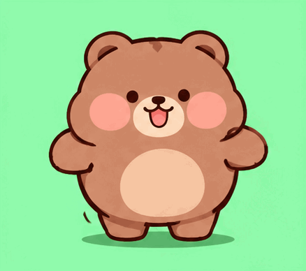
  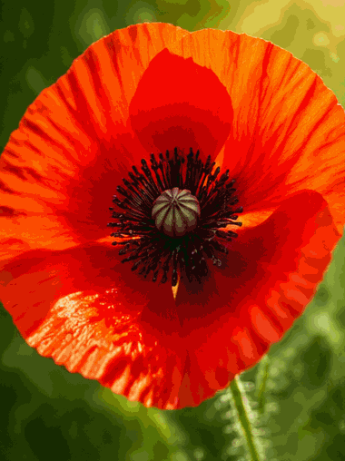
  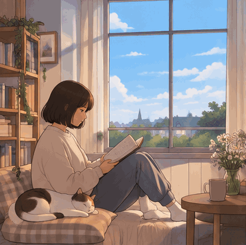
  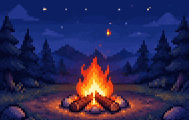
  
</p>

## Contents

- [How these GIFs are made](#how-these-gifs-are-made)
- [Stickers & Reactions](#stickers-reactions) · 189 prompts
- [Flash Cuts & Brand Reels](#flash-cuts-brand-reels) · 84 prompts
- [Ambient Loops](#ambient-loops) · 126 prompts
- [Pixel Art & UI Motion](#pixel-art-ui-motion) · 84 prompts
- [Science & Explainers](#science-explainers) · 8 prompts
- [Generate them yourself](#generate-them-yourself)

## How these GIFs are made

GPT Image 2.6 can return an animated GIF instead of a still image when you request `output_format: "gif"`. The model decides the frame count, timing and pixel size on its own.

Each prompt in this repo is sent with one extra sentence appended, which asks for a clean loop:

```text
Animate it as a short, smooth, seamlessly looping GIF with clear motion between frames.
```

### Prompt formula

**Subject** (one clear character or object) + **Motion** (1–2 verbs: waving, bouncing, drifting, flickering) + **Style** (flat illustration, chibi sticker, pixel art, photo) + **Background** (plain, high-contrast color for stickers)

### Tips

- One subject and one or two movements. Busy scenes leave less room for clear motion.
- Describe motion with verbs — *wobbling, nodding off, flickering, sliding down* — not adjectives.
- Flat illustration, chibi and pixel art styles survive small GIF sizes far better than photorealism.
- For a sticker set, repeat the exact same character description in every prompt so the pack stays consistent.
- For stickers you plan to cut out, use one flat background color far away from the character's colors.
- For flash cuts, describe each frame as a different shot; for brand reels, lock the logo position and change only the surroundings.
- Long text and complex day-to-night loops are still unreliable — keep text short and let light carry big changes.

## Stickers & Reactions

The 12 newest of 189 prompts in this category. [See all 189 →](categories/stickers.md)

### 1. Penguin knitting a scarf

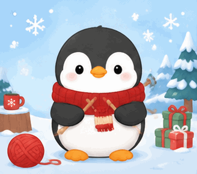

<sub>16 frames · 328×290 · 2.2s · gpt-image-2.6 · generated 2026-11-17</sub>

**Prompt**

```text
A round penguin sits clicking two knitting needles, a striped red scarf growing longer from its flippers. Cute flat cartoon, snowy light blue background.
```

`penguin` `knitting` `winter`

### 2. Bunny slurps noodles


<sub>16 frames · 309×309 · 2.2s · gpt-image-2.6 · generated 2026-11-17</sub>

**Prompt**

```text
A white bunny with chopsticks slurps a long noodle from a bowl, cheeks puffing, the noodle wiggling up into its mouth. Cute flat sticker style, thick outline, pale orange background.
```

`bunny` `noodles` `food`

### 3. Octopus ink oops


<sub>9 frames · 412×412 · 1.6s · gpt-image-2.6 · generated 2026-11-17</sub>

**Prompt**

```text
A small pink octopus gets startled and puffs out a cloud of ink, then peeks out of the cloud with an embarrassed grin. Cute flat cartoon, light aqua background.
```

`octopus` `oops` `funny`

### 4. Hippo big yawn

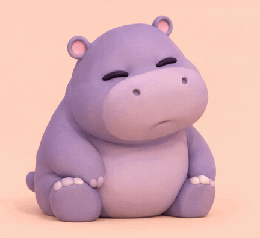

<sub>9 frames · 432×395 · 1.6s · gpt-image-2.6 · generated 2026-11-17</sub>

**Prompt**

```text
A sleepy round lavender hippo opens its mouth in an enormous yawn, eyes squeezed shut, then closes it with a satisfied smack. Soft clay-like 3D style, pale peach background.
```

`hippo` `yawn` `sleepy`

### 5. Shiba running late

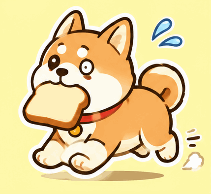

<sub>8 frames · 429×394 · 1.0s · gpt-image-2.6 · generated 2026-11-17</sub>

**Prompt**

```text
A shiba inu with a slice of toast in its mouth runs in place in a panic, ears flapping, a sweat drop flying off. Funny flat sticker style, thick white outline, light yellow background.
```

`shiba` `late` `sticker`

### 6. Baby elephant trunk shower

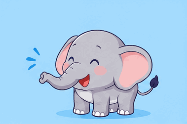

<sub>16 frames · 379×251 · 2.2s · gpt-image-2.6 · generated 2026-11-17</sub>

**Prompt**

```text
A chubby baby elephant lifts its trunk and sprays a happy fountain of water over its own head, droplets sparkling. Cute flat cartoon, light blue background, fixed camera.
```

`elephant` `water` `cute`

### 7. Doodle eye roll


<sub>9 frames · 425×399 · 1.6s · gpt-image-2.6 · generated 2026-11-17</sub>

**Prompt**

```text
A round hand-drawn doodle face with marker lines rolls its eyes up in exaggerated annoyance, then looks back forward with a flat mouth. White paper background, wobbly ink lines.
```

`doodle` `eye-roll` `reaction`

### 8. Notebook stick figure dances


<sub>9 frames · 438×387 · 1.3s · gpt-image-2.6 · generated 2026-11-17</sub>

**Prompt**

```text
A hand-drawn ballpoint stick figure on lined notebook paper does a goofy hip-shaking dance with arms waving, slight line boil like a flipbook. Paper texture, fixed overhead camera.
```

`doodle` `dance` `sketch`

### 9. Fox steps up and waves


<sub>12 frames · 358×358 · 1.9s · gpt-image-2.6 · generated 2026-11-17</sub>

**Prompt**

```text
An orange fox in a little blue scarf takes two small steps toward the viewer, waves one paw, then steps back to where it started. Flat vector cartoon, pale mint background, fixed camera.
```

> 💡 **Tip:** Describe the start pose, the action and the return to start; it keeps the first and last frames matched.

`fox` `wave` `greeting`

### 10. Red panda blinks and smiles

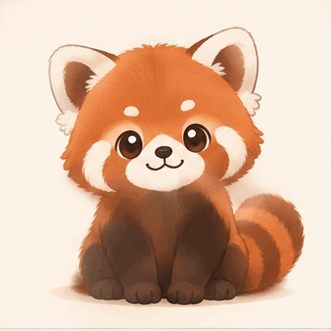

<sub>9 frames · 414×414 · 1.6s · gpt-image-2.6 · generated 2026-11-17</sub>

**Prompt**

```text
A fluffy red panda mascot closes its eyes, opens them again with a small happy smile, ears twitching once. Soft flat illustration, cream background, fixed camera.
```

`red-panda` `blink` `cute`

### 11. Mint robot waves hello

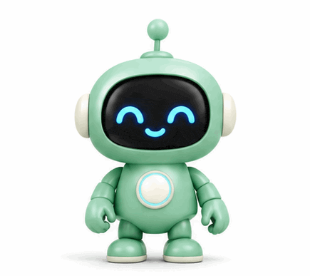

<sub>9 frames · 435×387 · 1.4s · gpt-image-2.6 · generated 2026-11-17</sub>

**Prompt**

```text
A small mint-green robot with a round screen face and a blinking antenna raises one hand, gives one wave, and lowers it back to rest. Simple rounded 3D illustration, clean white background, fixed camera.
```

`robot` `wave` `hello`

### 12. Kitten fixes a cracked screen

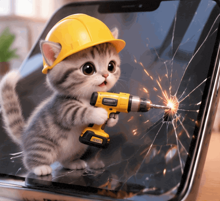

<sub>9 frames · 433×395 · 1.4s · gpt-image-2.6 · generated 2026-11-17</sub>

**Prompt**

```text
A tiny gray kitten in a yellow hard hat stands inside a cracked phone screen and works a toy power drill against the crack, sparks flying, the crack shrinking a little. Cute 3D cartoon, phone fills the frame, fixed camera.
```

`kitten` `phone` `repair`

**[See all 189 prompts in this category →](categories/stickers.md)**

## Flash Cuts & Brand Reels

The 12 newest of 84 prompts in this category. [See all 84 →](categories/flash.md)

### 1. Roast dinner reveal

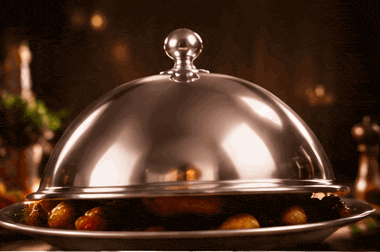

<sub>16 frames · 380×252 · 2.9s · gpt-image-2.6 · generated 2026-11-17</sub>

**Prompt**

```text
A silver dome lid lifts off a golden roast chicken on a platter, a burst of steam rising and a few herb leaves falling onto it. Warm festive food ad style, dark wood background.
```

`dinner` `holiday` `food`

### 2. Popcorn popping

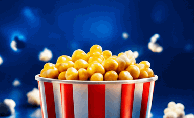

<sub>16 frames · 379×230 · 2.2s · gpt-image-2.6 · generated 2026-11-17</sub>

**Prompt**

```text
Kernels in a red and white striped bowl burst into fluffy popcorn one by one, some pieces jumping out and tumbling back in. Bold movie-night ad style, deep blue background.
```

`popcorn` `snack` `movie`

### 3. Pancake flip

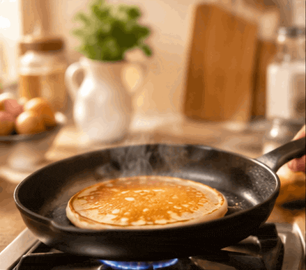

<sub>9 frames · 439×388 · 1.3s · gpt-image-2.6 · generated 2026-11-17</sub>

**Prompt**

```text
A golden pancake is tossed up from a cast iron pan, flips once in the air and lands back with a little puff of steam. Bright food ad style, warm kitchen background, fixed camera.
```

`pancake` `food` `kitchen`

### 4. Travel journal stickers

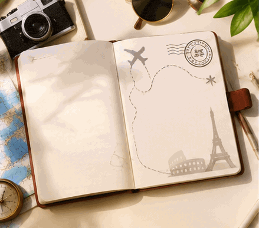

<sub>9 frames · 439×387 · 2.0s · gpt-image-2.6 · generated 2026-11-17</sub>

**Prompt**

```text
An open travel journal on an ivory desk; little stickers of a plane, a ticket stub, a palm tree and a stamp pop onto the page one after another with a soft bounce. Cozy scrapbook style, overhead camera.
```

`scrapbook` `travel` `journal`

### 5. Wooden game piece flips

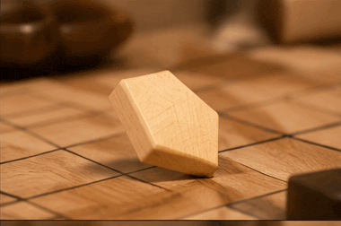

<sub>16 frames · 380×252 · 1.9s · gpt-image-2.6 · generated 2026-11-17</sub>

**Prompt**

```text
A pale wooden pentagon-shaped board game piece flips over in the air and lands with a small clack on a wooden grid board, a puff of dust at impact. Warm tabletop lighting, close-up, fixed camera.
```

`board-game` `wood` `flip`

### 6. Bauhaus shapes shuffle

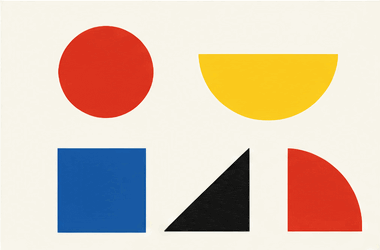

<sub>16 frames · 380×250 · 2.6s · gpt-image-2.6 · generated 2026-11-17</sub>

**Prompt**

```text
A grid of Bauhaus shapes in red, yellow, blue and black, circles, half circles, squares and triangles, slide and rotate into new positions in crisp steps. Flat poster style, off-white background.
```

`bauhaus` `geometric` `motion-design`

### 7. Shopping bag hops


<sub>16 frames · 307×306 · 2.2s · gpt-image-2.6 · generated 2026-11-17</sub>

**Prompt**

```text
A glossy orange shopping bag with rope handles hops up, squashes on landing, and a little gift box pops out of the top and drops back in. Playful 3D product style, pastel pink background.
```

`shopping` `bag` `promo`

### 8. SALE tag swings


<sub>16 frames · 313×302 · 1.4s · gpt-image-2.6 · generated 2026-11-17</sub>

**Prompt**

```text
A red paper price tag that says SALE hangs from a string and swings left and right with a tiny bounce, a few gold sparkles popping around it. Bold flat ad style, solid black background edge to edge in every frame.
```

> 💡 **Tip:** Keep on-image text to one short word; longer text tends to change between frames.

`sale` `black-friday` `ad`

### 9. Compact mirror opens


<sub>9 frames · 428×398 · 1.6s · gpt-image-2.6 · generated 2026-11-17</sub>

**Prompt**

```text
A rose-gold makeup compact clicks open, the mirror catches a flash of light and a little powder puff lifts out. Elegant beauty product shot, blush pink background.
```

`beauty` `product` `compact`

### 10. Keycaps press in a wave


<sub>16 frames · 371×252 · 1.8s · gpt-image-2.6 · generated 2026-11-17</sub>

**Prompt**

```text
Mechanical keyboard keycaps press down one after another in a wave from left to right, RGB glow following underneath. Sleek product shot, dark background.
```

`keyboard` `product` `tech`

### 11. Ice drops into lemonade

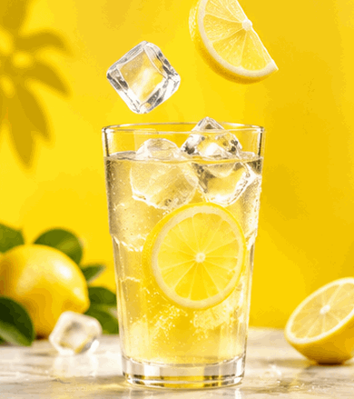

<sub>9 frames · 390×439 · 1.4s · gpt-image-2.6 · generated 2026-11-17</sub>

**Prompt**

```text
Ice cubes and a lemon slice drop into a tall glass of lemonade, splashing droplets and fizzing bubbles. Fresh summer drink ad style, sunny yellow background.
```

`drink` `summer` `ad`

### 12. Spellbook game menu

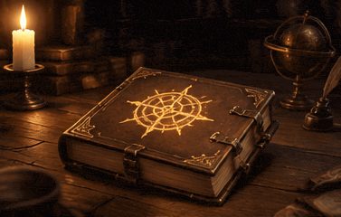

<sub>16 frames · 377×240 · 2.9s · gpt-image-2.6 · generated 2026-11-17</sub>

**Prompt**

```text
A worn leather spellbook drops onto a wooden table, flips open, and three glowing menu buttons rise out of its pages. Fantasy game UI style, warm candlelight, dark background.
```

`book` `game` `menu`

**[See all 84 prompts in this category →](categories/flash.md)**

## Ambient Loops

The 12 newest of 126 prompts in this category. [See all 126 →](categories/loops.md)

### 1. Snow globe swirl

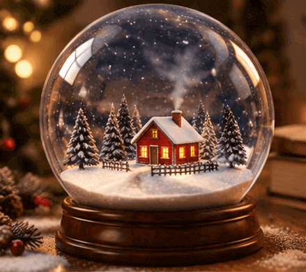

<sub>9 frames · 439×390 · 1.6s · gpt-image-2.6 · generated 2026-11-17</sub>

**Prompt**

```text
A glass snow globe with a tiny red cabin and pine trees inside; snowflakes swirl up and settle slowly around the cabin. Warm cozy lighting, wooden table, fixed close-up.
```

`snow-globe` `winter` `cozy`

### 2. Roasting chestnuts

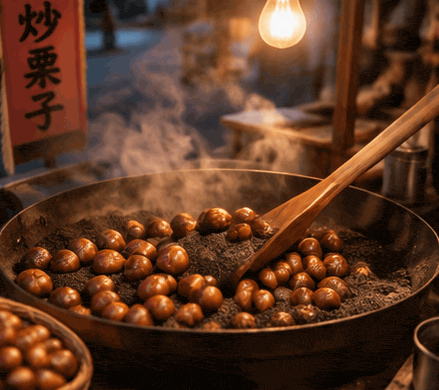

<sub>9 frames · 439×390 · 1.6s · gpt-image-2.6 · generated 2026-11-17</sub>

**Prompt**

```text
A big iron wok of chestnuts and dark sand is stirred by a wooden paddle, steam curling up under a warm bulb at a winter street stall. Cozy photographic style, close-up, fixed camera.
```

`chestnut` `street-food` `winter`

### 3. First snow under a lamp

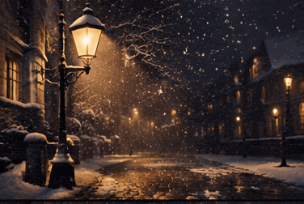

<sub>16 frames · 376×252 · 2.9s · gpt-image-2.6 · generated 2026-11-17</sub>

**Prompt**

```text
Big soft snowflakes drift down through the warm cone of an old street lamp on a quiet cobblestone street at night. Cinematic, fixed camera, everything else still.
```

`snow` `night` `street`

### 4. Frost spreads on glass

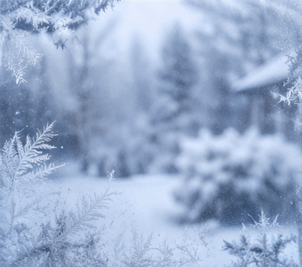

<sub>8 frames · 439×388 · 1.8s · gpt-image-2.6 · generated 2026-11-17</sub>

**Prompt**

```text
Delicate fern-like frost patterns creep across a cold window pane from the corners, a blurry snowy garden visible behind. Macro winter photography, fixed camera.
```

`frost` `winter` `macro`

### 5. Sky lanterns rising

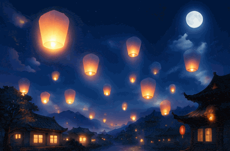

<sub>16 frames · 377×248 · 2.9s · gpt-image-2.6 · generated 2026-11-17</sub>

**Prompt**

```text
Dozens of warm glowing paper lanterns float slowly up into a deep blue night sky above dark rooftops, flickering softly. Dreamy painterly style, fixed camera.
```

`lantern` `night` `festival`

### 6. Ladybug and dewdrop

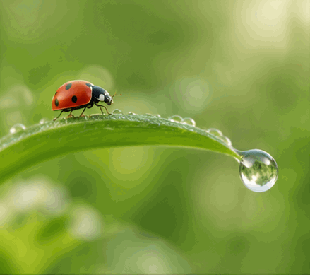

<sub>9 frames · 439×389 · 1.6s · gpt-image-2.6 · generated 2026-11-17</sub>

**Prompt**

```text
A ladybug walks along a curved green leaf while a dewdrop at the leaf tip swells and wobbles. Macro nature photography, soft morning bokeh, fixed camera.
```

`ladybug` `macro` `nature`

### 7. Bear snoring in a cave


<sub>16 frames · 380×248 · 2.9s · gpt-image-2.6 · generated 2026-11-17</sub>

**Prompt**

```text
A brown bear sleeps curled up in a cozy cave, its belly rising and falling as a snore bubble grows and shrinks from its nose, snow falling softly outside. Storybook illustration, fixed camera.
```

`bear` `hibernation` `winter`

### 8. Otter floats and naps


<sub>9 frames · 432×395 · 1.6s · gpt-image-2.6 · generated 2026-11-17</sub>

**Prompt**

```text
A sea otter floats on its back in calm water, holding a small shell on its belly, bobbing gently with the ripples as its eyes stay closed. Soft watercolor style, fixed overhead-angle camera.
```

`otter` `sleep` `calm`

### 9. Comet over the desert


<sub>9 frames · 506×337 · 2.0s · gpt-image-2.6 · generated 2026-11-17</sub>

**Prompt**

```text
A bright comet with a long glowing tail drifts slowly across a starry sky above dark desert dunes, the tail shimmering. Calm night photography look, fixed wide camera.
```

`comet` `night` `sky`

### 10. Glowing mycelium bridge

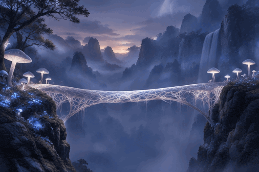

<sub>9 frames · 506×337 · 1.6s · gpt-image-2.6 · generated 2026-11-17</sub>

**Prompt**

```text
A delicate bridge woven from glowing white fungal threads spans a misty canyon at dusk; soft pulses of blue light travel along the threads from one side to the other. Fantasy concept art, fixed wide shot.
```

`fantasy` `bridge` `glow`

### 11. Naive geometric face

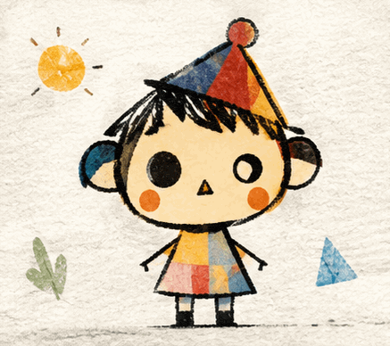

<sub>9 frames · 437×388 · 1.6s · gpt-image-2.6 · generated 2026-11-17</sub>

**Prompt**

```text
A naive hand-drawn portrait of an imaginary character built from uneven circles, triangles and blocks of retro color, with trembling black ink outlines; the character blinks once and the color blocks shift slightly. Textured paper, lots of empty space.
```

`illustration` `geometric` `ink`

### 12. Cove waves cinemagraph


<sub>9 frames · 437×388 · 1.6s · gpt-image-2.6 · generated 2026-11-17</sub>

**Prompt**

```text
A quiet rocky cove at golden hour where only the sea moves: small waves roll in and wash over the sand. The rocks, cliffs and sky stay completely still. Natural photographic color, fixed camera.
```

> 💡 **Tip:** For a cinemagraph, name the one thing that moves and list what must stay frozen.

`sea` `cinemagraph` `calm`

**[See all 126 prompts in this category →](categories/loops.md)**

## Pixel Art & UI Motion

The 12 newest of 84 prompts in this category. [See all 84 →](categories/pixel-ui.md)

### 1. Success toast slides in


<sub>16 frames · 380×252 · 1.8s · gpt-image-2.6 · generated 2026-11-17</sub>

**Prompt**

```text
A green rounded notification toast slides in from the top with a white check mark drawing itself, holds a moment, then slides back up. Minimal app UI, white background, no other text.
```

`ui` `toast` `notification`

### 2. Emoji reactions pop


<sub>12 frames · 356×356 · 1.4s · gpt-image-2.6 · generated 2026-11-17</sub>

**Prompt**

```text
A rounded white reaction bar where five round emoji faces, smile, laugh, heart eyes, surprise and sad, pop up one after another with a springy bounce. Clean app UI style, light gray background.
```

`ui` `emoji` `reaction`

### 3. Pixel train on a bridge

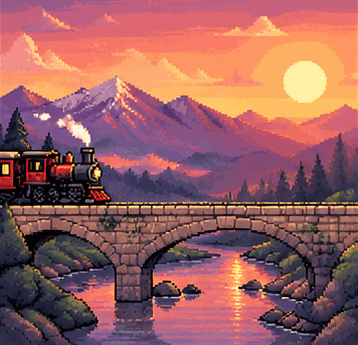

<sub>12 frames · 358×345 · 1.4s · gpt-image-2.6 · generated 2026-11-17</sub>

**Prompt**

```text
A small pixel art steam train crosses a stone arch bridge over a river, puffing little smoke clouds, mountains behind. 16-bit side-scroller style, sunset palette.
```

`pixel` `train` `landscape`

### 4. Pixel bee garden

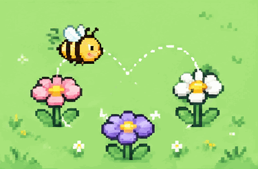

<sub>16 frames · 375×246 · 1.9s · gpt-image-2.6 · generated 2026-11-17</sub>

**Prompt**

```text
A pixel art bee buzzes in a figure eight between three pixel flowers that sway slightly. 16-bit game style, light green background.
```

`pixel` `bee` `garden`

### 5. Bookmark saved


<sub>9 frames · 438×389 · 1.4s · gpt-image-2.6 · generated 2026-11-17</sub>

**Prompt**

```text
An outlined bookmark icon fills with solid gold from top to bottom and gives a small bounce, with a few tiny sparkles. Minimal app icon style, white background.
```

`ui` `bookmark` `save`

### 6. Add to cart


<sub>9 frames · 437×388 · 1.4s · gpt-image-2.6 · generated 2026-11-17</sub>

**Prompt**

```text
A flat shopping cart icon; a small box drops into it, the cart wiggles, and a red badge with the number 1 pops up on its corner. Clean app UI icon style, white background.
```

`ui` `cart` `ecommerce`

### 7. Pixel dino stomps and roars


<sub>12 frames · 344×366 · 1.7s · gpt-image-2.6 · generated 2026-11-17</sub>

**Prompt**

```text
A small green pixel art dinosaur stomps one foot, opens its mouth in a tiny roar with a shake line, then settles back. 16-bit game sprite, plain sand-colored background.
```

`pixel` `dinosaur` `sprite`

### 8. Low-poly hero jog

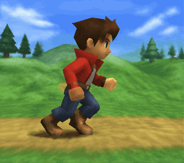

<sub>12 frames · 380×337 · 1.4s · gpt-image-2.6 · generated 2026-11-17</sub>

**Prompt**

```text
A blocky low-poly game hero in a red jacket jogs along a dirt path in a side view, rendered like an early 2000s console game with chunky polygons and blurry textures. Fixed camera, simple green hills behind.
```

`low-poly` `retro-game` `run`

### 9. Pixel astronaut run cycle

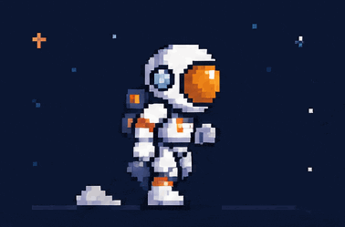

<sub>16 frames · 378×249 · 1.6s · gpt-image-2.6 · generated 2026-11-17</sub>

**Prompt**

```text
A pixel art astronaut in a white suit with an orange visor runs in place in a smooth side-view run cycle, small dust puffs at each step. Limited 16-color palette, dark navy background with a few stars.
```

> 💡 **Tip:** Run and walk cycles look smoother with 12–16 frames.

`pixel` `astronaut` `run-cycle`

### 10. Donut chart fills

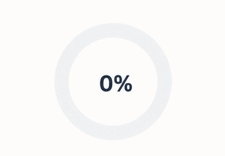

<sub>16 frames · 379×263 · 1.6s · gpt-image-2.6 · generated 2026-11-17</sub>

**Prompt**

```text
A donut chart fills segment by segment in teal, coral and yellow while the percentage in the middle counts up. Clean dashboard UI style, white background.
```

`ui` `chart` `data`

### 11. Map pin drops


<sub>12 frames · 358×357 · 1.4s · gpt-image-2.6 · generated 2026-11-17</sub>

**Prompt**

```text
A red location pin drops onto a simple folded map, bounces once and sends out a soft ripple ring. Flat UI icon style, pale green background.
```

`ui` `map` `location`

### 12. Copied to clipboard


<sub>9 frames · 439×390 · 1.4s · gpt-image-2.6 · generated 2026-11-17</sub>

**Prompt**

```text
Two stacked rounded squares slide together into a clipboard icon, then a green checkmark draws itself on top. Minimal flat UI animation, light gray background.
```

`ui` `copy` `icon`

**[See all 84 prompts in this category →](categories/pixel-ui.md)**

## Science & Explainers

### 1. Seesaw lever balance


<sub>16 frames · 378×254 · 2.2s · gpt-image-2.6 · generated 2026-11-17</sub>

**Prompt**

```text
A simple wooden seesaw on a triangle pivot tips one way as a heavy block drops on one end, then a small block slides farther out on the other end until it balances level. Flat textbook illustration, white background, no text.
```

`lever` `physics` `simple-machines`

### 2. Prism splits light

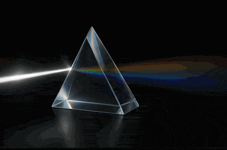

<sub>16 frames · 380×252 · 1.9s · gpt-image-2.6 · generated 2026-11-17</sub>

**Prompt**

```text
A white beam of light enters a glass triangular prism and fans out into a rainbow on the other side, the rainbow shimmering gently. Dark background, clean science illustration, fixed camera.
```

`light` `prism` `physics`

### 3. Planets orbit the sun

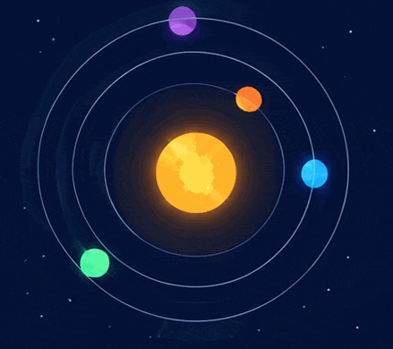

<sub>9 frames · 439×390 · 1.4s · gpt-image-2.6 · generated 2026-11-17</sub>

**Prompt**

```text
A flat top-down diagram of a glowing sun with four colorful planets moving along thin circular orbits at different speeds. Dark navy background, simple clean shapes, no text.
```

`solar-system` `astronomy` `diagram`

### 4. Beating heart diagram

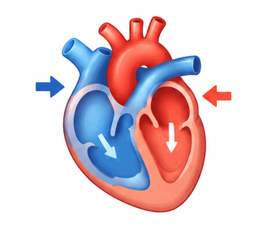

<sub>9 frames · 439×388 · 1.6s · gpt-image-2.6 · generated 2026-11-17</sub>

**Prompt**

```text
A friendly simplified anatomical heart in red and blue squeezes and relaxes in a steady beat, small arrows showing blood flowing in and out. Flat medical infographic style, light background, no text.
```

`heart` `biology` `infographic`

### 5. Bean sprouting underground

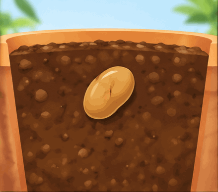

<sub>9 frames · 439×388 · 2.0s · gpt-image-2.6 · generated 2026-11-17</sub>

**Prompt**

```text
A cutaway of a soil pot shows a bean seed splitting open, a root reaching down and a pale shoot pushing up toward the surface. Soft flat educational illustration, brown and green palette, no text.
```

`plant` `germination` `biology`

### 6. Moon phases

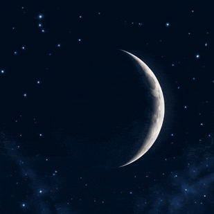

<sub>16 frames · 309×309 · 1.9s · gpt-image-2.6 · generated 2026-11-17</sub>

**Prompt**

```text
A single moon centered in a square frame of dark starry sky goes through its phases, from thin crescent to full moon and back to crescent, the shadow edge sliding smoothly across it. Clean flat illustration, fixed camera.
```

`moon` `astronomy` `science`

### 7. Water cycle


<sub>16 frames · 380×252 · 2.9s · gpt-image-2.6 · generated 2026-11-17</sub>

**Prompt**

```text
A friendly cutaway landscape showing the water cycle: vapor rises from a lake, gathers into a cloud, rain falls on a mountain and flows back down a river into the lake. Flat educational illustration, soft blue palette, no text.
```

`water-cycle` `science` `diagram`

### 8. Pendulum swing


<sub>12 frames · 358×357 · 1.4s · gpt-image-2.6 · generated 2026-11-17</sub>

**Prompt**

```text
A simple science diagram of a pendulum: a metal ball on a string swings left and right from a fixed pivot, a faint dotted arc showing its path. Clean flat textbook illustration, white background, no text labels.
```

> 💡 **Tip:** Ask for no text labels; diagram text drifts between frames.

`physics` `pendulum` `science`

## Generate them yourself

Use the [ViNano AI API](https://vinano.ai/api-keys): create an API key, submit a GIF task, then poll its status until the GIF URL comes back (25 credits per GIF).

```bash
# 1. Submit a GIF task — the response contains a task "uuid"
curl -X POST https://vinano.ai/api/async-openai-images \
  -H "Authorization: Bearer $VINANO_API_KEY" \
  -F mode=txt2img -F zeakaiModel=gpt-image-2.6-gif -F model="ViNano AI" \
  -F count=1 -F img_size=1k -F aspectRatio=1:1 \
  -F prompt="A cheerful cartoon cat waving hello. Animate it as a short, smooth, seamlessly looping GIF with clear motion between frames."

# 2. Poll until "completed" is true — the GIF URL is in "generated_images_url"
curl "https://vinano.ai/api/task-status?uuid=<uuid>" \
  -H "Authorization: Bearer $VINANO_API_KEY"
```

Or regenerate every example in this repo with the included script (Node 18+):

```bash
git clone https://github.com/ailingqu/awesome-ai-gif-prompts.git && cd awesome-ai-gif-prompts
cp .env.example .env   # fill in VINANO_API_KEY
npm run generate        # only generates prompts without a GIF
npm run build           # rebuilds README.md and README_zh.md
```

## Sources

Entries without a source line were written and generated by us. Entries marked **Source** were collected from X and the web: the prompt and GIF are shown as posted, credited to the creator with a link to the original post, and all rights stay with them. Creators can ask for changes or removal by opening an issue.

## Contributing

New prompts are welcome! Add an entry to `data/prompts.json`, include the GIF you got, and run `npm run build`. See [CONTRIBUTING.md](CONTRIBUTING.md).

## License

Prompts and example GIFs: [CC BY 4.0](LICENSE). If this list helps you, a ⭐ helps others find it.
