# Awesome AI GIF Prompts · 639+ Cases

**English** · [简体中文](README_zh.md)

    [](https://awesome.re)

A curated collection of prompts for making **animated GIFs directly with AI** — stickers, reactions, flash cuts, brand reels, ambient loops and pixel art. Our own examples were generated from the exact prompt shown, with no editing; community picks are marked with their source and credited to their creators.

> 🔄 **Updated daily** — 10 new prompts tested by us plus 40+ credited community picks from X and the web, almost every day. Last update: **2026-11-26**. ⭐ Star or 👀 watch the repo to get new cases.
>
> 🎞️ **Try these prompts online:** paste any prompt into the [ViNano AI GIF Generator](https://vinano.ai/gif-generator) — text or a photo in, looping GIF out, powered by GPT Image 2.6.

<p align="center">
  
  
  
  
  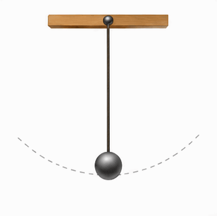
  
  
  
  
</p>

## Contents

- [How these GIFs are made](#how-these-gifs-are-made)
- [Stickers & Reactions](#stickers-reactions) · 236 prompts
- [Flash Cuts & Brand Reels](#flash-cuts-brand-reels) · 94 prompts
- [Ambient Loops](#ambient-loops) · 157 prompts
- [Pixel Art & UI Motion](#pixel-art-ui-motion) · 102 prompts
- [Science & Explainers](#science-explainers) · 18 prompts
- [Holidays & Greetings](#holidays-greetings) · 3 prompts
- [Product Showcase](#product-showcase) · 13 prompts
- [Food & Drinks](#food-drinks) · 9 prompts
- [Animated Avatars](#animated-avatars) · 7 prompts
- [Generate them yourself](#generate-them-yourself)

## How these GIFs are made

GPT Image 2.6 can return an animated GIF instead of a still image when you request `output_format: "gif"`. The model decides the frame count, timing and pixel size on its own.

Each prompt in this repo is sent with one extra sentence appended, which asks for a clean loop:

```text
Animate it as a short, smooth, seamlessly looping GIF with clear motion between frames.
```

### Prompt formula

**Subject** (one clear character or object) + **Motion** (1–2 verbs: waving, bouncing, drifting, flickering) + **Style** (flat illustration, chibi sticker, pixel art, photo) + **Background** (plain, high-contrast color for stickers)

### Tips

- One subject and one or two movements. Busy scenes leave less room for clear motion.
- Describe motion with verbs — *wobbling, nodding off, flickering, sliding down* — not adjectives.
- Flat illustration, chibi and pixel art styles survive small GIF sizes far better than photorealism.
- For a sticker set, repeat the exact same character description in every prompt so the pack stays consistent.
- For stickers you plan to cut out, use one flat background color far away from the character's colors.
- For flash cuts, describe each frame as a different shot; for brand reels, lock the logo position and change only the surroundings.
- Long text and complex day-to-night loops are still unreliable — keep text short and let light carry big changes.

## Stickers & Reactions

The 12 newest of 236 prompts in this category. [See all 236 →](categories/stickers.md)

### 1. Cat Typing at Furious Speed

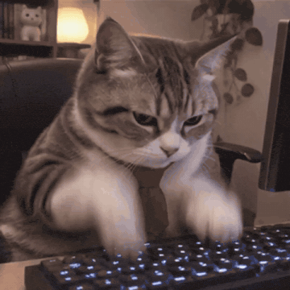

<sub>44 frames · 360×360 · 3.7s · GPT Image 2.6 (ChatGPT)</sub>

📌 **Source:** [@asei_ikarashi on X](https://x.com/asei_ikarashi/status/2125545032564539531)

**Prompt**

```text
ものすごい速さでキーボードを打つ猫の、ループするGIFを作って。カメラは固定で、最後は最初のポーズに戻して。
```

`cat` `keyboard` `work` `meme` `minimal-prompt`

### 2. Dancing Cat in a Flower Costume

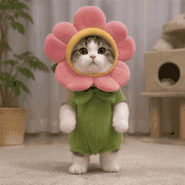

<sub>65 frames · 360×360 · 5.4s · GPT Image 2.6 (ChatGPT)</sub>

📌 **Source:** [@asei_ikarashi on X](https://x.com/asei_ikarashi/status/2125545032564539531)

**Prompt**

```text
花の着ぐるみを着て踊る猫の、ループするGIFを作って。カメラは固定で、最後は最初のポーズに戻して。
```

`cat` `dance` `costume` `minimal-prompt` `japanese`

### 3. Suit Cat Leaving Work with Pop-in Caption


<sub>16 frames · 298×318 · 2.3s · GPT Image 2.6 (ChatGPT)</sub>

📌 **Source:** [@asahi_ai_x on X](https://x.com/asahi_ai_x/status/2125397102457168019)

**Prompt**

```text
GIFを作って。スーツを着た白い猫が、鞄を持って、会釈して手を振る。画面の下に「お先に失礼します」の日本語の文字が下から弾むように「ぽん」と現れる（文字は大きく太く、一度出たら崩さない）。猫の顔は最初から最後まで同じ顔。背景は白、文字は読みやすい濃い紺色。最後は最初と同じ立ち姿に戻るなめらかなループ。コマ数は多めで。
```

`cat` `office` `caption` `japanese-text` `greeting`

### 4. White Cat "Big Success" Jump

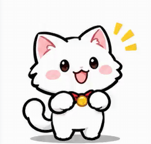

<sub>16 frames · 312×296 · 1.8s · GPT Image 2.6 (ChatGPT)</sub>

📌 **Source:** [@asahi_ai_x on X](https://x.com/asahi_ai_x/status/2125397083486347269)

**Prompt**

```text
GIFを作って。白いふわふわの猫のキャラクターが「大成功！」を全身で喜ぶ動き。しゃがんで力をためる→大きくジャンプ（空中でつぶれと伸びを使った誇張した動き）→着地で少しつぶれる→両手を上げて笑顔。ジャンプの瞬間にカラフルな紙吹雪とキラキラが舞う。線ははっきり、色はあざやか、背景は白、文字なし。コマ数は多めで、最初と最後が同じポーズになるなめらかなループ。
```

`cat` `celebration` `squash-and-stretch` `confetti` `japanese`

### 5. Cat Dancing (OpenAI Demo Prompt)

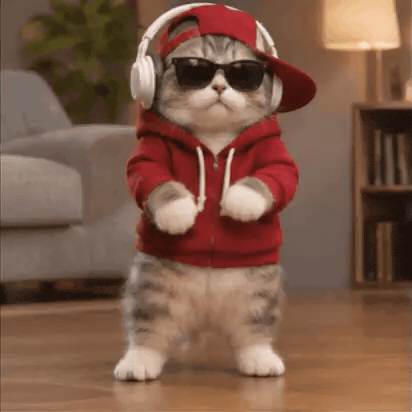

<sub>9 frames · 412×412 · 1.3s · GPT Image 2.6</sub>

📌 **Source:** [@fatma_zaidi1 on X](https://x.com/fatma_zaidi1/status/2118916305420214294)

**Prompt**

```text
make a gif of a cat dancing
```

`cat` `dance` `minimal-prompt`

### 6. Office Pigeon Cries Over a Stock Crash

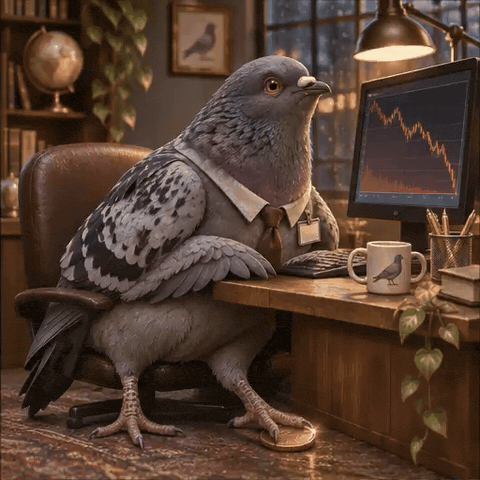

<sub>15 frames · 480×480 · 3.7s · GPT Image 2.6</sub>

📌 **Source:** [@aiacademyus on X](https://x.com/aiacademyus/status/2118395609594147237)

**Prompt**

```text
Create a single animation sprite sheet for a seamless looping GIF.

A photorealistic gray pigeon works in a cozy miniature office, sitting upright in a brown leather chair at a wooden desk. The pigeon has detailed gray feathers, black-and-white patterned wings, an iridescent green and purple neck, expressive orange eyes, and pink feet. It wears a white office shirt collar, a loosened red tie, and a small blank employee badge.

One foot rests protectively on its last coin beneath the desk. In front of the pigeon, a computer monitor displays a clearly plunging red stock-market line chart. A keyboard, a ceramic pigeon mug, pencils, books, and a trailing green plant sit on the desk. In the background are bookshelves, a globe, a framed bird picture, a window, and a warm desk lamp.

Exactly 6 sequential frames arranged in a precise 3-column by 2-row grid, read left-to-right and then top-to-bottom. Every panel has identical dimensions. Fixed front three-quarter camera, consistent character identity, body proportions, desk, monitor, clothing, lighting, and background in every frame.

Animation sequence:

Frame 1: The pigeon sits upright and looks at the monitor with a quietly hopeful expression, one foot resting on the coin.

Frame 2: The pigeon notices the chart falling and slowly lowers its head, looking worried.

Frame 3: Its orange eyes widen, and its beak opens slightly in shock as it stares at the plunging chart.

Frame 4: Its face crumples, eyes squeeze shut, and its head droops in sadness.

Frame 5: Large cartoon tears stream down both cheeks as the pigeon cries over its last coin.

Frame 6: The pigeon quietly wipes away its tears with one wing while looking toward the monitor. Its expression begins to relax and its posture starts returning toward the first frame.

Clear incremental facial, head, wing, and tear movement between frames. Keep the camera, composition, object placement, and character scale fixed. Make the sixth frame transition smoothly toward the first for a looping animation.

Photorealistic pigeon with subtly anthropomorphic expressions, highly detailed feathers, cinematic warm lighting, cozy miniature office atmosphere, humorous and sympathetic mood, polished digital artwork.

No captions, no words, no numbers, no logos, no watermark, no speech bubbles, no panel labels, no borders, no gutters.
```

`pigeon` `stocks` `crying` `sprite-sheet`

### 7. Bowl-Cut Dog Scrolling on the Toilet


<sub>7 frames · 480×480 · 1.8s · GPT Image 2.6</sub>

📌 **Source:** [@aiacademyus on X](https://x.com/aiacademyus/status/2118929517242978439)

**Prompt**

```text
Create a single animation sprite sheet for a seamless looping GIF. A photorealistic brown dog with a bowl-cut hairstyle, a straight fringe across its forehead, sits upright on a white toilet like a human in a clean bathroom with white tiles and a white sink in the background, holding a smartphone in both front paws and looking down at the screen. A small watermark reading 'aioae.us' appears in the bottom-right corner of every panel, applied to each of the 6 frames individually at 70% transparency (30% opacity), identical in size, position, and wording in every frame. Exactly 6 sequential frames arranged in a precise 3-column by 2-row grid, read left-to-right and then top-to-bottom. Every panel has identical dimensions. Fixed front camera, consistent character identity, body proportions, fur, lighting, watermark, and background in every frame. Animation sequence: Frame 1: The dog sits on the toilet holding the phone in both paws, eyes on the screen, neutral expression. Frame 2: The dog scrolls the phone with one paw, head tilting slightly, focused. Frame 3: The dog's eyes widen at something on the screen, mouth opening slightly in surprise. Frame 4: The dog smirks and chuckles, scrolling faster, head bobbing. Frame 5: The dog looks up briefly with an annoyed expression, then glances back down at the phone. Frame 6: The dog settles back into scrolling calmly, expression relaxing, posture returning toward the first frame. Clear incremental head, paw, and facial movement between frames. Keep the camera, composition, and character scale fixed. Make the sixth frame transition smoothly toward the first for a looping animation. Photorealistic dog, highly detailed fur, bright bathroom lighting, deadpan and funny mood, polished digital artwork. No captions, no words, no numbers, no logos, no speech bubbles, no panel labels, no borders, no gutters. The only text in the image is the small 'aioae.us' watermark.
```

`dog` `phone` `sprite-sheet` `funny`

### 8. Silverback Gorilla Hip-Shake Dance

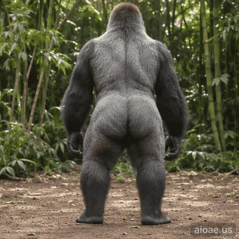

<sub>6 frames · 480×480 · 1.1s · GPT Image 2.6</sub>

📌 **Source:** [@aiacademyus on X](https://x.com/aiacademyus/status/2118926399558013243)

**Prompt**

```text
Create a single animation sprite sheet for a seamless looping GIF. A photorealistic large silverback gorilla in a jungle dirt clearing, shot from behind at a low angle, with bamboo and green foliage in the background. The gorilla dances playfully, shaking its hips, tongue sticking out, arms spread wide. A small watermark reading 'aioae.us' appears in the bottom-right corner of every panel, applied to each of the 6 frames individually at 70% transparency (30% opacity), identical in size, position, and wording in every frame. Exactly 6 sequential frames arranged in a precise 3-column by 2-row grid, read left-to-right and then top-to-bottom. Every panel has identical dimensions. Fixed low camera angle, consistent character identity, body proportions, fur, lighting, watermark, and background in every frame. Animation sequence: Frame 1: The gorilla stands calmly facing away, arms relaxed at its sides, tongue in. Frame 2: The gorilla starts swaying its hips gently side to side, arms lifting slightly. Frame 3: The gorilla shakes its hips harder, tongue sticking out, arms spreading wide. Frame 4: The gorilla bounces its hips in a full playful dance, arms out wide, tongue out, head tilted back joyfully. Frame 5: The gorilla shakes its hips to the other side, still grinning with its tongue out. Frame 6: The gorilla slows down, hips settling, tongue going back in, posture returning toward the first frame. Clear incremental hip, arm, and head movement between frames. Keep the camera, composition, and character scale fixed. Make the sixth frame transition smoothly toward the first for a looping animation. Photorealistic gorilla, highly detailed fur, natural jungle lighting, funny and energetic mood, polished digital artwork. No captions, no words, no numbers, no logos, no speech bubbles, no panel labels, no borders, no gutters. The only text in the image is the small 'aioae.us' watermark.
```

`gorilla` `dance` `sprite-sheet` `photoreal`

### 9. Little Robot Says Good Work


<sub>9 frames · 480×502 · 1.2s · GPT Image 2.6</sub>

📌 **Source:** [@asahi_ai_x on X](https://x.com/asahi_ai_x/status/2118663182688383267)

**Prompt**

```text
GIFを作って。
仕事のSNS投稿で使えるように、小さなロボットのキャラクターが、笑顔で手を振りながら「お疲れさま」と伝える動き。
白い背景で、かわいいフラットなイラスト。文字は入れないで。
```

`robot` `wave` `work`

### 10. Paper-cut Fox Wave


<sub>9 frames · 433×396 · 1.6s · GPT Image 2.6 Sunburst</sub>

📌 **Source:** [OmniaKey on OmniaKey Blog](https://omniakey.com/blog/gpt-image-2-6-review)

**Prompt**

```text
A cheerful paper-cut fox with a teal scarf sits on a grassy hill, waves one paw, blinks, then lowers the paw back to its starting pose. Flat pastel sky, soft paper shadows, gentle motion, perfect loop.
```

`fox` `paper-cut` `wave`

### 11. 100 Unread Emails, Laptop Closed

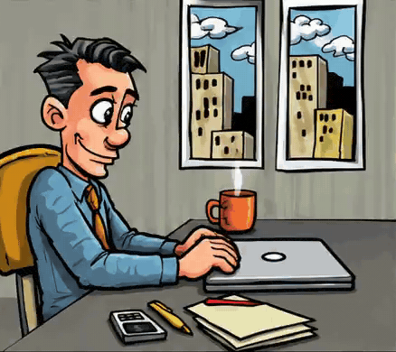

<sub>9 frames · 438×390 · 2.2s · GPT Image 2.6</sub>

📌 **Source:** [@chatgptricks on X](https://x.com/chatgptricks/status/2118995179726340146)

**Prompt**

```text
Create a funny animated GIF of a cartoon office worker opening their laptop, seeing 100 unread emails, and slowly closing it again. Exaggerated facial expressions. Seamless loop.
```

`reaction` `office` `email` `meme`

### 12. Tuxedo Cat Playing with a Teaser

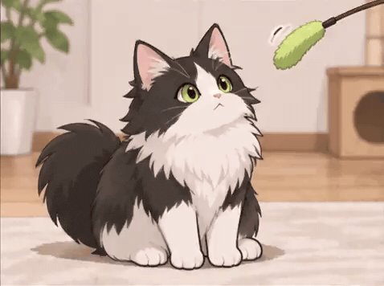

<sub>9 frames · 478×356 · 1.3s · GPT Image 2.6</sub>

📌 **Source:** [@Arctanote on X](https://x.com/Arctanote/status/2119234479726473289)

**Prompt**

```text
次の内容で GIF を作成して: かわいいシンプルなアニメの白黒のノルゥェージャンのハチワレ猫が、ねこじゃらしで遊んでいる様子。
```

`cat` `anime` `cute` `japanese`

**[See all 236 prompts in this category →](categories/stickers.md)**

## Flash Cuts & Brand Reels

The 12 newest of 94 prompts in this category. [See all 94 →](categories/flash.md)

### 1. Silver Balloon Thank You

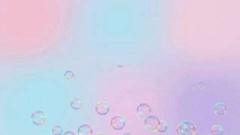

<sub>30 frames · 480×270 · 3.0s · Gemini</sub>

📌 **Source:** [@hanagekkou on X](https://x.com/hanagekkou/status/2123891691757416496)

**Prompt**

```text
ピンク、水色、薄紫色、パステルカラーのグラデーションを背景にシャボン玉がフワフワと下から上へ浮かび上がる空間で「Thank you
 for watching」と銀色のバルーン文字が飛び出してきます
```

`thank-you` `balloon` `bubbles`

### 2. Flickering Hebrew Neon Bakery Sign

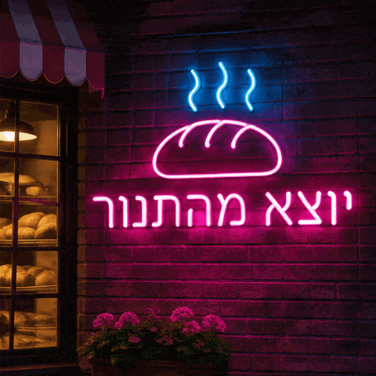

<sub>9 frames · 480×480 · 1.8s · GPT Image 2.6</sub>

📌 **Source:** [Cadabra AI on Cadabra AI Blog](https://www.livinginmovie.com/en/blog/how-to-make-gif-in-chatgpt)

**Prompt**

```text
A seamless looping animated GIF of a glowing neon sign on a dark brick wall of a small bakery at night, photorealistic. The camera stays fixed. Only the neon moves: it flickers twice and then glows steady, and a soft pink and blue light pulses on the bricks. The last frame returns exactly to the first frame. The neon reads in big Hebrew letters, exactly: "יוצא מהתנור". Every Hebrew letter must be correct and read right to left. The text stays in the same position in every frame. No other text anywhere.
```

`neon` `sign` `text-in-gif` `hebrew` `night`

### 3. Heisei Era SNS GIF


<sub>6 frames · 480×480 · 1.3s · GPT Image 2.6</sub>

📌 **Source:** [@rem_rev on X](https://x.com/rem_rev/status/2118252486360498485)

**Prompt**

```text
平成を象徴する何か。SNS向けのGIF画像を生成して下さい。
```

`heisei` `retro` `nostalgia` `social`

### 4. Orange bear mascot with scarf waves


<sub>12 frames · 358×358 · 2.2s · GPT Image 2.6</sub>

📌 **Source:** [牧牧的成長實驗室 on 方格子 vocus](https://vocus.cc/article/6aebf9a0fd8978000170526d)

**Prompt**

```text
製作一張品牌吉祥物 GIF。角色是一隻圓潤、可愛的橘色小熊，戴著米白色圍巾，站在簡潔的淺色背景前。小熊慢慢揮手，露出友善笑容。保留品牌配色與角色比例，循環播放，背景固定。
```

`mascot` `bear` `brand`

### 5. Round robot mascot welcome wave


<sub>12 frames · 357×358 · 1.9s · GPT Image 2.6</sub>

📌 **Source:** [蘇柔瑋 on 數位時代 BusinessNext](https://www.bnext.com.tw/article/92943/chatgpt-gif-generator-prompts)

**Prompt**

```text
請製作一張 GIF 動畫，一隻圓潤可愛的機器人吉祥物站在畫面中央，先微笑眨眼，再抬起右手向觀眾揮手，最後恢復站立姿勢。使用柔和的藍白配色、簡潔 3D 插畫風格，背景灰白。保持角色造型、配色及身體比例一致，鏡頭固定，製作可以無縫循環的動畫。
```

`mascot` `brand` `3d`

### 6. "ON AIR" neon sign with level meter


<sub>9 frames · 480×270 · 1.6s · GPT Image 2.6</sub>

📌 **Source:** [Fuxuan Guo on ChatCut Blog](https://chatcut.io/blog/gpt-image-2-6)

**Prompt**

```text
Locked tripod close-up shot through a dark midnight recording studio glass booth window, 16:9 looping animation. Inside the dark acoustic booth, a sleek red neon sign reading 'ON AIR' above a minimal 4-bar digital LED audio level meter pulses in a clean seamless cycle: frame 1 starts at a soft dim crimson resting glow with four low blue meter bars, frames 3 to 6 flare into a bright vermilion neon halo with warm glass reflections while the LED bars jump into yellow and red peaks, and frames 7 to 9 settle smoothly back to the exact dim resting glow and four blue bars of frame 1. Condenser microphone silhouette and studio headphones in foreground stay completely still.
```

`neon` `studio` `text`

### 7. EMBER logo with flickering flame

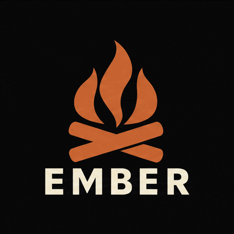

<sub>8 frames · 480×480 · 1.4s · GPT Image 2.6</sub>

📌 **Source:** [Fuxuan Guo on ChatCut Blog](https://chatcut.io/blog/chatgpt-gif)

**Prompt**

```text
Minimalist flat vector brand logo lockup on a solid charcoal-black square background, locked front-on view. Centered copper-orange stylized campfire emblem above clean cream geometric sans-serif all-caps wordmark reading "EMBER". Only the center flame tongue of the copper emblem flickers smoothly upward a few pixels and settles back into its exact starting silhouette on the final frame for a clean loop. Keep the wordmark "EMBER" and side logs completely motionless across every frame, crisp flat colors.
```

`logo` `brand` `flat`

### 8. 360 kickflip on a skateboard


<sub>12 frames · 358×356 · 1.3s · gpt-image-2.6-gif</sub>

📌 **Source:** [@justynclark on X](https://x.com/justynclark/status/2118189691820482677)

**Prompt**

```text
Create a GIF of a 360 kickflip on a skateboard
```

`skateboard` `sport` `trick`

### 9. Idiom riddle: four ceramic props bounce in turn


<sub>36 frames · 480×640 · 3.0s · gpt-image-2.6-gif</sub>

📌 **Source:** [@GeekCatX on X](https://x.com/GeekCatX/status/2118160560290480519)

**Prompt**

```text
制作一个中国成语物件猜谜 GIF 动图，竖版 3:4，精致可爱的短视频封面风格。

【输出规格】
输出一个可播放的 GIF 动图。
画面尺寸：768×1024 像素。
总时长：3秒，无限循环。
建议帧率：20fps，约60帧。
动画包含4个连续动作段，每段0.75秒，分别对应四件物品。
全程为同一个完整画面，镜头固定，构图固定，没有切镜、推拉、摇移或缩放。
【制作原则：同一母版，局部动画】
先建立一张完整的静态母版，再基于同一母版制作动画。
所有帧保持相同的背景、构图、文字、台面、物件造型、材质、颜色与光照。
只允许当前指定物件进行小幅竖直位移，并同步调整它的局部高光、接触阴影与倒影。
其余三个物件保持静止。
文字必须使用同一份静态图层，在全部帧中重复使用，不要逐帧重新绘制。
【背景】
深蓝色专业摄影棚背景，中心为柔和宝蓝色，向四周自然渐暗为午夜蓝。
背景纯净，具有轻微柔光晕，渐变细腻，没有明显纹理和杂乱装饰。
背景空白区域分布3—5个微小、低亮度的金色光点。
光点沿非常短的闭合轨迹缓慢漂浮，一个循环周期为3秒。
光点不穿过文字或物件，不闪烁、不突然出现或消失，循环结束时回到起始位置。
【文字：全程完全静止】
画面中只允许出现以下两行文字，不增加任何其他文字：
第一行：
物件藏着一个成语

第二行：
你猜出来了吗
第一行位于画面顶部居中，使用明黄色 #FFD54A 的超粗圆体大字，字形饱满圆润，带浅描边和轻微投影。
第二行位于第一行正下方，使用白色粗圆体，字号约为第一行的60%。

两行文字保持足够行距，四周预留安全边距，不贴边、不裁切。
汉字笔画完整，字形标准，清晰易读，无错别字。
在所有帧中，文字的位置、字号、字距、笔画、颜色、描边、阴影与透明度完全一致。
文字不参与弹跳、高光扫动、闪烁或任何其他动画。
【台面与构图】
画面中下部是一条横向浅木纹展示台。
台面干净，木纹细腻，具有柔和、克制的反光。
四件物品集中排列于画面中下部，物件组占画面宽度约85%—90%。
四件物品位于同一前后层级，静止时底部对齐于同一条台面接触基线。
它们具有接近的视觉体量，间距均匀，彼此留出清晰空隙。
不前后错落、不堆叠、不互相遮挡。

采用固定的轻微俯视角度，能够清楚看见杯口和水面，同时保持四件物品横向并排的秩序感。
【四件物品：顺序固定】
从左到右严格依次为：
一辆红色Q版小汽车。
圆润饱满，车身呈中国红，轮子与车窗清晰可辨，具有精致陶瓷玩具质感。

一个装满清水的青花瓷杯。
杯身具有细腻青花纹样，杯口清晰，能够看见透明清水与柔和水面反光。
杯身无文字，水面保持平稳，不溢出、不飞溅。
一匹金色Q版小马。
造型圆润可爱，具有清晰的马头、鬃毛、四肢与尾巴，表面为温润的金色陶瓷釉面。
一条青绿色盘身小龙。
中国传统小龙造型，身体盘曲，龙头微微抬起，龙角、龙须与鳞片适度简化，神态可爱，具有青绿色陶瓷釉面质感。

四件物品保持各自明确的识别特征。
物件表面没有文字、拼音、标签、数字或答案提示。
【动作规则】
所有物件均为刚性的陶瓷摆件，只允许整体轻轻向上移动，再回到原位。
不挤压、不拉伸、不旋转、不左右移动、不改变造型。

弹跳最高点距离原位约为画面高度的1%，动作轻巧、克制。
每个物件必须完整落回原位后，下一个物件才开始动作。
任意时刻，四件物品中最多只有一件正在运动。
当前物件弹起时，一道低强度、柔和的高光缓缓掠过其表面。
高光只作用于当前物件，不影响文字、背景和其他物件。
物件下方的阴影与倒影随高度轻微变化，落地后恢复母版状态。
小汽车轮子不转，小马不迈腿，小龙不摆尾、不转头。

【3秒动作时间线】
0.00—0.75秒：
红色小汽车完成一次轻轻弹起并落回原位。
瓷杯、小马、小龙保持静止。
0.75—1.50秒：
青花瓷杯完成一次轻轻弹起并落回原位。
汽车、小马、小龙保持静止。

1.50—2.25秒：
金色小马完成一次轻轻弹起并落回原位。
汽车、瓷杯、小龙保持静止。
2.25—3.00秒：
青绿色小龙完成一次轻轻弹起并落回原位。
汽车、瓷杯、小马保持静止。

每个0.75秒动作段均遵循：
短暂停住 → 平缓上升 → 平缓落下 → 落定后短暂停住。
上升和下落采用柔和缓入缓出，不突然跳位，不夸张弹震。

【无缝循环】
首帧与末帧完全一致：
四件物品全部落在原位，所有高光、阴影、倒影与背景光点均回到初始状态。
从末帧接回首帧时，没有位置跳变、亮度跳变或颜色闪动。
循环中不出现黑帧、白帧、残影或重影。

【整体质感】
精致可爱的Q版3D陶瓷摆件，圆润、细腻、通透。
以中国红、金色、青绿色和青花蓝点缀深蓝背景，融入克制的中国传统纹样细节。
顶部柔光配合左右轮廓光，物件边缘高光清晰，台面倒影柔和。
整体具有中国文化韵味，适合全年龄观看。
【禁止事项】
不出现成语答案。
不出现额外文字、水印、品牌标志或界面元素。
不出现分镜拼图、四宫格或多画面。
不改变四件物品的数量、顺序、造型、颜色或比例。
不让两个物件同时运动。
不让物件重叠、碰撞、堆叠或横向移位。
不让文字闪烁、变形、位移或重新生成。
不改变相机位置、背景亮度或整体色调。
```

`riddle` `chinese idiom` `3d`

### 10. Psychedelic dancing cat


<sub>9 frames · 438×390 · 1.4s · gpt-image-2.6-gif</sub>

📌 **Source:** [@xedrik7 on X](https://x.com/xedrik7/status/2118258491043483978)

**Prompt**

```text
psychedelic gif of cat dancing
```

`cat` `psychedelic` `dance`

### 11. Roast dinner reveal


<sub>16 frames · 380×252 · 2.9s · gpt-image-2.6 · generated 2026-11-17</sub>

**Prompt**

```text
A silver dome lid lifts off a golden roast chicken on a platter, a burst of steam rising and a few herb leaves falling onto it. Warm festive food ad style, dark wood background.
```

`dinner` `holiday` `food`

### 12. Popcorn popping


<sub>16 frames · 379×230 · 2.2s · gpt-image-2.6 · generated 2026-11-17</sub>

**Prompt**

```text
Kernels in a red and white striped bowl burst into fluffy popcorn one by one, some pieces jumping out and tumbling back in. Bold movie-night ad style, deep blue background.
```

`popcorn` `snack` `movie`

**[See all 94 prompts in this category →](categories/flash.md)**

## Ambient Loops

The 12 newest of 157 prompts in this category. [See all 157 →](categories/loops.md)

### 1. Rainy Window with Coffee Steam


<sub>30 frames · 480×480 · 2.5s · GPT Image 2.6 (ChatGPT)</sub>

📌 **Source:** [@asei_ikarashi on X](https://x.com/asei_ikarashi/status/2125545032564539531)

**Prompt**

```text
雨の窓辺で、雨粒とコーヒーの湯気だけが動く、落ち着いたイラストの、ループするGIFを作って。カメラは固定で、最後は最初のポーズに戻して。
```

`rain` `coffee` `cozy` `lofi` `minimal-prompt`

### 2. White Dove in Golden Cloud Light

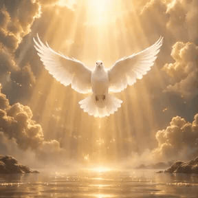

<sub>9 frames · 288×288 · 1.8s · GPT Image 2.6</sub>

📌 **Source:** [@JasonHeatony7 on X](https://x.com/JasonHeatony7/status/2119882262317560298)

**Prompt**

```text
A seamless looping GIF of a radiant white dove hovering gently in the center of a soft opening in golden clouds, wings spread wide and moving in slow, calm beats, surrounded by warm beams of heavenly light streaming down onto a still, misty river below. Tiny glowing particles of light drift slowly downward, and the light rays softly pulse brighter and dimmer. Locked camera, no zoom or pan. Minimal, peaceful motion. The dove stays in the same spot and its wings complete one full beat so the first and last frames match perfectly for a seamless loop. The dove keeps the same shape, size, two wings and white feathers throughout; natural, realistic wing movement; no morphing, no extra birds. Serene, holy, reverent atmosphere, realistic 8K detail, vertical 9:16.
```

`dove` `clouds` `light-rays` `serene`

### 3. Zebra in a Fingerprint Tunnel

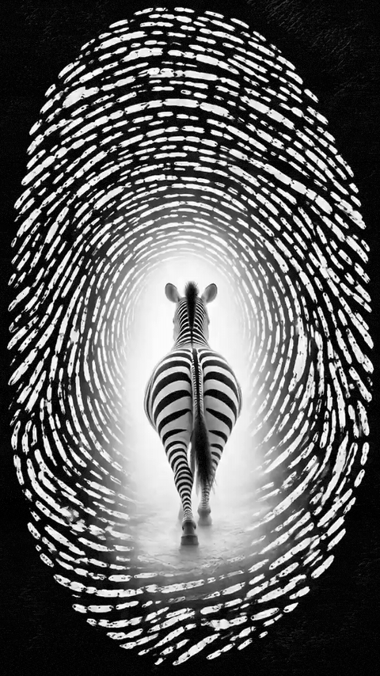

<sub>9 frames · 480×854 · 1.8s · GPT Image 2.6 Sunburst</sub>

📌 **Source:** [@churvikv on X](https://x.com/churvikv/status/2123819465796206817)

**Prompt**

```text
High-contrast black-and-white conceptual artwork, tall 9:16 vertical composition, mixed-media graphic style. Full bleed edge to edge, no frame, no border, no lettering.
BACKGROUND: a rich matte black surface with a fine pebbled leather grain and subtle diagonal texture, deepening to pure black at the corners and edges.
FINGERPRINT: one enormous white fingerprint fills the frame as the dominant graphic element, its outline a wide oval, slightly tapering toward the top. It is drawn not as solid lines but as hundreds of broken dashed strokes and short parallel bars with softly rounded ends, hand-painted with slight thickness variation, some strokes irregular and chipped. The ridges sweep in long concentric arches and whorls, curving up over the crown and down both sides, with a dense tight cluster of concentric rings in the centre.
TUNNEL: dead centre, the fingerprint ridges part to form a glowing opening — a soft luminous white corridor receding into the distance, its walls a smooth radiant gradient of blurred white and pale grey, brightest at the far end, dissolving into a bright misty haze that halos the centre of the print.
ZEBRA: inside that opening walks a single zebra, seen from directly behind, moving away from the viewer toward the light. Its body is compact and symmetrical, coat a crisp pattern of black and white vertical stripes, a dark mane standing up in a short brush between two rounded ears, a long thin tail hanging straight down the middle of its back, hindquarters rounded and hind hooves faintly visible in the haze. Its silhouette is sharp and dark against the glowing tunnel, its stripes echoing the ridges of the fingerprint around it.
LIGHT: soft white backlight pouring out from the tunnel mouth onto the zebra, rim-lighting its ears and flanks, a gentle glow bleeding into the surrounding ridges.
PALETTE: pure black, charcoal, soft white, pearl grey. Graphic poster feel, minimalist, surreal.
```

`zebra` `surreal` `monochrome`

### 4. Riverbank Walk with a Baby Elephant


<sub>9 frames · 480×270 · 1.3s · GPT Image 2.6 Sunburst</sub>

📌 **Source:** [Karunakar Gautam on Frameloop Research](https://frameloop.ai/research/gpt-image-2-6-vs-2-5-comprehensive-benchmark)

**Prompt**

```text
3D animated family-film style. A small girl with curly hair and a yellow raincoat walks beside a friendly baby elephant along a jungle riverbank. The elephant sprays water from its trunk and the girl laughs. Looping side view. (9 frames, 150 ms per frame.)
```

`3d` `animatic` `elephant`

### 5. Purple Spark Tracing a Cyan Circle

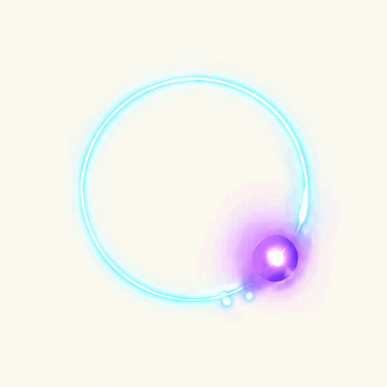

<sub>9 frames · 480×480 · 1.4s · GPT Image 2.6 Flare</sub>

📌 **Source:** [@vegekyd-sys on GitHub](https://github.com/vegekyd-sys/ai-image-editor/blob/HEAD/evidence/gpt-image26-upgrade/26-flare-gif/receipt.json)

**Prompt**

```text
Create a seamless animated GIF of a purple rounded creative spark that gently pulses and traces a cyan circle on a cream background. Fixed camera, one clean object, smooth visible continuous motion. No text.
```

`abstract` `spark` `minimal`

### 6. Golden Leaf to Umbrella Boat at Sunset


<sub>9 frames · 480×854 · 1.8s · GPT Image 2.6</sub>

📌 **Source:** [@churvikv on X](https://x.com/churvikv/status/2122636815819559091)

**Prompt**

```text
A single golden leaf floats gently on calm water, creating soft ripples, with a serene sunset in the background casting warm golden hues across the sky and water, evoking a tranquil and peaceful mood in a minimalist composition.
A surreal scene featuring a small black boat with a billowing gold cloth inside, topped by an open black umbrella, floating on calm golden water with gentle ripples. A single golden leaf drifts nearby, and a large sun sets on the horizon, casting a warm, tranquil glow across the minimalist composition and creating a serene, dreamlike mood.
```

`nature` `water` `sunset` `calm`

### 7. Street Tabby Cat Asleep in the Rain


<sub>9 frames · 360×360 · 1.8s · GPT Image 2.6</sub>

📌 **Source:** [mileson (SkillU) on GitHub](https://github.com/mileson/awesome-gpt-images-2.6-gif)

**Prompt**

```text
A chubby orange-and-white tabby cat, orange head and ears, cream-white chest and front paws, big dark round eyes, standing on its hind legs in the middle of a wet night street, dark asphalt reflecting yellow streetlights, buildings with warm yellow lights on the left, a white car parked on the right, realistic candid phone-video look, dark night tones, 9-frame looping animation. Curled up asleep on the wet street, breathing softly, tail wrapped around its body.
```

`cat` `sleeping` `breathing` `night-street`

### 8. Retro 1970s Lava Lamp


<sub>16 frames · 480×480 · 2.4s · GPT Image 2.6</sub>

📌 **Source:** [Oxen.ai on Oxen.ai Blog](https://ghost.oxen.ai/gpt-image-26/)

**Prompt**

```text
A retro 1970s lava lamp on a wooden side table in a dark room. Orange
wax blobs slowly rise, stretch, split and sink through purple liquid.
The lamp glows and casts warm light on the wall. Seamless loop.
```

`lava-lamp` `retro` `ambient` `loop`

### 9. Ballerina Leap and Landing

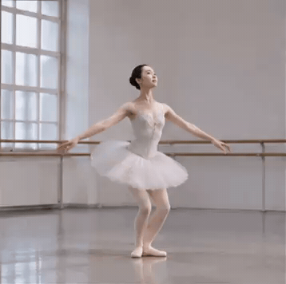

<sub>12 frames · 358×356 · 1.8s · GPT Image 2.6</sub>

📌 **Source:** [@kabumira862571 on X](https://x.com/kabumira862571/status/2118196682680856739)

**Prompt**

```text
次の内容で GIF を作成して: バレリーナが飛び上がって着地するまで
```

`ballet` `dance` `leap` `short-prompt`

### 10. Bubblegum Pop Studio Loop


<sub>9 frames · 480×480 · 1.8s · GPT Image 2.6</sub>

📌 **Source:** [@morphedai on X](https://x.com/morphedai/status/2118424987833094244)

**Prompt**

```text
A seamless looping animated GIF. Young Scandinavian woman, 22, platinum blonde bob, freckles, hot pink oversized puffer jacket, on a flat saturated cobalt blue studio wall and floor. Medium shot. She blows a huge bubblegum bubble, it pops on her face, it resets, forever, her eyes bored and looking straight at the camera. Bold, bright, crisp photographic look, hard studio light, no text, no logos.
```

`bubblegum` `studio` `photoreal` `loop`

### 11. Mount Fuji Gouache Travel Poster


<sub>96 frames · 480×640 · 8.0s · GPT Image 2.6</sub>

📌 **Source:** [@devteamdrew on X](https://x.com/devteamdrew/status/2118308538564989025)

**Prompt**

```text
A living mid-century gouache travel-poster painting of Mount Fuji behind a five-storey Japanese pagoda, static locked-off camera, seamless looping animation. The pagoda is vermilion-orange with deep teal-slate tiled roofs, a slender spire, and a dark evergreen tree beside it. Fuji sits small and distant in dusty blue-grey with a snow-white cap and ragged dry-brush ridges, over a pale mist field. Foreground cherry trees in soft coral-pink blossom with dark trunks frame the bottom, and tiny figures stand on pale speckled ground. Warm cream paper-grain sky fills the upper half. Matte flat gouache with ragged, flaking edges, visible bristle marks and speckled holes. Subtle motion only: blossom petals drift down, branches sway faintly, tiny figures shift, a bell-like gentle shimmer on the light. Soft spring morning light, vertical 3:4, perfect loop.
```

`gouache` `travel-poster` `japan` `cherry-blossom`

### 12. Colosseum Gouache Travel Poster


<sub>96 frames · 480×640 · 8.0s · GPT Image 2.6</sub>

📌 **Source:** [@devteamdrew on X](https://x.com/devteamdrew/status/2118308538564989025)

**Prompt**

```text
A living mid-century gouache travel-poster painting of the Roman Colosseum, locked-off static camera, a seamless looping animation. The ruined amphitheater sits low in the frame in sun-bleached ochre, sand and travertine with dusty rose and pale blue-grey arches, painted in dry-brush gouache with flaky, speckled edges and worn-away patches. A tall Italian stone pine in dark green and bottle-green leans in from the right, a vintage teal street lamp on the left, rose-coral flowering shrubs at the base. Open warm cream paper-textured sky fills the upper two thirds with fine paper grain. Gentle motion only: a few tiny birds drift across the sky, a cyclist rides slowly along the piazza, a small scooter, a couple in coral and mustard strolling, pine foliage barely sways. Soft warm afternoon light, long pale shadows, flat matte shapes, vertical 3:4, perfect loop.
```

`gouache` `travel-poster` `rome` `landmark`

**[See all 157 prompts in this category →](categories/loops.md)**

## Pixel Art & UI Motion

The 12 newest of 102 prompts in this category. [See all 102 →](categories/pixel-ui.md)

### 1. Pixel Japanese Fantasy City

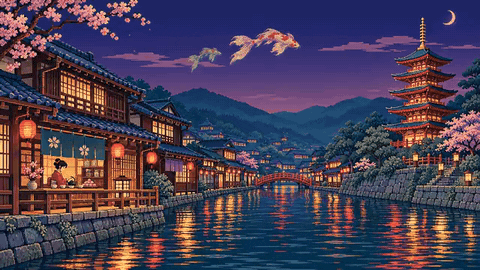

<sub>80 frames · 480×270 · 8.0s · GPT-6.2 Astra (ChatGPT)</sub>

📌 **Source:** [@leo114119 on X](https://x.com/leo114119/status/2123062551923798110)

**Prompt**

```text
生成一个日式奇幻城市动画 GIF，像素艺术，超精细，超高质量，画面惊艳，整体协调统一且完美
```

`pixel-art` `city` `japanese` `fantasy` `minimal-prompt`

### 2. Obsidian Flame Sword Cursor

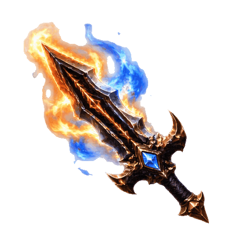

<sub>14 frames · 480×480 · 1.3s · GPT Image 2.6 Flare (sprite sheet to GIF)</sub>

📌 **Source:** [wuyoscar (after a workflow by @hAru_mAki_ch) on GitHub](https://github.com/wuyoscar/GPT-Image2-Skill/blob/HEAD/skills/gpt-image/references/gallery-gaming.md)

**Prompt**

```text
An animation sprite sheet for a fantasy desktop cursor, inspired by a flaming-sword mouse pointer. Exactly 8 frames in a 4-column by 2-row uniform grid, read left to right then top to bottom. Canvas 2048 by 1024, each cell exactly 512 by 512. Transparent background, no gutters, no borders, no text, no labels. In every cell the same small ornate obsidian sword points diagonally toward the upper-left. Its sharp tip is fixed at cell coordinate (100,100), blade geometry and position identical in every frame. Bright amber and electric-blue flame curls around the blade, progressing smoothly through eight phases and returning to the initial shape at the loop boundary. The blade stays still; only flames, a few sparks and reflected light move. Keep all effects within the middle 360 by 360 pixels of each cell. Crisp illustrated game-UI asset, luminous edges, convincing metallic highlights, strong silhouette, no character, no duplicate swords within a cell. Do not draw checkerboards; use actual transparency.
```

`cursor` `game-ui` `sprite-sheet`

### 3. Pixel Cat Typing in a Rainy Café


<sub>12 frames · 358×358 · 2.2s · GPT Image 2.6</sub>

📌 **Source:** [OP響樂生活 on OP響樂生活 myfone blog](https://myfone.blog/tech-news/news6-chatgpt-gif-2611010/)

**Prompt**

```text
請幫我生成一張復古像素風格（Pixel Art）的動態 GIF：畫面中央是一隻戴著耳機的橘貓，坐在雨天的咖啡館窗邊，雙手在筆電上規律敲鍵盤，旁邊有一杯熱咖啡冒著縷縷輕煙，背景窗戶有緩緩流下的雨滴，請確保動畫能流暢循環播放（Seamless loop）。
```

`pixel-art` `cat` `lofi` `rain` `cafe`

### 4. 8-bit Ox Walk Cycle Sprite

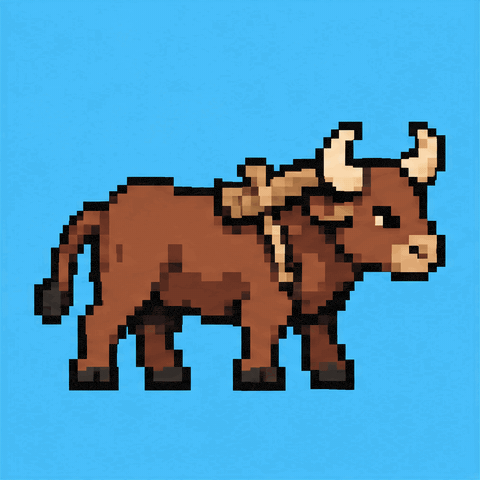

<sub>8 frames · 480×480 · 0.8s · GPT Image 2.6</sub>

📌 **Source:** [Oxen.ai on Oxen.ai Blog](https://ghost.oxen.ai/gpt-image-26/)

**Prompt**

```text
An 8-bit pixel art sprite of a stocky brown ox with a tiny yoke,
walking in place from left to right. Classic side-scrolling game walk
cycle, flat sky blue background, crisp pixels, no blur.
```

`pixel-art` `sprite` `walk-cycle` `game`

### 5. Pixel Hero Sword Slash

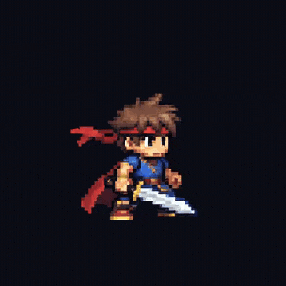

<sub>12 frames · 358×358 · 1.2s · GPT Image 2.6</sub>

📌 **Source:** [@YaReYaRu30Life on X](https://x.com/YaReYaRu30Life/status/2118166505603153922)

**Prompt**

```text
GIFを作成。ドット絵の勇者。
剣にエフェクトをつけて振り回す
```

`pixel-art` `hero` `sword` `fx`

### 6. Green CTA button with light sweep


<sub>8 frames · 480×238 · 1.1s · GPT Image 2.6</sub>

📌 **Source:** [末松 光太郎 on WizTry Blog](https://wiztrydx.com/blog/chatgpt-images-2-6-kaisetsu/)

**Prompt**

```text
ホームページに置くボタンのループGIFを作って。横長の角丸で、緑色のボタンに白い文字で「無料見積りはこちら」。文字の位置は動かさず、光が左から右へ流れて、ボタンが少しだけふくらむ動きにして。背景は白。
```

`button` `ui` `japanese`

### 7. Lightbulb icon glows on


<sub>12 frames · 308×414 · 2.2s · GPT Image 2.6</sub>

📌 **Source:** [牧牧的成長實驗室 on 方格子 vocus](https://vocus.cc/article/6aebf9a0fd8978000170526d)

**Prompt**

```text
製作一張極簡扁平插畫 GIF。畫面中央是一個黃色燈泡圖示，燈泡從微暗逐漸亮起，接著恢復原本狀態。背景純白、圖示位置固定，動畫柔和，不要任何文字，無縫循環。
```

`icon` `flat` `education`

### 8. Pixel-art lightning strike


<sub>12 frames · 358×268 · 1.0s · GPT Image 2.6</sub>

📌 **Source:** [@kasperzackgames on GitHub](https://github.com/kasperzackgames/chatgpt-pixel-effects/tree/main/effects/lightning)

**Prompt**

```text
Make an animated GIF of a pixel-art lightning strike for a 2D side-view game, rendered as large as you can. 14 frames, about 70 ms per frame. Use fine pixel art: each art pixel is only 2 to 3 image pixels wide, so the bolt has a lot of detail (it spans the full frame height, about 120 art pixels). The camera does not move. The bottom edge of the frame is the ground line, and the bolt hits the ground at the bottom centre, at the same point in every frame. Don't draw the ground itself. Sequence: a thin flickering leader zigzags down from the top edge; the full bolt strikes: a thick jagged white core with an electric blue and violet glow outline and three or four forked branches; one frame where the bolt and a bright white burst at the impact point are at their brightest; the bolt flickers twice, changing its branches each time; at the impact point a burst of electric sparks flies out in arcs and short arcs of electricity crawl sideways along the ground; the bolt vanishes, leaving a glowing blue afterimage that fades; a few sparks and a small curl of dark smoke fade out until the frame is empty. True pixel art: crisp pixels on one even grid, hard edges, no anti-aliasing, no blur, no soft gradients, a limited palette of about 16 colours (white, pale cyan, electric blues, violets, two dark greys for the smoke). Background: flat solid pure green #00FF00 in every frame, nothing else. No text, no borders.
```

`pixel-art` `game-fx` `lightning`

### 9. Pixel-art fire pillar


<sub>15 frames · 265×358 · 1.3s · GPT Image 2.6</sub>

📌 **Source:** [@kasperzackgames on GitHub](https://github.com/kasperzackgames/chatgpt-pixel-effects/tree/main/effects/fire-pillar)

**Prompt**

```text
Make an animated GIF of a pixel-art fire pillar erupting from the ground, for a 2D side-view game, in a tall frame (taller than wide), rendered as large as you can. 16 frames, about 80 ms per frame. Use fine pixel art: each art pixel is exactly 2 image pixels wide, so the fire has a lot of detail. The camera does not move. The bottom edge of the frame is the ground line, and the pillar erupts at the bottom centre, at the same point in every frame. Don't draw the ground itself. The tallest flame tips reach about 85 percent of the frame height: always leave empty background above the fire and at both sides, so nothing is ever cut off by the frame edges. Sequence: a small glowing crack and a few embers rising; flames burst upward into a tall roaring column of fire, wider at the base, with swirling tongues of flame, a white-yellow hot core and orange, red and dark red edges; burning chunks and sparks fly out of the top; the column roars for several frames, its flames changing shape every frame; it collapses downward into low flickering flames and puffs of dark smoke; glowing embers drift up and fade until the frame is empty. True pixel art: crisp pixels on one even grid, hard edges, no anti-aliasing, no blur, no soft gradients, a limited palette of about 18 colours (white, yellows, oranges, reds, dark reds and three dark greys for the smoke). Background: flat solid pure magenta #FF00FF in every frame, nothing else. No text, no borders.
```

`pixel-art` `game-fx` `fire-pillar`

### 10. Pixel-art volcano eruption


<sub>16 frames · 309×308 · 1.4s · GPT Image 2.6</sub>

📌 **Source:** [@kasperzackgames on GitHub](https://github.com/kasperzackgames/chatgpt-pixel-effects/tree/main/effects/eruption)

**Prompt**

```text
Make an animated GIF of a pixel-art volcano eruption seen from far away, for the background of a 2D side-view game, in a square frame, rendered as large as you can. 16 frames, about 90 ms per frame. Use fine pixel art: each art pixel is exactly 2 image pixels wide. The camera does not move. The crater is at the bottom centre of the frame, at the same point in every frame; don't draw the mountain itself, only what comes out of the crater. Sequence: frames 1 to 4: the crater glows brighter and spits a few sparks; frame 5: a bright burst; frames 6 to 16: a full eruption that loops seamlessly from frame 16 back to frame 6: a fountain of glowing lava shooting straight up from the crater, glowing lava bombs flying out in high arcs and falling back down on both sides, and a thick dark ash column rising above it, its underside lit red and orange by the lava, the top of the ash staying inside the frame. Leave empty background around everything so nothing is cut off by the frame edges. True pixel art: crisp pixels on one even grid, hard edges, no anti-aliasing, no blur, no soft gradients, a limited palette of about 18 colours (white, yellows, oranges, reds, dark reds, and four dark grey-browns for the ash). Background: flat solid pure magenta #FF00FF in every frame, nothing else. No text, no borders.
```

`pixel-art` `game-fx` `eruption`

### 11. Pixel-art energy beam


<sub>13 frames · 439×216 · 1.1s · GPT Image 2.6</sub>

📌 **Source:** [@kasperzackgames on GitHub](https://github.com/kasperzackgames/chatgpt-pixel-effects/tree/main/effects/beam)

**Prompt**

```text
Make an animated GIF of a pixel-art energy beam for a 2D side-view game, in a wide frame twice as wide as it is tall, rendered as large as you can. 16 frames, about 70 ms per frame. Use fine pixel art: each art pixel is only 2 to 3 image pixels wide. The camera does not move. The beam starts at the left edge at mid-height, at the same point in every frame. Sequence: a small glowing orb of energy charges at the left edge, crackling and growing as sparks are pulled into it; it fires: a thick straight beam with a white core and cyan and electric blue outer layers shoots to the right edge within two frames; the beam holds for several frames, pulsing thicker and thinner, with bright ripples travelling along it, rings around its origin and sparks spraying off its edges; the beam thins to a line and vanishes; small sparks and a fading glow at the origin until the frame is empty. True pixel art: crisp pixels on one even grid, hard edges, no anti-aliasing, no blur, no soft gradients, a limited palette of about 14 colours (white, pale cyan, cyans, electric blues, deep blue). Background: flat solid pure magenta #FF00FF in every frame, nothing else. No text, no borders.
```

`pixel-art` `game-fx` `beam`

### 12. Pixel-art explosion with mushroom cloud


<sub>15 frames · 316×302 · 1.3s · GPT Image 2.6</sub>

📌 **Source:** [@kasperzackgames on GitHub](https://github.com/kasperzackgames/chatgpt-pixel-effects)

**Prompt**

```text
Make an animated GIF of a pixel-art explosion for a 2D side-view game, rendered as large as you can (at least 512x512). 16 frames, about 80 ms per frame. Use fine pixel art: each art pixel is only 2 to 3 image pixels wide, so the explosion has a lot of detail (about 120 art pixels tall at its peak). The camera does not move. The bottom edge of the frame is the ground line, and the explosion hits the ground at the bottom centre, at the same point in every frame. Don't draw the ground itself. Sequence: a tiny spark on the ground; one bright white flash frame; a huge orange and yellow fireball that grows until it fills about three quarters of the frame height and rises into a mushroom cloud with a fiery stem; debris chunks and sparks flying out in arcs; a thin dust ring rolling sideways along the ground; the fire breaks up into a light grey smoke column that rises and drifts; glowing embers fade out until the frame is empty. True pixel art: crisp pixels on one even grid, hard edges, no anti-aliasing, no blur, no soft gradients, a limited palette of about 20 colours (white, yellows, oranges, reds, dark reds and four neutral greys for the smoke). Background: flat solid pure magenta #FF00FF in every frame, nothing else. No text, no borders.
```

`pixel-art` `game-fx` `explosion`

**[See all 102 prompts in this category →](categories/pixel-ui.md)**

## Science & Explainers

The 12 newest of 18 prompts in this category. [See all 18 →](categories/explainers.md)

### 1. Light Bulb Halo Pulse


<sub>9 frames · 480×480 · 1.8s · GPT Image 2.6 Flare</sub>

📌 **Source:** [@liangdabiao on GitHub](https://github.com/liangdabiao/whiteboard-teacher-video-motion/blob/HEAD/examples/sample/assets.json)

**Prompt**

```text
A single centered minimalist light bulb, its soft golden halo gently pulsing brighter then dimmer, fixed camera, smooth even motion, every detail of the bulb stays identical across frames, ending exactly back at the starting pose for a seamless loop, clean flat pale background, no text, no logo
```

`explainer` `light-bulb` `minimal`

### 2. Luminol Chemiluminescence Vortex


<sub>16 frames · 294×320 · 1.4s · GPT Image 2.6</sub>

📌 **Source:** [@ZHENGJUNTING92 on X](https://x.com/ZHENGJUNTING92/status/2118252052556255364)

**Prompt**

```text
制作gif
垂直俯拍一个烧杯的杯口，里面的水在旋转形成漩涡，然后滴入液体
C8H7N3O2+H202+NaOH-Na2C8H5N204+N2 1+H20+luminol CL
烧杯中是少量罗丹明B碱性的鲁米诺溶液 和过氧化氢
胶头滴管中是含铁离子溶液 和荧光染料
```

`chemistry` `luminol` `experiment` `science`

### 3. Osaka Castle Construction Process


<sub>12 frames · 358×358 · 1.4s · GPT Image 2.6</sub>

📌 **Source:** [@jammaru_lab on X](https://x.com/jammaru_lab/status/2118153279821787623)

**Prompt**

```text
大阪城を建築する流れをGIFにして
```

`castle` `construction` `history` `process`

### 4. Water Cycle Classroom Diagram


<sub>96 frames · 480×270 · 8.0s · GPT Image 2.6</sub>

📌 **Source:** [挖挖Github on 掘金](https://juejin.cn/post/7709418733185892403)

**Prompt**

```text
制作一段展示水循环（示意图）的教学 GIF，横版 16:9。整体采用极简扁平化科普示意图风格，用简化几何图形表示水循环。
动画依次表现：海面水汽上升，水汽聚集成云，云下落雨，雨水汇成河流流回海洋。配上清晰、准确、易读的简体中文标签：“蒸发”“凝结”“降水”“径流”，标签靠近对应环节，使用深灰色简洁无衬线字体。
镜头固定，动画节奏缓慢，形状和布局保持稳定；结尾自然回到开头状态，形成无缝循环。整体画面简洁直观，像一张会动的科学课本插图。
```

`water-cycle` `education` `flat-design` `diagram` `chinese-labels`

### 5. Paper invoice to spreadsheet via AI, 4 panels


<sub>4 frames · 480×238 · 3.4s · GPT Image 2.6</sub>

📌 **Source:** [末松 光太郎 on WizTry Blog](https://wiztrydx.com/blog/chatgpt-images-2-6-kaisetsu/)

**Prompt**

```text
紙の請求書をスマホで撮ると、AIが読み取って、表に入力されるまでの流れを、4コマのループGIFにして。
```

`workflow` `business` `japanese`

### 6. Seed sprouting in a soil cutaway


<sub>12 frames · 358×358 · 3.1s · GPT Image 2.6</sub>

📌 **Source:** [牧牧的成長實驗室 on 方格子 vocus](https://vocus.cc/article/6aebf9a0fd8978000170526d)

**Prompt**

```text
製作一張教育用途的 GIF 動畫，呈現一顆種子逐漸發芽，長出嫩芽與兩片小葉子的過程。使用清楚的科普插畫風格，固定土壤剖面與攝影機視角，讓植物生長過程自然銜接，並設計成循環動畫。
```

`science` `plant` `education`

### 7. Annual revenue bar chart growing


<sub>33 frames · 480×270 · 4.8s · GPT Image 2.6</sub>

📌 **Source:** [蘇柔瑋 on 數位時代 BusinessNext](https://www.bnext.com.tw/article/92943/chatgpt-gif-generator-prompts)

**Prompt**

```text
請製作一張 16:9 橫式 GIF 動畫，主題為企業年度營收成長。畫面使用暖白色背景、深灰色文字與橘色重點配色，呈現簡潔專業的商業資訊圖表風格。中央有四根長條圖，分別代表 2023、2024、2025、2026 年，數值依序為 100、150、210、300，單位為百萬元。動畫開始時所有長條從零逐漸向上延伸，依照年份由左至右依序完成，最後停留在完整圖表畫面。確保年份、數字與長條高度完全對應，所有文字清晰可讀，鏡頭固定。動畫約 5 秒，不要增加其他數據或裝飾元素。
```

`chart` `business` `data`

### 8. Sicilian Defense chess opening


<sub>16 frames · 288×288 · 3.2s · gpt-image-2.6-gif</sub>

📌 **Source:** [vunderba on Mordenstar](https://imgpb.com/OzSMKJ)

**Prompt**

```text
A simple animation of the Sicilian Defense opening on a chess board, flat vector illustration
```

`chess` `opening` `diagram`

### 9. Speaker sound waves

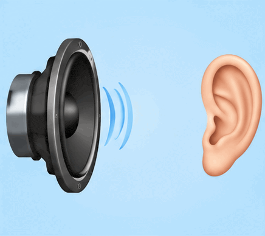

<sub>9 frames · 436×388 · 1.3s · gpt-image-2.6 · generated 2026-11-18</sub>

**Prompt**

```text
Side view diagram of a loudspeaker whose cone pushes in and out, sending evenly spaced curved sound waves rippling to the right toward a cartoon ear. Flat educational infographic, light blue background.
```

`sound` `physics` `waves`

### 10. Photosynthesis in a leaf


<sub>9 frames · 439×390 · 1.6s · gpt-image-2.6 · generated 2026-11-18</sub>

**Prompt**

```text
Simple science diagram of a green leaf: yellow sun rays enter from the top, blue water droplets rise from the stem, and small bubbles labeled O2 float out of the leaf. Clean textbook illustration, white background.
```

`photosynthesis` `biology` `diagram`

### 11. Seesaw lever balance

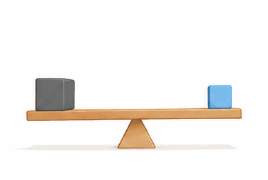

<sub>16 frames · 378×254 · 2.2s · gpt-image-2.6 · generated 2026-11-17</sub>

**Prompt**

```text
A simple wooden seesaw on a triangle pivot tips one way as a heavy block drops on one end, then a small block slides farther out on the other end until it balances level. Flat textbook illustration, white background, no text.
```

`lever` `physics` `simple-machines`

### 12. Prism splits light


<sub>16 frames · 380×252 · 1.9s · gpt-image-2.6 · generated 2026-11-17</sub>

**Prompt**

```text
A white beam of light enters a glass triangular prism and fans out into a rainbow on the other side, the rainbow shimmering gently. Dark background, clean science illustration, fixed camera.
```

`light` `prism` `physics`

**[See all 18 prompts in this category →](categories/explainers.md)**

## Holidays & Greetings

### 1. Felt-style birthday cake with a party kitten


<sub>16 frames · 276×346 · 4.0s · GPT Image 2.6</sub>

📌 **Source:** [蘇柔瑋 on 數位時代 BusinessNext](https://www.bnext.com.tw/article/92943/chatgpt-gif-generator-prompts)

**Prompt**

```text
請製作一張 直式 4:5、約 4 秒的生日祝福 GIF 動畫，採用溫暖可愛的日系羊毛氈 3D 插畫風格。畫面中央是一個精緻的草莓鮮奶油蛋糕，插著三根點燃的粉色蠟燭。蛋糕右側坐著一隻戴生日帽的奶油色小貓，開心地抱著蛋糕，左側擺放粉色禮物盒。背景搭配三角旗幟、發光星星與木質桌面，使用奶油白、蜜桃粉與暖金色調，呈現溫馨療癒的童話氛圍。動畫效果： 蠟燭火焰輕輕搖曳，星星依序閃爍，最後少量粉色彩紙從上方緩緩飄落。保持角色、蛋糕與背景造型一致，鏡頭固定，動作自然流暢，可無縫循環播放。不要加入任何文字。
```

`birthday` `felt` `greeting`

### 2. Thank-you pie with rising steam


<sub>9 frames · 439×390 · 1.6s · gpt-image-2.6 · generated 2026-11-18</sub>

**Prompt**

```text
A whole pumpkin pie on a checkered cloth with three curls of steam rising and fading, a small hand-lettered card beside it reading "THANK YOU". Soft gouache style, warm orange and brown tones.
```

`thanksgiving` `pie` `thank you`

### 3. Gingerbread house waving


<sub>8 frames · 439×390 · 1.4s · gpt-image-2.6 · generated 2026-11-18</sub>

**Prompt**

```text
A tiny gingerbread figure with white icing buttons stands in the doorway of a candy-trimmed gingerbread house and waves one arm, while soft snowflakes drift past. Warm cozy illustration, cream background.
```

`christmas` `gingerbread` `greeting`

## Product Showcase

The 12 newest of 13 prompts in this category. [See all 13 →](categories/product.md)

### 1. Frosted Perfume Light Sweep


<sub>9 frames · 480×480 · 1.8s · GPT Image 2.6 Flare</sub>

📌 **Source:** [Veevid Team on Veevid Blog](https://veevid.ai/blog/gpt-image-2-6-gif)

**Prompt**

```text
A frosted glass perfume bottle on a round stone pedestal. The sequence: a soft band of light sweeps slowly across the glass from left to right while tiny dust particles drift upward. Fixed camera, same bottle, same pedestal, warm beige studio background. The last frame transitions smoothly back to the first for a seamless loop. Clean product photography style. No captions, no words, no logos, no borders.
```

`perfume` `light-sweep` `product`

### 2. NIGHT LAB Mug Steam Loop

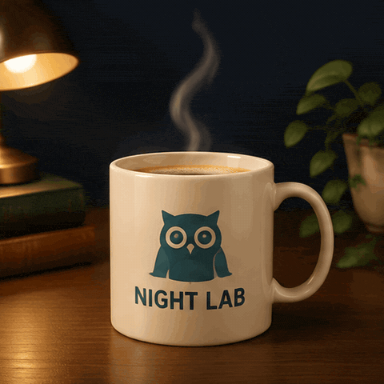

<sub>6 frames · 480×480 · 1.2s · GPT Image 2.6 Sunburst</sub>

📌 **Source:** [@az9713 on GitHub](https://github.com/az9713/gpt-image-2.6-demo/blob/HEAD/image_26_experiment/requests/22-gif-sunburst-product.json)

**Prompt**

```text
Seamless looping product animation. One ivory ceramic mug with a simple teal owl emblem and the exact words NIGHT LAB sits on a walnut desk. Delicate steam curls upward in a small continuous motion. The mug and camera stay absolutely still. Dark navy backdrop, warm amber light. No additional text.
```

`mug` `steam` `product`

### 3. Noise-Cancelling: Street Turns to White Studio


<sub>9 frames · 358×478 · 2.0s · GPT Image 2.6</sub>

📌 **Source:** [@TanShilong on X](https://x.com/TanShilong/status/2119452466161008908)

**Prompt**

```text
生成一个竖版Gif图，使用创意手法体现一个降噪耳机的降噪效果，主体是一个现实风格，苹果摄影风格的一个喧嚣的街头，特写集中在一个欧洲人的面部，侧脸。人物带上耳机之后，瞬间街道内容直接变成纯白色的摄影棚
```

`product` `headphones` `ad` `transformation`

### 4. Sword in Stone 360 Turntable


<sub>12 frames · 358×346 · 1.6s · GPT Image 2.6</sub>

📌 **Source:** [@xikhar on X](https://x.com/xikhar/status/2118407355859878352)

**Prompt**

```text
create a gif of a "3d legendary sword in a stone game asset" spinning full 360 degrees
```

`3d` `game-asset` `turntable` `sword`

### 5. Futuristic Motorbike 360 Turntable


<sub>12 frames · 358×356 · 1.3s · GPT Image 2.6</sub>

📌 **Source:** [@xikhar on X](https://x.com/xikhar/status/2118407355859878352)

**Prompt**

```text
create a gif of a "AAA 3d futuristic motorbike game asset" spinning full 360 degrees
```

`3d` `game-asset` `turntable` `motorbike`

### 6. 3D Dwarf Model 360 Turntable


<sub>12 frames · 358×358 · 1.4s · GPT Image 2.6</sub>

📌 **Source:** [@xikhar on X](https://x.com/xikhar/status/2118407355859878352)

**Prompt**

```text
create a gif of a "3d dwarf game model carrying a huge axe on his shoulders" spinning full 360 degrees
```

`3d` `game-asset` `turntable` `dwarf`

### 7. Bathroom remodel banner with rising steam


<sub>6 frames · 480×240 · 1.8s · GPT Image 2.6</sub>

📌 **Source:** [末松 光太郎 on WizTry Blog](https://wiztrydx.com/blog/chatgpt-images-2-6-kaisetsu/)

**Prompt**

```text
ホームページのトップに置く、横長の広告バナーのループGIFを作って。写真のようにリアルな、木の窓がある明るいお風呂。湯船の湯気だけがゆっくり上がる。左側に大きく「冬のお風呂リフォーム応援キャンペーン」、その下に「手すりの取り付け無料」と「11月20日〜12月25日」。文字は動かさないで。
```

`banner` `ad` `japanese`

### 8. Earbuds case lid opens and closes


<sub>12 frames · 358×358 · 1.9s · GPT Image 2.6</sub>

📌 **Source:** [蘇柔瑋 on 數位時代 BusinessNext](https://www.bnext.com.tw/article/92943/chatgpt-gif-generator-prompts)

**Prompt**

```text
請製作一張 1:1 的高質感產品展示 GIF。畫面中央是一個【極簡白色無線耳機充電盒】，放置於淡灰色攝影棚背景。動畫從盒蓋關閉開始，接著盒蓋慢慢打開，展示內部耳機，最後緩緩關閉。商品外觀、比例、材質與顏色必須保持一致，鏡頭固定，使用柔和商業攝影光線，製作平滑循環動畫，不要加入文字。
```

`product` `tech` `ecommerce`

### 9. Earbuds case with pulsing LED


<sub>9 frames · 480×270 · 1.6s · GPT Image 2.6</sub>

📌 **Source:** [Fuxuan Guo on ChatCut Blog](https://chatcut.io/blog/chatgpt-gif)

**Prompt**

```text
Locked macro studio product shot on a dark brushed-aluminum desk. A matte smoke-gray wireless earbuds charging case sits open with both earbuds resting inside, completely motionless. Only the tiny round emerald-green status LED on the front lip of the case pulses smoothly from dim to bright green with a soft tiny halo and fades back to dim on the final frame for a clean loop. Keep the case, earbuds, and reflections completely still, no text.
```

`product` `tech` `macro`

### 10. Coffee bag hero shot with espresso steam


<sub>9 frames · 480×606 · 1.8s · GPT Image 2.6</sub>

📌 **Source:** [Fuxuan Guo on ChatCut Blog](https://chatcut.io/blog/chatgpt-gif)

**Prompt**

```text
Locked tripod commercial product shot in soft morning studio light. A matte terracotta kraft coffee bag with a clean cream front label reading "MORNING ROAST" in sharp dark-brown sans-serif type stands completely motionless beside a speckled stoneware espresso cup on a travertine counter. Only a thin ribbon of warm white steam curls gently upward from the cup and settles back to the exact starting wisp on the final frame for a clean loop. Keep the coffee bag, label text, and cup completely still across every frame.
```

`product` `coffee` `steam`

### 11. Water bottle rocking (product loop)


<sub>10 frames · 480×480 · 2.0s · gpt-image-2.6-gif</sub>

📌 **Source:** [Curtis Pyke on Kingy AI](https://kingy.ai/blog/chatgpt-gifs-images-2-6-vs-2-5-hands-on-test/)

**Prompt**

```text
Generate an actual animated GIF file, not a still picture, sprite sheet, video, or Python-coded animation. Square 512 by 512 pixels, a seamless 2-second loop. A bright orange reusable water bottle with a charcoal screw cap and a small turquoise circular badge remains centered on a pale gray studio background. The bottle rocks gently left and right and returns to its starting pose; the camera and background stay fixed. The bottle reads exactly "KINGY LAB" and "750 mL" throughout. No other text or objects. Use ChatGPT's native GIF generation and provide the downloadable GIF. If native GIF generation is unavailable, state that limitation rather than simulating it with code.
```

`product` `bottle` `api`

### 12. Smartwatch screen wake-up


<sub>12 frames · 358×358 · 2.2s · gpt-image-2.6 · generated 2026-11-18</sub>

**Prompt**

```text
A round matte black smartwatch with a sage green strap lies on a light stone surface; its screen wakes up with a soft glow, the clock hands sweep into place, then the screen dims again. Minimal studio product shot, no text, no logos.
```

`smartwatch` `wearable` `product shot`

**[See all 13 prompts in this category →](categories/product.md)**

## Food & Drinks

### 1. Clay Cat at a Neon Ramen Stall


<sub>30 frames · 480×270 · 3.0s · Gemini Omni 1.2 Flash</sub>

📌 **Source:** [@hiwise_aigc on X](https://x.com/hiwise_aigc/status/2123826646365188489)

**Prompt**

```text
生成一只戴着墨镜的橘猫，坐在霓虹闪烁的街头拉面摊前，用爪子挑起一筷子冒着热气的拉面。镜片上倒映着流动的彩色灯光，整体采用黏土定格动画风格，生成循环播放的 GIF
```

`cat` `ramen` `claymation`

### 2. Heart Latte by the Window


<sub>9 frames · 480×480 · 1.8s · GPT Image 2.6</sub>

📌 **Source:** [Veevid Team on Veevid Blog](https://veevid.ai/blog/gpt-image-2-6-gif)

**Prompt**

```text
A steaming ceramic coffee cup with heart latte art on a wooden cafe table, soft steam curling upward, warm morning window light, seamless loop
```

`coffee` `steam` `cafe`

### 3. Clay Cat Barista Coffee Sip

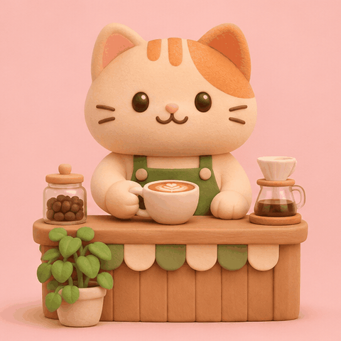

<sub>6 frames · 480×480 · 1.1s · Codex image generation (sprite sheet to GIF)</sub>

📌 **Source:** [@jkf87 on GitHub](https://github.com/jkf87/gif-maker-skill/blob/HEAD/README.md)

**Prompt**

```text
"A cute chubby clay cat barista wearing a tiny green apron" --motion "lifts a coffee cup, takes a sip, closes eyes happily, then returns exactly to the starting pose"
```

`cat` `coffee` `clay` `sprite-sheet`

### 4. Coffee Steam by a Night Window


<sub>18 frames · 438×390 · 4.1s · GPT Image 2.6</sub>

📌 **Source:** [@CoharuCrew on X](https://x.com/CoharuCrew/status/2120758651078005094)

**Prompt**

```text
湯気がゆらゆら立つコーヒーカップの、ループするGIFを作って。
もっとゆっくりにして、背景を夜の窓辺にして。
```

`coffee` `steam` `night` `cozy`

### 5. Espresso Steam Cinemagraph


<sub>9 frames · 480×480 · 1.8s · GPT Image 2.6</sub>

📌 **Source:** [Cadabra AI on Cadabra AI Blog](https://www.livinginmovie.com/en/blog/how-to-make-gif-in-chatgpt)

**Prompt**

```text
A seamless looping animated GIF, a cinemagraph of one espresso cup on a marble cafe table in warm morning light, photorealistic. The camera stays fixed and the cup and the table never move. Only the steam rises and curls slowly above the cup, and the last frame returns exactly to the first frame. No text anywhere.
```

`coffee` `cinemagraph` `steam` `product`

### 6. Hand-drawn coffee cup with rising steam


<sub>12 frames · 358×358 · 2.7s · GPT Image 2.6</sub>

📌 **Source:** [牧牧的成長實驗室 on 方格子 vocus](https://vocus.cc/article/6aebf9a0fd8978000170526d)

**Prompt**

```text
製作一張溫暖手繪風 GIF。木桌上放著一杯熱咖啡，杯子與背景保持完全靜止，只有白色蒸氣緩慢向上飄動。柔和晨光、咖啡館氛圍，畫面自然循環。
```

`coffee` `hand-drawn` `cozy`

### 7. Latte art with rising steam in a sunny cafe

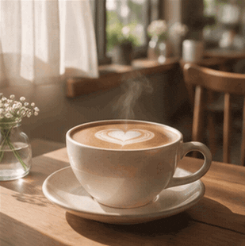

<sub>16 frames · 309×310 · 4.0s · GPT Image 2.6</sub>

📌 **Source:** [蘇柔瑋 on 數位時代 BusinessNext](https://www.bnext.com.tw/article/92943/chatgpt-gif-generator-prompts)

**Prompt**

```text
請製作一張 1:1 正方形 GIF 動畫。畫面中央是一杯放在木桌上的熱拿鐵，杯中有精緻的愛心拉花，背景是陽光灑落的日系咖啡廳。讓咖啡上方的白色蒸氣緩緩向上飄動，窗邊的薄紗窗簾輕輕晃動，陽光保持溫暖柔和。採用高質感寫實攝影風格，固定鏡頭，杯子、桌面與拉花完全保持靜止。動畫長度約 4 秒，節奏緩慢、自然流暢，適合無縫循環播放，不要加入文字。
```

`coffee` `cafe` `steam`

### 8. Pizza slice cheese pull


<sub>16 frames · 380×249 · 1.9s · gpt-image-2.6 · generated 2026-11-18</sub>

**Prompt**

```text
A hand lifts one slice of pepperoni pizza away from the whole pie, long strings of melted mozzarella stretching between the slice and the pan, then the slice settles back into place. Warm close-up food illustration, rustic wooden table.
```

`pizza` `cheese` `food`

### 9. Milk tea pearls pour


<sub>16 frames · 322×292 · 2.2s · gpt-image-2.6 · generated 2026-11-18</sub>

**Prompt**

```text
A clear cup of milk tea sits on a counter as a spoonful of dark tapioca pearls drops in and sinks, swirling brown sugar streaks along the glass. Bright cute flat illustration, pastel pink background.
```

`bubble tea` `boba` `drink`

## Animated Avatars

### 1. Orange Cat Mascot with a Lantern

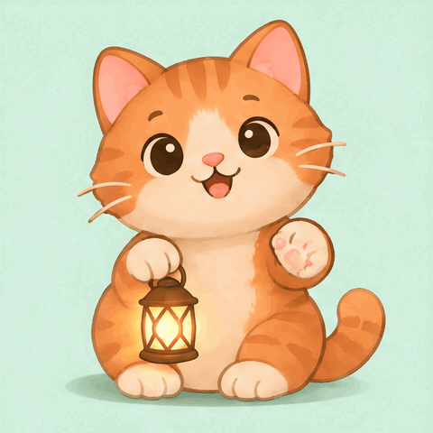

<sub>9 frames · 480×480 · 1.8s · GPT Image 2.6 Flare</sub>

📌 **Source:** [Linger on Lightlyn Images](https://image.lightlyn.com/gpt-image-2-6?lang=en)

**Prompt**

```text
A cheerful round orange cat mascot with a tiny lantern, waving hello and blinking, soft flat illustration style, clean pastel background, gentle seamless loop.
```

`cat` `mascot` `lantern`

### 2. Orange Fox Mascot Hello


<sub>17 frames · 480×480 · 1.8s · GPT Image 2.6</sub>

📌 **Source:** [Veevid Team on Veevid Blog](https://veevid.ai/blog/gpt-image-2-6-gif)

**Prompt**

```text
A cute orange fox brand mascot waving hello and blinking, flat vector sticker style, thick outline, pastel background, seamless loop
```

`fox` `mascot` `wave`

### 3. Potted Cactus Mascot Wave


<sub>9 frames · 480×480 · 1.8s · GPT Image 2.6 Flare</sub>

📌 **Source:** [Veevid Team on Veevid Blog](https://veevid.ai/blog/gpt-image-2-6-gif)

**Prompt**

```text
Create a single animation sprite sheet for a seamless looping GIF. A cheerful cartoon cactus mascot in a small terracotta pot. The sequence: the cactus leans slightly left, raises one arm and waves, smiles and blinks, then leans back to center. Fixed front camera, same character, same pot, plain pastel peach background. Clear incremental arm and body motion; the last frame transitions smoothly back to the first. Flat vector sticker style, thick outline. No captions, no words, no logos, no borders, no gutters.
```

`cactus` `mascot` `wave`

### 4. Teal Owl Wing Wave


<sub>6 frames · 480×480 · 1.2s · GPT Image 2.6 Flare</sub>

📌 **Source:** [@az9713 on GitHub](https://github.com/az9713/gpt-image-2.6-demo/blob/HEAD/image_26_experiment/requests/21-gif-flare-owl.json)

**Prompt**

```text
A seamless looping animation of one adorable rounded teal owl with amber eyes, cream belly and tiny brass spectacles. Front view, fixed camera and scale, dark navy background. The owl blinks once and gently waves its right wing, returning to its starting pose. No text.
```

`owl` `mascot` `wave`

### 5. Small Orange Robot Waving


<sub>9 frames · 480×480 · 1.8s · GPT Image 2.6</sub>

📌 **Source:** [@morphedai on X](https://x.com/morphedai/status/2122359048293257288)

**Prompt**

```text
A friendly small orange robot waves one hand hello. Clean white background, fixed camera, simple rounded 3D illustration. A seamless loop.
```

`robot` `wave` `3d` `mascot`

### 6. Astronaut cat blinking

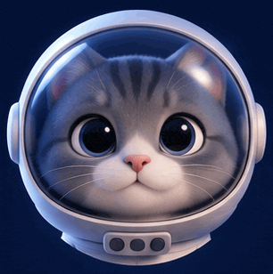

<sub>16 frames · 306×308 · 2.9s · gpt-image-2.6 · generated 2026-11-18</sub>

**Prompt**

```text
Circular profile avatar of a grey cat inside a round astronaut helmet, blinking slowly while a tiny star glints across the glass visor. Soft 3D clay style, navy blue background.
```

`avatar` `cat` `space`

### 7. Fox with headphones nodding


<sub>9 frames · 436×387 · 1.4s · gpt-image-2.6 · generated 2026-11-18</sub>

**Prompt**

```text
Circular avatar of a red fox wearing chunky yellow headphones, eyes closed, nodding its head to a beat as small music notes pop beside it. Flat vector style, teal background.
```

`avatar` `fox` `music`

## Generate them yourself

Use the [ViNano AI API](https://vinano.ai/api-keys): create an API key, submit a GIF task, then poll its status until the GIF URL comes back (25 credits per GIF).

```bash
# 1. Submit a GIF task — the response contains a task "uuid"
curl -X POST https://vinano.ai/api/async-openai-images \
  -H "Authorization: Bearer $VINANO_API_KEY" \
  -F mode=txt2img -F zeakaiModel=gpt-image-2.6-gif -F model="ViNano AI" \
  -F count=1 -F img_size=1k -F aspectRatio=1:1 \
  -F prompt="A cheerful cartoon cat waving hello. Animate it as a short, smooth, seamlessly looping GIF with clear motion between frames."

# 2. Poll until "completed" is true — the GIF URL is in "generated_images_url"
curl "https://vinano.ai/api/task-status?uuid=<uuid>" \
  -H "Authorization: Bearer $VINANO_API_KEY"
```

Or regenerate every example in this repo with the included script (Node 18+):

```bash
git clone https://github.com/ailingqu/awesome-ai-gif-prompts.git && cd awesome-ai-gif-prompts
cp .env.example .env   # fill in VINANO_API_KEY
npm run generate        # only generates prompts without a GIF
npm run build           # rebuilds README.md and README_zh.md
```

## Sources

Entries without a source line were written and generated by us. Entries marked **Source** were collected from X and the web: the prompt and GIF are shown as posted, credited to the creator with a link to the original post, and all rights stay with them. Creators can ask for changes or removal by opening an issue.

## Contributing

New prompts are welcome! Add an entry to `data/prompts.json`, include the GIF you got, and run `npm run build`. See [CONTRIBUTING.md](CONTRIBUTING.md).

## License

Prompts and example GIFs: [CC BY 4.0](LICENSE). If this list helps you, a ⭐ helps others find it.
