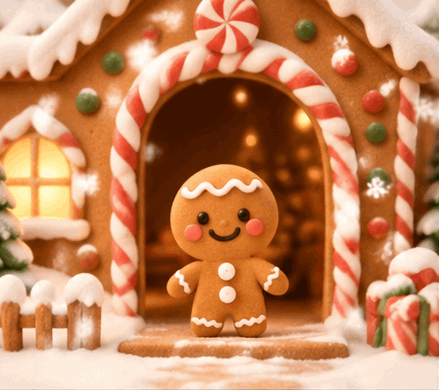
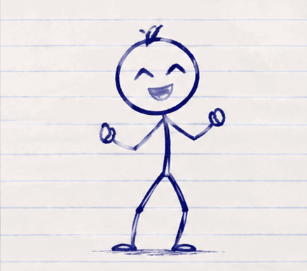
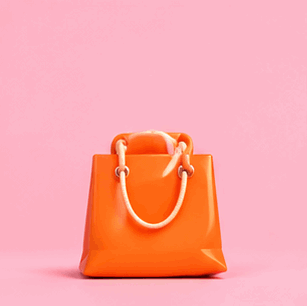
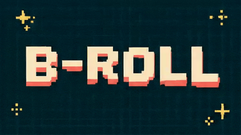

# Awesome AI GIF Prompts · 511+ Cases

**English** · [简体中文](README_zh.md)

    [](https://awesome.re)

A curated collection of prompts for making **animated GIFs directly with AI** — stickers, reactions, flash cuts, brand reels, ambient loops and pixel art. Our own examples were generated from the exact prompt shown, with no editing; community picks are marked with their source and credited to their creators.

> 🔄 **Updated daily** — 10 new prompts tested by us plus 40+ credited community picks from X and the web, almost every day. Last update: **2026-11-18**. ⭐ Star or 👀 watch the repo to get new cases.
>
> 🎞️ **Try these prompts online:** paste any prompt into the [ViNano AI GIF Generator](https://vinano.ai/gif-generator) — text or a photo in, looping GIF out, powered by GPT Image 2.6.

<p align="center">
  
  
  
  
  
  
  
  
  
</p>

## Contents

- [How these GIFs are made](#how-these-gifs-are-made)
- [Stickers & Reactions](#stickers-reactions) · 191 prompts
- [Flash Cuts & Brand Reels](#flash-cuts-brand-reels) · 87 prompts
- [Ambient Loops](#ambient-loops) · 128 prompts
- [Pixel Art & UI Motion](#pixel-art-ui-motion) · 85 prompts
- [Science & Explainers](#science-explainers) · 11 prompts
- [Holidays & Greetings](#holidays-greetings) · 2 prompts
- [Product Showcase](#product-showcase) · 3 prompts
- [Food & Drinks](#food-drinks) · 2 prompts
- [Animated Avatars](#animated-avatars) · 2 prompts
- [Generate them yourself](#generate-them-yourself)

## How these GIFs are made

GPT Image 2.6 can return an animated GIF instead of a still image when you request `output_format: "gif"`. The model decides the frame count, timing and pixel size on its own.

Each prompt in this repo is sent with one extra sentence appended, which asks for a clean loop:

```text
Animate it as a short, smooth, seamlessly looping GIF with clear motion between frames.
```

### Prompt formula

**Subject** (one clear character or object) + **Motion** (1–2 verbs: waving, bouncing, drifting, flickering) + **Style** (flat illustration, chibi sticker, pixel art, photo) + **Background** (plain, high-contrast color for stickers)

### Tips

- One subject and one or two movements. Busy scenes leave less room for clear motion.
- Describe motion with verbs — *wobbling, nodding off, flickering, sliding down* — not adjectives.
- Flat illustration, chibi and pixel art styles survive small GIF sizes far better than photorealism.
- For a sticker set, repeat the exact same character description in every prompt so the pack stays consistent.
- For stickers you plan to cut out, use one flat background color far away from the character's colors.
- For flash cuts, describe each frame as a different shot; for brand reels, lock the logo position and change only the surroundings.
- Long text and complex day-to-night loops are still unreliable — keep text short and let light carry big changes.

## Stickers & Reactions

The 12 newest of 191 prompts in this category. [See all 191 →](categories/stickers.md)

### 1. Cat coder runs out of Codex quota


<sub>9 frames · 414×412 · 1.6s · gpt-image-2.6-gif</sub>

📌 **Source:** [@DawienZZ on X](https://x.com/DawienZZ/status/2120785093661012027)

**Prompt**

```text
生成一个循环 GIF：一只橘猫趴在电脑前敲键盘，codex提示没额度了，表情从平静变成崩溃，最后无奈地趴在键盘上。Q版3D风格，9帧，循环播放
```

`cat` `coding` `meme`

### 2. "This is fine" dog sipping tea


<sub>16 frames · 380×506 · 2.9s · gpt-image-2.6-gif</sub>

📌 **Source:** [@shitunote on X](https://x.com/shitunote/status/2118187063241777311)

**Prompt**

```text
做一个循环 GIF，一只戴着小帽子的卡通狗坐在着火的房间里，先是平静地喝茶，然后慢慢意识到不对劲，表情逐渐从“没事”变成“其实有事”，最后又假装没事继续喝茶。风格偏扁平插画，表情夸张，背景火焰轻微闪动，6-8帧，无缝循环。
```

`dog` `meme` `fire`

### 3. Penguin knitting a scarf


<sub>16 frames · 328×290 · 2.2s · gpt-image-2.6 · generated 2026-11-17</sub>

**Prompt**

```text
A round penguin sits clicking two knitting needles, a striped red scarf growing longer from its flippers. Cute flat cartoon, snowy light blue background.
```

`penguin` `knitting` `winter`

### 4. Bunny slurps noodles


<sub>16 frames · 309×309 · 2.2s · gpt-image-2.6 · generated 2026-11-17</sub>

**Prompt**

```text
A white bunny with chopsticks slurps a long noodle from a bowl, cheeks puffing, the noodle wiggling up into its mouth. Cute flat sticker style, thick outline, pale orange background.
```

`bunny` `noodles` `food`

### 5. Octopus ink oops


<sub>9 frames · 412×412 · 1.6s · gpt-image-2.6 · generated 2026-11-17</sub>

**Prompt**

```text
A small pink octopus gets startled and puffs out a cloud of ink, then peeks out of the cloud with an embarrassed grin. Cute flat cartoon, light aqua background.
```

`octopus` `oops` `funny`

### 6. Hippo big yawn


<sub>9 frames · 432×395 · 1.6s · gpt-image-2.6 · generated 2026-11-17</sub>

**Prompt**

```text
A sleepy round lavender hippo opens its mouth in an enormous yawn, eyes squeezed shut, then closes it with a satisfied smack. Soft clay-like 3D style, pale peach background.
```

`hippo` `yawn` `sleepy`

### 7. Shiba running late


<sub>8 frames · 429×394 · 1.0s · gpt-image-2.6 · generated 2026-11-17</sub>

**Prompt**

```text
A shiba inu with a slice of toast in its mouth runs in place in a panic, ears flapping, a sweat drop flying off. Funny flat sticker style, thick white outline, light yellow background.
```

`shiba` `late` `sticker`

### 8. Baby elephant trunk shower


<sub>16 frames · 379×251 · 2.2s · gpt-image-2.6 · generated 2026-11-17</sub>

**Prompt**

```text
A chubby baby elephant lifts its trunk and sprays a happy fountain of water over its own head, droplets sparkling. Cute flat cartoon, light blue background, fixed camera.
```

`elephant` `water` `cute`

### 9. Doodle eye roll


<sub>9 frames · 425×399 · 1.6s · gpt-image-2.6 · generated 2026-11-17</sub>

**Prompt**

```text
A round hand-drawn doodle face with marker lines rolls its eyes up in exaggerated annoyance, then looks back forward with a flat mouth. White paper background, wobbly ink lines.
```

`doodle` `eye-roll` `reaction`

### 10. Notebook stick figure dances



<sub>9 frames · 438×387 · 1.3s · gpt-image-2.6 · generated 2026-11-17</sub>

**Prompt**

```text
A hand-drawn ballpoint stick figure on lined notebook paper does a goofy hip-shaking dance with arms waving, slight line boil like a flipbook. Paper texture, fixed overhead camera.
```

`doodle` `dance` `sketch`

### 11. Fox steps up and waves


<sub>12 frames · 358×358 · 1.9s · gpt-image-2.6 · generated 2026-11-17</sub>

**Prompt**

```text
An orange fox in a little blue scarf takes two small steps toward the viewer, waves one paw, then steps back to where it started. Flat vector cartoon, pale mint background, fixed camera.
```

> 💡 **Tip:** Describe the start pose, the action and the return to start; it keeps the first and last frames matched.

`fox` `wave` `greeting`

### 12. Red panda blinks and smiles


<sub>9 frames · 414×414 · 1.6s · gpt-image-2.6 · generated 2026-11-17</sub>

**Prompt**

```text
A fluffy red panda mascot closes its eyes, opens them again with a small happy smile, ears twitching once. Soft flat illustration, cream background, fixed camera.
```

`red-panda` `blink` `cute`

**[See all 191 prompts in this category →](categories/stickers.md)**

## Flash Cuts & Brand Reels

The 12 newest of 87 prompts in this category. [See all 87 →](categories/flash.md)

### 1. 360 kickflip on a skateboard


<sub>12 frames · 358×356 · 1.3s · gpt-image-2.6-gif</sub>

📌 **Source:** [@justynclark on X](https://x.com/justynclark/status/2118189691820482677)

**Prompt**

```text
Create a GIF of a 360 kickflip on a skateboard
```

`skateboard` `sport` `trick`

### 2. Idiom riddle: four ceramic props bounce in turn


<sub>36 frames · 480×640 · 3.0s · gpt-image-2.6-gif</sub>

📌 **Source:** [@GeekCatX on X](https://x.com/GeekCatX/status/2118160560290480519)

**Prompt**

```text
制作一个中国成语物件猜谜 GIF 动图，竖版 3:4，精致可爱的短视频封面风格。

【输出规格】
输出一个可播放的 GIF 动图。
画面尺寸：768×1024 像素。
总时长：3秒，无限循环。
建议帧率：20fps，约60帧。
动画包含4个连续动作段，每段0.75秒，分别对应四件物品。
全程为同一个完整画面，镜头固定，构图固定，没有切镜、推拉、摇移或缩放。
【制作原则：同一母版，局部动画】
先建立一张完整的静态母版，再基于同一母版制作动画。
所有帧保持相同的背景、构图、文字、台面、物件造型、材质、颜色与光照。
只允许当前指定物件进行小幅竖直位移，并同步调整它的局部高光、接触阴影与倒影。
其余三个物件保持静止。
文字必须使用同一份静态图层，在全部帧中重复使用，不要逐帧重新绘制。
【背景】
深蓝色专业摄影棚背景，中心为柔和宝蓝色，向四周自然渐暗为午夜蓝。
背景纯净，具有轻微柔光晕，渐变细腻，没有明显纹理和杂乱装饰。
背景空白区域分布3—5个微小、低亮度的金色光点。
光点沿非常短的闭合轨迹缓慢漂浮，一个循环周期为3秒。
光点不穿过文字或物件，不闪烁、不突然出现或消失，循环结束时回到起始位置。
【文字：全程完全静止】
画面中只允许出现以下两行文字，不增加任何其他文字：
第一行：
物件藏着一个成语

第二行：
你猜出来了吗
第一行位于画面顶部居中，使用明黄色 #FFD54A 的超粗圆体大字，字形饱满圆润，带浅描边和轻微投影。
第二行位于第一行正下方，使用白色粗圆体，字号约为第一行的60%。

两行文字保持足够行距，四周预留安全边距，不贴边、不裁切。
汉字笔画完整，字形标准，清晰易读，无错别字。
在所有帧中，文字的位置、字号、字距、笔画、颜色、描边、阴影与透明度完全一致。
文字不参与弹跳、高光扫动、闪烁或任何其他动画。
【台面与构图】
画面中下部是一条横向浅木纹展示台。
台面干净，木纹细腻，具有柔和、克制的反光。
四件物品集中排列于画面中下部，物件组占画面宽度约85%—90%。
四件物品位于同一前后层级，静止时底部对齐于同一条台面接触基线。
它们具有接近的视觉体量，间距均匀，彼此留出清晰空隙。
不前后错落、不堆叠、不互相遮挡。

采用固定的轻微俯视角度，能够清楚看见杯口和水面，同时保持四件物品横向并排的秩序感。
【四件物品：顺序固定】
从左到右严格依次为：
一辆红色Q版小汽车。
圆润饱满，车身呈中国红，轮子与车窗清晰可辨，具有精致陶瓷玩具质感。

一个装满清水的青花瓷杯。
杯身具有细腻青花纹样，杯口清晰，能够看见透明清水与柔和水面反光。
杯身无文字，水面保持平稳，不溢出、不飞溅。
一匹金色Q版小马。
造型圆润可爱，具有清晰的马头、鬃毛、四肢与尾巴，表面为温润的金色陶瓷釉面。
一条青绿色盘身小龙。
中国传统小龙造型，身体盘曲，龙头微微抬起，龙角、龙须与鳞片适度简化，神态可爱，具有青绿色陶瓷釉面质感。

四件物品保持各自明确的识别特征。
物件表面没有文字、拼音、标签、数字或答案提示。
【动作规则】
所有物件均为刚性的陶瓷摆件，只允许整体轻轻向上移动，再回到原位。
不挤压、不拉伸、不旋转、不左右移动、不改变造型。

弹跳最高点距离原位约为画面高度的1%，动作轻巧、克制。
每个物件必须完整落回原位后，下一个物件才开始动作。
任意时刻，四件物品中最多只有一件正在运动。
当前物件弹起时，一道低强度、柔和的高光缓缓掠过其表面。
高光只作用于当前物件，不影响文字、背景和其他物件。
物件下方的阴影与倒影随高度轻微变化，落地后恢复母版状态。
小汽车轮子不转，小马不迈腿，小龙不摆尾、不转头。

【3秒动作时间线】
0.00—0.75秒：
红色小汽车完成一次轻轻弹起并落回原位。
瓷杯、小马、小龙保持静止。
0.75—1.50秒：
青花瓷杯完成一次轻轻弹起并落回原位。
汽车、小马、小龙保持静止。

1.50—2.25秒：
金色小马完成一次轻轻弹起并落回原位。
汽车、瓷杯、小龙保持静止。
2.25—3.00秒：
青绿色小龙完成一次轻轻弹起并落回原位。
汽车、瓷杯、小马保持静止。

每个0.75秒动作段均遵循：
短暂停住 → 平缓上升 → 平缓落下 → 落定后短暂停住。
上升和下落采用柔和缓入缓出，不突然跳位，不夸张弹震。

【无缝循环】
首帧与末帧完全一致：
四件物品全部落在原位，所有高光、阴影、倒影与背景光点均回到初始状态。
从末帧接回首帧时，没有位置跳变、亮度跳变或颜色闪动。
循环中不出现黑帧、白帧、残影或重影。

【整体质感】
精致可爱的Q版3D陶瓷摆件，圆润、细腻、通透。
以中国红、金色、青绿色和青花蓝点缀深蓝背景，融入克制的中国传统纹样细节。
顶部柔光配合左右轮廓光，物件边缘高光清晰，台面倒影柔和。
整体具有中国文化韵味，适合全年龄观看。
【禁止事项】
不出现成语答案。
不出现额外文字、水印、品牌标志或界面元素。
不出现分镜拼图、四宫格或多画面。
不改变四件物品的数量、顺序、造型、颜色或比例。
不让两个物件同时运动。
不让物件重叠、碰撞、堆叠或横向移位。
不让文字闪烁、变形、位移或重新生成。
不改变相机位置、背景亮度或整体色调。
```

`riddle` `chinese idiom` `3d`

### 3. Psychedelic dancing cat


<sub>9 frames · 438×390 · 1.4s · gpt-image-2.6-gif</sub>

📌 **Source:** [@xedrik7 on X](https://x.com/xedrik7/status/2118258491043483978)

**Prompt**

```text
psychedelic gif of cat dancing
```

`cat` `psychedelic` `dance`

### 4. Roast dinner reveal


<sub>16 frames · 380×252 · 2.9s · gpt-image-2.6 · generated 2026-11-17</sub>

**Prompt**

```text
A silver dome lid lifts off a golden roast chicken on a platter, a burst of steam rising and a few herb leaves falling onto it. Warm festive food ad style, dark wood background.
```

`dinner` `holiday` `food`

### 5. Popcorn popping


<sub>16 frames · 379×230 · 2.2s · gpt-image-2.6 · generated 2026-11-17</sub>

**Prompt**

```text
Kernels in a red and white striped bowl burst into fluffy popcorn one by one, some pieces jumping out and tumbling back in. Bold movie-night ad style, deep blue background.
```

`popcorn` `snack` `movie`

### 6. Pancake flip


<sub>9 frames · 439×388 · 1.3s · gpt-image-2.6 · generated 2026-11-17</sub>

**Prompt**

```text
A golden pancake is tossed up from a cast iron pan, flips once in the air and lands back with a little puff of steam. Bright food ad style, warm kitchen background, fixed camera.
```

`pancake` `food` `kitchen`

### 7. Travel journal stickers


<sub>9 frames · 439×387 · 2.0s · gpt-image-2.6 · generated 2026-11-17</sub>

**Prompt**

```text
An open travel journal on an ivory desk; little stickers of a plane, a ticket stub, a palm tree and a stamp pop onto the page one after another with a soft bounce. Cozy scrapbook style, overhead camera.
```

`scrapbook` `travel` `journal`

### 8. Wooden game piece flips


<sub>16 frames · 380×252 · 1.9s · gpt-image-2.6 · generated 2026-11-17</sub>

**Prompt**

```text
A pale wooden pentagon-shaped board game piece flips over in the air and lands with a small clack on a wooden grid board, a puff of dust at impact. Warm tabletop lighting, close-up, fixed camera.
```

`board-game` `wood` `flip`

### 9. Bauhaus shapes shuffle


<sub>16 frames · 380×250 · 2.6s · gpt-image-2.6 · generated 2026-11-17</sub>

**Prompt**

```text
A grid of Bauhaus shapes in red, yellow, blue and black, circles, half circles, squares and triangles, slide and rotate into new positions in crisp steps. Flat poster style, off-white background.
```

`bauhaus` `geometric` `motion-design`

### 10. Shopping bag hops



<sub>16 frames · 307×306 · 2.2s · gpt-image-2.6 · generated 2026-11-17</sub>

**Prompt**

```text
A glossy orange shopping bag with rope handles hops up, squashes on landing, and a little gift box pops out of the top and drops back in. Playful 3D product style, pastel pink background.
```

`shopping` `bag` `promo`

### 11. SALE tag swings


<sub>16 frames · 313×302 · 1.4s · gpt-image-2.6 · generated 2026-11-17</sub>

**Prompt**

```text
A red paper price tag that says SALE hangs from a string and swings left and right with a tiny bounce, a few gold sparkles popping around it. Bold flat ad style, solid black background edge to edge in every frame.
```

> 💡 **Tip:** Keep on-image text to one short word; longer text tends to change between frames.

`sale` `black-friday` `ad`

### 12. Compact mirror opens


<sub>9 frames · 428×398 · 1.6s · gpt-image-2.6 · generated 2026-11-17</sub>

**Prompt**

```text
A rose-gold makeup compact clicks open, the mirror catches a flash of light and a little powder puff lifts out. Elegant beauty product shot, blush pink background.
```

`beauty` `product` `compact`

**[See all 87 prompts in this category →](categories/flash.md)**

## Ambient Loops

The 12 newest of 128 prompts in this category. [See all 128 →](categories/loops.md)

### 1. Canton Tower rising from morning mist


<sub>9 frames · 480×198 · 1.6s · gpt-image-2.6-gif</sub>

📌 **Source:** [@AIWAVE2025 on X](https://x.com/AIWAVE2025/status/2118154755826766225)

**Prompt**

```text
清晨珠江，薄雾，镜头低空推进，广州塔从雾里露出来，一艘游船划过。
```

`city` `mist` `river`

### 2. Orange bird flapping on a branch


<sub>9 frames · 480×480 · 1.8s · gpt-image-2.6-gif</sub>

📌 **Source:** [Ofox on Ofox](https://ofox.ai/blog/gpt-image-2-6-gif-guide/)

**Prompt**

```text
Create a looping animation of a small orange bird on a stationary branch against a plain cream background. The bird raises its wings, pauses, then lowers them to its starting pose. Keep the camera fixed, the branch still, and the bird shape and colors consistent. No text. Make the transition back to the start smooth.
```

`bird` `loop` `api`

### 3. Snow globe swirl


<sub>9 frames · 439×390 · 1.6s · gpt-image-2.6 · generated 2026-11-17</sub>

**Prompt**

```text
A glass snow globe with a tiny red cabin and pine trees inside; snowflakes swirl up and settle slowly around the cabin. Warm cozy lighting, wooden table, fixed close-up.
```

`snow-globe` `winter` `cozy`

### 4. Roasting chestnuts


<sub>9 frames · 439×390 · 1.6s · gpt-image-2.6 · generated 2026-11-17</sub>

**Prompt**

```text
A big iron wok of chestnuts and dark sand is stirred by a wooden paddle, steam curling up under a warm bulb at a winter street stall. Cozy photographic style, close-up, fixed camera.
```

`chestnut` `street-food` `winter`

### 5. First snow under a lamp


<sub>16 frames · 376×252 · 2.9s · gpt-image-2.6 · generated 2026-11-17</sub>

**Prompt**

```text
Big soft snowflakes drift down through the warm cone of an old street lamp on a quiet cobblestone street at night. Cinematic, fixed camera, everything else still.
```

`snow` `night` `street`

### 6. Frost spreads on glass


<sub>8 frames · 439×388 · 1.8s · gpt-image-2.6 · generated 2026-11-17</sub>

**Prompt**

```text
Delicate fern-like frost patterns creep across a cold window pane from the corners, a blurry snowy garden visible behind. Macro winter photography, fixed camera.
```

`frost` `winter` `macro`

### 7. Sky lanterns rising


<sub>16 frames · 377×248 · 2.9s · gpt-image-2.6 · generated 2026-11-17</sub>

**Prompt**

```text
Dozens of warm glowing paper lanterns float slowly up into a deep blue night sky above dark rooftops, flickering softly. Dreamy painterly style, fixed camera.
```

`lantern` `night` `festival`

### 8. Ladybug and dewdrop


<sub>9 frames · 439×389 · 1.6s · gpt-image-2.6 · generated 2026-11-17</sub>

**Prompt**

```text
A ladybug walks along a curved green leaf while a dewdrop at the leaf tip swells and wobbles. Macro nature photography, soft morning bokeh, fixed camera.
```

`ladybug` `macro` `nature`

### 9. Bear snoring in a cave


<sub>16 frames · 380×248 · 2.9s · gpt-image-2.6 · generated 2026-11-17</sub>

**Prompt**

```text
A brown bear sleeps curled up in a cozy cave, its belly rising and falling as a snore bubble grows and shrinks from its nose, snow falling softly outside. Storybook illustration, fixed camera.
```

`bear` `hibernation` `winter`

### 10. Otter floats and naps


<sub>9 frames · 432×395 · 1.6s · gpt-image-2.6 · generated 2026-11-17</sub>

**Prompt**

```text
A sea otter floats on its back in calm water, holding a small shell on its belly, bobbing gently with the ripples as its eyes stay closed. Soft watercolor style, fixed overhead-angle camera.
```

`otter` `sleep` `calm`

### 11. Comet over the desert


<sub>9 frames · 506×337 · 2.0s · gpt-image-2.6 · generated 2026-11-17</sub>

**Prompt**

```text
A bright comet with a long glowing tail drifts slowly across a starry sky above dark desert dunes, the tail shimmering. Calm night photography look, fixed wide camera.
```

`comet` `night` `sky`

### 12. Glowing mycelium bridge


<sub>9 frames · 506×337 · 1.6s · gpt-image-2.6 · generated 2026-11-17</sub>

**Prompt**

```text
A delicate bridge woven from glowing white fungal threads spans a misty canyon at dusk; soft pulses of blue light travel along the threads from one side to the other. Fantasy concept art, fixed wide shot.
```

`fantasy` `bridge` `glow`

**[See all 128 prompts in this category →](categories/loops.md)**

## Pixel Art & UI Motion

The 12 newest of 85 prompts in this category. [See all 85 →](categories/pixel-ui.md)

### 1. Pixel letters bounce: B-ROLL



<sub>12 frames · 480×270 · 3.0s · gpt-image-2.6-gif</sub>

📌 **Source:** [@Wv3EcACHtizRjZK on X](https://x.com/Wv3EcACHtizRjZK/status/2119673507068203035)

**Prompt**

```text
深青色背景，奶油色像素字体 B-ROLL，字母从左到右轻轻跳起再落回原位，珊瑚色光标从下方划过。字形、拼写和间距保持一致，动画 GIF。
```

`pixel font` `text` `title`

### 2. Success toast slides in


<sub>16 frames · 380×252 · 1.8s · gpt-image-2.6 · generated 2026-11-17</sub>

**Prompt**

```text
A green rounded notification toast slides in from the top with a white check mark drawing itself, holds a moment, then slides back up. Minimal app UI, white background, no other text.
```

`ui` `toast` `notification`

### 3. Emoji reactions pop


<sub>12 frames · 356×356 · 1.4s · gpt-image-2.6 · generated 2026-11-17</sub>

**Prompt**

```text
A rounded white reaction bar where five round emoji faces, smile, laugh, heart eyes, surprise and sad, pop up one after another with a springy bounce. Clean app UI style, light gray background.
```

`ui` `emoji` `reaction`

### 4. Pixel train on a bridge


<sub>12 frames · 358×345 · 1.4s · gpt-image-2.6 · generated 2026-11-17</sub>

**Prompt**

```text
A small pixel art steam train crosses a stone arch bridge over a river, puffing little smoke clouds, mountains behind. 16-bit side-scroller style, sunset palette.
```

`pixel` `train` `landscape`

### 5. Pixel bee garden


<sub>16 frames · 375×246 · 1.9s · gpt-image-2.6 · generated 2026-11-17</sub>

**Prompt**

```text
A pixel art bee buzzes in a figure eight between three pixel flowers that sway slightly. 16-bit game style, light green background.
```

`pixel` `bee` `garden`

### 6. Bookmark saved


<sub>9 frames · 438×389 · 1.4s · gpt-image-2.6 · generated 2026-11-17</sub>

**Prompt**

```text
An outlined bookmark icon fills with solid gold from top to bottom and gives a small bounce, with a few tiny sparkles. Minimal app icon style, white background.
```

`ui` `bookmark` `save`

### 7. Add to cart


<sub>9 frames · 437×388 · 1.4s · gpt-image-2.6 · generated 2026-11-17</sub>

**Prompt**

```text
A flat shopping cart icon; a small box drops into it, the cart wiggles, and a red badge with the number 1 pops up on its corner. Clean app UI icon style, white background.
```

`ui` `cart` `ecommerce`

### 8. Pixel dino stomps and roars


<sub>12 frames · 344×366 · 1.7s · gpt-image-2.6 · generated 2026-11-17</sub>

**Prompt**

```text
A small green pixel art dinosaur stomps one foot, opens its mouth in a tiny roar with a shake line, then settles back. 16-bit game sprite, plain sand-colored background.
```

`pixel` `dinosaur` `sprite`

### 9. Low-poly hero jog


<sub>12 frames · 380×337 · 1.4s · gpt-image-2.6 · generated 2026-11-17</sub>

**Prompt**

```text
A blocky low-poly game hero in a red jacket jogs along a dirt path in a side view, rendered like an early 2000s console game with chunky polygons and blurry textures. Fixed camera, simple green hills behind.
```

`low-poly` `retro-game` `run`

### 10. Pixel astronaut run cycle


<sub>16 frames · 378×249 · 1.6s · gpt-image-2.6 · generated 2026-11-17</sub>

**Prompt**

```text
A pixel art astronaut in a white suit with an orange visor runs in place in a smooth side-view run cycle, small dust puffs at each step. Limited 16-color palette, dark navy background with a few stars.
```

> 💡 **Tip:** Run and walk cycles look smoother with 12–16 frames.

`pixel` `astronaut` `run-cycle`

### 11. Donut chart fills


<sub>16 frames · 379×263 · 1.6s · gpt-image-2.6 · generated 2026-11-17</sub>

**Prompt**

```text
A donut chart fills segment by segment in teal, coral and yellow while the percentage in the middle counts up. Clean dashboard UI style, white background.
```

`ui` `chart` `data`

### 12. Map pin drops


<sub>12 frames · 358×357 · 1.4s · gpt-image-2.6 · generated 2026-11-17</sub>

**Prompt**

```text
A red location pin drops onto a simple folded map, bounces once and sends out a soft ripple ring. Flat UI icon style, pale green background.
```

`ui` `map` `location`

**[See all 85 prompts in this category →](categories/pixel-ui.md)**

## Science & Explainers

### 1. Sicilian Defense chess opening


<sub>16 frames · 288×288 · 3.2s · gpt-image-2.6-gif</sub>

📌 **Source:** [vunderba on Mordenstar](https://imgpb.com/OzSMKJ)

**Prompt**

```text
A simple animation of the Sicilian Defense opening on a chess board, flat vector illustration
```

`chess` `opening` `diagram`

### 2. Speaker sound waves


<sub>9 frames · 436×388 · 1.3s · gpt-image-2.6 · generated 2026-11-18</sub>

**Prompt**

```text
Side view diagram of a loudspeaker whose cone pushes in and out, sending evenly spaced curved sound waves rippling to the right toward a cartoon ear. Flat educational infographic, light blue background.
```

`sound` `physics` `waves`

### 3. Photosynthesis in a leaf


<sub>9 frames · 439×390 · 1.6s · gpt-image-2.6 · generated 2026-11-18</sub>

**Prompt**

```text
Simple science diagram of a green leaf: yellow sun rays enter from the top, blue water droplets rise from the stem, and small bubbles labeled O2 float out of the leaf. Clean textbook illustration, white background.
```

`photosynthesis` `biology` `diagram`

### 4. Seesaw lever balance


<sub>16 frames · 378×254 · 2.2s · gpt-image-2.6 · generated 2026-11-17</sub>

**Prompt**

```text
A simple wooden seesaw on a triangle pivot tips one way as a heavy block drops on one end, then a small block slides farther out on the other end until it balances level. Flat textbook illustration, white background, no text.
```

`lever` `physics` `simple-machines`

### 5. Prism splits light


<sub>16 frames · 380×252 · 1.9s · gpt-image-2.6 · generated 2026-11-17</sub>

**Prompt**

```text
A white beam of light enters a glass triangular prism and fans out into a rainbow on the other side, the rainbow shimmering gently. Dark background, clean science illustration, fixed camera.
```

`light` `prism` `physics`

### 6. Planets orbit the sun


<sub>9 frames · 439×390 · 1.4s · gpt-image-2.6 · generated 2026-11-17</sub>

**Prompt**

```text
A flat top-down diagram of a glowing sun with four colorful planets moving along thin circular orbits at different speeds. Dark navy background, simple clean shapes, no text.
```

`solar-system` `astronomy` `diagram`

### 7. Beating heart diagram


<sub>9 frames · 439×388 · 1.6s · gpt-image-2.6 · generated 2026-11-17</sub>

**Prompt**

```text
A friendly simplified anatomical heart in red and blue squeezes and relaxes in a steady beat, small arrows showing blood flowing in and out. Flat medical infographic style, light background, no text.
```

`heart` `biology` `infographic`

### 8. Bean sprouting underground


<sub>9 frames · 439×388 · 2.0s · gpt-image-2.6 · generated 2026-11-17</sub>

**Prompt**

```text
A cutaway of a soil pot shows a bean seed splitting open, a root reaching down and a pale shoot pushing up toward the surface. Soft flat educational illustration, brown and green palette, no text.
```

`plant` `germination` `biology`

### 9. Moon phases


<sub>16 frames · 309×309 · 1.9s · gpt-image-2.6 · generated 2026-11-17</sub>

**Prompt**

```text
A single moon centered in a square frame of dark starry sky goes through its phases, from thin crescent to full moon and back to crescent, the shadow edge sliding smoothly across it. Clean flat illustration, fixed camera.
```

`moon` `astronomy` `science`

### 10. Water cycle


<sub>16 frames · 380×252 · 2.9s · gpt-image-2.6 · generated 2026-11-17</sub>

**Prompt**

```text
A friendly cutaway landscape showing the water cycle: vapor rises from a lake, gathers into a cloud, rain falls on a mountain and flows back down a river into the lake. Flat educational illustration, soft blue palette, no text.
```

`water-cycle` `science` `diagram`

### 11. Pendulum swing


<sub>12 frames · 358×357 · 1.4s · gpt-image-2.6 · generated 2026-11-17</sub>

**Prompt**

```text
A simple science diagram of a pendulum: a metal ball on a string swings left and right from a fixed pivot, a faint dotted arc showing its path. Clean flat textbook illustration, white background, no text labels.
```

> 💡 **Tip:** Ask for no text labels; diagram text drifts between frames.

`physics` `pendulum` `science`

## Holidays & Greetings

### 1. Thank-you pie with rising steam


<sub>9 frames · 439×390 · 1.6s · gpt-image-2.6 · generated 2026-11-18</sub>

**Prompt**

```text
A whole pumpkin pie on a checkered cloth with three curls of steam rising and fading, a small hand-lettered card beside it reading "THANK YOU". Soft gouache style, warm orange and brown tones.
```

`thanksgiving` `pie` `thank you`

### 2. Gingerbread house waving


<sub>8 frames · 439×390 · 1.4s · gpt-image-2.6 · generated 2026-11-18</sub>

**Prompt**

```text
A tiny gingerbread figure with white icing buttons stands in the doorway of a candy-trimmed gingerbread house and waves one arm, while soft snowflakes drift past. Warm cozy illustration, cream background.
```

`christmas` `gingerbread` `greeting`

## Product Showcase

### 1. Water bottle rocking (product loop)


<sub>10 frames · 480×480 · 2.0s · gpt-image-2.6-gif</sub>

📌 **Source:** [Curtis Pyke on Kingy AI](https://kingy.ai/blog/chatgpt-gifs-images-2-6-vs-2-5-hands-on-test/)

**Prompt**

```text
Generate an actual animated GIF file, not a still picture, sprite sheet, video, or Python-coded animation. Square 512 by 512 pixels, a seamless 2-second loop. A bright orange reusable water bottle with a charcoal screw cap and a small turquoise circular badge remains centered on a pale gray studio background. The bottle rocks gently left and right and returns to its starting pose; the camera and background stay fixed. The bottle reads exactly "KINGY LAB" and "750 mL" throughout. No other text or objects. Use ChatGPT's native GIF generation and provide the downloadable GIF. If native GIF generation is unavailable, state that limitation rather than simulating it with code.
```

`product` `bottle` `api`

### 2. Smartwatch screen wake-up


<sub>12 frames · 358×358 · 2.2s · gpt-image-2.6 · generated 2026-11-18</sub>

**Prompt**

```text
A round matte black smartwatch with a sage green strap lies on a light stone surface; its screen wakes up with a soft glow, the clock hands sweep into place, then the screen dims again. Minimal studio product shot, no text, no logos.
```

`smartwatch` `wearable` `product shot`

### 3. Sneaker on a turntable


<sub>16 frames · 380×250 · 1.9s · gpt-image-2.6 · generated 2026-11-18</sub>

**Prompt**

```text
A clean white running sneaker with a mint green sole slowly rotates on a round white turntable, a soft highlight sliding across the toe. Studio product shot, pale grey seamless background, no text.
```

`sneaker` `turntable` `ecommerce`

## Food & Drinks

### 1. Pizza slice cheese pull


<sub>16 frames · 380×249 · 1.9s · gpt-image-2.6 · generated 2026-11-18</sub>

**Prompt**

```text
A hand lifts one slice of pepperoni pizza away from the whole pie, long strings of melted mozzarella stretching between the slice and the pan, then the slice settles back into place. Warm close-up food illustration, rustic wooden table.
```

`pizza` `cheese` `food`

### 2. Milk tea pearls pour


<sub>16 frames · 322×292 · 2.2s · gpt-image-2.6 · generated 2026-11-18</sub>

**Prompt**

```text
A clear cup of milk tea sits on a counter as a spoonful of dark tapioca pearls drops in and sinks, swirling brown sugar streaks along the glass. Bright cute flat illustration, pastel pink background.
```

`bubble tea` `boba` `drink`

## Animated Avatars

### 1. Astronaut cat blinking


<sub>16 frames · 306×308 · 2.9s · gpt-image-2.6 · generated 2026-11-18</sub>

**Prompt**

```text
Circular profile avatar of a grey cat inside a round astronaut helmet, blinking slowly while a tiny star glints across the glass visor. Soft 3D clay style, navy blue background.
```

`avatar` `cat` `space`

### 2. Fox with headphones nodding


<sub>9 frames · 436×387 · 1.4s · gpt-image-2.6 · generated 2026-11-18</sub>

**Prompt**

```text
Circular avatar of a red fox wearing chunky yellow headphones, eyes closed, nodding its head to a beat as small music notes pop beside it. Flat vector style, teal background.
```

`avatar` `fox` `music`

## Generate them yourself

Use the [ViNano AI API](https://vinano.ai/api-keys): create an API key, submit a GIF task, then poll its status until the GIF URL comes back (25 credits per GIF).

```bash
# 1. Submit a GIF task — the response contains a task "uuid"
curl -X POST https://vinano.ai/api/async-openai-images \
  -H "Authorization: Bearer $VINANO_API_KEY" \
  -F mode=txt2img -F zeakaiModel=gpt-image-2.6-gif -F model="ViNano AI" \
  -F count=1 -F img_size=1k -F aspectRatio=1:1 \
  -F prompt="A cheerful cartoon cat waving hello. Animate it as a short, smooth, seamlessly looping GIF with clear motion between frames."

# 2. Poll until "completed" is true — the GIF URL is in "generated_images_url"
curl "https://vinano.ai/api/task-status?uuid=<uuid>" \
  -H "Authorization: Bearer $VINANO_API_KEY"
```

Or regenerate every example in this repo with the included script (Node 18+):

```bash
git clone https://github.com/ailingqu/awesome-ai-gif-prompts.git && cd awesome-ai-gif-prompts
cp .env.example .env   # fill in VINANO_API_KEY
npm run generate        # only generates prompts without a GIF
npm run build           # rebuilds README.md and README_zh.md
```

## Sources

Entries without a source line were written and generated by us. Entries marked **Source** were collected from X and the web: the prompt and GIF are shown as posted, credited to the creator with a link to the original post, and all rights stay with them. Creators can ask for changes or removal by opening an issue.

## Contributing

New prompts are welcome! Add an entry to `data/prompts.json`, include the GIF you got, and run `npm run build`. See [CONTRIBUTING.md](CONTRIBUTING.md).

## License

Prompts and example GIFs: [CC BY 4.0](LICENSE). If this list helps you, a ⭐ helps others find it.
