# Awesome AI GIF Prompts · 491+ Cases

**English** · [简体中文](README_zh.md)

    [](https://awesome.re)

A curated collection of prompts for making **animated GIFs directly with AI** — stickers, reactions, flash cuts, brand reels, ambient loops and pixel art. Every example below was generated from the exact prompt shown, with no editing.

> 🔄 **Updated continuously** — 50+ new prompts with tested GIFs are added almost every day. Last update: **2026-11-17**. ⭐ Star or 👀 watch the repo to get new cases.
>
> 🎞️ **Try these prompts online:** paste any prompt into the [ViNano AI GIF Generator](https://vinano.ai/gif-generator) — text or a photo in, looping GIF out, powered by GPT Image 2.6.

<p align="center">
  
  
  
  
  
</p>

## Contents

- [How these GIFs are made](#how-these-gifs-are-made)
- [Stickers & Reactions](#stickers-reactions) · 189 prompts
- [Flash Cuts & Brand Reels](#flash-cuts-brand-reels) · 84 prompts
- [Ambient Loops](#ambient-loops) · 126 prompts
- [Pixel Art & UI Motion](#pixel-art-ui-motion) · 84 prompts
- [Science & Explainers](#science-explainers) · 8 prompts
- [Generate them yourself](#generate-them-yourself)

## How these GIFs are made

GPT Image 2.6 can return an animated GIF instead of a still image when you request `output_format: "gif"`. The model decides the frame count, timing and pixel size on its own.

Each prompt in this repo is sent with one extra sentence appended, which asks for a clean loop:

```text
Animate it as a short, smooth, seamlessly looping GIF with clear motion between frames.
```

### Prompt formula

**Subject** (one clear character or object) + **Motion** (1–2 verbs: waving, bouncing, drifting, flickering) + **Style** (flat illustration, chibi sticker, pixel art, photo) + **Background** (plain, high-contrast color for stickers)

### Tips

- One subject and one or two movements. Busy scenes leave less room for clear motion.
- Describe motion with verbs — *wobbling, nodding off, flickering, sliding down* — not adjectives.
- Flat illustration, chibi and pixel art styles survive small GIF sizes far better than photorealism.
- For a sticker set, repeat the exact same character description in every prompt so the pack stays consistent.
- For stickers you plan to cut out, use one flat background color far away from the character's colors.
- For flash cuts, describe each frame as a different shot; for brand reels, lock the logo position and change only the surroundings.
- Long text and complex day-to-night loops are still unreliable — keep text short and let light carry big changes.

## Stickers & Reactions

### 1. Jelly bear wobble


<sub>9 frames · 438×388 · 1.3s · gpt-image-2.6 · generated 2026-11-06</sub>

**Prompt**

```text
A chubby round cartoon bear with a soft jelly-like body and stubby arms, squishing down and springing back up while wobbling side to side, cheeks jiggling on every bounce. Thick clean outlines, flat pastel colors, centered on a plain solid mint-green background that contrasts strongly with the bear.
```

> 💡 **Tip:** Keep the background one flat color far from the character's colors so it can be keyed out as a transparent sticker later.

`sticker` `bouncy` `cute`

### 2. Bunny thumbs-up


<sub>9 frames · 438×388 · 1.3s · gpt-image-2.6 · generated 2026-11-06</sub>

**Prompt**

```text
A small white cartoon bunny with long floppy ears and a pink nose, giving an enthusiastic thumbs-up with one paw, the paw pumping forward twice while the ears bounce. Chibi sticker style, bold outline, plain warm yellow background.
```

> 💡 **Tip:** Reuse the same character description across a set (see the next two prompts) so the whole sticker pack stays consistent.

`sticker` `reaction` `sticker-pack`

### 3. Bunny laughing to tears


<sub>8 frames · 440×389 · 1.1s · gpt-image-2.6 · generated 2026-11-06</sub>

**Prompt**

```text
A small white cartoon bunny with long floppy ears and a pink nose, laughing so hard it rocks back and forth, eyes squeezed shut and two little tears flying out. Chibi sticker style, bold outline, plain warm yellow background.
```

`sticker` `reaction` `sticker-pack`

### 4. Sleepy bunny

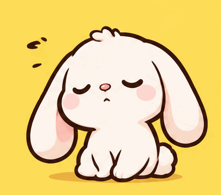

<sub>9 frames · 439×387 · 1.6s · gpt-image-2.6 · generated 2026-11-06</sub>

**Prompt**

```text
A small white cartoon bunny with long floppy ears and a pink nose, sitting and nodding off, head slowly drooping then jerking back up, a small bubble swelling and shrinking from its nose. Chibi sticker style, bold outline, plain warm yellow background.
```

`sticker` `reaction` `sticker-pack`

### 5. Cartoon cat waving hello


<sub>9 frames · 438×390 · 1.3s · gpt-image-2.6 · generated 2026-11-05</sub>

**Prompt**

```text
A cheerful cartoon cat waving hello.
```

> 💡 **Tip:** Even a one-line prompt works for simple greetings — the model fills in style and timing.

`sticker` `greeting` `minimal-prompt`

### 6. Confused shiba head tilt


<sub>9 frames · 439×390 · 1.6s · gpt-image-2.6 · generated 2026-11-06</sub>

**Prompt**

```text
A fluffy orange shiba inu puppy tilting its head to one side and back again, ears twitching, a small question mark popping above its head. Chibi sticker style, bold outline, plain light blue background.
```

`sticker` `reaction` `dog`

### 7. Cat typing furiously


<sub>16 frames · 380×242 · 1.9s · gpt-image-2.6 · generated 2026-11-06</sub>

**Prompt**

```text
A grey tabby cat sitting at a tiny laptop and typing furiously with both front paws, paws blurring, little speed lines and sweat drops flying off. Flat cartoon sticker style, bold outline, plain pale pink background.
```

> 💡 **Tip:** Speed lines and sweat drops make fast motion readable even with only a few frames.

`sticker` `work` `cat`

### 8. Frog blowing a heart

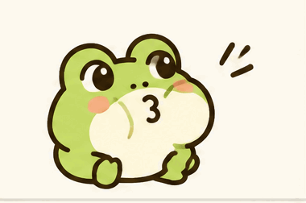

<sub>16 frames · 380×252 · 2.2s · gpt-image-2.6 · generated 2026-11-06</sub>

**Prompt**

```text
A round green cartoon frog puffing its cheeks and blowing a pink heart-shaped bubble that floats up and pops into tiny sparkles. Cute flat sticker style, bold outline, plain cream background.
```

`sticker` `love` `cute`

### 9. Penguin facepalm


<sub>9 frames · 435×389 · 1.4s · gpt-image-2.6 · generated 2026-11-06</sub>

**Prompt**

```text
A chubby cartoon penguin slowly raising one flipper and slapping it onto its forehead, then shaking its head in disbelief. Chibi sticker style, bold outline, plain light grey background.
```

`sticker` `reaction` `facepalm`

### 10. Basketball shot celebration


<sub>16 frames · 380×251 · 1.9s · gpt-image-2.6 · generated 2026-11-06</sub>

**Prompt**

```text
A chibi kid in a red jersey jumps and shoots a basketball, the ball swishes through the hoop, then the kid lands and pumps a fist in celebration before returning to the starting pose. Bold-outline sticker style, plain light orange background.
```

> 💡 **Tip:** For sports moves, break the action into 3 clear beats (jump, shot, celebrate). Complex tricks like a 360 kickflip still tend to fail.

`sticker` `sports` `celebration`

### 11. Cat chef tossing fried rice


<sub>16 frames · 323×295 · 1.9s · gpt-image-2.6 · generated 2026-11-06</sub>

**Prompt**

```text
A white cat chef in a tall chef hat tossing fried rice in a wok, the rice flies up in a little arc and lands back in the pan, a puff of steam rising each time. Comic cartoon style, warm kitchen background kept still.
```

`sticker` `food` `cat`

### 12. Black cat punch


<sub>9 frames · 437×390 · 1.3s · gpt-image-2.6 · generated 2026-11-06</sub>

**Prompt**

```text
A round black cat with big yellow eyes throwing a quick one-two punch toward the viewer with its front paws, little impact stars popping, then settling back into a boxing stance. Chibi sticker style, bold outline, plain pastel purple background.
```

`sticker` `reaction` `cat`

### 13. Office cat: exhausted


<sub>9 frames · 438×387 · 1.6s · gpt-image-2.6 · generated 2026-11-06</sub>

**Prompt**

```text
A chubby orange tabby cat office worker with a tiny blue tie and an employee badge slumps face-down onto a pile of papers on its desk, ears drooping, a tiny ghost of a sigh floating up, then twitches one paw. Flat cartoon sticker style, bold outline, plain pale grey background.
```

> 💡 **Tip:** Part of a set: repeat the exact same character description and only change the action — that is how real sticker packs stay consistent.

`sticker` `work` `sticker-pack`

### 14. Office cat: clocking out


<sub>16 frames · 374×249 · 2.6s · gpt-image-2.6 · generated 2026-11-06</sub>

**Prompt**

```text
A chubby orange tabby cat office worker with a tiny blue tie and an employee badge tosses its badge in the air, grabs a tiny backpack and does a happy little hop toward the door, tail swishing. Flat cartoon sticker style, bold outline, plain pale yellow background.
```

`sticker` `work` `sticker-pack`

### 15. Roaring duck


<sub>9 frames · 433×394 · 1.6s · gpt-image-2.6 · generated 2026-11-06</sub>

**Prompt**

```text
A small round yellow duck suddenly opening its beak wide and roaring like a lion, feathers blown back, the screen shaking slightly, then it calmly closes its beak. Cute cartoon sticker style, bold outline, plain sky-blue background.
```

`sticker` `reaction` `funny`

### 16. Chibi trader watching stocks crash


<sub>9 frames · 438×388 · 1.4s · gpt-image-2.6 · generated 2026-11-07</sub>

**Prompt**

```text
A chibi office worker in a white shirt and loose tie staring at a laptop where a red stock line plunges, his hopeful smile crumbling into big wobbling tears. Flat pastel sticker style on a plain light background.
```

`sticker` `office` `finance`

### 17. Chibi trader celebrating a rally


<sub>9 frames · 414×410 · 1.4s · gpt-image-2.6 · generated 2026-11-07</sub>

**Prompt**

```text
A chibi office worker in a white shirt and loose tie jumping up from his chair as a green stock line shoots upward on his laptop, throwing paper banknotes into the air with both hands. Flat pastel sticker style on a plain light background.
```

`sticker` `office` `finance`

### 18. Cat in sunglasses dancing

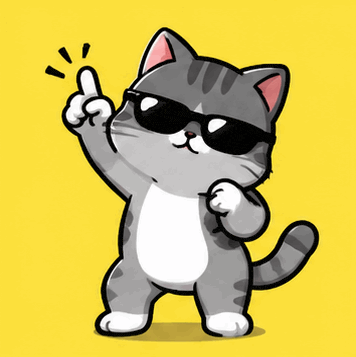

<sub>12 frames · 356×357 · 1.4s · gpt-image-2.6 · generated 2026-11-07</sub>

**Prompt**

```text
A cool grey cat wearing tiny black sunglasses doing a side-to-side groove dance, hips swaying and one paw pointing up then down. Bold cartoon sticker style on a plain yellow background.
```

`sticker` `cat` `dance`

### 19. Top-hat frog shooing bad vibes


<sub>9 frames · 438×390 · 1.4s · gpt-image-2.6 · generated 2026-11-07</sub>

**Prompt**

```text
A small green frog in a tall black top hat and a monocle waving a tiny cane in circles as if shooing away bad luck, little grey smoke puffs scattering. Cute storybook sticker style on a cream background.
```

`sticker` `frog` `reaction`

### 20. Busy bee clocking in


<sub>9 frames · 439×390 · 1.4s · gpt-image-2.6 · generated 2026-11-07</sub>

**Prompt**

```text
A round fuzzy cartoon bee with a tiny lanyard badge buzzing in place, wings fluttering fast, then giving a crisp salute. Soft flat sticker style on a plain mint background.
```

`sticker` `bee` `work`

### 21. Puppy swaying with hearts


<sub>9 frames · 437×389 · 1.6s · gpt-image-2.6 · generated 2026-11-07</sub>

**Prompt**

```text
A fluffy cream-colored puppy sitting and swaying its head left and right with its eyes closed happily, small pink hearts floating up around it. Kawaii sticker style on a plain white background.
```

`sticker` `dog` `love`

### 22. Goodnight kitty


<sub>16 frames · 380×251 · 2.9s · gpt-image-2.6 · generated 2026-11-07</sub>

**Prompt**

```text
A sleepy white kitten in a blue nightcap hugging a small pillow, slowly yawning and then nodding off as a tiny crescent moon bobs beside it. Soft pastel sticker style on a dark navy background.
```

`sticker` `cat` `goodnight`

### 23. Orange cat pouncing at the camera

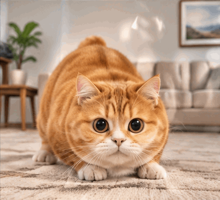

<sub>9 frames · 433×395 · 1.6s · gpt-image-2.6 · generated 2026-11-07</sub>

**Prompt**

```text
A chubby orange cat crouching, wiggling its rear, then leaping straight toward the viewer with paws spread wide until its face squishes against the glass. Funny cartoon style on a plain living room background.
```

`sticker` `cat` `funny`

### 24. Laughing so hard it cries


<sub>16 frames · 306×307 · 2.2s · gpt-image-2.6 · generated 2026-11-07</sub>

**Prompt**

```text
A round pink mochi blob character throwing its head back and laughing hysterically, tears spraying from its eyes, body shaking. Cute sticker style on a plain white background.
```

`sticker` `laugh` `reaction`

### 25. Apprentice spell backfires


<sub>8 frames · 439×388 · 1.3s · gpt-image-2.6 · generated 2026-11-07</sub>

**Prompt**

```text
A chibi wizard apprentice in an oversized purple hat waves a wand, a small puff explodes in front of her, and she is left blinking with a soot-black face and frizzy hair. Cute cartoon sticker style on a plain lilac background.
```

`sticker` `magic` `fail`

### 26. Cat baker sneezes flour


<sub>9 frames · 440×389 · 1.6s · gpt-image-2.6 · generated 2026-11-07</sub>

**Prompt**

```text
An anthropomorphic orange cat in an apron kneading dough on a wooden counter, then sneezing and blowing a big white cloud of flour into the air. Warm cartoon style.
```

`sticker` `cat` `cooking`

### 27. Lobster working overtime

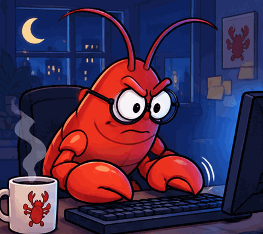

<sub>9 frames · 437×388 · 1.4s · gpt-image-2.6 · generated 2026-11-07</sub>

**Prompt**

```text
A red cartoon lobster wearing round glasses typing furiously on a keyboard with both claws at a desk late at night, lit by the blue glow of a monitor, a coffee mug steaming beside it. Cartoon sticker style.
```

`sticker` `work` `funny`

### 28. Penguin panics after hitting send


<sub>9 frames · 435×390 · 1.4s · gpt-image-2.6 · generated 2026-11-07</sub>

**Prompt**

```text
A small cartoon penguin slapping a big round red button labeled "SEND", then freezing as its eyes go wide and it grabs its head with both flippers in panic, sweat drops flying. Flat sticker style on a plain white background.
```

`sticker` `penguin` `reaction`

### 29. Otter in a teal scarf waving


<sub>9 frames · 438×389 · 1.6s · gpt-image-2.6 · generated 2026-11-07</sub>

**Prompt**

```text
A small brown sea otter with a cream muzzle and a teal knitted scarf turning toward the viewer, waving one paw twice and blinking. Soft sticker style on a plain cream background.
```

`sticker` `otter` `hello`

### 30. Office worker: received!


<sub>9 frames · 436×392 · 1.4s · gpt-image-2.6 · generated 2026-11-07</sub>

**Prompt**

```text
A chibi office worker with a tidy bob and a lanyard snapping to attention and giving a firm thumbs-up with a determined nod. Flat sticker style on a plain light blue background.
```

`sticker` `office` `reply`

### 31. Cat flying on a broomstick


<sub>16 frames · 378×252 · 2.2s · gpt-image-2.6 · generated 2026-11-07</sub>

**Prompt**

```text
A black cat with a tiny red scarf riding a wooden broomstick across a night sky, bobbing up and down, the scarf fluttering behind it. Cute storybook sticker style.
```

`sticker` `cat` `magic`

### 32. Baby robot wave and hop


<sub>9 frames · 440×388 · 1.4s · gpt-image-2.6 · generated 2026-11-07</sub>

**Prompt**

```text
A tiny round white baby robot with a glowing blue face screen and stubby legs waving one hand and doing a small happy hop, its antenna wobbling. Clean 3D toy style on a plain pastel background.
```

`sticker` `robot` `hello`

### 33. Hamster stuffing its cheeks


<sub>9 frames · 433×395 · 1.6s · gpt-image-2.6 · generated 2026-11-07</sub>

**Prompt**

```text
A golden hamster sitting up and stuffing sunflower seeds into its cheeks until they balloon comically, then blinking proudly. Cute cartoon style on a plain white background.
```

`sticker` `hamster` `food`

### 34. Duckling with a tiny umbrella


<sub>16 frames · 380×252 · 2.2s · gpt-image-2.6 · generated 2026-11-07</sub>

**Prompt**

```text
A yellow duckling holding a tiny red umbrella hopping in a small puddle, splashes rising with each hop while rain falls. Soft watercolor sticker style.
```

`sticker` `duck` `rain`

### 35. Gym bear doing chest presses

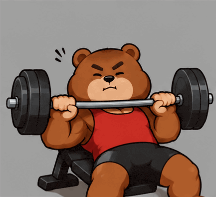

<sub>9 frames · 433×395 · 1.4s · gpt-image-2.6 · generated 2026-11-07</sub>

**Prompt**

```text
A muscular cartoon brown bear in a red tank top lying on a bench and pressing a barbell up and down, cheeks puffing with each rep. Bold cartoon sticker style on a plain grey background.
```

`sticker` `fitness` `bear`

### 36. Cat dozing in a VR headset

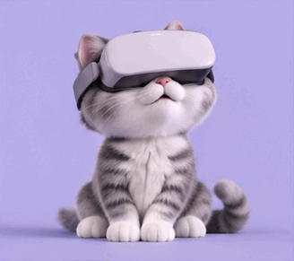

<sub>16 frames · 328×291 · 2.9s · gpt-image-2.6 · generated 2026-11-07</sub>

**Prompt**

```text
A fluffy grey cat wearing a sleek white VR headset slowly nodding off, its head drooping and jerking back up, a small Zzz bubble floating up. Soft 3D render on a plain lavender background.
```

`sticker` `cat` `tech`

### 37. Grateful shrimp bows deeply

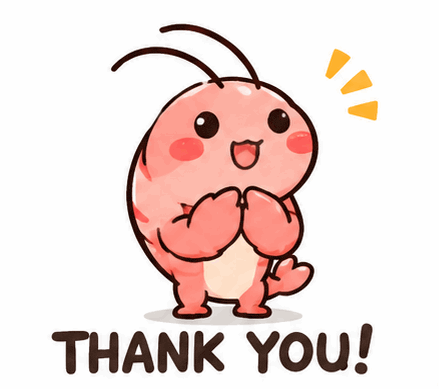

<sub>9 frames · 439×389 · 1.6s · gpt-image-2.6 · generated 2026-11-07</sub>

**Prompt**

```text
A small pink cartoon shrimp pressing its claws together, raising them high over its head and then bowing dramatically low, with the caption "THANK YOU!" fixed at the bottom. Flat sticker style on a white background.
```

`sticker` `caption` `thanks`

### 38. Mantis shrimp jiggles a flan

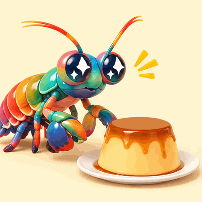

<sub>9 frames · 414×414 · 1.6s · gpt-image-2.6 · generated 2026-11-08</sub>

**Prompt**

```text
A rainbow-colored cartoon mantis shrimp poking a caramel flan on a plate with both front claws, the flan wobbling wildly while the shrimp's eyes sparkle with delight. Glossy clay-toy style on a pale yellow background.
```

`sticker` `food` `funny`

### 39. Gorilla shuffle dance


<sub>16 frames · 320×289 · 1.9s · gpt-image-2.6 · generated 2026-11-08</sub>

**Prompt**

```text
A chunky cartoon gorilla wearing a tiny red bow tie doing a side-to-side shuffle dance, swinging its long arms and bobbing its head to the beat. Flat vector sticker on a white background.
```

`sticker` `dance` `animal`

### 40. Bowl-cut dog scrolling


<sub>9 frames · 435×391 · 1.6s · gpt-image-2.6 · generated 2026-11-08</sub>

**Prompt**

```text
A small dog with a perfectly round bowl-cut hairstyle lying on its belly, scrolling a smartphone with one paw and snorting with laughter at the screen. Cute cartoon style on a white background.
```

`sticker` `phone` `dog`

### 41. Baby seal: shocked


<sub>9 frames · 439×388 · 1.4s · gpt-image-2.6 · generated 2026-11-08</sub>

**Prompt**

```text
a chubby white baby harp seal with big glossy black eyes, pink cheeks and a tiny blue scarf jolting backward in shock, eyes popping wide and whiskers standing straight out, with a small burst of exclamation lines. Flat chat-sticker style on a white background.
```

> 💡 **Tip:** For a set, reuse the exact same character description in every prompt.

`sticker` `seal` `shock`

### 42. Baby seal: sneaky giggle


<sub>8 frames · 439×390 · 1.2s · gpt-image-2.6 · generated 2026-11-08</sub>

**Prompt**

```text
a chubby white baby harp seal with big glossy black eyes, pink cheeks and a tiny blue scarf covering its mouth with one flipper and giggling, shoulders shaking and eyes curved into happy arcs. Flat chat-sticker style on a white background.
```

> 💡 **Tip:** For a set, reuse the exact same character description in every prompt.

`sticker` `seal` `laugh`

### 43. Baby seal: giving up


<sub>16 frames · 376×259 · 2.9s · gpt-image-2.6 · generated 2026-11-08</sub>

**Prompt**

```text
a chubby white baby harp seal with big glossy black eyes, pink cheeks and a tiny blue scarf lying flat on its belly and slowly melting into a puddle-like blob, then sighing a tiny cloud. Flat chat-sticker style on a white background.
```

> 💡 **Tip:** For a set, reuse the exact same character description in every prompt.

`sticker` `seal` `lazy`

### 44. Baby seal: crying


<sub>9 frames · 431×393 · 1.4s · gpt-image-2.6 · generated 2026-11-08</sub>

**Prompt**

```text
a chubby white baby harp seal with big glossy black eyes, pink cheeks and a tiny blue scarf bawling with its mouth wide open, two streams of tears spraying out sideways, flippers flapping. Flat chat-sticker style on a white background.
```

> 💡 **Tip:** For a set, reuse the exact same character description in every prompt.

`sticker` `seal` `cry`

### 45. Baby seal: sending love


<sub>9 frames · 435×388 · 1.6s · gpt-image-2.6 · generated 2026-11-08</sub>

**Prompt**

```text
a chubby white baby harp seal with big glossy black eyes, pink cheeks and a tiny blue scarf lifting both flippers together over its head to form a clear heart shape, then small pink hearts float up. Flat chat-sticker style on a white background.
```

> 💡 **Tip:** Two-limb heart gestures often fail to close; spell out that the flippers meet above the head.

`sticker` `seal` `love`

### 46. Shiba: on it, on it


<sub>9 frames · 436×388 · 1.3s · gpt-image-2.6 · generated 2026-11-08</sub>

**Prompt**

```text
A cream shiba inu at a desk typing furiously on a keyboard with both paws, sweat drops flying off its head, with the handwritten caption "在改了在改了" fixed at the top. Flat sticker style on a white background.
```

`sticker` `caption` `work`

### 47. Shiba takes a snowball

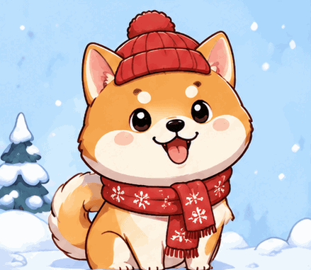

<sub>9 frames · 439×381 · 1.4s · gpt-image-2.6 · generated 2026-11-08</sub>

**Prompt**

```text
A shiba inu in a red knitted winter hat standing in the snow gets hit in the face by a snowball, snow bursting everywhere, then blinks and shakes its head. Cartoon sticker style on a pale blue background.
```

`sticker` `winter` `funny`

### 48. Tuxedo cat vs. foxtail toy


<sub>9 frames · 390×439 · 1.3s · gpt-image-2.6 · generated 2026-11-08</sub>

**Prompt**

```text
A simple black-and-white anime-style tuxedo cat sitting up and swatting at a foxtail grass toy dangling from above, ears flattened, tail twitching. Clean line art on a white background.
```

`sticker` `cat` `monochrome`

### 49. Hamster courier


<sub>9 frames · 433×388 · 1.4s · gpt-image-2.6 · generated 2026-11-08</sub>

**Prompt**

```text
A small golden hamster in a tiny brown courier cap pushing a cardboard parcel twice its size across the floor, cheeks puffed with effort and feet scrabbling. Cozy cartoon sticker on a white background.
```

`sticker` `work` `hamster`

### 50. Grandma in her Sunday hat


<sub>9 frames · 437×390 · 1.6s · gpt-image-2.6 · generated 2026-11-08</sub>

**Prompt**

```text
A cheerful cartoon grandma in a big floral Sunday hat and a pearl necklace clapping and swaying side to side to music, eyes closed in joy. Warm flat illustration on a soft pink background.
```

`sticker` `joy` `character`

### 51. Cardboard robot breakdance


<sub>9 frames · 440×388 · 1.6s · gpt-image-2.6 · generated 2026-11-08</sub>

**Prompt**

```text
A robot made from cardboard boxes with bottle-cap eyes doing a breakdance toprock step, then dropping into a one-hand freeze on a flattened cardboard mat. Hand-drawn marker style on white paper.
```

`sticker` `dance` `robot`

### 52. Corgi begs for a snack


<sub>9 frames · 412×412 · 1.4s · gpt-image-2.6 · generated 2026-11-08</sub>

**Prompt**

```text
A fluffy corgi mascot staring up at a treat just above its head, drooling, wiggling its round butt and doing a little hop. Cute vector sticker on a white background.
```

`sticker` `dog` `food`

### 53. Dramatic poodle faint


<sub>9 frames · 439×390 · 1.4s · gpt-image-2.6 · generated 2026-11-08</sub>

**Prompt**

```text
A white poodle mascot striking a dramatic pose, pressing a paw to its forehead and swooning backward onto a red velvet cushion. Exaggerated theatrical cartoon on a cream background.
```

`sticker` `drama` `dog`

### 54. White cat and yarn ball


<sub>9 frames · 439×390 · 1.4s · gpt-image-2.6 · generated 2026-11-08</sub>

**Prompt**

```text
A fluffy white kitten batting a red yarn ball, rolling onto its back with the ball in its paws, then popping back upright. Soft pastel cartoon on a pale lavender background.
```

`sticker` `cat` `play`

### 55. Flower-crown cat dance


<sub>9 frames · 414×414 · 1.3s · gpt-image-2.6 · generated 2026-11-08</sub>

**Prompt**

```text
A grey cat wearing a crown of small daisies doing a happy side-step dance on its hind legs, front paws swinging. Flat cute illustration on a light green background.
```

`sticker` `cat` `dance`

### 56. Raincoat kid big jump

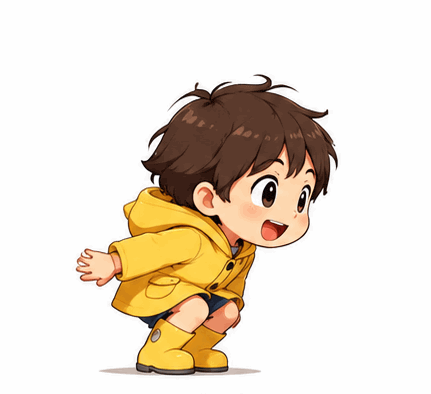

<sub>9 frames · 431×394 · 1.4s · gpt-image-2.6 · generated 2026-11-08</sub>

**Prompt**

```text
A chibi kid in a yellow raincoat crouching down, springing into a high jump with arms up, then landing with a little puff of dust. Side view, flat animation style on a white background.
```

`sticker` `jump` `character`

### 57. Mochi says OK


<sub>9 frames · 414×414 · 1.6s · gpt-image-2.6 · generated 2026-11-08</sub>

**Prompt**

```text
A round white mochi character with tiny arms bowing politely and then popping up holding an "OK!" sign, cheeks blushing. LINE-sticker style with thick outlines on a white background.
```

`sticker` `caption` `ok`

### 58. Snail mail delivery


<sub>9 frames · 437×387 · 1.6s · gpt-image-2.6 · generated 2026-11-08</sub>

**Prompt**

```text
A small snail with a tiny leather postbag slowly sliding forward and holding out an envelope with its antennae, smiling proudly. Soft storybook illustration on a cream background.
```

`sticker` `mail` `slow`

### 59. Surprised toast pops up


<sub>9 frames · 438×390 · 1.4s · gpt-image-2.6 · generated 2026-11-08</sub>

**Prompt**

```text
Two slices of toast with cartoon faces popping out of a chrome toaster, flipping in the air with surprised expressions, then dropping back in. Glossy 3D cartoon on a pale orange background.
```

`sticker` `food` `surprise`

### 60. Cactus wants a hug

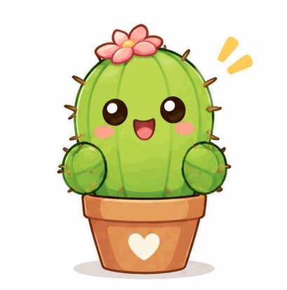

<sub>9 frames · 409×414 · 1.6s · gpt-image-2.6 · generated 2026-11-08</sub>

**Prompt**

```text
A small potted cactus character opening its spiky arms wide for a hug, then looking down at its spines and drooping sadly. Flat cute illustration on a white background.
```

`sticker` `hug` `sad`

### 61. Axolotl blows a bubble


<sub>16 frames · 378×241 · 2.2s · gpt-image-2.6 · generated 2026-11-08</sub>

**Prompt**

```text
A pink axolotl with frilly gills puffing its cheeks to blow a round bubble that grows, pops, and leaves it blinking in surprise. Soft cartoon style, light aqua background.
```

`sticker` `water` `cute`

### 62. Sloth wakes up with coffee


<sub>16 frames · 384×262 · 2.9s · gpt-image-2.6 · generated 2026-11-08</sub>

**Prompt**

```text
A sleepy sloth hanging from a branch slowly sipping coffee from a tiny cup, then its eyes pop wide open with sparkles. Soft cartoon sticker on a white background.
```

`sticker` `coffee` `morning`

### 63. Frog puddle jump

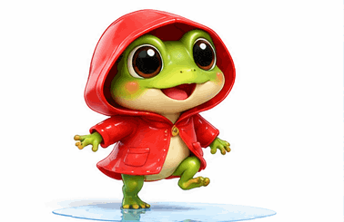

<sub>16 frames · 378×245 · 2.2s · gpt-image-2.6 · generated 2026-11-08</sub>

**Prompt**

```text
A small green frog in a red raincoat leaping into a puddle, water splashing up in a crown, then giving a happy little wave. Bright cartoon style on a white background.
```

`sticker` `rain` `frog`

### 64. Bunny rolling on the floor crying


<sub>9 frames · 439×390 · 1.3s · gpt-image-2.6 · generated 2026-11-09</sub>

**Prompt**

```text
A chubby cream-colored cartoon bunny lying on its back on the floor, kicking its little legs and rolling side to side while sobbing, big cartoon tears flying off both sides. Thick outlines, flat colors, plain pale pink background.
```

`sticker` `crying` `bunny`

### 65. 90s anime gasp


<sub>9 frames · 433×395 · 1.6s · gpt-image-2.6 · generated 2026-11-09</sub>

**Prompt**

```text
A 1990s cel-animation style girl with two long auburn braids, a band of freckles across her nose, round glasses and a green denim jacket gasping in shock: her eyes go wide behind the glasses, a big sweat drop appears beside her head, then her shoulders drop. Soft film grain, VHS-era color palette, plain lavender background.
```

> 💡 **Tip:** Name the decade and medium (cel animation, film grain, VHS palette) and keep the character design generic so it doesn't drift toward a known show.

`anime` `retro` `reaction`

### 66. 90s anime blush


<sub>9 frames · 439×390 · 1.4s · gpt-image-2.6 · generated 2026-11-09</sub>

**Prompt**

```text
A 1990s cel-animation style boy with messy brown hair and a red scarf blushing: pink hatched lines spread across his cheeks, he looks away and scratches the back of his head. Soft film grain, VHS-era color palette, plain peach background.
```

`anime` `retro` `reaction`

### 67. Otter holding a thank-you sign


<sub>9 frames · 438×389 · 1.6s · gpt-image-2.6 · generated 2026-11-09</sub>

**Prompt**

```text
A small brown cartoon otter holding up a little wooden sign that reads "THANK YOU", bowing forward and popping back up with a happy squint, tiny hearts floating above. Thick outlines, flat colors, plain mint background.
```

> 💡 **Tip:** Short words in quotes usually stay legible; check every frame for letter changes.

`sticker` `thanks` `text`

### 68. Shrimp saved by a recovered file

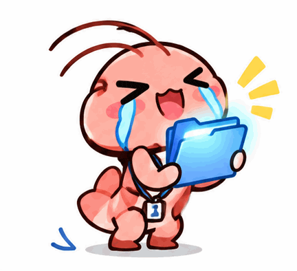

<sub>9 frames · 432×394 · 1.6s · gpt-image-2.6 · generated 2026-11-09</sub>

**Prompt**

```text
A small pink cartoon shrimp in a tiny office lanyard hugging a glowing blue folder icon to its chest, crying tears of relief and bouncing up and down with joy. Thick outlines, flat colors, plain white background.
```

`sticker` `office` `relief`

### 69. Panda resting on a cushion

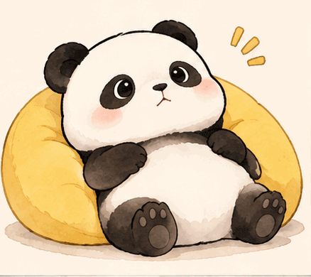

<sub>9 frames · 438×390 · 2.7s · gpt-image-2.6 · generated 2026-11-09</sub>

**Prompt**

```text
A chubby cartoon panda leaning back on a big round yellow cushion, slowly closing its eyes and letting out a long relaxed sigh, a small "zzz" drifting up. Soft watercolor texture, gentle outlines, plain cream background.
```

`sticker` `rest` `panda`

### 70. Hedgehog hugging a sweet potato


<sub>9 frames · 439×390 · 1.4s · gpt-image-2.6 · generated 2026-11-09</sub>

**Prompt**

```text
A tiny cartoon hedgehog hugging a roasted sweet potato almost as big as itself, steam rising from the cracked skin, the hedgehog taking a happy nibble and wiggling. Crayon doodle style on plain off-white paper.
```

`sticker` `food` `doodle`

### 71. Caveman shrug

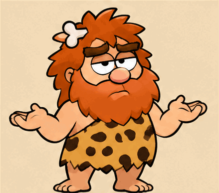

<sub>9 frames · 439×387 · 1.6s · gpt-image-2.6 · generated 2026-11-09</sub>

**Prompt**

```text
A stocky cartoon caveman with a wild orange beard, a bone hair clip and a spotted fur tunic shrugging with both palms up and an unimpressed face, eyebrows bouncing once. Thick outlines, flat colors, plain sand-colored background.
```

`sticker` `shrug` `reaction`

### 72. Too many emails, close laptop


<sub>9 frames · 436×390 · 1.6s · gpt-image-2.6 · generated 2026-11-09</sub>

**Prompt**

```text
A cartoon office worker with round glasses opening a laptop, the screen showing a red badge with a huge unread count, their face going pale, then slowly closing the laptop again. Exaggerated expressions, thick outlines, flat colors, plain light grey background.
```

`sticker` `office` `email`

### 73. Smug raccoon says no thanks

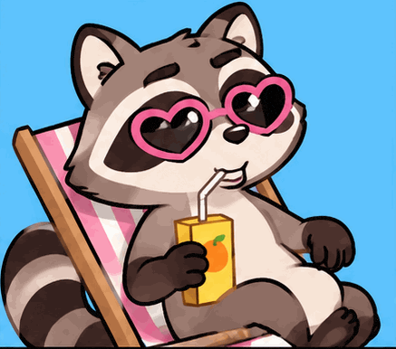

<sub>9 frames · 437×386 · 1.4s · gpt-image-2.6 · generated 2026-11-09</sub>

**Prompt**

```text
A smug cartoon raccoon in pink heart-shaped sunglasses lounging in a beach chair, sipping a juice box and lazily waving one paw in a "no thanks" gesture, eyebrows raised. Thick outlines, flat colors, plain sky-blue background.
```

`sticker` `smug` `reaction`

### 74. Monday desk slump

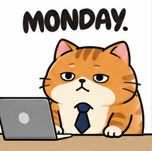

<sub>16 frames · 309×306 · 2.9s · gpt-image-2.6 · generated 2026-11-09</sub>

**Prompt**

```text
A chubby orange cat wearing a navy necktie slumping over a laptop, sinking lower and lower until it disappears behind the desk, then popping back up with a tired face. The word "MONDAY." printed above in bold letters. Thick outlines, flat colors, plain white background.
```

`sticker` `office` `monday` `text`

### 75. Collapsed souffle tears


<sub>9 frames · 439×390 · 2.0s · gpt-image-2.6 · generated 2026-11-09</sub>

**Prompt**

```text
A chibi baker girl in a white apron pulling a tall souffle out of the oven, the souffle sinking flat, her eyes filling with tears, then she shrugs and takes a spoonful. Soft pastel cartoon, plain warm beige background.
```

> 💡 **Tip:** Four beats (pull out, collapse, cry, eat) fit a 6-frame sprite sheet; more beats make each step blur together.

`sticker` `baking` `chibi`

### 76. Tabby cat double take


<sub>9 frames · 439×390 · 1.6s · gpt-image-2.6 · generated 2026-11-09</sub>

**Prompt**

```text
A calm orange tabby cat sitting sideways, then suddenly turning toward the viewer: its eyes go huge, ears shoot up, mouth drops open, then it settles back to calm. Clean cartoon style, plain pale yellow background.
```

`sticker` `cat` `shocked`

### 77. Capybara: OK


<sub>8 frames · 439×389 · 1.4s · gpt-image-2.6 · generated 2026-11-09</sub>

**Prompt**

```text
a round brown cartoon capybara with a small orange yuzu balanced on its head, sleepy half-closed eyes and a calm smile, thick clean outlines, flat pastel colors, plain cream background. The capybara slowly raises one stubby paw into an OK sign and nods once, the yuzu wobbling on its head.
```

> 💡 **Tip:** All four capybara entries share the exact same character description so the set stays consistent.

`sticker` `capybara` `series`

### 78. Capybara: sleepy nod

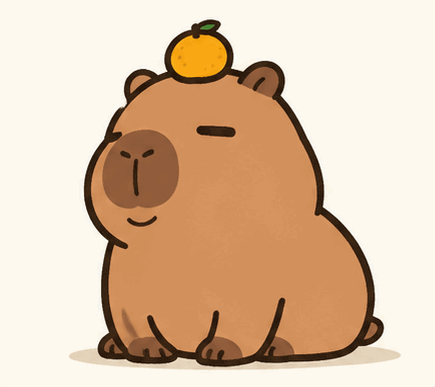

<sub>9 frames · 435×387 · 1.6s · gpt-image-2.6 · generated 2026-11-09</sub>

**Prompt**

```text
a round brown cartoon capybara with a small orange yuzu balanced on its head, sleepy half-closed eyes and a calm smile, thick clean outlines, flat pastel colors, plain cream background. The capybara's head slowly droops forward as it dozes off, then jerks back up, the yuzu nearly falling off.
```

`sticker` `capybara` `series`

### 79. Capybara: cheering


<sub>9 frames · 433×393 · 1.4s · gpt-image-2.6 · generated 2026-11-09</sub>

**Prompt**

```text
a round brown cartoon capybara with a small orange yuzu balanced on its head, sleepy half-closed eyes and a calm smile, thick clean outlines, flat pastel colors, plain cream background. The capybara waves two tiny pom-poms above its head and bounces, small sparkles popping around it.
```

`sticker` `capybara` `series`

### 80. Capybara: hot spring


<sub>9 frames · 439×387 · 2.0s · gpt-image-2.6 · generated 2026-11-09</sub>

**Prompt**

```text
a round brown cartoon capybara with a small orange yuzu balanced on its head, sleepy half-closed eyes and a calm smile, thick clean outlines, flat pastel colors, plain cream background. The capybara sits up to its chin in a small round hot spring, steam curling up, eyes closing in bliss as it sinks slightly lower.
```

`sticker` `capybara` `series`

### 81. Koala jolted awake


<sub>16 frames · 378×246 · 2.9s · gpt-image-2.6 · generated 2026-11-09</sub>

**Prompt**

```text
A sleepy grey cartoon koala hugging a giant mug, nodding off until its nose dips into the coffee, then jolting wide awake with spiky fur. Thick outlines, flat colors, plain soft green background.
```

`sticker` `coffee` `sleepy`

### 82. Duckling in big headphones


<sub>16 frames · 308×309 · 1.9s · gpt-image-2.6 · generated 2026-11-09</sub>

**Prompt**

```text
A fluffy yellow duckling wearing oversized purple headphones, eyes closed, bobbing its head and tapping one foot to the beat, small music notes floating around. Thick outlines, flat colors, plain lilac background.
```

`sticker` `music` `duck`

### 83. Tortoise: on my way


<sub>16 frames · 378×253 · 1.8s · gpt-image-2.6 · generated 2026-11-09</sub>

**Prompt**

```text
A green cartoon tortoise with a tiny backpack running as fast as it can, legs spinning in a blur with speed lines and sweat drops, but barely moving forward. Thick outlines, flat colors, plain white background.
```

`sticker` `late` `funny`

### 84. Raccoon finds a treasure


<sub>16 frames · 380×251 · 2.2s · gpt-image-2.6 · generated 2026-11-09</sub>

**Prompt**

```text
A grey cartoon raccoon popping up out of a cardboard box holding a shiny silver spoon high above its head, eyes sparkling proudly, a little gleam flashing on the spoon. Thick outlines, flat colors, plain orange background.
```

`sticker` `proud` `raccoon`

### 85. Dinosaur tiny-arm clap

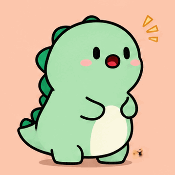

<sub>12 frames · 358×358 · 1.7s · gpt-image-2.6 · generated 2026-11-09</sub>

**Prompt**

```text
A chubby mint-green cartoon dinosaur trying hard to clap with its very short arms, the paws barely reaching, its face scrunched in effort, then a proud grin. Thick outlines, flat colors, plain peach background.
```

`sticker` `clap` `dinosaur`

### 86. Owl side-eye


<sub>9 frames · 439×389 · 2.0s · gpt-image-2.6 · generated 2026-11-09</sub>

**Prompt**

```text
A round brown cartoon owl perched on a branch, slowly turning its eyes sideways toward the viewer and raising one feathery eyebrow in suspicion, then blinking once. Thick outlines, flat colors, plain teal background.
```

`sticker` `side-eye` `reaction`

### 87. Cloud sneezes rain

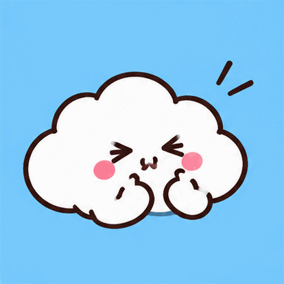

<sub>9 frames · 414×414 · 1.6s · gpt-image-2.6 · generated 2026-11-09</sub>

**Prompt**

```text
A small fluffy white cloud character with rosy cheeks scrunching up its face and sneezing, a burst of raindrops and a tiny rainbow shooting out, then sniffling. Thick outlines, flat colors, plain sky-blue background.
```

`sticker` `weather` `cute`

### 88. Pug blows out a candle


<sub>9 frames · 439×390 · 1.6s · gpt-image-2.6 · generated 2026-11-09</sub>

**Prompt**

```text
A pug in a striped party hat puffing its cheeks and blowing out a single candle on a pink cupcake, the flame going out and colorful confetti popping up. Thick outlines, flat colors, plain yellow background.
```

`sticker` `birthday` `dog`

### 89. Alpaca hair flip


<sub>9 frames · 436×390 · 1.3s · gpt-image-2.6 · generated 2026-11-09</sub>

**Prompt**

```text
A fluffy white cartoon alpaca with a huge curly fringe tossing its head to flip the fringe out of its eyes, then posing with a confident wink. Thick outlines, flat colors, plain pink background.
```

`sticker` `sassy` `alpaca`

### 90. Cherry cake hat sprite waves


<sub>9 frames · 438×386 · 1.3s · gpt-image-2.6 · generated 2026-11-10</sub>

**Prompt**

```text
A tiny round cream-colored creature wearing a little strawberry shortcake with a cherry on top as a hat. It waves one stubby arm and does a small happy bounce, the cherry wobbling. Soft pastel sticker style, thick outline, plain white background.
```

`sticker` `cute` `original-character`

### 91. Cream puff stretch and yawn


<sub>9 frames · 412×412 · 1.6s · gpt-image-2.6 · generated 2026-11-10</sub>

**Prompt**

```text
A chubby cream puff character with tiny arms stretches upward and lets out a big yawn, a little cream squishing out of its top, then settles back down sleepily. Kawaii sticker style, bold outline, plain pale yellow background.
```

`sticker` `sleepy` `food`

### 92. Cat-ear hoodie girl nods yes


<sub>9 frames · 444×394 · 1.4s · gpt-image-2.6 · generated 2026-11-10</sub>

**Prompt**

```text
A chibi girl in an oversized mint hoodie with cat ears on the hood nods eagerly twice, the ears flopping, eyes closed in a happy smile. Clean anime-inspired chibi sticker style, plain white background.
```

`sticker` `yes` `chibi`

### 93. Bear slips on a banana peel


<sub>12 frames · 356×358 · 1.9s · gpt-image-2.6 · generated 2026-11-10</sub>

**Prompt**

```text
A round brown cartoon bear walks forward, steps on a banana peel, and flips onto its back with legs in the air and stars circling its head. Slapstick sticker style, thick outline, plain white background.
```

`sticker` `slapstick` `fail`

### 94. Rabbit comedic fan smack


<sub>9 frames · 432×395 · 1.1s · gpt-image-2.6 · generated 2026-11-10</sub>

**Prompt**

```text
A white rabbit in a tiny bow tie swings a folded paper fan sideways in a classic comedy retort gesture, mouth open mid-shout, with speed lines. Bold manga-comedy sticker style, plain white background.
```

`sticker` `reaction` `comedy`

### 95. Pigeon spit-take


<sub>8 frames · 437×383 · 1.1s · gpt-image-2.6 · generated 2026-11-10</sub>

**Prompt**

```text
A gray city pigeon holding a tiny teacup takes a sip and sprays the tea out in a dramatic spit-take, eyes bulging. Cartoon sticker style, thick outline, plain light blue background.
```

`sticker` `reaction` `shock`

### 96. Round robot hears good news


<sub>16 frames · 380×252 · 2.2s · gpt-image-2.6 · generated 2026-11-10</sub>

**Prompt**

```text
A small round white robot with a screen face: its pixel eyes grow wide and sparkly, both little arms shoot up in celebration, then it returns to a neutral pose. High-contrast flat shapes, pale blue background.
```

`sticker` `celebrate` `robot`

### 97. Monkey on roller skates


<sub>9 frames · 439×390 · 1.4s · gpt-image-2.6 · generated 2026-11-10</sub>

**Prompt**

```text
A cheerful cartoon monkey in red roller skates glides along a sidewalk, arms out for balance, its tail swaying behind. Bright flat illustration, simple sidewalk and plain sky background, side view.
```

`character` `skate` `animal`

### 98. Bubblegum bubble pops in a neon diner


<sub>9 frames · 435×386 · 2.0s · gpt-image-2.6 · generated 2026-11-10</sub>

**Prompt**

```text
An illustrated girl in a retro neon diner booth at night slowly blows a big pink bubblegum bubble until it pops on her face. Pink and teal neon lighting, stylized illustration, fixed camera.
```

`reaction` `neon` `retro`

### 99. Horned chibi girl twirls


<sub>12 frames · 358×358 · 1.9s · gpt-image-2.6 · generated 2026-11-10</sub>

**Prompt**

```text
A chibi girl with small curled ivory horns, wearing a ruffled lavender gown, does a little twirl so the skirt flares out, then curtsies. Soft cel-shaded chibi style, plain cream background.
```

`dance` `chibi` `original-character`

### 100. Cactus reads the newspaper


<sub>9 frames · 439×390 · 1.6s · gpt-image-2.6 · generated 2026-11-10</sub>

**Prompt**

```text
A green cactus character wearing a wide straw hat sits on a stool reading a newspaper, peeks over the top with raised eyebrows, then flips the page. Flat cartoon style, plain sandy background.
```

`sticker` `reading` `plant`

### 101. Young mage levitates a glowing orb


<sub>9 frames · 433×387 · 1.4s · gpt-image-2.6 · generated 2026-11-10</sub>

**Prompt**

```text
A young mage in a hooded blue cloak holds both palms apart while a glowing turquoise orb floats and slowly rotates between them, sparks circling. Anime-style illustration, dark gradient background.
```

`magic` `character` `glow`

### 102. Chick bounce entrance


<sub>9 frames · 432×393 · 1.3s · gpt-image-2.6 · generated 2026-11-10</sub>

**Prompt**

```text
A fluffy yellow chick drops in from above, squashes flat on landing, springs back up, and strikes a proud pose with one wing raised. Squash-and-stretch cartoon style, plain white background.
```

`entrance` `sticker` `bounce`

### 103. Sheep fluffs up and dozes


<sub>9 frames · 414×413 · 1.6s · gpt-image-2.6 · generated 2026-11-10</sub>

**Prompt**

```text
A round fluffy sheep slowly puffs up its wool like a cloud, its eyes droop closed, and small Z letters float up. Soft pastel sticker style, plain lilac background.
```

`sticker` `sleepy` `animal`

### 104. Octopus types on four keyboards


<sub>9 frames · 438×387 · 1.3s · gpt-image-2.6 · generated 2026-11-10</sub>

**Prompt**

```text
A purple cartoon octopus wearing glasses types furiously on four keyboards at once, tentacles moving in turn, a tiny sweat drop flying off. Flat office-humor sticker style, plain white background.
```

`sticker` `work` `busy`

### 105. Duck mic drop


<sub>12 frames · 356×356 · 1.9s · gpt-image-2.6 · generated 2026-11-10</sub>

**Prompt**

```text
A white duck in sunglasses holds a tiny microphone out at wing's length, drops it, and turns away with a smug look. Cartoon sticker style, thick outline, plain yellow background.
```

`sticker` `smug` `reaction`

### 106. Mushroom nods yes


<sub>9 frames · 412×413 · 1.4s · gpt-image-2.6 · generated 2026-11-10</sub>

**Prompt**

```text
A small red-capped mushroom character with white spots nods enthusiastically, its cap bouncing up and down, cheeks blushing. Cute sticker style, plain mint background.
```

`sticker` `yes` `cute`

### 107. Tofu shivers in the cold


<sub>16 frames · 324×295 · 1.9s · gpt-image-2.6 · generated 2026-11-10</sub>

**Prompt**

```text
A soft white tofu block character wrapped in a tiny scarf shivers hard, teeth chattering, with a little icicle hanging from its edge and snowflakes drifting. Kawaii sticker style, plain icy blue background.
```

`sticker` `cold` `food`

### 108. Dumpling hides a blush


<sub>9 frames · 437×388 · 1.6s · gpt-image-2.6 · generated 2026-11-10</sub>

**Prompt**

```text
A plump steamed dumpling character covers its face with tiny hands, peeks out between them, and blushes bright pink. Kawaii sticker style, bold outline, plain white background.
```

`sticker` `shy` `food`

### 109. Angry goose honks


<sub>16 frames · 380×250 · 1.9s · gpt-image-2.6 · generated 2026-11-10</sub>

**Prompt**

```text
A white goose stretches its neck forward, flaps its wings wide, and honks angrily with its beak open, a little cartoon anger mark above its head. Cartoon sticker style, plain light green background.
```

`sticker` `angry` `animal`

### 110. Office bear: Monday sigh

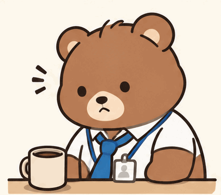

<sub>9 frames · 436×386 · 1.6s · gpt-image-2.6 · generated 2026-11-11</sub>

**Prompt**

```text
a chubby cartoon brown bear office worker in a loose blue tie and a lanyard badge, round ears, small dot eyes, thick clean outlines, flat pastel colors, plain cream background. The bear slumps forward over a coffee mug, shoulders rising and falling with a long sigh, a small gray puff of breath drifting out.
```

`sticker` `bear` `series` `office`

### 111. Office bear: eye roll


<sub>12 frames · 356×357 · 1.9s · gpt-image-2.6 · generated 2026-11-11</sub>

**Prompt**

```text
a chubby cartoon brown bear office worker in a loose blue tie and a lanyard badge, round ears, small dot eyes, thick clean outlines, flat pastel colors, plain cream background. The bear holds a phone, glances at it, then rolls its eyes up dramatically and lets the phone drop to its side.
```

`sticker` `bear` `series` `reaction`

### 112. Office bear: sneaky snack


<sub>12 frames · 356×355 · 2.2s · gpt-image-2.6 · generated 2026-11-11</sub>

**Prompt**

```text
a chubby cartoon brown bear office worker in a loose blue tie and a lanyard badge, round ears, small dot eyes, thick clean outlines, flat pastel colors, plain cream background. Hiding behind a laptop screen, the bear peeks left and right, then quickly pops a cookie into its mouth and chews with puffed cheeks.
```

`sticker` `bear` `series` `office`

### 113. Office bear: overtime wail

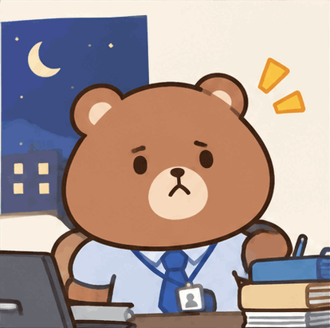

<sub>9 frames · 414×412 · 1.6s · gpt-image-2.6 · generated 2026-11-11</sub>

**Prompt**

```text
a chubby cartoon brown bear office worker in a loose blue tie and a lanyard badge, round ears, small dot eyes, thick clean outlines, flat pastel colors, plain cream background. At a desk piled with folders under a night-blue window, the bear opens its mouth wide and wails, two streams of tears spraying sideways.
```

`sticker` `bear` `series` `office`

### 114. Office bear: payday


<sub>16 frames · 378×252 · 2.6s · gpt-image-2.6 · generated 2026-11-11</sub>

**Prompt**

```text
a chubby cartoon brown bear office worker in a loose blue tie and a lanyard badge, round ears, small dot eyes, thick clean outlines, flat pastel colors, plain cream background. The bear throws its head back laughing while hugging a fat envelope, small coins bouncing up around it.
```

`sticker` `bear` `series` `money`

### 115. Office bear: clocking out


<sub>9 frames · 435×388 · 1.3s · gpt-image-2.6 · generated 2026-11-11</sub>

**Prompt**

```text
a chubby cartoon brown bear office worker in a loose blue tie and a lanyard badge, round ears, small dot eyes, thick clean outlines, flat pastel colors, plain cream background. With a backpack on, the bear jogs in place with fast little legs, speed lines streaming behind and its tie flapping over its shoulder.
```

`sticker` `bear` `series` `office`

### 116. Christmas Eve apple unwrap

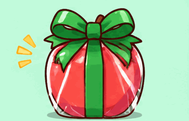

<sub>16 frames · 378×242 · 2.9s · gpt-image-2.6 · generated 2026-11-11</sub>

**Prompt**

```text
a cute cartoon red apple wrapped in a shiny gift wrapper with a green ribbon, on a plain mint background. Small hands pull off the wrapper, revealing another wrapper underneath, and the apple gives a puzzled blink. Flat sticker style, thick outlines.
```

`sticker` `christmas` `holiday`

### 117. Asleep at the countdown

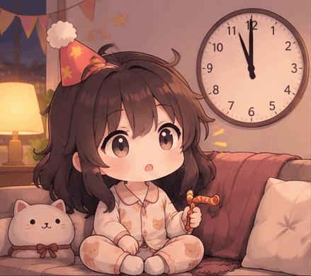

<sub>9 frames · 439×390 · 2.0s · gpt-image-2.6 · generated 2026-11-11</sub>

**Prompt**

```text
a chibi kid in pajamas and a party hat sits on a sofa holding a tiny noisemaker; a wall clock shows one minute to midnight. The kid's head nods down slowly, jerks back up, then nods again with a floating Zzz. Cozy flat illustration, warm lamp light.
```

`sticker` `new-year` `holiday`

### 118. Red envelope: no, no, yes

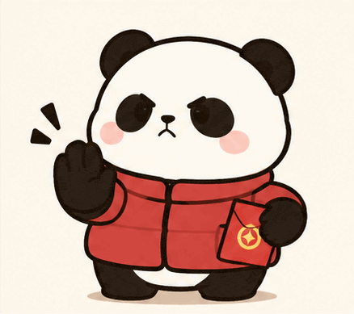

<sub>9 frames · 438×389 · 1.6s · gpt-image-2.6 · generated 2026-11-11</sub>

**Prompt**

```text
a round cartoon panda in a red padded jacket shakes its head and waves one paw in polite refusal, while its other paw quietly slips a red envelope into its jacket pocket. Flat sticker style, plain cream background, thick outlines.
```

`sticker` `lunar-new-year` `holiday`

### 119. End-screen wave


<sub>9 frames · 500×332 · 1.4s · gpt-image-2.6 · generated 2026-11-11</sub>

**Prompt**

```text
a friendly cartoon robot with a round screen face showing a smile stands on the right side of a plain coral background, waves one hand and points to a blank rounded rectangle on the left where a red bell icon gives a little shake. Flat vector style.
```

`creator` `video` `mascot`

### 120. Desk stretch break


<sub>16 frames · 379×252 · 2.9s · gpt-image-2.6 · generated 2026-11-11</sub>

**Prompt**

```text
a chibi office worker with messy hair types fast on a laptop, then leans back and stretches both arms high with a big yawn before returning to typing. Flat pastel illustration, plain light gray background.
```

`sticker` `office` `work`

### 121. Deadline hamster on fire


<sub>9 frames · 433×395 · 1.4s · gpt-image-2.6 · generated 2026-11-11</sub>

**Prompt**

```text
a tiny golden hamster in round glasses types furiously on a little keyboard while a cartoon flame burns on top of its head and sweat drops fly off. White sticker border, flat colors, plain pale yellow background.
```

`sticker` `deadline` `work`

### 122. Avocado OMG jump

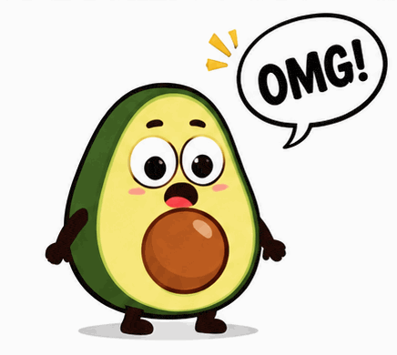

<sub>9 frames · 436×390 · 1.4s · gpt-image-2.6 · generated 2026-11-11</sub>

**Prompt**

```text
a cartoon avocado half with a big seed belly and tiny arms leaps up in surprise, eyes wide and mouth open, a speech bubble reading OMG! popping beside it. Bold outlines, flat colors, plain white background.
```

`sticker` `food` `text`

### 123. Plush bear sipping cocoa


<sub>9 frames · 439×390 · 1.6s · gpt-image-2.6 · generated 2026-11-11</sub>

**Prompt**

```text
a soft plush teddy bear with visible fabric texture and stitched seams holds a big mug with both paws, takes a slow sip, and closes its eyes contentedly as steam curls up. Cozy warm lighting, plain oatmeal background.
```

`sticker` `plush` `cozy`

### 124. Mood toggle cube


<sub>12 frames · 358×358 · 2.6s · gpt-image-2.6 · generated 2026-11-11</sub>

**Prompt**

```text
a cute pastel yellow cube character with stubby legs stands still and switches expressions: a grumpy frown with a small storm cloud, then a big grin with sparkles. Kawaii flat style, plain light blue background.
```

`sticker` `emotion` `reaction`

### 125. Penguin belly slide


<sub>12 frames · 356×357 · 1.7s · gpt-image-2.6 · generated 2026-11-11</sub>

**Prompt**

```text
a round cartoon penguin with a tiny red beanie slides on its belly across a patch of ice, flaps its flippers happily and gives a little wave. Flat colors, thick outlines, plain icy blue background.
```

`sticker` `penguin` `winter`

### 126. Fox spills coffee

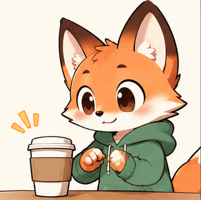

<sub>9 frames · 413×412 · 1.3s · gpt-image-2.6 · generated 2026-11-11</sub>

**Prompt**

```text
a cartoon orange fox in a green hoodie bumps a coffee cup, the coffee splashes up, and the fox freezes with a wide-eyed oops face and paws on its cheeks. Flat sticker style, plain cream background.
```

`sticker` `fox` `oops`

### 127. Slow thumbs up


<sub>9 frames · 437×386 · 2.7s · gpt-image-2.6 · generated 2026-11-11</sub>

**Prompt**

```text
a sleepy green cartoon turtle in a tiny knit cap very slowly raises one flipper into a thumbs-up and gives a lazy smile. Flat pastel colors, thick outlines, plain light peach background.
```

`sticker` `turtle` `approval`

### 128. Upside-down bat goodnight


<sub>9 frames · 430×391 · 2.0s · gpt-image-2.6 · generated 2026-11-11</sub>

**Prompt**

```text
a fluffy little purple bat hangs upside down from a branch, wraps its wings around itself and sways gently while a small crescent moon and Zzz float nearby. Kawaii flat style, plain midnight blue background.
```

`sticker` `goodnight` `bat`

### 129. Bunny carrot crunch


<sub>16 frames · 379×247 · 1.6s · gpt-image-2.6 · generated 2026-11-11</sub>

**Prompt**

```text
a white cartoon bunny with floppy ears holds a big carrot and munches quickly, cheeks bouncing, small orange crumbs flying off. Flat colors, plain pale green background.
```

`sticker` `bunny` `food`

### 130. Lamb says sorry


<sub>16 frames · 322×293 · 2.2s · gpt-image-2.6 · generated 2026-11-11</sub>

**Prompt**

```text
a fluffy cartoon lamb with a cloud-like wool coat presses its hooves together and bows deeply, a small sweat drop and a pink heart appearing above. Soft pastel flat style, plain lavender background.
```

`sticker` `apology` `lamb`

### 131. Juggling squirrel


<sub>16 frames · 326×291 · 1.9s · gpt-image-2.6 · generated 2026-11-11</sub>

**Prompt**

```text
a red cartoon squirrel with a huge fluffy tail juggles three acorns in an arc, tongue out in concentration. Flat colors, thick outlines, plain warm beige background.
```

`sticker` `squirrel` `fun`

### 132. Whale spout hello


<sub>16 frames · 380×252 · 2.9s · gpt-image-2.6 · generated 2026-11-11</sub>

**Prompt**

```text
a chubby baby blue whale bobs on small waves and puffs a water spout shaped like a heart from its blowhole, then smiles. Flat pastel style, plain aqua background.
```

`sticker` `whale` `hello`

### 133. Cartoon shark fin wave


<sub>9 frames · 437×387 · 1.4s · gpt-image-2.6 · generated 2026-11-12</sub>

**Prompt**

```text
A chubby light-blue cartoon shark pops halfway out of a tiny wave, waves one fin hello and grins showing round teeth. Flat colors, thick outlines, plain white background.
```

`sticker` `shark` `hello`

### 134. Hedgehog blush hide

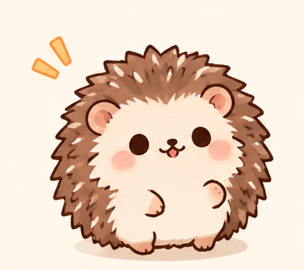

<sub>9 frames · 439×390 · 1.6s · gpt-image-2.6 · generated 2026-11-12</sub>

**Prompt**

```text
A tiny brown hedgehog with pink cheeks hears a compliment, blushes bright red and curls up into a spiky ball, then peeks out with one eye. Soft kawaii sticker style, plain cream background.
```

`sticker` `hedgehog` `shy`

### 135. Frog noted salute


<sub>9 frames · 412×412 · 1.4s · gpt-image-2.6 · generated 2026-11-12</sub>

**Prompt**

```text
A round green frog in a tiny yellow raincoat stands up straight and gives a crisp salute, its cheeks puffing proudly. Chunky cartoon sticker, thick white outline, plain mint background.
```

`sticker` `frog` `ok`

### 136. Bunny head pat melt

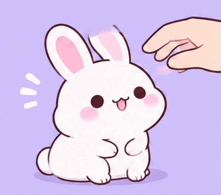

<sub>9 frames · 437×386 · 1.6s · gpt-image-2.6 · generated 2026-11-12</sub>

**Prompt**

```text
A small white bunny receives gentle pats from a hand entering the frame and slowly melts into a happy flat puddle with closed eyes. Pastel sticker style, plain lilac background.
```

`sticker` `bunny` `cute`

### 137. Cat keyboard rage


<sub>9 frames · 413×413 · 1.3s · gpt-image-2.6 · generated 2026-11-12</sub>

**Prompt**

```text
An angry gray cat with a furrowed brow mashes a tiny keyboard with both paws, little key caps flying off with each hit. Bold cartoon sticker, plain light gray background.
```

`sticker` `cat` `work`

### 138. Penguin needs coffee


<sub>9 frames · 414×414 · 1.6s · gpt-image-2.6 · generated 2026-11-12</sub>

**Prompt**

```text
A sleepy penguin holds up an empty mug, shakes it upside down, and droops with heavy eyelids. Simple flat sticker style, plain pale blue background.
```

`sticker` `penguin` `coffee`

### 139. Puppy zoomies

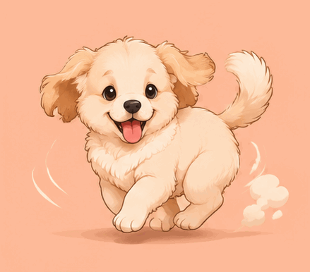

<sub>9 frames · 439×386 · 1.0s · gpt-image-2.6 · generated 2026-11-12</sub>

**Prompt**

```text
A fluffy cream puppy spins in fast happy circles chasing its own tail, ears flapping, little dust puffs behind it. Cute cartoon sticker, plain peach background.
```

`sticker` `dog` `happy`

### 140. Owl big yawn


<sub>9 frames · 437×388 · 1.6s · gpt-image-2.6 · generated 2026-11-12</sub>

**Prompt**

```text
A round brown owl on a branch stretches its wings and lets out a huge yawn, eyes squeezing shut, then settles back down. Soft storybook sticker, plain navy background.
```

`sticker` `owl` `sleepy`

### 141. Angry tomato steam


<sub>9 frames · 435×386 · 1.4s · gpt-image-2.6 · generated 2026-11-12</sub>

**Prompt**

```text
A cartoon tomato character turns from red to deep crimson, shakes with anger and puffs steam from its leafy top. Flat sticker style, thick outlines, plain white background.
```

`sticker` `food` `angry`

### 142. Bao bun wiggle dance


<sub>9 frames · 412×411 · 1.6s · gpt-image-2.6 · generated 2026-11-12</sub>

**Prompt**

```text
A soft steamed bao bun with a tiny face wiggles side to side on a bamboo steamer, little steam curls rising above it. Cute kawaii sticker, plain warm beige background.
```

`sticker` `food` `dance`

### 143. Shy ghost boo


<sub>9 frames · 438×390 · 1.4s · gpt-image-2.6 · generated 2026-11-12</sub>

**Prompt**

```text
A tiny white ghost jumps out shouting boo with raised arms, then immediately hides its face embarrassed. Simple cartoon sticker, plain dark purple background.
```

`sticker` `ghost` `funny`

### 144. Panda bamboo thumbs up


<sub>9 frames · 414×414 · 1.6s · gpt-image-2.6 · generated 2026-11-12</sub>

**Prompt**

```text
A chubby panda chewing a bamboo stalk gives a slow confident thumbs up and nods once. Flat sticker style, plain light green background.
```

`sticker` `panda` `ok`

### 145. Cat full HP revive


<sub>9 frames · 432×393 · 1.6s · gpt-image-2.6 · generated 2026-11-12</sub>

**Prompt**

```text
A limp flattened orange cat lies on the floor, a green health bar above it fills up, and the cat springs up with sparkling eyes and a fist pump. Chunky cartoon sticker, plain white background.
```

`sticker` `cat` `energy`

### 146. Two mice dancing

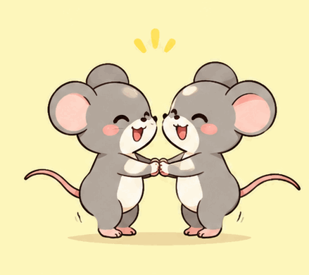

<sub>9 frames · 439×390 · 1.4s · gpt-image-2.6 · generated 2026-11-12</sub>

**Prompt**

```text
Two little gray mice hold paws and do a happy hopping dance in a circle, tails swinging. Cute flat sticker style, plain pale yellow background.
```

`sticker` `mouse` `dance`

### 147. Snowman mitten wave

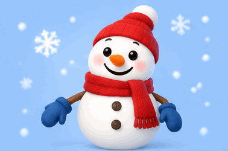

<sub>16 frames · 378×250 · 2.6s · gpt-image-2.6 · generated 2026-11-12</sub>

**Prompt**

```text
A small round snowman with a red knitted scarf and blue mittens waves one arm while light snowflakes drift around it. Cozy winter sticker style, plain light blue background.
```

`sticker` `winter` `snowman`

### 148. Lazy lion in a Santa hat


<sub>8 frames · 438×377 · 1.4s · gpt-image-2.6 · generated 2026-11-12</sub>

**Prompt**

```text
A droopy-eyed chubby lion wearing a Santa hat sighs heavily, its mane flopping, then gives a half-hearted wave. Soft cartoon sticker, plain red background.
```

`sticker` `christmas` `lion`

### 149. Cat: that costs extra


<sub>9 frames · 414×414 · 1.6s · gpt-image-2.6 · generated 2026-11-12</sub>

**Prompt**

```text
A businesslike white cat in a tiny tie rubs its paw pads together, and small gold coins pop up beside it one by one. Flat cartoon sticker, plain light gray background.
```

`sticker` `cat` `work`

### 150. Cat refuses to go to work


<sub>9 frames · 433×395 · 1.6s · gpt-image-2.6 · generated 2026-11-12</sub>

**Prompt**

```text
A tabby cat clings to a pillow with all four paws and shakes its head no as an alarm clock rings beside it. Cartoon sticker style, plain lavender background.
```

`sticker` `cat` `monday`

### 151. Bunny hop with shadow

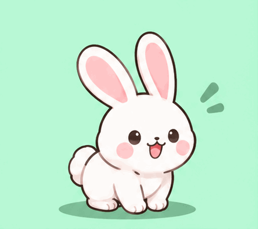

<sub>9 frames · 439×390 · 1.3s · gpt-image-2.6 · generated 2026-11-12</sub>

**Prompt**

```text
A white bunny hops in place, ears flopping on each landing while its oval shadow shrinks when it rises and grows when it lands. Simple soft sticker style, plain mint background.
```

`sticker` `bunny` `hop`

### 152. Chick under an umbrella


<sub>9 frames · 414×414 · 1.4s · gpt-image-2.6 · generated 2026-11-12</sub>

**Prompt**

```text
A tiny yellow chick holds a red umbrella and twirls it while raindrops bounce off the top. Cute flat sticker style, plain gray-blue background.
```

`sticker` `rain` `chick`

### 153. Kung fu kitten kick


<sub>9 frames · 438×390 · 1.1s · gpt-image-2.6 · generated 2026-11-13</sub>

**Prompt**

```text
A chubby gray kitten wearing a red cloth sash holds a martial arts stance, snaps out one quick front kick with a little 'hi-yah' face, then lands back in the same stance. Thick outlines, flat sticker colors, plain cream background.
```

`cat` `kung-fu` `sticker`

### 154. Frazzled cat stare


<sub>9 frames · 439×389 · 1.3s · gpt-image-2.6 · generated 2026-11-13</sub>

**Prompt**

```text
A white cat with messy fur and spiral eyes stares blankly ahead while a tiny gray storm cloud circles above its head, one ear twitching. Simple cartoon sticker style, pale blue background.
```

`cat` `mood` `sticker`

### 155. Tofu flips the sign


<sub>9 frames · 435×388 · 1.4s · gpt-image-2.6 · generated 2026-11-13</sub>

**Prompt**

```text
A square tofu character holds up a small sign with a big smiley face, then flips it over to show a crying face on the back while its own smile stays frozen. Kawaii flat style, peach background, no words.
```

`tofu` `reversal` `sticker`

### 156. Walrus thinking


<sub>9 frames · 439×388 · 1.4s · gpt-image-2.6 · generated 2026-11-13</sub>

**Prompt**

```text
A round walrus strokes one tusk with its flipper, eyes rolling up in thought, and a small question mark pops above its head. Flat sticker style, thick outline, light gray background.
```

`walrus` `thinking` `sticker`

### 157. Chick peeks from the egg


<sub>9 frames · 440×380 · 1.6s · gpt-image-2.6 · generated 2026-11-13</sub>

**Prompt**

```text
A yellow chick lifts the cracked top of its eggshell like a lid, peeks out, waves one wing, then ducks back inside. Cute flat cartoon, mint background.
```

`chick` `hello` `sticker`

### 158. Corgi butt wiggle bye


<sub>9 frames · 439×390 · 1.4s · gpt-image-2.6 · generated 2026-11-13</sub>

**Prompt**

```text
A corgi walks away from the viewer wiggling its fluffy rear, then looks back over its shoulder with a cheeky grin. Flat sticker art, pale yellow background.
```

`corgi` `bye` `sticker`

### 159. Angry pufferfish

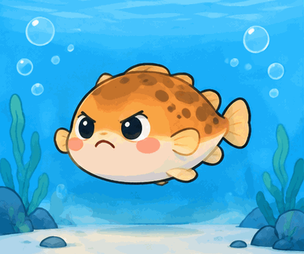

<sub>9 frames · 439×367 · 1.6s · gpt-image-2.6 · generated 2026-11-13</sub>

**Prompt**

```text
A small pufferfish frowns, puffs up into a spiky round ball with red cheeks, then slowly deflates back. Simple cartoon, light blue water background.
```

`pufferfish` `angry` `sticker`

### 160. Otters high five

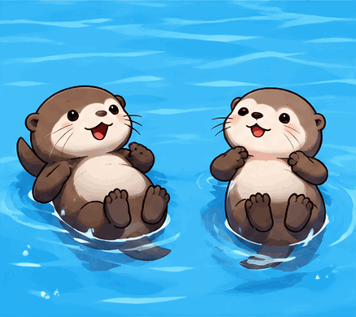

<sub>9 frames · 438×390 · 1.6s · gpt-image-2.6 · generated 2026-11-13</sub>

**Prompt**

```text
Two brown otters float on their backs, reach up and slap a high five with a small sparkle, then drift apart. Cute flat style, blue water background.
```

`otter` `high-five` `sticker`

### 161. Loaf cat dozing


<sub>9 frames · 439×390 · 2.0s · gpt-image-2.6 · generated 2026-11-13</sub>

**Prompt**

```text
An orange cat tucked into a perfect loaf shape slowly nods off, its head dipping down, then jerks awake. Soft pastel sticker style, cream background.
```

`cat` `sleepy` `sticker`

### 162. Duck winks

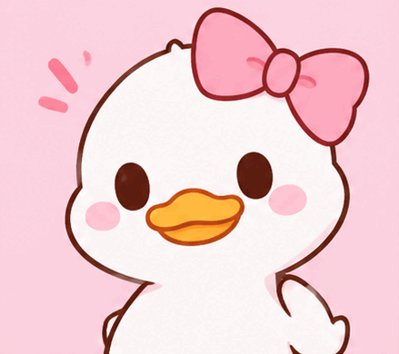

<sub>9 frames · 439×390 · 1.6s · gpt-image-2.6 · generated 2026-11-13</sub>

**Prompt**

```text
A white duck with a pink bow winks and a small red heart pops out beside its cheek. Kawaii flat style, light pink background.
```

`duck` `love` `sticker`

### 163. Mole pops up

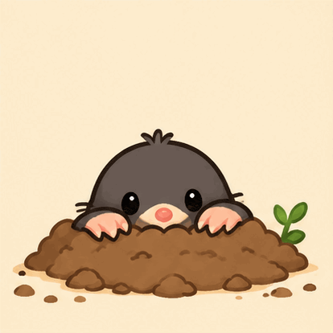

<sub>9 frames · 414×414 · 1.4s · gpt-image-2.6 · generated 2026-11-13</sub>

**Prompt**

```text
A little mole pops out of a dirt hole, waves a tiny pink paw, then ducks back down as soil crumbs bounce. Cartoon sticker style, plain beige background.
```

`mole` `hello` `sticker`

### 164. Parrot head bob


<sub>9 frames · 438×390 · 1.4s · gpt-image-2.6 · generated 2026-11-13</sub>

**Prompt**

```text
A green parrot on a perch bobs its head to a beat, eyes half closed, as small music notes float up. Flat cartoon, warm yellow background.
```

`parrot` `music` `sticker`

### 165. Piglet mud splash


<sub>9 frames · 439×390 · 1.3s · gpt-image-2.6 · generated 2026-11-13</sub>

**Prompt**

```text
A pink piglet hops into a mud puddle, brown droplets splash up, and it grins happily. Flat sticker art, light blue sky background.
```

`pig` `happy` `sticker`

### 166. Crab snip dance


<sub>9 frames · 437×388 · 1.4s · gpt-image-2.6 · generated 2026-11-13</sub>

**Prompt**

```text
A red crab sidesteps left and right, snipping both claws in rhythm with a proud face. Flat cartoon, sandy beige background.
```

`crab` `dance` `sticker`

### 167. Snail in a hurry

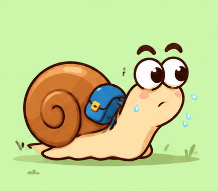

<sub>9 frames · 434×381 · 1.4s · gpt-image-2.6 · generated 2026-11-17</sub>

**Prompt**

```text
A snail with a tiny backpack strains forward with sweat drops and speed lines flying, yet barely moves an inch. Funny flat cartoon, light green background.
```

`snail` `late` `sticker`

### 168. Squirrel ready to fight


<sub>9 frames · 439×390 · 1.4s · gpt-image-2.6 · generated 2026-11-17</sub>

**Prompt**

```text
A chubby red squirrel in tiny boxing gloves, cheeks stuffed with nuts, bounces on its feet and throws two quick jabs. Bold cartoon sticker, white outline, cream background.
```

`squirrel` `fight` `sticker`

### 169. Houseplant survives


<sub>12 frames · 357×358 · 1.7s · gpt-image-2.6 · generated 2026-11-17</sub>

**Prompt**

```text
A droopy potted plant with two leaves sags, then perks straight up and flexes one leaf like a bicep. Cute flat sticker, thick outline, light yellow background.
```

`plant` `survive` `sticker`

### 170. Milk on the way home


<sub>9 frames · 414×414 · 1.6s · gpt-image-2.6 · generated 2026-11-17</sub>

**Prompt**

```text
A round white cat holds up an empty milk carton and gives a hopeful little bow, a small heart popping above. Soft family sticker style, big rounded shapes, light pink background.
```

`cat` `family` `sticker`

### 171. Go ahead and eat


<sub>8 frames · 414×414 · 1.4s · gpt-image-2.6 · generated 2026-11-17</sub>

**Prompt**

```text
A brown bear in an apron sets down a steaming bowl and waves a paw toward it with a warm smile. Cozy family sticker style, thick outline, beige background.
```

`bear` `dinner` `family`

### 172. Saved, thank you


<sub>9 frames · 431×393 · 1.4s · gpt-image-2.6 · generated 2026-11-17</sub>

**Prompt**

```text
A yellow duck clinging to a red-white lifebuoy pops up from water and waves gratefully, sparkles around it. Cheerful flat sticker, light aqua background.
```

`duck` `thanks` `sticker`

### 173. Taking a day off


<sub>9 frames · 439×389 · 1.6s · gpt-image-2.6 · generated 2026-11-17</sub>

**Prompt**

```text
A hamster yawns and pulls a tiny quilt over its head, leaving only its ears and a dangling OFF tag visible. Cute sticker style, lavender background.
```

`hamster` `rest` `sticker`

### 174. Bee bonks a flower


<sub>9 frames · 439×388 · 1.3s · gpt-image-2.6 · generated 2026-11-17</sub>

**Prompt**

```text
A round bumblebee buzzes forward, bonks into a big daisy, and spins dizzily with little stars circling its head. Playful cartoon sticker, mint background.
```

`bee` `oops` `sticker`

### 175. Goat yells

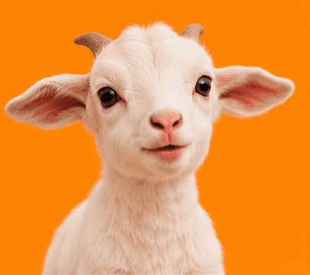

<sub>9 frames · 439×390 · 1.3s · gpt-image-2.6 · generated 2026-11-17</sub>

**Prompt**

```text
A small white goat opens its mouth wide in a dramatic yell, ears flapping and motion lines bursting out. Funny meme sticker, bright orange background.
```

`goat` `shock` `meme`

### 176. Cat peeks from box


<sub>12 frames · 353×352 · 2.2s · gpt-image-2.6 · generated 2026-11-17</sub>

**Prompt**

```text
A gray tabby slowly rises out of a cardboard box until its eyes clear the edge, blinks once, then sinks back down. Simple cartoon, warm white background.
```

`cat` `box` `peek`

### 177. Penguin pirouette


<sub>12 frames · 357×357 · 1.7s · gpt-image-2.6 · generated 2026-11-17</sub>

**Prompt**

```text
A chubby penguin in a tiny tutu does one wobbly spin on ice and ends with a proud flipper pose. Cute flat sticker, icy blue background.
```

`penguin` `dance` `sticker`

### 178. Kitten fixes a cracked screen


<sub>9 frames · 433×395 · 1.4s · gpt-image-2.6 · generated 2026-11-17</sub>

**Prompt**

```text
A tiny gray kitten in a yellow hard hat stands inside a cracked phone screen and works a toy power drill against the crack, sparks flying, the crack shrinking a little. Cute 3D cartoon, phone fills the frame, fixed camera.
```

`kitten` `phone` `repair`

### 179. Mint robot waves hello


<sub>9 frames · 435×387 · 1.4s · gpt-image-2.6 · generated 2026-11-17</sub>

**Prompt**

```text
A small mint-green robot with a round screen face and a blinking antenna raises one hand, gives one wave, and lowers it back to rest. Simple rounded 3D illustration, clean white background, fixed camera.
```

`robot` `wave` `hello`

### 180. Red panda blinks and smiles


<sub>9 frames · 414×414 · 1.6s · gpt-image-2.6 · generated 2026-11-17</sub>

**Prompt**

```text
A fluffy red panda mascot closes its eyes, opens them again with a small happy smile, ears twitching once. Soft flat illustration, cream background, fixed camera.
```

`red-panda` `blink` `cute`

### 181. Fox steps up and waves

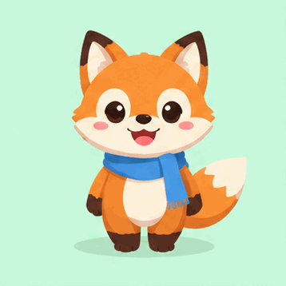

<sub>12 frames · 358×358 · 1.9s · gpt-image-2.6 · generated 2026-11-17</sub>

**Prompt**

```text
An orange fox in a little blue scarf takes two small steps toward the viewer, waves one paw, then steps back to where it started. Flat vector cartoon, pale mint background, fixed camera.
```

> 💡 **Tip:** Describe the start pose, the action and the return to start; it keeps the first and last frames matched.

`fox` `wave` `greeting`

### 182. Notebook stick figure dances


<sub>9 frames · 438×387 · 1.3s · gpt-image-2.6 · generated 2026-11-17</sub>

**Prompt**

```text
A hand-drawn ballpoint stick figure on lined notebook paper does a goofy hip-shaking dance with arms waving, slight line boil like a flipbook. Paper texture, fixed overhead camera.
```

`doodle` `dance` `sketch`

### 183. Doodle eye roll


<sub>9 frames · 425×399 · 1.6s · gpt-image-2.6 · generated 2026-11-17</sub>

**Prompt**

```text
A round hand-drawn doodle face with marker lines rolls its eyes up in exaggerated annoyance, then looks back forward with a flat mouth. White paper background, wobbly ink lines.
```

`doodle` `eye-roll` `reaction`

### 184. Baby elephant trunk shower


<sub>16 frames · 379×251 · 2.2s · gpt-image-2.6 · generated 2026-11-17</sub>

**Prompt**

```text
A chubby baby elephant lifts its trunk and sprays a happy fountain of water over its own head, droplets sparkling. Cute flat cartoon, light blue background, fixed camera.
```

`elephant` `water` `cute`

### 185. Shiba running late


<sub>8 frames · 429×394 · 1.0s · gpt-image-2.6 · generated 2026-11-17</sub>

**Prompt**

```text
A shiba inu with a slice of toast in its mouth runs in place in a panic, ears flapping, a sweat drop flying off. Funny flat sticker style, thick white outline, light yellow background.
```

`shiba` `late` `sticker`

### 186. Hippo big yawn


<sub>9 frames · 432×395 · 1.6s · gpt-image-2.6 · generated 2026-11-17</sub>

**Prompt**

```text
A sleepy round lavender hippo opens its mouth in an enormous yawn, eyes squeezed shut, then closes it with a satisfied smack. Soft clay-like 3D style, pale peach background.
```

`hippo` `yawn` `sleepy`

### 187. Octopus ink oops

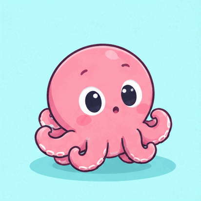

<sub>9 frames · 412×412 · 1.6s · gpt-image-2.6 · generated 2026-11-17</sub>

**Prompt**

```text
A small pink octopus gets startled and puffs out a cloud of ink, then peeks out of the cloud with an embarrassed grin. Cute flat cartoon, light aqua background.
```

`octopus` `oops` `funny`

### 188. Bunny slurps noodles


<sub>16 frames · 309×309 · 2.2s · gpt-image-2.6 · generated 2026-11-17</sub>

**Prompt**

```text
A white bunny with chopsticks slurps a long noodle from a bowl, cheeks puffing, the noodle wiggling up into its mouth. Cute flat sticker style, thick outline, pale orange background.
```

`bunny` `noodles` `food`

### 189. Penguin knitting a scarf


<sub>16 frames · 328×290 · 2.2s · gpt-image-2.6 · generated 2026-11-17</sub>

**Prompt**

```text
A round penguin sits clicking two knitting needles, a striped red scarf growing longer from its flippers. Cute flat cartoon, snowy light blue background.
```

`penguin` `knitting` `winter`

## Flash Cuts & Brand Reels

### 190. Flower macro flash cut


<sub>8 frames · 380×508 · 3.6s · gpt-image-2.6 · generated 2026-11-06</sub>

**Prompt**

```text
A fast flash-cut sequence of eight different flower photographs, one per frame, each filling the whole frame: a red poppy shot from above with light glowing through its petals, a creamy gardenia in soft side light, blue delphinium against a deep blue background, a golden marigold macro, a pink peony from a high angle, a dark purple iris close-up, an orange lily with curled petals, and pale green hydrangea with dew drops. Realistic botanical fashion photography, each frame with a different color, distance and composition.
```

> 💡 **Tip:** Describe every frame as a distinct shot. Changing color, angle and framing between frames is what makes a flash cut feel energetic.

`flash-cut` `photography` `editorial`

### 191. Cat-head logo brand reel


<sub>8 frames · 380×507 · 2.8s · gpt-image-2.6 · generated 2026-11-06</sub>

**Prompt**

```text
A quick-cut brand reel for a fictional cat food brand called "MEOWBITE". The same flat dark-brown cat-head logo — round face, two short pointed ears, cream almond eyes, short whiskers — stays fixed at the center of every frame while everything around it changes: an orange full-bleed poster, a pink pouch of cat food, a blue ceramic cat bowl seen from above, a kraft shipping box, a round sticker, and a final dark frame with the word MEOWBITE in big cream letters. Bold graphic design, flat colors, citrus orange, cream and dark brown palette.
```

> 💡 **Tip:** Lock the logo's position and size in every frame and only change the surroundings — that is what makes a brand flash read as one identity.

`flash-cut` `branding` `logo`

### 192. Sneaker colorway flash


<sub>5 frames · 349×883 · 1.8s · gpt-image-2.6 · generated 2026-11-06</sub>

**Prompt**

```text
A fast flash-cut in a square frame: the same chunky sneaker seen from the side, centered and the same size in every frame, while its colorway and the full-bleed solid background change each frame: white and red on blue, black and lime on pink, cream and brown on orange, purple and silver on yellow, all-white on black. Clean studio product photography, the background fills the whole frame edge to edge.
```

> 💡 **Tip:** Fix the product's angle and position, change only colors — the classic product colorway reel.

`flash-cut` `product` `fashion`

### 193. One tree, four seasons

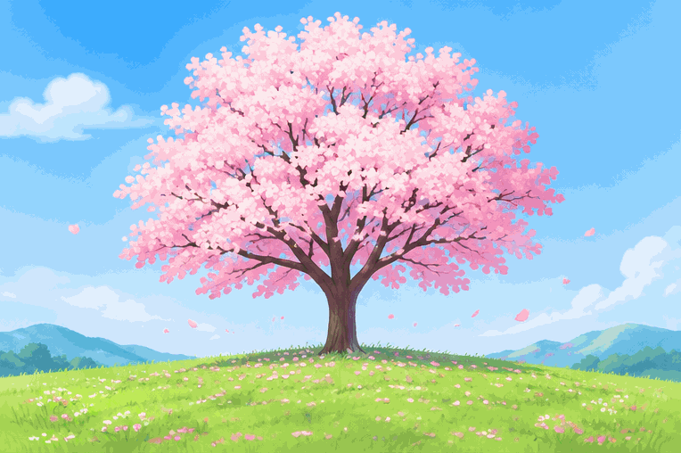

<sub>4 frames · 764×508 · 2.6s · gpt-image-2.6 · generated 2026-11-06</sub>

**Prompt**

```text
The same lone round tree on a small hill, framed identically in every frame, cycling through the four seasons: pink spring blossoms, lush green summer, orange autumn leaves falling, bare branches in winter snow. Soft flat illustration with a matching sky color for each season.
```

`flash-cut` `nature` `seasons`

### 194. Magazine collage panels pop in


<sub>9 frames · 438×387 · 1.6s · gpt-image-2.6 · generated 2026-11-06</sub>

**Prompt**

```text
A fashion-magazine collage layout where photo panels pop in one by one — a flower, a pair of sunglasses, a coffee cup, a city skyline — each with a small bounce, and finally a bold title bar reading "WEEKEND" slides in. Clean editorial design, cream background, coral and navy accents.
```

> 💡 **Tip:** Keep the text to one short word; long titles still warp between frames.

`flash-cut` `editorial` `layout`

### 195. Paper airplane desk to notebook

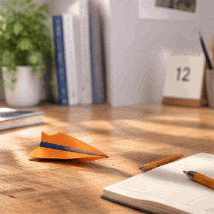

<sub>12 frames · 358×358 · 1.7s · gpt-image-2.6 · generated 2026-11-07</sub>

**Prompt**

```text
An orange paper airplane with one navy stripe lifting off a wooden desk, gliding in a gentle arc and landing on an open notebook beside a pencil. Fixed camera, soft daylight, realistic photo style.
```

`storyboard` `object` `desk`

### 196. Neon OPEN sign flicker

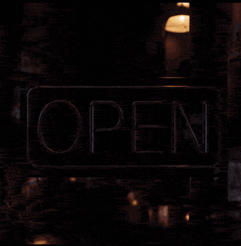

<sub>12 frames · 350×358 · 2.2s · gpt-image-2.6 · generated 2026-11-07</sub>

**Prompt**

```text
A pink and blue neon "OPEN" sign in a dark shop window at night, buzzing and flickering on letter by letter, then glowing steadily. Realistic photo style.
```

`neon` `sign` `text`

### 197. Light sweep over a product


<sub>16 frames · 379×252 · 2.9s · gpt-image-2.6 · generated 2026-11-07</sub>

**Prompt**

```text
A frosted glass skincare bottle standing still on a beige stone plinth while a soft diagonal band of light sweeps slowly across the background from left to right. Minimal product photography.
```

`product` `ad` `light`

### 198. Perfume bottle spinning on water

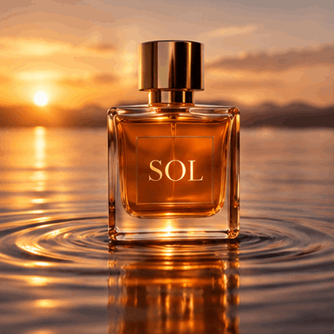

<sub>9 frames · 414×414 · 1.6s · gpt-image-2.6 · generated 2026-11-07</sub>

**Prompt**

```text
A square amber perfume bottle labeled "SOL" slowly rotating on the surface of still water, rings of ripples spreading out, warm sunset reflections. Luxury product photography.
```

`product` `perfume` `water`

### 199. Two-line event title reveal

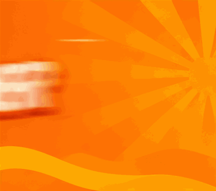

<sub>9 frames · 439×388 · 1.4s · gpt-image-2.6 · generated 2026-11-07</sub>

**Prompt**

```text
A bold two-line title "SUMMER" and "MARKET 2026" sliding in from the left one line after the other on a sunny orange background, with small confetti pieces popping. Clean flat motion graphics.
```

`text` `title` `motion-graphics`

### 200. Chat bubbles popping in


<sub>9 frames · 430×397 · 3.1s · gpt-image-2.6 · generated 2026-11-07</sub>

**Prompt**

```text
A phone chat screen where three message bubbles pop in one by one: grey "Are you done yet?", blue "Almost!", grey "Send it!". Clean flat UI style on a white background.
```

`ui` `chat` `text`

### 201. City jumps a thousand years


<sub>9 frames · 439×385 · 4.0s · gpt-image-2.6 · generated 2026-11-07</sub>

**Prompt**

```text
The same riverside city skyline from a fixed viewpoint changing era by era: low brick buildings, then glass towers, then floating platforms with glowing sky bridges. Cinematic matte painting style.
```

`timelapse` `city` `sci-fi`

### 202. Tiny people building a sandwich


<sub>9 frames · 438×389 · 1.6s · gpt-image-2.6 · generated 2026-11-07</sub>

**Prompt**

```text
A team of miniature people in aprons on a full-size kitchen table hauling a lettuce leaf, a tomato slice and a cheese square onto a giant slice of bread using ropes and a tiny ladder. Tilt-shift macro photo style.
```

`miniature` `food` `funny`

### 203. Castle rising stone by stone


<sub>16 frames · 380×252 · 2.9s · gpt-image-2.6 · generated 2026-11-07</sub>

**Prompt**

```text
A medieval stone castle on a green hill building itself up from the foundation: walls rise, towers grow, then flags pop up on top. Fixed camera, isometric storybook illustration.
```

`build` `castle` `timelapse`

### 204. Same fox in six materials


<sub>6 frames · 508×508 · 3.6s · gpt-image-2.6 · generated 2026-11-07</sub>

**Prompt**

```text
The same sitting fox in the same pose, each frame rendered in a different material: felt, paper cut, risograph print, pixel art, glossy Y2K chrome, clay. Centered, identical framing, plain background.
```

`style` `material` `comparison`

### 205. Gift box with a pop-up ghost


<sub>16 frames · 307×309 · 2.2s · gpt-image-2.6 · generated 2026-11-08</sub>

**Prompt**

```text
A glossy red cartoon gift box with a gold ribbon: the lid pops open and a tiny round white ghost springs out on a coiled spring, bouncing with a jelly-like wobble. Soft rounded 3D render on a mint background, square 1:1.
```

`3d` `surprise` `bouncy`

### 206. Ring of fire spell

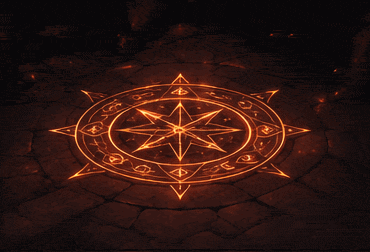

<sub>16 frames · 370×252 · 1.9s · gpt-image-2.6 · generated 2026-11-08</sub>

**Prompt**

```text
A glowing circular magic sigil on dark stone floor ignites into a ring of orange flames that swirl around its edge while embers drift upward. Stylized anime game effect, top-down three-quarter view, dark background.
```

`vfx` `fire` `game`

### 207. Lightning in a jar

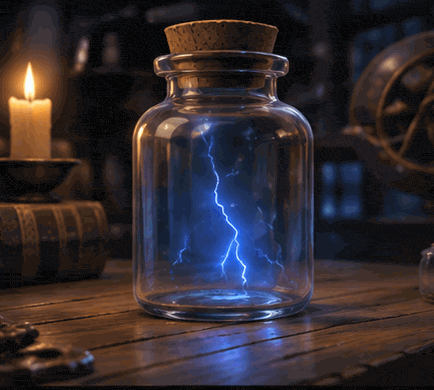

<sub>8 frames · 434×390 · 1.4s · gpt-image-2.6 · generated 2026-11-08</sub>

**Prompt**

```text
A corked glass jar on a wooden table with a tiny bolt of blue-white lightning crackling inside, flashing and branching against the glass and lighting up the table. Painterly fantasy style, dim room.
```

`vfx` `lightning` `fantasy`

### 208. Water spiral orb


<sub>16 frames · 378×250 · 1.8s · gpt-image-2.6 · generated 2026-11-08</sub>

**Prompt**

```text
A floating sphere of clear water with a spiral current turning inside it, small droplets orbiting around and catching light. Anime game skill effect on a deep teal background.
```

`vfx` `water` `game`

### 209. Ice crystal bloom


<sub>16 frames · 378×249 · 2.2s · gpt-image-2.6 · generated 2026-11-08</sub>

**Prompt**

```text
A pale blue ice crystal growing from the center of the frame, frost branches spreading outward like a snowflake and sparkling, cold mist curling at the edges. Anime game effect on a dark navy background.
```

`vfx` `ice` `game`

### 210. Comic halftone action poster


<sub>9 frames · 434×387 · 1.3s · gpt-image-2.6 · generated 2026-11-08</sub>

**Prompt**

```text
A bold comic-style action poster: a masked fox thief in a long red coat leaps across the frame while red, black and white halftone burst rays pulse behind and speed lines flash. Graphic print style.
```

`poster` `comic` `bold`

### 211. House cutaway reveal


<sub>9 frames · 432×395 · 2.0s · gpt-image-2.6 · generated 2026-11-08</sub>

**Prompt**

```text
An isometric 3D cutaway of a small two-story house: the front wall slides away to reveal tiny furnished rooms, and the lights switch on room by room. Soft clay render on a light blue background.
```

`3d` `isometric` `reveal`

### 212. Neon star with light trail


<sub>16 frames · 380×252 · 1.9s · gpt-image-2.6 · generated 2026-11-08</sub>

**Prompt**

```text
A neon sign shaped like a five-pointed star, outlined in orange-pink LED dots, glowing against a dark starfield while a thin comet-like light trail orbits around it and small stars twinkle.
```

`neon` `glow` `sign`

### 213. Mug colorway cycle


<sub>5 frames · 350×883 · 2.3s · gpt-image-2.6 · generated 2026-11-08</sub>

**Prompt**

```text
A single ceramic coffee mug shown whole and centered in a square frame, handle to the right, on a seamless white studio backdrop. Only the mug's glaze color changes from frame to frame — coral, sage green, navy, mustard, lilac — while its shape, position, shadow and lighting stay exactly the same.
```

> 💡 **Tip:** Colorway cycles come back as one frame per color (5 here). Our first try was cropped with seams; asking for the whole mug centered fixed it, but the output became a tall 350×883 strip, so crop it to square if needed.

`product` `colorway` `ecommerce`

### 214. Tote bag feature callouts

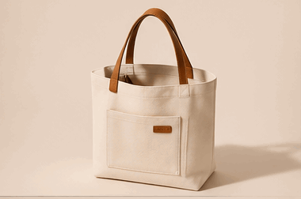

<sub>16 frames · 380×252 · 2.9s · gpt-image-2.6 · generated 2026-11-08</sub>

**Prompt**

```text
A product shot of a natural canvas tote bag; small glowing circle markers with plus icons appear one after another on the front pocket, the leather handle and the inner divider. Clean studio photography on beige.
```

`product` `ecommerce` `callout`

### 215. Paper collage night scene assembles


<sub>16 frames · 379×252 · 2.9s · gpt-image-2.6 · generated 2026-11-09</sub>

**Prompt**

```text
A paper collage on a blank cream page: torn paper pieces slide in one by one to build a night city skyline, then a pair of scissors snips out a paper moon that settles into the sky. Craft texture, visible paper edges, fixed camera.
```

> 💡 **Tip:** For B-roll, decide the visual metaphor and the final still first, then ask for the pieces to assemble from blank.

`collage` `b-roll` `reveal`

### 216. Fictional logo reveal


<sub>12 frames · 358×358 · 2.2s · gpt-image-2.6 · generated 2026-11-09</sub>

**Prompt**

```text
A minimal logo reveal on a deep green background for a fictional tea brand called "LEAF & CO": a single leaf line draws itself, a circle closes around it, the wordmark fades in below, then a soft glow sweeps across. Clean vector style.
```

`logo` `brand` `reveal`

### 217. Floating headphones product shot


<sub>9 frames · 414×414 · 1.6s · gpt-image-2.6 · generated 2026-11-09</sub>

**Prompt**

```text
A pair of matte white over-ear headphones floating above a round pedestal, slowly turning a quarter turn and bobbing gently while a soft coral rim light glows behind. Studio product shot, plain gradient background, fixed camera.
```

`product` `tech` `studio`

### 218. Citrus bottle splash


<sub>16 frames · 380×252 · 1.9s · gpt-image-2.6 · generated 2026-11-09</sub>

**Prompt**

```text
A glass bottle of orange juice with a plain unbranded label standing in the center, orange slices and water droplets bursting outward around it and falling back, the bottle staying perfectly still. Bright summer studio shot, fixed camera.
```

`product` `drink` `splash`

### 219. Lipstick twisting up


<sub>9 frames · 433×395 · 1.6s · gpt-image-2.6 · generated 2026-11-09</sub>

**Prompt**

```text
A lipstick in a plain smooth rose-gold cylindrical case with no logo, letters or markings, standing on a marble surface: the red bullet twists slowly up out of the case and a light glint slides across the metal. Luxury beauty product shot, soft shadows, fixed camera.
```

> 💡 **Tip:** Say "no logo, letters or markings" on products; otherwise the model may invent a real brand's monogram.

`product` `beauty` `luxury`

### 220. Minimal watch close-up


<sub>12 frames · 358×358 · 2.2s · gpt-image-2.6 · generated 2026-11-09</sub>

**Prompt**

```text
A minimalist wristwatch with a white dial lying on a linen surface, the second hand sweeping around, a band of light passing over the glass. Clean product photography, fixed camera.
```

`product` `watch` `minimal`

### 221. Gold ink signature writes itself


<sub>9 frames · 414×414 · 1.6s · gpt-image-2.6 · generated 2026-11-10</sub>

**Prompt**

```text
An elegant cursive signature reading Mira writes itself stroke by stroke in shimmering gold ink on cream paper, finishing with a small star flourish that sparkles once. Clean top-down view.
```

`signature` `text` `brand`

### 222. One bottle, three worlds


<sub>12 frames · 358×358 · 2.2s · gpt-image-2.6 · generated 2026-11-10</sub>

**Prompt**

```text
A frosted glass serum bottle stays fixed in the center while the world behind it changes: a sunlit desert dune, then a deep blue underwater reef, then a misty green forest. Premium product photography, soft reflections.
```

`product` `ad` `background`

### 223. Nebula shimmer nail tips


<sub>8 frames · 433×395 · 1.4s · gpt-image-2.6 · generated 2026-11-10</sub>

**Prompt**

```text
Five glossy almond-shaped nail tips on a white display stand, each painted deep navy; a swirling purple and pink nebula with tiny glitter stars drifts across their surface. Macro beauty product shot.
```

`beauty` `product` `sparkle`

### 224. Headphones switch off the street


<sub>12 frames · 358×357 · 2.2s · gpt-image-2.6 · generated 2026-11-10</sub>

**Prompt**

```text
Stylized illustration: a person on a crowded noisy street with honking cars puts on over-ear headphones, and the whole street dissolves into a calm bright white studio around them. Clean ad visual, side profile, fixed camera.
```

`product` `ad` `before-after`

### 225. 3D gold token spins


<sub>16 frames · 309×309 · 1.8s · gpt-image-2.6 · generated 2026-11-10</sub>

**Prompt**

```text
A thick 3D gold coin embossed with a simple star emblem spins smoothly on its vertical axis, catching a glint of light on each turn. Studio render, dark charcoal background, soft floor reflection.
```

`3d` `coin` `spin`

### 226. Comic BOOM poster


<sub>9 frames · 438×388 · 1.3s · gpt-image-2.6 · generated 2026-11-10</sub>

**Prompt**

```text
A halftone comic-print poster: a small cartoon rocket blasts upward and a big jagged yellow BOOM burst pops in behind it with action lines. Bold CMYK offset-print texture, red background.
```

`poster` `comic` `text`

### 227. Travel postcards flip through


<sub>9 frames · 436×386 · 2.7s · gpt-image-2.6 · generated 2026-11-10</sub>

**Prompt**

```text
A stack of illustrated travel postcards flips one after another: a mountain lake at sunrise, a white seaside town, a red desert canyon. Gouache illustration style, slight paper texture, centered framing.
```

`travel` `illustration` `flip`

### 228. Island in a glass jar


<sub>9 frames · 433×393 · 1.6s · gpt-image-2.6 · generated 2026-11-10</sub>

**Prompt**

```text
A tiny island with a white lighthouse sealed inside a glass jar on a table; small waves lap at the shore and the lighthouse beam sweeps around inside the glass. Detailed miniature diorama, warm lamp light.
```

`miniature` `glass` `diorama`

### 229. Watercolor street flipbook


<sub>9 frames · 438×390 · 2.0s · gpt-image-2.6 · generated 2026-11-10</sub>

**Prompt**

```text
A sketchbook lies open and its pages turn by themselves, each showing a loose watercolor street scene: a narrow alley with lanterns, a tram crossing, a rainy crosswalk. Soft wet-paper watercolor style.
```

`watercolor` `sketchbook` `city`

### 230. Chinese brush signature


<sub>9 frames · 412×411 · 1.6s · gpt-image-2.6 · generated 2026-11-11</sub>

**Prompt**

```text
On textured rice paper, a black ink brush writes two Chinese characters in flowing cursive calligraphy, stroke by stroke, then a small red square seal stamps down beside them. Top-down view, fixed camera.
```

> 💡 **Tip:** Two or three characters work best; the model occasionally invents strokes, so check each frame.

`signature` `calligraphy` `text`

### 231. Earbud case reveal


<sub>9 frames · 439×390 · 1.6s · gpt-image-2.6 · generated 2026-11-11</sub>

**Prompt**

```text
A matte terracotta-orange egg-shaped charging case with a wooden lid sits on a beige pedestal; the lid slides open sideways, a tiny amber light blinks, and two round pebble-shaped earbuds with no stems rise slightly and settle back. Clean studio product photography, soft shadow.
```

`product` `tech` `ecommerce`

### 232. Showtime curtain


<sub>16 frames · 380×252 · 2.2s · gpt-image-2.6 · generated 2026-11-11</sub>

**Prompt**

```text
Red velvet theater curtains part on a small stage; a spotlight sweeps across and gold confetti bursts down over an empty microphone stand. Bright festive illustration, fixed front view.
```

`event` `announcement` `celebration`

### 233. Ceramic vase on a turntable


<sub>16 frames · 322×297 · 1.9s · gpt-image-2.6 · generated 2026-11-11</sub>

**Prompt**

```text
A speckled sage-green ceramic vase holding one dried branch rotates a full turn on a white turntable; soft window light glides across its glaze. Minimal studio product photography on off-white.
```

`product` `ceramic` `turntable`

### 234. Photo cards shuffle


<sub>9 frames · 439×390 · 1.6s · gpt-image-2.6 · generated 2026-11-11</sub>

**Prompt**

```text
Three overlapping instant photo cards showing a beach, a mountain and a city at night sit on a light wood table; the top card slides out to the right and tucks behind the stack, revealing the next one. Top-down view, soft natural light.
```

`photo` `layout` `social`

### 235. Cereal and milk pour


<sub>9 frames · 414×414 · 1.6s · gpt-image-2.6 · generated 2026-11-11</sub>

**Prompt**

```text
Milk pours into a white bowl of colorful ring cereal, the rings bob up and swirl around a spoon. Bright overhead food photography on a pale pink table.
```

`food` `product` `breakfast`

### 236. Chilled soda can


<sub>9 frames · 414×413 · 1.6s · gpt-image-2.6 · generated 2026-11-11</sub>

**Prompt**

```text
An unbranded mint-green soda can covered in cold condensation stands on crushed ice; water droplets roll down, the tab pops open and fine fizz mist puffs out. High-key product photography on teal.
```

`product` `drink` `ecommerce`

### 237. Serum dropper drip


<sub>9 frames · 439×390 · 1.6s · gpt-image-2.6 · generated 2026-11-11</sub>

**Prompt**

```text
A glass skincare dropper squeezes out one clear golden drop that falls into an open amber serum bottle, a ripple spreading on the surface. Clean luxury product photography on soft cream with gentle reflections.
```

`product` `beauty` `skincare`

### 238. Honey drizzle


<sub>16 frames · 380×252 · 2.2s · gpt-image-2.6 · generated 2026-11-11</sub>

**Prompt**

```text
A wooden honey dipper lifts above a jar, a thick ribbon of golden honey drizzles down and folds over itself into the jar. Warm backlit food photography, shallow depth of field.
```

`food` `product` `macro`

### 239. Ice cream drip promo


<sub>9 frames · 438×390 · 1.4s · gpt-image-2.6 · generated 2026-11-12</sub>

**Prompt**

```text
A pink strawberry ice cream cone slowly drips one drop of melted cream while sprinkles sparkle around it. Bold product ad style, plain bright yellow background.
```

`product` `food` `ad`

### 240. Sneaker lace tie


<sub>9 frames · 433×395 · 1.6s · gpt-image-2.6 · generated 2026-11-12</sub>

**Prompt**

```text
A white sneaker on a pedestal ties its own laces into a neat bow, then gives a tiny bounce. Clean 3D product render, plain light gray background.
```

`product` `fashion` `3d`

### 241. Candle jar lights up


<sub>16 frames · 380×252 · 2.9s · gpt-image-2.6 · generated 2026-11-12</sub>

**Prompt**

```text
A frosted glass candle jar with a blank label, the wick sparks and lights, warm glow spreading across the jar. Minimal product shot, plain warm gray background.
```

`product` `candle` `ad`

### 242. Phone box reveal


<sub>9 frames · 446×395 · 1.6s · gpt-image-2.6 · generated 2026-11-12</sub>

**Prompt**

```text
A plain white box lid lifts off to reveal a generic slim smartphone that rises slightly with a soft shine. Clean 3D product render, plain white background, no logos.
```

`product` `tech` `unboxing`

### 243. Coffee bean burst


<sub>16 frames · 309×306 · 1.9s · gpt-image-2.6 · generated 2026-11-12</sub>

**Prompt**

```text
A matte black coffee bag with a blank label, roasted beans burst up from behind it and fall back down. Dark moody product photography, plain brown background.
```

`product` `coffee` `ad`

### 244. Bold title over mountains


<sub>9 frames · 439×390 · 1.6s · gpt-image-2.6 · generated 2026-11-12</sub>

**Prompt**

```text
The single bold word WILD rises letter by letter over a misty snow-capped mountain range at sunrise, the fog drifting slowly behind it. Editorial poster typography, fixed camera.
```

`typography` `title` `landscape`

### 245. Signature with music notes


<sub>16 frames · 380×252 · 2.2s · gpt-image-2.6 · generated 2026-11-12</sub>

**Prompt**

```text
A flowing gold handwritten signature draws itself across a dark navy card while tiny music notes and glowing particles spill from a small violin icon beside it. Elegant minimal style.
```

`signature` `music` `particles`

### 246. Same plate, new dish


<sub>9 frames · 436×389 · 3.1s · gpt-image-2.6 · generated 2026-11-12</sub>

**Prompt**

```text
Top-down shot of one white plate on a fixed wooden table; the dish on it changes from a seared steak to a green salad to a bowl of pasta, nothing else moves. Food photography, fixed camera.
```

`food` `menu` `restaurant`

### 247. Make the logo bigger


<sub>16 frames · 376×261 · 1.9s · gpt-image-2.6 · generated 2026-11-12</sub>

**Prompt**

```text
A plain kraft shipping box on a white table; the simple round star emblem printed on it swells bigger and bigger until it nearly covers the box, then wobbles. Clean product shot, no real brands.
```

`product` `meme` `logo`

### 248. Editorial jump in a yellow coat


<sub>16 frames · 322×293 · 1.9s · gpt-image-2.6 · generated 2026-11-12</sub>

**Prompt**

```text
A fashion model in an oversized mustard-yellow coat leaps mid-air in a clean studio, the coat flaring out, then lands. Editorial fashion photography, plain pale gray backdrop.
```

`fashion` `editorial` `jump`

### 249. Acrylic charm spins


<sub>9 frames · 438×390 · 1.6s · gpt-image-2.6 · generated 2026-11-13</sub>

**Prompt**

```text
A clear acrylic keychain charm shaped like a bunny in a strawberry hat spins slowly on its metal ring, catching small rainbow glints on the edges. Product shot, soft gray gradient background.
```

`acrylic` `keychain` `merch`

### 250. Article header with paper plane


<sub>9 frames · 508×337 · 1.3s · gpt-image-2.6 · generated 2026-11-13</sub>

**Prompt**

```text
A wide article header banner in soft pastel colors with the short title 'WEEKLY NOTES'; a small paper plane loops across the banner leaving a dotted trail while the title stays perfectly still.
```

> 💡 **Tip:** Keep the title short and ask for it to stay still; moving text is where letters break.

`banner` `header` `text`

### 251. Espresso shot pour


<sub>9 frames · 430×392 · 1.6s · gpt-image-2.6 · generated 2026-11-13</sub>

**Prompt**

```text
Close-up of a chrome espresso machine pulling a shot into a small glass cup; the dark stream thins to honey color and the crema swirls. Dark studio, warm rim light, fixed camera.
```

`coffee` `product` `espresso`

### 252. Birthday cake with confetti


<sub>9 frames · 439×390 · 1.6s · gpt-image-2.6 · generated 2026-11-13</sub>

**Prompt**

```text
A pink frosted birthday cake with three lit candles sits on a table; the flames flicker and colorful confetti flutters down around it. Bright cheerful illustration, fixed camera.
```

`birthday` `cake` `celebration`

### 253. Cream jar opens


<sub>9 frames · 432×394 · 1.6s · gpt-image-2.6 · generated 2026-11-13</sub>

**Prompt**

```text
A frosted glass skincare jar's lid twists off and lifts, revealing smooth white cream as a soft sparkle passes over it. Minimal beauty product shot, blush pink backdrop.
```

`skincare` `product` `beauty`

### 254. Sneaker drop bounce


<sub>9 frames · 439×390 · 1.1s · gpt-image-2.6 · generated 2026-11-13</sub>

**Prompt**

```text
A white running sneaker drops onto a round platform, the sole squashes and springs back, sending a small ring of dust outward. Clean studio product shot, light gray background.
```

`sneaker` `product` `bounce`

### 255. Tea bag dunk


<sub>9 frames · 411×414 · 1.6s · gpt-image-2.6 · generated 2026-11-13</sub>

**Prompt**

```text
A tea bag is dipped into a clear glass mug of hot water and amber color blooms outward in soft swirls. Bright minimal product photo, white backdrop.
```

`tea` `product` `drink`

### 256. Burger stacks itself


<sub>16 frames · 380×248 · 2.2s · gpt-image-2.6 · generated 2026-11-17</sub>

**Prompt**

```text
Burger layers drop from above one by one, bun, patty, cheese, lettuce, tomato, top bun, each landing with a little bounce. Bold food ad style, orange background.
```

`burger` `food` `ad`

### 257. Umbrella pops open


<sub>16 frames · 380×249 · 1.9s · gpt-image-2.6 · generated 2026-11-17</sub>

**Prompt**

```text
A navy folding umbrella pops open and spins once while raindrops bead and roll off its canopy. Product shot, soft gray studio background.
```

`umbrella` `product` `rain`

### 258. Book releases paper birds


<sub>9 frames · 439×390 · 1.6s · gpt-image-2.6 · generated 2026-11-17</sub>

**Prompt**

```text
A hardcover book opens on a table, warm light spills out and a few small paper birds flutter up from the pages. Cozy illustrated style, dark background.
```

`book` `magic` `promo`

### 259. Donut sprinkle spin


<sub>16 frames · 380×252 · 2.6s · gpt-image-2.6 · generated 2026-11-17</sub>

**Prompt**

```text
A glazed pink donut turns slowly on a small pedestal as rainbow sprinkles rain down and stick to the icing. Playful bakery ad, mint background.
```

`donut` `food` `ad`

### 260. Chocolate snap


<sub>9 frames · 439×390 · 1.4s · gpt-image-2.6 · generated 2026-11-17</sub>

**Prompt**

```text
A dark chocolate bar snaps cleanly in half and small crumbs pop into the air. Close-up food photography, deep brown backdrop, dramatic side light.
```

`chocolate` `food` `product`

### 261. Sunglasses reflection sweep


<sub>16 frames · 380×252 · 1.9s · gpt-image-2.6 · generated 2026-11-17</sub>

**Prompt**

```text
A pair of tortoiseshell sunglasses rotates gently on a stand while a reflection of blue sky and clouds sweeps across the lenses. Summer product shot, sand-colored backdrop.
```

`sunglasses` `product` `summer`

### 262. Spellbook game menu


<sub>16 frames · 377×240 · 2.9s · gpt-image-2.6 · generated 2026-11-17</sub>

**Prompt**

```text
A worn leather spellbook drops onto a wooden table, flips open, and three glowing menu buttons rise out of its pages. Fantasy game UI style, warm candlelight, dark background.
```

`book` `game` `menu`

### 263. Ice drops into lemonade


<sub>9 frames · 390×439 · 1.4s · gpt-image-2.6 · generated 2026-11-17</sub>

**Prompt**

```text
Ice cubes and a lemon slice drop into a tall glass of lemonade, splashing droplets and fizzing bubbles. Fresh summer drink ad style, sunny yellow background.
```

`drink` `summer` `ad`

### 264. Keycaps press in a wave


<sub>16 frames · 371×252 · 1.8s · gpt-image-2.6 · generated 2026-11-17</sub>

**Prompt**

```text
Mechanical keyboard keycaps press down one after another in a wave from left to right, RGB glow following underneath. Sleek product shot, dark background.
```

`keyboard` `product` `tech`

### 265. Compact mirror opens


<sub>9 frames · 428×398 · 1.6s · gpt-image-2.6 · generated 2026-11-17</sub>

**Prompt**

```text
A rose-gold makeup compact clicks open, the mirror catches a flash of light and a little powder puff lifts out. Elegant beauty product shot, blush pink background.
```

`beauty` `product` `compact`

### 266. SALE tag swings


<sub>16 frames · 313×302 · 1.4s · gpt-image-2.6 · generated 2026-11-17</sub>

**Prompt**

```text
A red paper price tag that says SALE hangs from a string and swings left and right with a tiny bounce, a few gold sparkles popping around it. Bold flat ad style, solid black background edge to edge in every frame.
```

> 💡 **Tip:** Keep on-image text to one short word; longer text tends to change between frames.

`sale` `black-friday` `ad`

### 267. Shopping bag hops


<sub>16 frames · 307×306 · 2.2s · gpt-image-2.6 · generated 2026-11-17</sub>

**Prompt**

```text
A glossy orange shopping bag with rope handles hops up, squashes on landing, and a little gift box pops out of the top and drops back in. Playful 3D product style, pastel pink background.
```

`shopping` `bag` `promo`

### 268. Bauhaus shapes shuffle


<sub>16 frames · 380×250 · 2.6s · gpt-image-2.6 · generated 2026-11-17</sub>

**Prompt**

```text
A grid of Bauhaus shapes in red, yellow, blue and black, circles, half circles, squares and triangles, slide and rotate into new positions in crisp steps. Flat poster style, off-white background.
```

`bauhaus` `geometric` `motion-design`

### 269. Wooden game piece flips


<sub>16 frames · 380×252 · 1.9s · gpt-image-2.6 · generated 2026-11-17</sub>

**Prompt**

```text
A pale wooden pentagon-shaped board game piece flips over in the air and lands with a small clack on a wooden grid board, a puff of dust at impact. Warm tabletop lighting, close-up, fixed camera.
```

`board-game` `wood` `flip`

### 270. Travel journal stickers


<sub>9 frames · 439×387 · 2.0s · gpt-image-2.6 · generated 2026-11-17</sub>

**Prompt**

```text
An open travel journal on an ivory desk; little stickers of a plane, a ticket stub, a palm tree and a stamp pop onto the page one after another with a soft bounce. Cozy scrapbook style, overhead camera.
```

`scrapbook` `travel` `journal`

### 271. Pancake flip


<sub>9 frames · 439×388 · 1.3s · gpt-image-2.6 · generated 2026-11-17</sub>

**Prompt**

```text
A golden pancake is tossed up from a cast iron pan, flips once in the air and lands back with a little puff of steam. Bright food ad style, warm kitchen background, fixed camera.
```

`pancake` `food` `kitchen`

### 272. Popcorn popping


<sub>16 frames · 379×230 · 2.2s · gpt-image-2.6 · generated 2026-11-17</sub>

**Prompt**

```text
Kernels in a red and white striped bowl burst into fluffy popcorn one by one, some pieces jumping out and tumbling back in. Bold movie-night ad style, deep blue background.
```

`popcorn` `snack` `movie`

### 273. Roast dinner reveal


<sub>16 frames · 380×252 · 2.9s · gpt-image-2.6 · generated 2026-11-17</sub>

**Prompt**

```text
A silver dome lid lifts off a golden roast chicken on a platter, a burst of steam rising and a few herb leaves falling onto it. Warm festive food ad style, dark wood background.
```

`dinner` `holiday` `food`

## Ambient Loops

### 274. Reading by the window, day to night


<sub>9 frames · 413×412 · 3.1s · gpt-image-2.6 · generated 2026-11-06</sub>

**Prompt**

```text
A girl with a short bob reading a book on a cushion by a big window, seen from the side. Outside the window the sky cycles from bright morning blue to orange sunset to a starry night and back to morning, while the room light warms up and a desk lamp switches on at night. Soft flat illustration, calm and cozy.
```

> 💡 **Tip:** Day-to-night loops are harder than simple motions. Keep the character mostly still and let the light and sky carry the change.

`loop` `character` `time-lapse`

### 275. Steaming coffee loop


<sub>16 frames · 379×252 · 2.6s · gpt-image-2.6 · generated 2026-11-05</sub>

**Prompt**

```text
A steaming cup of coffee on a small wooden table, steam curling and drifting upward, a tiny spoon wobbling on the saucer. Cozy flat illustration with warm colors.
```

`loop` `food` `cozy`

### 276. Rainy window and plant


<sub>16 frames · 378×252 · 2.9s · gpt-image-2.6 · generated 2026-11-06</sub>

**Prompt**

```text
A rainy window at dusk with a small potted plant on the sill, raindrops sliding down the glass and blurry city lights twinkling outside. Soft muted blue palette, lo-fi illustration style.
```

`loop` `lofi` `weather`

### 277. Goldfish in a bowl


<sub>16 frames · 380×243 · 2.9s · gpt-image-2.6 · generated 2026-11-06</sub>

**Prompt**

```text
A round glass fishbowl on a windowsill with one orange goldfish swimming a slow circle, tail fluttering, tiny bubbles rising to the surface. Soft watercolor-style illustration, gentle light.
```

`loop` `pet` `calm`

### 278. Lighthouse at night


<sub>16 frames · 380×247 · 2.9s · gpt-image-2.6 · generated 2026-11-06</sub>

**Prompt**

```text
A white lighthouse on a rocky shore at night, its beam sweeping slowly across a dark blue sky, waves rolling and splashing against the rocks below. Flat illustration with a deep navy and warm yellow palette.
```

`loop` `seascape` `night`

### 279. Cat sleeping by the fireplace


<sub>16 frames · 380×243 · 2.9s · gpt-image-2.6 · generated 2026-11-06</sub>

**Prompt**

```text
A ginger cat curled up asleep on a rug in front of a crackling fireplace, its body gently rising and falling with each breath, flames flickering and casting warm light. Cozy flat illustration, warm orange and brown tones.
```

> 💡 **Tip:** Breathing is a great tiny motion for calm loops — it reads clearly and loops naturally.

`loop` `cozy` `cat`

### 280. Lantern monkey in the snow


<sub>16 frames · 380×241 · 2.9s · gpt-image-2.6 · generated 2026-11-06</sub>

**Prompt**

```text
A small monkey in an olive-green hooded coat standing in a snowy pine forest at dusk, lifting a glowing amber paper lantern, looking up and blinking, then lowering the lantern back to where it started. Snow falls gently and a tiny cabin glows in the background. Soft storybook illustration, locked camera.
```

> 💡 **Tip:** Give the subject a pose to return to and lock the camera — the easiest way to get a clean loop.

`loop` `character` `winter`

### 281. Sleepy fox on a mossy rock


<sub>9 frames · 432×394 · 1.6s · gpt-image-2.6 · generated 2026-11-06</sub>

**Prompt**

```text
A small orange fox curled up asleep on a mossy rock, its tail gently swaying and ears twitching. Soft storybook illustration, locked camera.
```

`loop` `animal` `calm`

### 282. Lo-fi study loop


<sub>9 frames · 434×383 · 1.6s · gpt-image-2.6 · generated 2026-11-06</sub>

**Prompt**

```text
A girl with headphones writing in a notebook at a desk at night, her pencil moving, steam rising from a mug, rain sliding down the window behind her and a desk lamp glowing. Lo-fi anime illustration, muted purple and blue palette, locked camera.
```

`loop` `lofi` `study`

### 283. Café cinemagraph


<sub>9 frames · 439×390 · 1.6s · gpt-image-2.6 · generated 2026-11-06</sub>

**Prompt**

```text
A cinemagraph of a quiet street café terrace in the morning: everything is perfectly still except the steam curling from a cup on the table and a striped awning flag fluttering in the breeze. Realistic photography, soft warm light, locked camera.
```

> 💡 **Tip:** For a cinemagraph, say explicitly that everything is still except one or two named elements.

`loop` `cinemagraph` `photo`

### 284. Ink-wash galloping horse


<sub>16 frames · 380×252 · 1.9s · gpt-image-2.6 · generated 2026-11-06</sub>

**Prompt**

```text
A racehorse with a jockey galloping to the right in a loose Chinese ink-wash painting style, legs cycling through a full gallop stride, the jockey bobbing up and down, ink splashes kicking up behind the hooves. Rice-paper background, black ink with a touch of red.
```

`loop` `ink-wash` `animal`

### 285. Doodle monster comes alive


<sub>9 frames · 440×386 · 1.6s · gpt-image-2.6 · generated 2026-11-06</sub>

**Prompt**

```text
A crude crayon doodle of a little purple blob monster with two eyes on wobbly stalks and three stubby legs, drawn on lined notebook paper, comes alive: its eye-stalks blink and sway, it waves its tiny arms and hops in place, keeping the wobbly hand-drawn lines and odd proportions. The notebook paper stays still.
```

`loop` `doodle` `cute`

### 286. Teapot steam turns into a heart


<sub>16 frames · 380×252 · 2.9s · gpt-image-2.6 · generated 2026-11-07</sub>

**Prompt**

```text
A copper teapot on a windowsill on a rainy afternoon, steam rising from the spout and briefly curling into a heart shape before drifting apart. Clay stop-motion style, fixed camera.
```

`steam` `cozy` `clay`

### 287. Husky howling in a snow globe


<sub>9 frames · 433×393 · 1.6s · gpt-image-2.6 · generated 2026-11-07</sub>

**Prompt**

```text
A tiny husky inside a glass snow globe sitting on a snowy mound and howling up at the sky as glitter snow swirls around it. Product photo style on a dark wooden table.
```

`snow-globe` `dog` `winter`

### 288. City in a snow globe


<sub>16 frames · 380×252 · 2.9s · gpt-image-2.6 · generated 2026-11-07</sub>

**Prompt**

```text
A snow globe holding a miniature city of red-brick apartment blocks and a little yellow taxi, snow drifting down slowly inside the glass. Warm studio lighting, macro photo.
```

`snow-globe` `city` `winter`

### 289. Clay kitten in a ball pit


<sub>16 frames · 380×250 · 2.2s · gpt-image-2.6 · generated 2026-11-07</sub>

**Prompt**

```text
A clay kitten popping its head out of a ball pit full of colorful plastic balls, balls tumbling off its head as it wiggles. Claymation style.
```

`clay` `cat` `playful`

### 290. Pelican riding a bicycle


<sub>16 frames · 380×250 · 2.2s · gpt-image-2.6 · generated 2026-11-07</sub>

**Prompt**

```text
A pelican riding a red bicycle along a seaside promenade, legs pedaling and its big beak bobbing, waves rolling in behind. Flat vector illustration, side view.
```

`animal` `bicycle` `classic-test`

### 291. Windmill on green hills


<sub>9 frames · 439×388 · 1.6s · gpt-image-2.6 · generated 2026-11-07</sub>

**Prompt**

```text
A white wooden windmill on rolling green hills, its four sails turning slowly while clouds drift across a blue sky. Soft painterly landscape.
```

`landscape` `windmill` `calm`

### 292. Paper boat bobbing on water


<sub>9 frames · 439×390 · 1.6s · gpt-image-2.6 · generated 2026-11-07</sub>

**Prompt**

```text
A white folded paper boat bobbing gently on calm water, small ripples spreading outward, fixed overhead camera. Soft natural light photo style.
```

`water` `paper` `calm`

### 293. Robot dancing on the street


<sub>9 frames · 439×390 · 1.3s · gpt-image-2.6 · generated 2026-11-07</sub>

**Prompt**

```text
A boxy orange robot doing a robotic pop-and-lock dance on a graffiti-covered city street, arms snapping between poses. Fixed camera, vibrant 3D render.
```

`robot` `dance` `street`

### 294. Chopping wood in winter


<sub>9 frames · 433×395 · 1.6s · gpt-image-2.6 · generated 2026-11-07</sub>

**Prompt**

```text
An old man in a thick wool coat raising an axe and splitting a log on a stump in a snowy backyard, wood halves falling to the sides, his breath visible in the cold air. Painterly illustration.
```

`winter` `rural` `work`

### 295. Petting a shiba in the rain


<sub>9 frames · 439×390 · 1.6s · gpt-image-2.6 · generated 2026-11-07</sub>

**Prompt**

```text
A girl with a clear umbrella crouching on a wet city street at night to pet a shiba inu, the dog's tail wagging, rain glittering under neon reflections. Anime-style illustration.
```

`rain` `dog` `night`

### 296. Canyon waterfall mist


<sub>9 frames · 431×396 · 1.6s · gpt-image-2.6 · generated 2026-11-07</sub>

**Prompt**

```text
A tall waterfall pouring into a deep green canyon pool, mist rising and ripples spreading across the water. Fixed wide shot, realistic landscape photo.
```

`nature` `waterfall` `cinemagraph`

### 297. Glass butterfly with shifting shadows


<sub>16 frames · 324×291 · 2.9s · gpt-image-2.6 · generated 2026-11-07</sub>

**Prompt**

```text
A butterfly made of clear glass perched on a white table, slowly opening and closing its wings while the colorful refracted shadow on the table changes in sync. Macro photo, soft light.
```

`glass` `butterfly` `light`

### 298. Glowing beaker vortex


<sub>16 frames · 379×250 · 2.6s · gpt-image-2.6 · generated 2026-11-07</sub>

**Prompt**

```text
A glass lab beaker on a dark bench with a swirling vortex of glowing teal liquid inside, tiny bubbles rising and the glow pulsing. Moody lab photography.
```

`science` `glow` `liquid`

### 299. Eagle flapping its wings


<sub>9 frames · 439×390 · 1.1s · gpt-image-2.6 · generated 2026-11-07</sub>

**Prompt**

```text
A golden eagle flying in place with powerful wing beats, feathers rippling, isolated on a plain sky-blue background. Realistic illustration.
```

`bird` `flight` `animal`

### 300. Paper lantern Jiangnan with koi


<sub>16 frames · 380×245 · 2.9s · gpt-image-2.6 · generated 2026-11-07</sub>

**Prompt**

```text
A layered paper-cut lantern scene of a southern Chinese water town with a stone arch bridge and a pavilion, two golden koi swimming beneath the bridge while the warm light flickers. Paper-sculpture style.
```

`paper-cut` `chinese` `lantern`

### 301. Clay dough baker mascot


<sub>9 frames · 439×390 · 1.6s · gpt-image-2.6 · generated 2026-11-07</sub>

**Prompt**

```text
A round clay dough mascot in a little white chef hat kneading a piece of dough on a floured board, folding it over and giving a small wave. Claymation style, fixed camera.
```

`clay` `mascot` `cooking`

### 302. Robot barista pouring coffee


<sub>9 frames · 432×394 · 1.6s · gpt-image-2.6 · generated 2026-11-07</sub>

**Prompt**

```text
A small white robot barista with one arm pouring steamed milk into a cup of coffee on a café counter, drawing a leaf pattern in the foam. Clean 3D render.
```

`robot` `coffee` `cafe`

### 303. Train wind on the platform


<sub>16 frames · 380×252 · 1.9s · gpt-image-2.6 · generated 2026-11-07</sub>

**Prompt**

```text
A girl with long dark hair and a yellow raincoat standing on a subway platform as a train rushes past behind her, her hair and coat whipping sideways in the gust while she squints. Anime film still style, fixed camera.
```

`anime` `wind` `cinemagraph`

### 304. Paper crane takes off from a card


<sub>9 frames · 437×379 · 1.6s · gpt-image-2.6 · generated 2026-11-08</sub>

**Prompt**

```text
A folded white paper crane sitting on an open greeting card flaps its creased paper wings and lifts off, rising gently above the card. Soft pastel watercolor style on a cream background, fixed camera.
```

`paper` `message` `watercolor`

### 305. Tang court dancer


<sub>9 frames · 439×390 · 1.4s · gpt-image-2.6 · generated 2026-11-08</sub>

**Prompt**

```text
A court dancer in flowing red and gold Tang-dynasty robes spinning in place, her long water sleeves trailing in wide arcs around her. Painted in the style of ancient Chinese cave murals on a warm ochre background.
```

`chinese` `dance` `mural`

### 306. Steam over fresh sourdough


<sub>9 frames · 436×389 · 1.6s · gpt-image-2.6 · generated 2026-11-08</sub>

**Prompt**

```text
A freshly baked sourdough loaf on a floured wooden board, still except for thin curls of steam rising from its scored crust. Warm morning light, food photography, fixed camera.
```

`food` `steam` `cinemagraph`

### 307. Cat stretching on the windowsill


<sub>16 frames · 380×249 · 2.9s · gpt-image-2.6 · generated 2026-11-08</sub>

**Prompt**

```text
An orange tabby cat on a sunny windowsill stretching its front legs, yawning wide, then settling back and blinking slowly. Soft watercolor illustration, curtains still, fixed camera.
```

`cat` `cozy` `watercolor`

### 308. Ripples on a dawn lake


<sub>16 frames · 380×252 · 4.0s · gpt-image-2.6 · generated 2026-11-08</sub>

**Prompt**

```text
A calm mountain lake at dawn, everything still except soft ripples spreading across the water and a thin layer of mist drifting slowly over the surface. Photorealistic landscape, fixed camera.
```

`landscape` `water` `cinemagraph`

### 309. Paper-cut river valley


<sub>9 frames · 439×390 · 1.6s · gpt-image-2.6 · generated 2026-11-08</sub>

**Prompt**

```text
Layered paper-cut art of a river valley: paper waves slide across, a little paper fishing boat bobs on them, and paper clouds drift, with soft shadows between the layers. Pastel blue and green palette.
```

`papercut` `craft` `layers`

### 310. Glowing jellyfish


<sub>9 frames · 439×389 · 1.6s · gpt-image-2.6 · generated 2026-11-08</sub>

**Prompt**

```text
A single translucent jellyfish drifting in the deep ocean, its bell pulsing slowly and its tentacles trailing as soft cyan bioluminescence glows along its edges. Dark blue water, fixed camera.
```

`ocean` `glow` `ambient`

### 311. Candle on a writing desk


<sub>9 frames · 439×390 · 1.6s · gpt-image-2.6 · generated 2026-11-08</sub>

**Prompt**

```text
A lit candle on an old wooden writing desk beside an open notebook and fountain pen, still except for the flickering flame and its soft shifting glow on the paper. Moody painterly style.
```

`candle` `cozy` `cinemagraph`

### 312. Sushi conveyor belt


<sub>12 frames · 358×358 · 1.7s · gpt-image-2.6 · generated 2026-11-08</sub>

**Prompt**

```text
A sushi conveyor belt in a small restaurant with colorful plates of nigiri sliding steadily from left to right past the counter. Warm anime background art style, fixed camera.
```

`food` `anime` `conveyor`

### 313. Lifting ramen noodles


<sub>9 frames · 414×413 · 1.6s · gpt-image-2.6 · generated 2026-11-08</sub>

**Prompt**

```text
A bowl of ramen with a soft-boiled egg and green onions, chopsticks lifting a bundle of noodles that sway gently while steam rises. Rich anime food illustration, fixed camera.
```

`food` `anime` `steam`

### 314. Spinning vinyl record


<sub>16 frames · 380×252 · 2.6s · gpt-image-2.6 · generated 2026-11-08</sub>

**Prompt**

```text
A vinyl record spinning on a wooden turntable with the tonearm resting on it, warm lamp light reflecting off the grooves, small music notes floating up. Cozy lo-fi illustration, fixed camera.
```

`music` `lofi` `cozy`

### 315. Picture-book bunny watering flowers


<sub>9 frames · 431×394 · 1.6s · gpt-image-2.6 · generated 2026-11-09</sub>

**Prompt**

```text
A children's picture-book page in soft watercolor and colored pencil: a little bunny in blue overalls watering a row of tulips with a tin can, water drops falling, two butterflies fluttering around. Gentle healing mood, fixed camera.
```

> 💡 **Tip:** Picture-book style works well for calm kids' videos; keep only one or two small moving parts.

`storybook` `watercolor` `kids`

### 316. Diwali oil lamps


<sub>9 frames · 439×387 · 2.0s · gpt-image-2.6 · generated 2026-11-09</sub>

**Prompt**

```text
A row of small clay diya oil lamps on a stone step decorated with a colorful rangoli pattern, their flames flickering, warm light pulsing softly, a few marigold petals drifting down. Warm festive night, fixed camera.
```

`festival` `diwali` `lights`

### 317. Ink-wash moonlit window


<sub>16 frames · 376×248 · 2.9s · gpt-image-2.6 · generated 2026-11-09</sub>

**Prompt**

```text
A Chinese ink-wash painting of a moonlit round window with a pipa lute leaning against the sill, plum blossom petals drifting past, thin clouds sliding across the full moon. Muted ink tones on rice paper, fixed camera.
```

`ink` `chinese` `moon`

### 318. Palm shadow on a travel journal


<sub>9 frames · 439×389 · 1.6s · gpt-image-2.6 · generated 2026-11-09</sub>

**Prompt**

```text
An open travel journal on a sunny café table with taped photos and a handwritten page, the soft shadow of a palm frond drifting slowly across the pages and back. Everything else stays still. Warm film-photo colors, fixed overhead camera.
```

`cinemagraph` `travel` `shadow`

### 319. Astronaut with a paper star


<sub>16 frames · 308×302 · 2.9s · gpt-image-2.6 · generated 2026-11-09</sub>

**Prompt**

```text
A small astronaut sitting on a city rooftop at night holding a folded paper star, the star starting to glow, lifting gently out of their gloves, floating up a little and drifting back down. Dreamy illustration, deep blue sky, fixed camera.
```

`night` `dreamy` `space`

### 320. Bonsai with fireflies


<sub>9 frames · 431×395 · 2.7s · gpt-image-2.6 · generated 2026-11-09</sub>

**Prompt**

```text
A small bonsai pine in a ceramic pot on a wooden shelf at dusk, a few fireflies drifting around its branches and blinking on and off. Soft painterly style, fixed camera.
```

`calm` `nature` `night`

### 321. Swaying kelp forest


<sub>9 frames · 439×390 · 1.6s · gpt-image-2.6 · generated 2026-11-09</sub>

**Prompt**

```text
An underwater kelp forest with tall golden-green kelp swaying in the current, sun rays shimmering down from the surface, a small school of silver fish darting past. Fixed camera.
```

`ocean` `calm` `nature`

### 322. View from a train window


<sub>9 frames · 433×386 · 1.6s · gpt-image-2.6 · generated 2026-11-09</sub>

**Prompt**

```text
The view through a train window on a sunny afternoon: green rice fields and distant hills scrolling past, telegraph poles flicking by, a cup of tea on the windowsill rippling slightly. Anime-inspired background painting, fixed camera inside the carriage.
```

`travel` `train` `scenery`

### 323. Whisking matcha


<sub>9 frames · 439×390 · 1.1s · gpt-image-2.6 · generated 2026-11-09</sub>

**Prompt**

```text
A bamboo whisk briskly whisking bright green matcha in a dark ceramic bowl, fine foam forming on top, a wisp of steam rising. Close-up on a wooden tray, soft natural light, fixed camera.
```

`tea` `food` `asmr`

### 324. Aurora over a cabin


<sub>16 frames · 379×246 · 3.5s · gpt-image-2.6 · generated 2026-11-09</sub>

**Prompt**

```text
A small wooden cabin with glowing windows in a snowy valley, green and violet aurora ribbons rippling slowly across the starry sky above, smoke curling from the chimney. Fixed camera.
```

`night` `winter` `aurora`

### 325. Hot-air balloons at sunrise


<sub>9 frames · 439×388 · 1.6s · gpt-image-2.6 · generated 2026-11-09</sub>

**Prompt**

```text
Several colorful hot-air balloons drifting gently over a canyon at sunrise, the nearest one's burner flaring briefly, morning mist moving below. Soft golden light, fixed camera.
```

`travel` `sunrise` `sky`

### 326. Cherry blossoms over a stone bridge


<sub>16 frames · 380×252 · 2.9s · gpt-image-2.6 · generated 2026-11-09</sub>

**Prompt**

```text
An arched stone bridge over a quiet stream lined with cherry trees in full bloom, pink petals falling and landing on the water, ripples spreading. Soft spring light, fixed camera.
```

`spring` `flowers` `japan`

### 327. Roasting a marshmallow


<sub>9 frames · 439×389 · 1.6s · gpt-image-2.6 · generated 2026-11-09</sub>

**Prompt**

```text
A marshmallow on a stick held over a campfire at night, slowly turning golden brown, the flames flickering and small sparks floating up. Close-up, warm firelight, fixed camera.
```

`camping` `food` `cozy`

### 328. Risograph shapes drift


<sub>16 frames · 379×252 · 2.9s · gpt-image-2.6 · generated 2026-11-10</sub>

**Prompt**

```text
Four flat textured shapes in risograph colors (pink, teal, yellow, blue) slowly drift and morph into one another, overlapping with grainy ink texture. Abstract background loop, centered composition.
```

`abstract` `background` `texture`

### 329. Torn paper ocean waves


<sub>16 frames · 380×252 · 2.2s · gpt-image-2.6 · generated 2026-11-10</sub>

**Prompt**

```text
Layered torn-paper ocean waves in shades of blue roll forward one behind another, a small paper sailboat rising and dipping on top. Handmade paper collage with visible fibers and paint texture.
```

`paper` `ocean` `collage`

### 330. Garden hose rainbow


<sub>9 frames · 440×389 · 1.6s · gpt-image-2.6 · generated 2026-11-10</sub>

**Prompt**

```text
A gardener in a wide straw hat, seen from behind, sprays a fan of water over a sunny flower bed, and a small rainbow shimmers in the mist. Warm painterly illustration, summer light.
```

`garden` `summer` `rainbow`

### 331. Kingfisher dives


<sub>16 frames · 380×250 · 1.9s · gpt-image-2.6 · generated 2026-11-10</sub>

**Prompt**

```text
A bright blue and orange kingfisher dives from a branch into a calm river, a crown of splash rising where it enters the water. Detailed nature illustration, side view, fixed camera.
```

`bird` `nature` `splash`

### 332. Lava lamp blobs


<sub>9 frames · 437×384 · 2.5s · gpt-image-2.6 · generated 2026-11-10</sub>

**Prompt**

```text
A retro lava lamp on a dark shelf: orange wax blobs slowly rise, stretch, split, and sink in glowing purple liquid. Moody 70s photography style, close-up.
```

`retro` `lamp` `ambient`

### 333. Rooftop laundry in the breeze


<sub>16 frames · 380×247 · 2.6s · gpt-image-2.6 · generated 2026-11-10</sub>

**Prompt**

```text
Colorful laundry hangs on a line across a city rooftop, shirts and sheets flapping gently in the breeze under a blue sky with drifting clouds. Soft anime background art style.
```

`city` `breeze` `calm`

### 334. Ferris wheel at dusk


<sub>16 frames · 380×242 · 2.9s · gpt-image-2.6 · generated 2026-11-10</sub>

**Prompt**

```text
A ferris wheel at a seaside fair turns slowly at dusk, its bulb lights twinkling in sequence against a purple and orange sky. Dreamy illustration, wide shot, fixed camera.
```

`fair` `dusk` `lights`

### 335. Tea leaves unfurl


<sub>16 frames · 380×247 · 2.9s · gpt-image-2.6 · generated 2026-11-10</sub>

**Prompt**

```text
Inside a clear glass teapot, rolled green tea leaves slowly unfurl and drift down through amber water while tiny bubbles rise. Macro photography, soft daylight, white background.
```

`tea` `macro` `calm`

### 336. Umbrellas on a rainy crosswalk


<sub>16 frames · 378×247 · 2.9s · gpt-image-2.6 · generated 2026-11-10</sub>

**Prompt**

```text
Top-down view of a rainy crosswalk where colorful umbrellas move across the white stripes, puddles rippling under the rain. Minimal flat illustration, muted gray street.
```

`rain` `city` `top-down`

### 337. Meteor shower over a tent


<sub>9 frames · 439×389 · 1.6s · gpt-image-2.6 · generated 2026-11-10</sub>

**Prompt**

```text
A small glowing orange tent on a hill under a deep blue sky, meteors streaking across the stars one after another. Calm illustrated night scene, wide shot.
```

`night` `camping` `stars`

### 338. Autumn leaves swirl round a bench


<sub>9 frames · 433×395 · 1.6s · gpt-image-2.6 · generated 2026-11-10</sub>

**Prompt**

```text
Golden and red autumn leaves swirl in a little gust around an empty wooden park bench under a lamppost. Warm gouache illustration, fixed camera.
```

`autumn` `park` `wind`

### 339. Bookshop window in the snow


<sub>9 frames · 435×385 · 1.6s · gpt-image-2.6 · generated 2026-11-10</sub>

**Prompt**

```text
A cozy bookshop window at night with warm light; a gray cat sleeps on a stack of books, its tail swishing slowly, while snow falls outside. Storybook illustration style.
```

`cozy` `snow` `cat`

### 340. Shadow puppet scholar


<sub>9 frames · 438×389 · 1.6s · gpt-image-2.6 · generated 2026-11-11</sub>

**Prompt**

```text
A traditional Chinese leather shadow puppet of a scholar holding a fan, translucent red and amber colors, backlit on a glowing white screen. The puppet turns its head, lifts the fan and bows slightly, thin control rods visible below.
```

`shadow-puppet` `chinese` `folk-art`

### 341. Cyber pastel shrine


<sub>16 frames · 380×252 · 2.9s · gpt-image-2.6 · generated 2026-11-11</sub>

**Prompt**

```text
A small shrine gate on a floating island in soft pastel pink and lilac, glowing cyan circuit lines pulse along its pillars, cherry petals drift past and holographic paper charms flutter. Dreamy anime background art, fixed camera.
```

`cyber` `pastel` `scenery`

### 342. Layered paper forest


<sub>16 frames · 378×250 · 2.9s · gpt-image-2.6 · generated 2026-11-11</sub>

**Prompt**

```text
A layered cut-paper diorama of a pine forest at dusk, five paper layers in deepening blues and a pale moon; the layers drift sideways at different speeds for a gentle parallax and a small paper deer lifts its head. Soft side lighting with real paper shadows.
```

`paper-craft` `parallax` `scenery`

### 343. Coastal convertible drive


<sub>16 frames · 380×252 · 2.6s · gpt-image-2.6 · generated 2026-11-11</sub>

**Prompt**

```text
A vintage red convertible drives along a cliffside coastal road at sunset, the camera tracking alongside it; palm trees and guardrails slide past while the sea glitters below. Warm cinematic film look.
```

`car` `road-trip` `cinematic`

### 344. Picture-book bear makes tea


<sub>16 frames · 380×252 · 2.9s · gpt-image-2.6 · generated 2026-11-11</sub>

**Prompt**

```text
a picture-book watercolor scene of a small brown bear in a striped apron pouring tea from a round pot into a cup at a wooden table, steam rising, a cat on the windowsill flicking its tail. Soft paper texture, gentle colors.
```

`picture-book` `watercolor` `cozy`

### 345. Floating river lanterns


<sub>16 frames · 375×244 · 2.9s · gpt-image-2.6 · generated 2026-11-11</sub>

**Prompt**

```text
Paper lotus lanterns with candle flames float slowly down a dark river at night, their reflections wobbling on the water while the flames flicker. Painterly style, fixed camera.
```

`lantern` `night` `festival`

### 346. Bread rising in the oven


<sub>16 frames · 378×236 · 2.9s · gpt-image-2.6 · generated 2026-11-11</sub>

**Prompt**

```text
Through a glowing oven window, a braided loaf slowly puffs up and turns golden while the orange heating element pulses. Warm cozy kitchen photography, fixed close-up.
```

`baking` `kitchen` `cozy`

### 347. Tide pool crab


<sub>9 frames · 439×390 · 1.6s · gpt-image-2.6 · generated 2026-11-11</sub>

**Prompt**

```text
A small orange crab scuttles sideways between pebbles in a clear tide pool as gentle ripples pass over it and a sea anemone waves its tentacles. Top-down nature photography, fixed camera.
```

`nature` `ocean` `macro`

### 348. Wind over dunes


<sub>9 frames · 439×388 · 1.6s · gpt-image-2.6 · generated 2026-11-11</sub>

**Prompt**

```text
Fine sand streams off the sharp crest of a golden desert dune in the wind, rippled sand patterns glowing under a low evening sun and a pale sky. Cinematic landscape, fixed wide shot.
```

`desert` `landscape` `wind`

### 349. Music box dancer


<sub>16 frames · 380×252 · 2.6s · gpt-image-2.6 · generated 2026-11-11</sub>

**Prompt**

```text
Inside an open wooden music box lined with red velvet, a small porcelain dancer in a white tutu spins on a pin while the brass comb mechanism turns. Warm vintage lighting, close-up.
```

`vintage` `music-box` `object`

### 350. Glowing mushroom forest


<sub>16 frames · 378×251 · 2.9s · gpt-image-2.6 · generated 2026-11-11</sub>

**Prompt**

```text
A mossy forest floor at night with clusters of bioluminescent blue mushrooms whose caps pulse brighter and dimmer as tiny glowing spores drift upward. Fantasy illustration, fixed camera.
```

`fantasy` `night` `nature`

### 351. Rainy candle shop window


<sub>16 frames · 377×241 · 2.9s · gpt-image-2.6 · generated 2026-11-12</sub>

**Prompt**

```text
A small candle shop window at night with dozens of candles flickering softly while rain streaks down the glass. Cozy painterly style, fixed camera.
```

`ambient` `rain` `cozy`

### 352. Overhead koi pond


<sub>9 frames · 414×414 · 2.0s · gpt-image-2.6 · generated 2026-11-12</sub>

**Prompt**

```text
Top-down view of a dark pond where three orange and white koi glide in a slow circle among lily pads, gentle ripples spreading. Watercolor style, fixed camera.
```

`ambient` `fish` `water`

### 353. Snowy ramen stall


<sub>16 frames · 379×250 · 2.9s · gpt-image-2.6 · generated 2026-11-12</sub>

**Prompt**

```text
A tiny street ramen stall at night, steam rising from a pot and paper lanterns swaying while snow falls gently. Warm anime background style, fixed camera.
```

`ambient` `food` `snow`

### 354. Porch wind chime


<sub>16 frames · 328×291 · 2.2s · gpt-image-2.6 · generated 2026-11-12</sub>

**Prompt**

```text
A glass wind chime on a wooden porch sways in a summer breeze, its paper tag fluttering and light glinting off the glass. Soft anime summer style, blue sky behind.
```

`ambient` `summer` `japan`

### 355. Socks by the fireplace


<sub>16 frames · 377×249 · 2.6s · gpt-image-2.6 · generated 2026-11-12</sub>

**Prompt**

```text
Knitted socks hang on a line above a crackling fireplace, flames dancing and the socks swaying slightly in the warm air. Cozy illustrated style, fixed camera.
```

`ambient` `cozy` `winter`

### 356. Galaxy hourglass


<sub>16 frames · 320×294 · 2.6s · gpt-image-2.6 · generated 2026-11-12</sub>

**Prompt**

```text
A glass hourglass where tiny glowing stars trickle down instead of sand, forming a small swirling galaxy in the bottom bulb. Dark background, magical realism style.
```

`ambient` `space` `magic`

### 357. Dusk tram passing


<sub>9 frames · 438×387 · 1.6s · gpt-image-2.6 · generated 2026-11-12</sub>

**Prompt**

```text
A small yellow tram glides past a row of pastel buildings at dusk, its windows glowing and overhead wires swaying. Flat illustration style, fixed camera.
```

`ambient` `city` `travel`

### 358. Seaside cat nap


<sub>9 frames · 440×389 · 1.6s · gpt-image-2.6 · generated 2026-11-12</sub>

**Prompt**

```text
A calico cat naps on a sunny harbor wall, its tail flicking lazily while small waves roll in behind it. Bright gouache illustration, fixed camera.
```

`ambient` `cat` `sea`

### 359. Autumn tea on the table


<sub>16 frames · 380×252 · 2.9s · gpt-image-2.6 · generated 2026-11-12</sub>

**Prompt**

```text
A cup of tea on a wooden table by a window, steam curling up while maple leaves drift past outside. Warm cozy illustration, fixed camera.
```

`ambient` `autumn` `tea`

### 360. Giant bubble in the park


<sub>9 frames · 439×389 · 1.6s · gpt-image-2.6 · generated 2026-11-12</sub>

**Prompt**

```text
A giant soap bubble wobbles and drifts across a green park, rainbow colors swirling on its surface. Bright cheerful illustration, fixed camera.
```

`ambient` `bubble` `summer`

### 361. Robot and scientist watch a test tube


<sub>9 frames · 433×373 · 1.6s · gpt-image-2.6 · generated 2026-11-12</sub>

**Prompt**

```text
A scientist in a white coat and a small round robot lean in to watch a test tube that bubbles and glows green, both blinking in wonder. Clean flat illustration, plain white background.
```

`science` `robot` `illustration`

### 362. Winter bunny catches snow


<sub>9 frames · 439×390 · 1.6s · gpt-image-2.6 · generated 2026-11-12</sub>

**Prompt**

```text
A small bunny in a green knitted scarf looks up and catches falling snowflakes on its nose, sneezing softly. Warm watercolor winter style, snowy forest background.
```

`winter` `bunny` `cozy`

### 363. Light-bulb head collage


<sub>9 frames · 414×411 · 1.6s · gpt-image-2.6 · generated 2026-11-12</sub>

**Prompt**

```text
Cut-paper collage of a figure with a light-bulb head; gears inside the bulb turn and the bulb flickers on with a bright idea. Vintage magazine collage style, beige paper background.
```

`collage` `idea` `paper`

### 364. Origami fox unfolds


<sub>9 frames · 437×388 · 1.6s · gpt-image-2.6 · generated 2026-11-12</sub>

**Prompt**

```text
A flat sheet of orange paper folds itself into an origami fox that turns its head and blinks. Clean paper craft style, plain white background.
```

`paper` `origami` `fox`

### 365. Felted sheep on a felt hill


<sub>9 frames · 439×387 · 1.4s · gpt-image-2.6 · generated 2026-11-13</sub>

**Prompt**

```text
A needle-felted wool sheep trots across a rolling felt hill with tiny felt flowers, its legs bobbing, while a felt cloud drifts behind. Soft fuzzy fiber texture, warm studio light, fixed camera.
```

> 💡 **Tip:** Felt has no crisp edges, so the texture can shimmer between frames. Keep the shot wide and the motion small.

`felt` `sheep` `craft`

### 366. Cube morphs into a pavilion


<sub>9 frames · 438×390 · 1.6s · gpt-image-2.6 · generated 2026-11-13</sub>

**Prompt**

```text
A plain white cube architectural model on a concrete plinth smoothly melts and stretches into a flowing curved futuristic pavilion, then folds back into the cube. Clean architectural model photography, neutral backdrop.
```

`architecture` `morph` `model`

### 367. Cat portrait comes alive


<sub>9 frames · 435×389 · 1.6s · gpt-image-2.6 · generated 2026-11-13</sub>

**Prompt**

```text
An old oil painting in an ornate gold frame shows a noble cat wearing a lace ruff collar; the cat slowly blinks and glances sideways while a painted candle beside it flickers. Visible brush strokes, museum wall.
```

`painting` `cat` `museum`

### 368. Library sunbeam dust


<sub>16 frames · 378×251 · 2.9s · gpt-image-2.6 · generated 2026-11-17</sub>

**Prompt**

```text
Golden dust motes drift slowly through a beam of sunlight in a quiet wooden library aisle. Warm cinematic light, fixed camera, everything else still.
```

`library` `light` `calm`

### 369. Moonlit boat


<sub>9 frames · 438×387 · 1.6s · gpt-image-2.6 · generated 2026-11-17</sub>

**Prompt**

```text
A small wooden rowboat rocks gently on dark water under a full moon, its reflection rippling. Soft painterly night scene, fixed camera.
```

`boat` `moon` `night`

### 370. Wheat field in the wind


<sub>16 frames · 380×252 · 2.9s · gpt-image-2.6 · generated 2026-11-17</sub>

**Prompt**

```text
Golden wheat sways in waves across a field as fluffy clouds drift slowly overhead. Warm late afternoon light, wide fixed shot.
```

`wheat` `wind` `nature`

### 371. Beach hammock


<sub>16 frames · 380×252 · 2.6s · gpt-image-2.6 · generated 2026-11-17</sub>

**Prompt**

```text
An empty striped hammock sways between two palm trees while small waves roll onto the beach behind it. Bright tropical illustration, fixed camera.
```

`beach` `hammock` `summer`

### 372. Brass gears turning


<sub>16 frames · 380×247 · 2.6s · gpt-image-2.6 · generated 2026-11-17</sub>

**Prompt**

```text
A cluster of interlocking brass gears turns smoothly at different speeds, light glinting on the teeth. Steampunk macro shot, dark background.
```

`gears` `steampunk` `machine`

### 373. Terrarium mist


<sub>9 frames · 429×395 · 2.0s · gpt-image-2.6 · generated 2026-11-17</sub>

**Prompt**

```text
Inside a glass terrarium with moss and tiny ferns, soft mist curls and a single water drop slides down the glass. Macro photography, soft green light.
```

`terrarium` `plants` `mist`

### 374. Night laundromat


<sub>9 frames · 436×389 · 1.6s · gpt-image-2.6 · generated 2026-11-17</sub>

**Prompt**

```text
A front-loading washer spins colorful clothes behind its round glass door in an empty laundromat at night, fluorescent light humming. Moody lo-fi illustration, fixed camera.
```

`laundromat` `night` `lofi`

### 375. Manta ray glide


<sub>9 frames · 439×389 · 1.6s · gpt-image-2.6 · generated 2026-11-17</sub>

**Prompt**

```text
A manta ray glides through blue water, its wings rising and falling slowly while sun rays shimmer from above. Underwater scene, fixed camera.
```

`ocean` `manta` `underwater`

### 376. Rainy greenhouse


<sub>16 frames · 372×252 · 2.9s · gpt-image-2.6 · generated 2026-11-17</sub>

**Prompt**

```text
Rain streaks down the glass panes of a small greenhouse full of potted plants, droplets tapping and leaves trembling slightly. Soft green cinematic light.
```

`greenhouse` `rain` `plants`

### 377. Seed sprouts in a pot


<sub>9 frames · 439×390 · 1.6s · gpt-image-2.6 · generated 2026-11-17</sub>

**Prompt**

```text
A seed in a small clay pot pushes up a green sprout that unfurls two leaves, a droplet sliding off one. Soft cartoon style, warm windowsill light.
```

`plant` `sprout` `growth`

### 378. Cloud pours coffee


<sub>9 frames · 412×413 · 1.6s · gpt-image-2.6 · generated 2026-11-17</sub>

**Prompt**

```text
A fluffy white cloud with a sleepy face tilts and pours a thin stream of coffee into a striped mug below, steam curling up. Soft pastel illustration, pale blue background.
```

`cloud` `coffee` `morning`

### 379. Celestial clock cracks


<sub>16 frames · 378×252 · 2.9s · gpt-image-2.6 · generated 2026-11-17</sub>

**Prompt**

```text
A brass astronomical clock with tiny planets on its rings cracks across the face and spills glowing star fragments that drift outward. Ornate fantasy illustration, deep navy background.
```

`clock` `stars` `fantasy`

### 380. Submarine cross-section


<sub>12 frames · 379×337 · 1.9s · gpt-image-2.6 · generated 2026-11-17</sub>

**Prompt**

```text
A cutaway view of a yellow submarine showing small rooms; tiny crew members walk between the engine room and the periscope while bubbles rise outside. Clean isometric infographic style, deep teal water.
```

`cutaway` `submarine` `infographic`

### 381. Ant nest cross-section


<sub>9 frames · 433×395 · 1.6s · gpt-image-2.6 · generated 2026-11-17</sub>

**Prompt**

```text
A cross-section of an underground ant nest; ants carry crumbs and leaves along winding tunnels into round chambers. Educational illustration, warm soil tones.
```

`cutaway` `ants` `science`

### 382. Volcano magma rising


<sub>16 frames · 379×250 · 2.9s · gpt-image-2.6 · generated 2026-11-17</sub>

**Prompt**

```text
A cross-section of a cone volcano with labeled layers; glowing magma climbs the central vent and a small puff of smoke pops from the crater. Textbook infographic style, white background.
```

`cutaway` `volcano` `science`

### 383. Raking a zen garden


<sub>9 frames · 433×395 · 1.6s · gpt-image-2.6 · generated 2026-11-17</sub>

**Prompt**

```text
A wooden rake draws smooth curving lines through white sand around a mossy stone in a small zen garden. Calm top-down illustration, soft morning light.
```

`zen` `garden` `calm`

### 384. Pottery wheel


<sub>16 frames · 380×252 · 2.9s · gpt-image-2.6 · generated 2026-11-17</sub>

**Prompt**

```text
Clay-covered hands shape a bowl on a spinning pottery wheel, its rim rising slowly and evenly. Warm studio illustration, earthy tones.
```

`pottery` `craft` `calm`

### 385. Sea turtle in sun rays


<sub>9 frames · 439×390 · 1.6s · gpt-image-2.6 · generated 2026-11-17</sub>

**Prompt**

```text
A green sea turtle paddles slowly through shafts of sunlight with small fish drifting past. Painterly underwater scene, turquoise water.
```

`turtle` `ocean` `calm`

### 386. Snail house lights up


<sub>9 frames · 439×387 · 3.1s · gpt-image-2.6 · generated 2026-11-17</sub>

**Prompt**

```text
A snail carrying a tiny cottage on its back inches along a mossy log as the little windows flicker on one by one at dusk. Storybook watercolor style.
```

`snail` `cottage` `storybook`

### 387. Peony blooms open


<sub>9 frames · 437×390 · 1.6s · gpt-image-2.6 · generated 2026-11-17</sub>

**Prompt**

```text
A single pink peony bud slowly unfurls its layered petals into a full bloom, a few petals trembling at the edges. Soft studio light, plain cream background, fixed close-up camera.
```

> 💡 **Tip:** Blooming is a one-way motion, so ask for the bloom to ease back closed at the end if you want it to loop cleanly.

`flower` `bloom` `macro`

### 388. Cove waves cinemagraph


<sub>9 frames · 437×388 · 1.6s · gpt-image-2.6 · generated 2026-11-17</sub>

**Prompt**

```text
A quiet rocky cove at golden hour where only the sea moves: small waves roll in and wash over the sand. The rocks, cliffs and sky stay completely still. Natural photographic color, fixed camera.
```

> 💡 **Tip:** For a cinemagraph, name the one thing that moves and list what must stay frozen.

`sea` `cinemagraph` `calm`

### 389. Naive geometric face


<sub>9 frames · 437×388 · 1.6s · gpt-image-2.6 · generated 2026-11-17</sub>

**Prompt**

```text
A naive hand-drawn portrait of an imaginary character built from uneven circles, triangles and blocks of retro color, with trembling black ink outlines; the character blinks once and the color blocks shift slightly. Textured paper, lots of empty space.
```

`illustration` `geometric` `ink`

### 390. Glowing mycelium bridge


<sub>9 frames · 506×337 · 1.6s · gpt-image-2.6 · generated 2026-11-17</sub>

**Prompt**

```text
A delicate bridge woven from glowing white fungal threads spans a misty canyon at dusk; soft pulses of blue light travel along the threads from one side to the other. Fantasy concept art, fixed wide shot.
```

`fantasy` `bridge` `glow`

### 391. Comet over the desert


<sub>9 frames · 506×337 · 2.0s · gpt-image-2.6 · generated 2026-11-17</sub>

**Prompt**

```text
A bright comet with a long glowing tail drifts slowly across a starry sky above dark desert dunes, the tail shimmering. Calm night photography look, fixed wide camera.
```

`comet` `night` `sky`

### 392. Otter floats and naps


<sub>9 frames · 432×395 · 1.6s · gpt-image-2.6 · generated 2026-11-17</sub>

**Prompt**

```text
A sea otter floats on its back in calm water, holding a small shell on its belly, bobbing gently with the ripples as its eyes stay closed. Soft watercolor style, fixed overhead-angle camera.
```

`otter` `sleep` `calm`

### 393. Bear snoring in a cave


<sub>16 frames · 380×248 · 2.9s · gpt-image-2.6 · generated 2026-11-17</sub>

**Prompt**

```text
A brown bear sleeps curled up in a cozy cave, its belly rising and falling as a snore bubble grows and shrinks from its nose, snow falling softly outside. Storybook illustration, fixed camera.
```

`bear` `hibernation` `winter`

### 394. Ladybug and dewdrop


<sub>9 frames · 439×389 · 1.6s · gpt-image-2.6 · generated 2026-11-17</sub>

**Prompt**

```text
A ladybug walks along a curved green leaf while a dewdrop at the leaf tip swells and wobbles. Macro nature photography, soft morning bokeh, fixed camera.
```

`ladybug` `macro` `nature`

### 395. Sky lanterns rising


<sub>16 frames · 377×248 · 2.9s · gpt-image-2.6 · generated 2026-11-17</sub>

**Prompt**

```text
Dozens of warm glowing paper lanterns float slowly up into a deep blue night sky above dark rooftops, flickering softly. Dreamy painterly style, fixed camera.
```

`lantern` `night` `festival`

### 396. Frost spreads on glass


<sub>8 frames · 439×388 · 1.8s · gpt-image-2.6 · generated 2026-11-17</sub>

**Prompt**

```text
Delicate fern-like frost patterns creep across a cold window pane from the corners, a blurry snowy garden visible behind. Macro winter photography, fixed camera.
```

`frost` `winter` `macro`

### 397. First snow under a lamp


<sub>16 frames · 376×252 · 2.9s · gpt-image-2.6 · generated 2026-11-17</sub>

**Prompt**

```text
Big soft snowflakes drift down through the warm cone of an old street lamp on a quiet cobblestone street at night. Cinematic, fixed camera, everything else still.
```

`snow` `night` `street`

### 398. Roasting chestnuts


<sub>9 frames · 439×390 · 1.6s · gpt-image-2.6 · generated 2026-11-17</sub>

**Prompt**

```text
A big iron wok of chestnuts and dark sand is stirred by a wooden paddle, steam curling up under a warm bulb at a winter street stall. Cozy photographic style, close-up, fixed camera.
```

`chestnut` `street-food` `winter`

### 399. Snow globe swirl


<sub>9 frames · 439×390 · 1.6s · gpt-image-2.6 · generated 2026-11-17</sub>

**Prompt**

```text
A glass snow globe with a tiny red cabin and pine trees inside; snowflakes swirl up and settle slowly around the cabin. Warm cozy lighting, wooden table, fixed close-up.
```

`snow-globe` `winter` `cozy`

## Pixel Art & UI Motion

### 400. Pixel art campfire


<sub>16 frames · 378×240 · 1.9s · gpt-image-2.6 · generated 2026-11-06</sub>

**Prompt**

```text
A pixel art campfire at night in a small forest clearing, flames flickering, sparks rising and fading, two logs glowing orange. 16-bit retro game style, dark blue night sky with a few stars.
```

`pixel-art` `loop` `game`

### 401. Bouncing dots loader


<sub>16 frames · 385×266 · 1.4s · gpt-image-2.6 · generated 2026-11-06</sub>

**Prompt**

```text
A minimal loading animation: three rounded dots in coral, violet and teal bouncing up and down one after another in a wave, with soft squash on landing. Flat vector style on a plain off-white background.
```

> 💡 **Tip:** UI loaders work best with very few elements and a plain background.

`ui` `loader` `minimal`

### 402. Pixel knight run cycle


<sub>8 frames · 380×508 · 1.0s · gpt-image-2.6 · generated 2026-11-06</sub>

**Prompt**

```text
A pixel art knight with a blue cape and a small sword running to the right in a side view run cycle, cape flapping, on a plain dark background. 16-bit retro game sprite style, crisp pixels.
```

> 💡 **Tip:** Ask for a "run cycle" in "side view" to get game-sprite style animation.

`pixel-art` `sprite` `game`

### 403. Like button heart burst


<sub>16 frames · 379×246 · 1.8s · gpt-image-2.6 · generated 2026-11-06</sub>

**Prompt**

```text
A rounded outline heart icon that fills with red, pops bigger with a bounce and bursts into small colorful confetti dots around it, then settles back. Flat vector UI animation on a plain white background.
```

`ui` `icon` `micro-interaction`

### 404. Hourglass loading


<sub>16 frames · 379×252 · 2.2s · gpt-image-2.6 · generated 2026-11-06</sub>

**Prompt**

```text
A simple flat hourglass icon with sand pouring from the top to the bottom, then the hourglass flips over and starts again. Minimal vector style, teal frame and golden sand on a plain off-white background.
```

`ui` `loader` `icon`

### 405. Arcade VS screen


<sub>16 frames · 376×251 · 2.2s · gpt-image-2.6 · generated 2026-11-06</sub>

**Prompt**

```text
A retro arcade versus screen: on the left a chubby panda wrestler in a yellow cape, on the right a lanky girl skateboarder with a green ponytail and a hoodie, both slide in from the edges, a huge "VS" slams into the center with lightning flashes, then both strike a pose. 16-bit pixel art, bold colors.
```

> 💡 **Tip:** Use clearly original characters (animals, unusual outfits). Generic "martial artist in a headband" drifts toward famous fighting-game heroes.

`pixel-art` `game` `versus`

### 406. 8-bit slime boss battle


<sub>16 frames · 375×240 · 2.2s · gpt-image-2.6 · generated 2026-11-06</sub>

**Prompt**

```text
An 8-bit boss battle: a giant green slime boss with a tiny crown bounces and squishes in the center of a dungeon arena, its health bar at the top flashing, while a small pixel hero on the left raises a shield. Retro NES pixel art, dark stone background.
```

`pixel-art` `game` `boss`

### 407. Love-burst skill animation


<sub>16 frames · 369×239 · 1.9s · gpt-image-2.6 · generated 2026-11-06</sub>

**Prompt**

```text
A chibi magical girl with a pink bob raises her wand and casts a "love burst" skill: a ring of glowing pink hearts explodes outward from her and fades, then she returns to her idle pose. Game skill-card style animation, sparkly effects, dark purple background.
```

`game` `skill` `effects`

### 408. Junkyard robot walk cycle


<sub>16 frames · 380×252 · 1.9s · gpt-image-2.6 · generated 2026-11-06</sub>

**Prompt**

```text
A rusty little scrap-metal robot with one antenna and a mismatched arm walking to the right in a side-view walk cycle, bolts jiggling, a puff of dust at each step. Pixel art game sprite on a plain dark background, crisp pixels.
```

`pixel-art` `sprite` `game`

### 409. Pixel hero sword slash


<sub>12 frames · 358×358 · 1.3s · gpt-image-2.6 · generated 2026-11-07</sub>

**Prompt**

```text
A pixel art hero with spiky red hair swinging a sword in a wide arc, leaving a bright white slash trail. Side view game sprite on a plain dark background, crisp pixels.
```

`pixel-art` `sprite` `attack`

### 410. Handheld-style castle run


<sub>12 frames · 380×336 · 1.4s · gpt-image-2.6 · generated 2026-11-07</sub>

**Prompt**

```text
A 32-bit handheld-style side-scrolling level: a small round armadillo knight in shiny orange armor with a feathered helmet running and jumping across castle battlements while the background parallax scrolls. Pixel art.
```

`pixel-art` `platformer` `game`

### 411. Squash and stretch bouncing ball


<sub>16 frames · 379×243 · 1.9s · gpt-image-2.6 · generated 2026-11-07</sub>

**Prompt**

```text
A red rubber ball bouncing on a flat floor with classic squash and stretch, a soft shadow growing and shrinking underneath. Clean flat animation on a plain white background.
```

`animation-basics` `ball` `loop`

### 412. AI assistant typing indicator


<sub>12 frames · 356×356 · 1.7s · gpt-image-2.6 · generated 2026-11-07</sub>

**Prompt**

```text
A chat interface where a small rounded robot avatar sits beside a grey bubble with three dots pulsing one after another, the avatar's eyes blinking. Clean modern UI style on white.
```

`ui` `chat` `loader`

### 413. 16-bit fighter punch combo


<sub>9 frames · 439×390 · 1.3s · gpt-image-2.6 · generated 2026-11-07</sub>

**Prompt**

```text
A 16-bit arcade fighter, a stocky red panda in a blue gi, throwing a jab and a straight punch from a fighting stance with hit sparks. Side view sprite on a dojo background.
```

`pixel-art` `fighting` `sprite`

### 414. Bodyweight squat guide


<sub>9 frames · 439×389 · 1.3s · gpt-image-2.6 · generated 2026-11-08</sub>

**Prompt**

```text
A clean flat infographic of a faceless fitness figure in a teal tank top doing a bodyweight squat in side view: sitting the hips back with arms stretched forward, then standing tall. Light grey background with a dotted guideline at knee height.
```

`fitness` `infographic` `tutorial`

### 415. 8-bit raver alien


<sub>16 frames · 377×245 · 1.9s · gpt-image-2.6 · generated 2026-11-08</sub>

**Prompt**

```text
8-bit pixel art of a little green alien wearing antenna headphones, jumping and pumping its fist on a tiny dance floor while colored strobe lights flash. Retro game palette, black background.
```

`pixel` `dance` `retro`

### 416. Pixel coffee cup


<sub>16 frames · 379×247 · 2.2s · gpt-image-2.6 · generated 2026-11-08</sub>

**Prompt**

```text
A pixel-art coffee cup on a saucer with three wisps of steam rising and curling in a loop. 16-bit style, warm brown palette, plain cream background.
```

`pixel` `coffee` `icon`

### 417. Scroll-down arrow hint


<sub>9 frames · 438×389 · 1.1s · gpt-image-2.6 · generated 2026-11-08</sub>

**Prompt**

```text
A minimalist rounded chevron arrow pointing down, bouncing gently up and down with a soft shadow that shrinks and grows beneath it. Flat UI style, indigo on white.
```

`ui` `arrow` `minimal`

### 418. Pixel lantern scares ghosts


<sub>12 frames · 356×351 · 1.7s · gpt-image-2.6 · generated 2026-11-08</sub>

**Prompt**

```text
16-bit pixel art of a kid in a hooded green cloak raising a glowing lantern in a moonlit graveyard, and three small round cartoon ghosts flee off to the right. Side view, retro game style.
```

`pixel` `game` `halloween`

### 419. Gem merge game ad


<sub>9 frames · 439×390 · 1.6s · gpt-image-2.6 · generated 2026-11-08</sub>

**Prompt**

```text
A mobile puzzle game ad shot: two identical glowing blue gems slide together on a grid board and merge into one bigger gem with a burst of sparkles and a floating "+100". Bright casual-game style.
```

`game` `ad` `mobile`

### 420. Pixel treasure chest


<sub>16 frames · 378×252 · 1.9s · gpt-image-2.6 · generated 2026-11-08</sub>

**Prompt**

```text
16-bit pixel art treasure chest: the lid flips open, gold coins and a gem burst upward with sparkles, then settle back inside. Retro RPG style on a dark dungeon floor.
```

`pixel` `game` `reward`

### 421. Rocket progress bar


<sub>16 frames · 378×272 · 1.6s · gpt-image-2.6 · generated 2026-11-08</sub>

**Prompt**

```text
A flat UI progress bar filling from left to right as a tiny cartoon rocket flies along its leading edge, leaving a sparkly trail. Clean vector style, purple and white.
```

`ui` `loader` `rocket`

### 422. Sun / moon theme toggle


<sub>9 frames · 435×386 · 1.1s · gpt-image-2.6 · generated 2026-11-08</sub>

**Prompt**

```text
A rounded toggle switch sliding from a sunny yellow side with a sun icon to a dark navy side with a crescent moon and tiny stars. Flat UI style on a light grey background.
```

`ui` `toggle` `dark-mode`

### 423. Earth Online: morning commute


<sub>9 frames · 439×379 · 1.6s · gpt-image-2.6 · generated 2026-11-09</sub>

**Prompt**

```text
A 16-bit pixel art RPG scene of a tired office worker character walking to a bus stop, a game HUD on top: the stamina bar slowly draining, a "+10 EXP" popup rising, and a quest box saying "Survive the commute". Retro game UI, fixed camera.
```

> 💡 **Tip:** Treating everyday life as a game HUD (stamina, EXP, quest box) is a popular series format.

`pixel` `rpg` `daily-life` `text`

### 424. Pixel fishing catch


<sub>16 frames · 380×252 · 2.2s · gpt-image-2.6 · generated 2026-11-09</sub>

**Prompt**

```text
16-bit pixel art of a kid in a straw hat on a wooden pier, the bobber dipping, the kid yanking the rod up and a shiny fish flipping out of the water with a little sparkle. Retro game palette, fixed camera.
```

`pixel` `game` `fishing`

### 425. Pixel town in the rain


<sub>16 frames · 374×250 · 2.9s · gpt-image-2.6 · generated 2026-11-09</sub>

**Prompt**

```text
Pixel art of a small town street at night in the rain, raindrops falling, warm windows flickering on, a neon noodle-shop sign buzzing and puddles rippling. Cozy retro game palette, fixed camera.
```

`pixel` `rain` `night`

### 426. Pixel crops sprouting


<sub>16 frames · 380×252 · 2.9s · gpt-image-2.6 · generated 2026-11-09</sub>

**Prompt**

```text
16-bit pixel art farm plot with three rows of soil: sprouts pop up, grow leaves and turn into ripe carrots and pumpkins, a small sparkle appearing over each. Retro farming game style, fixed camera.
```

`pixel` `farm` `game`

### 427. Notification bell ringing


<sub>16 frames · 376×245 · 1.6s · gpt-image-2.6 · generated 2026-11-09</sub>

**Prompt**

```text
A flat rounded yellow notification bell icon swinging side to side as if ringing, a red badge with the number 3 popping onto its corner, small motion lines around it. Clean UI icon style, plain white background.
```

`ui` `icon` `notification`

### 428. Battery charging icon


<sub>16 frames · 380×252 · 1.9s · gpt-image-2.6 · generated 2026-11-09</sub>

**Prompt**

```text
A flat rounded battery icon filling up segment by segment from red to green, a white lightning bolt pulsing in the middle, a small check mark appearing when full. Clean UI icon style, plain dark background.
```

`ui` `icon` `loading`

### 429. Download arrow turns into a check


<sub>16 frames · 379×255 · 2.2s · gpt-image-2.6 · generated 2026-11-09</sub>

**Prompt**

```text
A flat UI animation: a blue down arrow drops into a rounded tray, the tray fills with a progress line, then the arrow morphs into a white check mark inside a green circle. Clean vector style, plain white background.
```

`ui` `icon` `download`

### 430. Pixel bus pulls into the stop


<sub>16 frames · 380×252 · 2.6s · gpt-image-2.6 · generated 2026-11-10</sub>

**Prompt**

```text
Top-down pixel art street at morning rush hour: a yellow bus pulls into a stop while tiny commuters wait in line, swaying slightly. Fixed camera, fixed background, 16-bit palette.
```

`pixel` `city` `bus`

### 431. Pixel letters hop


<sub>16 frames · 377×252 · 1.8s · gpt-image-2.6 · generated 2026-11-10</sub>

**Prompt**

```text
Cream pixel-font letters spelling B-ROLL on a deep teal background hop up one by one from left to right and land back in place, while a coral cursor bar slides underneath. Spelling and spacing stay identical.
```

`pixel` `text` `title`

### 432. Pixel bucket-helmet frog jump attack


<sub>9 frames · 414×414 · 1.4s · gpt-image-2.6 · generated 2026-11-10</sub>

**Prompt**

```text
A chunky orange pixel art frog wearing a dented tin bucket as a helmet and holding a wooden spoon leaps up and slams the spoon down, landing with a small dust puff. 16-bit game sprite, side view, plain dark background.
```

`pixel` `game` `sprite`

### 433. Pixel owl wizard casts


<sub>16 frames · 380×252 · 2.2s · gpt-image-2.6 · generated 2026-11-10</sub>

**Prompt**

```text
A pixel art owl in a starry purple wizard hat raises a wooden wand and releases a burst of sparkles. 16-bit sprite, side view, plain black background.
```

`pixel` `magic` `sprite`

### 434. Pixel mushroom dances


<sub>16 frames · 378×248 · 1.9s · gpt-image-2.6 · generated 2026-11-10</sub>

**Prompt**

```text
A pixel art mushroom character with a teal cap striped in orange and a stubby lavender stem bops side to side and does a little hop, its cap bouncing. 8-bit game sprite style, plain navy background.
```

`pixel` `dance` `sprite`

### 435. Pixel cauldron brews


<sub>16 frames · 380×252 · 2.6s · gpt-image-2.6 · generated 2026-11-10</sub>

**Prompt**

```text
A pixel art black cauldron over a small fire bubbles with green potion, bubbles popping and a puff of sparkly smoke rising. 16-bit item animation, plain dark background.
```

`pixel` `potion` `item`

### 436. Wi-Fi bars fill up


<sub>9 frames · 439×388 · 1.6s · gpt-image-2.6 · generated 2026-11-10</sub>

**Prompt**

```text
A flat UI Wi-Fi icon whose arcs light up one by one from the center dot outward in bright blue, then all glow together. Clean vector style, plain white background.
```

`ui` `icon` `signal`

### 437. Crumpled paper into the trash


<sub>16 frames · 378×250 · 1.8s · gpt-image-2.6 · generated 2026-11-10</sub>

**Prompt**

```text
Flat UI animation: a sheet of paper crumples into a ball, arcs into a gray trash can icon, and the lid bounces shut. Clean vector style, plain white background.
```

`ui` `icon` `delete`

### 438. Star rating fills


<sub>9 frames · 509×339 · 1.4s · gpt-image-2.6 · generated 2026-11-10</sub>

**Prompt**

```text
Five outlined stars in a row fill with gold one after another, each popping slightly larger as it fills, with a tiny sparkle on the last. Flat UI style, plain white background.
```

`ui` `rating` `icon`

### 439. Send button becomes a paper plane


<sub>9 frames · 445×395 · 1.4s · gpt-image-2.6 · generated 2026-11-10</sub>

**Prompt**

```text
A rounded blue Send button squeezes inward and folds into a white paper plane that flies off to the upper right, leaving a dotted trail. Flat UI animation, plain white background.
```

`ui` `button` `send`

### 440. Padlock unlocks


<sub>9 frames · 445×395 · 1.4s · gpt-image-2.6 · generated 2026-11-10</sub>

**Prompt**

```text
A flat gray padlock icon wiggles, its shackle pops open, and the body turns green with a small check mark. Clean vector UI style, plain white background.
```

`ui` `icon` `security`

### 441. Magnifier scans a document


<sub>16 frames · 388×257 · 1.9s · gpt-image-2.6 · generated 2026-11-10</sub>

**Prompt**

```text
A flat UI document icon with gray text lines; a magnifying glass sweeps across it and each line it passes turns highlighted blue. Clean vector style, plain white background.
```

`ui` `search` `icon`

### 442. Upload arrow rises into a cloud


<sub>9 frames · 438×388 · 1.3s · gpt-image-2.6 · generated 2026-11-10</sub>

**Prompt**

```text
A white arrow rises from the bottom into a soft blue cloud icon, the cloud puffs up once, and a small progress ring around it completes. Flat UI style, plain white background.
```

`ui` `upload` `icon`

### 443. Equalizer bars bounce


<sub>16 frames · 380×252 · 1.6s · gpt-image-2.6 · generated 2026-11-10</sub>

**Prompt**

```text
Seven rounded equalizer bars in a purple-to-pink gradient bounce up and down to an implied beat. Flat UI style, plain dark navy background.
```

`ui` `music` `audio`

### 444. Pixel chameleon run cycle


<sub>16 frames · 379×252 · 1.8s · gpt-image-2.6 · generated 2026-11-11</sub>

**Prompt**

```text
A side-view pixel-art run cycle of a small green chameleon with a curled tail and big swiveling eyes, running in place on a strip of rusty junkyard ground. 16-bit game sprite style, plain dark teal background.
```

`pixel` `sprite` `game`

### 445. RPG stats card


<sub>16 frames · 366×252 · 2.9s · gpt-image-2.6 · generated 2026-11-11</sub>

**Prompt**

```text
A fantasy RPG character stat card with a cartoon fox ranger portrait; five horizontal bars labeled STR, AGI, INT, LUK and HP fill up one by one with glowing colors and a small level-up star sparkles in the corner. Clean game UI style on dark navy.
```

`ui` `game` `stats`

### 446. Hovering potion bottle


<sub>16 frames · 380×252 · 2.2s · gpt-image-2.6 · generated 2026-11-11</sub>

**Prompt**

```text
A round glass potion bottle with a cork stopper hovers and bobs gently; the glowing blue liquid sloshes inside and tiny bubbles rise and pop at the top. Stylized game item icon, soft glow, plain dark purple background.
```

`game` `item` `icon`

### 447. Toggle switch


<sub>12 frames · 384×343 · 1.7s · gpt-image-2.6 · generated 2026-11-11</sub>

**Prompt**

```text
A large rounded toggle switch slides from gray off to bright green on, the knob gives a small squish, and a tiny check mark pops beside it. Flat UI style, plain white background.
```

`ui` `toggle` `micro-interaction`

### 448. Pixel health hearts


<sub>16 frames · 379×247 · 1.9s · gpt-image-2.6 · generated 2026-11-11</sub>

**Prompt**

```text
A row of five pixel-art red hearts as a game health bar; one empty heart refills with a sparkle while all hearts pulse gently. 8-bit style, plain black background.
```

`pixel` `game` `ui`

### 449. Pixel coin collect


<sub>16 frames · 375×233 · 1.8s · gpt-image-2.6 · generated 2026-11-11</sub>

**Prompt**

```text
A spinning pixel-art gold coin pops up above a brick block, flips in the air, then vanishes in a small sparkle with a +1 floating up. 16-bit platformer style, plain sky blue background.
```

`pixel` `game` `coin`

### 450. Calendar page flip


<sub>16 frames · 378×250 · 1.9s · gpt-image-2.6 · generated 2026-11-11</sub>

**Prompt**

```text
A flat desk calendar icon with a red header; the top page curls up and flips over to reveal the next day, the date number sliding in. Flat UI icon style, plain light gray background.
```

`ui` `icon` `calendar`

### 451. Pixel dragon egg hatch


<sub>16 frames · 377×250 · 2.6s · gpt-image-2.6 · generated 2026-11-11</sub>

**Prompt**

```text
A speckled pixel-art dragon egg wobbles in a straw nest, cracks appear, and a tiny green baby dragon pokes its head out and blinks. 16-bit RPG style, plain dark brown background.
```

`pixel` `game` `dragon`

### 452. Pixel snowy cabin


<sub>16 frames · 380×241 · 2.9s · gpt-image-2.6 · generated 2026-11-12</sub>

**Prompt**

```text
A pixel-art log cabin in a snowy forest, smoke rising from the chimney, windows glowing and snow falling. 16-bit style, fixed camera.
```

`pixel` `winter` `ambient`

### 453. Pixel potion shop


<sub>9 frames · 437×387 · 1.6s · gpt-image-2.6 · generated 2026-11-12</sub>

**Prompt**

```text
A pixel-art potion shop counter with bubbling colorful bottles and a shopkeeper cat blinking behind it. 16-bit RPG style, fixed camera.
```

`pixel` `game` `shop`

### 454. Pixel ninja frog dash


<sub>16 frames · 380×252 · 1.9s · gpt-image-2.6 · generated 2026-11-12</sub>

**Prompt**

```text
A pixel-art frog in a red ninja headband dashes forward and leaves a short speed trail, then poses. 16-bit platformer sprite, plain dark blue background.
```

`pixel` `game` `sprite`

### 455. Level up badge


<sub>16 frames · 380×252 · 1.9s · gpt-image-2.6 · generated 2026-11-12</sub>

**Prompt**

```text
A shiny gold badge with a star flips in, flashes, and small sparkles burst around it. Game UI style, plain dark background, no text.
```

`ui` `game` `icon`

### 456. Pixel mailbox letter


<sub>9 frames · 445×396 · 1.6s · gpt-image-2.6 · generated 2026-11-12</sub>

**Prompt**

```text
A pixel-art red mailbox flips its flag up and a letter pops out with a small sparkle. 16-bit style, plain light background.
```

`pixel` `ui` `mail`

### 457. Pixel fox dash


<sub>12 frames · 380×337 · 1.4s · gpt-image-2.6 · generated 2026-11-12</sub>

**Prompt**

```text
A pixel-art orange fox crouches then dashes forward with a burst of dust and a speed trail, ending in a skid. 16-bit platformer sprite, plain dark green background.
```

`pixel` `sprite` `fox`

### 458. Pixel rocket launch


<sub>16 frames · 380×250 · 2.6s · gpt-image-2.6 · generated 2026-11-12</sub>

**Prompt**

```text
A pixel-art rocket on a launch pad rumbles, flames burst from its base and it lifts off leaving a smoke puff. 8-bit style, starry dark background.
```

`pixel` `space` `rocket`

### 459. ASCII star logo assembles


<sub>9 frames · 438×389 · 1.4s · gpt-image-2.6 · generated 2026-11-13</sub>

**Prompt**

```text
Scattered green ASCII characters on a black terminal screen drift into place and assemble into a simple five-point star logo, which pulses once. Monospace retro terminal look.
```

`ascii` `logo` `terminal`

### 460. Wallet top-up


<sub>9 frames · 436×388 · 1.6s · gpt-image-2.6 · generated 2026-11-13</sub>

**Prompt**

```text
A flat app icon of a teal wallet; three gold coins drop in one by one and a small plus badge pops on the corner. Clean UI illustration, white background.
```

`wallet` `ui` `icon`

### 461. Pixel cave waterfall


<sub>16 frames · 380×248 · 2.6s · gpt-image-2.6 · generated 2026-11-17</sub>

**Prompt**

```text
A pixel art cave with a waterfall pouring into a pool, glowing crystals blinking on the walls. 16-bit game style, fixed camera.
```

`pixel` `cave` `waterfall`

### 462. Pixel blacksmith


<sub>16 frames · 380×247 · 1.9s · gpt-image-2.6 · generated 2026-11-17</sub>

**Prompt**

```text
A pixel art blacksmith in a leather apron hammers a glowing sword on an anvil, sparks flying with each strike. 16-bit RPG style, dark forge background.
```

`pixel` `blacksmith` `rpg`

### 463. Pixel UFO beam


<sub>9 frames · 439×386 · 1.4s · gpt-image-2.6 · generated 2026-11-17</sub>

**Prompt**

```text
A pixel art flying saucer hovers over a farm at night and a green tractor beam lifts a surprised cow a little off the ground. 8-bit style, starry sky.
```

`pixel` `ufo` `cow`

### 464. Pixel sailboat


<sub>16 frames · 380×252 · 2.6s · gpt-image-2.6 · generated 2026-11-17</sub>

**Prompt**

```text
A small pixel art sailboat bobs on rolling waves with seagulls flapping overhead. 16-bit style, sunset sky.
```

`pixel` `sea` `boat`

### 465. Paw print loader


<sub>12 frames · 356×356 · 1.2s · gpt-image-2.6 · generated 2026-11-17</sub>

**Prompt**

```text
Six small paw prints appear one after another in a circle and fade, like a loading spinner. Flat UI style, white background, single brown color.
```

`loader` `ui` `paw`

### 466. Checkbox tick


<sub>9 frames · 436×388 · 1.1s · gpt-image-2.6 · generated 2026-11-17</sub>

**Prompt**

```text
An empty rounded checkbox fills with green and a white checkmark draws itself inside with a small bounce. Clean flat UI, white background.
```

`checkbox` `ui` `icon`

### 467. Pull to refresh


<sub>16 frames · 378×245 · 1.6s · gpt-image-2.6 · generated 2026-11-17</sub>

**Prompt**

```text
A circular arrow icon is pulled down, stretches slightly, then spins and snaps back with a small check. Minimal mobile UI style, light gray background.
```

`refresh` `ui` `mobile`

### 468. Pixel dungeon door


<sub>16 frames · 380×248 · 2.9s · gpt-image-2.6 · generated 2026-11-17</sub>

**Prompt**

```text
A pixel art golden key turns in a heavy wooden dungeon door, which creaks open to reveal torchlight inside. 16-bit game style, dark stone background.
```

`pixel` `door` `game`

### 469. Pixel shield block


<sub>8 frames · 439×390 · 1.0s · gpt-image-2.6 · generated 2026-11-17</sub>

**Prompt**

```text
A pixel art armored hedgehog raises a round shield and a fireball bursts into sparks against it. 16-bit game sprite style, plain dark purple background.
```

`pixel` `shield` `game`

### 470. Pixel kettle boils


<sub>16 frames · 380×244 · 2.2s · gpt-image-2.6 · generated 2026-11-17</sub>

**Prompt**

```text
A pixel art red kettle on a tiny stove rattles its lid and puffs steam clouds as it whistles. Cozy 16-bit style, warm kitchen tile background.
```

`pixel` `kettle` `cozy`

### 471. Volume slider


<sub>12 frames · 356×357 · 1.7s · gpt-image-2.6 · generated 2026-11-17</sub>

**Prompt**

```text
A rounded volume slider knob glides from left to right while sound wave arcs grow beside a speaker icon. Clean flat UI icon style, white background, purple accent.
```

`ui` `volume` `icon`

### 472. Copied to clipboard


<sub>9 frames · 439×390 · 1.4s · gpt-image-2.6 · generated 2026-11-17</sub>

**Prompt**

```text
Two stacked rounded squares slide together into a clipboard icon, then a green checkmark draws itself on top. Minimal flat UI animation, light gray background.
```

`ui` `copy` `icon`

### 473. Map pin drops


<sub>12 frames · 358×357 · 1.4s · gpt-image-2.6 · generated 2026-11-17</sub>

**Prompt**

```text
A red location pin drops onto a simple folded map, bounces once and sends out a soft ripple ring. Flat UI icon style, pale green background.
```

`ui` `map` `location`

### 474. Donut chart fills


<sub>16 frames · 379×263 · 1.6s · gpt-image-2.6 · generated 2026-11-17</sub>

**Prompt**

```text
A donut chart fills segment by segment in teal, coral and yellow while the percentage in the middle counts up. Clean dashboard UI style, white background.
```

`ui` `chart` `data`

### 475. Pixel astronaut run cycle


<sub>16 frames · 378×249 · 1.6s · gpt-image-2.6 · generated 2026-11-17</sub>

**Prompt**

```text
A pixel art astronaut in a white suit with an orange visor runs in place in a smooth side-view run cycle, small dust puffs at each step. Limited 16-color palette, dark navy background with a few stars.
```

> 💡 **Tip:** Run and walk cycles look smoother with 12–16 frames.

`pixel` `astronaut` `run-cycle`

### 476. Low-poly hero jog


<sub>12 frames · 380×337 · 1.4s · gpt-image-2.6 · generated 2026-11-17</sub>

**Prompt**

```text
A blocky low-poly game hero in a red jacket jogs along a dirt path in a side view, rendered like an early 2000s console game with chunky polygons and blurry textures. Fixed camera, simple green hills behind.
```

`low-poly` `retro-game` `run`

### 477. Pixel dino stomps and roars


<sub>12 frames · 344×366 · 1.7s · gpt-image-2.6 · generated 2026-11-17</sub>

**Prompt**

```text
A small green pixel art dinosaur stomps one foot, opens its mouth in a tiny roar with a shake line, then settles back. 16-bit game sprite, plain sand-colored background.
```

`pixel` `dinosaur` `sprite`

### 478. Add to cart


<sub>9 frames · 437×388 · 1.4s · gpt-image-2.6 · generated 2026-11-17</sub>

**Prompt**

```text
A flat shopping cart icon; a small box drops into it, the cart wiggles, and a red badge with the number 1 pops up on its corner. Clean app UI icon style, white background.
```

`ui` `cart` `ecommerce`

### 479. Bookmark saved


<sub>9 frames · 438×389 · 1.4s · gpt-image-2.6 · generated 2026-11-17</sub>

**Prompt**

```text
An outlined bookmark icon fills with solid gold from top to bottom and gives a small bounce, with a few tiny sparkles. Minimal app icon style, white background.
```

`ui` `bookmark` `save`

### 480. Pixel bee garden


<sub>16 frames · 375×246 · 1.9s · gpt-image-2.6 · generated 2026-11-17</sub>

**Prompt**

```text
A pixel art bee buzzes in a figure eight between three pixel flowers that sway slightly. 16-bit game style, light green background.
```

`pixel` `bee` `garden`

### 481. Pixel train on a bridge


<sub>12 frames · 358×345 · 1.4s · gpt-image-2.6 · generated 2026-11-17</sub>

**Prompt**

```text
A small pixel art steam train crosses a stone arch bridge over a river, puffing little smoke clouds, mountains behind. 16-bit side-scroller style, sunset palette.
```

`pixel` `train` `landscape`

### 482. Emoji reactions pop


<sub>12 frames · 356×356 · 1.4s · gpt-image-2.6 · generated 2026-11-17</sub>

**Prompt**

```text
A rounded white reaction bar where five round emoji faces, smile, laugh, heart eyes, surprise and sad, pop up one after another with a springy bounce. Clean app UI style, light gray background.
```

`ui` `emoji` `reaction`

### 483. Success toast slides in


<sub>16 frames · 380×252 · 1.8s · gpt-image-2.6 · generated 2026-11-17</sub>

**Prompt**

```text
A green rounded notification toast slides in from the top with a white check mark drawing itself, holds a moment, then slides back up. Minimal app UI, white background, no other text.
```

`ui` `toast` `notification`

## Science & Explainers

### 484. Pendulum swing


<sub>12 frames · 358×357 · 1.4s · gpt-image-2.6 · generated 2026-11-17</sub>

**Prompt**

```text
A simple science diagram of a pendulum: a metal ball on a string swings left and right from a fixed pivot, a faint dotted arc showing its path. Clean flat textbook illustration, white background, no text labels.
```

> 💡 **Tip:** Ask for no text labels; diagram text drifts between frames.

`physics` `pendulum` `science`

### 485. Water cycle


<sub>16 frames · 380×252 · 2.9s · gpt-image-2.6 · generated 2026-11-17</sub>

**Prompt**

```text
A friendly cutaway landscape showing the water cycle: vapor rises from a lake, gathers into a cloud, rain falls on a mountain and flows back down a river into the lake. Flat educational illustration, soft blue palette, no text.
```

`water-cycle` `science` `diagram`

### 486. Moon phases


<sub>16 frames · 309×309 · 1.9s · gpt-image-2.6 · generated 2026-11-17</sub>

**Prompt**

```text
A single moon centered in a square frame of dark starry sky goes through its phases, from thin crescent to full moon and back to crescent, the shadow edge sliding smoothly across it. Clean flat illustration, fixed camera.
```

`moon` `astronomy` `science`

### 487. Bean sprouting underground


<sub>9 frames · 439×388 · 2.0s · gpt-image-2.6 · generated 2026-11-17</sub>

**Prompt**

```text
A cutaway of a soil pot shows a bean seed splitting open, a root reaching down and a pale shoot pushing up toward the surface. Soft flat educational illustration, brown and green palette, no text.
```

`plant` `germination` `biology`

### 488. Beating heart diagram


<sub>9 frames · 439×388 · 1.6s · gpt-image-2.6 · generated 2026-11-17</sub>

**Prompt**

```text
A friendly simplified anatomical heart in red and blue squeezes and relaxes in a steady beat, small arrows showing blood flowing in and out. Flat medical infographic style, light background, no text.
```

`heart` `biology` `infographic`

### 489. Planets orbit the sun


<sub>9 frames · 439×390 · 1.4s · gpt-image-2.6 · generated 2026-11-17</sub>

**Prompt**

```text
A flat top-down diagram of a glowing sun with four colorful planets moving along thin circular orbits at different speeds. Dark navy background, simple clean shapes, no text.
```

`solar-system` `astronomy` `diagram`

### 490. Prism splits light


<sub>16 frames · 380×252 · 1.9s · gpt-image-2.6 · generated 2026-11-17</sub>

**Prompt**

```text
A white beam of light enters a glass triangular prism and fans out into a rainbow on the other side, the rainbow shimmering gently. Dark background, clean science illustration, fixed camera.
```

`light` `prism` `physics`

### 491. Seesaw lever balance


<sub>16 frames · 378×254 · 2.2s · gpt-image-2.6 · generated 2026-11-17</sub>

**Prompt**

```text
A simple wooden seesaw on a triangle pivot tips one way as a heavy block drops on one end, then a small block slides farther out on the other end until it balances level. Flat textbook illustration, white background, no text.
```

`lever` `physics` `simple-machines`

## Generate them yourself

Use the [ViNano AI API](https://vinano.ai/api-keys): create an API key, submit a GIF task, then poll its status until the GIF URL comes back (25 credits per GIF).

```bash
# 1. Submit a GIF task — the response contains a task "uuid"
curl -X POST https://vinano.ai/api/async-openai-images \
  -H "Authorization: Bearer $VINANO_API_KEY" \
  -F mode=txt2img -F zeakaiModel=gpt-image-2.6-gif -F model="ViNano AI" \
  -F count=1 -F img_size=1k -F aspectRatio=1:1 \
  -F prompt="A cheerful cartoon cat waving hello. Animate it as a short, smooth, seamlessly looping GIF with clear motion between frames."

# 2. Poll until "completed" is true — the GIF URL is in "generated_images_url"
curl "https://vinano.ai/api/task-status?uuid=<uuid>" \
  -H "Authorization: Bearer $VINANO_API_KEY"
```

Or regenerate every example in this repo with the included script (Node 18+):

```bash
git clone https://github.com/ailingqu/awesome-ai-gif-prompts.git && cd awesome-ai-gif-prompts
cp .env.example .env   # fill in VINANO_API_KEY
npm run generate        # only generates prompts without a GIF
npm run build           # rebuilds README.md and README_zh.md
```

## Sources

Prompt ideas are collected from the web, then rewritten and tested by us. All example GIFs in `gifs/` were generated by this repo.

## Contributing

New prompts are welcome! Add an entry to `data/prompts.json`, include the GIF you got, and run `npm run build`. See [CONTRIBUTING.md](CONTRIBUTING.md).

## License

Prompts and example GIFs: [CC BY 4.0](LICENSE). If this list helps you, a ⭐ helps others find it.
