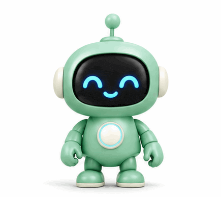
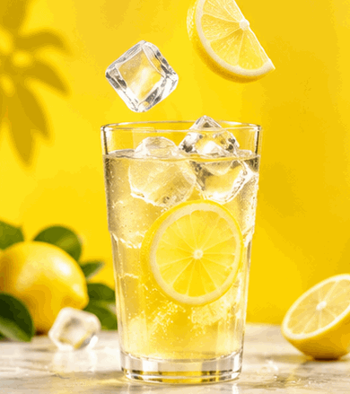

# Awesome AI GIF Prompts · 491+ 个案例

[English](README.md) · **简体中文**

    [](https://awesome.re)

精选 **AI 直出 GIF 动图** 提示词合集：表情包、反应图、快闪、品牌动效、氛围循环、像素风。自有示例都是用所列提示词原样生成的，未做任何后期修改；社区精选标注了来源并署名作者。

> 🔄 **每日更新**：几乎每天新增 10 条我们实测的提示词，外加 40+ 条标注来源的 X 与网络社区精选，最近更新：**2026-11-17**。点 ⭐ Star 或 👀 Watch 第一时间看到新案例。
>
> 🎞️ **在线试用：** 把任意提示词粘贴到 [ViNano AI GIF Generator](https://vinano.ai/gif-generator)，输入文字或上传照片即可得到循环 GIF（由 GPT Image 2.6 驱动）。

<p align="center">
  
  
  
  
  
</p>

## 目录

- [这些 GIF 是怎么生成的](#这些-gif-是怎么生成的)
- [表情包与贴纸](#表情包与贴纸) · 189 条提示词
- [快闪与品牌动效](#快闪与品牌动效) · 84 条提示词
- [氛围循环动画](#氛围循环动画) · 126 条提示词
- [像素风与界面动效](#像素风与界面动效) · 84 条提示词
- [科普讲解动图](#科普讲解动图) · 8 条提示词
- [自己动手生成](#自己动手生成)

## 这些 GIF 是怎么生成的

在请求里设置 `output_format: "gif"`，GPT Image 2.6 就会直接返回 GIF 动图而不是静态图。帧数、每帧时长和尺寸由模型自行决定。

本仓库的每条提示词在发送时都会追加一句话，要求生成无缝循环：

```text
Animate it as a short, smooth, seamlessly looping GIF with clear motion between frames.
```

### 提示词公式

**主体**（一个清晰的角色或物体）+ **动作**（1–2 个动词：挥手、弹跳、飘动、闪烁）+ **风格**（扁平插画、Q 版贴纸、像素风、摄影）+ **背景**（做贴纸时用纯色、高对比背景）

### 技巧

- 一个主体、一到两个动作。画面越杂，动作越难看清。
- 用动词描述动作，比如“摇晃、打瞌睡、闪烁、滑落”，少用形容词。
- 扁平插画、Q 版、像素风在 GIF 的小尺寸下比写实照片效果好得多。
- 做一套表情包时，每条提示词都复用完全相同的角色描述，整套才会一致。
- 要抠成透明贴纸的，背景用一种和角色颜色完全拉开的纯色。
- 快闪要把每一帧写成不同的镜头；品牌快闪则固定 Logo 的位置和大小，只换周围的场景。
- 长文字和复杂的昼夜循环目前仍不稳定：文字尽量短，大的变化交给光线来表现。

## 表情包与贴纸

这里展示本分类最新的 12 条（共 189 条）。[查看全部 189 条 →](categories/stickers_zh.md)

### 1. 织围巾的企鹅


<sub>16 帧 · 328×290 · 2.2s · gpt-image-2.6 · 生成于 2026-11-17</sub>

**提示词**

```text
A round penguin sits clicking two knitting needles, a striped red scarf growing longer from its flippers. Cute flat cartoon, snowy light blue background.
```

`penguin` `knitting` `winter`

### 2. 小兔吸面条


<sub>16 帧 · 309×309 · 2.2s · gpt-image-2.6 · 生成于 2026-11-17</sub>

**提示词**

```text
A white bunny with chopsticks slurps a long noodle from a bowl, cheeks puffing, the noodle wiggling up into its mouth. Cute flat sticker style, thick outline, pale orange background.
```

`bunny` `noodles` `food`

### 3. 章鱼喷墨尴尬


<sub>9 帧 · 412×412 · 1.6s · gpt-image-2.6 · 生成于 2026-11-17</sub>

**提示词**

```text
A small pink octopus gets startled and puffs out a cloud of ink, then peeks out of the cloud with an embarrassed grin. Cute flat cartoon, light aqua background.
```

`octopus` `oops` `funny`

### 4. 河马打大哈欠


<sub>9 帧 · 432×395 · 1.6s · gpt-image-2.6 · 生成于 2026-11-17</sub>

**提示词**

```text
A sleepy round lavender hippo opens its mouth in an enormous yawn, eyes squeezed shut, then closes it with a satisfied smack. Soft clay-like 3D style, pale peach background.
```

`hippo` `yawn` `sleepy`

### 5. 叼吐司赶路的柴犬


<sub>8 帧 · 429×394 · 1.0s · gpt-image-2.6 · 生成于 2026-11-17</sub>

**提示词**

```text
A shiba inu with a slice of toast in its mouth runs in place in a panic, ears flapping, a sweat drop flying off. Funny flat sticker style, thick white outline, light yellow background.
```

`shiba` `late` `sticker`

### 6. 小象鼻子喷水


<sub>16 帧 · 379×251 · 2.2s · gpt-image-2.6 · 生成于 2026-11-17</sub>

**提示词**

```text
A chubby baby elephant lifts its trunk and sprays a happy fountain of water over its own head, droplets sparkling. Cute flat cartoon, light blue background, fixed camera.
```

`elephant` `water` `cute`

### 7. 涂鸦小人翻白眼


<sub>9 帧 · 425×399 · 1.6s · gpt-image-2.6 · 生成于 2026-11-17</sub>

**提示词**

```text
A round hand-drawn doodle face with marker lines rolls its eyes up in exaggerated annoyance, then looks back forward with a flat mouth. White paper background, wobbly ink lines.
```

`doodle` `eye-roll` `reaction`

### 8. 本子上的火柴人跳舞


<sub>9 帧 · 438×387 · 1.3s · gpt-image-2.6 · 生成于 2026-11-17</sub>

**提示词**

```text
A hand-drawn ballpoint stick figure on lined notebook paper does a goofy hip-shaking dance with arms waving, slight line boil like a flipbook. Paper texture, fixed overhead camera.
```

`doodle` `dance` `sketch`

### 9. 小狐狸上前打招呼


<sub>12 帧 · 358×358 · 1.9s · gpt-image-2.6 · 生成于 2026-11-17</sub>

**提示词**

```text
An orange fox in a little blue scarf takes two small steps toward the viewer, waves one paw, then steps back to where it started. Flat vector cartoon, pale mint background, fixed camera.
```

> 💡 **技巧：** 写清起始姿势、动作和回到原位，首尾帧才对得上。

`fox` `wave` `greeting`

### 10. 小熊猫眨眼微笑


<sub>9 帧 · 414×414 · 1.6s · gpt-image-2.6 · 生成于 2026-11-17</sub>

**提示词**

```text
A fluffy red panda mascot closes its eyes, opens them again with a small happy smile, ears twitching once. Soft flat illustration, cream background, fixed camera.
```

`red-panda` `blink` `cute`

### 11. 薄荷色机器人挥手



<sub>9 帧 · 435×387 · 1.4s · gpt-image-2.6 · 生成于 2026-11-17</sub>

**提示词**

```text
A small mint-green robot with a round screen face and a blinking antenna raises one hand, gives one wave, and lowers it back to rest. Simple rounded 3D illustration, clean white background, fixed camera.
```

`robot` `wave` `hello`

### 12. 手机里修屏的小猫


<sub>9 帧 · 433×395 · 1.4s · gpt-image-2.6 · 生成于 2026-11-17</sub>

**提示词**

```text
A tiny gray kitten in a yellow hard hat stands inside a cracked phone screen and works a toy power drill against the crack, sparks flying, the crack shrinking a little. Cute 3D cartoon, phone fills the frame, fixed camera.
```

`kitten` `phone` `repair`

**[查看本分类全部 189 条 →](categories/stickers_zh.md)**

## 快闪与品牌动效

这里展示本分类最新的 12 条（共 84 条）。[查看全部 84 条 →](categories/flash_zh.md)

### 1. 烤鸡晚餐揭盖


<sub>16 帧 · 380×252 · 2.9s · gpt-image-2.6 · 生成于 2026-11-17</sub>

**提示词**

```text
A silver dome lid lifts off a golden roast chicken on a platter, a burst of steam rising and a few herb leaves falling onto it. Warm festive food ad style, dark wood background.
```

`dinner` `holiday` `food`

### 2. 爆米花蹦出来


<sub>16 帧 · 379×230 · 2.2s · gpt-image-2.6 · 生成于 2026-11-17</sub>

**提示词**

```text
Kernels in a red and white striped bowl burst into fluffy popcorn one by one, some pieces jumping out and tumbling back in. Bold movie-night ad style, deep blue background.
```

`popcorn` `snack` `movie`

### 3. 平底锅翻煎饼


<sub>9 帧 · 439×388 · 1.3s · gpt-image-2.6 · 生成于 2026-11-17</sub>

**提示词**

```text
A golden pancake is tossed up from a cast iron pan, flips once in the air and lands back with a little puff of steam. Bright food ad style, warm kitchen background, fixed camera.
```

`pancake` `food` `kitchen`

### 4. 旅行手账贴纸逐个贴上


<sub>9 帧 · 439×387 · 2.0s · gpt-image-2.6 · 生成于 2026-11-17</sub>

**提示词**

```text
An open travel journal on an ivory desk; little stickers of a plane, a ticket stub, a palm tree and a stamp pop onto the page one after another with a soft bounce. Cozy scrapbook style, overhead camera.
```

`scrapbook` `travel` `journal`

### 5. 木棋子翻面落定


<sub>16 帧 · 380×252 · 1.9s · gpt-image-2.6 · 生成于 2026-11-17</sub>

**提示词**

```text
A pale wooden pentagon-shaped board game piece flips over in the air and lands with a small clack on a wooden grid board, a puff of dust at impact. Warm tabletop lighting, close-up, fixed camera.
```

`board-game` `wood` `flip`

### 6. 包豪斯几何块换位


<sub>16 帧 · 380×250 · 2.6s · gpt-image-2.6 · 生成于 2026-11-17</sub>

**提示词**

```text
A grid of Bauhaus shapes in red, yellow, blue and black, circles, half circles, squares and triangles, slide and rotate into new positions in crisp steps. Flat poster style, off-white background.
```

`bauhaus` `geometric` `motion-design`

### 7. 蹦跳的购物袋


<sub>16 帧 · 307×306 · 2.2s · gpt-image-2.6 · 生成于 2026-11-17</sub>

**提示词**

```text
A glossy orange shopping bag with rope handles hops up, squashes on landing, and a little gift box pops out of the top and drops back in. Playful 3D product style, pastel pink background.
```

`shopping` `bag` `promo`

### 8. 摇摆的促销吊牌


<sub>16 帧 · 313×302 · 1.4s · gpt-image-2.6 · 生成于 2026-11-17</sub>

**提示词**

```text
A red paper price tag that says SALE hangs from a string and swings left and right with a tiny bounce, a few gold sparkles popping around it. Bold flat ad style, solid black background edge to edge in every frame.
```

> 💡 **技巧：** 画面文字只放一个短词，长文字在帧之间容易变形。

`sale` `black-friday` `ad`

### 9. 粉饼盒打开


<sub>9 帧 · 428×398 · 1.6s · gpt-image-2.6 · 生成于 2026-11-17</sub>

**提示词**

```text
A rose-gold makeup compact clicks open, the mirror catches a flash of light and a little powder puff lifts out. Elegant beauty product shot, blush pink background.
```

`beauty` `product` `compact`

### 10. 键帽波浪按压


<sub>16 帧 · 371×252 · 1.8s · gpt-image-2.6 · 生成于 2026-11-17</sub>

**提示词**

```text
Mechanical keyboard keycaps press down one after another in a wave from left to right, RGB glow following underneath. Sleek product shot, dark background.
```

`keyboard` `product` `tech`

### 11. 冰块落入柠檬水



<sub>9 帧 · 390×439 · 1.4s · gpt-image-2.6 · 生成于 2026-11-17</sub>

**提示词**

```text
Ice cubes and a lemon slice drop into a tall glass of lemonade, splashing droplets and fizzing bubbles. Fresh summer drink ad style, sunny yellow background.
```

`drink` `summer` `ad`

### 12. 魔法书游戏菜单


<sub>16 帧 · 377×240 · 2.9s · gpt-image-2.6 · 生成于 2026-11-17</sub>

**提示词**

```text
A worn leather spellbook drops onto a wooden table, flips open, and three glowing menu buttons rise out of its pages. Fantasy game UI style, warm candlelight, dark background.
```

`book` `game` `menu`

**[查看本分类全部 84 条 →](categories/flash_zh.md)**

## 氛围循环动画

这里展示本分类最新的 12 条（共 126 条）。[查看全部 126 条 →](categories/loops_zh.md)

### 1. 雪花球里的小木屋


<sub>9 帧 · 439×390 · 1.6s · gpt-image-2.6 · 生成于 2026-11-17</sub>

**提示词**

```text
A glass snow globe with a tiny red cabin and pine trees inside; snowflakes swirl up and settle slowly around the cabin. Warm cozy lighting, wooden table, fixed close-up.
```

`snow-globe` `winter` `cozy`

### 2. 糖炒栗子


<sub>9 帧 · 439×390 · 1.6s · gpt-image-2.6 · 生成于 2026-11-17</sub>

**提示词**

```text
A big iron wok of chestnuts and dark sand is stirred by a wooden paddle, steam curling up under a warm bulb at a winter street stall. Cozy photographic style, close-up, fixed camera.
```

`chestnut` `street-food` `winter`

### 3. 路灯下的初雪


<sub>16 帧 · 376×252 · 2.9s · gpt-image-2.6 · 生成于 2026-11-17</sub>

**提示词**

```text
Big soft snowflakes drift down through the warm cone of an old street lamp on a quiet cobblestone street at night. Cinematic, fixed camera, everything else still.
```

`snow` `night` `street`

### 4. 窗上霜花蔓延


<sub>8 帧 · 439×388 · 1.8s · gpt-image-2.6 · 生成于 2026-11-17</sub>

**提示词**

```text
Delicate fern-like frost patterns creep across a cold window pane from the corners, a blurry snowy garden visible behind. Macro winter photography, fixed camera.
```

`frost` `winter` `macro`

### 5. 孔明灯升空


<sub>16 帧 · 377×248 · 2.9s · gpt-image-2.6 · 生成于 2026-11-17</sub>

**提示词**

```text
Dozens of warm glowing paper lanterns float slowly up into a deep blue night sky above dark rooftops, flickering softly. Dreamy painterly style, fixed camera.
```

`lantern` `night` `festival`

### 6. 瓢虫与露珠


<sub>9 帧 · 439×389 · 1.6s · gpt-image-2.6 · 生成于 2026-11-17</sub>

**提示词**

```text
A ladybug walks along a curved green leaf while a dewdrop at the leaf tip swells and wobbles. Macro nature photography, soft morning bokeh, fixed camera.
```

`ladybug` `macro` `nature`

### 7. 山洞里打呼的熊


<sub>16 帧 · 380×248 · 2.9s · gpt-image-2.6 · 生成于 2026-11-17</sub>

**提示词**

```text
A brown bear sleeps curled up in a cozy cave, its belly rising and falling as a snore bubble grows and shrinks from its nose, snow falling softly outside. Storybook illustration, fixed camera.
```

`bear` `hibernation` `winter`

### 8. 海獭仰浮打盹


<sub>9 帧 · 432×395 · 1.6s · gpt-image-2.6 · 生成于 2026-11-17</sub>

**提示词**

```text
A sea otter floats on its back in calm water, holding a small shell on its belly, bobbing gently with the ripples as its eyes stay closed. Soft watercolor style, fixed overhead-angle camera.
```

`otter` `sleep` `calm`

### 9. 沙漠上空的彗星


<sub>9 帧 · 506×337 · 2.0s · gpt-image-2.6 · 生成于 2026-11-17</sub>

**提示词**

```text
A bright comet with a long glowing tail drifts slowly across a starry sky above dark desert dunes, the tail shimmering. Calm night photography look, fixed wide camera.
```

`comet` `night` `sky`

### 10. 发光菌丝峡谷桥


<sub>9 帧 · 506×337 · 1.6s · gpt-image-2.6 · 生成于 2026-11-17</sub>

**提示词**

```text
A delicate bridge woven from glowing white fungal threads spans a misty canyon at dusk; soft pulses of blue light travel along the threads from one side to the other. Fantasy concept art, fixed wide shot.
```

`fantasy` `bridge` `glow`

### 11. 稚拙几何手绘脸


<sub>9 帧 · 437×388 · 1.6s · gpt-image-2.6 · 生成于 2026-11-17</sub>

**提示词**

```text
A naive hand-drawn portrait of an imaginary character built from uneven circles, triangles and blocks of retro color, with trembling black ink outlines; the character blinks once and the color blocks shift slightly. Textured paper, lots of empty space.
```

`illustration` `geometric` `ink`

### 12. 海湾浪花动态照片


<sub>9 帧 · 437×388 · 1.6s · gpt-image-2.6 · 生成于 2026-11-17</sub>

**提示词**

```text
A quiet rocky cove at golden hour where only the sea moves: small waves roll in and wash over the sand. The rocks, cliffs and sky stay completely still. Natural photographic color, fixed camera.
```

> 💡 **技巧：** 做动态照片要点名唯一动的元素，并列出必须静止的部分。

`sea` `cinemagraph` `calm`

**[查看本分类全部 126 条 →](categories/loops_zh.md)**

## 像素风与界面动效

这里展示本分类最新的 12 条（共 84 条）。[查看全部 84 条 →](categories/pixel-ui_zh.md)

### 1. 成功提示条滑入


<sub>16 帧 · 380×252 · 1.8s · gpt-image-2.6 · 生成于 2026-11-17</sub>

**提示词**

```text
A green rounded notification toast slides in from the top with a white check mark drawing itself, holds a moment, then slides back up. Minimal app UI, white background, no other text.
```

`ui` `toast` `notification`

### 2. 表情回应依次弹出


<sub>12 帧 · 356×356 · 1.4s · gpt-image-2.6 · 生成于 2026-11-17</sub>

**提示词**

```text
A rounded white reaction bar where five round emoji faces, smile, laugh, heart eyes, surprise and sad, pop up one after another with a springy bounce. Clean app UI style, light gray background.
```

`ui` `emoji` `reaction`

### 3. 像素火车过桥


<sub>12 帧 · 358×345 · 1.4s · gpt-image-2.6 · 生成于 2026-11-17</sub>

**提示词**

```text
A small pixel art steam train crosses a stone arch bridge over a river, puffing little smoke clouds, mountains behind. 16-bit side-scroller style, sunset palette.
```

`pixel` `train` `landscape`

### 4. 像素蜜蜂花园


<sub>16 帧 · 375×246 · 1.9s · gpt-image-2.6 · 生成于 2026-11-17</sub>

**提示词**

```text
A pixel art bee buzzes in a figure eight between three pixel flowers that sway slightly. 16-bit game style, light green background.
```

`pixel` `bee` `garden`

### 5. 书签收藏


<sub>9 帧 · 438×389 · 1.4s · gpt-image-2.6 · 生成于 2026-11-17</sub>

**提示词**

```text
An outlined bookmark icon fills with solid gold from top to bottom and gives a small bounce, with a few tiny sparkles. Minimal app icon style, white background.
```

`ui` `bookmark` `save`

### 6. 加入购物车


<sub>9 帧 · 437×388 · 1.4s · gpt-image-2.6 · 生成于 2026-11-17</sub>

**提示词**

```text
A flat shopping cart icon; a small box drops into it, the cart wiggles, and a red badge with the number 1 pops up on its corner. Clean app UI icon style, white background.
```

`ui` `cart` `ecommerce`

### 7. 像素小恐龙跺脚吼叫


<sub>12 帧 · 344×366 · 1.7s · gpt-image-2.6 · 生成于 2026-11-17</sub>

**提示词**

```text
A small green pixel art dinosaur stomps one foot, opens its mouth in a tiny roar with a shake line, then settles back. 16-bit game sprite, plain sand-colored background.
```

`pixel` `dinosaur` `sprite`

### 8. 低多边形主角慢跑


<sub>12 帧 · 380×337 · 1.4s · gpt-image-2.6 · 生成于 2026-11-17</sub>

**提示词**

```text
A blocky low-poly game hero in a red jacket jogs along a dirt path in a side view, rendered like an early 2000s console game with chunky polygons and blurry textures. Fixed camera, simple green hills behind.
```

`low-poly` `retro-game` `run`

### 9. 像素宇航员跑步


<sub>16 帧 · 378×249 · 1.6s · gpt-image-2.6 · 生成于 2026-11-17</sub>

**提示词**

```text
A pixel art astronaut in a white suit with an orange visor runs in place in a smooth side-view run cycle, small dust puffs at each step. Limited 16-color palette, dark navy background with a few stars.
```

> 💡 **技巧：** 跑步、走路循环用 12–16 帧更顺。

`pixel` `astronaut` `run-cycle`

### 10. 环形图填充


<sub>16 帧 · 379×263 · 1.6s · gpt-image-2.6 · 生成于 2026-11-17</sub>

**提示词**

```text
A donut chart fills segment by segment in teal, coral and yellow while the percentage in the middle counts up. Clean dashboard UI style, white background.
```

`ui` `chart` `data`

### 11. 地图图钉落下


<sub>12 帧 · 358×357 · 1.4s · gpt-image-2.6 · 生成于 2026-11-17</sub>

**提示词**

```text
A red location pin drops onto a simple folded map, bounces once and sends out a soft ripple ring. Flat UI icon style, pale green background.
```

`ui` `map` `location`

### 12. 复制成功


<sub>9 帧 · 439×390 · 1.4s · gpt-image-2.6 · 生成于 2026-11-17</sub>

**提示词**

```text
Two stacked rounded squares slide together into a clipboard icon, then a green checkmark draws itself on top. Minimal flat UI animation, light gray background.
```

`ui` `copy` `icon`

**[查看本分类全部 84 条 →](categories/pixel-ui_zh.md)**

## 科普讲解动图

### 1. 跷跷板杠杆平衡


<sub>16 帧 · 378×254 · 2.2s · gpt-image-2.6 · 生成于 2026-11-17</sub>

**提示词**

```text
A simple wooden seesaw on a triangle pivot tips one way as a heavy block drops on one end, then a small block slides farther out on the other end until it balances level. Flat textbook illustration, white background, no text.
```

`lever` `physics` `simple-machines`

### 2. 三棱镜分光


<sub>16 帧 · 380×252 · 1.9s · gpt-image-2.6 · 生成于 2026-11-17</sub>

**提示词**

```text
A white beam of light enters a glass triangular prism and fans out into a rainbow on the other side, the rainbow shimmering gently. Dark background, clean science illustration, fixed camera.
```

`light` `prism` `physics`

### 3. 行星绕日运行


<sub>9 帧 · 439×390 · 1.4s · gpt-image-2.6 · 生成于 2026-11-17</sub>

**提示词**

```text
A flat top-down diagram of a glowing sun with four colorful planets moving along thin circular orbits at different speeds. Dark navy background, simple clean shapes, no text.
```

`solar-system` `astronomy` `diagram`

### 4. 心脏跳动示意


<sub>9 帧 · 439×388 · 1.6s · gpt-image-2.6 · 生成于 2026-11-17</sub>

**提示词**

```text
A friendly simplified anatomical heart in red and blue squeezes and relaxes in a steady beat, small arrows showing blood flowing in and out. Flat medical infographic style, light background, no text.
```

`heart` `biology` `infographic`

### 5. 豆子发芽地下剖面


<sub>9 帧 · 439×388 · 2.0s · gpt-image-2.6 · 生成于 2026-11-17</sub>

**提示词**

```text
A cutaway of a soil pot shows a bean seed splitting open, a root reaching down and a pale shoot pushing up toward the surface. Soft flat educational illustration, brown and green palette, no text.
```

`plant` `germination` `biology`

### 6. 月相变化


<sub>16 帧 · 309×309 · 1.9s · gpt-image-2.6 · 生成于 2026-11-17</sub>

**提示词**

```text
A single moon centered in a square frame of dark starry sky goes through its phases, from thin crescent to full moon and back to crescent, the shadow edge sliding smoothly across it. Clean flat illustration, fixed camera.
```

`moon` `astronomy` `science`

### 7. 水循环示意


<sub>16 帧 · 380×252 · 2.9s · gpt-image-2.6 · 生成于 2026-11-17</sub>

**提示词**

```text
A friendly cutaway landscape showing the water cycle: vapor rises from a lake, gathers into a cloud, rain falls on a mountain and flows back down a river into the lake. Flat educational illustration, soft blue palette, no text.
```

`water-cycle` `science` `diagram`

### 8. 单摆来回摆动


<sub>12 帧 · 358×357 · 1.4s · gpt-image-2.6 · 生成于 2026-11-17</sub>

**提示词**

```text
A simple science diagram of a pendulum: a metal ball on a string swings left and right from a fixed pivot, a faint dotted arc showing its path. Clean flat textbook illustration, white background, no text labels.
```

> 💡 **技巧：** 写明不要文字标注，示意图上的字在帧之间容易漂移。

`physics` `pendulum` `science`

## 自己动手生成

使用 [ViNano AI API](https://vinano.ai/api-keys)：先创建 API Key，提交 GIF 生成任务，再轮询任务状态拿到 GIF 地址（每张 25 积分）。

```bash
# 1. Submit a GIF task — the response contains a task "uuid"
curl -X POST https://vinano.ai/api/async-openai-images \
  -H "Authorization: Bearer $VINANO_API_KEY" \
  -F mode=txt2img -F zeakaiModel=gpt-image-2.6-gif -F model="ViNano AI" \
  -F count=1 -F img_size=1k -F aspectRatio=1:1 \
  -F prompt="A cheerful cartoon cat waving hello. Animate it as a short, smooth, seamlessly looping GIF with clear motion between frames."

# 2. Poll until "completed" is true — the GIF URL is in "generated_images_url"
curl "https://vinano.ai/api/task-status?uuid=<uuid>" \
  -H "Authorization: Bearer $VINANO_API_KEY"
```

或者用仓库自带的脚本重新生成全部示例（需要 Node 18+）：

```bash
git clone https://github.com/ailingqu/awesome-ai-gif-prompts.git && cd awesome-ai-gif-prompts
cp .env.example .env   # fill in VINANO_API_KEY
npm run generate        # only generates prompts without a GIF
npm run build           # rebuilds README.md and README_zh.md
```

## 来源

没有来源标注的条目由我们编写并生成。标有 **来源** 的条目搜集自 X 和其它网站，提示词和 GIF 按原样展示，署名作者并链接到原帖，版权归原作者所有；作者如需修改或删除，请提交 issue。

## 参与贡献

欢迎提交新提示词！在 `data/prompts.json` 里新增一条，附上你生成的 GIF，然后运行 `npm run build`。详见 [CONTRIBUTING.md](CONTRIBUTING.md)。

## 许可

提示词与示例 GIF 采用 [CC BY 4.0](LICENSE)。觉得有用的话，点个 ⭐ 能让更多人看到。
