# Awesome AI GIF Prompts · 596+ 个案例

[English](README.md) · **简体中文**

    [](https://awesome.re)

精选 **AI 直出 GIF 动图** 提示词合集：表情包、反应图、快闪、品牌动效、氛围循环、像素风。自有示例都是用所列提示词原样生成的，未做任何后期修改；社区精选标注了来源并署名作者。

> 🔄 **每日更新**：几乎每天新增 10 条我们实测的提示词，外加 40+ 条标注来源的 X 与网络社区精选，最近更新：**2026-11-20**。点 ⭐ Star 或 👀 Watch 第一时间看到新案例。
>
> 🎞️ **在线试用：** 把任意提示词粘贴到 [ViNano AI GIF Generator](https://vinano.ai/gif-generator)，输入文字或上传照片即可得到循环 GIF（由 GPT Image 2.6 驱动）。

<p align="center">
  
  
  
  
  
  
  
  
  
</p>

## 目录

- [这些 GIF 是怎么生成的](#这些-gif-是怎么生成的)
- [表情包与贴纸](#表情包与贴纸) · 221 条提示词
- [快闪与品牌动效](#快闪与品牌动效) · 92 条提示词
- [氛围循环动画](#氛围循环动画) · 149 条提示词
- [像素风与界面动效](#像素风与界面动效) · 98 条提示词
- [科普讲解动图](#科普讲解动图) · 17 条提示词
- [节日与祝福](#节日与祝福) · 3 条提示词
- [电商与产品展示](#电商与产品展示) · 10 条提示词
- [美食饮品](#美食饮品) · 4 条提示词
- [动态头像](#动态头像) · 2 条提示词
- [自己动手生成](#自己动手生成)

## 这些 GIF 是怎么生成的

在请求里设置 `output_format: "gif"`，GPT Image 2.6 就会直接返回 GIF 动图而不是静态图。帧数、每帧时长和尺寸由模型自行决定。

本仓库的每条提示词在发送时都会追加一句话，要求生成无缝循环：

```text
Animate it as a short, smooth, seamlessly looping GIF with clear motion between frames.
```

### 提示词公式

**主体**（一个清晰的角色或物体）+ **动作**（1–2 个动词：挥手、弹跳、飘动、闪烁）+ **风格**（扁平插画、Q 版贴纸、像素风、摄影）+ **背景**（做贴纸时用纯色、高对比背景）

### 技巧

- 一个主体、一到两个动作。画面越杂，动作越难看清。
- 用动词描述动作，比如“摇晃、打瞌睡、闪烁、滑落”，少用形容词。
- 扁平插画、Q 版、像素风在 GIF 的小尺寸下比写实照片效果好得多。
- 做一套表情包时，每条提示词都复用完全相同的角色描述，整套才会一致。
- 要抠成透明贴纸的，背景用一种和角色颜色完全拉开的纯色。
- 快闪要把每一帧写成不同的镜头；品牌快闪则固定 Logo 的位置和大小，只换周围的场景。
- 长文字和复杂的昼夜循环目前仍不稳定：文字尽量短，大的变化交给光线来表现。

## 表情包与贴纸

这里展示本分类最新的 12 条（共 221 条）。[查看全部 221 条 →](categories/stickers_zh.md)

### 1. Q版功夫少女演武


<sub>38 帧 · 356×266 · 8.2s · GPT Image 2.6</sub>

📌 **来源：** [@itnavi2022 on X](https://x.com/itnavi2022/status/2118516145942843865)

**提示词**

```text
ちびキャラのカンフー少女が演舞するGIFを作成して
```

`chibi` `kung-fu` `martial-arts` `short-prompt`

### 2. 橘猫快递员「收到」表情


<sub>9 帧 · 480×162 · 1.8s · GPT Image 2.6</sub>

📌 **来源：** [@AXIS95277 on X](https://x.com/AXIS95277/status/2118264180239184369)

**提示词**

```text
一只圆滚滚的橘猫快递员，戴蓝色帽子，开心地举起爪子挥手，循环动画。画面下方有白色粗体中文大字「收到」，黑色描边，文字在每一帧都保持不变、不晃动。干净的浅米色背景，扁平插画风格，表情包。除了「收到」两个字，不要任何其他文字。
```

`cat` `courier` `caption` `sticker`

### 3. 旋转的猫


<sub>9 帧 · 476×354 · 0.8s · GPT Image 2.6</sub>

📌 **来源：** [@xikhar on X](https://x.com/xikhar/status/2118407355859878352)

**提示词**

```text
create a gif of a cat spinning
```

`cat` `spin` `meme` `short-prompt`

### 4. 橘猫扑雪花

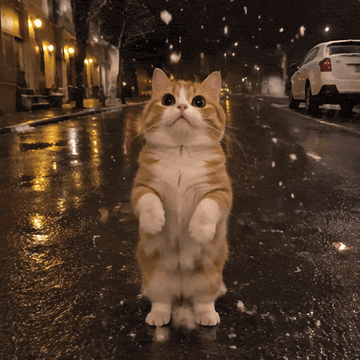

<sub>9 帧 · 360×360 · 1.8s · GPT Image 2.6</sub>

📌 **来源：** [mileson on GitHub](https://github.com/mileson/awesome-gpt-images-2.6-gif)

**提示词**

```text
A chubby orange-and-white tabby cat, orange head and ears, cream-white chest and front paws, big dark round eyes, standing on its hind legs in the middle of a wet night street, dark asphalt reflecting yellow streetlights, buildings with warm yellow lights on the left, a white car parked on the right, realistic candid phone-video look, dark night tones, 9-frame looping animation. Jumping up trying to catch falling snowflakes with its front paws.
```

`cat` `snow` `night-street` `photoreal`

### 5. 街头橘猫跳舞


<sub>9 帧 · 360×360 · 1.8s · GPT Image 2.6</sub>

📌 **来源：** [mileson on GitHub](https://github.com/mileson/awesome-gpt-images-2.6-gif)

**提示词**

```text
A chubby orange-and-white tabby cat, orange head and ears, cream-white chest and front paws, big dark round eyes, standing on its hind legs in the middle of a wet night street, dark asphalt reflecting yellow streetlights, buildings with warm yellow lights on the left, a white car parked on the right, realistic candid phone-video look, dark night tones, 9-frame looping animation. Bouncing and swaying side to side, paws up in the air, joyful dance.
```

`cat` `dance` `night-street` `photoreal`

### 6. 街头拳击橘猫出拳

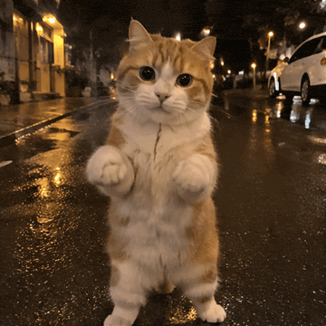

<sub>9 帧 · 360×360 · 1.8s · GPT Image 2.6</sub>

📌 **来源：** [mileson on GitHub](https://github.com/mileson/awesome-gpt-images-2.6-gif)

**提示词**

```text
A chubby orange-and-white tabby cat, orange head and ears, cream-white chest and front paws, big dark round eyes, standing on its hind legs in the middle of a wet night street, dark asphalt reflecting yellow streetlights, buildings with warm yellow lights on the left, a white car parked on the right, realistic candid phone-video look, dark night tones, 9-frame looping animation. Front paws alternating punching toward the camera, body swaying side to side, then leaning close to the camera.
```

`cat` `boxing` `night-street` `photoreal`

### 7. 股市大涨Q版打工人撒钱


<sub>12 帧 · 480×480 · 1.2s · GPT Image 2.6</sub>

📌 **来源：** [OpenArt on OpenAI](https://openai.com/index/introducing-images-2-6/)

**提示词**

```text
Create a single animation sprite sheet for a seamless looping GIF. A super-cute chibi adult office worker sits at a desk watching a computer monitor with a clearly soaring stock-market line chart and a large upward arrow. The sequence: notices the chart rising, eyes widen with delight, jumps up cheering, grabs a handful of generic paper banknotes with no readable currency markings, then happily tosses the banknotes into the air like confetti while laughing. Oversized round head, tiny body, big sparkling expressive eyes, soft rounded features, messy fluffy hair, white shirt and loosened tie. Exactly 6 sequential frames arranged in a precise 3-column by 2-row grid, read left-to-right then top-to-bottom. Every panel has identical dimensions. Fixed front three-quarter camera, same character, desk, monitor, outfit, and cozy miniature office background. Clear incremental body, arm, and flying-paper motion; sixth frame transitions smoothly toward the first. Polished kawaii chibi 3D toy-like style, bright celebratory pastel lighting, funny joyful mood. No captions, no words, no numbers, no logos, no real currency symbols, no speech bubbles, no panel labels, no borders, no gutters.
```

`chibi` `stock-market` `celebration` `office`

### 8. 股市暴跌Q版打工人哭泣

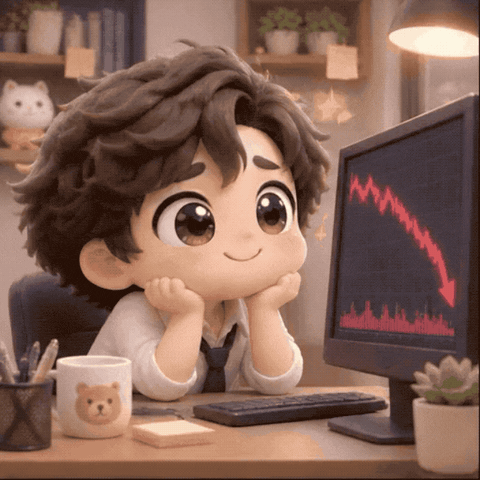

<sub>16 帧 · 480×480 · 1.3s · GPT Image 2.6</sub>

📌 **来源：** [OpenArt on OpenAI](https://openai.com/index/introducing-images-2-6/)

**提示词**

```text
Create a single animation sprite sheet for a seamless looping GIF. A super-cute chibi adult office worker sits at a desk watching a computer monitor with a clearly plunging stock-market line chart. The sequence: hopeful expression, notices the chart falling, eyes widen, face crumples, large cartoon tears stream down both cheeks, then quietly wipes tears while still staring at the falling chart. Oversized round head, tiny body, big expressive eyes, soft rounded features, messy fluffy hair, white shirt and loosened tie. Exactly 6 sequential frames arranged in a precise 3-column by 2-row grid, read left-to-right then top-to-bottom. Every panel has identical dimensions. Fixed front three-quarter camera, same character, same desk, monitor, outfit, and cozy miniature office background. Clear incremental facial and tear motion; sixth frame transitions smoothly toward the first. Polished kawaii chibi 3D toy-like style, warm pastel lighting, funny and sympathetic mood. No captions, no words, no numbers, no logos, no speech bubbles, no panel labels, no borders, no gutters.
```

`chibi` `stock-market` `crying` `office`

### 9. 戴墨镜猫咪跳舞梗图

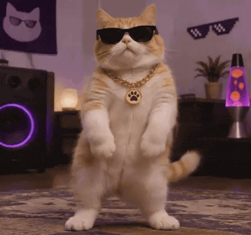

<sub>9 帧 · 426×398 · 1.2s · GPT Image 2.6</sub>

📌 **来源：** [@SSSS_CRYPTOMAN on X](https://x.com/SSSS_CRYPTOMAN/status/2118144429848748108)

**提示词**

```text
次の内容で GIF を作成して: サングラスをかけた猫がダンスをするミームっぽいGIF
```

`cat` `sunglasses` `dance` `meme`

### 10. 勤劳小蜜蜂每日打卡


<sub>9 帧 · 412×408 · 2.0s · GPT Image 2.6</sub>

📌 **来源：** [@MrGafish on X](https://x.com/MrGafish/status/2118217749680025722)

**提示词**

```text
生成一个GIF，用于在𝕏 平台每日签到打卡，寓意我是一个发贴的勤劳小蜜蜂
```

`bee` `check-in` `social` `cute`

### 11. 戴礼帽青蛙跳舞表情

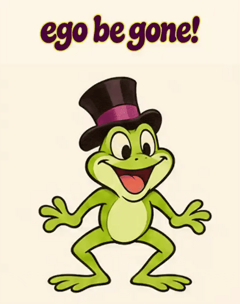

<sub>16 帧 · 480×608 · 1.8s · GPT Image 2.6</sub>

📌 **来源：** [@princess414141 on X](https://x.com/princess414141/status/2118144125354877152)

**提示词**

```text
dancing frog with a top hat on, with ego be gone! written at the top
```

`frog` `dance` `meme` `caption`

### 12. 小熊喝咖啡


<sub>12 帧 · 358×356 · 2.7s · GPT Image 2.6</sub>

📌 **来源：** [Makari｜AIイラスト on note](https://note.com/makari_5108010/n/nbfdb5c15e70b)

**提示词**

```text
ほっこりかわいいくまが、コーヒーを飲んでいるGIFを作ってください。
```

`bear` `coffee` `cute` `plush` `cozy`

**[查看本分类全部 221 条 →](categories/stickers_zh.md)**

## 快闪与品牌动效

这里展示本分类最新的 12 条（共 92 条）。[查看全部 92 条 →](categories/flash_zh.md)

### 1. 平成时代象征社交动图


<sub>6 帧 · 480×480 · 1.3s · GPT Image 2.6</sub>

📌 **来源：** [@rem_rev on X](https://x.com/rem_rev/status/2118252486360498485)

**提示词**

```text
平成を象徴する何か。SNS向けのGIF画像を生成して下さい。
```

`heisei` `retro` `nostalgia` `social`

### 2. 戴围巾的橘色小熊吉祥物挥手


<sub>12 帧 · 358×358 · 2.2s · GPT Image 2.6</sub>

📌 **来源：** [牧牧的成長實驗室 on 方格子 vocus](https://vocus.cc/article/6aebf9a0fd8978000170526d)

**提示词**

```text
製作一張品牌吉祥物 GIF。角色是一隻圓潤、可愛的橘色小熊，戴著米白色圍巾，站在簡潔的淺色背景前。小熊慢慢揮手，露出友善笑容。保留品牌配色與角色比例，循環播放，背景固定。
```

`mascot` `bear` `brand`

### 3. 圆润机器人吉祥物欢迎挥手


<sub>12 帧 · 357×358 · 1.9s · GPT Image 2.6</sub>

📌 **来源：** [蘇柔瑋 on 數位時代 BusinessNext](https://www.bnext.com.tw/article/92943/chatgpt-gif-generator-prompts)

**提示词**

```text
請製作一張 GIF 動畫，一隻圓潤可愛的機器人吉祥物站在畫面中央，先微笑眨眼，再抬起右手向觀眾揮手，最後恢復站立姿勢。使用柔和的藍白配色、簡潔 3D 插畫風格，背景灰白。保持角色造型、配色及身體比例一致，鏡頭固定，製作可以無縫循環的動畫。
```

`mascot` `brand` `3d`

### 4. “ON AIR”霓虹灯与音量表闪动


<sub>9 帧 · 480×270 · 1.6s · GPT Image 2.6</sub>

📌 **来源：** [Fuxuan Guo on ChatCut Blog](https://chatcut.io/blog/gpt-image-2-6)

**提示词**

```text
Locked tripod close-up shot through a dark midnight recording studio glass booth window, 16:9 looping animation. Inside the dark acoustic booth, a sleek red neon sign reading 'ON AIR' above a minimal 4-bar digital LED audio level meter pulses in a clean seamless cycle: frame 1 starts at a soft dim crimson resting glow with four low blue meter bars, frames 3 to 6 flare into a bright vermilion neon halo with warm glass reflections while the LED bars jump into yellow and red peaks, and frames 7 to 9 settle smoothly back to the exact dim resting glow and four blue bars of frame 1. Condenser microphone silhouette and studio headphones in foreground stay completely still.
```

`neon` `studio` `text`

### 5. EMBER 标志火焰跳动


<sub>8 帧 · 480×480 · 1.4s · GPT Image 2.6</sub>

📌 **来源：** [Fuxuan Guo on ChatCut Blog](https://chatcut.io/blog/chatgpt-gif)

**提示词**

```text
Minimalist flat vector brand logo lockup on a solid charcoal-black square background, locked front-on view. Centered copper-orange stylized campfire emblem above clean cream geometric sans-serif all-caps wordmark reading "EMBER". Only the center flame tongue of the copper emblem flickers smoothly upward a few pixels and settles back into its exact starting silhouette on the final frame for a clean loop. Keep the wordmark "EMBER" and side logs completely motionless across every frame, crisp flat colors.
```

`logo` `brand` `flat`

### 6. 滑板 360 尖翻

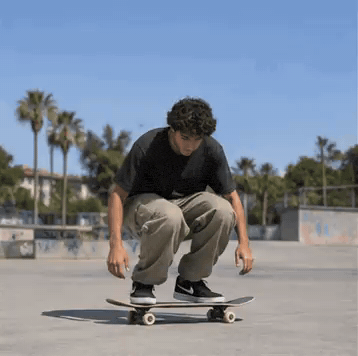

<sub>12 帧 · 358×356 · 1.3s · gpt-image-2.6-gif</sub>

📌 **来源：** [@justynclark on X](https://x.com/justynclark/status/2118189691820482677)

**提示词**

```text
Create a GIF of a 360 kickflip on a skateboard
```

`skateboard` `sport` `trick`

### 7. 成语物件猜谜：四个陶瓷摆件轮流弹跳


<sub>36 帧 · 480×640 · 3.0s · gpt-image-2.6-gif</sub>

📌 **来源：** [@GeekCatX on X](https://x.com/GeekCatX/status/2118160560290480519)

**提示词**

```text
制作一个中国成语物件猜谜 GIF 动图，竖版 3:4，精致可爱的短视频封面风格。

【输出规格】
输出一个可播放的 GIF 动图。
画面尺寸：768×1024 像素。
总时长：3秒，无限循环。
建议帧率：20fps，约60帧。
动画包含4个连续动作段，每段0.75秒，分别对应四件物品。
全程为同一个完整画面，镜头固定，构图固定，没有切镜、推拉、摇移或缩放。
【制作原则：同一母版，局部动画】
先建立一张完整的静态母版，再基于同一母版制作动画。
所有帧保持相同的背景、构图、文字、台面、物件造型、材质、颜色与光照。
只允许当前指定物件进行小幅竖直位移，并同步调整它的局部高光、接触阴影与倒影。
其余三个物件保持静止。
文字必须使用同一份静态图层，在全部帧中重复使用，不要逐帧重新绘制。
【背景】
深蓝色专业摄影棚背景，中心为柔和宝蓝色，向四周自然渐暗为午夜蓝。
背景纯净，具有轻微柔光晕，渐变细腻，没有明显纹理和杂乱装饰。
背景空白区域分布3—5个微小、低亮度的金色光点。
光点沿非常短的闭合轨迹缓慢漂浮，一个循环周期为3秒。
光点不穿过文字或物件，不闪烁、不突然出现或消失，循环结束时回到起始位置。
【文字：全程完全静止】
画面中只允许出现以下两行文字，不增加任何其他文字：
第一行：
物件藏着一个成语

第二行：
你猜出来了吗
第一行位于画面顶部居中，使用明黄色 #FFD54A 的超粗圆体大字，字形饱满圆润，带浅描边和轻微投影。
第二行位于第一行正下方，使用白色粗圆体，字号约为第一行的60%。

两行文字保持足够行距，四周预留安全边距，不贴边、不裁切。
汉字笔画完整，字形标准，清晰易读，无错别字。
在所有帧中，文字的位置、字号、字距、笔画、颜色、描边、阴影与透明度完全一致。
文字不参与弹跳、高光扫动、闪烁或任何其他动画。
【台面与构图】
画面中下部是一条横向浅木纹展示台。
台面干净，木纹细腻，具有柔和、克制的反光。
四件物品集中排列于画面中下部，物件组占画面宽度约85%—90%。
四件物品位于同一前后层级，静止时底部对齐于同一条台面接触基线。
它们具有接近的视觉体量，间距均匀，彼此留出清晰空隙。
不前后错落、不堆叠、不互相遮挡。

采用固定的轻微俯视角度，能够清楚看见杯口和水面，同时保持四件物品横向并排的秩序感。
【四件物品：顺序固定】
从左到右严格依次为：
一辆红色Q版小汽车。
圆润饱满，车身呈中国红，轮子与车窗清晰可辨，具有精致陶瓷玩具质感。

一个装满清水的青花瓷杯。
杯身具有细腻青花纹样，杯口清晰，能够看见透明清水与柔和水面反光。
杯身无文字，水面保持平稳，不溢出、不飞溅。
一匹金色Q版小马。
造型圆润可爱，具有清晰的马头、鬃毛、四肢与尾巴，表面为温润的金色陶瓷釉面。
一条青绿色盘身小龙。
中国传统小龙造型，身体盘曲，龙头微微抬起，龙角、龙须与鳞片适度简化，神态可爱，具有青绿色陶瓷釉面质感。

四件物品保持各自明确的识别特征。
物件表面没有文字、拼音、标签、数字或答案提示。
【动作规则】
所有物件均为刚性的陶瓷摆件，只允许整体轻轻向上移动，再回到原位。
不挤压、不拉伸、不旋转、不左右移动、不改变造型。

弹跳最高点距离原位约为画面高度的1%，动作轻巧、克制。
每个物件必须完整落回原位后，下一个物件才开始动作。
任意时刻，四件物品中最多只有一件正在运动。
当前物件弹起时，一道低强度、柔和的高光缓缓掠过其表面。
高光只作用于当前物件，不影响文字、背景和其他物件。
物件下方的阴影与倒影随高度轻微变化，落地后恢复母版状态。
小汽车轮子不转，小马不迈腿，小龙不摆尾、不转头。

【3秒动作时间线】
0.00—0.75秒：
红色小汽车完成一次轻轻弹起并落回原位。
瓷杯、小马、小龙保持静止。
0.75—1.50秒：
青花瓷杯完成一次轻轻弹起并落回原位。
汽车、小马、小龙保持静止。

1.50—2.25秒：
金色小马完成一次轻轻弹起并落回原位。
汽车、瓷杯、小龙保持静止。
2.25—3.00秒：
青绿色小龙完成一次轻轻弹起并落回原位。
汽车、瓷杯、小马保持静止。

每个0.75秒动作段均遵循：
短暂停住 → 平缓上升 → 平缓落下 → 落定后短暂停住。
上升和下落采用柔和缓入缓出，不突然跳位，不夸张弹震。

【无缝循环】
首帧与末帧完全一致：
四件物品全部落在原位，所有高光、阴影、倒影与背景光点均回到初始状态。
从末帧接回首帧时，没有位置跳变、亮度跳变或颜色闪动。
循环中不出现黑帧、白帧、残影或重影。

【整体质感】
精致可爱的Q版3D陶瓷摆件，圆润、细腻、通透。
以中国红、金色、青绿色和青花蓝点缀深蓝背景，融入克制的中国传统纹样细节。
顶部柔光配合左右轮廓光，物件边缘高光清晰，台面倒影柔和。
整体具有中国文化韵味，适合全年龄观看。
【禁止事项】
不出现成语答案。
不出现额外文字、水印、品牌标志或界面元素。
不出现分镜拼图、四宫格或多画面。
不改变四件物品的数量、顺序、造型、颜色或比例。
不让两个物件同时运动。
不让物件重叠、碰撞、堆叠或横向移位。
不让文字闪烁、变形、位移或重新生成。
不改变相机位置、背景亮度或整体色调。
```

`riddle` `chinese idiom` `3d`

### 8. 迷幻风跳舞猫


<sub>9 帧 · 438×390 · 1.4s · gpt-image-2.6-gif</sub>

📌 **来源：** [@xedrik7 on X](https://x.com/xedrik7/status/2118258491043483978)

**提示词**

```text
psychedelic gif of cat dancing
```

`cat` `psychedelic` `dance`

### 9. 烤鸡晚餐揭盖


<sub>16 帧 · 380×252 · 2.9s · gpt-image-2.6 · 生成于 2026-11-17</sub>

**提示词**

```text
A silver dome lid lifts off a golden roast chicken on a platter, a burst of steam rising and a few herb leaves falling onto it. Warm festive food ad style, dark wood background.
```

`dinner` `holiday` `food`

### 10. 爆米花蹦出来


<sub>16 帧 · 379×230 · 2.2s · gpt-image-2.6 · 生成于 2026-11-17</sub>

**提示词**

```text
Kernels in a red and white striped bowl burst into fluffy popcorn one by one, some pieces jumping out and tumbling back in. Bold movie-night ad style, deep blue background.
```

`popcorn` `snack` `movie`

### 11. 平底锅翻煎饼


<sub>9 帧 · 439×388 · 1.3s · gpt-image-2.6 · 生成于 2026-11-17</sub>

**提示词**

```text
A golden pancake is tossed up from a cast iron pan, flips once in the air and lands back with a little puff of steam. Bright food ad style, warm kitchen background, fixed camera.
```

`pancake` `food` `kitchen`

### 12. 旅行手账贴纸逐个贴上


<sub>9 帧 · 439×387 · 2.0s · gpt-image-2.6 · 生成于 2026-11-17</sub>

**提示词**

```text
An open travel journal on an ivory desk; little stickers of a plane, a ticket stub, a palm tree and a stamp pop onto the page one after another with a soft bounce. Cozy scrapbook style, overhead camera.
```

`scrapbook` `travel` `journal`

**[查看本分类全部 92 条 →](categories/flash_zh.md)**

## 氛围循环动画

这里展示本分类最新的 12 条（共 149 条）。[查看全部 149 条 →](categories/loops_zh.md)

### 1. 芭蕾舞者跳跃落地


<sub>12 帧 · 358×356 · 1.8s · GPT Image 2.6</sub>

📌 **来源：** [@kabumira862571 on X](https://x.com/kabumira862571/status/2118196682680856739)

**提示词**

```text
次の内容で GIF を作成して: バレリーナが飛び上がって着地するまで
```

`ballet` `dance` `leap` `short-prompt`

### 2. 泡泡糖吹破循环


<sub>9 帧 · 480×480 · 1.8s · GPT Image 2.6</sub>

📌 **来源：** [@morphedai on X](https://x.com/morphedai/status/2118424987833094244)

**提示词**

```text
A seamless looping animated GIF. Young Scandinavian woman, 22, platinum blonde bob, freckles, hot pink oversized puffer jacket, on a flat saturated cobalt blue studio wall and floor. Medium shot. She blows a huge bubblegum bubble, it pops on her face, it resets, forever, her eyes bored and looking straight at the camera. Bold, bright, crisp photographic look, hard studio light, no text, no logos.
```

`bubblegum` `studio` `photoreal` `loop`

### 3. 富士山水粉旅行海报


<sub>96 帧 · 480×640 · 8.0s · GPT Image 2.6</sub>

📌 **来源：** [@devteamdrew on X](https://x.com/devteamdrew/status/2118308538564989025)

**提示词**

```text
A living mid-century gouache travel-poster painting of Mount Fuji behind a five-storey Japanese pagoda, static locked-off camera, seamless looping animation. The pagoda is vermilion-orange with deep teal-slate tiled roofs, a slender spire, and a dark evergreen tree beside it. Fuji sits small and distant in dusty blue-grey with a snow-white cap and ragged dry-brush ridges, over a pale mist field. Foreground cherry trees in soft coral-pink blossom with dark trunks frame the bottom, and tiny figures stand on pale speckled ground. Warm cream paper-grain sky fills the upper half. Matte flat gouache with ragged, flaking edges, visible bristle marks and speckled holes. Subtle motion only: blossom petals drift down, branches sway faintly, tiny figures shift, a bell-like gentle shimmer on the light. Soft spring morning light, vertical 3:4, perfect loop.
```

`gouache` `travel-poster` `japan` `cherry-blossom`

### 4. 罗马斗兽场水粉旅行海报


<sub>96 帧 · 480×640 · 8.0s · GPT Image 2.6</sub>

📌 **来源：** [@devteamdrew on X](https://x.com/devteamdrew/status/2118308538564989025)

**提示词**

```text
A living mid-century gouache travel-poster painting of the Roman Colosseum, locked-off static camera, a seamless looping animation. The ruined amphitheater sits low in the frame in sun-bleached ochre, sand and travertine with dusty rose and pale blue-grey arches, painted in dry-brush gouache with flaky, speckled edges and worn-away patches. A tall Italian stone pine in dark green and bottle-green leans in from the right, a vintage teal street lamp on the left, rose-coral flowering shrubs at the base. Open warm cream paper-textured sky fills the upper two thirds with fine paper grain. Gentle motion only: a few tiny birds drift across the sky, a cyclist rides slowly along the piazza, a small scooter, a couple in coral and mustard strolling, pine foliage barely sways. Soft warm afternoon light, long pale shadows, flat matte shapes, vertical 3:4, perfect loop.
```

`gouache` `travel-poster` `rome` `landmark`

### 5. 白宫外观360度环绕航拍


<sub>9 帧 · 474×352 · 1.6s · GPT Image 2.6</sub>

📌 **来源：** [@nima2qisi2 on X](https://x.com/nima2qisi2/status/2118295936606798006)

**提示词**

```text
【白宫外观】360°环绕
帮我做一个真实白宫外观的360°环绕模仿无人机拍摄，要真实还原建筑环境的实际外观情况，做成gif
```

`drone` `orbit` `architecture` `landmark`

### 6. 金门大桥水粉旅行海报


<sub>96 帧 · 480×640 · 8.0s · GPT Image 2.6</sub>

📌 **来源：** [@devteamdrew on X](https://x.com/devteamdrew/status/2118308538564989025)

**提示词**

```text
A living mid-century gouache travel-poster painting of the Golden Gate Bridge seen from a beach, static locked-off camera, seamless looping animation. The bridge is rust-orange with two tall towers, fine suspension cables and vertical hangers, spanning to a hazy grey-blue headland on the left and a tan-grey rocky cliff on the right. In the foreground deep cobalt and teal surf rolls in with white foam lines onto a sweeping beach of sandy beige scratchy dry-brush strokes, with dark rocks, a driftwood log and tiny figures in coral, navy and mustard. Warm cream sky with fine paper grain fills the upper half. Matte opaque gouache, ragged flaking edges, visible bristle streaks, speckled worn texture. Gentle motion only: waves wash and recede, foam shimmers, seagulls glide across the sky, tiny people wander. Soft hazy daylight, vertical 3:4, perfect loop.
```

`gouache` `travel-poster` `bridge` `waves`

### 7. 雪林提灯小猴


<sub>9 帧 · 480×480 · 1.8s · GPT Image 2.6</sub>

📌 **来源：** [OpenAI Developers on OpenAI](https://developers.openai.com/api/docs/guides/image-prompting#generate-a-looping-gif)

**提示词**

```text
A little monkey in an olive-green hooded coat stands in a snowy pine forest at dusk. A wooden cabin glows in the background. The monkey holds a glowing amber paper lantern at chest height, slowly lifts it, looks up and blinks, then lowers it back to its starting pose. Keep the lantern in its hands and the camera still. Make the motion loop smoothly.
```

`monkey` `lantern` `snow` `seamless`

### 8. 拉各斯街头机器人跳舞


<sub>9 帧 · 414×414 · 1.1s · GPT Image 2.6</sub>

📌 **来源：** [@o_adeeko on X](https://x.com/o_adeeko/status/2118203950306410729)

**提示词**

```text
Create an animated GIF of a robot dancing to Afrobeats on a busy Lagos street. Make the movement loop smoothly.
```

`robot` `dance` `afrobeats` `street`

### 9. 纽约雪景水晶球


<sub>9 帧 · 414×414 · 1.3s · GPT Image 2.6</sub>

📌 **来源：** [@dreamwieber on X](https://x.com/dreamwieber/status/2118190877567037732)

**提示词**

```text
generate an animated gif of a beautiful NYC snow globe
```

`snow-globe` `city` `winter` `snow`

### 10. 水面漂浮的纸船


<sub>9 帧 · 412×402 · 1.3s · GPT Image 2.6</sub>

📌 **来源：** [@thinkszyg on X](https://x.com/thinkszyg/status/2118166234495947044)

**提示词**

```text
Make a looping GIF of a paper boat bobbing on the water.
```

`paper-boat` `water` `seamless` `calm`

### 11. 机器人冲咖啡


<sub>16 帧 · 480×480 · 2.4s · GPT Image 2.6</sub>

📌 **来源：** [@sousoccer6 on X](https://x.com/sousoccer6/status/2118210705585537226)

**提示词**

```text
コーヒーを淹れるロボット
```

`robot` `coffee` `brewing` `short-prompt`

### 12. 冬日庭院劈柴老爷爷


<sub>16 帧 · 288×288 · 1.9s · GPT Image 2.6</sub>

📌 **来源：** [@koe_ai414 on X](https://x.com/koe_ai414/status/2118153765094351279)

**提示词**

```text
冬の寒い中、家の庭で薪割りをするおじいさんのGIF
```

`winter` `wood-chopping` `yard` `everyday`

**[查看本分类全部 149 条 →](categories/loops_zh.md)**

## 像素风与界面动效

这里展示本分类最新的 12 条（共 98 条）。[查看全部 98 条 →](categories/pixel-ui_zh.md)

### 1. 像素勇者挥剑特效


<sub>12 帧 · 358×358 · 1.2s · GPT Image 2.6</sub>

📌 **来源：** [@YaReYaRu30Life on X](https://x.com/YaReYaRu30Life/status/2118166505603153922)

**提示词**

```text
GIFを作成。ドット絵の勇者。
剣にエフェクトをつけて振り回す
```

`pixel-art` `hero` `sword` `fx`

### 2. 绿色询价按钮流光


<sub>8 帧 · 480×238 · 1.1s · GPT Image 2.6</sub>

📌 **来源：** [末松 光太郎 on WizTry Blog](https://wiztrydx.com/blog/chatgpt-images-2-6-kaisetsu/)

**提示词**

```text
ホームページに置くボタンのループGIFを作って。横長の角丸で、緑色のボタンに白い文字で「無料見積りはこちら」。文字の位置は動かさず、光が左から右へ流れて、ボタンが少しだけふくらむ動きにして。背景は白。
```

`button` `ui` `japanese`

### 3. 灯泡图标慢慢亮起

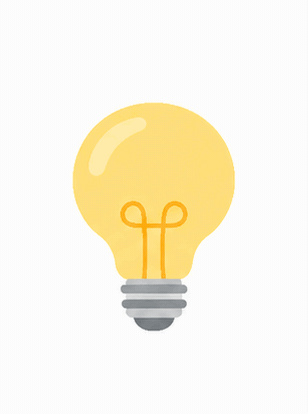

<sub>12 帧 · 308×414 · 2.2s · GPT Image 2.6</sub>

📌 **来源：** [牧牧的成長實驗室 on 方格子 vocus](https://vocus.cc/article/6aebf9a0fd8978000170526d)

**提示词**

```text
製作一張極簡扁平插畫 GIF。畫面中央是一個黃色燈泡圖示，燈泡從微暗逐漸亮起，接著恢復原本狀態。背景純白、圖示位置固定，動畫柔和，不要任何文字，無縫循環。
```

`icon` `flat` `education`

### 4. 像素闪电劈落特效


<sub>12 帧 · 358×268 · 1.0s · GPT Image 2.6</sub>

📌 **来源：** [@kasperzackgames on GitHub](https://github.com/kasperzackgames/chatgpt-pixel-effects/tree/main/effects/lightning)

**提示词**

```text
Make an animated GIF of a pixel-art lightning strike for a 2D side-view game, rendered as large as you can. 14 frames, about 70 ms per frame. Use fine pixel art: each art pixel is only 2 to 3 image pixels wide, so the bolt has a lot of detail (it spans the full frame height, about 120 art pixels). The camera does not move. The bottom edge of the frame is the ground line, and the bolt hits the ground at the bottom centre, at the same point in every frame. Don't draw the ground itself. Sequence: a thin flickering leader zigzags down from the top edge; the full bolt strikes: a thick jagged white core with an electric blue and violet glow outline and three or four forked branches; one frame where the bolt and a bright white burst at the impact point are at their brightest; the bolt flickers twice, changing its branches each time; at the impact point a burst of electric sparks flies out in arcs and short arcs of electricity crawl sideways along the ground; the bolt vanishes, leaving a glowing blue afterimage that fades; a few sparks and a small curl of dark smoke fade out until the frame is empty. True pixel art: crisp pixels on one even grid, hard edges, no anti-aliasing, no blur, no soft gradients, a limited palette of about 16 colours (white, pale cyan, electric blues, violets, two dark greys for the smoke). Background: flat solid pure green #00FF00 in every frame, nothing else. No text, no borders.
```

`pixel-art` `game-fx` `lightning`

### 5. 像素火柱喷发特效

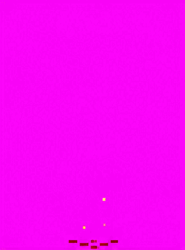

<sub>15 帧 · 265×358 · 1.3s · GPT Image 2.6</sub>

📌 **来源：** [@kasperzackgames on GitHub](https://github.com/kasperzackgames/chatgpt-pixel-effects/tree/main/effects/fire-pillar)

**提示词**

```text
Make an animated GIF of a pixel-art fire pillar erupting from the ground, for a 2D side-view game, in a tall frame (taller than wide), rendered as large as you can. 16 frames, about 80 ms per frame. Use fine pixel art: each art pixel is exactly 2 image pixels wide, so the fire has a lot of detail. The camera does not move. The bottom edge of the frame is the ground line, and the pillar erupts at the bottom centre, at the same point in every frame. Don't draw the ground itself. The tallest flame tips reach about 85 percent of the frame height: always leave empty background above the fire and at both sides, so nothing is ever cut off by the frame edges. Sequence: a small glowing crack and a few embers rising; flames burst upward into a tall roaring column of fire, wider at the base, with swirling tongues of flame, a white-yellow hot core and orange, red and dark red edges; burning chunks and sparks fly out of the top; the column roars for several frames, its flames changing shape every frame; it collapses downward into low flickering flames and puffs of dark smoke; glowing embers drift up and fade until the frame is empty. True pixel art: crisp pixels on one even grid, hard edges, no anti-aliasing, no blur, no soft gradients, a limited palette of about 18 colours (white, yellows, oranges, reds, dark reds and three dark greys for the smoke). Background: flat solid pure magenta #FF00FF in every frame, nothing else. No text, no borders.
```

`pixel-art` `game-fx` `fire-pillar`

### 6. 像素火山喷发特效

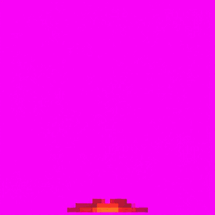

<sub>16 帧 · 309×308 · 1.4s · GPT Image 2.6</sub>

📌 **来源：** [@kasperzackgames on GitHub](https://github.com/kasperzackgames/chatgpt-pixel-effects/tree/main/effects/eruption)

**提示词**

```text
Make an animated GIF of a pixel-art volcano eruption seen from far away, for the background of a 2D side-view game, in a square frame, rendered as large as you can. 16 frames, about 90 ms per frame. Use fine pixel art: each art pixel is exactly 2 image pixels wide. The camera does not move. The crater is at the bottom centre of the frame, at the same point in every frame; don't draw the mountain itself, only what comes out of the crater. Sequence: frames 1 to 4: the crater glows brighter and spits a few sparks; frame 5: a bright burst; frames 6 to 16: a full eruption that loops seamlessly from frame 16 back to frame 6: a fountain of glowing lava shooting straight up from the crater, glowing lava bombs flying out in high arcs and falling back down on both sides, and a thick dark ash column rising above it, its underside lit red and orange by the lava, the top of the ash staying inside the frame. Leave empty background around everything so nothing is cut off by the frame edges. True pixel art: crisp pixels on one even grid, hard edges, no anti-aliasing, no blur, no soft gradients, a limited palette of about 18 colours (white, yellows, oranges, reds, dark reds, and four dark grey-browns for the ash). Background: flat solid pure magenta #FF00FF in every frame, nothing else. No text, no borders.
```

`pixel-art` `game-fx` `eruption`

### 7. 像素能量光束特效


<sub>13 帧 · 439×216 · 1.1s · GPT Image 2.6</sub>

📌 **来源：** [@kasperzackgames on GitHub](https://github.com/kasperzackgames/chatgpt-pixel-effects/tree/main/effects/beam)

**提示词**

```text
Make an animated GIF of a pixel-art energy beam for a 2D side-view game, in a wide frame twice as wide as it is tall, rendered as large as you can. 16 frames, about 70 ms per frame. Use fine pixel art: each art pixel is only 2 to 3 image pixels wide. The camera does not move. The beam starts at the left edge at mid-height, at the same point in every frame. Sequence: a small glowing orb of energy charges at the left edge, crackling and growing as sparks are pulled into it; it fires: a thick straight beam with a white core and cyan and electric blue outer layers shoots to the right edge within two frames; the beam holds for several frames, pulsing thicker and thinner, with bright ripples travelling along it, rings around its origin and sparks spraying off its edges; the beam thins to a line and vanishes; small sparks and a fading glow at the origin until the frame is empty. True pixel art: crisp pixels on one even grid, hard edges, no anti-aliasing, no blur, no soft gradients, a limited palette of about 14 colours (white, pale cyan, cyans, electric blues, deep blue). Background: flat solid pure magenta #FF00FF in every frame, nothing else. No text, no borders.
```

`pixel-art` `game-fx` `beam`

### 8. 像素爆炸与蘑菇云特效


<sub>15 帧 · 316×302 · 1.3s · GPT Image 2.6</sub>

📌 **来源：** [@kasperzackgames on GitHub](https://github.com/kasperzackgames/chatgpt-pixel-effects)

**提示词**

```text
Make an animated GIF of a pixel-art explosion for a 2D side-view game, rendered as large as you can (at least 512x512). 16 frames, about 80 ms per frame. Use fine pixel art: each art pixel is only 2 to 3 image pixels wide, so the explosion has a lot of detail (about 120 art pixels tall at its peak). The camera does not move. The bottom edge of the frame is the ground line, and the explosion hits the ground at the bottom centre, at the same point in every frame. Don't draw the ground itself. Sequence: a tiny spark on the ground; one bright white flash frame; a huge orange and yellow fireball that grows until it fills about three quarters of the frame height and rises into a mushroom cloud with a fiery stem; debris chunks and sparks flying out in arcs; a thin dust ring rolling sideways along the ground; the fire breaks up into a light grey smoke column that rises and drifts; glowing embers fade out until the frame is empty. True pixel art: crisp pixels on one even grid, hard edges, no anti-aliasing, no blur, no soft gradients, a limited palette of about 20 colours (white, yellows, oranges, reds, dark reds and four neutral greys for the smoke). Background: flat solid pure magenta #FF00FF in every frame, nothing else. No text, no borders.
```

`pixel-art` `game-fx` `explosion`

### 9. 三颗橘色圆点跳动加载


<sub>13 帧 · 416×404 · 1.1s · GPT Image 2.6</sub>

📌 **来源：** [蘇柔瑋 on 數位時代 BusinessNext](https://www.bnext.com.tw/article/92943/chatgpt-gif-generator-prompts)

**提示词**

```text
請設計一張極簡風格的 GIF 載入動畫。畫面中央有三顆橘色小圓點，依序從左至右向上跳動，再回到原本位置，形成自然連續的節奏。背景透明，整體使用簡潔的扁平化設計，圓點大小與顏色保持一致。鏡頭固定，動畫無縫循環，不要加入文字或其他裝飾。
```

`loader` `ui` `flat`

### 10. 指南针 App 图标指针摆动

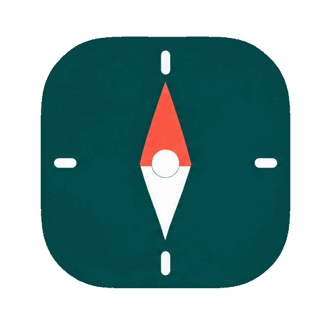

<sub>14 帧 · 480×480 · 1.2s · GPT Image 2.6</sub>

📌 **来源：** [Fuxuan Guo on ChatCut Blog](https://chatcut.io/blog/chatgpt-gif)

**提示词**

```text
Minimalist flat-vector rounded-square app icon on a completely transparent background, locked front-on view. A solid deep-teal rounded square dial with four tiny white tick marks holds a two-tone coral-and-white diamond compass needle pointing straight up. The compass needle swings 20 degrees clockwise, rebounds slightly left, and settles pointing straight up again in its exact starting alignment on the final frame for a clean loop. Flat crisp vector shapes, no gradients, no text.
```

`icon` `app` `transparent`

### 11. 纸飞机空状态加载图


<sub>8 帧 · 480×480 · 1.2s · GPT Image 2.6</sub>

📌 **来源：** [Fuxuan Guo on ChatCut Blog](https://chatcut.io/blog/chatgpt-gif)

**提示词**

```text
Clean flat vector empty-state loading illustration, locked front-on view. Inside a soft powder-blue circle badge on a crisp off-white square background, a folded coral-orange paper airplane glides in a gentle up-and-down bobbing arc above two tiny stationary white clouds, returning to its exact starting height and angle on the final frame for a clean loop. Flat colors, no gradients, no text.
```

`loader` `ui` `flat`

### 12. 三颗胶囊波浪加载动画


<sub>11 帧 · 480×480 · 1.0s · GPT Image 2.6</sub>

📌 **来源：** [Fuxuan Guo on ChatCut Blog](https://chatcut.io/blog/chatgpt-gif)

**提示词**

```text
Minimalist flat-vector UI loading indicator on a completely transparent background, locked front-on view. Three rounded cobalt-blue pill dots sit in a horizontal row; the left dot hops up, then the center dot, then the right dot in a crisp wave, and all three settle level in their exact starting alignment on the final frame for a clean loop. Sharp vector edges, solid flat blue, no text.
```

`loader` `ui` `transparent`

**[查看本分类全部 98 条 →](categories/pixel-ui_zh.md)**

## 科普讲解动图

这里展示本分类最新的 12 条（共 17 条）。[查看全部 17 条 →](categories/explainers_zh.md)

### 1. 烧杯漩涡鲁米诺化学发光

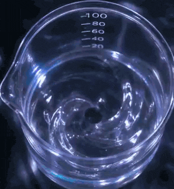

<sub>16 帧 · 294×320 · 1.4s · GPT Image 2.6</sub>

📌 **来源：** [@ZHENGJUNTING92 on X](https://x.com/ZHENGJUNTING92/status/2118252052556255364)

**提示词**

```text
制作gif
垂直俯拍一个烧杯的杯口，里面的水在旋转形成漩涡，然后滴入液体
C8H7N3O2+H202+NaOH-Na2C8H5N204+N2 1+H20+luminol CL
烧杯中是少量罗丹明B碱性的鲁米诺溶液 和过氧化氢
胶头滴管中是含铁离子溶液 和荧光染料
```

`chemistry` `luminol` `experiment` `science`

### 2. 大阪城建造过程


<sub>12 帧 · 358×358 · 1.4s · GPT Image 2.6</sub>

📌 **来源：** [@jammaru_lab on X](https://x.com/jammaru_lab/status/2118153279821787623)

**提示词**

```text
大阪城を建築する流れをGIFにして
```

`castle` `construction` `history` `process`

### 3. 水循环科普示意动图


<sub>96 帧 · 480×270 · 8.0s · GPT Image 2.6</sub>

📌 **来源：** [挖挖Github on 掘金](https://juejin.cn/post/7709418733185892403)

**提示词**

```text
制作一段展示水循环（示意图）的教学 GIF，横版 16:9。整体采用极简扁平化科普示意图风格，用简化几何图形表示水循环。
动画依次表现：海面水汽上升，水汽聚集成云，云下落雨，雨水汇成河流流回海洋。配上清晰、准确、易读的简体中文标签：“蒸发”“凝结”“降水”“径流”，标签靠近对应环节，使用深灰色简洁无衬线字体。
镜头固定，动画节奏缓慢，形状和布局保持稳定；结尾自然回到开头状态，形成无缝循环。整体画面简洁直观，像一张会动的科学课本插图。
```

`water-cycle` `education` `flat-design` `diagram` `chinese-labels`

### 4. 纸质发票经 AI 识别入表（四格流程）


<sub>4 帧 · 480×238 · 3.4s · GPT Image 2.6</sub>

📌 **来源：** [末松 光太郎 on WizTry Blog](https://wiztrydx.com/blog/chatgpt-images-2-6-kaisetsu/)

**提示词**

```text
紙の請求書をスマホで撮ると、AIが読み取って、表に入力されるまでの流れを、4コマのループGIFにして。
```

`workflow` `business` `japanese`

### 5. 土壤剖面里种子发芽


<sub>12 帧 · 358×358 · 3.1s · GPT Image 2.6</sub>

📌 **来源：** [牧牧的成長實驗室 on 方格子 vocus](https://vocus.cc/article/6aebf9a0fd8978000170526d)

**提示词**

```text
製作一張教育用途的 GIF 動畫，呈現一顆種子逐漸發芽，長出嫩芽與兩片小葉子的過程。使用清楚的科普插畫風格，固定土壤剖面與攝影機視角，讓植物生長過程自然銜接，並設計成循環動畫。
```

`science` `plant` `education`

### 6. 年度营收柱状图逐年增长


<sub>33 帧 · 480×270 · 4.8s · GPT Image 2.6</sub>

📌 **来源：** [蘇柔瑋 on 數位時代 BusinessNext](https://www.bnext.com.tw/article/92943/chatgpt-gif-generator-prompts)

**提示词**

```text
請製作一張 16:9 橫式 GIF 動畫，主題為企業年度營收成長。畫面使用暖白色背景、深灰色文字與橘色重點配色，呈現簡潔專業的商業資訊圖表風格。中央有四根長條圖，分別代表 2023、2024、2025、2026 年，數值依序為 100、150、210、300，單位為百萬元。動畫開始時所有長條從零逐漸向上延伸，依照年份由左至右依序完成，最後停留在完整圖表畫面。確保年份、數字與長條高度完全對應，所有文字清晰可讀，鏡頭固定。動畫約 5 秒，不要增加其他數據或裝飾元素。
```

`chart` `business` `data`

### 7. 西西里防御开局动画


<sub>16 帧 · 288×288 · 3.2s · gpt-image-2.6-gif</sub>

📌 **来源：** [vunderba on Mordenstar](https://imgpb.com/OzSMKJ)

**提示词**

```text
A simple animation of the Sicilian Defense opening on a chess board, flat vector illustration
```

`chess` `opening` `diagram`

### 8. 扬声器声波传播


<sub>9 帧 · 436×388 · 1.3s · gpt-image-2.6 · 生成于 2026-11-18</sub>

**提示词**

```text
Side view diagram of a loudspeaker whose cone pushes in and out, sending evenly spaced curved sound waves rippling to the right toward a cartoon ear. Flat educational infographic, light blue background.
```

`sound` `physics` `waves`

### 9. 叶片光合作用示意


<sub>9 帧 · 439×390 · 1.6s · gpt-image-2.6 · 生成于 2026-11-18</sub>

**提示词**

```text
Simple science diagram of a green leaf: yellow sun rays enter from the top, blue water droplets rise from the stem, and small bubbles labeled O2 float out of the leaf. Clean textbook illustration, white background.
```

`photosynthesis` `biology` `diagram`

### 10. 跷跷板杠杆平衡


<sub>16 帧 · 378×254 · 2.2s · gpt-image-2.6 · 生成于 2026-11-17</sub>

**提示词**

```text
A simple wooden seesaw on a triangle pivot tips one way as a heavy block drops on one end, then a small block slides farther out on the other end until it balances level. Flat textbook illustration, white background, no text.
```

`lever` `physics` `simple-machines`

### 11. 三棱镜分光


<sub>16 帧 · 380×252 · 1.9s · gpt-image-2.6 · 生成于 2026-11-17</sub>

**提示词**

```text
A white beam of light enters a glass triangular prism and fans out into a rainbow on the other side, the rainbow shimmering gently. Dark background, clean science illustration, fixed camera.
```

`light` `prism` `physics`

### 12. 行星绕日运行


<sub>9 帧 · 439×390 · 1.4s · gpt-image-2.6 · 生成于 2026-11-17</sub>

**提示词**

```text
A flat top-down diagram of a glowing sun with four colorful planets moving along thin circular orbits at different speeds. Dark navy background, simple clean shapes, no text.
```

`solar-system` `astronomy` `diagram`

**[查看本分类全部 17 条 →](categories/explainers_zh.md)**

## 节日与祝福

### 1. 羊毛毡风生日蛋糕与戴帽小猫


<sub>16 帧 · 276×346 · 4.0s · GPT Image 2.6</sub>

📌 **来源：** [蘇柔瑋 on 數位時代 BusinessNext](https://www.bnext.com.tw/article/92943/chatgpt-gif-generator-prompts)

**提示词**

```text
請製作一張 直式 4:5、約 4 秒的生日祝福 GIF 動畫，採用溫暖可愛的日系羊毛氈 3D 插畫風格。畫面中央是一個精緻的草莓鮮奶油蛋糕，插著三根點燃的粉色蠟燭。蛋糕右側坐著一隻戴生日帽的奶油色小貓，開心地抱著蛋糕，左側擺放粉色禮物盒。背景搭配三角旗幟、發光星星與木質桌面，使用奶油白、蜜桃粉與暖金色調，呈現溫馨療癒的童話氛圍。動畫效果： 蠟燭火焰輕輕搖曳，星星依序閃爍，最後少量粉色彩紙從上方緩緩飄落。保持角色、蛋糕與背景造型一致，鏡頭固定，動作自然流暢，可無縫循環播放。不要加入任何文字。
```

`birthday` `felt` `greeting`

### 2. 冒热气的感恩节南瓜派


<sub>9 帧 · 439×390 · 1.6s · gpt-image-2.6 · 生成于 2026-11-18</sub>

**提示词**

```text
A whole pumpkin pie on a checkered cloth with three curls of steam rising and fading, a small hand-lettered card beside it reading "THANK YOU". Soft gouache style, warm orange and brown tones.
```

`thanksgiving` `pie` `thank you`

### 3. 姜饼屋门口挥手的小姜饼人


<sub>8 帧 · 439×390 · 1.4s · gpt-image-2.6 · 生成于 2026-11-18</sub>

**提示词**

```text
A tiny gingerbread figure with white icing buttons stands in the doorway of a candy-trimmed gingerbread house and waves one arm, while soft snowflakes drift past. Warm cozy illustration, cream background.
```

`christmas` `gingerbread` `greeting`

## 电商与产品展示

### 1. 石中剑360度旋转


<sub>12 帧 · 358×346 · 1.6s · GPT Image 2.6</sub>

📌 **来源：** [@xikhar on X](https://x.com/xikhar/status/2118407355859878352)

**提示词**

```text
create a gif of a "3d legendary sword in a stone game asset" spinning full 360 degrees
```

`3d` `game-asset` `turntable` `sword`

### 2. 未来摩托车360度展示


<sub>12 帧 · 358×356 · 1.3s · GPT Image 2.6</sub>

📌 **来源：** [@xikhar on X](https://x.com/xikhar/status/2118407355859878352)

**提示词**

```text
create a gif of a "AAA 3d futuristic motorbike game asset" spinning full 360 degrees
```

`3d` `game-asset` `turntable` `motorbike`

### 3. 3D矮人模型360度旋转


<sub>12 帧 · 358×358 · 1.4s · GPT Image 2.6</sub>

📌 **来源：** [@xikhar on X](https://x.com/xikhar/status/2118407355859878352)

**提示词**

```text
create a gif of a "3d dwarf game model carrying a huge axe on his shoulders" spinning full 360 degrees
```

`3d` `game-asset` `turntable` `dwarf`

### 4. 浴室翻新广告横幅热气升腾


<sub>6 帧 · 480×240 · 1.8s · GPT Image 2.6</sub>

📌 **来源：** [末松 光太郎 on WizTry Blog](https://wiztrydx.com/blog/chatgpt-images-2-6-kaisetsu/)

**提示词**

```text
ホームページのトップに置く、横長の広告バナーのループGIFを作って。写真のようにリアルな、木の窓がある明るいお風呂。湯船の湯気だけがゆっくり上がる。左側に大きく「冬のお風呂リフォーム応援キャンペーン」、その下に「手すりの取り付け無料」と「11月20日〜12月25日」。文字は動かさないで。
```

`banner` `ad` `japanese`

### 5. 耳机充电盒开合展示


<sub>12 帧 · 358×358 · 1.9s · GPT Image 2.6</sub>

📌 **来源：** [蘇柔瑋 on 數位時代 BusinessNext](https://www.bnext.com.tw/article/92943/chatgpt-gif-generator-prompts)

**提示词**

```text
請製作一張 1:1 的高質感產品展示 GIF。畫面中央是一個【極簡白色無線耳機充電盒】，放置於淡灰色攝影棚背景。動畫從盒蓋關閉開始，接著盒蓋慢慢打開，展示內部耳機，最後緩緩關閉。商品外觀、比例、材質與顏色必須保持一致，鏡頭固定，使用柔和商業攝影光線，製作平滑循環動畫，不要加入文字。
```

`product` `tech` `ecommerce`

### 6. 耳机充电盒指示灯呼吸

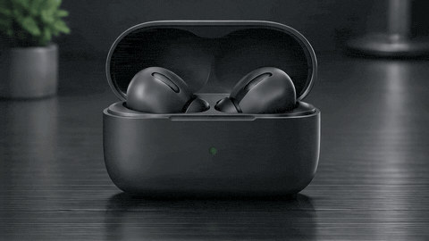

<sub>9 帧 · 480×270 · 1.6s · GPT Image 2.6</sub>

📌 **来源：** [Fuxuan Guo on ChatCut Blog](https://chatcut.io/blog/chatgpt-gif)

**提示词**

```text
Locked macro studio product shot on a dark brushed-aluminum desk. A matte smoke-gray wireless earbuds charging case sits open with both earbuds resting inside, completely motionless. Only the tiny round emerald-green status LED on the front lip of the case pulses smoothly from dim to bright green with a soft tiny halo and fades back to dim on the final frame for a clean loop. Keep the case, earbuds, and reflections completely still, no text.
```

`product` `tech` `macro`

### 7. 咖啡豆袋主图＋浓缩咖啡热气


<sub>9 帧 · 480×606 · 1.8s · GPT Image 2.6</sub>

📌 **来源：** [Fuxuan Guo on ChatCut Blog](https://chatcut.io/blog/chatgpt-gif)

**提示词**

```text
Locked tripod commercial product shot in soft morning studio light. A matte terracotta kraft coffee bag with a clean cream front label reading "MORNING ROAST" in sharp dark-brown sans-serif type stands completely motionless beside a speckled stoneware espresso cup on a travertine counter. Only a thin ribbon of warm white steam curls gently upward from the cup and settles back to the exact starting wisp on the final frame for a clean loop. Keep the coffee bag, label text, and cup completely still across every frame.
```

`product` `coffee` `steam`

### 8. 左右摇摆的水杯产品动图


<sub>10 帧 · 480×480 · 2.0s · gpt-image-2.6-gif</sub>

📌 **来源：** [Curtis Pyke on Kingy AI](https://kingy.ai/blog/chatgpt-gifs-images-2-6-vs-2-5-hands-on-test/)

**提示词**

```text
Generate an actual animated GIF file, not a still picture, sprite sheet, video, or Python-coded animation. Square 512 by 512 pixels, a seamless 2-second loop. A bright orange reusable water bottle with a charcoal screw cap and a small turquoise circular badge remains centered on a pale gray studio background. The bottle rocks gently left and right and returns to its starting pose; the camera and background stay fixed. The bottle reads exactly "KINGY LAB" and "750 mL" throughout. No other text or objects. Use ChatGPT's native GIF generation and provide the downloadable GIF. If native GIF generation is unavailable, state that limitation rather than simulating it with code.
```

`product` `bottle` `api`

### 9. 智能手表亮屏


<sub>12 帧 · 358×358 · 2.2s · gpt-image-2.6 · 生成于 2026-11-18</sub>

**提示词**

```text
A round matte black smartwatch with a sage green strap lies on a light stone surface; its screen wakes up with a soft glow, the clock hands sweep into place, then the screen dims again. Minimal studio product shot, no text, no logos.
```

`smartwatch` `wearable` `product shot`

### 10. 转台上旋转的运动鞋


<sub>16 帧 · 380×250 · 1.9s · gpt-image-2.6 · 生成于 2026-11-18</sub>

**提示词**

```text
A clean white running sneaker with a mint green sole slowly rotates on a round white turntable, a soft highlight sliding across the toe. Studio product shot, pale grey seamless background, no text.
```

`sneaker` `turntable` `ecommerce`

## 美食饮品

### 1. 手绘风热咖啡冒热气


<sub>12 帧 · 358×358 · 2.7s · GPT Image 2.6</sub>

📌 **来源：** [牧牧的成長實驗室 on 方格子 vocus](https://vocus.cc/article/6aebf9a0fd8978000170526d)

**提示词**

```text
製作一張溫暖手繪風 GIF。木桌上放著一杯熱咖啡，杯子與背景保持完全靜止，只有白色蒸氣緩慢向上飄動。柔和晨光、咖啡館氛圍，畫面自然循環。
```

`coffee` `hand-drawn` `cozy`

### 2. 阳光咖啡馆里冒热气的拉花拿铁


<sub>16 帧 · 309×310 · 4.0s · GPT Image 2.6</sub>

📌 **来源：** [蘇柔瑋 on 數位時代 BusinessNext](https://www.bnext.com.tw/article/92943/chatgpt-gif-generator-prompts)

**提示词**

```text
請製作一張 1:1 正方形 GIF 動畫。畫面中央是一杯放在木桌上的熱拿鐵，杯中有精緻的愛心拉花，背景是陽光灑落的日系咖啡廳。讓咖啡上方的白色蒸氣緩緩向上飄動，窗邊的薄紗窗簾輕輕晃動，陽光保持溫暖柔和。採用高質感寫實攝影風格，固定鏡頭，杯子、桌面與拉花完全保持靜止。動畫長度約 4 秒，節奏緩慢、自然流暢，適合無縫循環播放，不要加入文字。
```

`coffee` `cafe` `steam`

### 3. 披萨拉丝

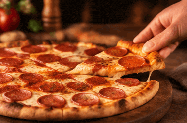

<sub>16 帧 · 380×249 · 1.9s · gpt-image-2.6 · 生成于 2026-11-18</sub>

**提示词**

```text
A hand lifts one slice of pepperoni pizza away from the whole pie, long strings of melted mozzarella stretching between the slice and the pan, then the slice settles back into place. Warm close-up food illustration, rustic wooden table.
```

`pizza` `cheese` `food`

### 4. 奶茶加珍珠


<sub>16 帧 · 322×292 · 2.2s · gpt-image-2.6 · 生成于 2026-11-18</sub>

**提示词**

```text
A clear cup of milk tea sits on a counter as a spoonful of dark tapioca pearls drops in and sinks, swirling brown sugar streaks along the glass. Bright cute flat illustration, pastel pink background.
```

`bubble tea` `boba` `drink`

## 动态头像

### 1. 宇航员猫咪眨眼头像


<sub>16 帧 · 306×308 · 2.9s · gpt-image-2.6 · 生成于 2026-11-18</sub>

**提示词**

```text
Circular profile avatar of a grey cat inside a round astronaut helmet, blinking slowly while a tiny star glints across the glass visor. Soft 3D clay style, navy blue background.
```

`avatar` `cat` `space`

### 2. 戴耳机点头的狐狸头像


<sub>9 帧 · 436×387 · 1.4s · gpt-image-2.6 · 生成于 2026-11-18</sub>

**提示词**

```text
Circular avatar of a red fox wearing chunky yellow headphones, eyes closed, nodding its head to a beat as small music notes pop beside it. Flat vector style, teal background.
```

`avatar` `fox` `music`

## 自己动手生成

使用 [ViNano AI API](https://vinano.ai/api-keys)：先创建 API Key，提交 GIF 生成任务，再轮询任务状态拿到 GIF 地址（每张 25 积分）。

```bash
# 1. Submit a GIF task — the response contains a task "uuid"
curl -X POST https://vinano.ai/api/async-openai-images \
  -H "Authorization: Bearer $VINANO_API_KEY" \
  -F mode=txt2img -F zeakaiModel=gpt-image-2.6-gif -F model="ViNano AI" \
  -F count=1 -F img_size=1k -F aspectRatio=1:1 \
  -F prompt="A cheerful cartoon cat waving hello. Animate it as a short, smooth, seamlessly looping GIF with clear motion between frames."

# 2. Poll until "completed" is true — the GIF URL is in "generated_images_url"
curl "https://vinano.ai/api/task-status?uuid=<uuid>" \
  -H "Authorization: Bearer $VINANO_API_KEY"
```

或者用仓库自带的脚本重新生成全部示例（需要 Node 18+）：

```bash
git clone https://github.com/ailingqu/awesome-ai-gif-prompts.git && cd awesome-ai-gif-prompts
cp .env.example .env   # fill in VINANO_API_KEY
npm run generate        # only generates prompts without a GIF
npm run build           # rebuilds README.md and README_zh.md
```

## 来源

没有来源标注的条目由我们编写并生成。标有 **来源** 的条目搜集自 X 和其它网站，提示词和 GIF 按原样展示，署名作者并链接到原帖，版权归原作者所有；作者如需修改或删除，请提交 issue。

## 参与贡献

欢迎提交新提示词！在 `data/prompts.json` 里新增一条，附上你生成的 GIF，然后运行 `npm run build`。详见 [CONTRIBUTING.md](CONTRIBUTING.md)。

## 许可

提示词与示例 GIF 采用 [CC BY 4.0](LICENSE)。觉得有用的话，点个 ⭐ 能让更多人看到。
