# Awesome AI GIF Prompts · 511+ 个案例

[English](README.md) · **简体中文**

    [](https://awesome.re)

精选 **AI 直出 GIF 动图** 提示词合集：表情包、反应图、快闪、品牌动效、氛围循环、像素风。自有示例都是用所列提示词原样生成的，未做任何后期修改；社区精选标注了来源并署名作者。

> 🔄 **每日更新**：几乎每天新增 10 条我们实测的提示词，外加 40+ 条标注来源的 X 与网络社区精选，最近更新：**2026-11-18**。点 ⭐ Star 或 👀 Watch 第一时间看到新案例。
>
> 🎞️ **在线试用：** 把任意提示词粘贴到 [ViNano AI GIF Generator](https://vinano.ai/gif-generator)，输入文字或上传照片即可得到循环 GIF（由 GPT Image 2.6 驱动）。

<p align="center">
  
  
  
  
  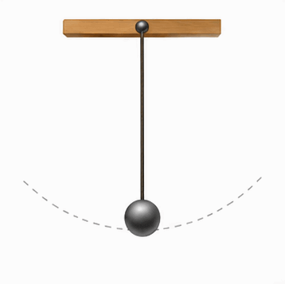
  
  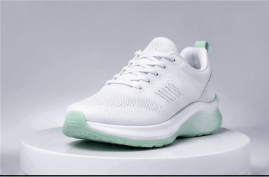
  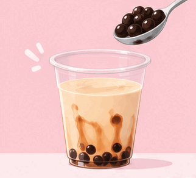
  
</p>

## 目录

- [这些 GIF 是怎么生成的](#这些-gif-是怎么生成的)
- [表情包与贴纸](#表情包与贴纸) · 191 条提示词
- [快闪与品牌动效](#快闪与品牌动效) · 87 条提示词
- [氛围循环动画](#氛围循环动画) · 128 条提示词
- [像素风与界面动效](#像素风与界面动效) · 85 条提示词
- [科普讲解动图](#科普讲解动图) · 11 条提示词
- [节日与祝福](#节日与祝福) · 2 条提示词
- [电商与产品展示](#电商与产品展示) · 3 条提示词
- [美食饮品](#美食饮品) · 2 条提示词
- [动态头像](#动态头像) · 2 条提示词
- [自己动手生成](#自己动手生成)

## 这些 GIF 是怎么生成的

在请求里设置 `output_format: "gif"`，GPT Image 2.6 就会直接返回 GIF 动图而不是静态图。帧数、每帧时长和尺寸由模型自行决定。

本仓库的每条提示词在发送时都会追加一句话，要求生成无缝循环：

```text
Animate it as a short, smooth, seamlessly looping GIF with clear motion between frames.
```

### 提示词公式

**主体**（一个清晰的角色或物体）+ **动作**（1–2 个动词：挥手、弹跳、飘动、闪烁）+ **风格**（扁平插画、Q 版贴纸、像素风、摄影）+ **背景**（做贴纸时用纯色、高对比背景）

### 技巧

- 一个主体、一到两个动作。画面越杂，动作越难看清。
- 用动词描述动作，比如“摇晃、打瞌睡、闪烁、滑落”，少用形容词。
- 扁平插画、Q 版、像素风在 GIF 的小尺寸下比写实照片效果好得多。
- 做一套表情包时，每条提示词都复用完全相同的角色描述，整套才会一致。
- 要抠成透明贴纸的，背景用一种和角色颜色完全拉开的纯色。
- 快闪要把每一帧写成不同的镜头；品牌快闪则固定 Logo 的位置和大小，只换周围的场景。
- 长文字和复杂的昼夜循环目前仍不稳定：文字尽量短，大的变化交给光线来表现。

## 表情包与贴纸

这里展示本分类最新的 12 条（共 191 条）。[查看全部 191 条 →](categories/stickers_zh.md)

### 1. 橘猫敲代码额度用光


<sub>9 帧 · 414×412 · 1.6s · gpt-image-2.6-gif</sub>

📌 **来源：** [@DawienZZ on X](https://x.com/DawienZZ/status/2120785093661012027)

**提示词**

```text
生成一个循环 GIF：一只橘猫趴在电脑前敲键盘，codex提示没额度了，表情从平静变成崩溃，最后无奈地趴在键盘上。Q版3D风格，9帧，循环播放
```

`cat` `coding` `meme`

### 2. 着火房间里喝茶的狗


<sub>16 帧 · 380×506 · 2.9s · gpt-image-2.6-gif</sub>

📌 **来源：** [@shitunote on X](https://x.com/shitunote/status/2118187063241777311)

**提示词**

```text
做一个循环 GIF，一只戴着小帽子的卡通狗坐在着火的房间里，先是平静地喝茶，然后慢慢意识到不对劲，表情逐渐从“没事”变成“其实有事”，最后又假装没事继续喝茶。风格偏扁平插画，表情夸张，背景火焰轻微闪动，6-8帧，无缝循环。
```

`dog` `meme` `fire`

### 3. 织围巾的企鹅


<sub>16 帧 · 328×290 · 2.2s · gpt-image-2.6 · 生成于 2026-11-17</sub>

**提示词**

```text
A round penguin sits clicking two knitting needles, a striped red scarf growing longer from its flippers. Cute flat cartoon, snowy light blue background.
```

`penguin` `knitting` `winter`

### 4. 小兔吸面条


<sub>16 帧 · 309×309 · 2.2s · gpt-image-2.6 · 生成于 2026-11-17</sub>

**提示词**

```text
A white bunny with chopsticks slurps a long noodle from a bowl, cheeks puffing, the noodle wiggling up into its mouth. Cute flat sticker style, thick outline, pale orange background.
```

`bunny` `noodles` `food`

### 5. 章鱼喷墨尴尬

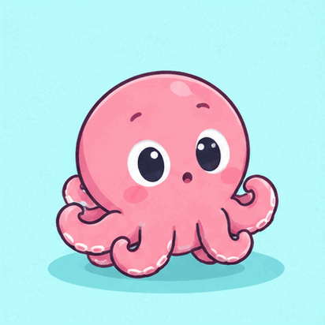

<sub>9 帧 · 412×412 · 1.6s · gpt-image-2.6 · 生成于 2026-11-17</sub>

**提示词**

```text
A small pink octopus gets startled and puffs out a cloud of ink, then peeks out of the cloud with an embarrassed grin. Cute flat cartoon, light aqua background.
```

`octopus` `oops` `funny`

### 6. 河马打大哈欠


<sub>9 帧 · 432×395 · 1.6s · gpt-image-2.6 · 生成于 2026-11-17</sub>

**提示词**

```text
A sleepy round lavender hippo opens its mouth in an enormous yawn, eyes squeezed shut, then closes it with a satisfied smack. Soft clay-like 3D style, pale peach background.
```

`hippo` `yawn` `sleepy`

### 7. 叼吐司赶路的柴犬

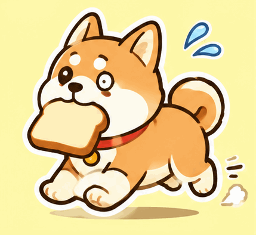

<sub>8 帧 · 429×394 · 1.0s · gpt-image-2.6 · 生成于 2026-11-17</sub>

**提示词**

```text
A shiba inu with a slice of toast in its mouth runs in place in a panic, ears flapping, a sweat drop flying off. Funny flat sticker style, thick white outline, light yellow background.
```

`shiba` `late` `sticker`

### 8. 小象鼻子喷水

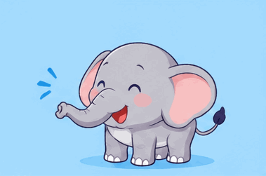

<sub>16 帧 · 379×251 · 2.2s · gpt-image-2.6 · 生成于 2026-11-17</sub>

**提示词**

```text
A chubby baby elephant lifts its trunk and sprays a happy fountain of water over its own head, droplets sparkling. Cute flat cartoon, light blue background, fixed camera.
```

`elephant` `water` `cute`

### 9. 涂鸦小人翻白眼


<sub>9 帧 · 425×399 · 1.6s · gpt-image-2.6 · 生成于 2026-11-17</sub>

**提示词**

```text
A round hand-drawn doodle face with marker lines rolls its eyes up in exaggerated annoyance, then looks back forward with a flat mouth. White paper background, wobbly ink lines.
```

`doodle` `eye-roll` `reaction`

### 10. 本子上的火柴人跳舞

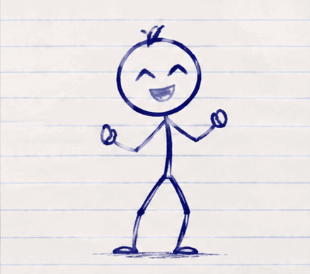

<sub>9 帧 · 438×387 · 1.3s · gpt-image-2.6 · 生成于 2026-11-17</sub>

**提示词**

```text
A hand-drawn ballpoint stick figure on lined notebook paper does a goofy hip-shaking dance with arms waving, slight line boil like a flipbook. Paper texture, fixed overhead camera.
```

`doodle` `dance` `sketch`

### 11. 小狐狸上前打招呼

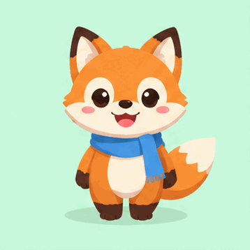

<sub>12 帧 · 358×358 · 1.9s · gpt-image-2.6 · 生成于 2026-11-17</sub>

**提示词**

```text
An orange fox in a little blue scarf takes two small steps toward the viewer, waves one paw, then steps back to where it started. Flat vector cartoon, pale mint background, fixed camera.
```

> 💡 **技巧：** 写清起始姿势、动作和回到原位，首尾帧才对得上。

`fox` `wave` `greeting`

### 12. 小熊猫眨眼微笑

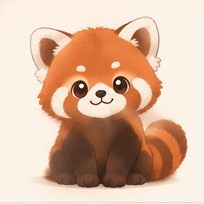

<sub>9 帧 · 414×414 · 1.6s · gpt-image-2.6 · 生成于 2026-11-17</sub>

**提示词**

```text
A fluffy red panda mascot closes its eyes, opens them again with a small happy smile, ears twitching once. Soft flat illustration, cream background, fixed camera.
```

`red-panda` `blink` `cute`

**[查看本分类全部 191 条 →](categories/stickers_zh.md)**

## 快闪与品牌动效

这里展示本分类最新的 12 条（共 87 条）。[查看全部 87 条 →](categories/flash_zh.md)

### 1. 滑板 360 尖翻


<sub>12 帧 · 358×356 · 1.3s · gpt-image-2.6-gif</sub>

📌 **来源：** [@justynclark on X](https://x.com/justynclark/status/2118189691820482677)

**提示词**

```text
Create a GIF of a 360 kickflip on a skateboard
```

`skateboard` `sport` `trick`

### 2. 成语物件猜谜：四个陶瓷摆件轮流弹跳


<sub>36 帧 · 480×640 · 3.0s · gpt-image-2.6-gif</sub>

📌 **来源：** [@GeekCatX on X](https://x.com/GeekCatX/status/2118160560290480519)

**提示词**

```text
制作一个中国成语物件猜谜 GIF 动图，竖版 3:4，精致可爱的短视频封面风格。

【输出规格】
输出一个可播放的 GIF 动图。
画面尺寸：768×1024 像素。
总时长：3秒，无限循环。
建议帧率：20fps，约60帧。
动画包含4个连续动作段，每段0.75秒，分别对应四件物品。
全程为同一个完整画面，镜头固定，构图固定，没有切镜、推拉、摇移或缩放。
【制作原则：同一母版，局部动画】
先建立一张完整的静态母版，再基于同一母版制作动画。
所有帧保持相同的背景、构图、文字、台面、物件造型、材质、颜色与光照。
只允许当前指定物件进行小幅竖直位移，并同步调整它的局部高光、接触阴影与倒影。
其余三个物件保持静止。
文字必须使用同一份静态图层，在全部帧中重复使用，不要逐帧重新绘制。
【背景】
深蓝色专业摄影棚背景，中心为柔和宝蓝色，向四周自然渐暗为午夜蓝。
背景纯净，具有轻微柔光晕，渐变细腻，没有明显纹理和杂乱装饰。
背景空白区域分布3—5个微小、低亮度的金色光点。
光点沿非常短的闭合轨迹缓慢漂浮，一个循环周期为3秒。
光点不穿过文字或物件，不闪烁、不突然出现或消失，循环结束时回到起始位置。
【文字：全程完全静止】
画面中只允许出现以下两行文字，不增加任何其他文字：
第一行：
物件藏着一个成语

第二行：
你猜出来了吗
第一行位于画面顶部居中，使用明黄色 #FFD54A 的超粗圆体大字，字形饱满圆润，带浅描边和轻微投影。
第二行位于第一行正下方，使用白色粗圆体，字号约为第一行的60%。

两行文字保持足够行距，四周预留安全边距，不贴边、不裁切。
汉字笔画完整，字形标准，清晰易读，无错别字。
在所有帧中，文字的位置、字号、字距、笔画、颜色、描边、阴影与透明度完全一致。
文字不参与弹跳、高光扫动、闪烁或任何其他动画。
【台面与构图】
画面中下部是一条横向浅木纹展示台。
台面干净，木纹细腻，具有柔和、克制的反光。
四件物品集中排列于画面中下部，物件组占画面宽度约85%—90%。
四件物品位于同一前后层级，静止时底部对齐于同一条台面接触基线。
它们具有接近的视觉体量，间距均匀，彼此留出清晰空隙。
不前后错落、不堆叠、不互相遮挡。

采用固定的轻微俯视角度，能够清楚看见杯口和水面，同时保持四件物品横向并排的秩序感。
【四件物品：顺序固定】
从左到右严格依次为：
一辆红色Q版小汽车。
圆润饱满，车身呈中国红，轮子与车窗清晰可辨，具有精致陶瓷玩具质感。

一个装满清水的青花瓷杯。
杯身具有细腻青花纹样，杯口清晰，能够看见透明清水与柔和水面反光。
杯身无文字，水面保持平稳，不溢出、不飞溅。
一匹金色Q版小马。
造型圆润可爱，具有清晰的马头、鬃毛、四肢与尾巴，表面为温润的金色陶瓷釉面。
一条青绿色盘身小龙。
中国传统小龙造型，身体盘曲，龙头微微抬起，龙角、龙须与鳞片适度简化，神态可爱，具有青绿色陶瓷釉面质感。

四件物品保持各自明确的识别特征。
物件表面没有文字、拼音、标签、数字或答案提示。
【动作规则】
所有物件均为刚性的陶瓷摆件，只允许整体轻轻向上移动，再回到原位。
不挤压、不拉伸、不旋转、不左右移动、不改变造型。

弹跳最高点距离原位约为画面高度的1%，动作轻巧、克制。
每个物件必须完整落回原位后，下一个物件才开始动作。
任意时刻，四件物品中最多只有一件正在运动。
当前物件弹起时，一道低强度、柔和的高光缓缓掠过其表面。
高光只作用于当前物件，不影响文字、背景和其他物件。
物件下方的阴影与倒影随高度轻微变化，落地后恢复母版状态。
小汽车轮子不转，小马不迈腿，小龙不摆尾、不转头。

【3秒动作时间线】
0.00—0.75秒：
红色小汽车完成一次轻轻弹起并落回原位。
瓷杯、小马、小龙保持静止。
0.75—1.50秒：
青花瓷杯完成一次轻轻弹起并落回原位。
汽车、小马、小龙保持静止。

1.50—2.25秒：
金色小马完成一次轻轻弹起并落回原位。
汽车、瓷杯、小龙保持静止。
2.25—3.00秒：
青绿色小龙完成一次轻轻弹起并落回原位。
汽车、瓷杯、小马保持静止。

每个0.75秒动作段均遵循：
短暂停住 → 平缓上升 → 平缓落下 → 落定后短暂停住。
上升和下落采用柔和缓入缓出，不突然跳位，不夸张弹震。

【无缝循环】
首帧与末帧完全一致：
四件物品全部落在原位，所有高光、阴影、倒影与背景光点均回到初始状态。
从末帧接回首帧时，没有位置跳变、亮度跳变或颜色闪动。
循环中不出现黑帧、白帧、残影或重影。

【整体质感】
精致可爱的Q版3D陶瓷摆件，圆润、细腻、通透。
以中国红、金色、青绿色和青花蓝点缀深蓝背景，融入克制的中国传统纹样细节。
顶部柔光配合左右轮廓光，物件边缘高光清晰，台面倒影柔和。
整体具有中国文化韵味，适合全年龄观看。
【禁止事项】
不出现成语答案。
不出现额外文字、水印、品牌标志或界面元素。
不出现分镜拼图、四宫格或多画面。
不改变四件物品的数量、顺序、造型、颜色或比例。
不让两个物件同时运动。
不让物件重叠、碰撞、堆叠或横向移位。
不让文字闪烁、变形、位移或重新生成。
不改变相机位置、背景亮度或整体色调。
```

`riddle` `chinese idiom` `3d`

### 3. 迷幻风跳舞猫

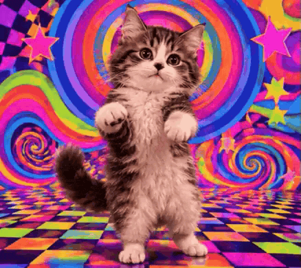

<sub>9 帧 · 438×390 · 1.4s · gpt-image-2.6-gif</sub>

📌 **来源：** [@xedrik7 on X](https://x.com/xedrik7/status/2118258491043483978)

**提示词**

```text
psychedelic gif of cat dancing
```

`cat` `psychedelic` `dance`

### 4. 烤鸡晚餐揭盖


<sub>16 帧 · 380×252 · 2.9s · gpt-image-2.6 · 生成于 2026-11-17</sub>

**提示词**

```text
A silver dome lid lifts off a golden roast chicken on a platter, a burst of steam rising and a few herb leaves falling onto it. Warm festive food ad style, dark wood background.
```

`dinner` `holiday` `food`

### 5. 爆米花蹦出来


<sub>16 帧 · 379×230 · 2.2s · gpt-image-2.6 · 生成于 2026-11-17</sub>

**提示词**

```text
Kernels in a red and white striped bowl burst into fluffy popcorn one by one, some pieces jumping out and tumbling back in. Bold movie-night ad style, deep blue background.
```

`popcorn` `snack` `movie`

### 6. 平底锅翻煎饼


<sub>9 帧 · 439×388 · 1.3s · gpt-image-2.6 · 生成于 2026-11-17</sub>

**提示词**

```text
A golden pancake is tossed up from a cast iron pan, flips once in the air and lands back with a little puff of steam. Bright food ad style, warm kitchen background, fixed camera.
```

`pancake` `food` `kitchen`

### 7. 旅行手账贴纸逐个贴上

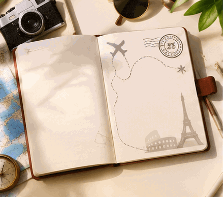

<sub>9 帧 · 439×387 · 2.0s · gpt-image-2.6 · 生成于 2026-11-17</sub>

**提示词**

```text
An open travel journal on an ivory desk; little stickers of a plane, a ticket stub, a palm tree and a stamp pop onto the page one after another with a soft bounce. Cozy scrapbook style, overhead camera.
```

`scrapbook` `travel` `journal`

### 8. 木棋子翻面落定

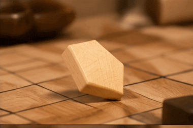

<sub>16 帧 · 380×252 · 1.9s · gpt-image-2.6 · 生成于 2026-11-17</sub>

**提示词**

```text
A pale wooden pentagon-shaped board game piece flips over in the air and lands with a small clack on a wooden grid board, a puff of dust at impact. Warm tabletop lighting, close-up, fixed camera.
```

`board-game` `wood` `flip`

### 9. 包豪斯几何块换位

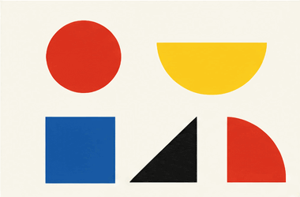

<sub>16 帧 · 380×250 · 2.6s · gpt-image-2.6 · 生成于 2026-11-17</sub>

**提示词**

```text
A grid of Bauhaus shapes in red, yellow, blue and black, circles, half circles, squares and triangles, slide and rotate into new positions in crisp steps. Flat poster style, off-white background.
```

`bauhaus` `geometric` `motion-design`

### 10. 蹦跳的购物袋

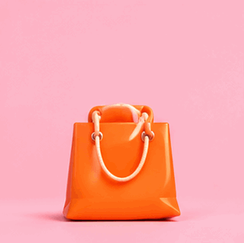

<sub>16 帧 · 307×306 · 2.2s · gpt-image-2.6 · 生成于 2026-11-17</sub>

**提示词**

```text
A glossy orange shopping bag with rope handles hops up, squashes on landing, and a little gift box pops out of the top and drops back in. Playful 3D product style, pastel pink background.
```

`shopping` `bag` `promo`

### 11. 摇摆的促销吊牌


<sub>16 帧 · 313×302 · 1.4s · gpt-image-2.6 · 生成于 2026-11-17</sub>

**提示词**

```text
A red paper price tag that says SALE hangs from a string and swings left and right with a tiny bounce, a few gold sparkles popping around it. Bold flat ad style, solid black background edge to edge in every frame.
```

> 💡 **技巧：** 画面文字只放一个短词，长文字在帧之间容易变形。

`sale` `black-friday` `ad`

### 12. 粉饼盒打开


<sub>9 帧 · 428×398 · 1.6s · gpt-image-2.6 · 生成于 2026-11-17</sub>

**提示词**

```text
A rose-gold makeup compact clicks open, the mirror catches a flash of light and a little powder puff lifts out. Elegant beauty product shot, blush pink background.
```

`beauty` `product` `compact`

**[查看本分类全部 87 条 →](categories/flash_zh.md)**

## 氛围循环动画

这里展示本分类最新的 12 条（共 128 条）。[查看全部 128 条 →](categories/loops_zh.md)

### 1. 晨雾中的广州塔


<sub>9 帧 · 480×198 · 1.6s · gpt-image-2.6-gif</sub>

📌 **来源：** [@AIWAVE2025 on X](https://x.com/AIWAVE2025/status/2118154755826766225)

**提示词**

```text
清晨珠江，薄雾，镜头低空推进，广州塔从雾里露出来，一艘游船划过。
```

`city` `mist` `river`

### 2. 树枝上扇动翅膀的橙色小鸟

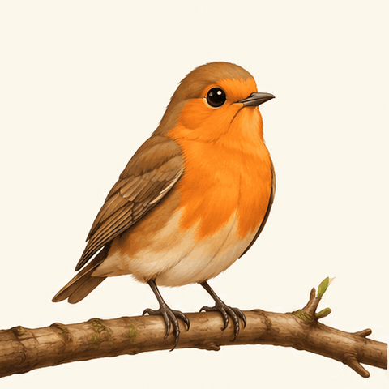

<sub>9 帧 · 480×480 · 1.8s · gpt-image-2.6-gif</sub>

📌 **来源：** [Ofox on Ofox](https://ofox.ai/blog/gpt-image-2-6-gif-guide/)

**提示词**

```text
Create a looping animation of a small orange bird on a stationary branch against a plain cream background. The bird raises its wings, pauses, then lowers them to its starting pose. Keep the camera fixed, the branch still, and the bird shape and colors consistent. No text. Make the transition back to the start smooth.
```

`bird` `loop` `api`

### 3. 雪花球里的小木屋


<sub>9 帧 · 439×390 · 1.6s · gpt-image-2.6 · 生成于 2026-11-17</sub>

**提示词**

```text
A glass snow globe with a tiny red cabin and pine trees inside; snowflakes swirl up and settle slowly around the cabin. Warm cozy lighting, wooden table, fixed close-up.
```

`snow-globe` `winter` `cozy`

### 4. 糖炒栗子


<sub>9 帧 · 439×390 · 1.6s · gpt-image-2.6 · 生成于 2026-11-17</sub>

**提示词**

```text
A big iron wok of chestnuts and dark sand is stirred by a wooden paddle, steam curling up under a warm bulb at a winter street stall. Cozy photographic style, close-up, fixed camera.
```

`chestnut` `street-food` `winter`

### 5. 路灯下的初雪


<sub>16 帧 · 376×252 · 2.9s · gpt-image-2.6 · 生成于 2026-11-17</sub>

**提示词**

```text
Big soft snowflakes drift down through the warm cone of an old street lamp on a quiet cobblestone street at night. Cinematic, fixed camera, everything else still.
```

`snow` `night` `street`

### 6. 窗上霜花蔓延


<sub>8 帧 · 439×388 · 1.8s · gpt-image-2.6 · 生成于 2026-11-17</sub>

**提示词**

```text
Delicate fern-like frost patterns creep across a cold window pane from the corners, a blurry snowy garden visible behind. Macro winter photography, fixed camera.
```

`frost` `winter` `macro`

### 7. 孔明灯升空


<sub>16 帧 · 377×248 · 2.9s · gpt-image-2.6 · 生成于 2026-11-17</sub>

**提示词**

```text
Dozens of warm glowing paper lanterns float slowly up into a deep blue night sky above dark rooftops, flickering softly. Dreamy painterly style, fixed camera.
```

`lantern` `night` `festival`

### 8. 瓢虫与露珠

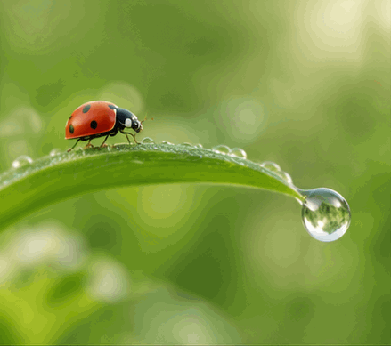

<sub>9 帧 · 439×389 · 1.6s · gpt-image-2.6 · 生成于 2026-11-17</sub>

**提示词**

```text
A ladybug walks along a curved green leaf while a dewdrop at the leaf tip swells and wobbles. Macro nature photography, soft morning bokeh, fixed camera.
```

`ladybug` `macro` `nature`

### 9. 山洞里打呼的熊


<sub>16 帧 · 380×248 · 2.9s · gpt-image-2.6 · 生成于 2026-11-17</sub>

**提示词**

```text
A brown bear sleeps curled up in a cozy cave, its belly rising and falling as a snore bubble grows and shrinks from its nose, snow falling softly outside. Storybook illustration, fixed camera.
```

`bear` `hibernation` `winter`

### 10. 海獭仰浮打盹

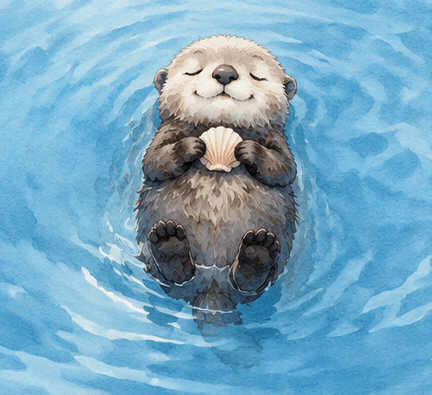

<sub>9 帧 · 432×395 · 1.6s · gpt-image-2.6 · 生成于 2026-11-17</sub>

**提示词**

```text
A sea otter floats on its back in calm water, holding a small shell on its belly, bobbing gently with the ripples as its eyes stay closed. Soft watercolor style, fixed overhead-angle camera.
```

`otter` `sleep` `calm`

### 11. 沙漠上空的彗星


<sub>9 帧 · 506×337 · 2.0s · gpt-image-2.6 · 生成于 2026-11-17</sub>

**提示词**

```text
A bright comet with a long glowing tail drifts slowly across a starry sky above dark desert dunes, the tail shimmering. Calm night photography look, fixed wide camera.
```

`comet` `night` `sky`

### 12. 发光菌丝峡谷桥


<sub>9 帧 · 506×337 · 1.6s · gpt-image-2.6 · 生成于 2026-11-17</sub>

**提示词**

```text
A delicate bridge woven from glowing white fungal threads spans a misty canyon at dusk; soft pulses of blue light travel along the threads from one side to the other. Fantasy concept art, fixed wide shot.
```

`fantasy` `bridge` `glow`

**[查看本分类全部 128 条 →](categories/loops_zh.md)**

## 像素风与界面动效

这里展示本分类最新的 12 条（共 85 条）。[查看全部 85 条 →](categories/pixel-ui_zh.md)

### 1. 像素字母依次跳动 B-ROLL

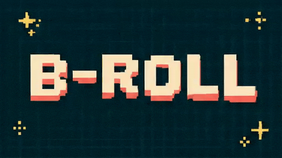

<sub>12 帧 · 480×270 · 3.0s · gpt-image-2.6-gif</sub>

📌 **来源：** [@Wv3EcACHtizRjZK on X](https://x.com/Wv3EcACHtizRjZK/status/2119673507068203035)

**提示词**

```text
深青色背景，奶油色像素字体 B-ROLL，字母从左到右轻轻跳起再落回原位，珊瑚色光标从下方划过。字形、拼写和间距保持一致，动画 GIF。
```

`pixel font` `text` `title`

### 2. 成功提示条滑入


<sub>16 帧 · 380×252 · 1.8s · gpt-image-2.6 · 生成于 2026-11-17</sub>

**提示词**

```text
A green rounded notification toast slides in from the top with a white check mark drawing itself, holds a moment, then slides back up. Minimal app UI, white background, no other text.
```

`ui` `toast` `notification`

### 3. 表情回应依次弹出


<sub>12 帧 · 356×356 · 1.4s · gpt-image-2.6 · 生成于 2026-11-17</sub>

**提示词**

```text
A rounded white reaction bar where five round emoji faces, smile, laugh, heart eyes, surprise and sad, pop up one after another with a springy bounce. Clean app UI style, light gray background.
```

`ui` `emoji` `reaction`

### 4. 像素火车过桥

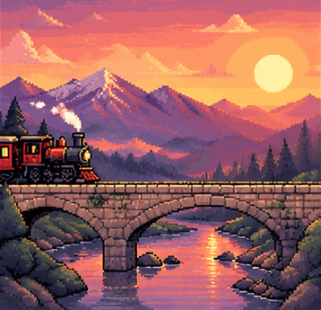

<sub>12 帧 · 358×345 · 1.4s · gpt-image-2.6 · 生成于 2026-11-17</sub>

**提示词**

```text
A small pixel art steam train crosses a stone arch bridge over a river, puffing little smoke clouds, mountains behind. 16-bit side-scroller style, sunset palette.
```

`pixel` `train` `landscape`

### 5. 像素蜜蜂花园

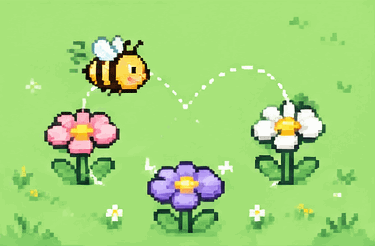

<sub>16 帧 · 375×246 · 1.9s · gpt-image-2.6 · 生成于 2026-11-17</sub>

**提示词**

```text
A pixel art bee buzzes in a figure eight between three pixel flowers that sway slightly. 16-bit game style, light green background.
```

`pixel` `bee` `garden`

### 6. 书签收藏


<sub>9 帧 · 438×389 · 1.4s · gpt-image-2.6 · 生成于 2026-11-17</sub>

**提示词**

```text
An outlined bookmark icon fills with solid gold from top to bottom and gives a small bounce, with a few tiny sparkles. Minimal app icon style, white background.
```

`ui` `bookmark` `save`

### 7. 加入购物车


<sub>9 帧 · 437×388 · 1.4s · gpt-image-2.6 · 生成于 2026-11-17</sub>

**提示词**

```text
A flat shopping cart icon; a small box drops into it, the cart wiggles, and a red badge with the number 1 pops up on its corner. Clean app UI icon style, white background.
```

`ui` `cart` `ecommerce`

### 8. 像素小恐龙跺脚吼叫

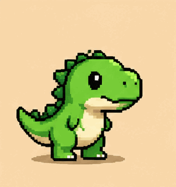

<sub>12 帧 · 344×366 · 1.7s · gpt-image-2.6 · 生成于 2026-11-17</sub>

**提示词**

```text
A small green pixel art dinosaur stomps one foot, opens its mouth in a tiny roar with a shake line, then settles back. 16-bit game sprite, plain sand-colored background.
```

`pixel` `dinosaur` `sprite`

### 9. 低多边形主角慢跑

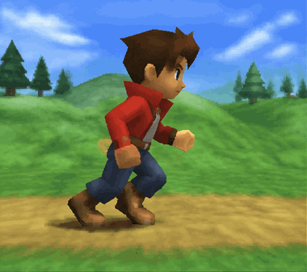

<sub>12 帧 · 380×337 · 1.4s · gpt-image-2.6 · 生成于 2026-11-17</sub>

**提示词**

```text
A blocky low-poly game hero in a red jacket jogs along a dirt path in a side view, rendered like an early 2000s console game with chunky polygons and blurry textures. Fixed camera, simple green hills behind.
```

`low-poly` `retro-game` `run`

### 10. 像素宇航员跑步

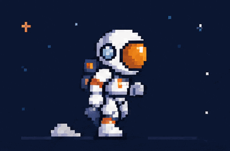

<sub>16 帧 · 378×249 · 1.6s · gpt-image-2.6 · 生成于 2026-11-17</sub>

**提示词**

```text
A pixel art astronaut in a white suit with an orange visor runs in place in a smooth side-view run cycle, small dust puffs at each step. Limited 16-color palette, dark navy background with a few stars.
```

> 💡 **技巧：** 跑步、走路循环用 12–16 帧更顺。

`pixel` `astronaut` `run-cycle`

### 11. 环形图填充

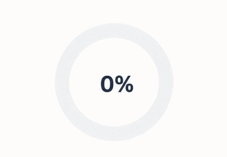

<sub>16 帧 · 379×263 · 1.6s · gpt-image-2.6 · 生成于 2026-11-17</sub>

**提示词**

```text
A donut chart fills segment by segment in teal, coral and yellow while the percentage in the middle counts up. Clean dashboard UI style, white background.
```

`ui` `chart` `data`

### 12. 地图图钉落下


<sub>12 帧 · 358×357 · 1.4s · gpt-image-2.6 · 生成于 2026-11-17</sub>

**提示词**

```text
A red location pin drops onto a simple folded map, bounces once and sends out a soft ripple ring. Flat UI icon style, pale green background.
```

`ui` `map` `location`

**[查看本分类全部 85 条 →](categories/pixel-ui_zh.md)**

## 科普讲解动图

### 1. 西西里防御开局动画

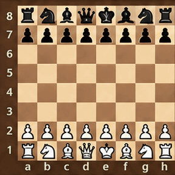

<sub>16 帧 · 288×288 · 3.2s · gpt-image-2.6-gif</sub>

📌 **来源：** [vunderba on Mordenstar](https://imgpb.com/OzSMKJ)

**提示词**

```text
A simple animation of the Sicilian Defense opening on a chess board, flat vector illustration
```

`chess` `opening` `diagram`

### 2. 扬声器声波传播

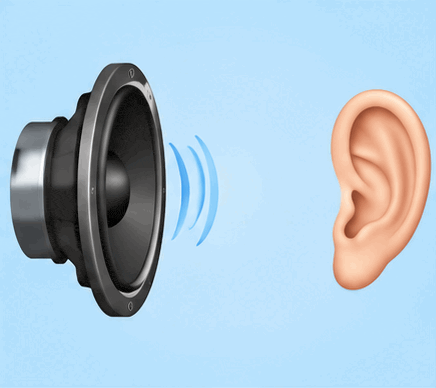

<sub>9 帧 · 436×388 · 1.3s · gpt-image-2.6 · 生成于 2026-11-18</sub>

**提示词**

```text
Side view diagram of a loudspeaker whose cone pushes in and out, sending evenly spaced curved sound waves rippling to the right toward a cartoon ear. Flat educational infographic, light blue background.
```

`sound` `physics` `waves`

### 3. 叶片光合作用示意


<sub>9 帧 · 439×390 · 1.6s · gpt-image-2.6 · 生成于 2026-11-18</sub>

**提示词**

```text
Simple science diagram of a green leaf: yellow sun rays enter from the top, blue water droplets rise from the stem, and small bubbles labeled O2 float out of the leaf. Clean textbook illustration, white background.
```

`photosynthesis` `biology` `diagram`

### 4. 跷跷板杠杆平衡

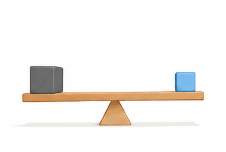

<sub>16 帧 · 378×254 · 2.2s · gpt-image-2.6 · 生成于 2026-11-17</sub>

**提示词**

```text
A simple wooden seesaw on a triangle pivot tips one way as a heavy block drops on one end, then a small block slides farther out on the other end until it balances level. Flat textbook illustration, white background, no text.
```

`lever` `physics` `simple-machines`

### 5. 三棱镜分光


<sub>16 帧 · 380×252 · 1.9s · gpt-image-2.6 · 生成于 2026-11-17</sub>

**提示词**

```text
A white beam of light enters a glass triangular prism and fans out into a rainbow on the other side, the rainbow shimmering gently. Dark background, clean science illustration, fixed camera.
```

`light` `prism` `physics`

### 6. 行星绕日运行

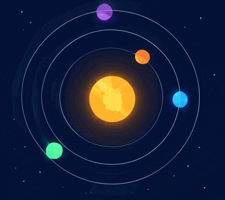

<sub>9 帧 · 439×390 · 1.4s · gpt-image-2.6 · 生成于 2026-11-17</sub>

**提示词**

```text
A flat top-down diagram of a glowing sun with four colorful planets moving along thin circular orbits at different speeds. Dark navy background, simple clean shapes, no text.
```

`solar-system` `astronomy` `diagram`

### 7. 心脏跳动示意

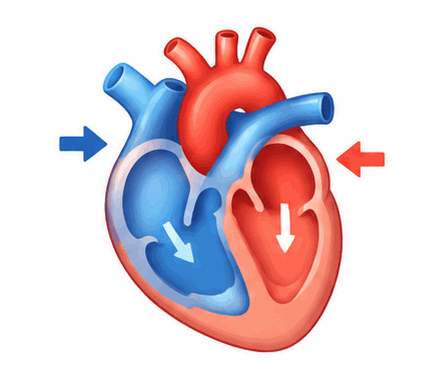

<sub>9 帧 · 439×388 · 1.6s · gpt-image-2.6 · 生成于 2026-11-17</sub>

**提示词**

```text
A friendly simplified anatomical heart in red and blue squeezes and relaxes in a steady beat, small arrows showing blood flowing in and out. Flat medical infographic style, light background, no text.
```

`heart` `biology` `infographic`

### 8. 豆子发芽地下剖面

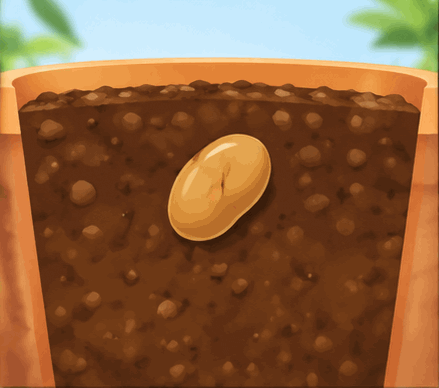

<sub>9 帧 · 439×388 · 2.0s · gpt-image-2.6 · 生成于 2026-11-17</sub>

**提示词**

```text
A cutaway of a soil pot shows a bean seed splitting open, a root reaching down and a pale shoot pushing up toward the surface. Soft flat educational illustration, brown and green palette, no text.
```

`plant` `germination` `biology`

### 9. 月相变化


<sub>16 帧 · 309×309 · 1.9s · gpt-image-2.6 · 生成于 2026-11-17</sub>

**提示词**

```text
A single moon centered in a square frame of dark starry sky goes through its phases, from thin crescent to full moon and back to crescent, the shadow edge sliding smoothly across it. Clean flat illustration, fixed camera.
```

`moon` `astronomy` `science`

### 10. 水循环示意


<sub>16 帧 · 380×252 · 2.9s · gpt-image-2.6 · 生成于 2026-11-17</sub>

**提示词**

```text
A friendly cutaway landscape showing the water cycle: vapor rises from a lake, gathers into a cloud, rain falls on a mountain and flows back down a river into the lake. Flat educational illustration, soft blue palette, no text.
```

`water-cycle` `science` `diagram`

### 11. 单摆来回摆动


<sub>12 帧 · 358×357 · 1.4s · gpt-image-2.6 · 生成于 2026-11-17</sub>

**提示词**

```text
A simple science diagram of a pendulum: a metal ball on a string swings left and right from a fixed pivot, a faint dotted arc showing its path. Clean flat textbook illustration, white background, no text labels.
```

> 💡 **技巧：** 写明不要文字标注，示意图上的字在帧之间容易漂移。

`physics` `pendulum` `science`

## 节日与祝福

### 1. 冒热气的感恩节南瓜派


<sub>9 帧 · 439×390 · 1.6s · gpt-image-2.6 · 生成于 2026-11-18</sub>

**提示词**

```text
A whole pumpkin pie on a checkered cloth with three curls of steam rising and fading, a small hand-lettered card beside it reading "THANK YOU". Soft gouache style, warm orange and brown tones.
```

`thanksgiving` `pie` `thank you`

### 2. 姜饼屋门口挥手的小姜饼人


<sub>8 帧 · 439×390 · 1.4s · gpt-image-2.6 · 生成于 2026-11-18</sub>

**提示词**

```text
A tiny gingerbread figure with white icing buttons stands in the doorway of a candy-trimmed gingerbread house and waves one arm, while soft snowflakes drift past. Warm cozy illustration, cream background.
```

`christmas` `gingerbread` `greeting`

## 电商与产品展示

### 1. 左右摇摆的水杯产品动图

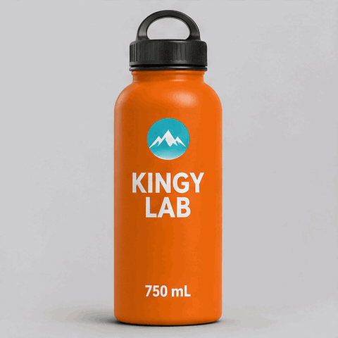

<sub>10 帧 · 480×480 · 2.0s · gpt-image-2.6-gif</sub>

📌 **来源：** [Curtis Pyke on Kingy AI](https://kingy.ai/blog/chatgpt-gifs-images-2-6-vs-2-5-hands-on-test/)

**提示词**

```text
Generate an actual animated GIF file, not a still picture, sprite sheet, video, or Python-coded animation. Square 512 by 512 pixels, a seamless 2-second loop. A bright orange reusable water bottle with a charcoal screw cap and a small turquoise circular badge remains centered on a pale gray studio background. The bottle rocks gently left and right and returns to its starting pose; the camera and background stay fixed. The bottle reads exactly "KINGY LAB" and "750 mL" throughout. No other text or objects. Use ChatGPT's native GIF generation and provide the downloadable GIF. If native GIF generation is unavailable, state that limitation rather than simulating it with code.
```

`product` `bottle` `api`

### 2. 智能手表亮屏

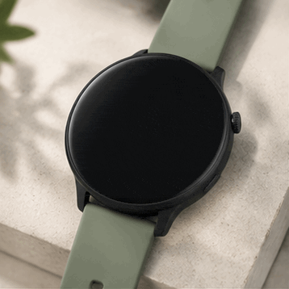

<sub>12 帧 · 358×358 · 2.2s · gpt-image-2.6 · 生成于 2026-11-18</sub>

**提示词**

```text
A round matte black smartwatch with a sage green strap lies on a light stone surface; its screen wakes up with a soft glow, the clock hands sweep into place, then the screen dims again. Minimal studio product shot, no text, no logos.
```

`smartwatch` `wearable` `product shot`

### 3. 转台上旋转的运动鞋


<sub>16 帧 · 380×250 · 1.9s · gpt-image-2.6 · 生成于 2026-11-18</sub>

**提示词**

```text
A clean white running sneaker with a mint green sole slowly rotates on a round white turntable, a soft highlight sliding across the toe. Studio product shot, pale grey seamless background, no text.
```

`sneaker` `turntable` `ecommerce`

## 美食饮品

### 1. 披萨拉丝


<sub>16 帧 · 380×249 · 1.9s · gpt-image-2.6 · 生成于 2026-11-18</sub>

**提示词**

```text
A hand lifts one slice of pepperoni pizza away from the whole pie, long strings of melted mozzarella stretching between the slice and the pan, then the slice settles back into place. Warm close-up food illustration, rustic wooden table.
```

`pizza` `cheese` `food`

### 2. 奶茶加珍珠


<sub>16 帧 · 322×292 · 2.2s · gpt-image-2.6 · 生成于 2026-11-18</sub>

**提示词**

```text
A clear cup of milk tea sits on a counter as a spoonful of dark tapioca pearls drops in and sinks, swirling brown sugar streaks along the glass. Bright cute flat illustration, pastel pink background.
```

`bubble tea` `boba` `drink`

## 动态头像

### 1. 宇航员猫咪眨眼头像


<sub>16 帧 · 306×308 · 2.9s · gpt-image-2.6 · 生成于 2026-11-18</sub>

**提示词**

```text
Circular profile avatar of a grey cat inside a round astronaut helmet, blinking slowly while a tiny star glints across the glass visor. Soft 3D clay style, navy blue background.
```

`avatar` `cat` `space`

### 2. 戴耳机点头的狐狸头像


<sub>9 帧 · 436×387 · 1.4s · gpt-image-2.6 · 生成于 2026-11-18</sub>

**提示词**

```text
Circular avatar of a red fox wearing chunky yellow headphones, eyes closed, nodding its head to a beat as small music notes pop beside it. Flat vector style, teal background.
```

`avatar` `fox` `music`

## 自己动手生成

使用 [ViNano AI API](https://vinano.ai/api-keys)：先创建 API Key，提交 GIF 生成任务，再轮询任务状态拿到 GIF 地址（每张 25 积分）。

```bash
# 1. Submit a GIF task — the response contains a task "uuid"
curl -X POST https://vinano.ai/api/async-openai-images \
  -H "Authorization: Bearer $VINANO_API_KEY" \
  -F mode=txt2img -F zeakaiModel=gpt-image-2.6-gif -F model="ViNano AI" \
  -F count=1 -F img_size=1k -F aspectRatio=1:1 \
  -F prompt="A cheerful cartoon cat waving hello. Animate it as a short, smooth, seamlessly looping GIF with clear motion between frames."

# 2. Poll until "completed" is true — the GIF URL is in "generated_images_url"
curl "https://vinano.ai/api/task-status?uuid=<uuid>" \
  -H "Authorization: Bearer $VINANO_API_KEY"
```

或者用仓库自带的脚本重新生成全部示例（需要 Node 18+）：

```bash
git clone https://github.com/ailingqu/awesome-ai-gif-prompts.git && cd awesome-ai-gif-prompts
cp .env.example .env   # fill in VINANO_API_KEY
npm run generate        # only generates prompts without a GIF
npm run build           # rebuilds README.md and README_zh.md
```

## 来源

没有来源标注的条目由我们编写并生成。标有 **来源** 的条目搜集自 X 和其它网站，提示词和 GIF 按原样展示，署名作者并链接到原帖，版权归原作者所有；作者如需修改或删除，请提交 issue。

## 参与贡献

欢迎提交新提示词！在 `data/prompts.json` 里新增一条，附上你生成的 GIF，然后运行 `npm run build`。详见 [CONTRIBUTING.md](CONTRIBUTING.md)。

## 许可

提示词与示例 GIF 采用 [CC BY 4.0](LICENSE)。觉得有用的话，点个 ⭐ 能让更多人看到。
