# Awesome AI GIF Prompts

[English](README.md) · **简体中文**

   [](https://awesome.re)

精选 **AI 直出 GIF 动图** 提示词合集：表情包、反应图、快闪、品牌动效、氛围循环、像素风。下面每个示例都是用所列提示词原样生成的，未做任何后期修改。

> 🎞️ **在线试用：** 把任意提示词粘贴到 [ViNano AI GIF Generator](https://vinano.ai/gif-generator)，输入文字或上传照片即可得到循环 GIF（由 GPT Image 2.6 驱动）。

<p align="center">
  
  
  
  
</p>

## 目录

- [这些 GIF 是怎么生成的](#这些-gif-是怎么生成的)
- [表情包与贴纸](#表情包与贴纸) · 132 条提示词
- [快闪与品牌动效](#快闪与品牌动效) · 49 条提示词
- [氛围循环动画](#氛围循环动画) · 77 条提示词
- [像素风与界面动效](#像素风与界面动效) · 52 条提示词
- [自己动手生成](#自己动手生成)

## 这些 GIF 是怎么生成的

在请求里设置 `output_format: "gif"`，GPT Image 2.6 就会直接返回 GIF 动图而不是静态图。帧数、每帧时长和尺寸由模型自行决定。

本仓库的每条提示词在发送时都会追加一句话，要求生成无缝循环：

```text
Animate it as a short, smooth, seamlessly looping GIF with clear motion between frames.
```

### 提示词公式

**主体**（一个清晰的角色或物体）+ **动作**（1–2 个动词：挥手、弹跳、飘动、闪烁）+ **风格**（扁平插画、Q 版贴纸、像素风、摄影）+ **背景**（做贴纸时用纯色、高对比背景）

### 技巧

- 一个主体、一到两个动作。画面越杂，动作越难看清。
- 用动词描述动作，比如“摇晃、打瞌睡、闪烁、滑落”，少用形容词。
- 扁平插画、Q 版、像素风在 GIF 的小尺寸下比写实照片效果好得多。
- 做一套表情包时，每条提示词都复用完全相同的角色描述，整套才会一致。
- 要抠成透明贴纸的，背景用一种和角色颜色完全拉开的纯色。
- 快闪要把每一帧写成不同的镜头；品牌快闪则固定 Logo 的位置和大小，只换周围的场景。
- 长文字和复杂的昼夜循环目前仍不稳定：文字尽量短，大的变化交给光线来表现。

## 表情包与贴纸

### 1. Q 弹果冻熊摇晃


<sub>9 帧 · 438×388 · 1.3s · gpt-image-2.6 · 生成于 2026-11-06</sub>

**提示词**

```text
A chubby round cartoon bear with a soft jelly-like body and stubby arms, squishing down and springing back up while wobbling side to side, cheeks jiggling on every bounce. Thick clean outlines, flat pastel colors, centered on a plain solid mint-green background that contrasts strongly with the bear.
```

> 💡 **技巧：** 背景用一种和角色颜色完全拉开的纯色，之后才方便抠成透明贴纸。

`sticker` `bouncy` `cute`

### 2. 兔兔点赞


<sub>9 帧 · 438×388 · 1.3s · gpt-image-2.6 · 生成于 2026-11-06</sub>

**提示词**

```text
A small white cartoon bunny with long floppy ears and a pink nose, giving an enthusiastic thumbs-up with one paw, the paw pumping forward twice while the ears bounce. Chibi sticker style, bold outline, plain warm yellow background.
```

> 💡 **技巧：** 一整套表情包都复用同一段角色描述（见后面两条），风格才能保持一致。

`sticker` `reaction` `sticker-pack`

### 3. 兔兔笑出眼泪


<sub>8 帧 · 440×389 · 1.1s · gpt-image-2.6 · 生成于 2026-11-06</sub>

**提示词**

```text
A small white cartoon bunny with long floppy ears and a pink nose, laughing so hard it rocks back and forth, eyes squeezed shut and two little tears flying out. Chibi sticker style, bold outline, plain warm yellow background.
```

`sticker` `reaction` `sticker-pack`

### 4. 兔兔犯困

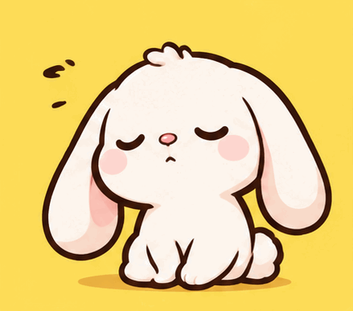

<sub>9 帧 · 439×387 · 1.6s · gpt-image-2.6 · 生成于 2026-11-06</sub>

**提示词**

```text
A small white cartoon bunny with long floppy ears and a pink nose, sitting and nodding off, head slowly drooping then jerking back up, a small bubble swelling and shrinking from its nose. Chibi sticker style, bold outline, plain warm yellow background.
```

`sticker` `reaction` `sticker-pack`

### 5. 卡通猫挥手打招呼


<sub>9 帧 · 438×390 · 1.3s · gpt-image-2.6 · 生成于 2026-11-05</sub>

**提示词**

```text
A cheerful cartoon cat waving hello.
```

> 💡 **技巧：** 简单的打招呼动作，一句话提示词也够用，风格和节奏交给模型。

`sticker` `greeting` `minimal-prompt`

### 6. 柴犬歪头疑惑


<sub>9 帧 · 439×390 · 1.6s · gpt-image-2.6 · 生成于 2026-11-06</sub>

**提示词**

```text
A fluffy orange shiba inu puppy tilting its head to one side and back again, ears twitching, a small question mark popping above its head. Chibi sticker style, bold outline, plain light blue background.
```

`sticker` `reaction` `dog`

### 7. 猫猫疯狂打字

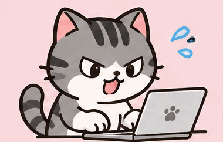

<sub>16 帧 · 380×242 · 1.9s · gpt-image-2.6 · 生成于 2026-11-06</sub>

**提示词**

```text
A grey tabby cat sitting at a tiny laptop and typing furiously with both front paws, paws blurring, little speed lines and sweat drops flying off. Flat cartoon sticker style, bold outline, plain pale pink background.
```

> 💡 **技巧：** 速度线和汗珠能让快速动作在帧数很少时也看得清。

`sticker` `work` `cat`

### 8. 青蛙吹出爱心

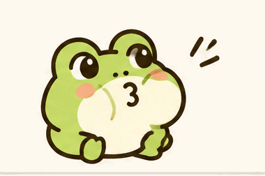

<sub>16 帧 · 380×252 · 2.2s · gpt-image-2.6 · 生成于 2026-11-06</sub>

**提示词**

```text
A round green cartoon frog puffing its cheeks and blowing a pink heart-shaped bubble that floats up and pops into tiny sparkles. Cute flat sticker style, bold outline, plain cream background.
```

`sticker` `love` `cute`

### 9. 企鹅捂脸


<sub>9 帧 · 435×389 · 1.4s · gpt-image-2.6 · 生成于 2026-11-06</sub>

**提示词**

```text
A chubby cartoon penguin slowly raising one flipper and slapping it onto its forehead, then shaking its head in disbelief. Chibi sticker style, bold outline, plain light grey background.
```

`sticker` `reaction` `facepalm`

### 10. 投篮命中庆祝

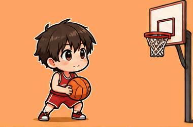

<sub>16 帧 · 380×251 · 1.9s · gpt-image-2.6 · 生成于 2026-11-06</sub>

**提示词**

```text
A chibi kid in a red jersey jumps and shoots a basketball, the ball swishes through the hoop, then the kid lands and pumps a fist in celebration before returning to the starting pose. Bold-outline sticker style, plain light orange background.
```

> 💡 **技巧：** 运动类动作拆成三个清楚的节拍（起跳、出手、庆祝）。360 度踢板这类复杂花式目前仍容易失败。

`sticker` `sports` `celebration`

### 11. 猫厨师颠勺炒饭


<sub>16 帧 · 323×295 · 1.9s · gpt-image-2.6 · 生成于 2026-11-06</sub>

**提示词**

```text
A white cat chef in a tall chef hat tossing fried rice in a wok, the rice flies up in a little arc and lands back in the pan, a puff of steam rising each time. Comic cartoon style, warm kitchen background kept still.
```

`sticker` `food` `cat`

### 12. 黑猫出拳

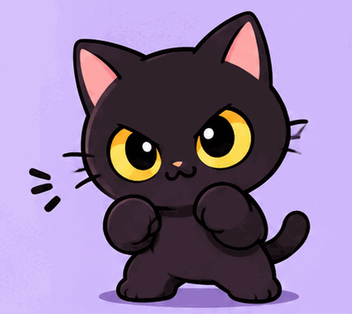

<sub>9 帧 · 437×390 · 1.3s · gpt-image-2.6 · 生成于 2026-11-06</sub>

**提示词**

```text
A round black cat with big yellow eyes throwing a quick one-two punch toward the viewer with its front paws, little impact stars popping, then settling back into a boxing stance. Chibi sticker style, bold outline, plain pastel purple background.
```

`sticker` `reaction` `cat`

### 13. 打工猫：累瘫


<sub>9 帧 · 438×387 · 1.6s · gpt-image-2.6 · 生成于 2026-11-06</sub>

**提示词**

```text
A chubby orange tabby cat office worker with a tiny blue tie and an employee badge slumps face-down onto a pile of papers on its desk, ears drooping, a tiny ghost of a sigh floating up, then twitches one paw. Flat cartoon sticker style, bold outline, plain pale grey background.
```

> 💡 **技巧：** 成套表情：角色描述一字不改，只换动作，真实上架的表情包都是这样保持一致的。

`sticker` `work` `sticker-pack`

### 14. 打工猫：下班啦


<sub>16 帧 · 374×249 · 2.6s · gpt-image-2.6 · 生成于 2026-11-06</sub>

**提示词**

```text
A chubby orange tabby cat office worker with a tiny blue tie and an employee badge tosses its badge in the air, grabs a tiny backpack and does a happy little hop toward the door, tail swishing. Flat cartoon sticker style, bold outline, plain pale yellow background.
```

`sticker` `work` `sticker-pack`

### 15. 咆哮的小黄鸭

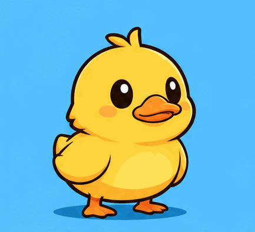

<sub>9 帧 · 433×394 · 1.6s · gpt-image-2.6 · 生成于 2026-11-06</sub>

**提示词**

```text
A small round yellow duck suddenly opening its beak wide and roaring like a lion, feathers blown back, the screen shaking slightly, then it calmly closes its beak. Cute cartoon sticker style, bold outline, plain sky-blue background.
```

`sticker` `reaction` `funny`

### 16. Q 版上班族看股价暴跌


<sub>9 帧 · 438×388 · 1.4s · gpt-image-2.6 · 生成于 2026-11-07</sub>

**提示词**

```text
A chibi office worker in a white shirt and loose tie staring at a laptop where a red stock line plunges, his hopeful smile crumbling into big wobbling tears. Flat pastel sticker style on a plain light background.
```

`sticker` `office` `finance`

### 17. Q 版上班族看股价暴涨


<sub>9 帧 · 414×410 · 1.4s · gpt-image-2.6 · 生成于 2026-11-07</sub>

**提示词**

```text
A chibi office worker in a white shirt and loose tie jumping up from his chair as a green stock line shoots upward on his laptop, throwing paper banknotes into the air with both hands. Flat pastel sticker style on a plain light background.
```

`sticker` `office` `finance`

### 18. 戴墨镜的猫跳舞

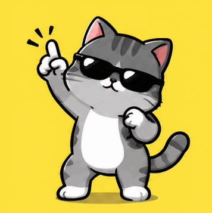

<sub>12 帧 · 356×357 · 1.4s · gpt-image-2.6 · 生成于 2026-11-07</sub>

**提示词**

```text
A cool grey cat wearing tiny black sunglasses doing a side-to-side groove dance, hips swaying and one paw pointing up then down. Bold cartoon sticker style on a plain yellow background.
```

`sticker` `cat` `dance`

### 19. 高礼帽青蛙驱散霉运

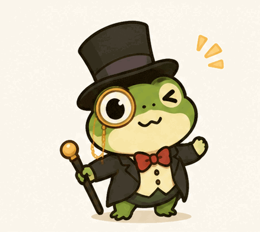

<sub>9 帧 · 438×390 · 1.4s · gpt-image-2.6 · 生成于 2026-11-07</sub>

**提示词**

```text
A small green frog in a tall black top hat and a monocle waving a tiny cane in circles as if shooing away bad luck, little grey smoke puffs scattering. Cute storybook sticker style on a cream background.
```

`sticker` `frog` `reaction`

### 20. 勤劳小蜜蜂打卡上班

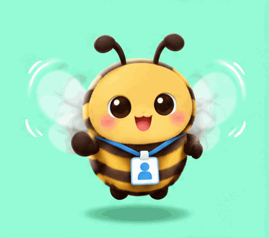

<sub>9 帧 · 439×390 · 1.4s · gpt-image-2.6 · 生成于 2026-11-07</sub>

**提示词**

```text
A round fuzzy cartoon bee with a tiny lanyard badge buzzing in place, wings fluttering fast, then giving a crisp salute. Soft flat sticker style on a plain mint background.
```

`sticker` `bee` `work`

### 21. 小狗摇摆冒爱心

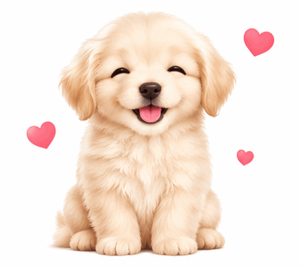

<sub>9 帧 · 437×389 · 1.6s · gpt-image-2.6 · 生成于 2026-11-07</sub>

**提示词**

```text
A fluffy cream-colored puppy sitting and swaying its head left and right with its eyes closed happily, small pink hearts floating up around it. Kawaii sticker style on a plain white background.
```

`sticker` `dog` `love`

### 22. 晚安喵


<sub>16 帧 · 380×251 · 2.9s · gpt-image-2.6 · 生成于 2026-11-07</sub>

**提示词**

```text
A sleepy white kitten in a blue nightcap hugging a small pillow, slowly yawning and then nodding off as a tiny crescent moon bobs beside it. Soft pastel sticker style on a dark navy background.
```

`sticker` `cat` `goodnight`

### 23. 橘猫扑向镜头

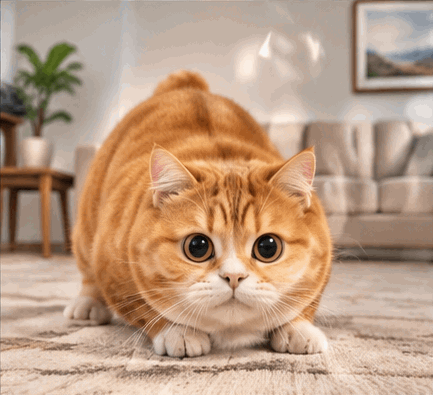

<sub>9 帧 · 433×395 · 1.6s · gpt-image-2.6 · 生成于 2026-11-07</sub>

**提示词**

```text
A chubby orange cat crouching, wiggling its rear, then leaping straight toward the viewer with paws spread wide until its face squishes against the glass. Funny cartoon style on a plain living room background.
```

`sticker` `cat` `funny`

### 24. 笑出眼泪的小团子


<sub>16 帧 · 306×307 · 2.2s · gpt-image-2.6 · 生成于 2026-11-07</sub>

**提示词**

```text
A round pink mochi blob character throwing its head back and laughing hysterically, tears spraying from its eyes, body shaking. Cute sticker style on a plain white background.
```

`sticker` `laugh` `reaction`

### 25. 魔法学徒咒语失控


<sub>8 帧 · 439×388 · 1.3s · gpt-image-2.6 · 生成于 2026-11-07</sub>

**提示词**

```text
A chibi wizard apprentice in an oversized purple hat waves a wand, a small puff explodes in front of her, and she is left blinking with a soot-black face and frizzy hair. Cute cartoon sticker style on a plain lilac background.
```

`sticker` `magic` `fail`

### 26. 橘猫揉面打喷嚏

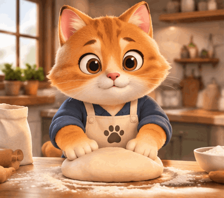

<sub>9 帧 · 440×389 · 1.6s · gpt-image-2.6 · 生成于 2026-11-07</sub>

**提示词**

```text
An anthropomorphic orange cat in an apron kneading dough on a wooden counter, then sneezing and blowing a big white cloud of flour into the air. Warm cartoon style.
```

`sticker` `cat` `cooking`

### 27. 深夜加班的龙虾

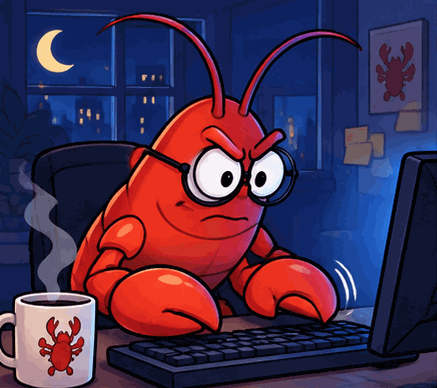

<sub>9 帧 · 437×388 · 1.4s · gpt-image-2.6 · 生成于 2026-11-07</sub>

**提示词**

```text
A red cartoon lobster wearing round glasses typing furiously on a keyboard with both claws at a desk late at night, lit by the blue glow of a monitor, a coffee mug steaming beside it. Cartoon sticker style.
```

`sticker` `work` `funny`

### 28. 按下发送后慌了的企鹅


<sub>9 帧 · 435×390 · 1.4s · gpt-image-2.6 · 生成于 2026-11-07</sub>

**提示词**

```text
A small cartoon penguin slapping a big round red button labeled "SEND", then freezing as its eyes go wide and it grabs its head with both flippers in panic, sweat drops flying. Flat sticker style on a plain white background.
```

`sticker` `penguin` `reaction`

### 29. 围巾小水獭挥手

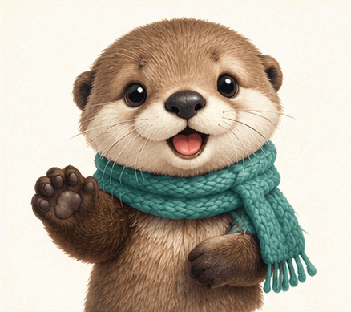

<sub>9 帧 · 438×389 · 1.6s · gpt-image-2.6 · 生成于 2026-11-07</sub>

**提示词**

```text
A small brown sea otter with a cream muzzle and a teal knitted scarf turning toward the viewer, waving one paw twice and blinking. Soft sticker style on a plain cream background.
```

`sticker` `otter` `hello`

### 30. 打工人：收到


<sub>9 帧 · 436×392 · 1.4s · gpt-image-2.6 · 生成于 2026-11-07</sub>

**提示词**

```text
A chibi office worker with a tidy bob and a lanyard snapping to attention and giving a firm thumbs-up with a determined nod. Flat sticker style on a plain light blue background.
```

`sticker` `office` `reply`

### 31. 骑扫把飞行的猫

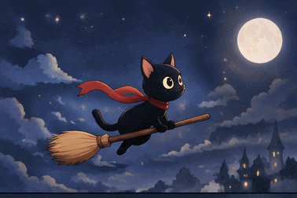

<sub>16 帧 · 378×252 · 2.2s · gpt-image-2.6 · 生成于 2026-11-07</sub>

**提示词**

```text
A black cat with a tiny red scarf riding a wooden broomstick across a night sky, bobbing up and down, the scarf fluttering behind it. Cute storybook sticker style.
```

`sticker` `cat` `magic`

### 32. 小机器人挥手蹦跳


<sub>9 帧 · 440×388 · 1.4s · gpt-image-2.6 · 生成于 2026-11-07</sub>

**提示词**

```text
A tiny round white baby robot with a glowing blue face screen and stubby legs waving one hand and doing a small happy hop, its antenna wobbling. Clean 3D toy style on a plain pastel background.
```

`sticker` `robot` `hello`

### 33. 仓鼠塞满腮帮子

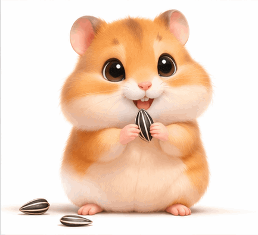

<sub>9 帧 · 433×395 · 1.6s · gpt-image-2.6 · 生成于 2026-11-07</sub>

**提示词**

```text
A golden hamster sitting up and stuffing sunflower seeds into its cheeks until they balloon comically, then blinking proudly. Cute cartoon style on a plain white background.
```

`sticker` `hamster` `food`

### 34. 撑伞小黄鸭

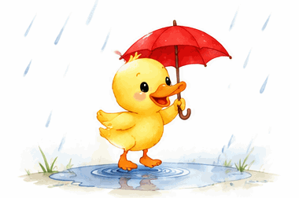

<sub>16 帧 · 380×252 · 2.2s · gpt-image-2.6 · 生成于 2026-11-07</sub>

**提示词**

```text
A yellow duckling holding a tiny red umbrella hopping in a small puddle, splashes rising with each hop while rain falls. Soft watercolor sticker style.
```

`sticker` `duck` `rain`

### 35. 健身熊推胸


<sub>9 帧 · 433×395 · 1.4s · gpt-image-2.6 · 生成于 2026-11-07</sub>

**提示词**

```text
A muscular cartoon brown bear in a red tank top lying on a bench and pressing a barbell up and down, cheeks puffing with each rep. Bold cartoon sticker style on a plain grey background.
```

`sticker` `fitness` `bear`

### 36. 戴 VR 眼镜打瞌睡的猫

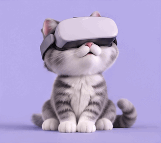

<sub>16 帧 · 328×291 · 2.9s · gpt-image-2.6 · 生成于 2026-11-07</sub>

**提示词**

```text
A fluffy grey cat wearing a sleek white VR headset slowly nodding off, its head drooping and jerking back up, a small Zzz bubble floating up. Soft 3D render on a plain lavender background.
```

`sticker` `cat` `tech`

### 37. 感激涕零的小虾

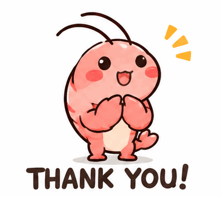

<sub>9 帧 · 439×389 · 1.6s · gpt-image-2.6 · 生成于 2026-11-07</sub>

**提示词**

```text
A small pink cartoon shrimp pressing its claws together, raising them high over its head and then bowing dramatically low, with the caption "THANK YOU!" fixed at the bottom. Flat sticker style on a white background.
```

`sticker` `caption` `thanks`

### 38. 螳螂虾戳布丁

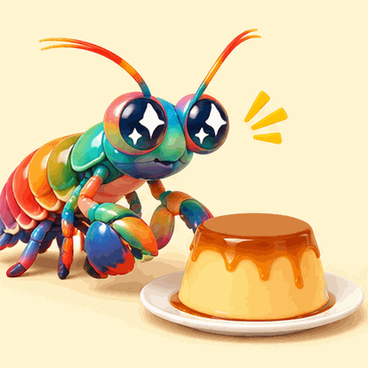

<sub>9 帧 · 414×414 · 1.6s · gpt-image-2.6 · 生成于 2026-11-08</sub>

**提示词**

```text
A rainbow-colored cartoon mantis shrimp poking a caramel flan on a plate with both front claws, the flan wobbling wildly while the shrimp's eyes sparkle with delight. Glossy clay-toy style on a pale yellow background.
```

`sticker` `food` `funny`

### 39. 领结大猩猩摇摆舞

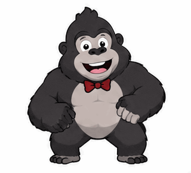

<sub>16 帧 · 320×289 · 1.9s · gpt-image-2.6 · 生成于 2026-11-08</sub>

**提示词**

```text
A chunky cartoon gorilla wearing a tiny red bow tie doing a side-to-side shuffle dance, swinging its long arms and bobbing its head to the beat. Flat vector sticker on a white background.
```

`sticker` `dance` `animal`

### 40. 西瓜头小狗刷手机


<sub>9 帧 · 435×391 · 1.6s · gpt-image-2.6 · 生成于 2026-11-08</sub>

**提示词**

```text
A small dog with a perfectly round bowl-cut hairstyle lying on its belly, scrolling a smartphone with one paw and snorting with laughter at the screen. Cute cartoon style on a white background.
```

`sticker` `phone` `dog`

### 41. 小海豹：震惊

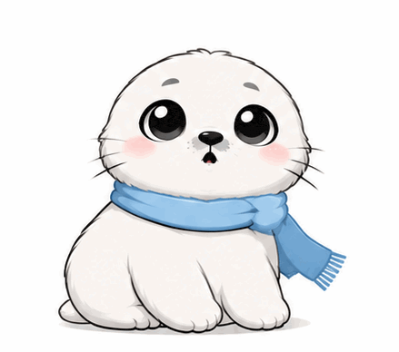

<sub>9 帧 · 439×388 · 1.4s · gpt-image-2.6 · 生成于 2026-11-08</sub>

**提示词**

```text
a chubby white baby harp seal with big glossy black eyes, pink cheeks and a tiny blue scarf jolting backward in shock, eyes popping wide and whiskers standing straight out, with a small burst of exclamation lines. Flat chat-sticker style on a white background.
```

> 💡 **技巧：** 做成套表情时，每条都复用完全相同的角色描述。

`sticker` `seal` `shock`

### 42. 小海豹：偷笑


<sub>8 帧 · 439×390 · 1.2s · gpt-image-2.6 · 生成于 2026-11-08</sub>

**提示词**

```text
a chubby white baby harp seal with big glossy black eyes, pink cheeks and a tiny blue scarf covering its mouth with one flipper and giggling, shoulders shaking and eyes curved into happy arcs. Flat chat-sticker style on a white background.
```

> 💡 **技巧：** 做成套表情时，每条都复用完全相同的角色描述。

`sticker` `seal` `laugh`

### 43. 小海豹：摆烂


<sub>16 帧 · 376×259 · 2.9s · gpt-image-2.6 · 生成于 2026-11-08</sub>

**提示词**

```text
a chubby white baby harp seal with big glossy black eyes, pink cheeks and a tiny blue scarf lying flat on its belly and slowly melting into a puddle-like blob, then sighing a tiny cloud. Flat chat-sticker style on a white background.
```

> 💡 **技巧：** 做成套表情时，每条都复用完全相同的角色描述。

`sticker` `seal` `lazy`

### 44. 小海豹：大哭


<sub>9 帧 · 431×393 · 1.4s · gpt-image-2.6 · 生成于 2026-11-08</sub>

**提示词**

```text
a chubby white baby harp seal with big glossy black eyes, pink cheeks and a tiny blue scarf bawling with its mouth wide open, two streams of tears spraying out sideways, flippers flapping. Flat chat-sticker style on a white background.
```

> 💡 **技巧：** 做成套表情时，每条都复用完全相同的角色描述。

`sticker` `seal` `cry`

### 45. 小海豹：比心


<sub>9 帧 · 435×388 · 1.6s · gpt-image-2.6 · 生成于 2026-11-08</sub>

**提示词**

```text
a chubby white baby harp seal with big glossy black eyes, pink cheeks and a tiny blue scarf lifting both flippers together over its head to form a clear heart shape, then small pink hearts float up. Flat chat-sticker style on a white background.
```

> 💡 **技巧：** 双手比心经常合不拢，要写明两只鳍在头顶碰在一起。

`sticker` `seal` `love`

### 46. 柴犬：在改了在改了


<sub>9 帧 · 436×388 · 1.3s · gpt-image-2.6 · 生成于 2026-11-08</sub>

**提示词**

```text
A cream shiba inu at a desk typing furiously on a keyboard with both paws, sweat drops flying off its head, with the handwritten caption "在改了在改了" fixed at the top. Flat sticker style on a white background.
```

`sticker` `caption` `work`

### 47. 柴犬被雪球砸脸


<sub>9 帧 · 439×381 · 1.4s · gpt-image-2.6 · 生成于 2026-11-08</sub>

**提示词**

```text
A shiba inu in a red knitted winter hat standing in the snow gets hit in the face by a snowball, snow bursting everywhere, then blinks and shakes its head. Cartoon sticker style on a pale blue background.
```

`sticker` `winter` `funny`

### 48. 奶牛猫扑逗猫棒

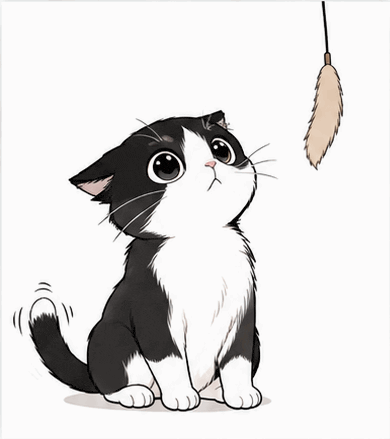

<sub>9 帧 · 390×439 · 1.3s · gpt-image-2.6 · 生成于 2026-11-08</sub>

**提示词**

```text
A simple black-and-white anime-style tuxedo cat sitting up and swatting at a foxtail grass toy dangling from above, ears flattened, tail twitching. Clean line art on a white background.
```

`sticker` `cat` `monochrome`

### 49. 仓鼠快递员

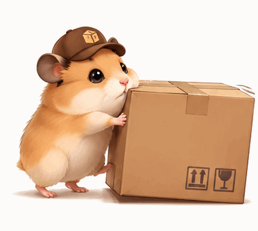

<sub>9 帧 · 433×388 · 1.4s · gpt-image-2.6 · 生成于 2026-11-08</sub>

**提示词**

```text
A small golden hamster in a tiny brown courier cap pushing a cardboard parcel twice its size across the floor, cheeks puffed with effort and feet scrabbling. Cozy cartoon sticker on a white background.
```

`sticker` `work` `hamster`

### 50. 戴礼帽的奶奶


<sub>9 帧 · 437×390 · 1.6s · gpt-image-2.6 · 生成于 2026-11-08</sub>

**提示词**

```text
A cheerful cartoon grandma in a big floral Sunday hat and a pearl necklace clapping and swaying side to side to music, eyes closed in joy. Warm flat illustration on a soft pink background.
```

`sticker` `joy` `character`

### 51. 纸箱机器人霹雳舞

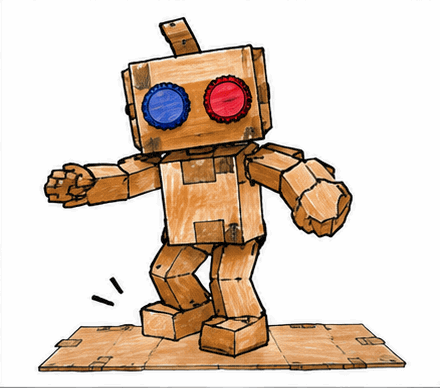

<sub>9 帧 · 440×388 · 1.6s · gpt-image-2.6 · 生成于 2026-11-08</sub>

**提示词**

```text
A robot made from cardboard boxes with bottle-cap eyes doing a breakdance toprock step, then dropping into a one-hand freeze on a flattened cardboard mat. Hand-drawn marker style on white paper.
```

`sticker` `dance` `robot`

### 52. 柯基讨零食

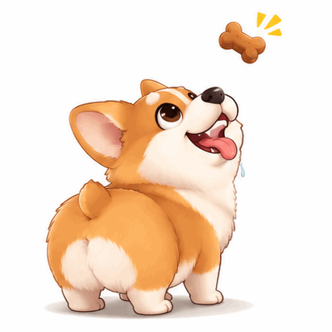

<sub>9 帧 · 412×412 · 1.4s · gpt-image-2.6 · 生成于 2026-11-08</sub>

**提示词**

```text
A fluffy corgi mascot staring up at a treat just above its head, drooling, wiggling its round butt and doing a little hop. Cute vector sticker on a white background.
```

`sticker` `dog` `food`

### 53. 戏精贵宾犬晕倒

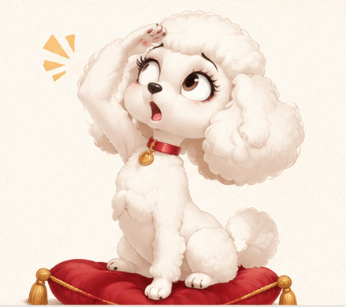

<sub>9 帧 · 439×390 · 1.4s · gpt-image-2.6 · 生成于 2026-11-08</sub>

**提示词**

```text
A white poodle mascot striking a dramatic pose, pressing a paw to its forehead and swooning backward onto a red velvet cushion. Exaggerated theatrical cartoon on a cream background.
```

`sticker` `drama` `dog`

### 54. 白猫滚毛线球

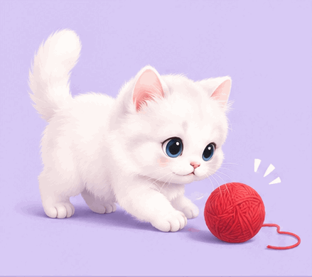

<sub>9 帧 · 439×390 · 1.4s · gpt-image-2.6 · 生成于 2026-11-08</sub>

**提示词**

```text
A fluffy white kitten batting a red yarn ball, rolling onto its back with the ball in its paws, then popping back upright. Soft pastel cartoon on a pale lavender background.
```

`sticker` `cat` `play`

### 55. 戴花环的猫跳舞

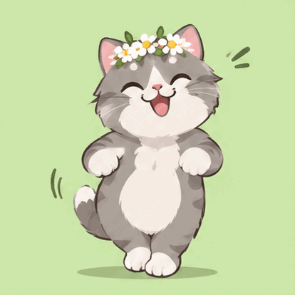

<sub>9 帧 · 414×414 · 1.3s · gpt-image-2.6 · 生成于 2026-11-08</sub>

**提示词**

```text
A grey cat wearing a crown of small daisies doing a happy side-step dance on its hind legs, front paws swinging. Flat cute illustration on a light green background.
```

`sticker` `cat` `dance`

### 56. 雨衣小孩起跳落地

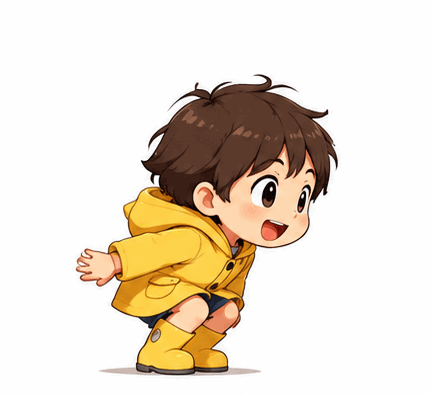

<sub>9 帧 · 431×394 · 1.4s · gpt-image-2.6 · 生成于 2026-11-08</sub>

**提示词**

```text
A chibi kid in a yellow raincoat crouching down, springing into a high jump with arms up, then landing with a little puff of dust. Side view, flat animation style on a white background.
```

`sticker` `jump` `character`

### 57. 麻薯团子说 OK


<sub>9 帧 · 414×414 · 1.6s · gpt-image-2.6 · 生成于 2026-11-08</sub>

**提示词**

```text
A round white mochi character with tiny arms bowing politely and then popping up holding an "OK!" sign, cheeks blushing. LINE-sticker style with thick outlines on a white background.
```

`sticker` `caption` `ok`

### 58. 蜗牛送信

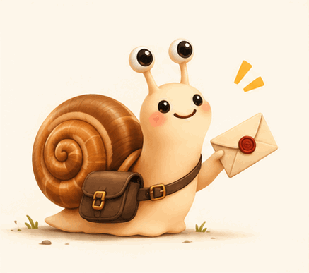

<sub>9 帧 · 437×387 · 1.6s · gpt-image-2.6 · 生成于 2026-11-08</sub>

**提示词**

```text
A small snail with a tiny leather postbag slowly sliding forward and holding out an envelope with its antennae, smiling proudly. Soft storybook illustration on a cream background.
```

`sticker` `mail` `slow`

### 59. 吐司弹出吓一跳


<sub>9 帧 · 438×390 · 1.4s · gpt-image-2.6 · 生成于 2026-11-08</sub>

**提示词**

```text
Two slices of toast with cartoon faces popping out of a chrome toaster, flipping in the air with surprised expressions, then dropping back in. Glossy 3D cartoon on a pale orange background.
```

`sticker` `food` `surprise`

### 60. 想要抱抱的仙人掌

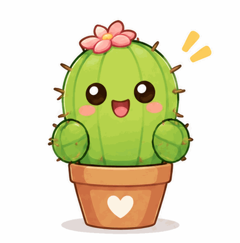

<sub>9 帧 · 409×414 · 1.6s · gpt-image-2.6 · 生成于 2026-11-08</sub>

**提示词**

```text
A small potted cactus character opening its spiky arms wide for a hug, then looking down at its spines and drooping sadly. Flat cute illustration on a white background.
```

`sticker` `hug` `sad`

### 61. 六角恐龙吹泡泡

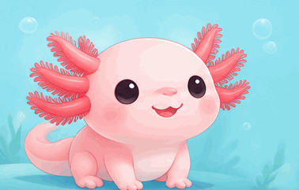

<sub>16 帧 · 378×241 · 2.2s · gpt-image-2.6 · 生成于 2026-11-08</sub>

**提示词**

```text
A pink axolotl with frilly gills puffing its cheeks to blow a round bubble that grows, pops, and leaves it blinking in surprise. Soft cartoon style, light aqua background.
```

`sticker` `water` `cute`

### 62. 树懒喝咖啡醒了

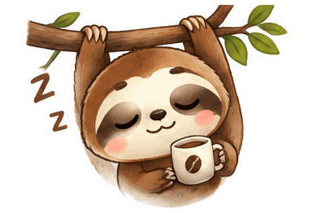

<sub>16 帧 · 384×262 · 2.9s · gpt-image-2.6 · 生成于 2026-11-08</sub>

**提示词**

```text
A sleepy sloth hanging from a branch slowly sipping coffee from a tiny cup, then its eyes pop wide open with sparkles. Soft cartoon sticker on a white background.
```

`sticker` `coffee` `morning`

### 63. 青蛙跳水坑

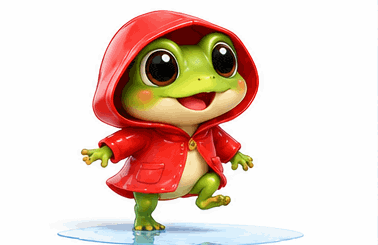

<sub>16 帧 · 378×245 · 2.2s · gpt-image-2.6 · 生成于 2026-11-08</sub>

**提示词**

```text
A small green frog in a red raincoat leaping into a puddle, water splashing up in a crown, then giving a happy little wave. Bright cartoon style on a white background.
```

`sticker` `rain` `frog`

### 64. 在地上打滚大哭的兔子


<sub>9 帧 · 439×390 · 1.3s · gpt-image-2.6 · 生成于 2026-11-09</sub>

**提示词**

```text
A chubby cream-colored cartoon bunny lying on its back on the floor, kicking its little legs and rolling side to side while sobbing, big cartoon tears flying off both sides. Thick outlines, flat colors, plain pale pink background.
```

`sticker` `crying` `bunny`

### 65. 90 年代动画风倒吸一口气

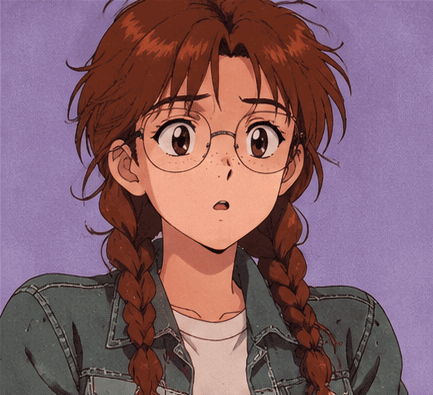

<sub>9 帧 · 433×395 · 1.6s · gpt-image-2.6 · 生成于 2026-11-09</sub>

**提示词**

```text
A 1990s cel-animation style girl with two long auburn braids, a band of freckles across her nose, round glasses and a green denim jacket gasping in shock: her eyes go wide behind the glasses, a big sweat drop appears beside her head, then her shoulders drop. Soft film grain, VHS-era color palette, plain lavender background.
```

> 💡 **技巧：** 写明年代和画法（赛璐珞、胶片颗粒、VHS 色调），角色外观保持通用，避免被画成某部现成动画的角色。

`anime` `retro` `reaction`

### 66. 90 年代动画风害羞脸红

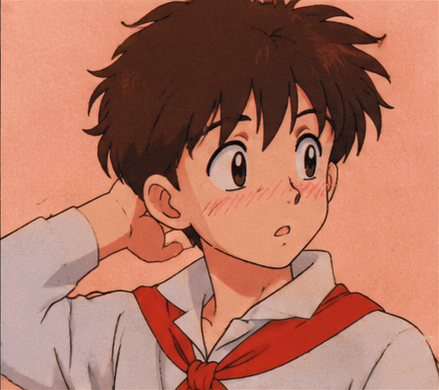

<sub>9 帧 · 439×390 · 1.4s · gpt-image-2.6 · 生成于 2026-11-09</sub>

**提示词**

```text
A 1990s cel-animation style boy with messy brown hair and a red scarf blushing: pink hatched lines spread across his cheeks, he looks away and scratches the back of his head. Soft film grain, VHS-era color palette, plain peach background.
```

`anime` `retro` `reaction`

### 67. 举牌道谢的水獭


<sub>9 帧 · 438×389 · 1.6s · gpt-image-2.6 · 生成于 2026-11-09</sub>

**提示词**

```text
A small brown cartoon otter holding up a little wooden sign that reads "THANK YOU", bowing forward and popping back up with a happy squint, tiny hearts floating above. Thick outlines, flat colors, plain mint background.
```

> 💡 **技巧：** 引号里的短词一般能保持清晰，仍要逐帧检查有没有字母走样。

`sticker` `thanks` `text`

### 68. 文件找回后喜极而泣的小虾


<sub>9 帧 · 432×394 · 1.6s · gpt-image-2.6 · 生成于 2026-11-09</sub>

**提示词**

```text
A small pink cartoon shrimp in a tiny office lanyard hugging a glowing blue folder icon to its chest, crying tears of relief and bouncing up and down with joy. Thick outlines, flat colors, plain white background.
```

`sticker` `office` `relief`

### 69. 靠着靠垫休息的熊猫


<sub>9 帧 · 438×390 · 2.7s · gpt-image-2.6 · 生成于 2026-11-09</sub>

**提示词**

```text
A chubby cartoon panda leaning back on a big round yellow cushion, slowly closing its eyes and letting out a long relaxed sigh, a small "zzz" drifting up. Soft watercolor texture, gentle outlines, plain cream background.
```

`sticker` `rest` `panda`

### 70. 抱着烤红薯的小刺猬

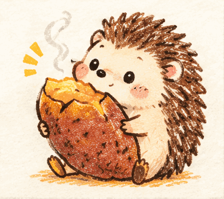

<sub>9 帧 · 439×390 · 1.4s · gpt-image-2.6 · 生成于 2026-11-09</sub>

**提示词**

```text
A tiny cartoon hedgehog hugging a roasted sweet potato almost as big as itself, steam rising from the cracked skin, the hedgehog taking a happy nibble and wiggling. Crayon doodle style on plain off-white paper.
```

`sticker` `food` `doodle`

### 71. 耸肩的原始人

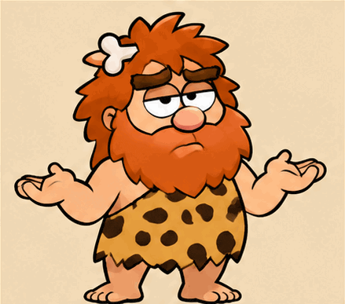

<sub>9 帧 · 439×387 · 1.6s · gpt-image-2.6 · 生成于 2026-11-09</sub>

**提示词**

```text
A stocky cartoon caveman with a wild orange beard, a bone hair clip and a spotted fur tunic shrugging with both palms up and an unimpressed face, eyebrows bouncing once. Thick outlines, flat colors, plain sand-colored background.
```

`sticker` `shrug` `reaction`

### 72. 邮件太多，默默合上电脑

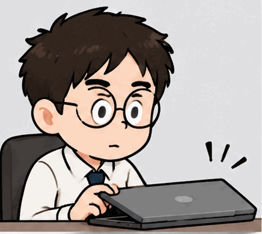

<sub>9 帧 · 436×390 · 1.6s · gpt-image-2.6 · 生成于 2026-11-09</sub>

**提示词**

```text
A cartoon office worker with round glasses opening a laptop, the screen showing a red badge with a huge unread count, their face going pale, then slowly closing the laptop again. Exaggerated expressions, thick outlines, flat colors, plain light grey background.
```

`sticker` `office` `email`

### 73. 得意地摆手说不用了的浣熊


<sub>9 帧 · 437×386 · 1.4s · gpt-image-2.6 · 生成于 2026-11-09</sub>

**提示词**

```text
A smug cartoon raccoon in pink heart-shaped sunglasses lounging in a beach chair, sipping a juice box and lazily waving one paw in a "no thanks" gesture, eyebrows raised. Thick outlines, flat colors, plain sky-blue background.
```

`sticker` `smug` `reaction`

### 74. 周一瘫在桌前的胖橘猫

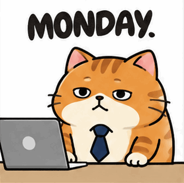

<sub>16 帧 · 309×306 · 2.9s · gpt-image-2.6 · 生成于 2026-11-09</sub>

**提示词**

```text
A chubby orange cat wearing a navy necktie slumping over a laptop, sinking lower and lower until it disappears behind the desk, then popping back up with a tired face. The word "MONDAY." printed above in bold letters. Thick outlines, flat colors, plain white background.
```

`sticker` `office` `monday` `text`

### 75. 舒芙蕾塌了哭着吃掉


<sub>9 帧 · 439×390 · 2.0s · gpt-image-2.6 · 生成于 2026-11-09</sub>

**提示词**

```text
A chibi baker girl in a white apron pulling a tall souffle out of the oven, the souffle sinking flat, her eyes filling with tears, then she shrugs and takes a spoonful. Soft pastel cartoon, plain warm beige background.
```

> 💡 **技巧：** 四个节拍（拿出、塌掉、哭、吃）正好放进 6 帧；节拍再多，每一步都会变得模糊。

`sticker` `baking` `chibi`

### 76. 虎斑猫猛地回头

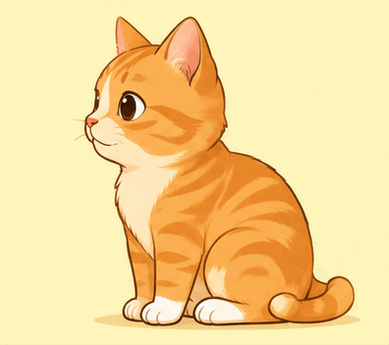

<sub>9 帧 · 439×390 · 1.6s · gpt-image-2.6 · 生成于 2026-11-09</sub>

**提示词**

```text
A calm orange tabby cat sitting sideways, then suddenly turning toward the viewer: its eyes go huge, ears shoot up, mouth drops open, then it settles back to calm. Clean cartoon style, plain pale yellow background.
```

`sticker` `cat` `shocked`

### 77. 水豚：好的

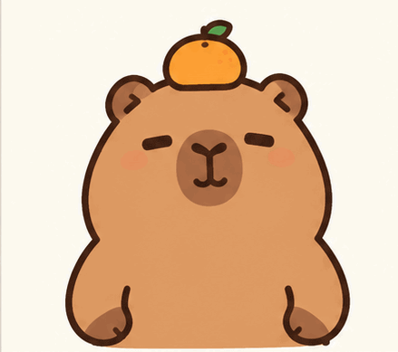

<sub>8 帧 · 439×389 · 1.4s · gpt-image-2.6 · 生成于 2026-11-09</sub>

**提示词**

```text
a round brown cartoon capybara with a small orange yuzu balanced on its head, sleepy half-closed eyes and a calm smile, thick clean outlines, flat pastel colors, plain cream background. The capybara slowly raises one stubby paw into an OK sign and nods once, the yuzu wobbling on its head.
```

> 💡 **技巧：** 四条水豚共用一模一样的角色描述，整套才能保持一致。

`sticker` `capybara` `series`

### 78. 水豚：困到点头

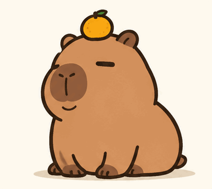

<sub>9 帧 · 435×387 · 1.6s · gpt-image-2.6 · 生成于 2026-11-09</sub>

**提示词**

```text
a round brown cartoon capybara with a small orange yuzu balanced on its head, sleepy half-closed eyes and a calm smile, thick clean outlines, flat pastel colors, plain cream background. The capybara's head slowly droops forward as it dozes off, then jerks back up, the yuzu nearly falling off.
```

`sticker` `capybara` `series`

### 79. 水豚：加油

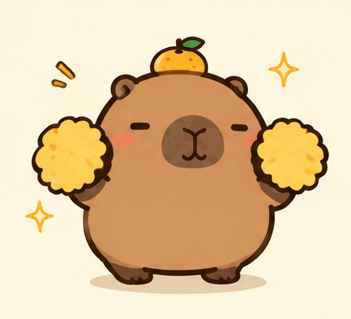

<sub>9 帧 · 433×393 · 1.4s · gpt-image-2.6 · 生成于 2026-11-09</sub>

**提示词**

```text
a round brown cartoon capybara with a small orange yuzu balanced on its head, sleepy half-closed eyes and a calm smile, thick clean outlines, flat pastel colors, plain cream background. The capybara waves two tiny pom-poms above its head and bounces, small sparkles popping around it.
```

`sticker` `capybara` `series`

### 80. 水豚：泡温泉

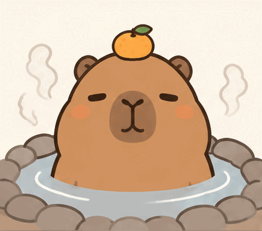

<sub>9 帧 · 439×387 · 2.0s · gpt-image-2.6 · 生成于 2026-11-09</sub>

**提示词**

```text
a round brown cartoon capybara with a small orange yuzu balanced on its head, sleepy half-closed eyes and a calm smile, thick clean outlines, flat pastel colors, plain cream background. The capybara sits up to its chin in a small round hot spring, steam curling up, eyes closing in bliss as it sinks slightly lower.
```

`sticker` `capybara` `series`

### 81. 被咖啡惊醒的考拉

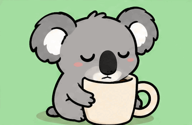

<sub>16 帧 · 378×246 · 2.9s · gpt-image-2.6 · 生成于 2026-11-09</sub>

**提示词**

```text
A sleepy grey cartoon koala hugging a giant mug, nodding off until its nose dips into the coffee, then jolting wide awake with spiky fur. Thick outlines, flat colors, plain soft green background.
```

`sticker` `coffee` `sleepy`

### 82. 戴大耳机摇头晃脑的小鸭


<sub>16 帧 · 308×309 · 1.9s · gpt-image-2.6 · 生成于 2026-11-09</sub>

**提示词**

```text
A fluffy yellow duckling wearing oversized purple headphones, eyes closed, bobbing its head and tapping one foot to the beat, small music notes floating around. Thick outlines, flat colors, plain lilac background.
```

`sticker` `music` `duck`

### 83. 乌龟：在路上了

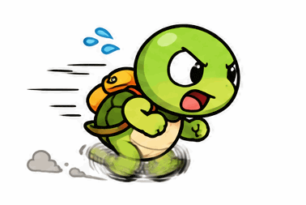

<sub>16 帧 · 378×253 · 1.8s · gpt-image-2.6 · 生成于 2026-11-09</sub>

**提示词**

```text
A green cartoon tortoise with a tiny backpack running as fast as it can, legs spinning in a blur with speed lines and sweat drops, but barely moving forward. Thick outlines, flat colors, plain white background.
```

`sticker` `late` `funny`

### 84. 从纸箱里探出头炫宝的浣熊

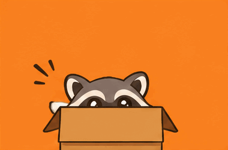

<sub>16 帧 · 380×251 · 2.2s · gpt-image-2.6 · 生成于 2026-11-09</sub>

**提示词**

```text
A grey cartoon raccoon popping up out of a cardboard box holding a shiny silver spoon high above its head, eyes sparkling proudly, a little gleam flashing on the spoon. Thick outlines, flat colors, plain orange background.
```

`sticker` `proud` `raccoon`

### 85. 小短手鼓掌的恐龙

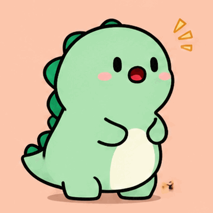

<sub>12 帧 · 358×358 · 1.7s · gpt-image-2.6 · 生成于 2026-11-09</sub>

**提示词**

```text
A chubby mint-green cartoon dinosaur trying hard to clap with its very short arms, the paws barely reaching, its face scrunched in effort, then a proud grin. Thick outlines, flat colors, plain peach background.
```

`sticker` `clap` `dinosaur`

### 86. 斜眼看人的猫头鹰


<sub>9 帧 · 439×389 · 2.0s · gpt-image-2.6 · 生成于 2026-11-09</sub>

**提示词**

```text
A round brown cartoon owl perched on a branch, slowly turning its eyes sideways toward the viewer and raising one feathery eyebrow in suspicion, then blinking once. Thick outlines, flat colors, plain teal background.
```

`sticker` `side-eye` `reaction`

### 87. 打喷嚏下雨的小云朵


<sub>9 帧 · 414×414 · 1.6s · gpt-image-2.6 · 生成于 2026-11-09</sub>

**提示词**

```text
A small fluffy white cloud character with rosy cheeks scrunching up its face and sneezing, a burst of raindrops and a tiny rainbow shooting out, then sniffling. Thick outlines, flat colors, plain sky-blue background.
```

`sticker` `weather` `cute`

### 88. 吹蜡烛的巴哥犬


<sub>9 帧 · 439×390 · 1.6s · gpt-image-2.6 · 生成于 2026-11-09</sub>

**提示词**

```text
A pug in a striped party hat puffing its cheeks and blowing out a single candle on a pink cupcake, the flame going out and colorful confetti popping up. Thick outlines, flat colors, plain yellow background.
```

`sticker` `birthday` `dog`

### 89. 甩刘海的羊驼


<sub>9 帧 · 436×390 · 1.3s · gpt-image-2.6 · 生成于 2026-11-09</sub>

**提示词**

```text
A fluffy white cartoon alpaca with a huge curly fringe tossing its head to flip the fringe out of its eyes, then posing with a confident wink. Thick outlines, flat colors, plain pink background.
```

`sticker` `sassy` `alpaca`

### 90. 樱桃蛋糕帽小家伙挥手


<sub>9 帧 · 438×386 · 1.3s · gpt-image-2.6 · 生成于 2026-11-10</sub>

**提示词**

```text
A tiny round cream-colored creature wearing a little strawberry shortcake with a cherry on top as a hat. It waves one stubby arm and does a small happy bounce, the cherry wobbling. Soft pastel sticker style, thick outline, plain white background.
```

`sticker` `cute` `original-character`

### 91. 奶油泡芙伸懒腰打哈欠


<sub>9 帧 · 412×412 · 1.6s · gpt-image-2.6 · 生成于 2026-11-10</sub>

**提示词**

```text
A chubby cream puff character with tiny arms stretches upward and lets out a big yawn, a little cream squishing out of its top, then settles back down sleepily. Kawaii sticker style, bold outline, plain pale yellow background.
```

`sticker` `sleepy` `food`

### 92. 猫耳卫衣女孩点头


<sub>9 帧 · 444×394 · 1.4s · gpt-image-2.6 · 生成于 2026-11-10</sub>

**提示词**

```text
A chibi girl in an oversized mint hoodie with cat ears on the hood nods eagerly twice, the ears flopping, eyes closed in a happy smile. Clean anime-inspired chibi sticker style, plain white background.
```

`sticker` `yes` `chibi`

### 93. 小熊踩香蕉皮滑倒


<sub>12 帧 · 356×358 · 1.9s · gpt-image-2.6 · 生成于 2026-11-10</sub>

**提示词**

```text
A round brown cartoon bear walks forward, steps on a banana peel, and flips onto its back with legs in the air and stars circling its head. Slapstick sticker style, thick outline, plain white background.
```

`sticker` `slapstick` `fail`

### 94. 兔子拿纸扇吐槽


<sub>9 帧 · 432×395 · 1.1s · gpt-image-2.6 · 生成于 2026-11-10</sub>

**提示词**

```text
A white rabbit in a tiny bow tie swings a folded paper fan sideways in a classic comedy retort gesture, mouth open mid-shout, with speed lines. Bold manga-comedy sticker style, plain white background.
```

`sticker` `reaction` `comedy`

### 95. 鸽子喷茶


<sub>8 帧 · 437×383 · 1.1s · gpt-image-2.6 · 生成于 2026-11-10</sub>

**提示词**

```text
A gray city pigeon holding a tiny teacup takes a sip and sprays the tea out in a dramatic spit-take, eyes bulging. Cartoon sticker style, thick outline, plain light blue background.
```

`sticker` `reaction` `shock`

### 96. 圆滚滚机器人听到好消息


<sub>16 帧 · 380×252 · 2.2s · gpt-image-2.6 · 生成于 2026-11-10</sub>

**提示词**

```text
A small round white robot with a screen face: its pixel eyes grow wide and sparkly, both little arms shoot up in celebration, then it returns to a neutral pose. High-contrast flat shapes, pale blue background.
```

`sticker` `celebrate` `robot`

### 97. 穿轮滑鞋的小猴子


<sub>9 帧 · 439×390 · 1.4s · gpt-image-2.6 · 生成于 2026-11-10</sub>

**提示词**

```text
A cheerful cartoon monkey in red roller skates glides along a sidewalk, arms out for balance, its tail swaying behind. Bright flat illustration, simple sidewalk and plain sky background, side view.
```

`character` `skate` `animal`

### 98. 霓虹餐厅里吹爆泡泡糖


<sub>9 帧 · 435×386 · 2.0s · gpt-image-2.6 · 生成于 2026-11-10</sub>

**提示词**

```text
An illustrated girl in a retro neon diner booth at night slowly blows a big pink bubblegum bubble until it pops on her face. Pink and teal neon lighting, stylized illustration, fixed camera.
```

`reaction` `neon` `retro`

### 99. 小角萌娃转圈跳舞


<sub>12 帧 · 358×358 · 1.9s · gpt-image-2.6 · 生成于 2026-11-10</sub>

**提示词**

```text
A chibi girl with small curled ivory horns, wearing a ruffled lavender gown, does a little twirl so the skirt flares out, then curtsies. Soft cel-shaded chibi style, plain cream background.
```

`dance` `chibi` `original-character`

### 100. 仙人掌看报纸


<sub>9 帧 · 439×390 · 1.6s · gpt-image-2.6 · 生成于 2026-11-10</sub>

**提示词**

```text
A green cactus character wearing a wide straw hat sits on a stool reading a newspaper, peeks over the top with raised eyebrows, then flips the page. Flat cartoon style, plain sandy background.
```

`sticker` `reading` `plant`

### 101. 小法师操控悬浮光球


<sub>9 帧 · 433×387 · 1.4s · gpt-image-2.6 · 生成于 2026-11-10</sub>

**提示词**

```text
A young mage in a hooded blue cloak holds both palms apart while a glowing turquoise orb floats and slowly rotates between them, sparks circling. Anime-style illustration, dark gradient background.
```

`magic` `character` `glow`

### 102. 小鸡弹跳登场


<sub>9 帧 · 432×393 · 1.3s · gpt-image-2.6 · 生成于 2026-11-10</sub>

**提示词**

```text
A fluffy yellow chick drops in from above, squashes flat on landing, springs back up, and strikes a proud pose with one wing raised. Squash-and-stretch cartoon style, plain white background.
```

`entrance` `sticker` `bounce`

### 103. 小羊蓬起来打瞌睡


<sub>9 帧 · 414×413 · 1.6s · gpt-image-2.6 · 生成于 2026-11-10</sub>

**提示词**

```text
A round fluffy sheep slowly puffs up its wool like a cloud, its eyes droop closed, and small Z letters float up. Soft pastel sticker style, plain lilac background.
```

`sticker` `sleepy` `animal`

### 104. 章鱼同时敲四个键盘


<sub>9 帧 · 438×387 · 1.3s · gpt-image-2.6 · 生成于 2026-11-10</sub>

**提示词**

```text
A purple cartoon octopus wearing glasses types furiously on four keyboards at once, tentacles moving in turn, a tiny sweat drop flying off. Flat office-humor sticker style, plain white background.
```

`sticker` `work` `busy`

### 105. 鸭子丢麦克风


<sub>12 帧 · 356×356 · 1.9s · gpt-image-2.6 · 生成于 2026-11-10</sub>

**提示词**

```text
A white duck in sunglasses holds a tiny microphone out at wing's length, drops it, and turns away with a smug look. Cartoon sticker style, thick outline, plain yellow background.
```

`sticker` `smug` `reaction`

### 106. 蘑菇猛点头


<sub>9 帧 · 412×413 · 1.4s · gpt-image-2.6 · 生成于 2026-11-10</sub>

**提示词**

```text
A small red-capped mushroom character with white spots nods enthusiastically, its cap bouncing up and down, cheeks blushing. Cute sticker style, plain mint background.
```

`sticker` `yes` `cute`

### 107. 豆腐冻得发抖


<sub>16 帧 · 324×295 · 1.9s · gpt-image-2.6 · 生成于 2026-11-10</sub>

**提示词**

```text
A soft white tofu block character wrapped in a tiny scarf shivers hard, teeth chattering, with a little icicle hanging from its edge and snowflakes drifting. Kawaii sticker style, plain icy blue background.
```

`sticker` `cold` `food`

### 108. 饺子害羞捂脸


<sub>9 帧 · 437×388 · 1.6s · gpt-image-2.6 · 生成于 2026-11-10</sub>

**提示词**

```text
A plump steamed dumpling character covers its face with tiny hands, peeks out between them, and blushes bright pink. Kawaii sticker style, bold outline, plain white background.
```

`sticker` `shy` `food`

### 109. 大鹅生气嘎嘎叫


<sub>16 帧 · 380×250 · 1.9s · gpt-image-2.6 · 生成于 2026-11-10</sub>

**提示词**

```text
A white goose stretches its neck forward, flaps its wings wide, and honks angrily with its beak open, a little cartoon anger mark above its head. Cartoon sticker style, plain light green background.
```

`sticker` `angry` `animal`

### 110. 打工熊：周一叹气


<sub>9 帧 · 436×386 · 1.6s · gpt-image-2.6 · 生成于 2026-11-11</sub>

**提示词**

```text
a chubby cartoon brown bear office worker in a loose blue tie and a lanyard badge, round ears, small dot eyes, thick clean outlines, flat pastel colors, plain cream background. The bear slumps forward over a coffee mug, shoulders rising and falling with a long sigh, a small gray puff of breath drifting out.
```

`sticker` `bear` `series` `office`

### 111. 打工熊：已读翻白眼


<sub>12 帧 · 356×357 · 1.9s · gpt-image-2.6 · 生成于 2026-11-11</sub>

**提示词**

```text
a chubby cartoon brown bear office worker in a loose blue tie and a lanyard badge, round ears, small dot eyes, thick clean outlines, flat pastel colors, plain cream background. The bear holds a phone, glances at it, then rolls its eyes up dramatically and lets the phone drop to its side.
```

`sticker` `bear` `series` `reaction`

### 112. 打工熊：摸鱼偷吃


<sub>12 帧 · 356×355 · 2.2s · gpt-image-2.6 · 生成于 2026-11-11</sub>

**提示词**

```text
a chubby cartoon brown bear office worker in a loose blue tie and a lanyard badge, round ears, small dot eyes, thick clean outlines, flat pastel colors, plain cream background. Hiding behind a laptop screen, the bear peeks left and right, then quickly pops a cookie into its mouth and chews with puffed cheeks.
```

`sticker` `bear` `series` `office`

### 113. 打工熊：又加班大哭


<sub>9 帧 · 414×412 · 1.6s · gpt-image-2.6 · 生成于 2026-11-11</sub>

**提示词**

```text
a chubby cartoon brown bear office worker in a loose blue tie and a lanyard badge, round ears, small dot eyes, thick clean outlines, flat pastel colors, plain cream background. At a desk piled with folders under a night-blue window, the bear opens its mouth wide and wails, two streams of tears spraying sideways.
```

`sticker` `bear` `series` `office`

### 114. 打工熊：发薪日大笑


<sub>16 帧 · 378×252 · 2.6s · gpt-image-2.6 · 生成于 2026-11-11</sub>

**提示词**

```text
a chubby cartoon brown bear office worker in a loose blue tie and a lanyard badge, round ears, small dot eyes, thick clean outlines, flat pastel colors, plain cream background. The bear throws its head back laughing while hugging a fat envelope, small coins bouncing up around it.
```

`sticker` `bear` `series` `money`

### 115. 打工熊：下班冲刺


<sub>9 帧 · 435×388 · 1.3s · gpt-image-2.6 · 生成于 2026-11-11</sub>

**提示词**

```text
a chubby cartoon brown bear office worker in a loose blue tie and a lanyard badge, round ears, small dot eyes, thick clean outlines, flat pastel colors, plain cream background. With a backpack on, the bear jogs in place with fast little legs, speed lines streaming behind and its tie flapping over its shoulder.
```

`sticker` `bear` `series` `office`

### 116. 平安果层层拆开


<sub>16 帧 · 378×242 · 2.9s · gpt-image-2.6 · 生成于 2026-11-11</sub>

**提示词**

```text
a cute cartoon red apple wrapped in a shiny gift wrapper with a green ribbon, on a plain mint background. Small hands pull off the wrapper, revealing another wrapper underneath, and the apple gives a puzzled blink. Flat sticker style, thick outlines.
```

`sticker` `christmas` `holiday`

### 117. 跨年倒数睡着了


<sub>9 帧 · 439×390 · 2.0s · gpt-image-2.6 · 生成于 2026-11-11</sub>

**提示词**

```text
a chibi kid in pajamas and a party hat sits on a sofa holding a tiny noisemaker; a wall clock shows one minute to midnight. The kid's head nods down slowly, jerks back up, then nods again with a floating Zzz. Cozy flat illustration, warm lamp light.
```

`sticker` `new-year` `holiday`

### 118. 嘴上不要手很诚实


<sub>9 帧 · 438×389 · 1.6s · gpt-image-2.6 · 生成于 2026-11-11</sub>

**提示词**

```text
a round cartoon panda in a red padded jacket shakes its head and waves one paw in polite refusal, while its other paw quietly slips a red envelope into its jacket pocket. Flat sticker style, plain cream background, thick outlines.
```

`sticker` `lunar-new-year` `holiday`

### 119. 片尾挥手


<sub>9 帧 · 500×332 · 1.4s · gpt-image-2.6 · 生成于 2026-11-11</sub>

**提示词**

```text
a friendly cartoon robot with a round screen face showing a smile stands on the right side of a plain coral background, waves one hand and points to a blank rounded rectangle on the left where a red bell icon gives a little shake. Flat vector style.
```

`creator` `video` `mascot`

### 120. 工位伸懒腰


<sub>16 帧 · 379×252 · 2.9s · gpt-image-2.6 · 生成于 2026-11-11</sub>

**提示词**

```text
a chibi office worker with messy hair types fast on a laptop, then leans back and stretches both arms high with a big yawn before returning to typing. Flat pastel illustration, plain light gray background.
```

`sticker` `office` `work`

### 121. 截止日火烧仓鼠


<sub>9 帧 · 433×395 · 1.4s · gpt-image-2.6 · 生成于 2026-11-11</sub>

**提示词**

```text
a tiny golden hamster in round glasses types furiously on a little keyboard while a cartoon flame burns on top of its head and sweat drops fly off. White sticker border, flat colors, plain pale yellow background.
```

`sticker` `deadline` `work`

### 122. 牛油果吓一跳


<sub>9 帧 · 436×390 · 1.4s · gpt-image-2.6 · 生成于 2026-11-11</sub>

**提示词**

```text
a cartoon avocado half with a big seed belly and tiny arms leaps up in surprise, eyes wide and mouth open, a speech bubble reading OMG! popping beside it. Bold outlines, flat colors, plain white background.
```

`sticker` `food` `text`

### 123. 毛绒熊喝可可


<sub>9 帧 · 439×390 · 1.6s · gpt-image-2.6 · 生成于 2026-11-11</sub>

**提示词**

```text
a soft plush teddy bear with visible fabric texture and stitched seams holds a big mug with both paws, takes a slow sip, and closes its eyes contentedly as steam curls up. Cozy warm lighting, plain oatmeal background.
```

`sticker` `plush` `cozy`

### 124. 心情切换小方块


<sub>12 帧 · 358×358 · 2.6s · gpt-image-2.6 · 生成于 2026-11-11</sub>

**提示词**

```text
a cute pastel yellow cube character with stubby legs stands still and switches expressions: a grumpy frown with a small storm cloud, then a big grin with sparkles. Kawaii flat style, plain light blue background.
```

`sticker` `emotion` `reaction`

### 125. 企鹅肚皮滑


<sub>12 帧 · 356×357 · 1.7s · gpt-image-2.6 · 生成于 2026-11-11</sub>

**提示词**

```text
a round cartoon penguin with a tiny red beanie slides on its belly across a patch of ice, flaps its flippers happily and gives a little wave. Flat colors, thick outlines, plain icy blue background.
```

`sticker` `penguin` `winter`

### 126. 狐狸打翻咖啡


<sub>9 帧 · 413×412 · 1.3s · gpt-image-2.6 · 生成于 2026-11-11</sub>

**提示词**

```text
a cartoon orange fox in a green hoodie bumps a coffee cup, the coffee splashes up, and the fox freezes with a wide-eyed oops face and paws on its cheeks. Flat sticker style, plain cream background.
```

`sticker` `fox` `oops`

### 127. 慢吞吞点赞


<sub>9 帧 · 437×386 · 2.7s · gpt-image-2.6 · 生成于 2026-11-11</sub>

**提示词**

```text
a sleepy green cartoon turtle in a tiny knit cap very slowly raises one flipper into a thumbs-up and gives a lazy smile. Flat pastel colors, thick outlines, plain light peach background.
```

`sticker` `turtle` `approval`

### 128. 倒挂蝙蝠晚安


<sub>9 帧 · 430×391 · 2.0s · gpt-image-2.6 · 生成于 2026-11-11</sub>

**提示词**

```text
a fluffy little purple bat hangs upside down from a branch, wraps its wings around itself and sways gently while a small crescent moon and Zzz float nearby. Kawaii flat style, plain midnight blue background.
```

`sticker` `goodnight` `bat`

### 129. 兔子啃胡萝卜


<sub>16 帧 · 379×247 · 1.6s · gpt-image-2.6 · 生成于 2026-11-11</sub>

**提示词**

```text
a white cartoon bunny with floppy ears holds a big carrot and munches quickly, cheeks bouncing, small orange crumbs flying off. Flat colors, plain pale green background.
```

`sticker` `bunny` `food`

### 130. 小羊鞠躬道歉


<sub>16 帧 · 322×293 · 2.2s · gpt-image-2.6 · 生成于 2026-11-11</sub>

**提示词**

```text
a fluffy cartoon lamb with a cloud-like wool coat presses its hooves together and bows deeply, a small sweat drop and a pink heart appearing above. Soft pastel flat style, plain lavender background.
```

`sticker` `apology` `lamb`

### 131. 松鼠抛橡果


<sub>16 帧 · 326×291 · 1.9s · gpt-image-2.6 · 生成于 2026-11-11</sub>

**提示词**

```text
a red cartoon squirrel with a huge fluffy tail juggles three acorns in an arc, tongue out in concentration. Flat colors, thick outlines, plain warm beige background.
```

`sticker` `squirrel` `fun`

### 132. 鲸鱼喷水打招呼


<sub>16 帧 · 380×252 · 2.9s · gpt-image-2.6 · 生成于 2026-11-11</sub>

**提示词**

```text
a chubby baby blue whale bobs on small waves and puffs a water spout shaped like a heart from its blowhole, then smiles. Flat pastel style, plain aqua background.
```

`sticker` `whale` `hello`

## 快闪与品牌动效

### 133. 花卉微距快闪


<sub>8 帧 · 380×508 · 3.6s · gpt-image-2.6 · 生成于 2026-11-06</sub>

**提示词**

```text
A fast flash-cut sequence of eight different flower photographs, one per frame, each filling the whole frame: a red poppy shot from above with light glowing through its petals, a creamy gardenia in soft side light, blue delphinium against a deep blue background, a golden marigold macro, a pink peony from a high angle, a dark purple iris close-up, an orange lily with curled petals, and pale green hydrangea with dew drops. Realistic botanical fashion photography, each frame with a different color, distance and composition.
```

> 💡 **技巧：** 把每一帧写成独立的镜头。帧与帧之间颜色、角度、景别差异越大，快闪越有冲击力。

`flash-cut` `photography` `editorial`

### 134. 猫头 Logo 品牌快闪


<sub>8 帧 · 380×507 · 2.8s · gpt-image-2.6 · 生成于 2026-11-06</sub>

**提示词**

```text
A quick-cut brand reel for a fictional cat food brand called "MEOWBITE". The same flat dark-brown cat-head logo — round face, two short pointed ears, cream almond eyes, short whiskers — stays fixed at the center of every frame while everything around it changes: an orange full-bleed poster, a pink pouch of cat food, a blue ceramic cat bowl seen from above, a kraft shipping box, a round sticker, and a final dark frame with the word MEOWBITE in big cream letters. Bold graphic design, flat colors, citrus orange, cream and dark brown palette.
```

> 💡 **技巧：** 每一帧都锁定 Logo 的位置和大小，只换周围的场景，快闪才像同一个品牌。

`flash-cut` `branding` `logo`

### 135. 球鞋配色快闪


<sub>5 帧 · 349×883 · 1.8s · gpt-image-2.6 · 生成于 2026-11-06</sub>

**提示词**

```text
A fast flash-cut in a square frame: the same chunky sneaker seen from the side, centered and the same size in every frame, while its colorway and the full-bleed solid background change each frame: white and red on blue, black and lime on pink, cream and brown on orange, purple and silver on yellow, all-white on black. Clean studio product photography, the background fills the whole frame edge to edge.
```

> 💡 **技巧：** 固定产品角度和位置，只换配色，就是最经典的产品配色快闪。

`flash-cut` `product` `fashion`

### 136. 一棵树的四季


<sub>4 帧 · 764×508 · 2.6s · gpt-image-2.6 · 生成于 2026-11-06</sub>

**提示词**

```text
The same lone round tree on a small hill, framed identically in every frame, cycling through the four seasons: pink spring blossoms, lush green summer, orange autumn leaves falling, bare branches in winter snow. Soft flat illustration with a matching sky color for each season.
```

`flash-cut` `nature` `seasons`

### 137. 杂志拼贴逐格弹出


<sub>9 帧 · 438×387 · 1.6s · gpt-image-2.6 · 生成于 2026-11-06</sub>

**提示词**

```text
A fashion-magazine collage layout where photo panels pop in one by one — a flower, a pair of sunglasses, a coffee cup, a city skyline — each with a small bounce, and finally a bold title bar reading "WEEKEND" slides in. Clean editorial design, cream background, coral and navy accents.
```

> 💡 **技巧：** 文字只放一个短单词，长标题在帧间仍会变形。

`flash-cut` `editorial` `layout`

### 138. 纸飞机从桌面滑到笔记本


<sub>12 帧 · 358×358 · 1.7s · gpt-image-2.6 · 生成于 2026-11-07</sub>

**提示词**

```text
An orange paper airplane with one navy stripe lifting off a wooden desk, gliding in a gentle arc and landing on an open notebook beside a pencil. Fixed camera, soft daylight, realistic photo style.
```

`storyboard` `object` `desk`

### 139. 霓虹 OPEN 招牌闪烁


<sub>12 帧 · 350×358 · 2.2s · gpt-image-2.6 · 生成于 2026-11-07</sub>

**提示词**

```text
A pink and blue neon "OPEN" sign in a dark shop window at night, buzzing and flickering on letter by letter, then glowing steadily. Realistic photo style.
```

`neon` `sign` `text`

### 140. 产品背景光掠过


<sub>16 帧 · 379×252 · 2.9s · gpt-image-2.6 · 生成于 2026-11-07</sub>

**提示词**

```text
A frosted glass skincare bottle standing still on a beige stone plinth while a soft diagonal band of light sweeps slowly across the background from left to right. Minimal product photography.
```

`product` `ad` `light`

### 141. 香水瓶在水面旋转


<sub>9 帧 · 414×414 · 1.6s · gpt-image-2.6 · 生成于 2026-11-07</sub>

**提示词**

```text
A square amber perfume bottle labeled "SOL" slowly rotating on the surface of still water, rings of ripples spreading out, warm sunset reflections. Luxury product photography.
```

`product` `perfume` `water`

### 142. 两行活动标题动效


<sub>9 帧 · 439×388 · 1.4s · gpt-image-2.6 · 生成于 2026-11-07</sub>

**提示词**

```text
A bold two-line title "SUMMER" and "MARKET 2026" sliding in from the left one line after the other on a sunny orange background, with small confetti pieces popping. Clean flat motion graphics.
```

`text` `title` `motion-graphics`

### 143. 聊天气泡逐条弹出


<sub>9 帧 · 430×397 · 3.1s · gpt-image-2.6 · 生成于 2026-11-07</sub>

**提示词**

```text
A phone chat screen where three message bubbles pop in one by one: grey "Are you done yet?", blue "Almost!", grey "Send it!". Clean flat UI style on a white background.
```

`ui` `chat` `text`

### 144. 城市千年变迁


<sub>9 帧 · 439×385 · 4.0s · gpt-image-2.6 · 生成于 2026-11-07</sub>

**提示词**

```text
The same riverside city skyline from a fixed viewpoint changing era by era: low brick buildings, then glass towers, then floating platforms with glowing sky bridges. Cinematic matte painting style.
```

`timelapse` `city` `sci-fi`

### 145. 小人们搭建三明治


<sub>9 帧 · 438×389 · 1.6s · gpt-image-2.6 · 生成于 2026-11-07</sub>

**提示词**

```text
A team of miniature people in aprons on a full-size kitchen table hauling a lettuce leaf, a tomato slice and a cheese square onto a giant slice of bread using ropes and a tiny ladder. Tilt-shift macro photo style.
```

`miniature` `food` `funny`

### 146. 城堡拔地而起


<sub>16 帧 · 380×252 · 2.9s · gpt-image-2.6 · 生成于 2026-11-07</sub>

**提示词**

```text
A medieval stone castle on a green hill building itself up from the foundation: walls rise, towers grow, then flags pop up on top. Fixed camera, isometric storybook illustration.
```

`build` `castle` `timelapse`

### 147. 同一只狐狸换六种材质


<sub>6 帧 · 508×508 · 3.6s · gpt-image-2.6 · 生成于 2026-11-07</sub>

**提示词**

```text
The same sitting fox in the same pose, each frame rendered in a different material: felt, paper cut, risograph print, pixel art, glossy Y2K chrome, clay. Centered, identical framing, plain background.
```

`style` `material` `comparison`

### 148. 礼物盒弹出小白鬼


<sub>16 帧 · 307×309 · 2.2s · gpt-image-2.6 · 生成于 2026-11-08</sub>

**提示词**

```text
A glossy red cartoon gift box with a gold ribbon: the lid pops open and a tiny round white ghost springs out on a coiled spring, bouncing with a jelly-like wobble. Soft rounded 3D render on a mint background, square 1:1.
```

`3d` `surprise` `bouncy`

### 149. 火焰法阵


<sub>16 帧 · 370×252 · 1.9s · gpt-image-2.6 · 生成于 2026-11-08</sub>

**提示词**

```text
A glowing circular magic sigil on dark stone floor ignites into a ring of orange flames that swirl around its edge while embers drift upward. Stylized anime game effect, top-down three-quarter view, dark background.
```

`vfx` `fire` `game`

### 150. 瓶中闪电


<sub>8 帧 · 434×390 · 1.4s · gpt-image-2.6 · 生成于 2026-11-08</sub>

**提示词**

```text
A corked glass jar on a wooden table with a tiny bolt of blue-white lightning crackling inside, flashing and branching against the glass and lighting up the table. Painterly fantasy style, dim room.
```

`vfx` `lightning` `fantasy`

### 151. 水流旋涡球


<sub>16 帧 · 378×250 · 1.8s · gpt-image-2.6 · 生成于 2026-11-08</sub>

**提示词**

```text
A floating sphere of clear water with a spiral current turning inside it, small droplets orbiting around and catching light. Anime game skill effect on a deep teal background.
```

`vfx` `water` `game`

### 152. 冰晶绽放


<sub>16 帧 · 378×249 · 2.2s · gpt-image-2.6 · 生成于 2026-11-08</sub>

**提示词**

```text
A pale blue ice crystal growing from the center of the frame, frost branches spreading outward like a snowflake and sparkling, cold mist curling at the edges. Anime game effect on a dark navy background.
```

`vfx` `ice` `game`

### 153. 网点漫画动感海报


<sub>9 帧 · 434×387 · 1.3s · gpt-image-2.6 · 生成于 2026-11-08</sub>

**提示词**

```text
A bold comic-style action poster: a masked fox thief in a long red coat leaps across the frame while red, black and white halftone burst rays pulse behind and speed lines flash. Graphic print style.
```

`poster` `comic` `bold`

### 154. 房屋剖面展开


<sub>9 帧 · 432×395 · 2.0s · gpt-image-2.6 · 生成于 2026-11-08</sub>

**提示词**

```text
An isometric 3D cutaway of a small two-story house: the front wall slides away to reveal tiny furnished rooms, and the lights switch on room by room. Soft clay render on a light blue background.
```

`3d` `isometric` `reveal`

### 155. 霓虹星星与环绕光轨


<sub>16 帧 · 380×252 · 1.9s · gpt-image-2.6 · 生成于 2026-11-08</sub>

**提示词**

```text
A neon sign shaped like a five-pointed star, outlined in orange-pink LED dots, glowing against a dark starfield while a thin comet-like light trail orbits around it and small stars twinkle.
```

`neon` `glow` `sign`

### 156. 马克杯换色展示


<sub>5 帧 · 350×883 · 2.3s · gpt-image-2.6 · 生成于 2026-11-08</sub>

**提示词**

```text
A single ceramic coffee mug shown whole and centered in a square frame, handle to the right, on a seamless white studio backdrop. Only the mug's glaze color changes from frame to frame — coral, sage green, navy, mustard, lilac — while its shape, position, shadow and lighting stay exactly the same.
```

> 💡 **技巧：** 换色展示会按颜色出帧（这里 5 帧）。第一次画面被裁、有接缝；写明整只杯子居中后修好了，但输出变成 350×883 的竖长条，需要的话再裁成方图。

`product` `colorway` `ecommerce`

### 157. 帆布包卖点标注


<sub>16 帧 · 380×252 · 2.9s · gpt-image-2.6 · 生成于 2026-11-08</sub>

**提示词**

```text
A product shot of a natural canvas tote bag; small glowing circle markers with plus icons appear one after another on the front pocket, the leather handle and the inner divider. Clean studio photography on beige.
```

`product` `ecommerce` `callout`

### 158. 纸拼贴夜景逐块拼出


<sub>16 帧 · 379×252 · 2.9s · gpt-image-2.6 · 生成于 2026-11-09</sub>

**提示词**

```text
A paper collage on a blank cream page: torn paper pieces slide in one by one to build a night city skyline, then a pair of scissors snips out a paper moon that settles into the sky. Craft texture, visible paper edges, fixed camera.
```

> 💡 **技巧：** 做口播 B-roll 时，先定画面隐喻和最终静帧，再让画面从空白一块块拼出来。

`collage` `b-roll` `reveal`

### 159. 虚构品牌标志展开


<sub>12 帧 · 358×358 · 2.2s · gpt-image-2.6 · 生成于 2026-11-09</sub>

**提示词**

```text
A minimal logo reveal on a deep green background for a fictional tea brand called "LEAF & CO": a single leaf line draws itself, a circle closes around it, the wordmark fades in below, then a soft glow sweeps across. Clean vector style.
```

`logo` `brand` `reveal`

### 160. 悬浮旋转的耳机


<sub>9 帧 · 414×414 · 1.6s · gpt-image-2.6 · 生成于 2026-11-09</sub>

**提示词**

```text
A pair of matte white over-ear headphones floating above a round pedestal, slowly turning a quarter turn and bobbing gently while a soft coral rim light glows behind. Studio product shot, plain gradient background, fixed camera.
```

`product` `tech` `studio`

### 161. 柑橘饮料瓶溅水


<sub>16 帧 · 380×252 · 1.9s · gpt-image-2.6 · 生成于 2026-11-09</sub>

**提示词**

```text
A glass bottle of orange juice with a plain unbranded label standing in the center, orange slices and water droplets bursting outward around it and falling back, the bottle staying perfectly still. Bright summer studio shot, fixed camera.
```

`product` `drink` `splash`

### 162. 旋出的口红


<sub>9 帧 · 433×395 · 1.6s · gpt-image-2.6 · 生成于 2026-11-09</sub>

**提示词**

```text
A lipstick in a plain smooth rose-gold cylindrical case with no logo, letters or markings, standing on a marble surface: the red bullet twists slowly up out of the case and a light glint slides across the metal. Luxury beauty product shot, soft shadows, fixed camera.
```

> 💡 **技巧：** 产品类要写明“no logo, letters or markings”，否则模型可能自己画出真实品牌的字母标。

`product` `beauty` `luxury`

### 163. 极简手表特写


<sub>12 帧 · 358×358 · 2.2s · gpt-image-2.6 · 生成于 2026-11-09</sub>

**提示词**

```text
A minimalist wristwatch with a white dial lying on a linen surface, the second hand sweeping around, a band of light passing over the glass. Clean product photography, fixed camera.
```

`product` `watch` `minimal`

### 164. 金色签名自己写出来


<sub>9 帧 · 414×414 · 1.6s · gpt-image-2.6 · 生成于 2026-11-10</sub>

**提示词**

```text
An elegant cursive signature reading Mira writes itself stroke by stroke in shimmering gold ink on cream paper, finishing with a small star flourish that sparkles once. Clean top-down view.
```

`signature` `text` `brand`

### 165. 一个瓶子三个世界


<sub>12 帧 · 358×358 · 2.2s · gpt-image-2.6 · 生成于 2026-11-10</sub>

**提示词**

```text
A frosted glass serum bottle stays fixed in the center while the world behind it changes: a sunlit desert dune, then a deep blue underwater reef, then a misty green forest. Premium product photography, soft reflections.
```

`product` `ad` `background`

### 166. 星云闪烁的美甲片


<sub>8 帧 · 433×395 · 1.4s · gpt-image-2.6 · 生成于 2026-11-10</sub>

**提示词**

```text
Five glossy almond-shaped nail tips on a white display stand, each painted deep navy; a swirling purple and pink nebula with tiny glitter stars drifts across their surface. Macro beauty product shot.
```

`beauty` `product` `sparkle`

### 167. 戴上耳机，街道瞬间安静


<sub>12 帧 · 358×357 · 2.2s · gpt-image-2.6 · 生成于 2026-11-10</sub>

**提示词**

```text
Stylized illustration: a person on a crowded noisy street with honking cars puts on over-ear headphones, and the whole street dissolves into a calm bright white studio around them. Clean ad visual, side profile, fixed camera.
```

`product` `ad` `before-after`

### 168. 3D 金币旋转


<sub>16 帧 · 309×309 · 1.8s · gpt-image-2.6 · 生成于 2026-11-10</sub>

**提示词**

```text
A thick 3D gold coin embossed with a simple star emblem spins smoothly on its vertical axis, catching a glint of light on each turn. Studio render, dark charcoal background, soft floor reflection.
```

`3d` `coin` `spin`

### 169. 漫画风 BOOM 海报


<sub>9 帧 · 438×388 · 1.3s · gpt-image-2.6 · 生成于 2026-11-10</sub>

**提示词**

```text
A halftone comic-print poster: a small cartoon rocket blasts upward and a big jagged yellow BOOM burst pops in behind it with action lines. Bold CMYK offset-print texture, red background.
```

`poster` `comic` `text`

### 170. 旅行明信片翻页


<sub>9 帧 · 436×386 · 2.7s · gpt-image-2.6 · 生成于 2026-11-10</sub>

**提示词**

```text
A stack of illustrated travel postcards flips one after another: a mountain lake at sunrise, a white seaside town, a red desert canyon. Gouache illustration style, slight paper texture, centered framing.
```

`travel` `illustration` `flip`

### 171. 玻璃罐里的小岛


<sub>9 帧 · 433×393 · 1.6s · gpt-image-2.6 · 生成于 2026-11-10</sub>

**提示词**

```text
A tiny island with a white lighthouse sealed inside a glass jar on a table; small waves lap at the shore and the lighthouse beam sweeps around inside the glass. Detailed miniature diorama, warm lamp light.
```

`miniature` `glass` `diorama`

### 172. 水彩街景翻页书


<sub>9 帧 · 438×390 · 2.0s · gpt-image-2.6 · 生成于 2026-11-10</sub>

**提示词**

```text
A sketchbook lies open and its pages turn by themselves, each showing a loose watercolor street scene: a narrow alley with lanterns, a tram crossing, a rainy crosswalk. Soft wet-paper watercolor style.
```

`watercolor` `sketchbook` `city`

### 173. 中文草书签名


<sub>9 帧 · 412×411 · 1.6s · gpt-image-2.6 · 生成于 2026-11-11</sub>

**提示词**

```text
On textured rice paper, a black ink brush writes two Chinese characters in flowing cursive calligraphy, stroke by stroke, then a small red square seal stamps down beside them. Top-down view, fixed camera.
```

> 💡 **技巧：** 两三个字最稳；模型偶尔会多出笔画，逐帧检查。

`signature` `calligraphy` `text`

### 174. 耳机盒开盖


<sub>9 帧 · 439×390 · 1.6s · gpt-image-2.6 · 生成于 2026-11-11</sub>

**提示词**

```text
A matte terracotta-orange egg-shaped charging case with a wooden lid sits on a beige pedestal; the lid slides open sideways, a tiny amber light blinks, and two round pebble-shaped earbuds with no stems rise slightly and settle back. Clean studio product photography, soft shadow.
```

`product` `tech` `ecommerce`

### 175. 开幕帷幕与彩纸


<sub>16 帧 · 380×252 · 2.2s · gpt-image-2.6 · 生成于 2026-11-11</sub>

**提示词**

```text
Red velvet theater curtains part on a small stage; a spotlight sweeps across and gold confetti bursts down over an empty microphone stand. Bright festive illustration, fixed front view.
```

`event` `announcement` `celebration`

### 176. 陶瓷花瓶转台


<sub>16 帧 · 322×297 · 1.9s · gpt-image-2.6 · 生成于 2026-11-11</sub>

**提示词**

```text
A speckled sage-green ceramic vase holding one dried branch rotates a full turn on a white turntable; soft window light glides across its glaze. Minimal studio product photography on off-white.
```

`product` `ceramic` `turntable`

### 177. 照片卡片错位滑动


<sub>9 帧 · 439×390 · 1.6s · gpt-image-2.6 · 生成于 2026-11-11</sub>

**提示词**

```text
Three overlapping instant photo cards showing a beach, a mountain and a city at night sit on a light wood table; the top card slides out to the right and tucks behind the stack, revealing the next one. Top-down view, soft natural light.
```

`photo` `layout` `social`

### 178. 麦片倒牛奶


<sub>9 帧 · 414×414 · 1.6s · gpt-image-2.6 · 生成于 2026-11-11</sub>

**提示词**

```text
Milk pours into a white bowl of colorful ring cereal, the rings bob up and swirl around a spoon. Bright overhead food photography on a pale pink table.
```

`food` `product` `breakfast`

### 179. 冰镇汽水罐


<sub>9 帧 · 414×413 · 1.6s · gpt-image-2.6 · 生成于 2026-11-11</sub>

**提示词**

```text
An unbranded mint-green soda can covered in cold condensation stands on crushed ice; water droplets roll down, the tab pops open and fine fizz mist puffs out. High-key product photography on teal.
```

`product` `drink` `ecommerce`

### 180. 精华滴管


<sub>9 帧 · 439×390 · 1.6s · gpt-image-2.6 · 生成于 2026-11-11</sub>

**提示词**

```text
A glass skincare dropper squeezes out one clear golden drop that falls into an open amber serum bottle, a ripple spreading on the surface. Clean luxury product photography on soft cream with gentle reflections.
```

`product` `beauty` `skincare`

### 181. 蜂蜜滴落


<sub>16 帧 · 380×252 · 2.2s · gpt-image-2.6 · 生成于 2026-11-11</sub>

**提示词**

```text
A wooden honey dipper lifts above a jar, a thick ribbon of golden honey drizzles down and folds over itself into the jar. Warm backlit food photography, shallow depth of field.
```

`food` `product` `macro`

## 氛围循环动画

### 182. 窗边读书·白天到夜晚


<sub>9 帧 · 413×412 · 3.1s · gpt-image-2.6 · 生成于 2026-11-06</sub>

**提示词**

```text
A girl with a short bob reading a book on a cushion by a big window, seen from the side. Outside the window the sky cycles from bright morning blue to orange sunset to a starry night and back to morning, while the room light warms up and a desk lamp switches on at night. Soft flat illustration, calm and cozy.
```

> 💡 **技巧：** 昼夜循环比简单动作难得多。让人物基本保持不动，用天空和光线来表现变化。

`loop` `character` `time-lapse`

### 183. 冒热气的咖啡


<sub>16 帧 · 379×252 · 2.6s · gpt-image-2.6 · 生成于 2026-11-05</sub>

**提示词**

```text
A steaming cup of coffee on a small wooden table, steam curling and drifting upward, a tiny spoon wobbling on the saucer. Cozy flat illustration with warm colors.
```

`loop` `food` `cozy`

### 184. 雨窗与绿植


<sub>16 帧 · 378×252 · 2.9s · gpt-image-2.6 · 生成于 2026-11-06</sub>

**提示词**

```text
A rainy window at dusk with a small potted plant on the sill, raindrops sliding down the glass and blurry city lights twinkling outside. Soft muted blue palette, lo-fi illustration style.
```

`loop` `lofi` `weather`

### 185. 鱼缸里的金鱼


<sub>16 帧 · 380×243 · 2.9s · gpt-image-2.6 · 生成于 2026-11-06</sub>

**提示词**

```text
A round glass fishbowl on a windowsill with one orange goldfish swimming a slow circle, tail fluttering, tiny bubbles rising to the surface. Soft watercolor-style illustration, gentle light.
```

`loop` `pet` `calm`

### 186. 夜晚的灯塔


<sub>16 帧 · 380×247 · 2.9s · gpt-image-2.6 · 生成于 2026-11-06</sub>

**提示词**

```text
A white lighthouse on a rocky shore at night, its beam sweeping slowly across a dark blue sky, waves rolling and splashing against the rocks below. Flat illustration with a deep navy and warm yellow palette.
```

`loop` `seascape` `night`

### 187. 壁炉边睡觉的猫


<sub>16 帧 · 380×243 · 2.9s · gpt-image-2.6 · 生成于 2026-11-06</sub>

**提示词**

```text
A ginger cat curled up asleep on a rug in front of a crackling fireplace, its body gently rising and falling with each breath, flames flickering and casting warm light. Cozy flat illustration, warm orange and brown tones.
```

> 💡 **技巧：** “呼吸起伏”这种小动作很适合做安静的循环，看得清又天然能循环。

`loop` `cozy` `cat`

### 188. 雪林提灯的小猴子


<sub>16 帧 · 380×241 · 2.9s · gpt-image-2.6 · 生成于 2026-11-06</sub>

**提示词**

```text
A small monkey in an olive-green hooded coat standing in a snowy pine forest at dusk, lifting a glowing amber paper lantern, looking up and blinking, then lowering the lantern back to where it started. Snow falls gently and a tiny cabin glows in the background. Soft storybook illustration, locked camera.
```

> 💡 **技巧：** 给主体一个能回去的起始姿势，并锁定镜头，循环最容易接得上。

`loop` `character` `winter`

### 189. 苔石上打盹的小狐狸


<sub>9 帧 · 432×394 · 1.6s · gpt-image-2.6 · 生成于 2026-11-06</sub>

**提示词**

```text
A small orange fox curled up asleep on a mossy rock, its tail gently swaying and ears twitching. Soft storybook illustration, locked camera.
```

`loop` `animal` `calm`

### 190. Lo-fi 学习循环


<sub>9 帧 · 434×383 · 1.6s · gpt-image-2.6 · 生成于 2026-11-06</sub>

**提示词**

```text
A girl with headphones writing in a notebook at a desk at night, her pencil moving, steam rising from a mug, rain sliding down the window behind her and a desk lamp glowing. Lo-fi anime illustration, muted purple and blue palette, locked camera.
```

`loop` `lofi` `study`

### 191. 街角咖啡馆动态照片


<sub>9 帧 · 439×390 · 1.6s · gpt-image-2.6 · 生成于 2026-11-06</sub>

**提示词**

```text
A cinemagraph of a quiet street café terrace in the morning: everything is perfectly still except the steam curling from a cup on the table and a striped awning flag fluttering in the breeze. Realistic photography, soft warm light, locked camera.
```

> 💡 **技巧：** 做动态照片（cinemagraph）要明确写“除了某一两个元素，其他都静止”。

`loop` `cinemagraph` `photo`

### 192. 水墨奔马


<sub>16 帧 · 380×252 · 1.9s · gpt-image-2.6 · 生成于 2026-11-06</sub>

**提示词**

```text
A racehorse with a jockey galloping to the right in a loose Chinese ink-wash painting style, legs cycling through a full gallop stride, the jockey bobbing up and down, ink splashes kicking up behind the hooves. Rice-paper background, black ink with a touch of red.
```

`loop` `ink-wash` `animal`

### 193. 涂鸦小怪兽活了


<sub>9 帧 · 440×386 · 1.6s · gpt-image-2.6 · 生成于 2026-11-06</sub>

**提示词**

```text
A crude crayon doodle of a little purple blob monster with two eyes on wobbly stalks and three stubby legs, drawn on lined notebook paper, comes alive: its eye-stalks blink and sway, it waves its tiny arms and hops in place, keeping the wobbly hand-drawn lines and odd proportions. The notebook paper stays still.
```

`loop` `doodle` `cute`

### 194. 茶壶蒸汽变成爱心


<sub>16 帧 · 380×252 · 2.9s · gpt-image-2.6 · 生成于 2026-11-07</sub>

**提示词**

```text
A copper teapot on a windowsill on a rainy afternoon, steam rising from the spout and briefly curling into a heart shape before drifting apart. Clay stop-motion style, fixed camera.
```

`steam` `cozy` `clay`

### 195. 雪花球里嚎叫的哈士奇


<sub>9 帧 · 433×393 · 1.6s · gpt-image-2.6 · 生成于 2026-11-07</sub>

**提示词**

```text
A tiny husky inside a glass snow globe sitting on a snowy mound and howling up at the sky as glitter snow swirls around it. Product photo style on a dark wooden table.
```

`snow-globe` `dog` `winter`

### 196. 雪花球里的城市


<sub>16 帧 · 380×252 · 2.9s · gpt-image-2.6 · 生成于 2026-11-07</sub>

**提示词**

```text
A snow globe holding a miniature city of red-brick apartment blocks and a little yellow taxi, snow drifting down slowly inside the glass. Warm studio lighting, macro photo.
```

`snow-globe` `city` `winter`

### 197. 球池里的黏土小猫


<sub>16 帧 · 380×250 · 2.2s · gpt-image-2.6 · 生成于 2026-11-07</sub>

**提示词**

```text
A clay kitten popping its head out of a ball pit full of colorful plastic balls, balls tumbling off its head as it wiggles. Claymation style.
```

`clay` `cat` `playful`

### 198. 海边骑车的鹈鹕


<sub>16 帧 · 380×250 · 2.2s · gpt-image-2.6 · 生成于 2026-11-07</sub>

**提示词**

```text
A pelican riding a red bicycle along a seaside promenade, legs pedaling and its big beak bobbing, waves rolling in behind. Flat vector illustration, side view.
```

`animal` `bicycle` `classic-test`

### 199. 青山上的风车


<sub>9 帧 · 439×388 · 1.6s · gpt-image-2.6 · 生成于 2026-11-07</sub>

**提示词**

```text
A white wooden windmill on rolling green hills, its four sails turning slowly while clouds drift across a blue sky. Soft painterly landscape.
```

`landscape` `windmill` `calm`

### 200. 水面上起伏的纸船


<sub>9 帧 · 439×390 · 1.6s · gpt-image-2.6 · 生成于 2026-11-07</sub>

**提示词**

```text
A white folded paper boat bobbing gently on calm water, small ripples spreading outward, fixed overhead camera. Soft natural light photo style.
```

`water` `paper` `calm`

### 201. 街头跳舞的机器人


<sub>9 帧 · 439×390 · 1.3s · gpt-image-2.6 · 生成于 2026-11-07</sub>

**提示词**

```text
A boxy orange robot doing a robotic pop-and-lock dance on a graffiti-covered city street, arms snapping between poses. Fixed camera, vibrant 3D render.
```

`robot` `dance` `street`

### 202. 冬日院子里劈柴


<sub>9 帧 · 433×395 · 1.6s · gpt-image-2.6 · 生成于 2026-11-07</sub>

**提示词**

```text
An old man in a thick wool coat raising an axe and splitting a log on a stump in a snowy backyard, wood halves falling to the sides, his breath visible in the cold air. Painterly illustration.
```

`winter` `rural` `work`

### 203. 雨夜摸柴犬


<sub>9 帧 · 439×390 · 1.6s · gpt-image-2.6 · 生成于 2026-11-07</sub>

**提示词**

```text
A girl with a clear umbrella crouching on a wet city street at night to pet a shiba inu, the dog's tail wagging, rain glittering under neon reflections. Anime-style illustration.
```

`rain` `dog` `night`

### 204. 峡谷瀑布与水雾


<sub>9 帧 · 431×396 · 1.6s · gpt-image-2.6 · 生成于 2026-11-07</sub>

**提示词**

```text
A tall waterfall pouring into a deep green canyon pool, mist rising and ripples spreading across the water. Fixed wide shot, realistic landscape photo.
```

`nature` `waterfall` `cinemagraph`

### 205. 玻璃蝴蝶与投影


<sub>16 帧 · 324×291 · 2.9s · gpt-image-2.6 · 生成于 2026-11-07</sub>

**提示词**

```text
A butterfly made of clear glass perched on a white table, slowly opening and closing its wings while the colorful refracted shadow on the table changes in sync. Macro photo, soft light.
```

`glass` `butterfly` `light`

### 206. 烧杯荧光漩涡


<sub>16 帧 · 379×250 · 2.6s · gpt-image-2.6 · 生成于 2026-11-07</sub>

**提示词**

```text
A glass lab beaker on a dark bench with a swirling vortex of glowing teal liquid inside, tiny bubbles rising and the glow pulsing. Moody lab photography.
```

`science` `glow` `liquid`

### 207. 振翅的老鹰


<sub>9 帧 · 439×390 · 1.1s · gpt-image-2.6 · 生成于 2026-11-07</sub>

**提示词**

```text
A golden eagle flying in place with powerful wing beats, feathers rippling, isolated on a plain sky-blue background. Realistic illustration.
```

`bird` `flight` `animal`

### 208. 纸雕灯里的江南


<sub>16 帧 · 380×245 · 2.9s · gpt-image-2.6 · 生成于 2026-11-07</sub>

**提示词**

```text
A layered paper-cut lantern scene of a southern Chinese water town with a stone arch bridge and a pavilion, two golden koi swimming beneath the bridge while the warm light flickers. Paper-sculpture style.
```

`paper-cut` `chinese` `lantern`

### 209. 黏土面团面包师


<sub>9 帧 · 439×390 · 1.6s · gpt-image-2.6 · 生成于 2026-11-07</sub>

**提示词**

```text
A round clay dough mascot in a little white chef hat kneading a piece of dough on a floured board, folding it over and giving a small wave. Claymation style, fixed camera.
```

`clay` `mascot` `cooking`

### 210. 做咖啡的机器人


<sub>9 帧 · 432×394 · 1.6s · gpt-image-2.6 · 生成于 2026-11-07</sub>

**提示词**

```text
A small white robot barista with one arm pouring steamed milk into a cup of coffee on a café counter, drawing a leaf pattern in the foam. Clean 3D render.
```

`robot` `coffee` `cafe`

### 211. 地铁进站的那阵风


<sub>16 帧 · 380×252 · 1.9s · gpt-image-2.6 · 生成于 2026-11-07</sub>

**提示词**

```text
A girl with long dark hair and a yellow raincoat standing on a subway platform as a train rushes past behind her, her hair and coat whipping sideways in the gust while she squints. Anime film still style, fixed camera.
```

`anime` `wind` `cinemagraph`

### 212. 纸鹤从贺卡上起飞


<sub>9 帧 · 437×379 · 1.6s · gpt-image-2.6 · 生成于 2026-11-08</sub>

**提示词**

```text
A folded white paper crane sitting on an open greeting card flaps its creased paper wings and lifts off, rising gently above the card. Soft pastel watercolor style on a cream background, fixed camera.
```

`paper` `message` `watercolor`

### 213. 唐代舞姬转袖


<sub>9 帧 · 439×390 · 1.4s · gpt-image-2.6 · 生成于 2026-11-08</sub>

**提示词**

```text
A court dancer in flowing red and gold Tang-dynasty robes spinning in place, her long water sleeves trailing in wide arcs around her. Painted in the style of ancient Chinese cave murals on a warm ochre background.
```

`chinese` `dance` `mural`

### 214. 刚出炉的酸面包冒热气


<sub>9 帧 · 436×389 · 1.6s · gpt-image-2.6 · 生成于 2026-11-08</sub>

**提示词**

```text
A freshly baked sourdough loaf on a floured wooden board, still except for thin curls of steam rising from its scored crust. Warm morning light, food photography, fixed camera.
```

`food` `steam` `cinemagraph`

### 215. 窗台伸懒腰的橘猫


<sub>16 帧 · 380×249 · 2.9s · gpt-image-2.6 · 生成于 2026-11-08</sub>

**提示词**

```text
An orange tabby cat on a sunny windowsill stretching its front legs, yawning wide, then settling back and blinking slowly. Soft watercolor illustration, curtains still, fixed camera.
```

`cat` `cozy` `watercolor`

### 216. 清晨湖面的涟漪


<sub>16 帧 · 380×252 · 4.0s · gpt-image-2.6 · 生成于 2026-11-08</sub>

**提示词**

```text
A calm mountain lake at dawn, everything still except soft ripples spreading across the water and a thin layer of mist drifting slowly over the surface. Photorealistic landscape, fixed camera.
```

`landscape` `water` `cinemagraph`

### 217. 剪纸风河谷小船


<sub>9 帧 · 439×390 · 1.6s · gpt-image-2.6 · 生成于 2026-11-08</sub>

**提示词**

```text
Layered paper-cut art of a river valley: paper waves slide across, a little paper fishing boat bobs on them, and paper clouds drift, with soft shadows between the layers. Pastel blue and green palette.
```

`papercut` `craft` `layers`

### 218. 发光水母


<sub>9 帧 · 439×389 · 1.6s · gpt-image-2.6 · 生成于 2026-11-08</sub>

**提示词**

```text
A single translucent jellyfish drifting in the deep ocean, its bell pulsing slowly and its tentacles trailing as soft cyan bioluminescence glows along its edges. Dark blue water, fixed camera.
```

`ocean` `glow` `ambient`

### 219. 书桌上的烛光


<sub>9 帧 · 439×390 · 1.6s · gpt-image-2.6 · 生成于 2026-11-08</sub>

**提示词**

```text
A lit candle on an old wooden writing desk beside an open notebook and fountain pen, still except for the flickering flame and its soft shifting glow on the paper. Moody painterly style.
```

`candle` `cozy` `cinemagraph`

### 220. 回转寿司传送带


<sub>12 帧 · 358×358 · 1.7s · gpt-image-2.6 · 生成于 2026-11-08</sub>

**提示词**

```text
A sushi conveyor belt in a small restaurant with colorful plates of nigiri sliding steadily from left to right past the counter. Warm anime background art style, fixed camera.
```

`food` `anime` `conveyor`

### 221. 夹起拉面


<sub>9 帧 · 414×413 · 1.6s · gpt-image-2.6 · 生成于 2026-11-08</sub>

**提示词**

```text
A bowl of ramen with a soft-boiled egg and green onions, chopsticks lifting a bundle of noodles that sway gently while steam rises. Rich anime food illustration, fixed camera.
```

`food` `anime` `steam`

### 222. 转动的黑胶唱片


<sub>16 帧 · 380×252 · 2.6s · gpt-image-2.6 · 生成于 2026-11-08</sub>

**提示词**

```text
A vinyl record spinning on a wooden turntable with the tonearm resting on it, warm lamp light reflecting off the grooves, small music notes floating up. Cozy lo-fi illustration, fixed camera.
```

`music` `lofi` `cozy`

### 223. 绘本风：小兔子浇花


<sub>9 帧 · 431×394 · 1.6s · gpt-image-2.6 · 生成于 2026-11-09</sub>

**提示词**

```text
A children's picture-book page in soft watercolor and colored pencil: a little bunny in blue overalls watering a row of tulips with a tin can, water drops falling, two butterflies fluttering around. Gentle healing mood, fixed camera.
```

> 💡 **技巧：** 绘本风适合做治愈系儿童短视频；画面里只让一两个小东西动。

`storybook` `watercolor` `kids`

### 224. 排灯节油灯


<sub>9 帧 · 439×387 · 2.0s · gpt-image-2.6 · 生成于 2026-11-09</sub>

**提示词**

```text
A row of small clay diya oil lamps on a stone step decorated with a colorful rangoli pattern, their flames flickering, warm light pulsing softly, a few marigold petals drifting down. Warm festive night, fixed camera.
```

`festival` `diwali` `lights`

### 225. 水墨月夜窗前


<sub>16 帧 · 376×248 · 2.9s · gpt-image-2.6 · 生成于 2026-11-09</sub>

**提示词**

```text
A Chinese ink-wash painting of a moonlit round window with a pipa lute leaning against the sill, plum blossom petals drifting past, thin clouds sliding across the full moon. Muted ink tones on rice paper, fixed camera.
```

`ink` `chinese` `moon`

### 226. 旅行手账上的棕榈影


<sub>9 帧 · 439×389 · 1.6s · gpt-image-2.6 · 生成于 2026-11-09</sub>

**提示词**

```text
An open travel journal on a sunny café table with taped photos and a handwritten page, the soft shadow of a palm frond drifting slowly across the pages and back. Everything else stays still. Warm film-photo colors, fixed overhead camera.
```

`cinemagraph` `travel` `shadow`

### 227. 屋顶上捧纸星星的宇航员


<sub>16 帧 · 308×302 · 2.9s · gpt-image-2.6 · 生成于 2026-11-09</sub>

**提示词**

```text
A small astronaut sitting on a city rooftop at night holding a folded paper star, the star starting to glow, lifting gently out of their gloves, floating up a little and drifting back down. Dreamy illustration, deep blue sky, fixed camera.
```

`night` `dreamy` `space`

### 228. 萤火虫环绕的盆景


<sub>9 帧 · 431×395 · 2.7s · gpt-image-2.6 · 生成于 2026-11-09</sub>

**提示词**

```text
A small bonsai pine in a ceramic pot on a wooden shelf at dusk, a few fireflies drifting around its branches and blinking on and off. Soft painterly style, fixed camera.
```

`calm` `nature` `night`

### 229. 摇曳的海带森林


<sub>9 帧 · 439×390 · 1.6s · gpt-image-2.6 · 生成于 2026-11-09</sub>

**提示词**

```text
An underwater kelp forest with tall golden-green kelp swaying in the current, sun rays shimmering down from the surface, a small school of silver fish darting past. Fixed camera.
```

`ocean` `calm` `nature`

### 230. 火车窗外的田野


<sub>9 帧 · 433×386 · 1.6s · gpt-image-2.6 · 生成于 2026-11-09</sub>

**提示词**

```text
The view through a train window on a sunny afternoon: green rice fields and distant hills scrolling past, telegraph poles flicking by, a cup of tea on the windowsill rippling slightly. Anime-inspired background painting, fixed camera inside the carriage.
```

`travel` `train` `scenery`

### 231. 刷抹茶


<sub>9 帧 · 439×390 · 1.1s · gpt-image-2.6 · 生成于 2026-11-09</sub>

**提示词**

```text
A bamboo whisk briskly whisking bright green matcha in a dark ceramic bowl, fine foam forming on top, a wisp of steam rising. Close-up on a wooden tray, soft natural light, fixed camera.
```

`tea` `food` `asmr`

### 232. 木屋上空的极光


<sub>16 帧 · 379×246 · 3.5s · gpt-image-2.6 · 生成于 2026-11-09</sub>

**提示词**

```text
A small wooden cabin with glowing windows in a snowy valley, green and violet aurora ribbons rippling slowly across the starry sky above, smoke curling from the chimney. Fixed camera.
```

`night` `winter` `aurora`

### 233. 日出时的热气球


<sub>9 帧 · 439×388 · 1.6s · gpt-image-2.6 · 生成于 2026-11-09</sub>

**提示词**

```text
Several colorful hot-air balloons drifting gently over a canyon at sunrise, the nearest one's burner flaring briefly, morning mist moving below. Soft golden light, fixed camera.
```

`travel` `sunrise` `sky`

### 234. 石桥上的樱花雨


<sub>16 帧 · 380×252 · 2.9s · gpt-image-2.6 · 生成于 2026-11-09</sub>

**提示词**

```text
An arched stone bridge over a quiet stream lined with cherry trees in full bloom, pink petals falling and landing on the water, ripples spreading. Soft spring light, fixed camera.
```

`spring` `flowers` `japan`

### 235. 烤棉花糖


<sub>9 帧 · 439×389 · 1.6s · gpt-image-2.6 · 生成于 2026-11-09</sub>

**提示词**

```text
A marshmallow on a stick held over a campfire at night, slowly turning golden brown, the flames flickering and small sparks floating up. Close-up, warm firelight, fixed camera.
```

`camping` `food` `cozy`

### 236. 孔版印刷色块漂移


<sub>16 帧 · 379×252 · 2.9s · gpt-image-2.6 · 生成于 2026-11-10</sub>

**提示词**

```text
Four flat textured shapes in risograph colors (pink, teal, yellow, blue) slowly drift and morph into one another, overlapping with grainy ink texture. Abstract background loop, centered composition.
```

`abstract` `background` `texture`

### 237. 撕纸海浪


<sub>16 帧 · 380×252 · 2.2s · gpt-image-2.6 · 生成于 2026-11-10</sub>

**提示词**

```text
Layered torn-paper ocean waves in shades of blue roll forward one behind another, a small paper sailboat rising and dipping on top. Handmade paper collage with visible fibers and paint texture.
```

`paper` `ocean` `collage`

### 238. 浇花喷出彩虹


<sub>9 帧 · 440×389 · 1.6s · gpt-image-2.6 · 生成于 2026-11-10</sub>

**提示词**

```text
A gardener in a wide straw hat, seen from behind, sprays a fan of water over a sunny flower bed, and a small rainbow shimmers in the mist. Warm painterly illustration, summer light.
```

`garden` `summer` `rainbow`

### 239. 翠鸟入水


<sub>16 帧 · 380×250 · 1.9s · gpt-image-2.6 · 生成于 2026-11-10</sub>

**提示词**

```text
A bright blue and orange kingfisher dives from a branch into a calm river, a crown of splash rising where it enters the water. Detailed nature illustration, side view, fixed camera.
```

`bird` `nature` `splash`

### 240. 熔岩灯气泡


<sub>9 帧 · 437×384 · 2.5s · gpt-image-2.6 · 生成于 2026-11-10</sub>

**提示词**

```text
A retro lava lamp on a dark shelf: orange wax blobs slowly rise, stretch, split, and sink in glowing purple liquid. Moody 70s photography style, close-up.
```

`retro` `lamp` `ambient`

### 241. 天台晾衣随风摆


<sub>16 帧 · 380×247 · 2.6s · gpt-image-2.6 · 生成于 2026-11-10</sub>

**提示词**

```text
Colorful laundry hangs on a line across a city rooftop, shirts and sheets flapping gently in the breeze under a blue sky with drifting clouds. Soft anime background art style.
```

`city` `breeze` `calm`

### 242. 黄昏摩天轮


<sub>16 帧 · 380×242 · 2.9s · gpt-image-2.6 · 生成于 2026-11-10</sub>

**提示词**

```text
A ferris wheel at a seaside fair turns slowly at dusk, its bulb lights twinkling in sequence against a purple and orange sky. Dreamy illustration, wide shot, fixed camera.
```

`fair` `dusk` `lights`

### 243. 茶叶在玻璃壶里舒展


<sub>16 帧 · 380×247 · 2.9s · gpt-image-2.6 · 生成于 2026-11-10</sub>

**提示词**

```text
Inside a clear glass teapot, rolled green tea leaves slowly unfurl and drift down through amber water while tiny bubbles rise. Macro photography, soft daylight, white background.
```

`tea` `macro` `calm`

### 244. 雨天斑马线上的伞


<sub>16 帧 · 378×247 · 2.9s · gpt-image-2.6 · 生成于 2026-11-10</sub>

**提示词**

```text
Top-down view of a rainy crosswalk where colorful umbrellas move across the white stripes, puddles rippling under the rain. Minimal flat illustration, muted gray street.
```

`rain` `city` `top-down`

### 245. 帐篷上空的流星雨


<sub>9 帧 · 439×389 · 1.6s · gpt-image-2.6 · 生成于 2026-11-10</sub>

**提示词**

```text
A small glowing orange tent on a hill under a deep blue sky, meteors streaking across the stars one after another. Calm illustrated night scene, wide shot.
```

`night` `camping` `stars`

### 246. 落叶绕着长椅打转


<sub>9 帧 · 433×395 · 1.6s · gpt-image-2.6 · 生成于 2026-11-10</sub>

**提示词**

```text
Golden and red autumn leaves swirl in a little gust around an empty wooden park bench under a lamppost. Warm gouache illustration, fixed camera.
```

`autumn` `park` `wind`

### 247. 雪夜书店橱窗


<sub>9 帧 · 435×385 · 1.6s · gpt-image-2.6 · 生成于 2026-11-10</sub>

**提示词**

```text
A cozy bookshop window at night with warm light; a gray cat sleeps on a stack of books, its tail swishing slowly, while snow falls outside. Storybook illustration style.
```

`cozy` `snow` `cat`

### 248. 皮影戏书生


<sub>9 帧 · 438×389 · 1.6s · gpt-image-2.6 · 生成于 2026-11-11</sub>

**提示词**

```text
A traditional Chinese leather shadow puppet of a scholar holding a fan, translucent red and amber colors, backlit on a glowing white screen. The puppet turns its head, lifts the fan and bows slightly, thin control rods visible below.
```

`shadow-puppet` `chinese` `folk-art`

### 249. 赛博粉彩神社


<sub>16 帧 · 380×252 · 2.9s · gpt-image-2.6 · 生成于 2026-11-11</sub>

**提示词**

```text
A small shrine gate on a floating island in soft pastel pink and lilac, glowing cyan circuit lines pulse along its pillars, cherry petals drift past and holographic paper charms flutter. Dreamy anime background art, fixed camera.
```

`cyber` `pastel` `scenery`

### 250. 剪纸分层森林


<sub>16 帧 · 378×250 · 2.9s · gpt-image-2.6 · 生成于 2026-11-11</sub>

**提示词**

```text
A layered cut-paper diorama of a pine forest at dusk, five paper layers in deepening blues and a pale moon; the layers drift sideways at different speeds for a gentle parallax and a small paper deer lifts its head. Soft side lighting with real paper shadows.
```

`paper-craft` `parallax` `scenery`

### 251. 海岸敞篷车


<sub>16 帧 · 380×252 · 2.6s · gpt-image-2.6 · 生成于 2026-11-11</sub>

**提示词**

```text
A vintage red convertible drives along a cliffside coastal road at sunset, the camera tracking alongside it; palm trees and guardrails slide past while the sea glitters below. Warm cinematic film look.
```

`car` `road-trip` `cinematic`

### 252. 绘本小熊泡茶


<sub>16 帧 · 380×252 · 2.9s · gpt-image-2.6 · 生成于 2026-11-11</sub>

**提示词**

```text
a picture-book watercolor scene of a small brown bear in a striped apron pouring tea from a round pot into a cup at a wooden table, steam rising, a cat on the windowsill flicking its tail. Soft paper texture, gentle colors.
```

`picture-book` `watercolor` `cozy`

### 253. 河灯漂流


<sub>16 帧 · 375×244 · 2.9s · gpt-image-2.6 · 生成于 2026-11-11</sub>

**提示词**

```text
Paper lotus lanterns with candle flames float slowly down a dark river at night, their reflections wobbling on the water while the flames flicker. Painterly style, fixed camera.
```

`lantern` `night` `festival`

### 254. 烤箱里膨胀的面包


<sub>16 帧 · 378×236 · 2.9s · gpt-image-2.6 · 生成于 2026-11-11</sub>

**提示词**

```text
Through a glowing oven window, a braided loaf slowly puffs up and turns golden while the orange heating element pulses. Warm cozy kitchen photography, fixed close-up.
```

`baking` `kitchen` `cozy`

### 255. 潮池小螃蟹


<sub>9 帧 · 439×390 · 1.6s · gpt-image-2.6 · 生成于 2026-11-11</sub>

**提示词**

```text
A small orange crab scuttles sideways between pebbles in a clear tide pool as gentle ripples pass over it and a sea anemone waves its tentacles. Top-down nature photography, fixed camera.
```

`nature` `ocean` `macro`

### 256. 风吹沙丘


<sub>9 帧 · 439×388 · 1.6s · gpt-image-2.6 · 生成于 2026-11-11</sub>

**提示词**

```text
Fine sand streams off the sharp crest of a golden desert dune in the wind, rippled sand patterns glowing under a low evening sun and a pale sky. Cinematic landscape, fixed wide shot.
```

`desert` `landscape` `wind`

### 257. 八音盒小舞者


<sub>16 帧 · 380×252 · 2.6s · gpt-image-2.6 · 生成于 2026-11-11</sub>

**提示词**

```text
Inside an open wooden music box lined with red velvet, a small porcelain dancer in a white tutu spins on a pin while the brass comb mechanism turns. Warm vintage lighting, close-up.
```

`vintage` `music-box` `object`

### 258. 发光蘑菇林


<sub>16 帧 · 378×251 · 2.9s · gpt-image-2.6 · 生成于 2026-11-11</sub>

**提示词**

```text
A mossy forest floor at night with clusters of bioluminescent blue mushrooms whose caps pulse brighter and dimmer as tiny glowing spores drift upward. Fantasy illustration, fixed camera.
```

`fantasy` `night` `nature`

## 像素风与界面动效

### 259. 像素风篝火


<sub>16 帧 · 378×240 · 1.9s · gpt-image-2.6 · 生成于 2026-11-06</sub>

**提示词**

```text
A pixel art campfire at night in a small forest clearing, flames flickering, sparks rising and fading, two logs glowing orange. 16-bit retro game style, dark blue night sky with a few stars.
```

`pixel-art` `loop` `game`

### 260. 弹跳圆点加载动画


<sub>16 帧 · 385×266 · 1.4s · gpt-image-2.6 · 生成于 2026-11-06</sub>

**提示词**

```text
A minimal loading animation: three rounded dots in coral, violet and teal bouncing up and down one after another in a wave, with soft squash on landing. Flat vector style on a plain off-white background.
```

> 💡 **技巧：** 界面加载动画元素越少越好，背景保持纯色。

`ui` `loader` `minimal`

### 261. 像素骑士跑步循环


<sub>8 帧 · 380×508 · 1.0s · gpt-image-2.6 · 生成于 2026-11-06</sub>

**提示词**

```text
A pixel art knight with a blue cape and a small sword running to the right in a side view run cycle, cape flapping, on a plain dark background. 16-bit retro game sprite style, crisp pixels.
```

> 💡 **技巧：** 写明 “side view” 和 “run cycle”，就能得到游戏精灵图那样的动画。

`pixel-art` `sprite` `game`

### 262. 点赞爱心爆开


<sub>16 帧 · 379×246 · 1.8s · gpt-image-2.6 · 生成于 2026-11-06</sub>

**提示词**

```text
A rounded outline heart icon that fills with red, pops bigger with a bounce and bursts into small colorful confetti dots around it, then settles back. Flat vector UI animation on a plain white background.
```

`ui` `icon` `micro-interaction`

### 263. 沙漏加载


<sub>16 帧 · 379×252 · 2.2s · gpt-image-2.6 · 生成于 2026-11-06</sub>

**提示词**

```text
A simple flat hourglass icon with sand pouring from the top to the bottom, then the hourglass flips over and starts again. Minimal vector style, teal frame and golden sand on a plain off-white background.
```

`ui` `loader` `icon`

### 264. 街机对战 VS 画面


<sub>16 帧 · 376×251 · 2.2s · gpt-image-2.6 · 生成于 2026-11-06</sub>

**提示词**

```text
A retro arcade versus screen: on the left a chubby panda wrestler in a yellow cape, on the right a lanky girl skateboarder with a green ponytail and a hoodie, both slide in from the edges, a huge "VS" slams into the center with lightning flashes, then both strike a pose. 16-bit pixel art, bold colors.
```

> 💡 **技巧：** 用一眼就是原创的角色（动物、少见的服装）。写“头戴发带的武术家”这类泛称，容易画成知名格斗游戏主角。

`pixel-art` `game` `versus`

### 265. 8-bit 史莱姆 Boss 战


<sub>16 帧 · 375×240 · 2.2s · gpt-image-2.6 · 生成于 2026-11-06</sub>

**提示词**

```text
An 8-bit boss battle: a giant green slime boss with a tiny crown bounces and squishes in the center of a dungeon arena, its health bar at the top flashing, while a small pixel hero on the left raises a shield. Retro NES pixel art, dark stone background.
```

`pixel-art` `game` `boss`

### 266. 爱心爆发技能动画


<sub>16 帧 · 369×239 · 1.9s · gpt-image-2.6 · 生成于 2026-11-06</sub>

**提示词**

```text
A chibi magical girl with a pink bob raises her wand and casts a "love burst" skill: a ring of glowing pink hearts explodes outward from her and fades, then she returns to her idle pose. Game skill-card style animation, sparkly effects, dark purple background.
```

`game` `skill` `effects`

### 267. 废品场机器人行走


<sub>16 帧 · 380×252 · 1.9s · gpt-image-2.6 · 生成于 2026-11-06</sub>

**提示词**

```text
A rusty little scrap-metal robot with one antenna and a mismatched arm walking to the right in a side-view walk cycle, bolts jiggling, a puff of dust at each step. Pixel art game sprite on a plain dark background, crisp pixels.
```

`pixel-art` `sprite` `game`

### 268. 像素勇者挥剑


<sub>12 帧 · 358×358 · 1.3s · gpt-image-2.6 · 生成于 2026-11-07</sub>

**提示词**

```text
A pixel art hero with spiky red hair swinging a sword in a wide arc, leaving a bright white slash trail. Side view game sprite on a plain dark background, crisp pixels.
```

`pixel-art` `sprite` `attack`

### 269. 掌机风城堡横版关卡


<sub>12 帧 · 380×336 · 1.4s · gpt-image-2.6 · 生成于 2026-11-07</sub>

**提示词**

```text
A 32-bit handheld-style side-scrolling level: a small round armadillo knight in shiny orange armor with a feathered helmet running and jumping across castle battlements while the background parallax scrolls. Pixel art.
```

`pixel-art` `platformer` `game`

### 270. 弹跳球挤压拉伸


<sub>16 帧 · 379×243 · 1.9s · gpt-image-2.6 · 生成于 2026-11-07</sub>

**提示词**

```text
A red rubber ball bouncing on a flat floor with classic squash and stretch, a soft shadow growing and shrinking underneath. Clean flat animation on a plain white background.
```

`animation-basics` `ball` `loop`

### 271. AI 助手正在输入


<sub>12 帧 · 356×356 · 1.7s · gpt-image-2.6 · 生成于 2026-11-07</sub>

**提示词**

```text
A chat interface where a small rounded robot avatar sits beside a grey bubble with three dots pulsing one after another, the avatar's eyes blinking. Clean modern UI style on white.
```

`ui` `chat` `loader`

### 272. 16 位格斗角色出拳


<sub>9 帧 · 439×390 · 1.3s · gpt-image-2.6 · 生成于 2026-11-07</sub>

**提示词**

```text
A 16-bit arcade fighter, a stocky red panda in a blue gi, throwing a jab and a straight punch from a fighting stance with hit sparks. Side view sprite on a dojo background.
```

`pixel-art` `fighting` `sprite`

### 273. 徒手深蹲示范


<sub>9 帧 · 439×389 · 1.3s · gpt-image-2.6 · 生成于 2026-11-08</sub>

**提示词**

```text
A clean flat infographic of a faceless fitness figure in a teal tank top doing a bodyweight squat in side view: sitting the hips back with arms stretched forward, then standing tall. Light grey background with a dotted guideline at knee height.
```

`fitness` `infographic` `tutorial`

### 274. 8 位像素外星人蹦迪


<sub>16 帧 · 377×245 · 1.9s · gpt-image-2.6 · 生成于 2026-11-08</sub>

**提示词**

```text
8-bit pixel art of a little green alien wearing antenna headphones, jumping and pumping its fist on a tiny dance floor while colored strobe lights flash. Retro game palette, black background.
```

`pixel` `dance` `retro`

### 275. 像素咖啡杯


<sub>16 帧 · 379×247 · 2.2s · gpt-image-2.6 · 生成于 2026-11-08</sub>

**提示词**

```text
A pixel-art coffee cup on a saucer with three wisps of steam rising and curling in a loop. 16-bit style, warm brown palette, plain cream background.
```

`pixel` `coffee` `icon`

### 276. 向下滑动提示箭头


<sub>9 帧 · 438×389 · 1.1s · gpt-image-2.6 · 生成于 2026-11-08</sub>

**提示词**

```text
A minimalist rounded chevron arrow pointing down, bouncing gently up and down with a soft shadow that shrinks and grows beneath it. Flat UI style, indigo on white.
```

`ui` `arrow` `minimal`

### 277. 像素提灯驱鬼


<sub>12 帧 · 356×351 · 1.7s · gpt-image-2.6 · 生成于 2026-11-08</sub>

**提示词**

```text
16-bit pixel art of a kid in a hooded green cloak raising a glowing lantern in a moonlit graveyard, and three small round cartoon ghosts flee off to the right. Side view, retro game style.
```

`pixel` `game` `halloween`

### 278. 宝石合成游戏广告


<sub>9 帧 · 439×390 · 1.6s · gpt-image-2.6 · 生成于 2026-11-08</sub>

**提示词**

```text
A mobile puzzle game ad shot: two identical glowing blue gems slide together on a grid board and merge into one bigger gem with a burst of sparkles and a floating "+100". Bright casual-game style.
```

`game` `ad` `mobile`

### 279. 像素宝箱开启


<sub>16 帧 · 378×252 · 1.9s · gpt-image-2.6 · 生成于 2026-11-08</sub>

**提示词**

```text
16-bit pixel art treasure chest: the lid flips open, gold coins and a gem burst upward with sparkles, then settle back inside. Retro RPG style on a dark dungeon floor.
```

`pixel` `game` `reward`

### 280. 火箭进度条


<sub>16 帧 · 378×272 · 1.6s · gpt-image-2.6 · 生成于 2026-11-08</sub>

**提示词**

```text
A flat UI progress bar filling from left to right as a tiny cartoon rocket flies along its leading edge, leaving a sparkly trail. Clean vector style, purple and white.
```

`ui` `loader` `rocket`

### 281. 日夜模式切换开关


<sub>9 帧 · 435×386 · 1.1s · gpt-image-2.6 · 生成于 2026-11-08</sub>

**提示词**

```text
A rounded toggle switch sliding from a sunny yellow side with a sun icon to a dark navy side with a crescent moon and tiny stars. Flat UI style on a light grey background.
```

`ui` `toggle` `dark-mode`

### 282. 地球 Online：早高峰通勤


<sub>9 帧 · 439×379 · 1.6s · gpt-image-2.6 · 生成于 2026-11-09</sub>

**提示词**

```text
A 16-bit pixel art RPG scene of a tired office worker character walking to a bus stop, a game HUD on top: the stamina bar slowly draining, a "+10 EXP" popup rising, and a quest box saying "Survive the commute". Retro game UI, fixed camera.
```

> 💡 **技巧：** 把日常生活画成游戏界面（体力条、经验值、任务框）是很受欢迎的系列玩法。

`pixel` `rpg` `daily-life` `text`

### 283. 像素钓鱼上钩


<sub>16 帧 · 380×252 · 2.2s · gpt-image-2.6 · 生成于 2026-11-09</sub>

**提示词**

```text
16-bit pixel art of a kid in a straw hat on a wooden pier, the bobber dipping, the kid yanking the rod up and a shiny fish flipping out of the water with a little sparkle. Retro game palette, fixed camera.
```

`pixel` `game` `fishing`

### 284. 雨夜像素小镇


<sub>16 帧 · 374×250 · 2.9s · gpt-image-2.6 · 生成于 2026-11-09</sub>

**提示词**

```text
Pixel art of a small town street at night in the rain, raindrops falling, warm windows flickering on, a neon noodle-shop sign buzzing and puddles rippling. Cozy retro game palette, fixed camera.
```

`pixel` `rain` `night`

### 285. 像素农田发芽


<sub>16 帧 · 380×252 · 2.9s · gpt-image-2.6 · 生成于 2026-11-09</sub>

**提示词**

```text
16-bit pixel art farm plot with three rows of soil: sprouts pop up, grow leaves and turn into ripe carrots and pumpkins, a small sparkle appearing over each. Retro farming game style, fixed camera.
```

`pixel` `farm` `game`

### 286. 通知铃铛摇晃


<sub>16 帧 · 376×245 · 1.6s · gpt-image-2.6 · 生成于 2026-11-09</sub>

**提示词**

```text
A flat rounded yellow notification bell icon swinging side to side as if ringing, a red badge with the number 3 popping onto its corner, small motion lines around it. Clean UI icon style, plain white background.
```

`ui` `icon` `notification`

### 287. 电池充电图标


<sub>16 帧 · 380×252 · 1.9s · gpt-image-2.6 · 生成于 2026-11-09</sub>

**提示词**

```text
A flat rounded battery icon filling up segment by segment from red to green, a white lightning bolt pulsing in the middle, a small check mark appearing when full. Clean UI icon style, plain dark background.
```

`ui` `icon` `loading`

### 288. 下载箭头变成对勾


<sub>16 帧 · 379×255 · 2.2s · gpt-image-2.6 · 生成于 2026-11-09</sub>

**提示词**

```text
A flat UI animation: a blue down arrow drops into a rounded tray, the tray fills with a progress line, then the arrow morphs into a white check mark inside a green circle. Clean vector style, plain white background.
```

`ui` `icon` `download`

### 289. 像素巴士进站


<sub>16 帧 · 380×252 · 2.6s · gpt-image-2.6 · 生成于 2026-11-10</sub>

**提示词**

```text
Top-down pixel art street at morning rush hour: a yellow bus pulls into a stop while tiny commuters wait in line, swaying slightly. Fixed camera, fixed background, 16-bit palette.
```

`pixel` `city` `bus`

### 290. 像素字母跳动


<sub>16 帧 · 377×252 · 1.8s · gpt-image-2.6 · 生成于 2026-11-10</sub>

**提示词**

```text
Cream pixel-font letters spelling B-ROLL on a deep teal background hop up one by one from left to right and land back in place, while a coral cursor bar slides underneath. Spelling and spacing stay identical.
```

`pixel` `text` `title`

### 291. 像素水桶头盔青蛙跳劈


<sub>9 帧 · 414×414 · 1.4s · gpt-image-2.6 · 生成于 2026-11-10</sub>

**提示词**

```text
A chunky orange pixel art frog wearing a dented tin bucket as a helmet and holding a wooden spoon leaps up and slams the spoon down, landing with a small dust puff. 16-bit game sprite, side view, plain dark background.
```

`pixel` `game` `sprite`

### 292. 像素猫头鹰法师施法


<sub>16 帧 · 380×252 · 2.2s · gpt-image-2.6 · 生成于 2026-11-10</sub>

**提示词**

```text
A pixel art owl in a starry purple wizard hat raises a wooden wand and releases a burst of sparkles. 16-bit sprite, side view, plain black background.
```

`pixel` `magic` `sprite`

### 293. 像素蘑菇跳舞


<sub>16 帧 · 378×248 · 1.9s · gpt-image-2.6 · 生成于 2026-11-10</sub>

**提示词**

```text
A pixel art mushroom character with a teal cap striped in orange and a stubby lavender stem bops side to side and does a little hop, its cap bouncing. 8-bit game sprite style, plain navy background.
```

`pixel` `dance` `sprite`

### 294. 像素坩埚冒泡


<sub>16 帧 · 380×252 · 2.6s · gpt-image-2.6 · 生成于 2026-11-10</sub>

**提示词**

```text
A pixel art black cauldron over a small fire bubbles with green potion, bubbles popping and a puff of sparkly smoke rising. 16-bit item animation, plain dark background.
```

`pixel` `potion` `item`

### 295. Wi-Fi 信号格逐个点亮


<sub>9 帧 · 439×388 · 1.6s · gpt-image-2.6 · 生成于 2026-11-10</sub>

**提示词**

```text
A flat UI Wi-Fi icon whose arcs light up one by one from the center dot outward in bright blue, then all glow together. Clean vector style, plain white background.
```

`ui` `icon` `signal`

### 296. 纸团扔进垃圾桶


<sub>16 帧 · 378×250 · 1.8s · gpt-image-2.6 · 生成于 2026-11-10</sub>

**提示词**

```text
Flat UI animation: a sheet of paper crumples into a ball, arcs into a gray trash can icon, and the lid bounces shut. Clean vector style, plain white background.
```

`ui` `icon` `delete`

### 297. 五星评分逐个点亮


<sub>9 帧 · 509×339 · 1.4s · gpt-image-2.6 · 生成于 2026-11-10</sub>

**提示词**

```text
Five outlined stars in a row fill with gold one after another, each popping slightly larger as it fills, with a tiny sparkle on the last. Flat UI style, plain white background.
```

`ui` `rating` `icon`

### 298. 发送按钮变纸飞机


<sub>9 帧 · 445×395 · 1.4s · gpt-image-2.6 · 生成于 2026-11-10</sub>

**提示词**

```text
A rounded blue Send button squeezes inward and folds into a white paper plane that flies off to the upper right, leaving a dotted trail. Flat UI animation, plain white background.
```

`ui` `button` `send`

### 299. 挂锁解锁变绿


<sub>9 帧 · 445×395 · 1.4s · gpt-image-2.6 · 生成于 2026-11-10</sub>

**提示词**

```text
A flat gray padlock icon wiggles, its shackle pops open, and the body turns green with a small check mark. Clean vector UI style, plain white background.
```

`ui` `icon` `security`

### 300. 放大镜扫描文档


<sub>16 帧 · 388×257 · 1.9s · gpt-image-2.6 · 生成于 2026-11-10</sub>

**提示词**

```text
A flat UI document icon with gray text lines; a magnifying glass sweeps across it and each line it passes turns highlighted blue. Clean vector style, plain white background.
```

`ui` `search` `icon`

### 301. 上传箭头飞进云朵


<sub>9 帧 · 438×388 · 1.3s · gpt-image-2.6 · 生成于 2026-11-10</sub>

**提示词**

```text
A white arrow rises from the bottom into a soft blue cloud icon, the cloud puffs up once, and a small progress ring around it completes. Flat UI style, plain white background.
```

`ui` `upload` `icon`

### 302. 音乐均衡器跳动


<sub>16 帧 · 380×252 · 1.6s · gpt-image-2.6 · 生成于 2026-11-10</sub>

**提示词**

```text
Seven rounded equalizer bars in a purple-to-pink gradient bounce up and down to an implied beat. Flat UI style, plain dark navy background.
```

`ui` `music` `audio`

### 303. 像素变色龙奔跑


<sub>16 帧 · 379×252 · 1.8s · gpt-image-2.6 · 生成于 2026-11-11</sub>

**提示词**

```text
A side-view pixel-art run cycle of a small green chameleon with a curled tail and big swiveling eyes, running in place on a strip of rusty junkyard ground. 16-bit game sprite style, plain dark teal background.
```

`pixel` `sprite` `game`

### 304. 角色属性卡


<sub>16 帧 · 366×252 · 2.9s · gpt-image-2.6 · 生成于 2026-11-11</sub>

**提示词**

```text
A fantasy RPG character stat card with a cartoon fox ranger portrait; five horizontal bars labeled STR, AGI, INT, LUK and HP fill up one by one with glowing colors and a small level-up star sparkles in the corner. Clean game UI style on dark navy.
```

`ui` `game` `stats`

### 305. 悬浮药水瓶


<sub>16 帧 · 380×252 · 2.2s · gpt-image-2.6 · 生成于 2026-11-11</sub>

**提示词**

```text
A round glass potion bottle with a cork stopper hovers and bobs gently; the glowing blue liquid sloshes inside and tiny bubbles rise and pop at the top. Stylized game item icon, soft glow, plain dark purple background.
```

`game` `item` `icon`

### 306. 开关切换


<sub>12 帧 · 384×343 · 1.7s · gpt-image-2.6 · 生成于 2026-11-11</sub>

**提示词**

```text
A large rounded toggle switch slides from gray off to bright green on, the knob gives a small squish, and a tiny check mark pops beside it. Flat UI style, plain white background.
```

`ui` `toggle` `micro-interaction`

### 307. 像素生命值爱心


<sub>16 帧 · 379×247 · 1.9s · gpt-image-2.6 · 生成于 2026-11-11</sub>

**提示词**

```text
A row of five pixel-art red hearts as a game health bar; one empty heart refills with a sparkle while all hearts pulse gently. 8-bit style, plain black background.
```

`pixel` `game` `ui`

### 308. 像素金币收集


<sub>16 帧 · 375×233 · 1.8s · gpt-image-2.6 · 生成于 2026-11-11</sub>

**提示词**

```text
A spinning pixel-art gold coin pops up above a brick block, flips in the air, then vanishes in a small sparkle with a +1 floating up. 16-bit platformer style, plain sky blue background.
```

`pixel` `game` `coin`

### 309. 日历翻页


<sub>16 帧 · 378×250 · 1.9s · gpt-image-2.6 · 生成于 2026-11-11</sub>

**提示词**

```text
A flat desk calendar icon with a red header; the top page curls up and flips over to reveal the next day, the date number sliding in. Flat UI icon style, plain light gray background.
```

`ui` `icon` `calendar`

### 310. 像素龙蛋孵化


<sub>16 帧 · 377×250 · 2.6s · gpt-image-2.6 · 生成于 2026-11-11</sub>

**提示词**

```text
A speckled pixel-art dragon egg wobbles in a straw nest, cracks appear, and a tiny green baby dragon pokes its head out and blinks. 16-bit RPG style, plain dark brown background.
```

`pixel` `game` `dragon`

## 自己动手生成

使用 [ViNano AI API](https://vinano.ai/api-keys)：先创建 API Key，提交 GIF 生成任务，再轮询任务状态拿到 GIF 地址（每张 25 积分）。

```bash
# 1. Submit a GIF task — the response contains a task "uuid"
curl -X POST https://vinano.ai/api/async-openai-images \
  -H "Authorization: Bearer $VINANO_API_KEY" \
  -F mode=txt2img -F zeakaiModel=gpt-image-2.6-gif -F model="ViNano AI" \
  -F count=1 -F img_size=1k -F aspectRatio=1:1 \
  -F prompt="A cheerful cartoon cat waving hello. Animate it as a short, smooth, seamlessly looping GIF with clear motion between frames."

# 2. Poll until "completed" is true — the GIF URL is in "generated_images_url"
curl "https://vinano.ai/api/task-status?uuid=<uuid>" \
  -H "Authorization: Bearer $VINANO_API_KEY"
```

或者用仓库自带的脚本重新生成全部示例（需要 Node 18+）：

```bash
git clone https://github.com/ailingqu/awesome-ai-gif-prompts.git && cd awesome-ai-gif-prompts
cp .env.example .env   # fill in VINANO_API_KEY
npm run generate        # only generates prompts without a GIF
npm run build           # rebuilds README.md and README_zh.md
```

## 来源

提示词思路来源于网络，由我们改写并实测。`gifs/` 下的所有示例 GIF 均由本仓库生成。

## 参与贡献

欢迎提交新提示词！在 `data/prompts.json` 里新增一条，附上你生成的 GIF，然后运行 `npm run build`。详见 [CONTRIBUTING.md](CONTRIBUTING.md)。

## 许可

提示词与示例 GIF 采用 [CC BY 4.0](LICENSE)。觉得有用的话，点个 ⭐ 能让更多人看到。
