# Awesome AI GIF Prompts · 554+ 个案例

[English](README.md) · **简体中文**

    [](https://awesome.re)

精选 **AI 直出 GIF 动图** 提示词合集：表情包、反应图、快闪、品牌动效、氛围循环、像素风。自有示例都是用所列提示词原样生成的，未做任何后期修改；社区精选标注了来源并署名作者。

> 🔄 **每日更新**：几乎每天新增 10 条我们实测的提示词，外加 40+ 条标注来源的 X 与网络社区精选，最近更新：**2026-11-19**。点 ⭐ Star 或 👀 Watch 第一时间看到新案例。
>
> 🎞️ **在线试用：** 把任意提示词粘贴到 [ViNano AI GIF Generator](https://vinano.ai/gif-generator)，输入文字或上传照片即可得到循环 GIF（由 GPT Image 2.6 驱动）。

<p align="center">
  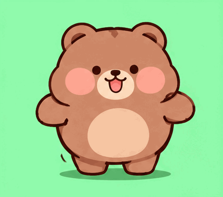
  
  
  
  
  
  
  
  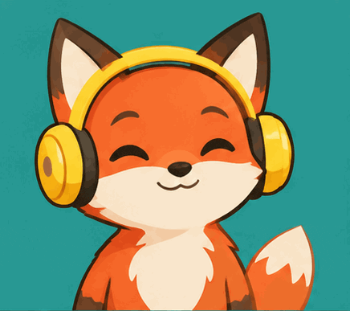
</p>

## 目录

- [这些 GIF 是怎么生成的](#这些-gif-是怎么生成的)
- [表情包与贴纸](#表情包与贴纸) · 203 条提示词
- [快闪与品牌动效](#快闪与品牌动效) · 91 条提示词
- [氛围循环动画](#氛围循环动画) · 133 条提示词
- [像素风与界面动效](#像素风与界面动效) · 97 条提示词
- [科普讲解动图](#科普讲解动图) · 14 条提示词
- [节日与祝福](#节日与祝福) · 3 条提示词
- [电商与产品展示](#电商与产品展示) · 7 条提示词
- [美食饮品](#美食饮品) · 4 条提示词
- [动态头像](#动态头像) · 2 条提示词
- [自己动手生成](#自己动手生成)

## 这些 GIF 是怎么生成的

在请求里设置 `output_format: "gif"`，GPT Image 2.6 就会直接返回 GIF 动图而不是静态图。帧数、每帧时长和尺寸由模型自行决定。

本仓库的每条提示词在发送时都会追加一句话，要求生成无缝循环：

```text
Animate it as a short, smooth, seamlessly looping GIF with clear motion between frames.
```

### 提示词公式

**主体**（一个清晰的角色或物体）+ **动作**（1–2 个动词：挥手、弹跳、飘动、闪烁）+ **风格**（扁平插画、Q 版贴纸、像素风、摄影）+ **背景**（做贴纸时用纯色、高对比背景）

### 技巧

- 一个主体、一到两个动作。画面越杂，动作越难看清。
- 用动词描述动作，比如“摇晃、打瞌睡、闪烁、滑落”，少用形容词。
- 扁平插画、Q 版、像素风在 GIF 的小尺寸下比写实照片效果好得多。
- 做一套表情包时，每条提示词都复用完全相同的角色描述，整套才会一致。
- 要抠成透明贴纸的，背景用一种和角色颜色完全拉开的纯色。
- 快闪要把每一帧写成不同的镜头；品牌快闪则固定 Logo 的位置和大小，只换周围的场景。
- 长文字和复杂的昼夜循环目前仍不稳定：文字尽量短，大的变化交给光线来表现。

## 表情包与贴纸

这里展示本分类最新的 12 条（共 203 条）。[查看全部 203 条 →](categories/stickers_zh.md)

### 1. 圆滚滚的蓝色机器人吉祥物打招呼


<sub>6 帧 · 480×480 · 0.9s · GPT Image 2.6</sub>

📌 **来源：** [@super_lewis on DEV Community](https://dev.to/super_lewis/animated-gifs-and-markup-guided-edits-with-the-gpt-image-26-api-real-timings-and-per-call-cost-2jmd)

**提示词**

```text
A round blue robot mascot waves hello. Seamless loop, same framing in every frame.
```

`mascot` `robot` `api`

### 2. 粉色爱心心跳缩放


<sub>12 帧 · 357×356 · 1.7s · GPT Image 2.6</sub>

📌 **来源：** [牧牧的成長實驗室 on 方格子 vocus](https://vocus.cc/article/6aebf9a0fd8978000170526d)

**提示词**

```text
製作一張粉紅色愛心 GIF。愛心在畫面中央輕輕放大，再縮回原本大小，呈現柔和的心跳節奏。背景簡潔、固定視角，畫面乾淨，無縫循環，不要文字。
```

`heart` `social` `flat`

### 3. 绿斗篷银发少年原地轻跳

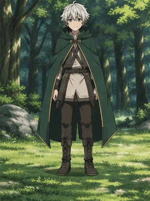

<sub>12 帧 · 309×414 · 1.7s · GPT Image 2.6</sub>

📌 **来源：** [牧牧的成長實驗室 on 方格子 vocus](https://vocus.cc/article/6aebf9a0fd8978000170526d)

**提示词**

```text
製作一張日系動畫風格 GIF。一名銀白色短髮少年穿著深綠色斗篷，站在森林空地上，輕輕跳起一次，然後回到站立姿勢。保持角色五官、衣服與背景一致，固定鏡頭，動作自然、無縫循環。
```

`anime` `character` `jump`

### 4. 穿吊带裤的 3D 小白兔挥手


<sub>12 帧 · 358×358 · 2.2s · GPT Image 2.6</sub>

📌 **来源：** [牧牧的成長實驗室 on 方格子 vocus](https://vocus.cc/article/6aebf9a0fd8978000170526d)

**提示词**

```text
製作一張可愛 3D 小白兔 GIF。小白兔穿著淺藍色吊帶褲，站在花園裡，慢慢舉起右手揮手打招呼，然後自然放下。背景固定，柔和晨光，可愛 3D 動畫風格，動作連貫，無縫循環，不要字幕。
```

`bunny` `3d` `greeting`

### 5. 穿格子衫的黏土橘猫疯狂敲键盘


<sub>9 帧 · 427×400 · 1.0s · GPT Image 2.6</sub>

📌 **来源：** [STRUGGLE_xlf on CSDN](https://tianqi.csdn.net/6aebfbae40858c2d8818a1fd.html)

**提示词**

```text
帮我生成一个无缝循环的 GIF 动图：一只穿格子衫的橘猫坐在电脑前疯狂敲键盘，屏幕反光映在脸上，旁边放着一杯冒热气的咖啡。3D 黏土动画风格，要求动作自然连贯，首尾帧无缝循环。
```

`cat` `3d-clay` `programmer`

### 6. Q版上班族看到工作通知瘫倒


<sub>12 帧 · 308×414 · 2.0s · GPT Image 2.6</sub>

📌 **来源：** [蘇柔瑋 on 數位時代 BusinessNext](https://www.bnext.com.tw/article/92943/chatgpt-gif-generator-prompts)

**提示词**

```text
請製作一張幽默的 GIF 動畫。一名 Q 版上班族坐在電腦前，先露出充滿期待的表情，接著看到螢幕上的工作通知，眼睛瞬間睜大，最後無奈地趴在桌上。使用可愛的日系 2D 插畫風格，背景為簡約辦公室，角色服裝與桌面物品保持一致。鏡頭固定，動作誇張但自然，動畫可以無縫循環，不要加入文字。
```

`office` `reaction` `chibi`

### 7. 3D 黏土橘猫挥手眨眼


<sub>12 帧 · 358×356 · 1.7s · GPT Image 2.6</sub>

📌 **来源：** [蘇柔瑋 on 數位時代 BusinessNext](https://www.bnext.com.tw/article/92943/chatgpt-gif-generator-prompts)

**提示词**

```text
請製作一張正方形 1:1 GIF 動畫。一隻可愛的橘貓坐在奶油白色背景前，慢慢抬起前腳揮手，接著眨眼，最後回到原本姿勢。採用精緻的 3D 黏土插畫風格，毛髮柔軟、表情可愛。鏡頭固定，保持角色外觀一致，製作自然流暢的無縫循環動畫，不要加入文字。
```

`cat` `3d-clay` `sticker`

### 8. 磁带“SIDE A”贴纸冒音符


<sub>14 帧 · 480×480 · 1.2s · GPT Image 2.6</sub>

📌 **来源：** [Fuxuan Guo on ChatCut Blog](https://chatcut.io/blog/gpt-image-2-6)

**提示词**

```text
Locked front-on 1:1 animated die-cut vinyl sticker on a fully transparent background with a crisp thick white kiss-cut border. A tilted brushed-silver and signal-orange compact cassette tape labeled 'SIDE A' in clean white sans-serif type. Across 8 frames, both white inner tape reel gears rotate smoothly while two bold electric-cobalt musical notes pop playfully out of the top-right corner on frames 2 to 5 and fade cleanly away by frame 8 so frame 8 matches frame 1's clean silhouette for a seamless loop.
```

`sticker` `retro` `music`

### 9. 浣熊梗图：五分钟修复搞崩线上


<sub>8 帧 · 480×480 · 1.4s · GPT Image 2.6</sub>

📌 **来源：** [Fuxuan Guo on ChatCut Blog](https://chatcut.io/blog/chatgpt-gif)

**提示词**

```text
Square internet reaction meme GIF with a solid white top caption bar reading "WHEN THE '5-MINUTE FIX' BREAKS PROD" in bold black sans-serif all-caps letters. Below the caption bar, locked front-on comic illustration of a wide-eyed gray raccoon wearing a black headset sitting at a dark desk behind an open laptop. Warm red-orange monitor light pulses across the raccoon's face as its paws hover tensely over the keyboard and its ears flatten slightly, then return to the exact starting pose on the final frame for a clean loop. Keep the white top bar and every letter of "WHEN THE '5-MINUTE FIX' BREAKS PROD" completely crisp and motionless across all frames.
```

`meme` `caption` `developer`

### 10. “SHIP IT!”徽章贴纸摇摆


<sub>14 帧 · 480×480 · 1.3s · GPT Image 2.6</sub>

📌 **来源：** [Fuxuan Guo on ChatCut Blog](https://chatcut.io/blog/chatgpt-gif)

**提示词**

```text
Bold street-art die-cut sticker badge with a thick white cutout border on a completely transparent background, locked front-on camera. Chunky crimson block letters reading "SHIP IT!" sit centered inside a bright yellow starburst badge. The badge tilts slightly left and right with tiny black comic wiggle lines around the border, then returns to the exact starting angle on the final frame for a clean loop. Crisp flat ink colors, exact spelling.
```

`sticker` `text` `transparent`

### 11. 黏土星星蹦跳贴纸


<sub>14 帧 · 480×480 · 1.2s · GPT Image 2.6</sub>

📌 **来源：** [Fuxuan Guo on ChatCut Blog](https://chatcut.io/blog/chatgpt-gif)

**提示词**

```text
Glossy 3D clay-style die-cut sticker with a thick white sticker border on a completely transparent background, locked front-on camera. A cheerful yellow five-pointed star character wearing tiny round black sunglasses does a happy little hop and lands softly back in its exact starting stance on the final frame for a clean loop. Crisp cutout edge, flat vibrant colors, no text.
```

`sticker` `transparent` `3d-clay`

### 12. 戴眼镜的青蛙疯狂打字


<sub>8 帧 · 480×480 · 0.9s · GPT Image 2.6</sub>

📌 **来源：** [Fuxuan Guo on ChatCut Blog](https://chatcut.io/blog/chatgpt-gif)

**提示词**

```text
Flat cel-shaded comic reaction illustration, locked front-on camera. A determined little green tree frog wearing round wire-rim glasses sits behind a silver laptop at a desk, rapidly tapping alternate webbed hands on the keyboard with tiny white motion arcs above its fingers while its glasses glint once, returning to the exact starting hand position on the final frame for a clean loop. Solid warm cream-teal background, bold outlines, no text.
```

`reaction` `frog` `work`

**[查看本分类全部 203 条 →](categories/stickers_zh.md)**

## 快闪与品牌动效

这里展示本分类最新的 12 条（共 91 条）。[查看全部 91 条 →](categories/flash_zh.md)

### 1. 戴围巾的橘色小熊吉祥物挥手

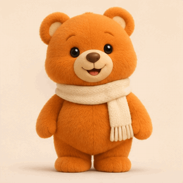

<sub>12 帧 · 358×358 · 2.2s · GPT Image 2.6</sub>

📌 **来源：** [牧牧的成長實驗室 on 方格子 vocus](https://vocus.cc/article/6aebf9a0fd8978000170526d)

**提示词**

```text
製作一張品牌吉祥物 GIF。角色是一隻圓潤、可愛的橘色小熊，戴著米白色圍巾，站在簡潔的淺色背景前。小熊慢慢揮手，露出友善笑容。保留品牌配色與角色比例，循環播放，背景固定。
```

`mascot` `bear` `brand`

### 2. 圆润机器人吉祥物欢迎挥手


<sub>12 帧 · 357×358 · 1.9s · GPT Image 2.6</sub>

📌 **来源：** [蘇柔瑋 on 數位時代 BusinessNext](https://www.bnext.com.tw/article/92943/chatgpt-gif-generator-prompts)

**提示词**

```text
請製作一張 GIF 動畫，一隻圓潤可愛的機器人吉祥物站在畫面中央，先微笑眨眼，再抬起右手向觀眾揮手，最後恢復站立姿勢。使用柔和的藍白配色、簡潔 3D 插畫風格，背景灰白。保持角色造型、配色及身體比例一致，鏡頭固定，製作可以無縫循環的動畫。
```

`mascot` `brand` `3d`

### 3. “ON AIR”霓虹灯与音量表闪动


<sub>9 帧 · 480×270 · 1.6s · GPT Image 2.6</sub>

📌 **来源：** [Fuxuan Guo on ChatCut Blog](https://chatcut.io/blog/gpt-image-2-6)

**提示词**

```text
Locked tripod close-up shot through a dark midnight recording studio glass booth window, 16:9 looping animation. Inside the dark acoustic booth, a sleek red neon sign reading 'ON AIR' above a minimal 4-bar digital LED audio level meter pulses in a clean seamless cycle: frame 1 starts at a soft dim crimson resting glow with four low blue meter bars, frames 3 to 6 flare into a bright vermilion neon halo with warm glass reflections while the LED bars jump into yellow and red peaks, and frames 7 to 9 settle smoothly back to the exact dim resting glow and four blue bars of frame 1. Condenser microphone silhouette and studio headphones in foreground stay completely still.
```

`neon` `studio` `text`

### 4. EMBER 标志火焰跳动


<sub>8 帧 · 480×480 · 1.4s · GPT Image 2.6</sub>

📌 **来源：** [Fuxuan Guo on ChatCut Blog](https://chatcut.io/blog/chatgpt-gif)

**提示词**

```text
Minimalist flat vector brand logo lockup on a solid charcoal-black square background, locked front-on view. Centered copper-orange stylized campfire emblem above clean cream geometric sans-serif all-caps wordmark reading "EMBER". Only the center flame tongue of the copper emblem flickers smoothly upward a few pixels and settles back into its exact starting silhouette on the final frame for a clean loop. Keep the wordmark "EMBER" and side logs completely motionless across every frame, crisp flat colors.
```

`logo` `brand` `flat`

### 5. 滑板 360 尖翻


<sub>12 帧 · 358×356 · 1.3s · gpt-image-2.6-gif</sub>

📌 **来源：** [@justynclark on X](https://x.com/justynclark/status/2118189691820482677)

**提示词**

```text
Create a GIF of a 360 kickflip on a skateboard
```

`skateboard` `sport` `trick`

### 6. 成语物件猜谜：四个陶瓷摆件轮流弹跳


<sub>36 帧 · 480×640 · 3.0s · gpt-image-2.6-gif</sub>

📌 **来源：** [@GeekCatX on X](https://x.com/GeekCatX/status/2118160560290480519)

**提示词**

```text
制作一个中国成语物件猜谜 GIF 动图，竖版 3:4，精致可爱的短视频封面风格。

【输出规格】
输出一个可播放的 GIF 动图。
画面尺寸：768×1024 像素。
总时长：3秒，无限循环。
建议帧率：20fps，约60帧。
动画包含4个连续动作段，每段0.75秒，分别对应四件物品。
全程为同一个完整画面，镜头固定，构图固定，没有切镜、推拉、摇移或缩放。
【制作原则：同一母版，局部动画】
先建立一张完整的静态母版，再基于同一母版制作动画。
所有帧保持相同的背景、构图、文字、台面、物件造型、材质、颜色与光照。
只允许当前指定物件进行小幅竖直位移，并同步调整它的局部高光、接触阴影与倒影。
其余三个物件保持静止。
文字必须使用同一份静态图层，在全部帧中重复使用，不要逐帧重新绘制。
【背景】
深蓝色专业摄影棚背景，中心为柔和宝蓝色，向四周自然渐暗为午夜蓝。
背景纯净，具有轻微柔光晕，渐变细腻，没有明显纹理和杂乱装饰。
背景空白区域分布3—5个微小、低亮度的金色光点。
光点沿非常短的闭合轨迹缓慢漂浮，一个循环周期为3秒。
光点不穿过文字或物件，不闪烁、不突然出现或消失，循环结束时回到起始位置。
【文字：全程完全静止】
画面中只允许出现以下两行文字，不增加任何其他文字：
第一行：
物件藏着一个成语

第二行：
你猜出来了吗
第一行位于画面顶部居中，使用明黄色 #FFD54A 的超粗圆体大字，字形饱满圆润，带浅描边和轻微投影。
第二行位于第一行正下方，使用白色粗圆体，字号约为第一行的60%。

两行文字保持足够行距，四周预留安全边距，不贴边、不裁切。
汉字笔画完整，字形标准，清晰易读，无错别字。
在所有帧中，文字的位置、字号、字距、笔画、颜色、描边、阴影与透明度完全一致。
文字不参与弹跳、高光扫动、闪烁或任何其他动画。
【台面与构图】
画面中下部是一条横向浅木纹展示台。
台面干净，木纹细腻，具有柔和、克制的反光。
四件物品集中排列于画面中下部，物件组占画面宽度约85%—90%。
四件物品位于同一前后层级，静止时底部对齐于同一条台面接触基线。
它们具有接近的视觉体量，间距均匀，彼此留出清晰空隙。
不前后错落、不堆叠、不互相遮挡。

采用固定的轻微俯视角度，能够清楚看见杯口和水面，同时保持四件物品横向并排的秩序感。
【四件物品：顺序固定】
从左到右严格依次为：
一辆红色Q版小汽车。
圆润饱满，车身呈中国红，轮子与车窗清晰可辨，具有精致陶瓷玩具质感。

一个装满清水的青花瓷杯。
杯身具有细腻青花纹样，杯口清晰，能够看见透明清水与柔和水面反光。
杯身无文字，水面保持平稳，不溢出、不飞溅。
一匹金色Q版小马。
造型圆润可爱，具有清晰的马头、鬃毛、四肢与尾巴，表面为温润的金色陶瓷釉面。
一条青绿色盘身小龙。
中国传统小龙造型，身体盘曲，龙头微微抬起，龙角、龙须与鳞片适度简化，神态可爱，具有青绿色陶瓷釉面质感。

四件物品保持各自明确的识别特征。
物件表面没有文字、拼音、标签、数字或答案提示。
【动作规则】
所有物件均为刚性的陶瓷摆件，只允许整体轻轻向上移动，再回到原位。
不挤压、不拉伸、不旋转、不左右移动、不改变造型。

弹跳最高点距离原位约为画面高度的1%，动作轻巧、克制。
每个物件必须完整落回原位后，下一个物件才开始动作。
任意时刻，四件物品中最多只有一件正在运动。
当前物件弹起时，一道低强度、柔和的高光缓缓掠过其表面。
高光只作用于当前物件，不影响文字、背景和其他物件。
物件下方的阴影与倒影随高度轻微变化，落地后恢复母版状态。
小汽车轮子不转，小马不迈腿，小龙不摆尾、不转头。

【3秒动作时间线】
0.00—0.75秒：
红色小汽车完成一次轻轻弹起并落回原位。
瓷杯、小马、小龙保持静止。
0.75—1.50秒：
青花瓷杯完成一次轻轻弹起并落回原位。
汽车、小马、小龙保持静止。

1.50—2.25秒：
金色小马完成一次轻轻弹起并落回原位。
汽车、瓷杯、小龙保持静止。
2.25—3.00秒：
青绿色小龙完成一次轻轻弹起并落回原位。
汽车、瓷杯、小马保持静止。

每个0.75秒动作段均遵循：
短暂停住 → 平缓上升 → 平缓落下 → 落定后短暂停住。
上升和下落采用柔和缓入缓出，不突然跳位，不夸张弹震。

【无缝循环】
首帧与末帧完全一致：
四件物品全部落在原位，所有高光、阴影、倒影与背景光点均回到初始状态。
从末帧接回首帧时，没有位置跳变、亮度跳变或颜色闪动。
循环中不出现黑帧、白帧、残影或重影。

【整体质感】
精致可爱的Q版3D陶瓷摆件，圆润、细腻、通透。
以中国红、金色、青绿色和青花蓝点缀深蓝背景，融入克制的中国传统纹样细节。
顶部柔光配合左右轮廓光，物件边缘高光清晰，台面倒影柔和。
整体具有中国文化韵味，适合全年龄观看。
【禁止事项】
不出现成语答案。
不出现额外文字、水印、品牌标志或界面元素。
不出现分镜拼图、四宫格或多画面。
不改变四件物品的数量、顺序、造型、颜色或比例。
不让两个物件同时运动。
不让物件重叠、碰撞、堆叠或横向移位。
不让文字闪烁、变形、位移或重新生成。
不改变相机位置、背景亮度或整体色调。
```

`riddle` `chinese idiom` `3d`

### 7. 迷幻风跳舞猫


<sub>9 帧 · 438×390 · 1.4s · gpt-image-2.6-gif</sub>

📌 **来源：** [@xedrik7 on X](https://x.com/xedrik7/status/2118258491043483978)

**提示词**

```text
psychedelic gif of cat dancing
```

`cat` `psychedelic` `dance`

### 8. 烤鸡晚餐揭盖


<sub>16 帧 · 380×252 · 2.9s · gpt-image-2.6 · 生成于 2026-11-17</sub>

**提示词**

```text
A silver dome lid lifts off a golden roast chicken on a platter, a burst of steam rising and a few herb leaves falling onto it. Warm festive food ad style, dark wood background.
```

`dinner` `holiday` `food`

### 9. 爆米花蹦出来


<sub>16 帧 · 379×230 · 2.2s · gpt-image-2.6 · 生成于 2026-11-17</sub>

**提示词**

```text
Kernels in a red and white striped bowl burst into fluffy popcorn one by one, some pieces jumping out and tumbling back in. Bold movie-night ad style, deep blue background.
```

`popcorn` `snack` `movie`

### 10. 平底锅翻煎饼


<sub>9 帧 · 439×388 · 1.3s · gpt-image-2.6 · 生成于 2026-11-17</sub>

**提示词**

```text
A golden pancake is tossed up from a cast iron pan, flips once in the air and lands back with a little puff of steam. Bright food ad style, warm kitchen background, fixed camera.
```

`pancake` `food` `kitchen`

### 11. 旅行手账贴纸逐个贴上


<sub>9 帧 · 439×387 · 2.0s · gpt-image-2.6 · 生成于 2026-11-17</sub>

**提示词**

```text
An open travel journal on an ivory desk; little stickers of a plane, a ticket stub, a palm tree and a stamp pop onto the page one after another with a soft bounce. Cozy scrapbook style, overhead camera.
```

`scrapbook` `travel` `journal`

### 12. 木棋子翻面落定


<sub>16 帧 · 380×252 · 1.9s · gpt-image-2.6 · 生成于 2026-11-17</sub>

**提示词**

```text
A pale wooden pentagon-shaped board game piece flips over in the air and lands with a small clack on a wooden grid board, a puff of dust at impact. Warm tabletop lighting, close-up, fixed camera.
```

`board-game` `wood` `flip`

**[查看本分类全部 91 条 →](categories/flash_zh.md)**

## 氛围循环动画

这里展示本分类最新的 12 条（共 133 条）。[查看全部 133 条 →](categories/loops_zh.md)

### 1. 窗边橘猫慢慢眨眼

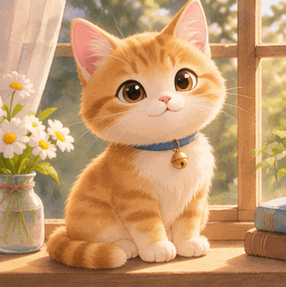

<sub>12 帧 · 357×358 · 2.2s · GPT Image 2.6</sub>

📌 **来源：** [牧牧的成長實驗室 on 方格子 vocus](https://vocus.cc/article/6aebf9a0fd8978000170526d)

**提示词**

```text
製作一張橘色貓咪 GIF 動畫。貓咪坐在窗邊，緩慢眨一下眼睛，然後恢復原本表情。保持姿勢、毛色與背景一致，溫暖插畫風格，固定鏡頭，無縫循環。
```

`cat` `cozy` `illustration`

### 2. 水彩绘本小镇樱花飘落


<sub>16 帧 · 414×232 · 5.0s · GPT Image 2.6</sub>

📌 **来源：** [蘇柔瑋 on 數位時代 BusinessNext](https://www.bnext.com.tw/article/92943/chatgpt-gif-generator-prompts)

**提示词**

```text
請製作一張 16:9 橫式 GIF 動畫。畫面是一座日系手繪風格的小鎮，街道兩側有溫暖的木造房屋、綠色植物與盛開的櫻花樹，遠方能看見淡藍色天空。採用柔和水彩與鉛筆線條交織的繪本插畫風格，保留細緻的紙張紋理。動畫中微風吹過，櫻花花瓣緩緩從樹上飄落，街邊植物輕輕搖擺，天空中的白雲緩慢移動。所有建築與街道保持靜止，鏡頭固定，整體氛圍安靜療癒。製作約 5 秒、動作自然且可以無縫循環的 GIF，不要加入任何文字。
```

`watercolor` `sakura` `storybook`

### 3. 复古黄铜节拍器摆动

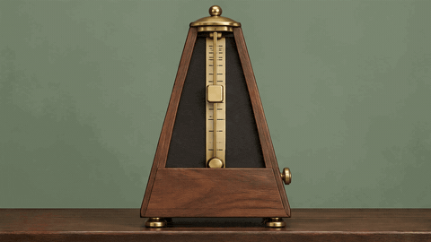

<sub>9 帧 · 480×270 · 1.4s · GPT Image 2.6</sub>

📌 **来源：** [Fuxuan Guo on ChatCut Blog](https://chatcut.io/blog/chatgpt-gif)

**提示词**

```text
Clean studio illustration on a muted sage-green background, locked dead-center front-on camera. A vintage pyramid-shaped walnut and polished-brass desk metronome rests motionless on a dark oak shelf. On frame 1, the vertical brass pendulum rod stands dead-center upright at 12 o'clock; across the middle frames it swings smoothly left, then swings right, and on the final frame it returns to the exact dead-center 12 o'clock upright starting position for a seamless loop. Keep the wooden metronome body, scale markings, and shelf completely still, no text.
```

`metronome` `mechanical` `loop`

### 4. 雪夜篝火（16 帧）

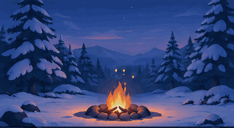

<sub>16 帧 · 480×264 · 1.9s · GPT Image 2.6</sub>

📌 **来源：** [Fuxuan Guo on ChatCut Blog](https://chatcut.io/blog/chatgpt-gif)

**提示词**

```text
Flat storybook winter landscape illustration, locked wide camera. In a quiet twilight clearing ringed by snow-dusted dark-teal pine trees, a small stone-ringed campfire crackles gently as warm orange flames sway and three tiny glowing embers drift slightly upward before settling back to the exact starting flame shape on the final frame for a clean loop. Keep the pine trees, snowbanks, and stones completely motionless, no text.
```

`winter` `campfire` `storybook`

### 5. 雨夜窗外路灯倒影涟漪


<sub>9 帧 · 480×270 · 1.6s · GPT Image 2.6</sub>

📌 **来源：** [Fuxuan Guo on ChatCut Blog](https://chatcut.io/blog/chatgpt-gif)

**提示词**

```text
Cozy lo-fi anime illustration seen through a dark wooden apartment window at dusk, locked camera. Diagonal rain streaks fall across the windowpane while warm amber streetlamp reflections ripple gently inside a wet cobblestone puddle below, returning to the exact starting rain and ripple pattern on the final frame for a clean loop. Keep the wooden window frame and indoor potted fern completely still, clean flat shading, no text.
```

`rain` `lo-fi` `anime`

### 6. 晨雾中的广州塔


<sub>9 帧 · 480×198 · 1.6s · gpt-image-2.6-gif</sub>

📌 **来源：** [@AIWAVE2025 on X](https://x.com/AIWAVE2025/status/2118154755826766225)

**提示词**

```text
清晨珠江，薄雾，镜头低空推进，广州塔从雾里露出来，一艘游船划过。
```

`city` `mist` `river`

### 7. 树枝上扇动翅膀的橙色小鸟


<sub>9 帧 · 480×480 · 1.8s · gpt-image-2.6-gif</sub>

📌 **来源：** [Ofox on Ofox](https://ofox.ai/blog/gpt-image-2-6-gif-guide/)

**提示词**

```text
Create a looping animation of a small orange bird on a stationary branch against a plain cream background. The bird raises its wings, pauses, then lowers them to its starting pose. Keep the camera fixed, the branch still, and the bird shape and colors consistent. No text. Make the transition back to the start smooth.
```

`bird` `loop` `api`

### 8. 雪花球里的小木屋


<sub>9 帧 · 439×390 · 1.6s · gpt-image-2.6 · 生成于 2026-11-17</sub>

**提示词**

```text
A glass snow globe with a tiny red cabin and pine trees inside; snowflakes swirl up and settle slowly around the cabin. Warm cozy lighting, wooden table, fixed close-up.
```

`snow-globe` `winter` `cozy`

### 9. 糖炒栗子


<sub>9 帧 · 439×390 · 1.6s · gpt-image-2.6 · 生成于 2026-11-17</sub>

**提示词**

```text
A big iron wok of chestnuts and dark sand is stirred by a wooden paddle, steam curling up under a warm bulb at a winter street stall. Cozy photographic style, close-up, fixed camera.
```

`chestnut` `street-food` `winter`

### 10. 路灯下的初雪


<sub>16 帧 · 376×252 · 2.9s · gpt-image-2.6 · 生成于 2026-11-17</sub>

**提示词**

```text
Big soft snowflakes drift down through the warm cone of an old street lamp on a quiet cobblestone street at night. Cinematic, fixed camera, everything else still.
```

`snow` `night` `street`

### 11. 窗上霜花蔓延


<sub>8 帧 · 439×388 · 1.8s · gpt-image-2.6 · 生成于 2026-11-17</sub>

**提示词**

```text
Delicate fern-like frost patterns creep across a cold window pane from the corners, a blurry snowy garden visible behind. Macro winter photography, fixed camera.
```

`frost` `winter` `macro`

### 12. 孔明灯升空


<sub>16 帧 · 377×248 · 2.9s · gpt-image-2.6 · 生成于 2026-11-17</sub>

**提示词**

```text
Dozens of warm glowing paper lanterns float slowly up into a deep blue night sky above dark rooftops, flickering softly. Dreamy painterly style, fixed camera.
```

`lantern` `night` `festival`

**[查看本分类全部 133 条 →](categories/loops_zh.md)**

## 像素风与界面动效

这里展示本分类最新的 12 条（共 97 条）。[查看全部 97 条 →](categories/pixel-ui_zh.md)

### 1. 绿色询价按钮流光


<sub>8 帧 · 480×238 · 1.1s · GPT Image 2.6</sub>

📌 **来源：** [末松 光太郎 on WizTry Blog](https://wiztrydx.com/blog/chatgpt-images-2-6-kaisetsu/)

**提示词**

```text
ホームページに置くボタンのループGIFを作って。横長の角丸で、緑色のボタンに白い文字で「無料見積りはこちら」。文字の位置は動かさず、光が左から右へ流れて、ボタンが少しだけふくらむ動きにして。背景は白。
```

`button` `ui` `japanese`

### 2. 灯泡图标慢慢亮起


<sub>12 帧 · 308×414 · 2.2s · GPT Image 2.6</sub>

📌 **来源：** [牧牧的成長實驗室 on 方格子 vocus](https://vocus.cc/article/6aebf9a0fd8978000170526d)

**提示词**

```text
製作一張極簡扁平插畫 GIF。畫面中央是一個黃色燈泡圖示，燈泡從微暗逐漸亮起，接著恢復原本狀態。背景純白、圖示位置固定，動畫柔和，不要任何文字，無縫循環。
```

`icon` `flat` `education`

### 3. 像素闪电劈落特效


<sub>12 帧 · 358×268 · 1.0s · GPT Image 2.6</sub>

📌 **来源：** [@kasperzackgames on GitHub](https://github.com/kasperzackgames/chatgpt-pixel-effects/tree/main/effects/lightning)

**提示词**

```text
Make an animated GIF of a pixel-art lightning strike for a 2D side-view game, rendered as large as you can. 14 frames, about 70 ms per frame. Use fine pixel art: each art pixel is only 2 to 3 image pixels wide, so the bolt has a lot of detail (it spans the full frame height, about 120 art pixels). The camera does not move. The bottom edge of the frame is the ground line, and the bolt hits the ground at the bottom centre, at the same point in every frame. Don't draw the ground itself. Sequence: a thin flickering leader zigzags down from the top edge; the full bolt strikes: a thick jagged white core with an electric blue and violet glow outline and three or four forked branches; one frame where the bolt and a bright white burst at the impact point are at their brightest; the bolt flickers twice, changing its branches each time; at the impact point a burst of electric sparks flies out in arcs and short arcs of electricity crawl sideways along the ground; the bolt vanishes, leaving a glowing blue afterimage that fades; a few sparks and a small curl of dark smoke fade out until the frame is empty. True pixel art: crisp pixels on one even grid, hard edges, no anti-aliasing, no blur, no soft gradients, a limited palette of about 16 colours (white, pale cyan, electric blues, violets, two dark greys for the smoke). Background: flat solid pure green #00FF00 in every frame, nothing else. No text, no borders.
```

`pixel-art` `game-fx` `lightning`

### 4. 像素火柱喷发特效


<sub>15 帧 · 265×358 · 1.3s · GPT Image 2.6</sub>

📌 **来源：** [@kasperzackgames on GitHub](https://github.com/kasperzackgames/chatgpt-pixel-effects/tree/main/effects/fire-pillar)

**提示词**

```text
Make an animated GIF of a pixel-art fire pillar erupting from the ground, for a 2D side-view game, in a tall frame (taller than wide), rendered as large as you can. 16 frames, about 80 ms per frame. Use fine pixel art: each art pixel is exactly 2 image pixels wide, so the fire has a lot of detail. The camera does not move. The bottom edge of the frame is the ground line, and the pillar erupts at the bottom centre, at the same point in every frame. Don't draw the ground itself. The tallest flame tips reach about 85 percent of the frame height: always leave empty background above the fire and at both sides, so nothing is ever cut off by the frame edges. Sequence: a small glowing crack and a few embers rising; flames burst upward into a tall roaring column of fire, wider at the base, with swirling tongues of flame, a white-yellow hot core and orange, red and dark red edges; burning chunks and sparks fly out of the top; the column roars for several frames, its flames changing shape every frame; it collapses downward into low flickering flames and puffs of dark smoke; glowing embers drift up and fade until the frame is empty. True pixel art: crisp pixels on one even grid, hard edges, no anti-aliasing, no blur, no soft gradients, a limited palette of about 18 colours (white, yellows, oranges, reds, dark reds and three dark greys for the smoke). Background: flat solid pure magenta #FF00FF in every frame, nothing else. No text, no borders.
```

`pixel-art` `game-fx` `fire-pillar`

### 5. 像素火山喷发特效


<sub>16 帧 · 309×308 · 1.4s · GPT Image 2.6</sub>

📌 **来源：** [@kasperzackgames on GitHub](https://github.com/kasperzackgames/chatgpt-pixel-effects/tree/main/effects/eruption)

**提示词**

```text
Make an animated GIF of a pixel-art volcano eruption seen from far away, for the background of a 2D side-view game, in a square frame, rendered as large as you can. 16 frames, about 90 ms per frame. Use fine pixel art: each art pixel is exactly 2 image pixels wide. The camera does not move. The crater is at the bottom centre of the frame, at the same point in every frame; don't draw the mountain itself, only what comes out of the crater. Sequence: frames 1 to 4: the crater glows brighter and spits a few sparks; frame 5: a bright burst; frames 6 to 16: a full eruption that loops seamlessly from frame 16 back to frame 6: a fountain of glowing lava shooting straight up from the crater, glowing lava bombs flying out in high arcs and falling back down on both sides, and a thick dark ash column rising above it, its underside lit red and orange by the lava, the top of the ash staying inside the frame. Leave empty background around everything so nothing is cut off by the frame edges. True pixel art: crisp pixels on one even grid, hard edges, no anti-aliasing, no blur, no soft gradients, a limited palette of about 18 colours (white, yellows, oranges, reds, dark reds, and four dark grey-browns for the ash). Background: flat solid pure magenta #FF00FF in every frame, nothing else. No text, no borders.
```

`pixel-art` `game-fx` `eruption`

### 6. 像素能量光束特效

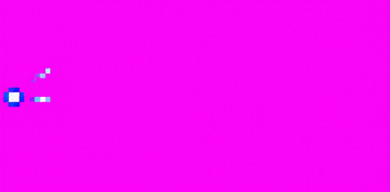

<sub>13 帧 · 439×216 · 1.1s · GPT Image 2.6</sub>

📌 **来源：** [@kasperzackgames on GitHub](https://github.com/kasperzackgames/chatgpt-pixel-effects/tree/main/effects/beam)

**提示词**

```text
Make an animated GIF of a pixel-art energy beam for a 2D side-view game, in a wide frame twice as wide as it is tall, rendered as large as you can. 16 frames, about 70 ms per frame. Use fine pixel art: each art pixel is only 2 to 3 image pixels wide. The camera does not move. The beam starts at the left edge at mid-height, at the same point in every frame. Sequence: a small glowing orb of energy charges at the left edge, crackling and growing as sparks are pulled into it; it fires: a thick straight beam with a white core and cyan and electric blue outer layers shoots to the right edge within two frames; the beam holds for several frames, pulsing thicker and thinner, with bright ripples travelling along it, rings around its origin and sparks spraying off its edges; the beam thins to a line and vanishes; small sparks and a fading glow at the origin until the frame is empty. True pixel art: crisp pixels on one even grid, hard edges, no anti-aliasing, no blur, no soft gradients, a limited palette of about 14 colours (white, pale cyan, cyans, electric blues, deep blue). Background: flat solid pure magenta #FF00FF in every frame, nothing else. No text, no borders.
```

`pixel-art` `game-fx` `beam`

### 7. 像素爆炸与蘑菇云特效


<sub>15 帧 · 316×302 · 1.3s · GPT Image 2.6</sub>

📌 **来源：** [@kasperzackgames on GitHub](https://github.com/kasperzackgames/chatgpt-pixel-effects)

**提示词**

```text
Make an animated GIF of a pixel-art explosion for a 2D side-view game, rendered as large as you can (at least 512x512). 16 frames, about 80 ms per frame. Use fine pixel art: each art pixel is only 2 to 3 image pixels wide, so the explosion has a lot of detail (about 120 art pixels tall at its peak). The camera does not move. The bottom edge of the frame is the ground line, and the explosion hits the ground at the bottom centre, at the same point in every frame. Don't draw the ground itself. Sequence: a tiny spark on the ground; one bright white flash frame; a huge orange and yellow fireball that grows until it fills about three quarters of the frame height and rises into a mushroom cloud with a fiery stem; debris chunks and sparks flying out in arcs; a thin dust ring rolling sideways along the ground; the fire breaks up into a light grey smoke column that rises and drifts; glowing embers fade out until the frame is empty. True pixel art: crisp pixels on one even grid, hard edges, no anti-aliasing, no blur, no soft gradients, a limited palette of about 20 colours (white, yellows, oranges, reds, dark reds and four neutral greys for the smoke). Background: flat solid pure magenta #FF00FF in every frame, nothing else. No text, no borders.
```

`pixel-art` `game-fx` `explosion`

### 8. 三颗橘色圆点跳动加载


<sub>13 帧 · 416×404 · 1.1s · GPT Image 2.6</sub>

📌 **来源：** [蘇柔瑋 on 數位時代 BusinessNext](https://www.bnext.com.tw/article/92943/chatgpt-gif-generator-prompts)

**提示词**

```text
請設計一張極簡風格的 GIF 載入動畫。畫面中央有三顆橘色小圓點，依序從左至右向上跳動，再回到原本位置，形成自然連續的節奏。背景透明，整體使用簡潔的扁平化設計，圓點大小與顏色保持一致。鏡頭固定，動畫無縫循環，不要加入文字或其他裝飾。
```

`loader` `ui` `flat`

### 9. 指南针 App 图标指针摆动


<sub>14 帧 · 480×480 · 1.2s · GPT Image 2.6</sub>

📌 **来源：** [Fuxuan Guo on ChatCut Blog](https://chatcut.io/blog/chatgpt-gif)

**提示词**

```text
Minimalist flat-vector rounded-square app icon on a completely transparent background, locked front-on view. A solid deep-teal rounded square dial with four tiny white tick marks holds a two-tone coral-and-white diamond compass needle pointing straight up. The compass needle swings 20 degrees clockwise, rebounds slightly left, and settles pointing straight up again in its exact starting alignment on the final frame for a clean loop. Flat crisp vector shapes, no gradients, no text.
```

`icon` `app` `transparent`

### 10. 纸飞机空状态加载图


<sub>8 帧 · 480×480 · 1.2s · GPT Image 2.6</sub>

📌 **来源：** [Fuxuan Guo on ChatCut Blog](https://chatcut.io/blog/chatgpt-gif)

**提示词**

```text
Clean flat vector empty-state loading illustration, locked front-on view. Inside a soft powder-blue circle badge on a crisp off-white square background, a folded coral-orange paper airplane glides in a gentle up-and-down bobbing arc above two tiny stationary white clouds, returning to its exact starting height and angle on the final frame for a clean loop. Flat colors, no gradients, no text.
```

`loader` `ui` `flat`

### 11. 三颗胶囊波浪加载动画


<sub>11 帧 · 480×480 · 1.0s · GPT Image 2.6</sub>

📌 **来源：** [Fuxuan Guo on ChatCut Blog](https://chatcut.io/blog/chatgpt-gif)

**提示词**

```text
Minimalist flat-vector UI loading indicator on a completely transparent background, locked front-on view. Three rounded cobalt-blue pill dots sit in a horizontal row; the left dot hops up, then the center dot, then the right dot in a crisp wave, and all three settle level in their exact starting alignment on the final frame for a clean loop. Sharp vector edges, solid flat blue, no text.
```

`loader` `ui` `transparent`

### 12. 16 位像素金毛点赞


<sub>8 帧 · 480×480 · 1.1s · GPT Image 2.6</sub>

📌 **来源：** [Fuxuan Guo on ChatCut Blog](https://chatcut.io/blog/chatgpt-gif)

**提示词**

```text
Crisp 16-bit pixel art reaction icon, locked front-on camera. A cheerful golden retriever wearing cool dark pixel sunglasses gives an enthusiastic double thumbs-up as three tiny yellow pixel stars pop around its head and fade out, returning to the exact starting pose on the final frame for a clean loop. Solid deep midnight-blue background, limited retro palette, no text.
```

`pixel-art` `dog` `reaction`

**[查看本分类全部 97 条 →](categories/pixel-ui_zh.md)**

## 科普讲解动图

这里展示本分类最新的 12 条（共 14 条）。[查看全部 14 条 →](categories/explainers_zh.md)

### 1. 纸质发票经 AI 识别入表（四格流程）


<sub>4 帧 · 480×238 · 3.4s · GPT Image 2.6</sub>

📌 **来源：** [末松 光太郎 on WizTry Blog](https://wiztrydx.com/blog/chatgpt-images-2-6-kaisetsu/)

**提示词**

```text
紙の請求書をスマホで撮ると、AIが読み取って、表に入力されるまでの流れを、4コマのループGIFにして。
```

`workflow` `business` `japanese`

### 2. 土壤剖面里种子发芽


<sub>12 帧 · 358×358 · 3.1s · GPT Image 2.6</sub>

📌 **来源：** [牧牧的成長實驗室 on 方格子 vocus](https://vocus.cc/article/6aebf9a0fd8978000170526d)

**提示词**

```text
製作一張教育用途的 GIF 動畫，呈現一顆種子逐漸發芽，長出嫩芽與兩片小葉子的過程。使用清楚的科普插畫風格，固定土壤剖面與攝影機視角，讓植物生長過程自然銜接，並設計成循環動畫。
```

`science` `plant` `education`

### 3. 年度营收柱状图逐年增长


<sub>33 帧 · 480×270 · 4.8s · GPT Image 2.6</sub>

📌 **来源：** [蘇柔瑋 on 數位時代 BusinessNext](https://www.bnext.com.tw/article/92943/chatgpt-gif-generator-prompts)

**提示词**

```text
請製作一張 16:9 橫式 GIF 動畫，主題為企業年度營收成長。畫面使用暖白色背景、深灰色文字與橘色重點配色，呈現簡潔專業的商業資訊圖表風格。中央有四根長條圖，分別代表 2023、2024、2025、2026 年，數值依序為 100、150、210、300，單位為百萬元。動畫開始時所有長條從零逐漸向上延伸，依照年份由左至右依序完成，最後停留在完整圖表畫面。確保年份、數字與長條高度完全對應，所有文字清晰可讀，鏡頭固定。動畫約 5 秒，不要增加其他數據或裝飾元素。
```

`chart` `business` `data`

### 4. 西西里防御开局动画


<sub>16 帧 · 288×288 · 3.2s · gpt-image-2.6-gif</sub>

📌 **来源：** [vunderba on Mordenstar](https://imgpb.com/OzSMKJ)

**提示词**

```text
A simple animation of the Sicilian Defense opening on a chess board, flat vector illustration
```

`chess` `opening` `diagram`

### 5. 扬声器声波传播


<sub>9 帧 · 436×388 · 1.3s · gpt-image-2.6 · 生成于 2026-11-18</sub>

**提示词**

```text
Side view diagram of a loudspeaker whose cone pushes in and out, sending evenly spaced curved sound waves rippling to the right toward a cartoon ear. Flat educational infographic, light blue background.
```

`sound` `physics` `waves`

### 6. 叶片光合作用示意


<sub>9 帧 · 439×390 · 1.6s · gpt-image-2.6 · 生成于 2026-11-18</sub>

**提示词**

```text
Simple science diagram of a green leaf: yellow sun rays enter from the top, blue water droplets rise from the stem, and small bubbles labeled O2 float out of the leaf. Clean textbook illustration, white background.
```

`photosynthesis` `biology` `diagram`

### 7. 跷跷板杠杆平衡


<sub>16 帧 · 378×254 · 2.2s · gpt-image-2.6 · 生成于 2026-11-17</sub>

**提示词**

```text
A simple wooden seesaw on a triangle pivot tips one way as a heavy block drops on one end, then a small block slides farther out on the other end until it balances level. Flat textbook illustration, white background, no text.
```

`lever` `physics` `simple-machines`

### 8. 三棱镜分光

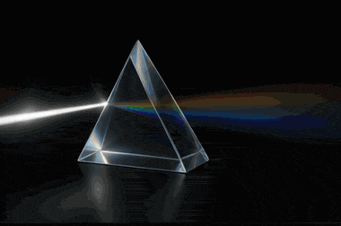

<sub>16 帧 · 380×252 · 1.9s · gpt-image-2.6 · 生成于 2026-11-17</sub>

**提示词**

```text
A white beam of light enters a glass triangular prism and fans out into a rainbow on the other side, the rainbow shimmering gently. Dark background, clean science illustration, fixed camera.
```

`light` `prism` `physics`

### 9. 行星绕日运行


<sub>9 帧 · 439×390 · 1.4s · gpt-image-2.6 · 生成于 2026-11-17</sub>

**提示词**

```text
A flat top-down diagram of a glowing sun with four colorful planets moving along thin circular orbits at different speeds. Dark navy background, simple clean shapes, no text.
```

`solar-system` `astronomy` `diagram`

### 10. 心脏跳动示意


<sub>9 帧 · 439×388 · 1.6s · gpt-image-2.6 · 生成于 2026-11-17</sub>

**提示词**

```text
A friendly simplified anatomical heart in red and blue squeezes and relaxes in a steady beat, small arrows showing blood flowing in and out. Flat medical infographic style, light background, no text.
```

`heart` `biology` `infographic`

### 11. 豆子发芽地下剖面


<sub>9 帧 · 439×388 · 2.0s · gpt-image-2.6 · 生成于 2026-11-17</sub>

**提示词**

```text
A cutaway of a soil pot shows a bean seed splitting open, a root reaching down and a pale shoot pushing up toward the surface. Soft flat educational illustration, brown and green palette, no text.
```

`plant` `germination` `biology`

### 12. 月相变化

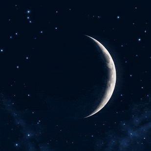

<sub>16 帧 · 309×309 · 1.9s · gpt-image-2.6 · 生成于 2026-11-17</sub>

**提示词**

```text
A single moon centered in a square frame of dark starry sky goes through its phases, from thin crescent to full moon and back to crescent, the shadow edge sliding smoothly across it. Clean flat illustration, fixed camera.
```

`moon` `astronomy` `science`

**[查看本分类全部 14 条 →](categories/explainers_zh.md)**

## 节日与祝福

### 1. 羊毛毡风生日蛋糕与戴帽小猫


<sub>16 帧 · 276×346 · 4.0s · GPT Image 2.6</sub>

📌 **来源：** [蘇柔瑋 on 數位時代 BusinessNext](https://www.bnext.com.tw/article/92943/chatgpt-gif-generator-prompts)

**提示词**

```text
請製作一張 直式 4:5、約 4 秒的生日祝福 GIF 動畫，採用溫暖可愛的日系羊毛氈 3D 插畫風格。畫面中央是一個精緻的草莓鮮奶油蛋糕，插著三根點燃的粉色蠟燭。蛋糕右側坐著一隻戴生日帽的奶油色小貓，開心地抱著蛋糕，左側擺放粉色禮物盒。背景搭配三角旗幟、發光星星與木質桌面，使用奶油白、蜜桃粉與暖金色調，呈現溫馨療癒的童話氛圍。動畫效果： 蠟燭火焰輕輕搖曳，星星依序閃爍，最後少量粉色彩紙從上方緩緩飄落。保持角色、蛋糕與背景造型一致，鏡頭固定，動作自然流暢，可無縫循環播放。不要加入任何文字。
```

`birthday` `felt` `greeting`

### 2. 冒热气的感恩节南瓜派


<sub>9 帧 · 439×390 · 1.6s · gpt-image-2.6 · 生成于 2026-11-18</sub>

**提示词**

```text
A whole pumpkin pie on a checkered cloth with three curls of steam rising and fading, a small hand-lettered card beside it reading "THANK YOU". Soft gouache style, warm orange and brown tones.
```

`thanksgiving` `pie` `thank you`

### 3. 姜饼屋门口挥手的小姜饼人


<sub>8 帧 · 439×390 · 1.4s · gpt-image-2.6 · 生成于 2026-11-18</sub>

**提示词**

```text
A tiny gingerbread figure with white icing buttons stands in the doorway of a candy-trimmed gingerbread house and waves one arm, while soft snowflakes drift past. Warm cozy illustration, cream background.
```

`christmas` `gingerbread` `greeting`

## 电商与产品展示

### 1. 浴室翻新广告横幅热气升腾


<sub>6 帧 · 480×240 · 1.8s · GPT Image 2.6</sub>

📌 **来源：** [末松 光太郎 on WizTry Blog](https://wiztrydx.com/blog/chatgpt-images-2-6-kaisetsu/)

**提示词**

```text
ホームページのトップに置く、横長の広告バナーのループGIFを作って。写真のようにリアルな、木の窓がある明るいお風呂。湯船の湯気だけがゆっくり上がる。左側に大きく「冬のお風呂リフォーム応援キャンペーン」、その下に「手すりの取り付け無料」と「11月20日〜12月25日」。文字は動かさないで。
```

`banner` `ad` `japanese`

### 2. 耳机充电盒开合展示


<sub>12 帧 · 358×358 · 1.9s · GPT Image 2.6</sub>

📌 **来源：** [蘇柔瑋 on 數位時代 BusinessNext](https://www.bnext.com.tw/article/92943/chatgpt-gif-generator-prompts)

**提示词**

```text
請製作一張 1:1 的高質感產品展示 GIF。畫面中央是一個【極簡白色無線耳機充電盒】，放置於淡灰色攝影棚背景。動畫從盒蓋關閉開始，接著盒蓋慢慢打開，展示內部耳機，最後緩緩關閉。商品外觀、比例、材質與顏色必須保持一致，鏡頭固定，使用柔和商業攝影光線，製作平滑循環動畫，不要加入文字。
```

`product` `tech` `ecommerce`

### 3. 耳机充电盒指示灯呼吸


<sub>9 帧 · 480×270 · 1.6s · GPT Image 2.6</sub>

📌 **来源：** [Fuxuan Guo on ChatCut Blog](https://chatcut.io/blog/chatgpt-gif)

**提示词**

```text
Locked macro studio product shot on a dark brushed-aluminum desk. A matte smoke-gray wireless earbuds charging case sits open with both earbuds resting inside, completely motionless. Only the tiny round emerald-green status LED on the front lip of the case pulses smoothly from dim to bright green with a soft tiny halo and fades back to dim on the final frame for a clean loop. Keep the case, earbuds, and reflections completely still, no text.
```

`product` `tech` `macro`

### 4. 咖啡豆袋主图＋浓缩咖啡热气

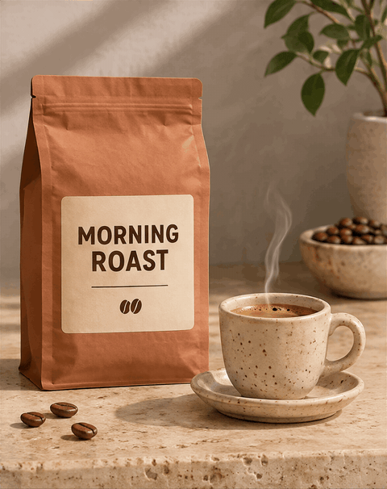

<sub>9 帧 · 480×606 · 1.8s · GPT Image 2.6</sub>

📌 **来源：** [Fuxuan Guo on ChatCut Blog](https://chatcut.io/blog/chatgpt-gif)

**提示词**

```text
Locked tripod commercial product shot in soft morning studio light. A matte terracotta kraft coffee bag with a clean cream front label reading "MORNING ROAST" in sharp dark-brown sans-serif type stands completely motionless beside a speckled stoneware espresso cup on a travertine counter. Only a thin ribbon of warm white steam curls gently upward from the cup and settles back to the exact starting wisp on the final frame for a clean loop. Keep the coffee bag, label text, and cup completely still across every frame.
```

`product` `coffee` `steam`

### 5. 左右摇摆的水杯产品动图


<sub>10 帧 · 480×480 · 2.0s · gpt-image-2.6-gif</sub>

📌 **来源：** [Curtis Pyke on Kingy AI](https://kingy.ai/blog/chatgpt-gifs-images-2-6-vs-2-5-hands-on-test/)

**提示词**

```text
Generate an actual animated GIF file, not a still picture, sprite sheet, video, or Python-coded animation. Square 512 by 512 pixels, a seamless 2-second loop. A bright orange reusable water bottle with a charcoal screw cap and a small turquoise circular badge remains centered on a pale gray studio background. The bottle rocks gently left and right and returns to its starting pose; the camera and background stay fixed. The bottle reads exactly "KINGY LAB" and "750 mL" throughout. No other text or objects. Use ChatGPT's native GIF generation and provide the downloadable GIF. If native GIF generation is unavailable, state that limitation rather than simulating it with code.
```

`product` `bottle` `api`

### 6. 智能手表亮屏


<sub>12 帧 · 358×358 · 2.2s · gpt-image-2.6 · 生成于 2026-11-18</sub>

**提示词**

```text
A round matte black smartwatch with a sage green strap lies on a light stone surface; its screen wakes up with a soft glow, the clock hands sweep into place, then the screen dims again. Minimal studio product shot, no text, no logos.
```

`smartwatch` `wearable` `product shot`

### 7. 转台上旋转的运动鞋


<sub>16 帧 · 380×250 · 1.9s · gpt-image-2.6 · 生成于 2026-11-18</sub>

**提示词**

```text
A clean white running sneaker with a mint green sole slowly rotates on a round white turntable, a soft highlight sliding across the toe. Studio product shot, pale grey seamless background, no text.
```

`sneaker` `turntable` `ecommerce`

## 美食饮品

### 1. 手绘风热咖啡冒热气


<sub>12 帧 · 358×358 · 2.7s · GPT Image 2.6</sub>

📌 **来源：** [牧牧的成長實驗室 on 方格子 vocus](https://vocus.cc/article/6aebf9a0fd8978000170526d)

**提示词**

```text
製作一張溫暖手繪風 GIF。木桌上放著一杯熱咖啡，杯子與背景保持完全靜止，只有白色蒸氣緩慢向上飄動。柔和晨光、咖啡館氛圍，畫面自然循環。
```

`coffee` `hand-drawn` `cozy`

### 2. 阳光咖啡馆里冒热气的拉花拿铁


<sub>16 帧 · 309×310 · 4.0s · GPT Image 2.6</sub>

📌 **来源：** [蘇柔瑋 on 數位時代 BusinessNext](https://www.bnext.com.tw/article/92943/chatgpt-gif-generator-prompts)

**提示词**

```text
請製作一張 1:1 正方形 GIF 動畫。畫面中央是一杯放在木桌上的熱拿鐵，杯中有精緻的愛心拉花，背景是陽光灑落的日系咖啡廳。讓咖啡上方的白色蒸氣緩緩向上飄動，窗邊的薄紗窗簾輕輕晃動，陽光保持溫暖柔和。採用高質感寫實攝影風格，固定鏡頭，杯子、桌面與拉花完全保持靜止。動畫長度約 4 秒，節奏緩慢、自然流暢，適合無縫循環播放，不要加入文字。
```

`coffee` `cafe` `steam`

### 3. 披萨拉丝


<sub>16 帧 · 380×249 · 1.9s · gpt-image-2.6 · 生成于 2026-11-18</sub>

**提示词**

```text
A hand lifts one slice of pepperoni pizza away from the whole pie, long strings of melted mozzarella stretching between the slice and the pan, then the slice settles back into place. Warm close-up food illustration, rustic wooden table.
```

`pizza` `cheese` `food`

### 4. 奶茶加珍珠


<sub>16 帧 · 322×292 · 2.2s · gpt-image-2.6 · 生成于 2026-11-18</sub>

**提示词**

```text
A clear cup of milk tea sits on a counter as a spoonful of dark tapioca pearls drops in and sinks, swirling brown sugar streaks along the glass. Bright cute flat illustration, pastel pink background.
```

`bubble tea` `boba` `drink`

## 动态头像

### 1. 宇航员猫咪眨眼头像


<sub>16 帧 · 306×308 · 2.9s · gpt-image-2.6 · 生成于 2026-11-18</sub>

**提示词**

```text
Circular profile avatar of a grey cat inside a round astronaut helmet, blinking slowly while a tiny star glints across the glass visor. Soft 3D clay style, navy blue background.
```

`avatar` `cat` `space`

### 2. 戴耳机点头的狐狸头像


<sub>9 帧 · 436×387 · 1.4s · gpt-image-2.6 · 生成于 2026-11-18</sub>

**提示词**

```text
Circular avatar of a red fox wearing chunky yellow headphones, eyes closed, nodding its head to a beat as small music notes pop beside it. Flat vector style, teal background.
```

`avatar` `fox` `music`

## 自己动手生成

使用 [ViNano AI API](https://vinano.ai/api-keys)：先创建 API Key，提交 GIF 生成任务，再轮询任务状态拿到 GIF 地址（每张 25 积分）。

```bash
# 1. Submit a GIF task — the response contains a task "uuid"
curl -X POST https://vinano.ai/api/async-openai-images \
  -H "Authorization: Bearer $VINANO_API_KEY" \
  -F mode=txt2img -F zeakaiModel=gpt-image-2.6-gif -F model="ViNano AI" \
  -F count=1 -F img_size=1k -F aspectRatio=1:1 \
  -F prompt="A cheerful cartoon cat waving hello. Animate it as a short, smooth, seamlessly looping GIF with clear motion between frames."

# 2. Poll until "completed" is true — the GIF URL is in "generated_images_url"
curl "https://vinano.ai/api/task-status?uuid=<uuid>" \
  -H "Authorization: Bearer $VINANO_API_KEY"
```

或者用仓库自带的脚本重新生成全部示例（需要 Node 18+）：

```bash
git clone https://github.com/ailingqu/awesome-ai-gif-prompts.git && cd awesome-ai-gif-prompts
cp .env.example .env   # fill in VINANO_API_KEY
npm run generate        # only generates prompts without a GIF
npm run build           # rebuilds README.md and README_zh.md
```

## 来源

没有来源标注的条目由我们编写并生成。标有 **来源** 的条目搜集自 X 和其它网站，提示词和 GIF 按原样展示，署名作者并链接到原帖，版权归原作者所有；作者如需修改或删除，请提交 issue。

## 参与贡献

欢迎提交新提示词！在 `data/prompts.json` 里新增一条，附上你生成的 GIF，然后运行 `npm run build`。详见 [CONTRIBUTING.md](CONTRIBUTING.md)。

## 许可

提示词与示例 GIF 采用 [CC BY 4.0](LICENSE)。觉得有用的话，点个 ⭐ 能让更多人看到。
