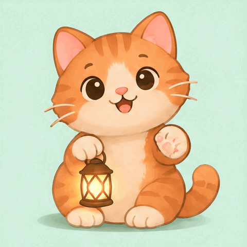
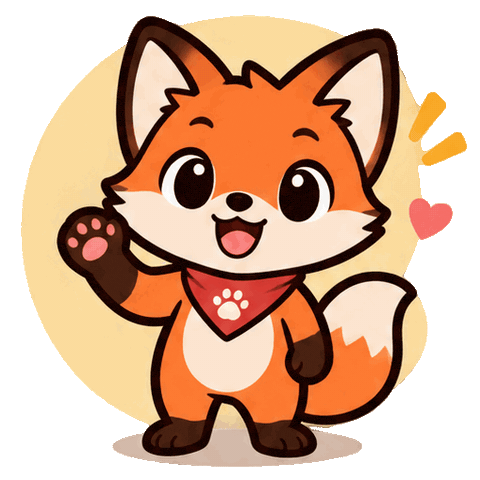
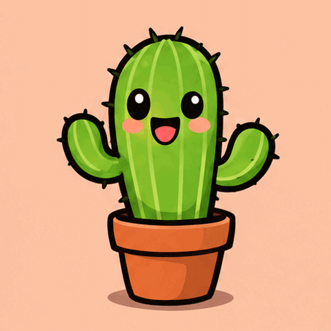
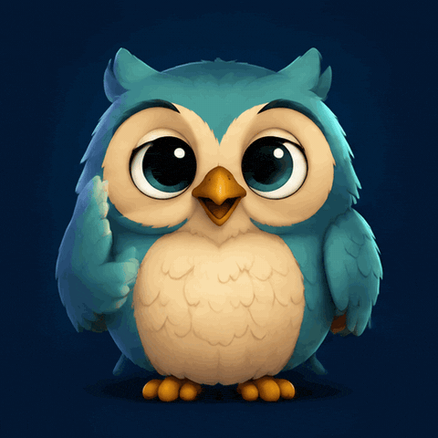
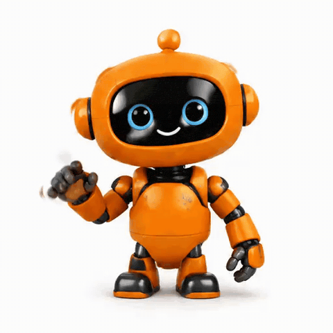
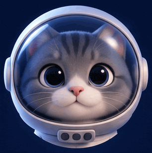
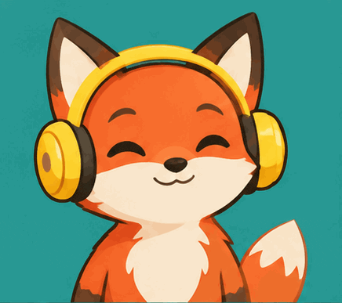

# Animated Avatars · 7 prompts

[← README](../README.md)

### 1. Orange Cat Mascot with a Lantern



<sub>9 frames · 480×480 · 1.8s · GPT Image 2.6 Flare</sub>

📌 **Source:** [Linger on Lightlyn Images](https://image.lightlyn.com/gpt-image-2-6?lang=en)

**Prompt**

```text
A cheerful round orange cat mascot with a tiny lantern, waving hello and blinking, soft flat illustration style, clean pastel background, gentle seamless loop.
```

`cat` `mascot` `lantern`

### 2. Orange Fox Mascot Hello



<sub>17 frames · 480×480 · 1.8s · GPT Image 2.6</sub>

📌 **Source:** [Veevid Team on Veevid Blog](https://veevid.ai/blog/gpt-image-2-6-gif)

**Prompt**

```text
A cute orange fox brand mascot waving hello and blinking, flat vector sticker style, thick outline, pastel background, seamless loop
```

`fox` `mascot` `wave`

### 3. Potted Cactus Mascot Wave



<sub>9 frames · 480×480 · 1.8s · GPT Image 2.6 Flare</sub>

📌 **Source:** [Veevid Team on Veevid Blog](https://veevid.ai/blog/gpt-image-2-6-gif)

**Prompt**

```text
Create a single animation sprite sheet for a seamless looping GIF. A cheerful cartoon cactus mascot in a small terracotta pot. The sequence: the cactus leans slightly left, raises one arm and waves, smiles and blinks, then leans back to center. Fixed front camera, same character, same pot, plain pastel peach background. Clear incremental arm and body motion; the last frame transitions smoothly back to the first. Flat vector sticker style, thick outline. No captions, no words, no logos, no borders, no gutters.
```

`cactus` `mascot` `wave`

### 4. Teal Owl Wing Wave



<sub>6 frames · 480×480 · 1.2s · GPT Image 2.6 Flare</sub>

📌 **Source:** [@az9713 on GitHub](https://github.com/az9713/gpt-image-2.6-demo/blob/HEAD/image_26_experiment/requests/21-gif-flare-owl.json)

**Prompt**

```text
A seamless looping animation of one adorable rounded teal owl with amber eyes, cream belly and tiny brass spectacles. Front view, fixed camera and scale, dark navy background. The owl blinks once and gently waves its right wing, returning to its starting pose. No text.
```

`owl` `mascot` `wave`

### 5. Small Orange Robot Waving



<sub>9 frames · 480×480 · 1.8s · GPT Image 2.6</sub>

📌 **Source:** [@morphedai on X](https://x.com/morphedai/status/2122359048293257288)

**Prompt**

```text
A friendly small orange robot waves one hand hello. Clean white background, fixed camera, simple rounded 3D illustration. A seamless loop.
```

`robot` `wave` `3d` `mascot`

### 6. Astronaut cat blinking



<sub>16 frames · 306×308 · 2.9s · gpt-image-2.6 · generated 2026-11-18</sub>

**Prompt**

```text
Circular profile avatar of a grey cat inside a round astronaut helmet, blinking slowly while a tiny star glints across the glass visor. Soft 3D clay style, navy blue background.
```

`avatar` `cat` `space`

### 7. Fox with headphones nodding



<sub>9 frames · 436×387 · 1.4s · gpt-image-2.6 · generated 2026-11-18</sub>

**Prompt**

```text
Circular avatar of a red fox wearing chunky yellow headphones, eyes closed, nodding its head to a beat as small music notes pop beside it. Flat vector style, teal background.
```

`avatar` `fox` `music`

[← README](../README.md)
