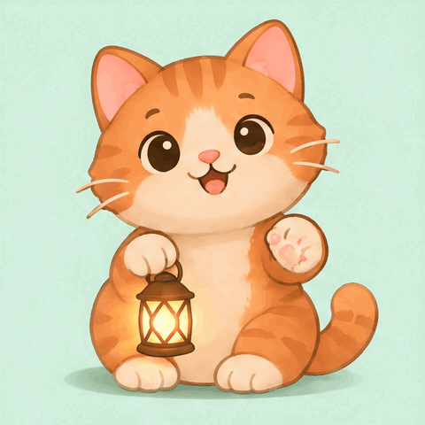
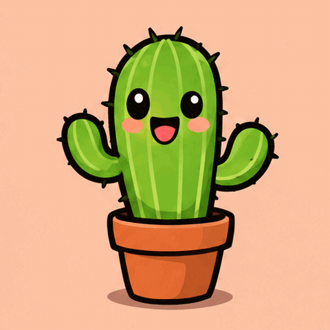
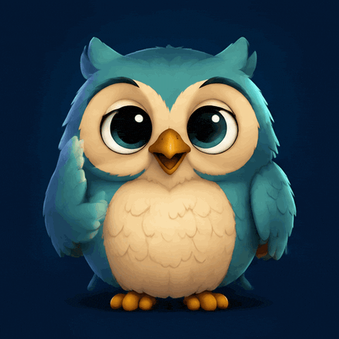
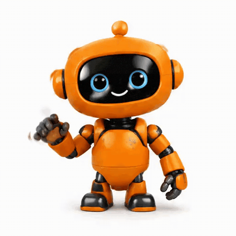
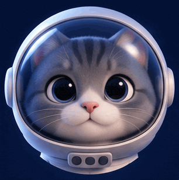
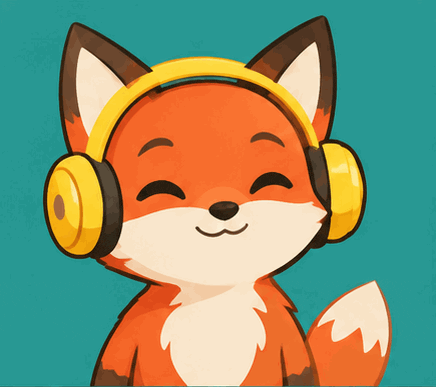

# 动态头像 · 7 条提示词

[← README](../README_zh.md)

### 1. 提灯橘猫吉祥物打招呼



<sub>9 帧 · 480×480 · 1.8s · GPT Image 2.6 Flare</sub>

📌 **来源：** [Linger on Lightlyn Images](https://image.lightlyn.com/gpt-image-2-6?lang=en)

**提示词**

```text
A cheerful round orange cat mascot with a tiny lantern, waving hello and blinking, soft flat illustration style, clean pastel background, gentle seamless loop.
```

`cat` `mascot` `lantern`

### 2. 橙色狐狸品牌吉祥物打招呼


<sub>17 帧 · 480×480 · 1.8s · GPT Image 2.6</sub>

📌 **来源：** [Veevid Team on Veevid Blog](https://veevid.ai/blog/gpt-image-2-6-gif)

**提示词**

```text
A cute orange fox brand mascot waving hello and blinking, flat vector sticker style, thick outline, pastel background, seamless loop
```

`fox` `mascot` `wave`

### 3. 陶盆仙人掌吉祥物招手



<sub>9 帧 · 480×480 · 1.8s · GPT Image 2.6 Flare</sub>

📌 **来源：** [Veevid Team on Veevid Blog](https://veevid.ai/blog/gpt-image-2-6-gif)

**提示词**

```text
Create a single animation sprite sheet for a seamless looping GIF. A cheerful cartoon cactus mascot in a small terracotta pot. The sequence: the cactus leans slightly left, raises one arm and waves, smiles and blinks, then leans back to center. Fixed front camera, same character, same pot, plain pastel peach background. Clear incremental arm and body motion; the last frame transitions smoothly back to the first. Flat vector sticker style, thick outline. No captions, no words, no logos, no borders, no gutters.
```

`cactus` `mascot` `wave`

### 4. 青色猫头鹰挥翅



<sub>6 帧 · 480×480 · 1.2s · GPT Image 2.6 Flare</sub>

📌 **来源：** [@az9713 on GitHub](https://github.com/az9713/gpt-image-2.6-demo/blob/HEAD/image_26_experiment/requests/21-gif-flare-owl.json)

**提示词**

```text
A seamless looping animation of one adorable rounded teal owl with amber eyes, cream belly and tiny brass spectacles. Front view, fixed camera and scale, dark navy background. The owl blinks once and gently waves its right wing, returning to its starting pose. No text.
```

`owl` `mascot` `wave`

### 5. 橙色小机器人挥手



<sub>9 帧 · 480×480 · 1.8s · GPT Image 2.6</sub>

📌 **来源：** [@morphedai on X](https://x.com/morphedai/status/2122359048293257288)

**提示词**

```text
A friendly small orange robot waves one hand hello. Clean white background, fixed camera, simple rounded 3D illustration. A seamless loop.
```

`robot` `wave` `3d` `mascot`

### 6. 宇航员猫咪眨眼头像



<sub>16 帧 · 306×308 · 2.9s · gpt-image-2.6 · 生成于 2026-11-18</sub>

**提示词**

```text
Circular profile avatar of a grey cat inside a round astronaut helmet, blinking slowly while a tiny star glints across the glass visor. Soft 3D clay style, navy blue background.
```

`avatar` `cat` `space`

### 7. 戴耳机点头的狐狸头像



<sub>9 帧 · 436×387 · 1.4s · gpt-image-2.6 · 生成于 2026-11-18</sub>

**提示词**

```text
Circular avatar of a red fox wearing chunky yellow headphones, eyes closed, nodding its head to a beat as small music notes pop beside it. Flat vector style, teal background.
```

`avatar` `fox` `music`

[← README](../README_zh.md)
