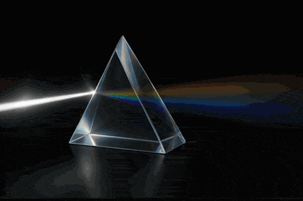
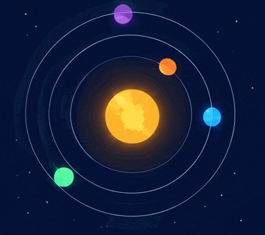
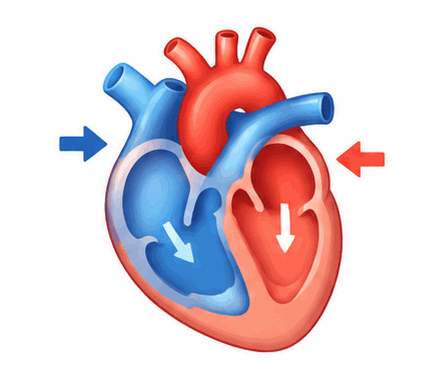
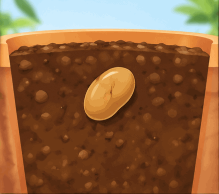
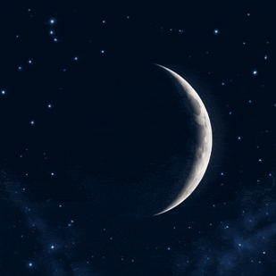
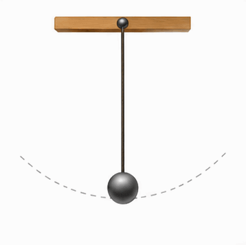

# Science & Explainers · 8 prompts

[← README](../README.md)

### 1. Seesaw lever balance


<sub>16 frames · 378×254 · 2.2s · gpt-image-2.6 · generated 2026-11-17</sub>

**Prompt**

```text
A simple wooden seesaw on a triangle pivot tips one way as a heavy block drops on one end, then a small block slides farther out on the other end until it balances level. Flat textbook illustration, white background, no text.
```

`lever` `physics` `simple-machines`

### 2. Prism splits light



<sub>16 frames · 380×252 · 1.9s · gpt-image-2.6 · generated 2026-11-17</sub>

**Prompt**

```text
A white beam of light enters a glass triangular prism and fans out into a rainbow on the other side, the rainbow shimmering gently. Dark background, clean science illustration, fixed camera.
```

`light` `prism` `physics`

### 3. Planets orbit the sun



<sub>9 frames · 439×390 · 1.4s · gpt-image-2.6 · generated 2026-11-17</sub>

**Prompt**

```text
A flat top-down diagram of a glowing sun with four colorful planets moving along thin circular orbits at different speeds. Dark navy background, simple clean shapes, no text.
```

`solar-system` `astronomy` `diagram`

### 4. Beating heart diagram



<sub>9 frames · 439×388 · 1.6s · gpt-image-2.6 · generated 2026-11-17</sub>

**Prompt**

```text
A friendly simplified anatomical heart in red and blue squeezes and relaxes in a steady beat, small arrows showing blood flowing in and out. Flat medical infographic style, light background, no text.
```

`heart` `biology` `infographic`

### 5. Bean sprouting underground



<sub>9 frames · 439×388 · 2.0s · gpt-image-2.6 · generated 2026-11-17</sub>

**Prompt**

```text
A cutaway of a soil pot shows a bean seed splitting open, a root reaching down and a pale shoot pushing up toward the surface. Soft flat educational illustration, brown and green palette, no text.
```

`plant` `germination` `biology`

### 6. Moon phases



<sub>16 frames · 309×309 · 1.9s · gpt-image-2.6 · generated 2026-11-17</sub>

**Prompt**

```text
A single moon centered in a square frame of dark starry sky goes through its phases, from thin crescent to full moon and back to crescent, the shadow edge sliding smoothly across it. Clean flat illustration, fixed camera.
```

`moon` `astronomy` `science`

### 7. Water cycle


<sub>16 frames · 380×252 · 2.9s · gpt-image-2.6 · generated 2026-11-17</sub>

**Prompt**

```text
A friendly cutaway landscape showing the water cycle: vapor rises from a lake, gathers into a cloud, rain falls on a mountain and flows back down a river into the lake. Flat educational illustration, soft blue palette, no text.
```

`water-cycle` `science` `diagram`

### 8. Pendulum swing



<sub>12 frames · 358×357 · 1.4s · gpt-image-2.6 · generated 2026-11-17</sub>

**Prompt**

```text
A simple science diagram of a pendulum: a metal ball on a string swings left and right from a fixed pivot, a faint dotted arc showing its path. Clean flat textbook illustration, white background, no text labels.
```

> 💡 **Tip:** Ask for no text labels; diagram text drifts between frames.

`physics` `pendulum` `science`

[← README](../README.md)
