# 快闪与品牌动效 · 87 条提示词

[← README](../README_zh.md)

### 1. 滑板 360 尖翻

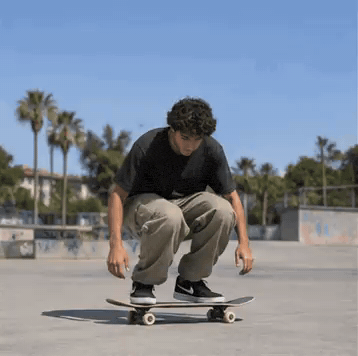

<sub>12 帧 · 358×356 · 1.3s · gpt-image-2.6-gif</sub>

📌 **来源：** [@justynclark on X](https://x.com/justynclark/status/2118189691820482677)

**提示词**

```text
Create a GIF of a 360 kickflip on a skateboard
```

`skateboard` `sport` `trick`

### 2. 成语物件猜谜：四个陶瓷摆件轮流弹跳

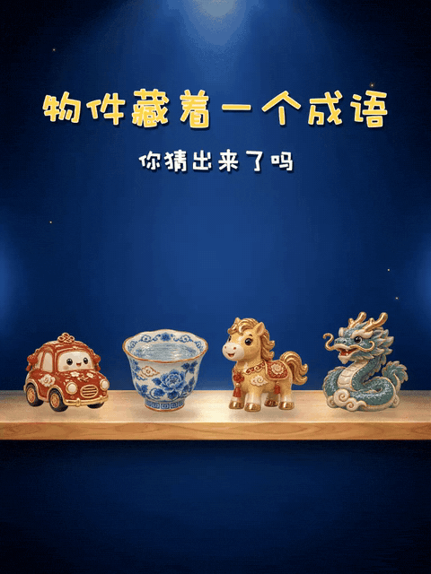

<sub>36 帧 · 480×640 · 3.0s · gpt-image-2.6-gif</sub>

📌 **来源：** [@GeekCatX on X](https://x.com/GeekCatX/status/2118160560290480519)

**提示词**

```text
制作一个中国成语物件猜谜 GIF 动图，竖版 3:4，精致可爱的短视频封面风格。

【输出规格】
输出一个可播放的 GIF 动图。
画面尺寸：768×1024 像素。
总时长：3秒，无限循环。
建议帧率：20fps，约60帧。
动画包含4个连续动作段，每段0.75秒，分别对应四件物品。
全程为同一个完整画面，镜头固定，构图固定，没有切镜、推拉、摇移或缩放。
【制作原则：同一母版，局部动画】
先建立一张完整的静态母版，再基于同一母版制作动画。
所有帧保持相同的背景、构图、文字、台面、物件造型、材质、颜色与光照。
只允许当前指定物件进行小幅竖直位移，并同步调整它的局部高光、接触阴影与倒影。
其余三个物件保持静止。
文字必须使用同一份静态图层，在全部帧中重复使用，不要逐帧重新绘制。
【背景】
深蓝色专业摄影棚背景，中心为柔和宝蓝色，向四周自然渐暗为午夜蓝。
背景纯净，具有轻微柔光晕，渐变细腻，没有明显纹理和杂乱装饰。
背景空白区域分布3—5个微小、低亮度的金色光点。
光点沿非常短的闭合轨迹缓慢漂浮，一个循环周期为3秒。
光点不穿过文字或物件，不闪烁、不突然出现或消失，循环结束时回到起始位置。
【文字：全程完全静止】
画面中只允许出现以下两行文字，不增加任何其他文字：
第一行：
物件藏着一个成语

第二行：
你猜出来了吗
第一行位于画面顶部居中，使用明黄色 #FFD54A 的超粗圆体大字，字形饱满圆润，带浅描边和轻微投影。
第二行位于第一行正下方，使用白色粗圆体，字号约为第一行的60%。

两行文字保持足够行距，四周预留安全边距，不贴边、不裁切。
汉字笔画完整，字形标准，清晰易读，无错别字。
在所有帧中，文字的位置、字号、字距、笔画、颜色、描边、阴影与透明度完全一致。
文字不参与弹跳、高光扫动、闪烁或任何其他动画。
【台面与构图】
画面中下部是一条横向浅木纹展示台。
台面干净，木纹细腻，具有柔和、克制的反光。
四件物品集中排列于画面中下部，物件组占画面宽度约85%—90%。
四件物品位于同一前后层级，静止时底部对齐于同一条台面接触基线。
它们具有接近的视觉体量，间距均匀，彼此留出清晰空隙。
不前后错落、不堆叠、不互相遮挡。

采用固定的轻微俯视角度，能够清楚看见杯口和水面，同时保持四件物品横向并排的秩序感。
【四件物品：顺序固定】
从左到右严格依次为：
一辆红色Q版小汽车。
圆润饱满，车身呈中国红，轮子与车窗清晰可辨，具有精致陶瓷玩具质感。

一个装满清水的青花瓷杯。
杯身具有细腻青花纹样，杯口清晰，能够看见透明清水与柔和水面反光。
杯身无文字，水面保持平稳，不溢出、不飞溅。
一匹金色Q版小马。
造型圆润可爱，具有清晰的马头、鬃毛、四肢与尾巴，表面为温润的金色陶瓷釉面。
一条青绿色盘身小龙。
中国传统小龙造型，身体盘曲，龙头微微抬起，龙角、龙须与鳞片适度简化，神态可爱，具有青绿色陶瓷釉面质感。

四件物品保持各自明确的识别特征。
物件表面没有文字、拼音、标签、数字或答案提示。
【动作规则】
所有物件均为刚性的陶瓷摆件，只允许整体轻轻向上移动，再回到原位。
不挤压、不拉伸、不旋转、不左右移动、不改变造型。

弹跳最高点距离原位约为画面高度的1%，动作轻巧、克制。
每个物件必须完整落回原位后，下一个物件才开始动作。
任意时刻，四件物品中最多只有一件正在运动。
当前物件弹起时，一道低强度、柔和的高光缓缓掠过其表面。
高光只作用于当前物件，不影响文字、背景和其他物件。
物件下方的阴影与倒影随高度轻微变化，落地后恢复母版状态。
小汽车轮子不转，小马不迈腿，小龙不摆尾、不转头。

【3秒动作时间线】
0.00—0.75秒：
红色小汽车完成一次轻轻弹起并落回原位。
瓷杯、小马、小龙保持静止。
0.75—1.50秒：
青花瓷杯完成一次轻轻弹起并落回原位。
汽车、小马、小龙保持静止。

1.50—2.25秒：
金色小马完成一次轻轻弹起并落回原位。
汽车、瓷杯、小龙保持静止。
2.25—3.00秒：
青绿色小龙完成一次轻轻弹起并落回原位。
汽车、瓷杯、小马保持静止。

每个0.75秒动作段均遵循：
短暂停住 → 平缓上升 → 平缓落下 → 落定后短暂停住。
上升和下落采用柔和缓入缓出，不突然跳位，不夸张弹震。

【无缝循环】
首帧与末帧完全一致：
四件物品全部落在原位，所有高光、阴影、倒影与背景光点均回到初始状态。
从末帧接回首帧时，没有位置跳变、亮度跳变或颜色闪动。
循环中不出现黑帧、白帧、残影或重影。

【整体质感】
精致可爱的Q版3D陶瓷摆件，圆润、细腻、通透。
以中国红、金色、青绿色和青花蓝点缀深蓝背景，融入克制的中国传统纹样细节。
顶部柔光配合左右轮廓光，物件边缘高光清晰，台面倒影柔和。
整体具有中国文化韵味，适合全年龄观看。
【禁止事项】
不出现成语答案。
不出现额外文字、水印、品牌标志或界面元素。
不出现分镜拼图、四宫格或多画面。
不改变四件物品的数量、顺序、造型、颜色或比例。
不让两个物件同时运动。
不让物件重叠、碰撞、堆叠或横向移位。
不让文字闪烁、变形、位移或重新生成。
不改变相机位置、背景亮度或整体色调。
```

`riddle` `chinese idiom` `3d`

### 3. 迷幻风跳舞猫

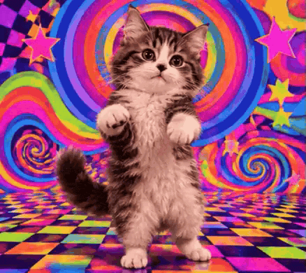

<sub>9 帧 · 438×390 · 1.4s · gpt-image-2.6-gif</sub>

📌 **来源：** [@xedrik7 on X](https://x.com/xedrik7/status/2118258491043483978)

**提示词**

```text
psychedelic gif of cat dancing
```

`cat` `psychedelic` `dance`

### 4. 烤鸡晚餐揭盖

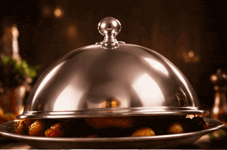

<sub>16 帧 · 380×252 · 2.9s · gpt-image-2.6 · 生成于 2026-11-17</sub>

**提示词**

```text
A silver dome lid lifts off a golden roast chicken on a platter, a burst of steam rising and a few herb leaves falling onto it. Warm festive food ad style, dark wood background.
```

`dinner` `holiday` `food`

### 5. 爆米花蹦出来

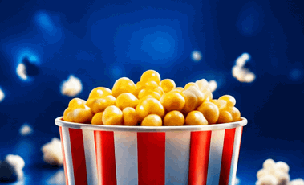

<sub>16 帧 · 379×230 · 2.2s · gpt-image-2.6 · 生成于 2026-11-17</sub>

**提示词**

```text
Kernels in a red and white striped bowl burst into fluffy popcorn one by one, some pieces jumping out and tumbling back in. Bold movie-night ad style, deep blue background.
```

`popcorn` `snack` `movie`

### 6. 平底锅翻煎饼

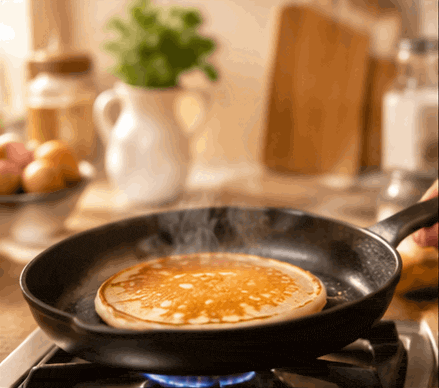

<sub>9 帧 · 439×388 · 1.3s · gpt-image-2.6 · 生成于 2026-11-17</sub>

**提示词**

```text
A golden pancake is tossed up from a cast iron pan, flips once in the air and lands back with a little puff of steam. Bright food ad style, warm kitchen background, fixed camera.
```

`pancake` `food` `kitchen`

### 7. 旅行手账贴纸逐个贴上

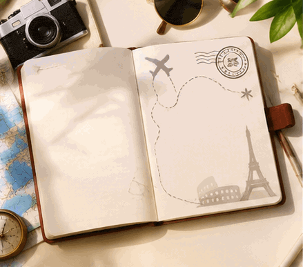

<sub>9 帧 · 439×387 · 2.0s · gpt-image-2.6 · 生成于 2026-11-17</sub>

**提示词**

```text
An open travel journal on an ivory desk; little stickers of a plane, a ticket stub, a palm tree and a stamp pop onto the page one after another with a soft bounce. Cozy scrapbook style, overhead camera.
```

`scrapbook` `travel` `journal`

### 8. 木棋子翻面落定

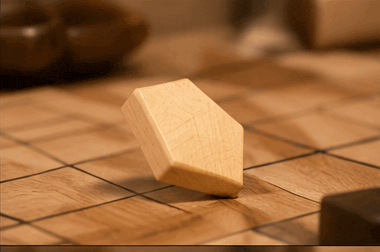

<sub>16 帧 · 380×252 · 1.9s · gpt-image-2.6 · 生成于 2026-11-17</sub>

**提示词**

```text
A pale wooden pentagon-shaped board game piece flips over in the air and lands with a small clack on a wooden grid board, a puff of dust at impact. Warm tabletop lighting, close-up, fixed camera.
```

`board-game` `wood` `flip`

### 9. 包豪斯几何块换位

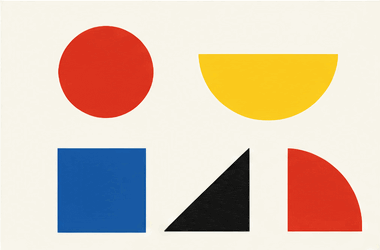

<sub>16 帧 · 380×250 · 2.6s · gpt-image-2.6 · 生成于 2026-11-17</sub>

**提示词**

```text
A grid of Bauhaus shapes in red, yellow, blue and black, circles, half circles, squares and triangles, slide and rotate into new positions in crisp steps. Flat poster style, off-white background.
```

`bauhaus` `geometric` `motion-design`

### 10. 蹦跳的购物袋

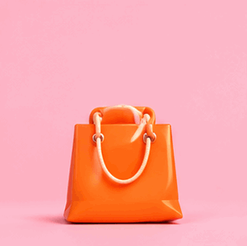

<sub>16 帧 · 307×306 · 2.2s · gpt-image-2.6 · 生成于 2026-11-17</sub>

**提示词**

```text
A glossy orange shopping bag with rope handles hops up, squashes on landing, and a little gift box pops out of the top and drops back in. Playful 3D product style, pastel pink background.
```

`shopping` `bag` `promo`

### 11. 摇摆的促销吊牌


<sub>16 帧 · 313×302 · 1.4s · gpt-image-2.6 · 生成于 2026-11-17</sub>

**提示词**

```text
A red paper price tag that says SALE hangs from a string and swings left and right with a tiny bounce, a few gold sparkles popping around it. Bold flat ad style, solid black background edge to edge in every frame.
```

> 💡 **技巧：** 画面文字只放一个短词，长文字在帧之间容易变形。

`sale` `black-friday` `ad`

### 12. 粉饼盒打开

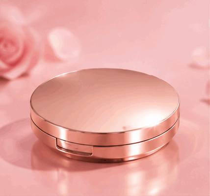

<sub>9 帧 · 428×398 · 1.6s · gpt-image-2.6 · 生成于 2026-11-17</sub>

**提示词**

```text
A rose-gold makeup compact clicks open, the mirror catches a flash of light and a little powder puff lifts out. Elegant beauty product shot, blush pink background.
```

`beauty` `product` `compact`

### 13. 键帽波浪按压

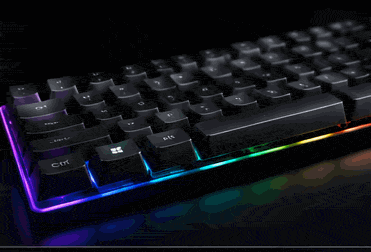

<sub>16 帧 · 371×252 · 1.8s · gpt-image-2.6 · 生成于 2026-11-17</sub>

**提示词**

```text
Mechanical keyboard keycaps press down one after another in a wave from left to right, RGB glow following underneath. Sleek product shot, dark background.
```

`keyboard` `product` `tech`

### 14. 冰块落入柠檬水

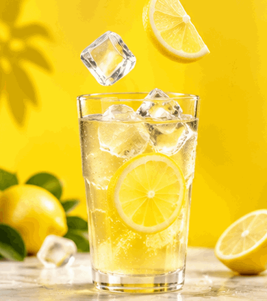

<sub>9 帧 · 390×439 · 1.4s · gpt-image-2.6 · 生成于 2026-11-17</sub>

**提示词**

```text
Ice cubes and a lemon slice drop into a tall glass of lemonade, splashing droplets and fizzing bubbles. Fresh summer drink ad style, sunny yellow background.
```

`drink` `summer` `ad`

### 15. 魔法书游戏菜单

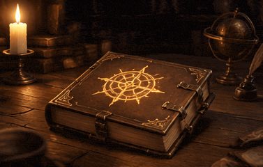

<sub>16 帧 · 377×240 · 2.9s · gpt-image-2.6 · 生成于 2026-11-17</sub>

**提示词**

```text
A worn leather spellbook drops onto a wooden table, flips open, and three glowing menu buttons rise out of its pages. Fantasy game UI style, warm candlelight, dark background.
```

`book` `game` `menu`

### 16. 墨镜反光扫过

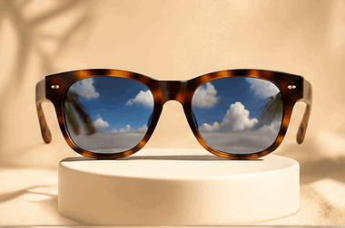

<sub>16 帧 · 380×252 · 1.9s · gpt-image-2.6 · 生成于 2026-11-17</sub>

**提示词**

```text
A pair of tortoiseshell sunglasses rotates gently on a stand while a reflection of blue sky and clouds sweeps across the lenses. Summer product shot, sand-colored backdrop.
```

`sunglasses` `product` `summer`

### 17. 巧克力掰开

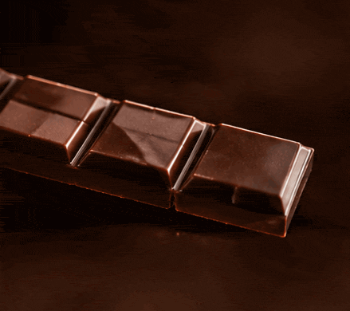

<sub>9 帧 · 439×390 · 1.4s · gpt-image-2.6 · 生成于 2026-11-17</sub>

**提示词**

```text
A dark chocolate bar snaps cleanly in half and small crumbs pop into the air. Close-up food photography, deep brown backdrop, dramatic side light.
```

`chocolate` `food` `product`

### 18. 甜甜圈旋转撒糖

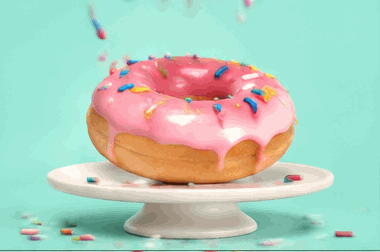

<sub>16 帧 · 380×252 · 2.6s · gpt-image-2.6 · 生成于 2026-11-17</sub>

**提示词**

```text
A glazed pink donut turns slowly on a small pedestal as rainbow sprinkles rain down and stick to the icing. Playful bakery ad, mint background.
```

`donut` `food` `ad`

### 19. 书里飞出纸鸟

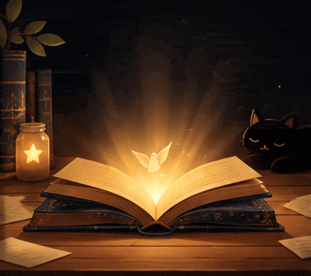

<sub>9 帧 · 439×390 · 1.6s · gpt-image-2.6 · 生成于 2026-11-17</sub>

**提示词**

```text
A hardcover book opens on a table, warm light spills out and a few small paper birds flutter up from the pages. Cozy illustrated style, dark background.
```

`book` `magic` `promo`

### 20. 雨伞弹开

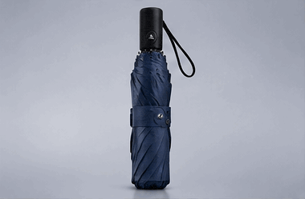

<sub>16 帧 · 380×249 · 1.9s · gpt-image-2.6 · 生成于 2026-11-17</sub>

**提示词**

```text
A navy folding umbrella pops open and spins once while raindrops bead and roll off its canopy. Product shot, soft gray studio background.
```

`umbrella` `product` `rain`

### 21. 汉堡层层落下

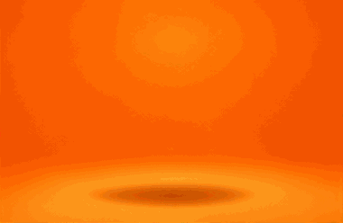

<sub>16 帧 · 380×248 · 2.2s · gpt-image-2.6 · 生成于 2026-11-17</sub>

**提示词**

```text
Burger layers drop from above one by one, bun, patty, cheese, lettuce, tomato, top bun, each landing with a little bounce. Bold food ad style, orange background.
```

`burger` `food` `ad`

### 22. 茶包入水晕开

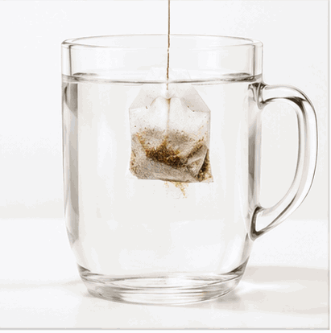

<sub>9 帧 · 411×414 · 1.6s · gpt-image-2.6 · 生成于 2026-11-13</sub>

**提示词**

```text
A tea bag is dipped into a clear glass mug of hot water and amber color blooms outward in soft swirls. Bright minimal product photo, white backdrop.
```

`tea` `product` `drink`

### 23. 球鞋落地回弹

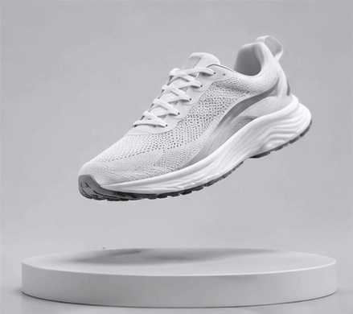

<sub>9 帧 · 439×390 · 1.1s · gpt-image-2.6 · 生成于 2026-11-13</sub>

**提示词**

```text
A white running sneaker drops onto a round platform, the sole squashes and springs back, sending a small ring of dust outward. Clean studio product shot, light gray background.
```

`sneaker` `product` `bounce`

### 24. 面霜罐开盖

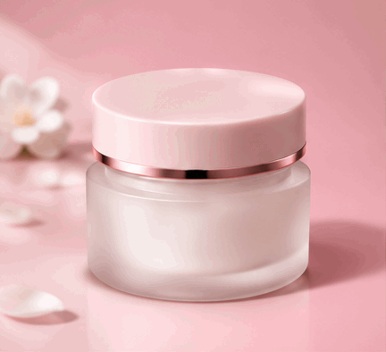

<sub>9 帧 · 432×394 · 1.6s · gpt-image-2.6 · 生成于 2026-11-13</sub>

**提示词**

```text
A frosted glass skincare jar's lid twists off and lifts, revealing smooth white cream as a soft sparkle passes over it. Minimal beauty product shot, blush pink backdrop.
```

`skincare` `product` `beauty`

### 25. 生日蛋糕彩纸


<sub>9 帧 · 439×390 · 1.6s · gpt-image-2.6 · 生成于 2026-11-13</sub>

**提示词**

```text
A pink frosted birthday cake with three lit candles sits on a table; the flames flicker and colorful confetti flutters down around it. Bright cheerful illustration, fixed camera.
```

`birthday` `cake` `celebration`

### 26. 浓缩咖啡萃取

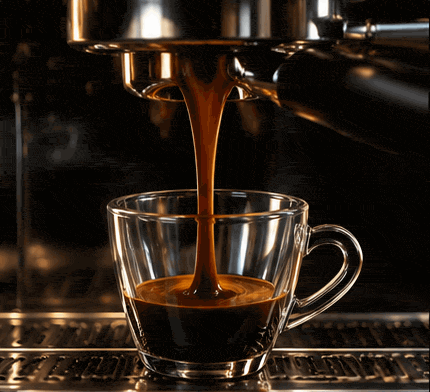

<sub>9 帧 · 430×392 · 1.6s · gpt-image-2.6 · 生成于 2026-11-13</sub>

**提示词**

```text
Close-up of a chrome espresso machine pulling a shot into a small glass cup; the dark stream thins to honey color and the crema swirls. Dark studio, warm rim light, fixed camera.
```

`coffee` `product` `espresso`

### 27. 文章头图纸飞机


<sub>9 帧 · 508×337 · 1.3s · gpt-image-2.6 · 生成于 2026-11-13</sub>

**提示词**

```text
A wide article header banner in soft pastel colors with the short title 'WEEKLY NOTES'; a small paper plane loops across the banner leaving a dotted trail while the title stays perfectly still.
```

> 💡 **技巧：** 标题要短，并写明文字不动；文字一动最容易错字。

`banner` `header` `text`

### 28. 亚克力挂件转动

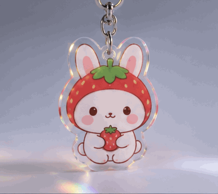

<sub>9 帧 · 438×390 · 1.6s · gpt-image-2.6 · 生成于 2026-11-13</sub>

**提示词**

```text
A clear acrylic keychain charm shaped like a bunny in a strawberry hat spins slowly on its metal ring, catching small rainbow glints on the edges. Product shot, soft gray gradient background.
```

`acrylic` `keychain` `merch`

### 29. 黄色大衣跳跃大片

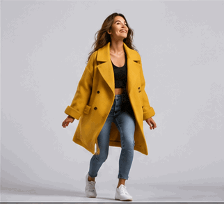

<sub>16 帧 · 322×293 · 1.9s · gpt-image-2.6 · 生成于 2026-11-12</sub>

**提示词**

```text
A fashion model in an oversized mustard-yellow coat leaps mid-air in a clean studio, the coat flaring out, then lands. Editorial fashion photography, plain pale gray backdrop.
```

`fashion` `editorial` `jump`

### 30. 把 logo 再放大点

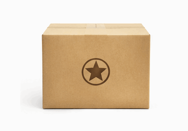

<sub>16 帧 · 376×261 · 1.9s · gpt-image-2.6 · 生成于 2026-11-12</sub>

**提示词**

```text
A plain kraft shipping box on a white table; the simple round star emblem printed on it swells bigger and bigger until it nearly covers the box, then wobbles. Clean product shot, no real brands.
```

`product` `meme` `logo`

### 31. 同一个盘子换菜

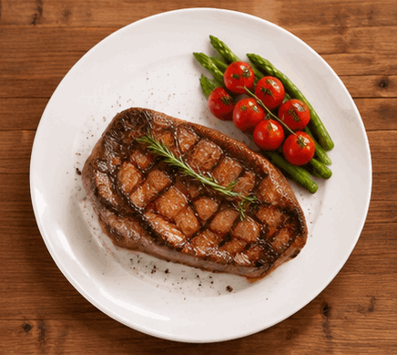

<sub>9 帧 · 436×389 · 3.1s · gpt-image-2.6 · 生成于 2026-11-12</sub>

**提示词**

```text
Top-down shot of one white plate on a fixed wooden table; the dish on it changes from a seared steak to a green salad to a bowl of pasta, nothing else moves. Food photography, fixed camera.
```

`food` `menu` `restaurant`

### 32. 乐器联动的动态签名

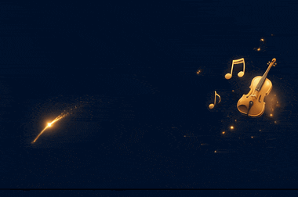

<sub>16 帧 · 380×252 · 2.2s · gpt-image-2.6 · 生成于 2026-11-12</sub>

**提示词**

```text
A flowing gold handwritten signature draws itself across a dark navy card while tiny music notes and glowing particles spill from a small violin icon beside it. Elegant minimal style.
```

`signature` `music` `particles`

### 33. 雪山大字标题登场


<sub>9 帧 · 439×390 · 1.6s · gpt-image-2.6 · 生成于 2026-11-12</sub>

**提示词**

```text
The single bold word WILD rises letter by letter over a misty snow-capped mountain range at sunrise, the fog drifting slowly behind it. Editorial poster typography, fixed camera.
```

`typography` `title` `landscape`

### 34. 咖啡豆飞溅

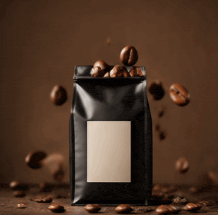

<sub>16 帧 · 309×306 · 1.9s · gpt-image-2.6 · 生成于 2026-11-12</sub>

**提示词**

```text
A matte black coffee bag with a blank label, roasted beans burst up from behind it and fall back down. Dark moody product photography, plain brown background.
```

`product` `coffee` `ad`

### 35. 手机开箱

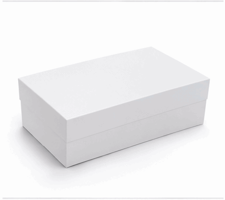

<sub>9 帧 · 446×395 · 1.6s · gpt-image-2.6 · 生成于 2026-11-12</sub>

**提示词**

```text
A plain white box lid lifts off to reveal a generic slim smartphone that rises slightly with a soft shine. Clean 3D product render, plain white background, no logos.
```

`product` `tech` `unboxing`

### 36. 香薰蜡烛点亮

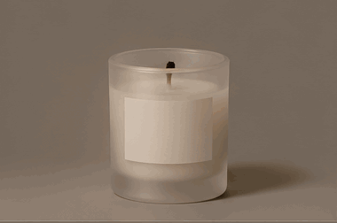

<sub>16 帧 · 380×252 · 2.9s · gpt-image-2.6 · 生成于 2026-11-12</sub>

**提示词**

```text
A frosted glass candle jar with a blank label, the wick sparks and lights, warm glow spreading across the jar. Minimal product shot, plain warm gray background.
```

`product` `candle` `ad`

### 37. 运动鞋自动系鞋带

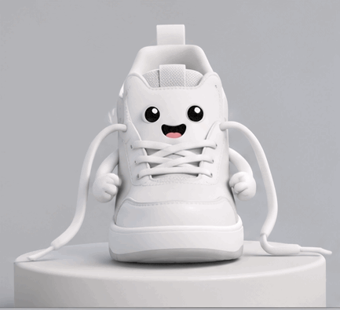

<sub>9 帧 · 433×395 · 1.6s · gpt-image-2.6 · 生成于 2026-11-12</sub>

**提示词**

```text
A white sneaker on a pedestal ties its own laces into a neat bow, then gives a tiny bounce. Clean 3D product render, plain light gray background.
```

`product` `fashion` `3d`

### 38. 冰淇淋滴落广告

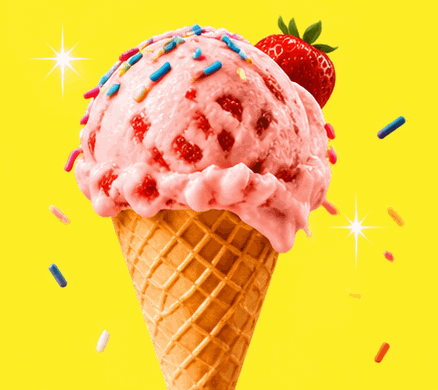

<sub>9 帧 · 438×390 · 1.4s · gpt-image-2.6 · 生成于 2026-11-12</sub>

**提示词**

```text
A pink strawberry ice cream cone slowly drips one drop of melted cream while sprinkles sparkle around it. Bold product ad style, plain bright yellow background.
```

`product` `food` `ad`

### 39. 蜂蜜滴落


<sub>16 帧 · 380×252 · 2.2s · gpt-image-2.6 · 生成于 2026-11-11</sub>

**提示词**

```text
A wooden honey dipper lifts above a jar, a thick ribbon of golden honey drizzles down and folds over itself into the jar. Warm backlit food photography, shallow depth of field.
```

`food` `product` `macro`

### 40. 精华滴管


<sub>9 帧 · 439×390 · 1.6s · gpt-image-2.6 · 生成于 2026-11-11</sub>

**提示词**

```text
A glass skincare dropper squeezes out one clear golden drop that falls into an open amber serum bottle, a ripple spreading on the surface. Clean luxury product photography on soft cream with gentle reflections.
```

`product` `beauty` `skincare`

### 41. 冰镇汽水罐

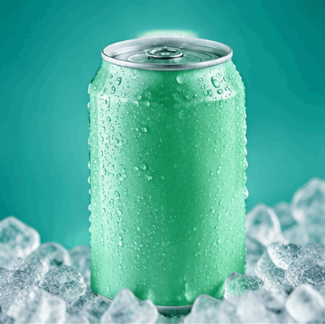

<sub>9 帧 · 414×413 · 1.6s · gpt-image-2.6 · 生成于 2026-11-11</sub>

**提示词**

```text
An unbranded mint-green soda can covered in cold condensation stands on crushed ice; water droplets roll down, the tab pops open and fine fizz mist puffs out. High-key product photography on teal.
```

`product` `drink` `ecommerce`

### 42. 麦片倒牛奶

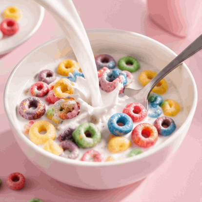

<sub>9 帧 · 414×414 · 1.6s · gpt-image-2.6 · 生成于 2026-11-11</sub>

**提示词**

```text
Milk pours into a white bowl of colorful ring cereal, the rings bob up and swirl around a spoon. Bright overhead food photography on a pale pink table.
```

`food` `product` `breakfast`

### 43. 照片卡片错位滑动

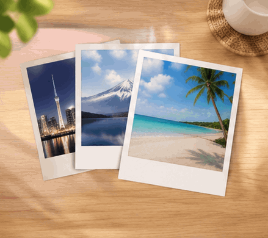

<sub>9 帧 · 439×390 · 1.6s · gpt-image-2.6 · 生成于 2026-11-11</sub>

**提示词**

```text
Three overlapping instant photo cards showing a beach, a mountain and a city at night sit on a light wood table; the top card slides out to the right and tucks behind the stack, revealing the next one. Top-down view, soft natural light.
```

`photo` `layout` `social`

### 44. 陶瓷花瓶转台

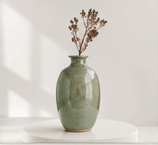

<sub>16 帧 · 322×297 · 1.9s · gpt-image-2.6 · 生成于 2026-11-11</sub>

**提示词**

```text
A speckled sage-green ceramic vase holding one dried branch rotates a full turn on a white turntable; soft window light glides across its glaze. Minimal studio product photography on off-white.
```

`product` `ceramic` `turntable`

### 45. 开幕帷幕与彩纸

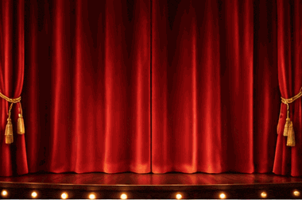

<sub>16 帧 · 380×252 · 2.2s · gpt-image-2.6 · 生成于 2026-11-11</sub>

**提示词**

```text
Red velvet theater curtains part on a small stage; a spotlight sweeps across and gold confetti bursts down over an empty microphone stand. Bright festive illustration, fixed front view.
```

`event` `announcement` `celebration`

### 46. 耳机盒开盖

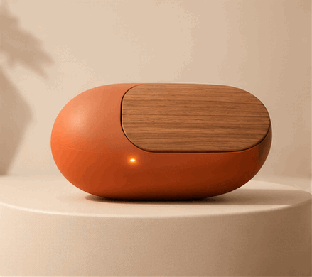

<sub>9 帧 · 439×390 · 1.6s · gpt-image-2.6 · 生成于 2026-11-11</sub>

**提示词**

```text
A matte terracotta-orange egg-shaped charging case with a wooden lid sits on a beige pedestal; the lid slides open sideways, a tiny amber light blinks, and two round pebble-shaped earbuds with no stems rise slightly and settle back. Clean studio product photography, soft shadow.
```

`product` `tech` `ecommerce`

### 47. 中文草书签名

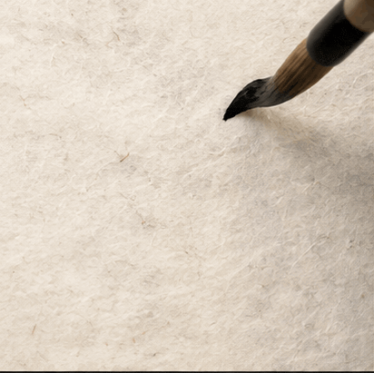

<sub>9 帧 · 412×411 · 1.6s · gpt-image-2.6 · 生成于 2026-11-11</sub>

**提示词**

```text
On textured rice paper, a black ink brush writes two Chinese characters in flowing cursive calligraphy, stroke by stroke, then a small red square seal stamps down beside them. Top-down view, fixed camera.
```

> 💡 **技巧：** 两三个字最稳；模型偶尔会多出笔画，逐帧检查。

`signature` `calligraphy` `text`

### 48. 水彩街景翻页书

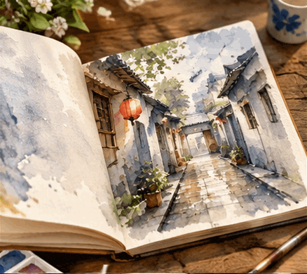

<sub>9 帧 · 438×390 · 2.0s · gpt-image-2.6 · 生成于 2026-11-10</sub>

**提示词**

```text
A sketchbook lies open and its pages turn by themselves, each showing a loose watercolor street scene: a narrow alley with lanterns, a tram crossing, a rainy crosswalk. Soft wet-paper watercolor style.
```

`watercolor` `sketchbook` `city`

### 49. 玻璃罐里的小岛

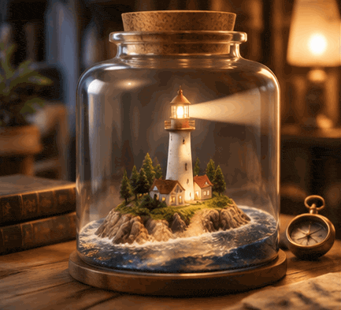

<sub>9 帧 · 433×393 · 1.6s · gpt-image-2.6 · 生成于 2026-11-10</sub>

**提示词**

```text
A tiny island with a white lighthouse sealed inside a glass jar on a table; small waves lap at the shore and the lighthouse beam sweeps around inside the glass. Detailed miniature diorama, warm lamp light.
```

`miniature` `glass` `diorama`

### 50. 旅行明信片翻页

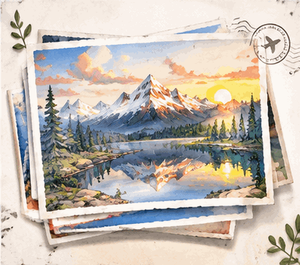

<sub>9 帧 · 436×386 · 2.7s · gpt-image-2.6 · 生成于 2026-11-10</sub>

**提示词**

```text
A stack of illustrated travel postcards flips one after another: a mountain lake at sunrise, a white seaside town, a red desert canyon. Gouache illustration style, slight paper texture, centered framing.
```

`travel` `illustration` `flip`

### 51. 漫画风 BOOM 海报


<sub>9 帧 · 438×388 · 1.3s · gpt-image-2.6 · 生成于 2026-11-10</sub>

**提示词**

```text
A halftone comic-print poster: a small cartoon rocket blasts upward and a big jagged yellow BOOM burst pops in behind it with action lines. Bold CMYK offset-print texture, red background.
```

`poster` `comic` `text`

### 52. 3D 金币旋转


<sub>16 帧 · 309×309 · 1.8s · gpt-image-2.6 · 生成于 2026-11-10</sub>

**提示词**

```text
A thick 3D gold coin embossed with a simple star emblem spins smoothly on its vertical axis, catching a glint of light on each turn. Studio render, dark charcoal background, soft floor reflection.
```

`3d` `coin` `spin`

### 53. 戴上耳机，街道瞬间安静

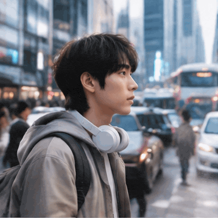

<sub>12 帧 · 358×357 · 2.2s · gpt-image-2.6 · 生成于 2026-11-10</sub>

**提示词**

```text
Stylized illustration: a person on a crowded noisy street with honking cars puts on over-ear headphones, and the whole street dissolves into a calm bright white studio around them. Clean ad visual, side profile, fixed camera.
```

`product` `ad` `before-after`

### 54. 星云闪烁的美甲片

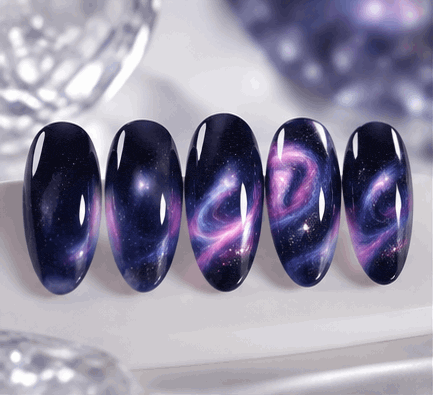

<sub>8 帧 · 433×395 · 1.4s · gpt-image-2.6 · 生成于 2026-11-10</sub>

**提示词**

```text
Five glossy almond-shaped nail tips on a white display stand, each painted deep navy; a swirling purple and pink nebula with tiny glitter stars drifts across their surface. Macro beauty product shot.
```

`beauty` `product` `sparkle`

### 55. 一个瓶子三个世界

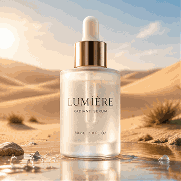

<sub>12 帧 · 358×358 · 2.2s · gpt-image-2.6 · 生成于 2026-11-10</sub>

**提示词**

```text
A frosted glass serum bottle stays fixed in the center while the world behind it changes: a sunlit desert dune, then a deep blue underwater reef, then a misty green forest. Premium product photography, soft reflections.
```

`product` `ad` `background`

### 56. 金色签名自己写出来

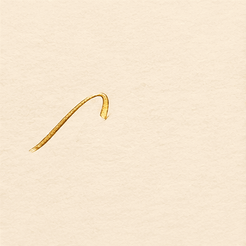

<sub>9 帧 · 414×414 · 1.6s · gpt-image-2.6 · 生成于 2026-11-10</sub>

**提示词**

```text
An elegant cursive signature reading Mira writes itself stroke by stroke in shimmering gold ink on cream paper, finishing with a small star flourish that sparkles once. Clean top-down view.
```

`signature` `text` `brand`

### 57. 极简手表特写

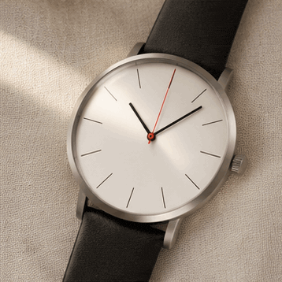

<sub>12 帧 · 358×358 · 2.2s · gpt-image-2.6 · 生成于 2026-11-09</sub>

**提示词**

```text
A minimalist wristwatch with a white dial lying on a linen surface, the second hand sweeping around, a band of light passing over the glass. Clean product photography, fixed camera.
```

`product` `watch` `minimal`

### 58. 旋出的口红

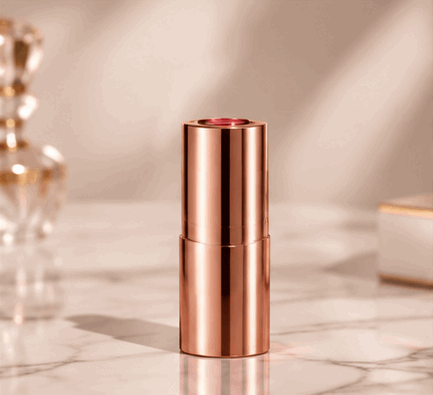

<sub>9 帧 · 433×395 · 1.6s · gpt-image-2.6 · 生成于 2026-11-09</sub>

**提示词**

```text
A lipstick in a plain smooth rose-gold cylindrical case with no logo, letters or markings, standing on a marble surface: the red bullet twists slowly up out of the case and a light glint slides across the metal. Luxury beauty product shot, soft shadows, fixed camera.
```

> 💡 **技巧：** 产品类要写明“no logo, letters or markings”，否则模型可能自己画出真实品牌的字母标。

`product` `beauty` `luxury`

### 59. 柑橘饮料瓶溅水


<sub>16 帧 · 380×252 · 1.9s · gpt-image-2.6 · 生成于 2026-11-09</sub>

**提示词**

```text
A glass bottle of orange juice with a plain unbranded label standing in the center, orange slices and water droplets bursting outward around it and falling back, the bottle staying perfectly still. Bright summer studio shot, fixed camera.
```

`product` `drink` `splash`

### 60. 悬浮旋转的耳机


<sub>9 帧 · 414×414 · 1.6s · gpt-image-2.6 · 生成于 2026-11-09</sub>

**提示词**

```text
A pair of matte white over-ear headphones floating above a round pedestal, slowly turning a quarter turn and bobbing gently while a soft coral rim light glows behind. Studio product shot, plain gradient background, fixed camera.
```

`product` `tech` `studio`

### 61. 虚构品牌标志展开


<sub>12 帧 · 358×358 · 2.2s · gpt-image-2.6 · 生成于 2026-11-09</sub>

**提示词**

```text
A minimal logo reveal on a deep green background for a fictional tea brand called "LEAF & CO": a single leaf line draws itself, a circle closes around it, the wordmark fades in below, then a soft glow sweeps across. Clean vector style.
```

`logo` `brand` `reveal`

### 62. 纸拼贴夜景逐块拼出


<sub>16 帧 · 379×252 · 2.9s · gpt-image-2.6 · 生成于 2026-11-09</sub>

**提示词**

```text
A paper collage on a blank cream page: torn paper pieces slide in one by one to build a night city skyline, then a pair of scissors snips out a paper moon that settles into the sky. Craft texture, visible paper edges, fixed camera.
```

> 💡 **技巧：** 做口播 B-roll 时，先定画面隐喻和最终静帧，再让画面从空白一块块拼出来。

`collage` `b-roll` `reveal`

### 63. 帆布包卖点标注


<sub>16 帧 · 380×252 · 2.9s · gpt-image-2.6 · 生成于 2026-11-08</sub>

**提示词**

```text
A product shot of a natural canvas tote bag; small glowing circle markers with plus icons appear one after another on the front pocket, the leather handle and the inner divider. Clean studio photography on beige.
```

`product` `ecommerce` `callout`

### 64. 马克杯换色展示


<sub>5 帧 · 350×883 · 2.3s · gpt-image-2.6 · 生成于 2026-11-08</sub>

**提示词**

```text
A single ceramic coffee mug shown whole and centered in a square frame, handle to the right, on a seamless white studio backdrop. Only the mug's glaze color changes from frame to frame — coral, sage green, navy, mustard, lilac — while its shape, position, shadow and lighting stay exactly the same.
```

> 💡 **技巧：** 换色展示会按颜色出帧（这里 5 帧）。第一次画面被裁、有接缝；写明整只杯子居中后修好了，但输出变成 350×883 的竖长条，需要的话再裁成方图。

`product` `colorway` `ecommerce`

### 65. 霓虹星星与环绕光轨


<sub>16 帧 · 380×252 · 1.9s · gpt-image-2.6 · 生成于 2026-11-08</sub>

**提示词**

```text
A neon sign shaped like a five-pointed star, outlined in orange-pink LED dots, glowing against a dark starfield while a thin comet-like light trail orbits around it and small stars twinkle.
```

`neon` `glow` `sign`

### 66. 房屋剖面展开


<sub>9 帧 · 432×395 · 2.0s · gpt-image-2.6 · 生成于 2026-11-08</sub>

**提示词**

```text
An isometric 3D cutaway of a small two-story house: the front wall slides away to reveal tiny furnished rooms, and the lights switch on room by room. Soft clay render on a light blue background.
```

`3d` `isometric` `reveal`

### 67. 网点漫画动感海报


<sub>9 帧 · 434×387 · 1.3s · gpt-image-2.6 · 生成于 2026-11-08</sub>

**提示词**

```text
A bold comic-style action poster: a masked fox thief in a long red coat leaps across the frame while red, black and white halftone burst rays pulse behind and speed lines flash. Graphic print style.
```

`poster` `comic` `bold`

### 68. 冰晶绽放


<sub>16 帧 · 378×249 · 2.2s · gpt-image-2.6 · 生成于 2026-11-08</sub>

**提示词**

```text
A pale blue ice crystal growing from the center of the frame, frost branches spreading outward like a snowflake and sparkling, cold mist curling at the edges. Anime game effect on a dark navy background.
```

`vfx` `ice` `game`

### 69. 水流旋涡球


<sub>16 帧 · 378×250 · 1.8s · gpt-image-2.6 · 生成于 2026-11-08</sub>

**提示词**

```text
A floating sphere of clear water with a spiral current turning inside it, small droplets orbiting around and catching light. Anime game skill effect on a deep teal background.
```

`vfx` `water` `game`

### 70. 瓶中闪电


<sub>8 帧 · 434×390 · 1.4s · gpt-image-2.6 · 生成于 2026-11-08</sub>

**提示词**

```text
A corked glass jar on a wooden table with a tiny bolt of blue-white lightning crackling inside, flashing and branching against the glass and lighting up the table. Painterly fantasy style, dim room.
```

`vfx` `lightning` `fantasy`

### 71. 火焰法阵


<sub>16 帧 · 370×252 · 1.9s · gpt-image-2.6 · 生成于 2026-11-08</sub>

**提示词**

```text
A glowing circular magic sigil on dark stone floor ignites into a ring of orange flames that swirl around its edge while embers drift upward. Stylized anime game effect, top-down three-quarter view, dark background.
```

`vfx` `fire` `game`

### 72. 礼物盒弹出小白鬼


<sub>16 帧 · 307×309 · 2.2s · gpt-image-2.6 · 生成于 2026-11-08</sub>

**提示词**

```text
A glossy red cartoon gift box with a gold ribbon: the lid pops open and a tiny round white ghost springs out on a coiled spring, bouncing with a jelly-like wobble. Soft rounded 3D render on a mint background, square 1:1.
```

`3d` `surprise` `bouncy`

### 73. 同一只狐狸换六种材质


<sub>6 帧 · 508×508 · 3.6s · gpt-image-2.6 · 生成于 2026-11-07</sub>

**提示词**

```text
The same sitting fox in the same pose, each frame rendered in a different material: felt, paper cut, risograph print, pixel art, glossy Y2K chrome, clay. Centered, identical framing, plain background.
```

`style` `material` `comparison`

### 74. 城堡拔地而起


<sub>16 帧 · 380×252 · 2.9s · gpt-image-2.6 · 生成于 2026-11-07</sub>

**提示词**

```text
A medieval stone castle on a green hill building itself up from the foundation: walls rise, towers grow, then flags pop up on top. Fixed camera, isometric storybook illustration.
```

`build` `castle` `timelapse`

### 75. 小人们搭建三明治


<sub>9 帧 · 438×389 · 1.6s · gpt-image-2.6 · 生成于 2026-11-07</sub>

**提示词**

```text
A team of miniature people in aprons on a full-size kitchen table hauling a lettuce leaf, a tomato slice and a cheese square onto a giant slice of bread using ropes and a tiny ladder. Tilt-shift macro photo style.
```

`miniature` `food` `funny`

### 76. 城市千年变迁


<sub>9 帧 · 439×385 · 4.0s · gpt-image-2.6 · 生成于 2026-11-07</sub>

**提示词**

```text
The same riverside city skyline from a fixed viewpoint changing era by era: low brick buildings, then glass towers, then floating platforms with glowing sky bridges. Cinematic matte painting style.
```

`timelapse` `city` `sci-fi`

### 77. 聊天气泡逐条弹出


<sub>9 帧 · 430×397 · 3.1s · gpt-image-2.6 · 生成于 2026-11-07</sub>

**提示词**

```text
A phone chat screen where three message bubbles pop in one by one: grey "Are you done yet?", blue "Almost!", grey "Send it!". Clean flat UI style on a white background.
```

`ui` `chat` `text`

### 78. 两行活动标题动效


<sub>9 帧 · 439×388 · 1.4s · gpt-image-2.6 · 生成于 2026-11-07</sub>

**提示词**

```text
A bold two-line title "SUMMER" and "MARKET 2026" sliding in from the left one line after the other on a sunny orange background, with small confetti pieces popping. Clean flat motion graphics.
```

`text` `title` `motion-graphics`

### 79. 香水瓶在水面旋转


<sub>9 帧 · 414×414 · 1.6s · gpt-image-2.6 · 生成于 2026-11-07</sub>

**提示词**

```text
A square amber perfume bottle labeled "SOL" slowly rotating on the surface of still water, rings of ripples spreading out, warm sunset reflections. Luxury product photography.
```

`product` `perfume` `water`

### 80. 产品背景光掠过


<sub>16 帧 · 379×252 · 2.9s · gpt-image-2.6 · 生成于 2026-11-07</sub>

**提示词**

```text
A frosted glass skincare bottle standing still on a beige stone plinth while a soft diagonal band of light sweeps slowly across the background from left to right. Minimal product photography.
```

`product` `ad` `light`

### 81. 霓虹 OPEN 招牌闪烁


<sub>12 帧 · 350×358 · 2.2s · gpt-image-2.6 · 生成于 2026-11-07</sub>

**提示词**

```text
A pink and blue neon "OPEN" sign in a dark shop window at night, buzzing and flickering on letter by letter, then glowing steadily. Realistic photo style.
```

`neon` `sign` `text`

### 82. 纸飞机从桌面滑到笔记本


<sub>12 帧 · 358×358 · 1.7s · gpt-image-2.6 · 生成于 2026-11-07</sub>

**提示词**

```text
An orange paper airplane with one navy stripe lifting off a wooden desk, gliding in a gentle arc and landing on an open notebook beside a pencil. Fixed camera, soft daylight, realistic photo style.
```

`storyboard` `object` `desk`

### 83. 杂志拼贴逐格弹出


<sub>9 帧 · 438×387 · 1.6s · gpt-image-2.6 · 生成于 2026-11-06</sub>

**提示词**

```text
A fashion-magazine collage layout where photo panels pop in one by one — a flower, a pair of sunglasses, a coffee cup, a city skyline — each with a small bounce, and finally a bold title bar reading "WEEKEND" slides in. Clean editorial design, cream background, coral and navy accents.
```

> 💡 **技巧：** 文字只放一个短单词，长标题在帧间仍会变形。

`flash-cut` `editorial` `layout`

### 84. 一棵树的四季


<sub>4 帧 · 764×508 · 2.6s · gpt-image-2.6 · 生成于 2026-11-06</sub>

**提示词**

```text
The same lone round tree on a small hill, framed identically in every frame, cycling through the four seasons: pink spring blossoms, lush green summer, orange autumn leaves falling, bare branches in winter snow. Soft flat illustration with a matching sky color for each season.
```

`flash-cut` `nature` `seasons`

### 85. 球鞋配色快闪


<sub>5 帧 · 349×883 · 1.8s · gpt-image-2.6 · 生成于 2026-11-06</sub>

**提示词**

```text
A fast flash-cut in a square frame: the same chunky sneaker seen from the side, centered and the same size in every frame, while its colorway and the full-bleed solid background change each frame: white and red on blue, black and lime on pink, cream and brown on orange, purple and silver on yellow, all-white on black. Clean studio product photography, the background fills the whole frame edge to edge.
```

> 💡 **技巧：** 固定产品角度和位置，只换配色，就是最经典的产品配色快闪。

`flash-cut` `product` `fashion`

### 86. 猫头 Logo 品牌快闪


<sub>8 帧 · 380×507 · 2.8s · gpt-image-2.6 · 生成于 2026-11-06</sub>

**提示词**

```text
A quick-cut brand reel for a fictional cat food brand called "MEOWBITE". The same flat dark-brown cat-head logo — round face, two short pointed ears, cream almond eyes, short whiskers — stays fixed at the center of every frame while everything around it changes: an orange full-bleed poster, a pink pouch of cat food, a blue ceramic cat bowl seen from above, a kraft shipping box, a round sticker, and a final dark frame with the word MEOWBITE in big cream letters. Bold graphic design, flat colors, citrus orange, cream and dark brown palette.
```

> 💡 **技巧：** 每一帧都锁定 Logo 的位置和大小，只换周围的场景，快闪才像同一个品牌。

`flash-cut` `branding` `logo`

### 87. 花卉微距快闪


<sub>8 帧 · 380×508 · 3.6s · gpt-image-2.6 · 生成于 2026-11-06</sub>

**提示词**

```text
A fast flash-cut sequence of eight different flower photographs, one per frame, each filling the whole frame: a red poppy shot from above with light glowing through its petals, a creamy gardenia in soft side light, blue delphinium against a deep blue background, a golden marigold macro, a pink peony from a high angle, a dark purple iris close-up, an orange lily with curled petals, and pale green hydrangea with dew drops. Realistic botanical fashion photography, each frame with a different color, distance and composition.
```

> 💡 **技巧：** 把每一帧写成独立的镜头。帧与帧之间颜色、角度、景别差异越大，快闪越有冲击力。

`flash-cut` `photography` `editorial`

[← README](../README_zh.md)
