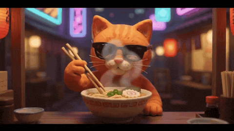
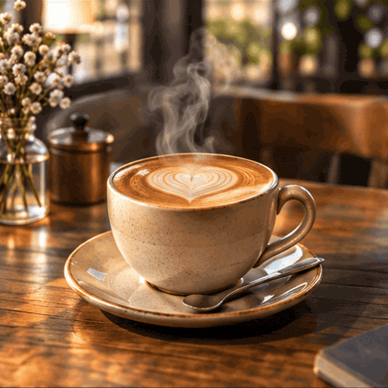
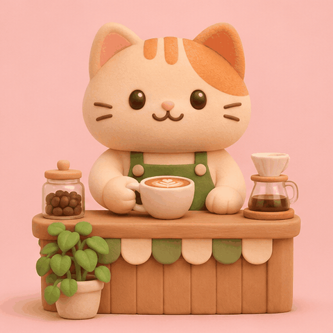
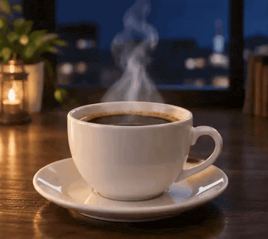
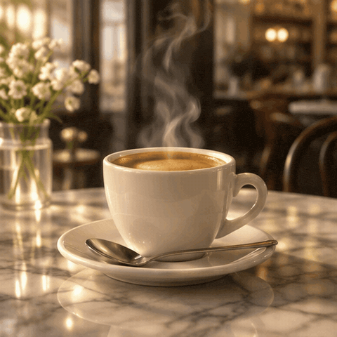
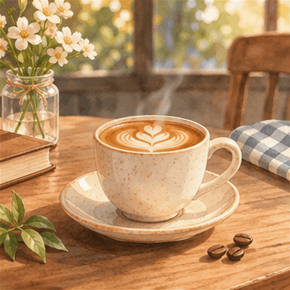
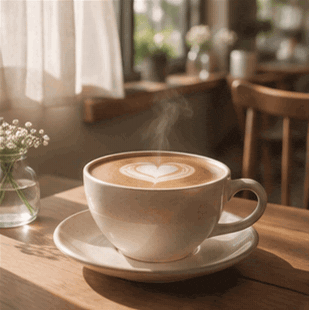
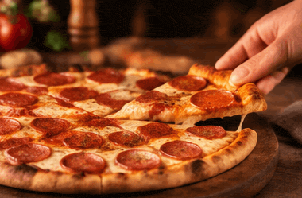
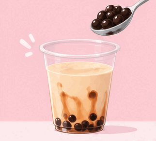

# Food & Drinks · 9 prompts

[← README](../README.md)

### 1. Clay Cat at a Neon Ramen Stall



<sub>30 frames · 480×270 · 3.0s · Gemini Omni 1.2 Flash</sub>

📌 **Source:** [@hiwise_aigc on X](https://x.com/hiwise_aigc/status/2123826646365188489)

**Prompt**

```text
生成一只戴着墨镜的橘猫，坐在霓虹闪烁的街头拉面摊前，用爪子挑起一筷子冒着热气的拉面。镜片上倒映着流动的彩色灯光，整体采用黏土定格动画风格，生成循环播放的 GIF
```

`cat` `ramen` `claymation`

### 2. Heart Latte by the Window



<sub>9 frames · 480×480 · 1.8s · GPT Image 2.6</sub>

📌 **Source:** [Veevid Team on Veevid Blog](https://veevid.ai/blog/gpt-image-2-6-gif)

**Prompt**

```text
A steaming ceramic coffee cup with heart latte art on a wooden cafe table, soft steam curling upward, warm morning window light, seamless loop
```

`coffee` `steam` `cafe`

### 3. Clay Cat Barista Coffee Sip



<sub>6 frames · 480×480 · 1.1s · Codex image generation (sprite sheet to GIF)</sub>

📌 **Source:** [@jkf87 on GitHub](https://github.com/jkf87/gif-maker-skill/blob/HEAD/README.md)

**Prompt**

```text
"A cute chubby clay cat barista wearing a tiny green apron" --motion "lifts a coffee cup, takes a sip, closes eyes happily, then returns exactly to the starting pose"
```

`cat` `coffee` `clay` `sprite-sheet`

### 4. Coffee Steam by a Night Window



<sub>18 frames · 438×390 · 4.1s · GPT Image 2.6</sub>

📌 **Source:** [@CoharuCrew on X](https://x.com/CoharuCrew/status/2120758651078005094)

**Prompt**

```text
湯気がゆらゆら立つコーヒーカップの、ループするGIFを作って。
もっとゆっくりにして、背景を夜の窓辺にして。
```

`coffee` `steam` `night` `cozy`

### 5. Espresso Steam Cinemagraph



<sub>9 frames · 480×480 · 1.8s · GPT Image 2.6</sub>

📌 **Source:** [Cadabra AI on Cadabra AI Blog](https://www.livinginmovie.com/en/blog/how-to-make-gif-in-chatgpt)

**Prompt**

```text
A seamless looping animated GIF, a cinemagraph of one espresso cup on a marble cafe table in warm morning light, photorealistic. The camera stays fixed and the cup and the table never move. Only the steam rises and curls slowly above the cup, and the last frame returns exactly to the first frame. No text anywhere.
```

`coffee` `cinemagraph` `steam` `product`

### 6. Hand-drawn coffee cup with rising steam



<sub>12 frames · 358×358 · 2.7s · GPT Image 2.6</sub>

📌 **Source:** [牧牧的成長實驗室 on 方格子 vocus](https://vocus.cc/article/6aebf9a0fd8978000170526d)

**Prompt**

```text
製作一張溫暖手繪風 GIF。木桌上放著一杯熱咖啡，杯子與背景保持完全靜止，只有白色蒸氣緩慢向上飄動。柔和晨光、咖啡館氛圍，畫面自然循環。
```

`coffee` `hand-drawn` `cozy`

### 7. Latte art with rising steam in a sunny cafe



<sub>16 frames · 309×310 · 4.0s · GPT Image 2.6</sub>

📌 **Source:** [蘇柔瑋 on 數位時代 BusinessNext](https://www.bnext.com.tw/article/92943/chatgpt-gif-generator-prompts)

**Prompt**

```text
請製作一張 1:1 正方形 GIF 動畫。畫面中央是一杯放在木桌上的熱拿鐵，杯中有精緻的愛心拉花，背景是陽光灑落的日系咖啡廳。讓咖啡上方的白色蒸氣緩緩向上飄動，窗邊的薄紗窗簾輕輕晃動，陽光保持溫暖柔和。採用高質感寫實攝影風格，固定鏡頭，杯子、桌面與拉花完全保持靜止。動畫長度約 4 秒，節奏緩慢、自然流暢，適合無縫循環播放，不要加入文字。
```

`coffee` `cafe` `steam`

### 8. Pizza slice cheese pull



<sub>16 frames · 380×249 · 1.9s · gpt-image-2.6 · generated 2026-11-18</sub>

**Prompt**

```text
A hand lifts one slice of pepperoni pizza away from the whole pie, long strings of melted mozzarella stretching between the slice and the pan, then the slice settles back into place. Warm close-up food illustration, rustic wooden table.
```

`pizza` `cheese` `food`

### 9. Milk tea pearls pour



<sub>16 frames · 322×292 · 2.2s · gpt-image-2.6 · generated 2026-11-18</sub>

**Prompt**

```text
A clear cup of milk tea sits on a counter as a spoonful of dark tapioca pearls drops in and sinks, swirling brown sugar streaks along the glass. Bright cute flat illustration, pastel pink background.
```

`bubble tea` `boba` `drink`

[← README](../README.md)
