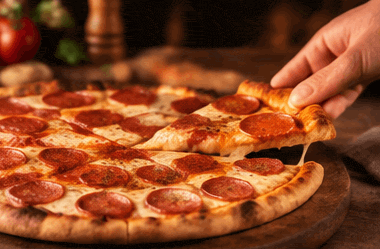
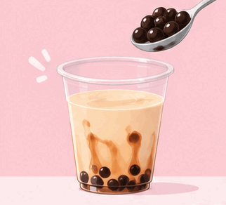

# 美食饮品 · 4 条提示词

[← README](../README_zh.md)

### 1. 手绘风热咖啡冒热气


<sub>12 帧 · 358×358 · 2.7s · GPT Image 2.6</sub>

📌 **来源：** [牧牧的成長實驗室 on 方格子 vocus](https://vocus.cc/article/6aebf9a0fd8978000170526d)

**提示词**

```text
製作一張溫暖手繪風 GIF。木桌上放著一杯熱咖啡，杯子與背景保持完全靜止，只有白色蒸氣緩慢向上飄動。柔和晨光、咖啡館氛圍，畫面自然循環。
```

`coffee` `hand-drawn` `cozy`

### 2. 阳光咖啡馆里冒热气的拉花拿铁


<sub>16 帧 · 309×310 · 4.0s · GPT Image 2.6</sub>

📌 **来源：** [蘇柔瑋 on 數位時代 BusinessNext](https://www.bnext.com.tw/article/92943/chatgpt-gif-generator-prompts)

**提示词**

```text
請製作一張 1:1 正方形 GIF 動畫。畫面中央是一杯放在木桌上的熱拿鐵，杯中有精緻的愛心拉花，背景是陽光灑落的日系咖啡廳。讓咖啡上方的白色蒸氣緩緩向上飄動，窗邊的薄紗窗簾輕輕晃動，陽光保持溫暖柔和。採用高質感寫實攝影風格，固定鏡頭，杯子、桌面與拉花完全保持靜止。動畫長度約 4 秒，節奏緩慢、自然流暢，適合無縫循環播放，不要加入文字。
```

`coffee` `cafe` `steam`

### 3. 披萨拉丝



<sub>16 帧 · 380×249 · 1.9s · gpt-image-2.6 · 生成于 2026-11-18</sub>

**提示词**

```text
A hand lifts one slice of pepperoni pizza away from the whole pie, long strings of melted mozzarella stretching between the slice and the pan, then the slice settles back into place. Warm close-up food illustration, rustic wooden table.
```

`pizza` `cheese` `food`

### 4. 奶茶加珍珠



<sub>16 帧 · 322×292 · 2.2s · gpt-image-2.6 · 生成于 2026-11-18</sub>

**提示词**

```text
A clear cup of milk tea sits on a counter as a spoonful of dark tapioca pearls drops in and sinks, swirling brown sugar streaks along the glass. Bright cute flat illustration, pastel pink background.
```

`bubble tea` `boba` `drink`

[← README](../README_zh.md)
