# Ambient Loops · 159 prompts

[← README](../README.md)

### 1. Paper Boat Sailing Through a Sidewalk Puddle

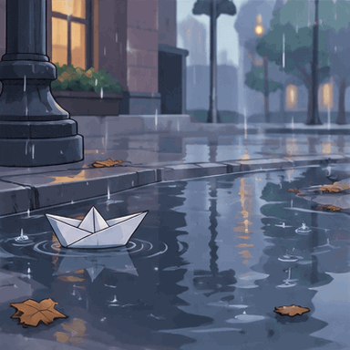

<sub>9 frames · 384×384 · 1.8s · GPT Image 2.6 Flare (API)</sub>

📌 **Source:** [useapi.net on useapi.net](https://useapi.net/docs/articles/gpt-image-2-6-gif-api)

**Prompt**

```text
Looping animation of a tiny paper boat sailing through a rain puddle on a city sidewalk, ripples spreading, flat illustrated style.
```

`paper-boat` `rain` `puddle` `flat-illustration`

### 2. Watercolor Ginger Cat on a Sunny Windowsill

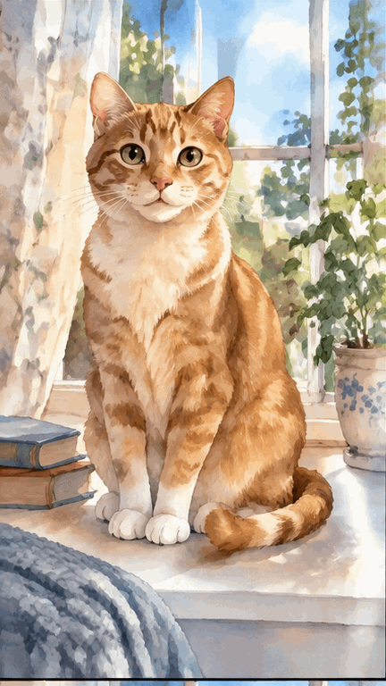

<sub>9 frames · 432×768 · 1.3s · GPT Image 2.6 Flare (API)</sub>

📌 **Source:** [useapi.net on useapi.net](https://useapi.net/docs/articles/gpt-image-2-6-gif-api)

**Prompt**

```text
Looping animation of a ginger cat on a sunny windowsill, slowly blinking and flicking its tail, watercolor style.
```

`cat` `watercolor` `windowsill` `cozy`

### 3. Rainy Window with Coffee Steam

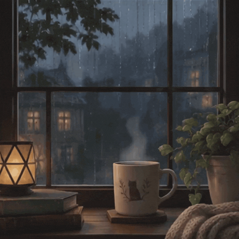

<sub>30 frames · 480×480 · 2.5s · GPT Image 2.6 (ChatGPT)</sub>

📌 **Source:** [@asei_ikarashi on X](https://x.com/asei_ikarashi/status/2125545032564539531)

**Prompt**

```text
雨の窓辺で、雨粒とコーヒーの湯気だけが動く、落ち着いたイラストの、ループするGIFを作って。カメラは固定で、最後は最初のポーズに戻して。
```

`rain` `coffee` `cozy` `lofi` `minimal-prompt`

### 4. White Dove in Golden Cloud Light


<sub>9 frames · 288×288 · 1.8s · GPT Image 2.6</sub>

📌 **Source:** [@JasonHeatony7 on X](https://x.com/JasonHeatony7/status/2119882262317560298)

**Prompt**

```text
A seamless looping GIF of a radiant white dove hovering gently in the center of a soft opening in golden clouds, wings spread wide and moving in slow, calm beats, surrounded by warm beams of heavenly light streaming down onto a still, misty river below. Tiny glowing particles of light drift slowly downward, and the light rays softly pulse brighter and dimmer. Locked camera, no zoom or pan. Minimal, peaceful motion. The dove stays in the same spot and its wings complete one full beat so the first and last frames match perfectly for a seamless loop. The dove keeps the same shape, size, two wings and white feathers throughout; natural, realistic wing movement; no morphing, no extra birds. Serene, holy, reverent atmosphere, realistic 8K detail, vertical 9:16.
```

`dove` `clouds` `light-rays` `serene`

### 5. Zebra in a Fingerprint Tunnel


<sub>9 frames · 480×854 · 1.8s · GPT Image 2.6 Sunburst</sub>

📌 **Source:** [@churvikv on X](https://x.com/churvikv/status/2123819465796206817)

**Prompt**

```text
High-contrast black-and-white conceptual artwork, tall 9:16 vertical composition, mixed-media graphic style. Full bleed edge to edge, no frame, no border, no lettering.
BACKGROUND: a rich matte black surface with a fine pebbled leather grain and subtle diagonal texture, deepening to pure black at the corners and edges.
FINGERPRINT: one enormous white fingerprint fills the frame as the dominant graphic element, its outline a wide oval, slightly tapering toward the top. It is drawn not as solid lines but as hundreds of broken dashed strokes and short parallel bars with softly rounded ends, hand-painted with slight thickness variation, some strokes irregular and chipped. The ridges sweep in long concentric arches and whorls, curving up over the crown and down both sides, with a dense tight cluster of concentric rings in the centre.
TUNNEL: dead centre, the fingerprint ridges part to form a glowing opening — a soft luminous white corridor receding into the distance, its walls a smooth radiant gradient of blurred white and pale grey, brightest at the far end, dissolving into a bright misty haze that halos the centre of the print.
ZEBRA: inside that opening walks a single zebra, seen from directly behind, moving away from the viewer toward the light. Its body is compact and symmetrical, coat a crisp pattern of black and white vertical stripes, a dark mane standing up in a short brush between two rounded ears, a long thin tail hanging straight down the middle of its back, hindquarters rounded and hind hooves faintly visible in the haze. Its silhouette is sharp and dark against the glowing tunnel, its stripes echoing the ridges of the fingerprint around it.
LIGHT: soft white backlight pouring out from the tunnel mouth onto the zebra, rim-lighting its ears and flanks, a gentle glow bleeding into the surrounding ridges.
PALETTE: pure black, charcoal, soft white, pearl grey. Graphic poster feel, minimalist, surreal.
```

`zebra` `surreal` `monochrome`

### 6. Riverbank Walk with a Baby Elephant

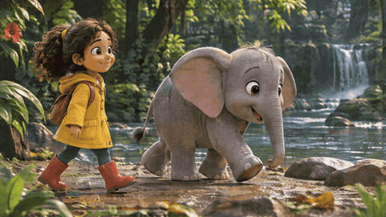

<sub>9 frames · 480×270 · 1.3s · GPT Image 2.6 Sunburst</sub>

📌 **Source:** [Karunakar Gautam on Frameloop Research](https://frameloop.ai/research/gpt-image-2-6-vs-2-5-comprehensive-benchmark)

**Prompt**

```text
3D animated family-film style. A small girl with curly hair and a yellow raincoat walks beside a friendly baby elephant along a jungle riverbank. The elephant sprays water from its trunk and the girl laughs. Looping side view. (9 frames, 150 ms per frame.)
```

`3d` `animatic` `elephant`

### 7. Purple Spark Tracing a Cyan Circle


<sub>9 frames · 480×480 · 1.4s · GPT Image 2.6 Flare</sub>

📌 **Source:** [@vegekyd-sys on GitHub](https://github.com/vegekyd-sys/ai-image-editor/blob/HEAD/evidence/gpt-image26-upgrade/26-flare-gif/receipt.json)

**Prompt**

```text
Create a seamless animated GIF of a purple rounded creative spark that gently pulses and traces a cyan circle on a cream background. Fixed camera, one clean object, smooth visible continuous motion. No text.
```

`abstract` `spark` `minimal`

### 8. Golden Leaf to Umbrella Boat at Sunset


<sub>9 frames · 480×854 · 1.8s · GPT Image 2.6</sub>

📌 **Source:** [@churvikv on X](https://x.com/churvikv/status/2122636815819559091)

**Prompt**

```text
A single golden leaf floats gently on calm water, creating soft ripples, with a serene sunset in the background casting warm golden hues across the sky and water, evoking a tranquil and peaceful mood in a minimalist composition.
A surreal scene featuring a small black boat with a billowing gold cloth inside, topped by an open black umbrella, floating on calm golden water with gentle ripples. A single golden leaf drifts nearby, and a large sun sets on the horizon, casting a warm, tranquil glow across the minimalist composition and creating a serene, dreamlike mood.
```

`nature` `water` `sunset` `calm`

### 9. Street Tabby Cat Asleep in the Rain


<sub>9 frames · 360×360 · 1.8s · GPT Image 2.6</sub>

📌 **Source:** [mileson (SkillU) on GitHub](https://github.com/mileson/awesome-gpt-images-2.6-gif)

**Prompt**

```text
A chubby orange-and-white tabby cat, orange head and ears, cream-white chest and front paws, big dark round eyes, standing on its hind legs in the middle of a wet night street, dark asphalt reflecting yellow streetlights, buildings with warm yellow lights on the left, a white car parked on the right, realistic candid phone-video look, dark night tones, 9-frame looping animation. Curled up asleep on the wet street, breathing softly, tail wrapped around its body.
```

`cat` `sleeping` `breathing` `night-street`

### 10. Retro 1970s Lava Lamp


<sub>16 frames · 480×480 · 2.4s · GPT Image 2.6</sub>

📌 **Source:** [Oxen.ai on Oxen.ai Blog](https://ghost.oxen.ai/gpt-image-26/)

**Prompt**

```text
A retro 1970s lava lamp on a wooden side table in a dark room. Orange
wax blobs slowly rise, stretch, split and sink through purple liquid.
The lamp glows and casts warm light on the wall. Seamless loop.
```

`lava-lamp` `retro` `ambient` `loop`

### 11. Ballerina Leap and Landing


<sub>12 frames · 358×356 · 1.8s · GPT Image 2.6</sub>

📌 **Source:** [@kabumira862571 on X](https://x.com/kabumira862571/status/2118196682680856739)

**Prompt**

```text
次の内容で GIF を作成して: バレリーナが飛び上がって着地するまで
```

`ballet` `dance` `leap` `short-prompt`

### 12. Bubblegum Pop Studio Loop


<sub>9 frames · 480×480 · 1.8s · GPT Image 2.6</sub>

📌 **Source:** [@morphedai on X](https://x.com/morphedai/status/2118424987833094244)

**Prompt**

```text
A seamless looping animated GIF. Young Scandinavian woman, 22, platinum blonde bob, freckles, hot pink oversized puffer jacket, on a flat saturated cobalt blue studio wall and floor. Medium shot. She blows a huge bubblegum bubble, it pops on her face, it resets, forever, her eyes bored and looking straight at the camera. Bold, bright, crisp photographic look, hard studio light, no text, no logos.
```

`bubblegum` `studio` `photoreal` `loop`

### 13. Mount Fuji Gouache Travel Poster


<sub>96 frames · 480×640 · 8.0s · GPT Image 2.6</sub>

📌 **Source:** [@devteamdrew on X](https://x.com/devteamdrew/status/2118308538564989025)

**Prompt**

```text
A living mid-century gouache travel-poster painting of Mount Fuji behind a five-storey Japanese pagoda, static locked-off camera, seamless looping animation. The pagoda is vermilion-orange with deep teal-slate tiled roofs, a slender spire, and a dark evergreen tree beside it. Fuji sits small and distant in dusty blue-grey with a snow-white cap and ragged dry-brush ridges, over a pale mist field. Foreground cherry trees in soft coral-pink blossom with dark trunks frame the bottom, and tiny figures stand on pale speckled ground. Warm cream paper-grain sky fills the upper half. Matte flat gouache with ragged, flaking edges, visible bristle marks and speckled holes. Subtle motion only: blossom petals drift down, branches sway faintly, tiny figures shift, a bell-like gentle shimmer on the light. Soft spring morning light, vertical 3:4, perfect loop.
```

`gouache` `travel-poster` `japan` `cherry-blossom`

### 14. Colosseum Gouache Travel Poster

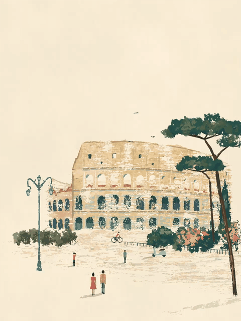

<sub>96 frames · 480×640 · 8.0s · GPT Image 2.6</sub>

📌 **Source:** [@devteamdrew on X](https://x.com/devteamdrew/status/2118308538564989025)

**Prompt**

```text
A living mid-century gouache travel-poster painting of the Roman Colosseum, locked-off static camera, a seamless looping animation. The ruined amphitheater sits low in the frame in sun-bleached ochre, sand and travertine with dusty rose and pale blue-grey arches, painted in dry-brush gouache with flaky, speckled edges and worn-away patches. A tall Italian stone pine in dark green and bottle-green leans in from the right, a vintage teal street lamp on the left, rose-coral flowering shrubs at the base. Open warm cream paper-textured sky fills the upper two thirds with fine paper grain. Gentle motion only: a few tiny birds drift across the sky, a cyclist rides slowly along the piazza, a small scooter, a couple in coral and mustard strolling, pine foliage barely sways. Soft warm afternoon light, long pale shadows, flat matte shapes, vertical 3:4, perfect loop.
```

`gouache` `travel-poster` `rome` `landmark`

### 15. White House 360 Drone Orbit


<sub>9 frames · 474×352 · 1.6s · GPT Image 2.6</sub>

📌 **Source:** [@nima2qisi2 on X](https://x.com/nima2qisi2/status/2118295936606798006)

**Prompt**

```text
【白宫外观】360°环绕
帮我做一个真实白宫外观的360°环绕模仿无人机拍摄，要真实还原建筑环境的实际外观情况，做成gif
```

`drone` `orbit` `architecture` `landmark`

### 16. Golden Gate Gouache Travel Poster


<sub>96 frames · 480×640 · 8.0s · GPT Image 2.6</sub>

📌 **Source:** [@devteamdrew on X](https://x.com/devteamdrew/status/2118308538564989025)

**Prompt**

```text
A living mid-century gouache travel-poster painting of the Golden Gate Bridge seen from a beach, static locked-off camera, seamless looping animation. The bridge is rust-orange with two tall towers, fine suspension cables and vertical hangers, spanning to a hazy grey-blue headland on the left and a tan-grey rocky cliff on the right. In the foreground deep cobalt and teal surf rolls in with white foam lines onto a sweeping beach of sandy beige scratchy dry-brush strokes, with dark rocks, a driftwood log and tiny figures in coral, navy and mustard. Warm cream sky with fine paper grain fills the upper half. Matte opaque gouache, ragged flaking edges, visible bristle streaks, speckled worn texture. Gentle motion only: waves wash and recede, foam shimmers, seagulls glide across the sky, tiny people wander. Soft hazy daylight, vertical 3:4, perfect loop.
```

`gouache` `travel-poster` `bridge` `waves`

### 17. Lantern Monkey in a Snowy Forest


<sub>9 frames · 480×480 · 1.8s · GPT Image 2.6</sub>

📌 **Source:** [OpenAI Developers on OpenAI](https://developers.openai.com/api/docs/guides/image-prompting#generate-a-looping-gif)

**Prompt**

```text
A little monkey in an olive-green hooded coat stands in a snowy pine forest at dusk. A wooden cabin glows in the background. The monkey holds a glowing amber paper lantern at chest height, slowly lifts it, looks up and blinks, then lowers it back to its starting pose. Keep the lantern in its hands and the camera still. Make the motion loop smoothly.
```

`monkey` `lantern` `snow` `seamless`

### 18. Robot Dancing Afrobeats in Lagos

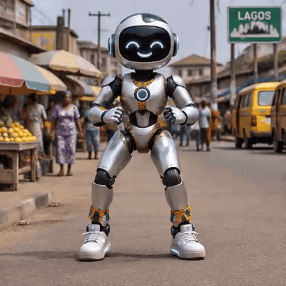

<sub>9 frames · 414×414 · 1.1s · GPT Image 2.6</sub>

📌 **Source:** [@o_adeeko on X](https://x.com/o_adeeko/status/2118203950306410729)

**Prompt**

```text
Create an animated GIF of a robot dancing to Afrobeats on a busy Lagos street. Make the movement loop smoothly.
```

`robot` `dance` `afrobeats` `street`

### 19. NYC Snow Globe

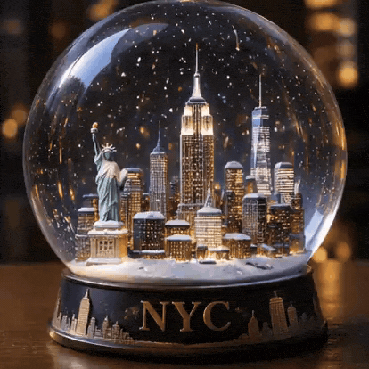

<sub>9 frames · 414×414 · 1.3s · GPT Image 2.6</sub>

📌 **Source:** [@dreamwieber on X](https://x.com/dreamwieber/status/2118190877567037732)

**Prompt**

```text
generate an animated gif of a beautiful NYC snow globe
```

`snow-globe` `city` `winter` `snow`

### 20. Paper Boat Bobbing on Water


<sub>9 frames · 412×402 · 1.3s · GPT Image 2.6</sub>

📌 **Source:** [@thinkszyg on X](https://x.com/thinkszyg/status/2118166234495947044)

**Prompt**

```text
Make a looping GIF of a paper boat bobbing on the water.
```

`paper-boat` `water` `seamless` `calm`

### 21. Robot Brewing Coffee


<sub>16 frames · 480×480 · 2.4s · GPT Image 2.6</sub>

📌 **Source:** [@sousoccer6 on X](https://x.com/sousoccer6/status/2118210705585537226)

**Prompt**

```text
コーヒーを淹れるロボット
```

`robot` `coffee` `brewing` `short-prompt`

### 22. Grandpa Chopping Wood in Winter


<sub>16 frames · 288×288 · 1.9s · GPT Image 2.6</sub>

📌 **Source:** [@koe_ai414 on X](https://x.com/koe_ai414/status/2118153765094351279)

**Prompt**

```text
冬の寒い中、家の庭で薪割りをするおじいさんのGIF
```

`winter` `wood-chopping` `yard` `everyday`

### 23. Ginger Kitten Boops the Lens

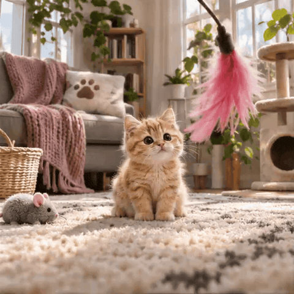

<sub>9 frames · 480×480 · 1.8s · GPT Image 2.6</sub>

📌 **Source:** [@meigesir on X](https://x.com/meigesir/status/2118248846648287720)

**Prompt**

```text
Animated 9-frame looping GIF. Fixed camera at floor level, bright cozy living room, warm soft daylight, cheerful mood. A tiny fluffy ginger kitten with big round sparkly eyes plays with a pink feather toy dangling just in front of the camera. Frames 1-2: kitten sits small in the center, wiggling, eyes locked on the feather. Frames 3-6: kitten hops playfully toward the camera, getting bigger each frame, mouth closed, ears perked, adorable curious face, one tiny paw reaching for the feather. Frame 7-8: kitten's soft pink paw pad gently boops the camera lens, kitten face cute and happy behind it. Frame 9: back to the kitten sitting small in the center, same as frame 1. Mouth closed in every frame, no teeth, no claws, cute and playful, never scary. Same kitten, same room, same lighting in every frame. Big, obvious motion. Photorealistic, sharp focus.
```

`kitten` `photoreal` `camera` `playful`

### 24. Claymation Kitten in a Ball Pit

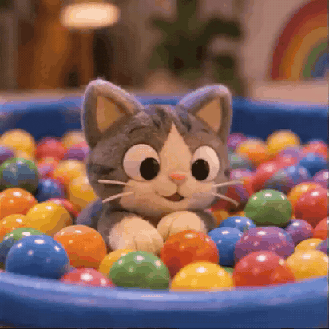

<sub>9 frames · 412×412 · 1.2s · GPT Image 2.6</sub>

📌 **Source:** [@dreamwieber on X](https://x.com/dreamwieber/status/2118191599872344467)

**Prompt**

```text
generate an animated gif of a claymation kitten playing in a plastic ball pit
```

`kitten` `claymation` `ball-pit` `cute`

### 25. Rooftop Astronaut and Glowing Paper Star

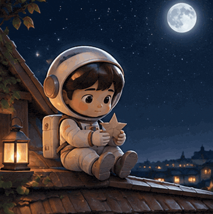

<sub>12 frames · 356×358 · 2.7s · GPT Image 2.6</sub>

📌 **Source:** [Ai.Alvin_daily on Substack (Ai.Alvin_daily)](https://aialvin.substack.com/p/chatgpt-image-26-gif-prompts-that)

**Prompt**

```text
Create a short, seamless looping GIF in a whimsical cinematic illustration style. A tiny astronaut sits on a moonlit rooftop holding a small paper star. Beat 1: the astronaut looks at the dark star. Beat 2: the star begins to glow. Beat 3: the glow illuminates the astronaut’s delighted face and lifts the star gently into the air. Beat 4: the star floats back into the astronaut’s hands, returning to the exact opening pose. Keep the camera locked in a medium-wide shot, maintain the same character and rooftop layout, use clear but restrained motion, and make the final beat blend perfectly into the first. No text, no dialogue, no camera zoom, no scene change, no watermark.
```

`astronaut` `night` `mini-story` `illustration`

### 26. Travel Journal Spread with Drifting Palm Shadow

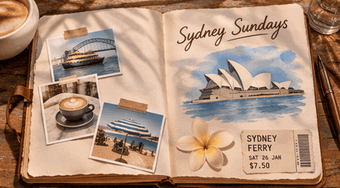

<sub>9 frames · 480×266 · 5.8s · GPT Image 2.6</sub>

📌 **Source:** [Clayton H on Substack (AI for Creators / Novarix Studio)](https://novarixstudio.substack.com/p/chatgpt-images-2-6-gifs)

**Prompt**

```text
Animated GIF, landscape, seamless loop.
Subject: an open leather-bound travel journal, two-page spread, on heavy cream cotton paper with deckled edges. Left page: three small film photo prints of Sydney (a harbour ferry passing the Harbour Bridge, a latte with latte art, a striped umbrella on Bondi Beach) fixed with torn strips of kraft tape. Right page: a loose watercolour sketch of the Opera House sails in chalk white and harbour blue, a pressed frangipani and a ferry ticket stub. Across the top, handwritten in brown script: "Sydney Sundays".
Setting: a weathered wooden café table with a cup of coffee, a glass of water and a pen.
Motion: the soft shadow of a palm frond drifts slowly across the spread and back. Nothing else moves.
Keep the same journal, photos, sketch and heading in every frame. Overhead camera, 35mm. Late-afternoon sun from the left, long soft shadows, Kodak Portra 400 colour grade. Sun-washed, analogue, editorial, unhurried. No other text.
```

`cinemagraph` `travel` `scrapbook` `journal` `shadow`

### 27. Orange cat blinks by the window


<sub>12 frames · 357×358 · 2.2s · GPT Image 2.6</sub>

📌 **Source:** [牧牧的成長實驗室 on 方格子 vocus](https://vocus.cc/article/6aebf9a0fd8978000170526d)

**Prompt**

```text
製作一張橘色貓咪 GIF 動畫。貓咪坐在窗邊，緩慢眨一下眼睛，然後恢復原本表情。保持姿勢、毛色與背景一致，溫暖插畫風格，固定鏡頭，無縫循環。
```

`cat` `cozy` `illustration`

### 28. Watercolor sakura town in the breeze


<sub>16 frames · 414×232 · 5.0s · GPT Image 2.6</sub>

📌 **Source:** [蘇柔瑋 on 數位時代 BusinessNext](https://www.bnext.com.tw/article/92943/chatgpt-gif-generator-prompts)

**Prompt**

```text
請製作一張 16:9 橫式 GIF 動畫。畫面是一座日系手繪風格的小鎮，街道兩側有溫暖的木造房屋、綠色植物與盛開的櫻花樹，遠方能看見淡藍色天空。採用柔和水彩與鉛筆線條交織的繪本插畫風格，保留細緻的紙張紋理。動畫中微風吹過，櫻花花瓣緩緩從樹上飄落，街邊植物輕輕搖擺，天空中的白雲緩慢移動。所有建築與街道保持靜止，鏡頭固定，整體氛圍安靜療癒。製作約 5 秒、動作自然且可以無縫循環的 GIF，不要加入任何文字。
```

`watercolor` `sakura` `storybook`

### 29. Vintage brass metronome swing


<sub>9 frames · 480×270 · 1.4s · GPT Image 2.6</sub>

📌 **Source:** [Fuxuan Guo on ChatCut Blog](https://chatcut.io/blog/chatgpt-gif)

**Prompt**

```text
Clean studio illustration on a muted sage-green background, locked dead-center front-on camera. A vintage pyramid-shaped walnut and polished-brass desk metronome rests motionless on a dark oak shelf. On frame 1, the vertical brass pendulum rod stands dead-center upright at 12 o'clock; across the middle frames it swings smoothly left, then swings right, and on the final frame it returns to the exact dead-center 12 o'clock upright starting position for a seamless loop. Keep the wooden metronome body, scale markings, and shelf completely still, no text.
```

`metronome` `mechanical` `loop`

### 30. Snowy twilight campfire (16 frames)


<sub>16 frames · 480×264 · 1.9s · GPT Image 2.6</sub>

📌 **Source:** [Fuxuan Guo on ChatCut Blog](https://chatcut.io/blog/chatgpt-gif)

**Prompt**

```text
Flat storybook winter landscape illustration, locked wide camera. In a quiet twilight clearing ringed by snow-dusted dark-teal pine trees, a small stone-ringed campfire crackles gently as warm orange flames sway and three tiny glowing embers drift slightly upward before settling back to the exact starting flame shape on the final frame for a clean loop. Keep the pine trees, snowbanks, and stones completely motionless, no text.
```

`winter` `campfire` `storybook`

### 31. Rainy dusk window with puddle ripples

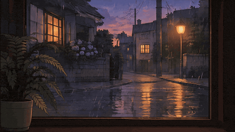

<sub>9 frames · 480×270 · 1.6s · GPT Image 2.6</sub>

📌 **Source:** [Fuxuan Guo on ChatCut Blog](https://chatcut.io/blog/chatgpt-gif)

**Prompt**

```text
Cozy lo-fi anime illustration seen through a dark wooden apartment window at dusk, locked camera. Diagonal rain streaks fall across the windowpane while warm amber streetlamp reflections ripple gently inside a wet cobblestone puddle below, returning to the exact starting rain and ripple pattern on the final frame for a clean loop. Keep the wooden window frame and indoor potted fern completely still, clean flat shading, no text.
```

`rain` `lo-fi` `anime`

### 32. Canton Tower rising from morning mist


<sub>9 frames · 480×198 · 1.6s · gpt-image-2.6-gif</sub>

📌 **Source:** [@AIWAVE2025 on X](https://x.com/AIWAVE2025/status/2118154755826766225)

**Prompt**

```text
清晨珠江，薄雾，镜头低空推进，广州塔从雾里露出来，一艘游船划过。
```

`city` `mist` `river`

### 33. Orange bird flapping on a branch

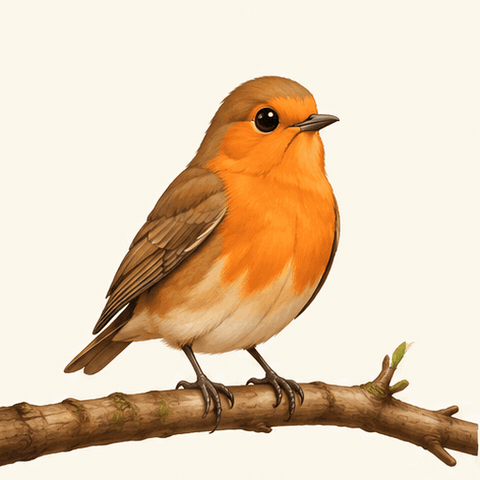

<sub>9 frames · 480×480 · 1.8s · gpt-image-2.6-gif</sub>

📌 **Source:** [Ofox on Ofox](https://ofox.ai/blog/gpt-image-2-6-gif-guide/)

**Prompt**

```text
Create a looping animation of a small orange bird on a stationary branch against a plain cream background. The bird raises its wings, pauses, then lowers them to its starting pose. Keep the camera fixed, the branch still, and the bird shape and colors consistent. No text. Make the transition back to the start smooth.
```

`bird` `loop` `api`

### 34. Snow globe swirl


<sub>9 frames · 439×390 · 1.6s · gpt-image-2.6 · generated 2026-11-17</sub>

**Prompt**

```text
A glass snow globe with a tiny red cabin and pine trees inside; snowflakes swirl up and settle slowly around the cabin. Warm cozy lighting, wooden table, fixed close-up.
```

`snow-globe` `winter` `cozy`

### 35. Roasting chestnuts


<sub>9 frames · 439×390 · 1.6s · gpt-image-2.6 · generated 2026-11-17</sub>

**Prompt**

```text
A big iron wok of chestnuts and dark sand is stirred by a wooden paddle, steam curling up under a warm bulb at a winter street stall. Cozy photographic style, close-up, fixed camera.
```

`chestnut` `street-food` `winter`

### 36. First snow under a lamp

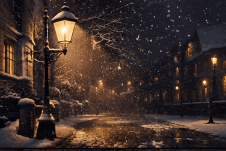

<sub>16 frames · 376×252 · 2.9s · gpt-image-2.6 · generated 2026-11-17</sub>

**Prompt**

```text
Big soft snowflakes drift down through the warm cone of an old street lamp on a quiet cobblestone street at night. Cinematic, fixed camera, everything else still.
```

`snow` `night` `street`

### 37. Frost spreads on glass


<sub>8 frames · 439×388 · 1.8s · gpt-image-2.6 · generated 2026-11-17</sub>

**Prompt**

```text
Delicate fern-like frost patterns creep across a cold window pane from the corners, a blurry snowy garden visible behind. Macro winter photography, fixed camera.
```

`frost` `winter` `macro`

### 38. Sky lanterns rising


<sub>16 frames · 377×248 · 2.9s · gpt-image-2.6 · generated 2026-11-17</sub>

**Prompt**

```text
Dozens of warm glowing paper lanterns float slowly up into a deep blue night sky above dark rooftops, flickering softly. Dreamy painterly style, fixed camera.
```

`lantern` `night` `festival`

### 39. Ladybug and dewdrop

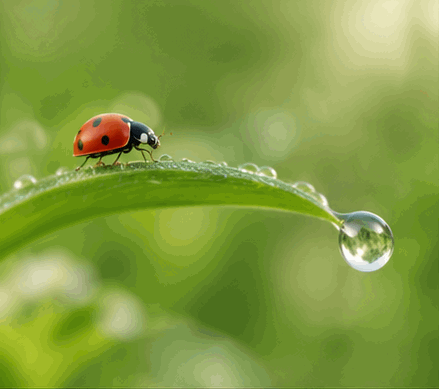

<sub>9 frames · 439×389 · 1.6s · gpt-image-2.6 · generated 2026-11-17</sub>

**Prompt**

```text
A ladybug walks along a curved green leaf while a dewdrop at the leaf tip swells and wobbles. Macro nature photography, soft morning bokeh, fixed camera.
```

`ladybug` `macro` `nature`

### 40. Bear snoring in a cave


<sub>16 frames · 380×248 · 2.9s · gpt-image-2.6 · generated 2026-11-17</sub>

**Prompt**

```text
A brown bear sleeps curled up in a cozy cave, its belly rising and falling as a snore bubble grows and shrinks from its nose, snow falling softly outside. Storybook illustration, fixed camera.
```

`bear` `hibernation` `winter`

### 41. Otter floats and naps


<sub>9 frames · 432×395 · 1.6s · gpt-image-2.6 · generated 2026-11-17</sub>

**Prompt**

```text
A sea otter floats on its back in calm water, holding a small shell on its belly, bobbing gently with the ripples as its eyes stay closed. Soft watercolor style, fixed overhead-angle camera.
```

`otter` `sleep` `calm`

### 42. Comet over the desert


<sub>9 frames · 506×337 · 2.0s · gpt-image-2.6 · generated 2026-11-17</sub>

**Prompt**

```text
A bright comet with a long glowing tail drifts slowly across a starry sky above dark desert dunes, the tail shimmering. Calm night photography look, fixed wide camera.
```

`comet` `night` `sky`

### 43. Glowing mycelium bridge


<sub>9 frames · 506×337 · 1.6s · gpt-image-2.6 · generated 2026-11-17</sub>

**Prompt**

```text
A delicate bridge woven from glowing white fungal threads spans a misty canyon at dusk; soft pulses of blue light travel along the threads from one side to the other. Fantasy concept art, fixed wide shot.
```

`fantasy` `bridge` `glow`

### 44. Naive geometric face


<sub>9 frames · 437×388 · 1.6s · gpt-image-2.6 · generated 2026-11-17</sub>

**Prompt**

```text
A naive hand-drawn portrait of an imaginary character built from uneven circles, triangles and blocks of retro color, with trembling black ink outlines; the character blinks once and the color blocks shift slightly. Textured paper, lots of empty space.
```

`illustration` `geometric` `ink`

### 45. Cove waves cinemagraph


<sub>9 frames · 437×388 · 1.6s · gpt-image-2.6 · generated 2026-11-17</sub>

**Prompt**

```text
A quiet rocky cove at golden hour where only the sea moves: small waves roll in and wash over the sand. The rocks, cliffs and sky stay completely still. Natural photographic color, fixed camera.
```

> 💡 **Tip:** For a cinemagraph, name the one thing that moves and list what must stay frozen.

`sea` `cinemagraph` `calm`

### 46. Peony blooms open

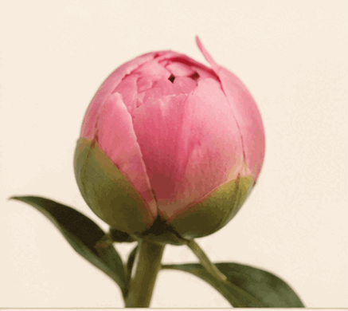

<sub>9 frames · 437×390 · 1.6s · gpt-image-2.6 · generated 2026-11-17</sub>

**Prompt**

```text
A single pink peony bud slowly unfurls its layered petals into a full bloom, a few petals trembling at the edges. Soft studio light, plain cream background, fixed close-up camera.
```

> 💡 **Tip:** Blooming is a one-way motion, so ask for the bloom to ease back closed at the end if you want it to loop cleanly.

`flower` `bloom` `macro`

### 47. Snail house lights up


<sub>9 frames · 439×387 · 3.1s · gpt-image-2.6 · generated 2026-11-17</sub>

**Prompt**

```text
A snail carrying a tiny cottage on its back inches along a mossy log as the little windows flicker on one by one at dusk. Storybook watercolor style.
```

`snail` `cottage` `storybook`

### 48. Sea turtle in sun rays


<sub>9 frames · 439×390 · 1.6s · gpt-image-2.6 · generated 2026-11-17</sub>

**Prompt**

```text
A green sea turtle paddles slowly through shafts of sunlight with small fish drifting past. Painterly underwater scene, turquoise water.
```

`turtle` `ocean` `calm`

### 49. Pottery wheel


<sub>16 frames · 380×252 · 2.9s · gpt-image-2.6 · generated 2026-11-17</sub>

**Prompt**

```text
Clay-covered hands shape a bowl on a spinning pottery wheel, its rim rising slowly and evenly. Warm studio illustration, earthy tones.
```

`pottery` `craft` `calm`

### 50. Raking a zen garden


<sub>9 frames · 433×395 · 1.6s · gpt-image-2.6 · generated 2026-11-17</sub>

**Prompt**

```text
A wooden rake draws smooth curving lines through white sand around a mossy stone in a small zen garden. Calm top-down illustration, soft morning light.
```

`zen` `garden` `calm`

### 51. Volcano magma rising


<sub>16 frames · 379×250 · 2.9s · gpt-image-2.6 · generated 2026-11-17</sub>

**Prompt**

```text
A cross-section of a cone volcano with labeled layers; glowing magma climbs the central vent and a small puff of smoke pops from the crater. Textbook infographic style, white background.
```

`cutaway` `volcano` `science`

### 52. Ant nest cross-section


<sub>9 frames · 433×395 · 1.6s · gpt-image-2.6 · generated 2026-11-17</sub>

**Prompt**

```text
A cross-section of an underground ant nest; ants carry crumbs and leaves along winding tunnels into round chambers. Educational illustration, warm soil tones.
```

`cutaway` `ants` `science`

### 53. Submarine cross-section


<sub>12 frames · 379×337 · 1.9s · gpt-image-2.6 · generated 2026-11-17</sub>

**Prompt**

```text
A cutaway view of a yellow submarine showing small rooms; tiny crew members walk between the engine room and the periscope while bubbles rise outside. Clean isometric infographic style, deep teal water.
```

`cutaway` `submarine` `infographic`

### 54. Celestial clock cracks


<sub>16 frames · 378×252 · 2.9s · gpt-image-2.6 · generated 2026-11-17</sub>

**Prompt**

```text
A brass astronomical clock with tiny planets on its rings cracks across the face and spills glowing star fragments that drift outward. Ornate fantasy illustration, deep navy background.
```

`clock` `stars` `fantasy`

### 55. Cloud pours coffee


<sub>9 frames · 412×413 · 1.6s · gpt-image-2.6 · generated 2026-11-17</sub>

**Prompt**

```text
A fluffy white cloud with a sleepy face tilts and pours a thin stream of coffee into a striped mug below, steam curling up. Soft pastel illustration, pale blue background.
```

`cloud` `coffee` `morning`

### 56. Seed sprouts in a pot

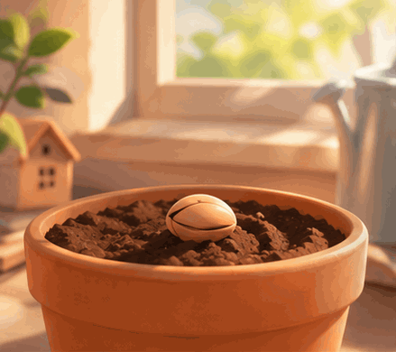

<sub>9 frames · 439×390 · 1.6s · gpt-image-2.6 · generated 2026-11-17</sub>

**Prompt**

```text
A seed in a small clay pot pushes up a green sprout that unfurls two leaves, a droplet sliding off one. Soft cartoon style, warm windowsill light.
```

`plant` `sprout` `growth`

### 57. Rainy greenhouse


<sub>16 frames · 372×252 · 2.9s · gpt-image-2.6 · generated 2026-11-17</sub>

**Prompt**

```text
Rain streaks down the glass panes of a small greenhouse full of potted plants, droplets tapping and leaves trembling slightly. Soft green cinematic light.
```

`greenhouse` `rain` `plants`

### 58. Manta ray glide

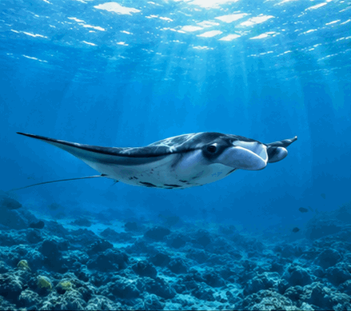

<sub>9 frames · 439×389 · 1.6s · gpt-image-2.6 · generated 2026-11-17</sub>

**Prompt**

```text
A manta ray glides through blue water, its wings rising and falling slowly while sun rays shimmer from above. Underwater scene, fixed camera.
```

`ocean` `manta` `underwater`

### 59. Night laundromat


<sub>9 frames · 436×389 · 1.6s · gpt-image-2.6 · generated 2026-11-17</sub>

**Prompt**

```text
A front-loading washer spins colorful clothes behind its round glass door in an empty laundromat at night, fluorescent light humming. Moody lo-fi illustration, fixed camera.
```

`laundromat` `night` `lofi`

### 60. Terrarium mist


<sub>9 frames · 429×395 · 2.0s · gpt-image-2.6 · generated 2026-11-17</sub>

**Prompt**

```text
Inside a glass terrarium with moss and tiny ferns, soft mist curls and a single water drop slides down the glass. Macro photography, soft green light.
```

`terrarium` `plants` `mist`

### 61. Brass gears turning


<sub>16 frames · 380×247 · 2.6s · gpt-image-2.6 · generated 2026-11-17</sub>

**Prompt**

```text
A cluster of interlocking brass gears turns smoothly at different speeds, light glinting on the teeth. Steampunk macro shot, dark background.
```

`gears` `steampunk` `machine`

### 62. Beach hammock


<sub>16 frames · 380×252 · 2.6s · gpt-image-2.6 · generated 2026-11-17</sub>

**Prompt**

```text
An empty striped hammock sways between two palm trees while small waves roll onto the beach behind it. Bright tropical illustration, fixed camera.
```

`beach` `hammock` `summer`

### 63. Wheat field in the wind

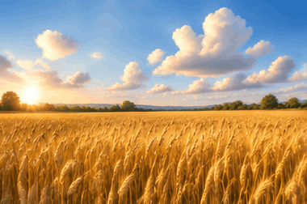

<sub>16 frames · 380×252 · 2.9s · gpt-image-2.6 · generated 2026-11-17</sub>

**Prompt**

```text
Golden wheat sways in waves across a field as fluffy clouds drift slowly overhead. Warm late afternoon light, wide fixed shot.
```

`wheat` `wind` `nature`

### 64. Moonlit boat


<sub>9 frames · 438×387 · 1.6s · gpt-image-2.6 · generated 2026-11-17</sub>

**Prompt**

```text
A small wooden rowboat rocks gently on dark water under a full moon, its reflection rippling. Soft painterly night scene, fixed camera.
```

`boat` `moon` `night`

### 65. Library sunbeam dust

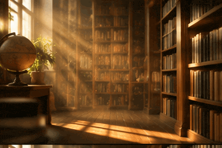

<sub>16 frames · 378×251 · 2.9s · gpt-image-2.6 · generated 2026-11-17</sub>

**Prompt**

```text
Golden dust motes drift slowly through a beam of sunlight in a quiet wooden library aisle. Warm cinematic light, fixed camera, everything else still.
```

`library` `light` `calm`

### 66. Cat portrait comes alive


<sub>9 frames · 435×389 · 1.6s · gpt-image-2.6 · generated 2026-11-13</sub>

**Prompt**

```text
An old oil painting in an ornate gold frame shows a noble cat wearing a lace ruff collar; the cat slowly blinks and glances sideways while a painted candle beside it flickers. Visible brush strokes, museum wall.
```

`painting` `cat` `museum`

### 67. Cube morphs into a pavilion


<sub>9 frames · 438×390 · 1.6s · gpt-image-2.6 · generated 2026-11-13</sub>

**Prompt**

```text
A plain white cube architectural model on a concrete plinth smoothly melts and stretches into a flowing curved futuristic pavilion, then folds back into the cube. Clean architectural model photography, neutral backdrop.
```

`architecture` `morph` `model`

### 68. Felted sheep on a felt hill


<sub>9 frames · 439×387 · 1.4s · gpt-image-2.6 · generated 2026-11-13</sub>

**Prompt**

```text
A needle-felted wool sheep trots across a rolling felt hill with tiny felt flowers, its legs bobbing, while a felt cloud drifts behind. Soft fuzzy fiber texture, warm studio light, fixed camera.
```

> 💡 **Tip:** Felt has no crisp edges, so the texture can shimmer between frames. Keep the shot wide and the motion small.

`felt` `sheep` `craft`

### 69. Origami fox unfolds


<sub>9 frames · 437×388 · 1.6s · gpt-image-2.6 · generated 2026-11-12</sub>

**Prompt**

```text
A flat sheet of orange paper folds itself into an origami fox that turns its head and blinks. Clean paper craft style, plain white background.
```

`paper` `origami` `fox`

### 70. Light-bulb head collage


<sub>9 frames · 414×411 · 1.6s · gpt-image-2.6 · generated 2026-11-12</sub>

**Prompt**

```text
Cut-paper collage of a figure with a light-bulb head; gears inside the bulb turn and the bulb flickers on with a bright idea. Vintage magazine collage style, beige paper background.
```

`collage` `idea` `paper`

### 71. Winter bunny catches snow


<sub>9 frames · 439×390 · 1.6s · gpt-image-2.6 · generated 2026-11-12</sub>

**Prompt**

```text
A small bunny in a green knitted scarf looks up and catches falling snowflakes on its nose, sneezing softly. Warm watercolor winter style, snowy forest background.
```

`winter` `bunny` `cozy`

### 72. Robot and scientist watch a test tube


<sub>9 frames · 433×373 · 1.6s · gpt-image-2.6 · generated 2026-11-12</sub>

**Prompt**

```text
A scientist in a white coat and a small round robot lean in to watch a test tube that bubbles and glows green, both blinking in wonder. Clean flat illustration, plain white background.
```

`science` `robot` `illustration`

### 73. Giant bubble in the park


<sub>9 frames · 439×389 · 1.6s · gpt-image-2.6 · generated 2026-11-12</sub>

**Prompt**

```text
A giant soap bubble wobbles and drifts across a green park, rainbow colors swirling on its surface. Bright cheerful illustration, fixed camera.
```

`ambient` `bubble` `summer`

### 74. Autumn tea on the table


<sub>16 frames · 380×252 · 2.9s · gpt-image-2.6 · generated 2026-11-12</sub>

**Prompt**

```text
A cup of tea on a wooden table by a window, steam curling up while maple leaves drift past outside. Warm cozy illustration, fixed camera.
```

`ambient` `autumn` `tea`

### 75. Seaside cat nap


<sub>9 frames · 440×389 · 1.6s · gpt-image-2.6 · generated 2026-11-12</sub>

**Prompt**

```text
A calico cat naps on a sunny harbor wall, its tail flicking lazily while small waves roll in behind it. Bright gouache illustration, fixed camera.
```

`ambient` `cat` `sea`

### 76. Dusk tram passing


<sub>9 frames · 438×387 · 1.6s · gpt-image-2.6 · generated 2026-11-12</sub>

**Prompt**

```text
A small yellow tram glides past a row of pastel buildings at dusk, its windows glowing and overhead wires swaying. Flat illustration style, fixed camera.
```

`ambient` `city` `travel`

### 77. Galaxy hourglass


<sub>16 frames · 320×294 · 2.6s · gpt-image-2.6 · generated 2026-11-12</sub>

**Prompt**

```text
A glass hourglass where tiny glowing stars trickle down instead of sand, forming a small swirling galaxy in the bottom bulb. Dark background, magical realism style.
```

`ambient` `space` `magic`

### 78. Socks by the fireplace


<sub>16 frames · 377×249 · 2.6s · gpt-image-2.6 · generated 2026-11-12</sub>

**Prompt**

```text
Knitted socks hang on a line above a crackling fireplace, flames dancing and the socks swaying slightly in the warm air. Cozy illustrated style, fixed camera.
```

`ambient` `cozy` `winter`

### 79. Porch wind chime

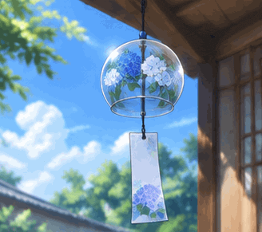

<sub>16 frames · 328×291 · 2.2s · gpt-image-2.6 · generated 2026-11-12</sub>

**Prompt**

```text
A glass wind chime on a wooden porch sways in a summer breeze, its paper tag fluttering and light glinting off the glass. Soft anime summer style, blue sky behind.
```

`ambient` `summer` `japan`

### 80. Snowy ramen stall


<sub>16 frames · 379×250 · 2.9s · gpt-image-2.6 · generated 2026-11-12</sub>

**Prompt**

```text
A tiny street ramen stall at night, steam rising from a pot and paper lanterns swaying while snow falls gently. Warm anime background style, fixed camera.
```

`ambient` `food` `snow`

### 81. Overhead koi pond


<sub>9 frames · 414×414 · 2.0s · gpt-image-2.6 · generated 2026-11-12</sub>

**Prompt**

```text
Top-down view of a dark pond where three orange and white koi glide in a slow circle among lily pads, gentle ripples spreading. Watercolor style, fixed camera.
```

`ambient` `fish` `water`

### 82. Rainy candle shop window


<sub>16 frames · 377×241 · 2.9s · gpt-image-2.6 · generated 2026-11-12</sub>

**Prompt**

```text
A small candle shop window at night with dozens of candles flickering softly while rain streaks down the glass. Cozy painterly style, fixed camera.
```

`ambient` `rain` `cozy`

### 83. Glowing mushroom forest


<sub>16 frames · 378×251 · 2.9s · gpt-image-2.6 · generated 2026-11-11</sub>

**Prompt**

```text
A mossy forest floor at night with clusters of bioluminescent blue mushrooms whose caps pulse brighter and dimmer as tiny glowing spores drift upward. Fantasy illustration, fixed camera.
```

`fantasy` `night` `nature`

### 84. Music box dancer

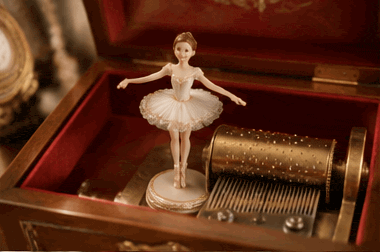

<sub>16 frames · 380×252 · 2.6s · gpt-image-2.6 · generated 2026-11-11</sub>

**Prompt**

```text
Inside an open wooden music box lined with red velvet, a small porcelain dancer in a white tutu spins on a pin while the brass comb mechanism turns. Warm vintage lighting, close-up.
```

`vintage` `music-box` `object`

### 85. Wind over dunes

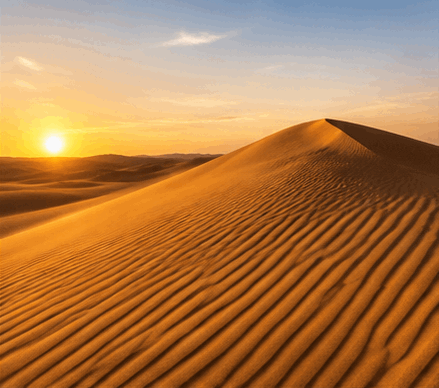

<sub>9 frames · 439×388 · 1.6s · gpt-image-2.6 · generated 2026-11-11</sub>

**Prompt**

```text
Fine sand streams off the sharp crest of a golden desert dune in the wind, rippled sand patterns glowing under a low evening sun and a pale sky. Cinematic landscape, fixed wide shot.
```

`desert` `landscape` `wind`

### 86. Tide pool crab


<sub>9 frames · 439×390 · 1.6s · gpt-image-2.6 · generated 2026-11-11</sub>

**Prompt**

```text
A small orange crab scuttles sideways between pebbles in a clear tide pool as gentle ripples pass over it and a sea anemone waves its tentacles. Top-down nature photography, fixed camera.
```

`nature` `ocean` `macro`

### 87. Bread rising in the oven


<sub>16 frames · 378×236 · 2.9s · gpt-image-2.6 · generated 2026-11-11</sub>

**Prompt**

```text
Through a glowing oven window, a braided loaf slowly puffs up and turns golden while the orange heating element pulses. Warm cozy kitchen photography, fixed close-up.
```

`baking` `kitchen` `cozy`

### 88. Floating river lanterns


<sub>16 frames · 375×244 · 2.9s · gpt-image-2.6 · generated 2026-11-11</sub>

**Prompt**

```text
Paper lotus lanterns with candle flames float slowly down a dark river at night, their reflections wobbling on the water while the flames flicker. Painterly style, fixed camera.
```

`lantern` `night` `festival`

### 89. Picture-book bear makes tea

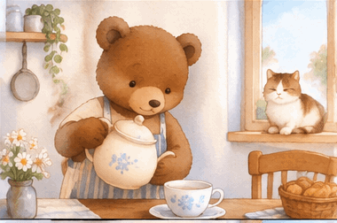

<sub>16 frames · 380×252 · 2.9s · gpt-image-2.6 · generated 2026-11-11</sub>

**Prompt**

```text
a picture-book watercolor scene of a small brown bear in a striped apron pouring tea from a round pot into a cup at a wooden table, steam rising, a cat on the windowsill flicking its tail. Soft paper texture, gentle colors.
```

`picture-book` `watercolor` `cozy`

### 90. Coastal convertible drive


<sub>16 frames · 380×252 · 2.6s · gpt-image-2.6 · generated 2026-11-11</sub>

**Prompt**

```text
A vintage red convertible drives along a cliffside coastal road at sunset, the camera tracking alongside it; palm trees and guardrails slide past while the sea glitters below. Warm cinematic film look.
```

`car` `road-trip` `cinematic`

### 91. Layered paper forest


<sub>16 frames · 378×250 · 2.9s · gpt-image-2.6 · generated 2026-11-11</sub>

**Prompt**

```text
A layered cut-paper diorama of a pine forest at dusk, five paper layers in deepening blues and a pale moon; the layers drift sideways at different speeds for a gentle parallax and a small paper deer lifts its head. Soft side lighting with real paper shadows.
```

`paper-craft` `parallax` `scenery`

### 92. Cyber pastel shrine

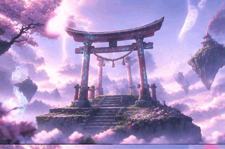

<sub>16 frames · 380×252 · 2.9s · gpt-image-2.6 · generated 2026-11-11</sub>

**Prompt**

```text
A small shrine gate on a floating island in soft pastel pink and lilac, glowing cyan circuit lines pulse along its pillars, cherry petals drift past and holographic paper charms flutter. Dreamy anime background art, fixed camera.
```

`cyber` `pastel` `scenery`

### 93. Shadow puppet scholar


<sub>9 frames · 438×389 · 1.6s · gpt-image-2.6 · generated 2026-11-11</sub>

**Prompt**

```text
A traditional Chinese leather shadow puppet of a scholar holding a fan, translucent red and amber colors, backlit on a glowing white screen. The puppet turns its head, lifts the fan and bows slightly, thin control rods visible below.
```

`shadow-puppet` `chinese` `folk-art`

### 94. Bookshop window in the snow


<sub>9 frames · 435×385 · 1.6s · gpt-image-2.6 · generated 2026-11-10</sub>

**Prompt**

```text
A cozy bookshop window at night with warm light; a gray cat sleeps on a stack of books, its tail swishing slowly, while snow falls outside. Storybook illustration style.
```

`cozy` `snow` `cat`

### 95. Autumn leaves swirl round a bench


<sub>9 frames · 433×395 · 1.6s · gpt-image-2.6 · generated 2026-11-10</sub>

**Prompt**

```text
Golden and red autumn leaves swirl in a little gust around an empty wooden park bench under a lamppost. Warm gouache illustration, fixed camera.
```

`autumn` `park` `wind`

### 96. Meteor shower over a tent


<sub>9 frames · 439×389 · 1.6s · gpt-image-2.6 · generated 2026-11-10</sub>

**Prompt**

```text
A small glowing orange tent on a hill under a deep blue sky, meteors streaking across the stars one after another. Calm illustrated night scene, wide shot.
```

`night` `camping` `stars`

### 97. Umbrellas on a rainy crosswalk


<sub>16 frames · 378×247 · 2.9s · gpt-image-2.6 · generated 2026-11-10</sub>

**Prompt**

```text
Top-down view of a rainy crosswalk where colorful umbrellas move across the white stripes, puddles rippling under the rain. Minimal flat illustration, muted gray street.
```

`rain` `city` `top-down`

### 98. Tea leaves unfurl


<sub>16 frames · 380×247 · 2.9s · gpt-image-2.6 · generated 2026-11-10</sub>

**Prompt**

```text
Inside a clear glass teapot, rolled green tea leaves slowly unfurl and drift down through amber water while tiny bubbles rise. Macro photography, soft daylight, white background.
```

`tea` `macro` `calm`

### 99. Ferris wheel at dusk


<sub>16 frames · 380×242 · 2.9s · gpt-image-2.6 · generated 2026-11-10</sub>

**Prompt**

```text
A ferris wheel at a seaside fair turns slowly at dusk, its bulb lights twinkling in sequence against a purple and orange sky. Dreamy illustration, wide shot, fixed camera.
```

`fair` `dusk` `lights`

### 100. Rooftop laundry in the breeze


<sub>16 frames · 380×247 · 2.6s · gpt-image-2.6 · generated 2026-11-10</sub>

**Prompt**

```text
Colorful laundry hangs on a line across a city rooftop, shirts and sheets flapping gently in the breeze under a blue sky with drifting clouds. Soft anime background art style.
```

`city` `breeze` `calm`

### 101. Lava lamp blobs

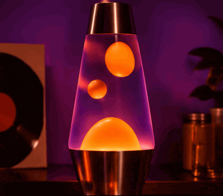

<sub>9 frames · 437×384 · 2.5s · gpt-image-2.6 · generated 2026-11-10</sub>

**Prompt**

```text
A retro lava lamp on a dark shelf: orange wax blobs slowly rise, stretch, split, and sink in glowing purple liquid. Moody 70s photography style, close-up.
```

`retro` `lamp` `ambient`

### 102. Kingfisher dives


<sub>16 frames · 380×250 · 1.9s · gpt-image-2.6 · generated 2026-11-10</sub>

**Prompt**

```text
A bright blue and orange kingfisher dives from a branch into a calm river, a crown of splash rising where it enters the water. Detailed nature illustration, side view, fixed camera.
```

`bird` `nature` `splash`

### 103. Garden hose rainbow


<sub>9 frames · 440×389 · 1.6s · gpt-image-2.6 · generated 2026-11-10</sub>

**Prompt**

```text
A gardener in a wide straw hat, seen from behind, sprays a fan of water over a sunny flower bed, and a small rainbow shimmers in the mist. Warm painterly illustration, summer light.
```

`garden` `summer` `rainbow`

### 104. Torn paper ocean waves


<sub>16 frames · 380×252 · 2.2s · gpt-image-2.6 · generated 2026-11-10</sub>

**Prompt**

```text
Layered torn-paper ocean waves in shades of blue roll forward one behind another, a small paper sailboat rising and dipping on top. Handmade paper collage with visible fibers and paint texture.
```

`paper` `ocean` `collage`

### 105. Risograph shapes drift


<sub>16 frames · 379×252 · 2.9s · gpt-image-2.6 · generated 2026-11-10</sub>

**Prompt**

```text
Four flat textured shapes in risograph colors (pink, teal, yellow, blue) slowly drift and morph into one another, overlapping with grainy ink texture. Abstract background loop, centered composition.
```

`abstract` `background` `texture`

### 106. Roasting a marshmallow


<sub>9 frames · 439×389 · 1.6s · gpt-image-2.6 · generated 2026-11-09</sub>

**Prompt**

```text
A marshmallow on a stick held over a campfire at night, slowly turning golden brown, the flames flickering and small sparks floating up. Close-up, warm firelight, fixed camera.
```

`camping` `food` `cozy`

### 107. Cherry blossoms over a stone bridge


<sub>16 frames · 380×252 · 2.9s · gpt-image-2.6 · generated 2026-11-09</sub>

**Prompt**

```text
An arched stone bridge over a quiet stream lined with cherry trees in full bloom, pink petals falling and landing on the water, ripples spreading. Soft spring light, fixed camera.
```

`spring` `flowers` `japan`

### 108. Hot-air balloons at sunrise


<sub>9 frames · 439×388 · 1.6s · gpt-image-2.6 · generated 2026-11-09</sub>

**Prompt**

```text
Several colorful hot-air balloons drifting gently over a canyon at sunrise, the nearest one's burner flaring briefly, morning mist moving below. Soft golden light, fixed camera.
```

`travel` `sunrise` `sky`

### 109. Aurora over a cabin

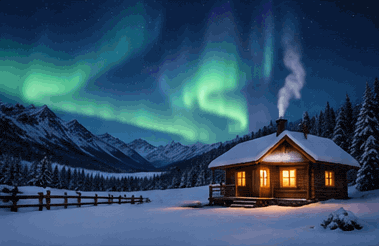

<sub>16 frames · 379×246 · 3.5s · gpt-image-2.6 · generated 2026-11-09</sub>

**Prompt**

```text
A small wooden cabin with glowing windows in a snowy valley, green and violet aurora ribbons rippling slowly across the starry sky above, smoke curling from the chimney. Fixed camera.
```

`night` `winter` `aurora`

### 110. Whisking matcha


<sub>9 frames · 439×390 · 1.1s · gpt-image-2.6 · generated 2026-11-09</sub>

**Prompt**

```text
A bamboo whisk briskly whisking bright green matcha in a dark ceramic bowl, fine foam forming on top, a wisp of steam rising. Close-up on a wooden tray, soft natural light, fixed camera.
```

`tea` `food` `asmr`

### 111. View from a train window


<sub>9 frames · 433×386 · 1.6s · gpt-image-2.6 · generated 2026-11-09</sub>

**Prompt**

```text
The view through a train window on a sunny afternoon: green rice fields and distant hills scrolling past, telegraph poles flicking by, a cup of tea on the windowsill rippling slightly. Anime-inspired background painting, fixed camera inside the carriage.
```

`travel` `train` `scenery`

### 112. Swaying kelp forest


<sub>9 frames · 439×390 · 1.6s · gpt-image-2.6 · generated 2026-11-09</sub>

**Prompt**

```text
An underwater kelp forest with tall golden-green kelp swaying in the current, sun rays shimmering down from the surface, a small school of silver fish darting past. Fixed camera.
```

`ocean` `calm` `nature`

### 113. Bonsai with fireflies


<sub>9 frames · 431×395 · 2.7s · gpt-image-2.6 · generated 2026-11-09</sub>

**Prompt**

```text
A small bonsai pine in a ceramic pot on a wooden shelf at dusk, a few fireflies drifting around its branches and blinking on and off. Soft painterly style, fixed camera.
```

`calm` `nature` `night`

### 114. Astronaut with a paper star


<sub>16 frames · 308×302 · 2.9s · gpt-image-2.6 · generated 2026-11-09</sub>

**Prompt**

```text
A small astronaut sitting on a city rooftop at night holding a folded paper star, the star starting to glow, lifting gently out of their gloves, floating up a little and drifting back down. Dreamy illustration, deep blue sky, fixed camera.
```

`night` `dreamy` `space`

### 115. Palm shadow on a travel journal


<sub>9 frames · 439×389 · 1.6s · gpt-image-2.6 · generated 2026-11-09</sub>

**Prompt**

```text
An open travel journal on a sunny café table with taped photos and a handwritten page, the soft shadow of a palm frond drifting slowly across the pages and back. Everything else stays still. Warm film-photo colors, fixed overhead camera.
```

`cinemagraph` `travel` `shadow`

### 116. Ink-wash moonlit window

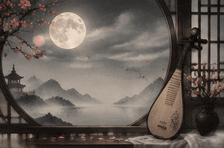

<sub>16 frames · 376×248 · 2.9s · gpt-image-2.6 · generated 2026-11-09</sub>

**Prompt**

```text
A Chinese ink-wash painting of a moonlit round window with a pipa lute leaning against the sill, plum blossom petals drifting past, thin clouds sliding across the full moon. Muted ink tones on rice paper, fixed camera.
```

`ink` `chinese` `moon`

### 117. Diwali oil lamps


<sub>9 frames · 439×387 · 2.0s · gpt-image-2.6 · generated 2026-11-09</sub>

**Prompt**

```text
A row of small clay diya oil lamps on a stone step decorated with a colorful rangoli pattern, their flames flickering, warm light pulsing softly, a few marigold petals drifting down. Warm festive night, fixed camera.
```

`festival` `diwali` `lights`

### 118. Picture-book bunny watering flowers


<sub>9 frames · 431×394 · 1.6s · gpt-image-2.6 · generated 2026-11-09</sub>

**Prompt**

```text
A children's picture-book page in soft watercolor and colored pencil: a little bunny in blue overalls watering a row of tulips with a tin can, water drops falling, two butterflies fluttering around. Gentle healing mood, fixed camera.
```

> 💡 **Tip:** Picture-book style works well for calm kids' videos; keep only one or two small moving parts.

`storybook` `watercolor` `kids`

### 119. Spinning vinyl record


<sub>16 frames · 380×252 · 2.6s · gpt-image-2.6 · generated 2026-11-08</sub>

**Prompt**

```text
A vinyl record spinning on a wooden turntable with the tonearm resting on it, warm lamp light reflecting off the grooves, small music notes floating up. Cozy lo-fi illustration, fixed camera.
```

`music` `lofi` `cozy`

### 120. Lifting ramen noodles


<sub>9 frames · 414×413 · 1.6s · gpt-image-2.6 · generated 2026-11-08</sub>

**Prompt**

```text
A bowl of ramen with a soft-boiled egg and green onions, chopsticks lifting a bundle of noodles that sway gently while steam rises. Rich anime food illustration, fixed camera.
```

`food` `anime` `steam`

### 121. Sushi conveyor belt


<sub>12 frames · 358×358 · 1.7s · gpt-image-2.6 · generated 2026-11-08</sub>

**Prompt**

```text
A sushi conveyor belt in a small restaurant with colorful plates of nigiri sliding steadily from left to right past the counter. Warm anime background art style, fixed camera.
```

`food` `anime` `conveyor`

### 122. Candle on a writing desk


<sub>9 frames · 439×390 · 1.6s · gpt-image-2.6 · generated 2026-11-08</sub>

**Prompt**

```text
A lit candle on an old wooden writing desk beside an open notebook and fountain pen, still except for the flickering flame and its soft shifting glow on the paper. Moody painterly style.
```

`candle` `cozy` `cinemagraph`

### 123. Glowing jellyfish


<sub>9 frames · 439×389 · 1.6s · gpt-image-2.6 · generated 2026-11-08</sub>

**Prompt**

```text
A single translucent jellyfish drifting in the deep ocean, its bell pulsing slowly and its tentacles trailing as soft cyan bioluminescence glows along its edges. Dark blue water, fixed camera.
```

`ocean` `glow` `ambient`

### 124. Paper-cut river valley


<sub>9 frames · 439×390 · 1.6s · gpt-image-2.6 · generated 2026-11-08</sub>

**Prompt**

```text
Layered paper-cut art of a river valley: paper waves slide across, a little paper fishing boat bobs on them, and paper clouds drift, with soft shadows between the layers. Pastel blue and green palette.
```

`papercut` `craft` `layers`

### 125. Ripples on a dawn lake


<sub>16 frames · 380×252 · 4.0s · gpt-image-2.6 · generated 2026-11-08</sub>

**Prompt**

```text
A calm mountain lake at dawn, everything still except soft ripples spreading across the water and a thin layer of mist drifting slowly over the surface. Photorealistic landscape, fixed camera.
```

`landscape` `water` `cinemagraph`

### 126. Cat stretching on the windowsill


<sub>16 frames · 380×249 · 2.9s · gpt-image-2.6 · generated 2026-11-08</sub>

**Prompt**

```text
An orange tabby cat on a sunny windowsill stretching its front legs, yawning wide, then settling back and blinking slowly. Soft watercolor illustration, curtains still, fixed camera.
```

`cat` `cozy` `watercolor`

### 127. Steam over fresh sourdough


<sub>9 frames · 436×389 · 1.6s · gpt-image-2.6 · generated 2026-11-08</sub>

**Prompt**

```text
A freshly baked sourdough loaf on a floured wooden board, still except for thin curls of steam rising from its scored crust. Warm morning light, food photography, fixed camera.
```

`food` `steam` `cinemagraph`

### 128. Tang court dancer

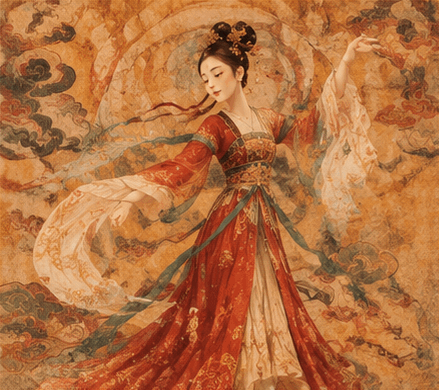

<sub>9 frames · 439×390 · 1.4s · gpt-image-2.6 · generated 2026-11-08</sub>

**Prompt**

```text
A court dancer in flowing red and gold Tang-dynasty robes spinning in place, her long water sleeves trailing in wide arcs around her. Painted in the style of ancient Chinese cave murals on a warm ochre background.
```

`chinese` `dance` `mural`

### 129. Paper crane takes off from a card


<sub>9 frames · 437×379 · 1.6s · gpt-image-2.6 · generated 2026-11-08</sub>

**Prompt**

```text
A folded white paper crane sitting on an open greeting card flaps its creased paper wings and lifts off, rising gently above the card. Soft pastel watercolor style on a cream background, fixed camera.
```

`paper` `message` `watercolor`

### 130. Train wind on the platform


<sub>16 frames · 380×252 · 1.9s · gpt-image-2.6 · generated 2026-11-07</sub>

**Prompt**

```text
A girl with long dark hair and a yellow raincoat standing on a subway platform as a train rushes past behind her, her hair and coat whipping sideways in the gust while she squints. Anime film still style, fixed camera.
```

`anime` `wind` `cinemagraph`

### 131. Robot barista pouring coffee


<sub>9 frames · 432×394 · 1.6s · gpt-image-2.6 · generated 2026-11-07</sub>

**Prompt**

```text
A small white robot barista with one arm pouring steamed milk into a cup of coffee on a café counter, drawing a leaf pattern in the foam. Clean 3D render.
```

`robot` `coffee` `cafe`

### 132. Clay dough baker mascot


<sub>9 frames · 439×390 · 1.6s · gpt-image-2.6 · generated 2026-11-07</sub>

**Prompt**

```text
A round clay dough mascot in a little white chef hat kneading a piece of dough on a floured board, folding it over and giving a small wave. Claymation style, fixed camera.
```

`clay` `mascot` `cooking`

### 133. Paper lantern Jiangnan with koi


<sub>16 frames · 380×245 · 2.9s · gpt-image-2.6 · generated 2026-11-07</sub>

**Prompt**

```text
A layered paper-cut lantern scene of a southern Chinese water town with a stone arch bridge and a pavilion, two golden koi swimming beneath the bridge while the warm light flickers. Paper-sculpture style.
```

`paper-cut` `chinese` `lantern`

### 134. Eagle flapping its wings


<sub>9 frames · 439×390 · 1.1s · gpt-image-2.6 · generated 2026-11-07</sub>

**Prompt**

```text
A golden eagle flying in place with powerful wing beats, feathers rippling, isolated on a plain sky-blue background. Realistic illustration.
```

`bird` `flight` `animal`

### 135. Glowing beaker vortex


<sub>16 frames · 379×250 · 2.6s · gpt-image-2.6 · generated 2026-11-07</sub>

**Prompt**

```text
A glass lab beaker on a dark bench with a swirling vortex of glowing teal liquid inside, tiny bubbles rising and the glow pulsing. Moody lab photography.
```

`science` `glow` `liquid`

### 136. Glass butterfly with shifting shadows


<sub>16 frames · 324×291 · 2.9s · gpt-image-2.6 · generated 2026-11-07</sub>

**Prompt**

```text
A butterfly made of clear glass perched on a white table, slowly opening and closing its wings while the colorful refracted shadow on the table changes in sync. Macro photo, soft light.
```

`glass` `butterfly` `light`

### 137. Canyon waterfall mist

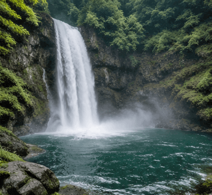

<sub>9 frames · 431×396 · 1.6s · gpt-image-2.6 · generated 2026-11-07</sub>

**Prompt**

```text
A tall waterfall pouring into a deep green canyon pool, mist rising and ripples spreading across the water. Fixed wide shot, realistic landscape photo.
```

`nature` `waterfall` `cinemagraph`

### 138. Petting a shiba in the rain


<sub>9 frames · 439×390 · 1.6s · gpt-image-2.6 · generated 2026-11-07</sub>

**Prompt**

```text
A girl with a clear umbrella crouching on a wet city street at night to pet a shiba inu, the dog's tail wagging, rain glittering under neon reflections. Anime-style illustration.
```

`rain` `dog` `night`

### 139. Chopping wood in winter

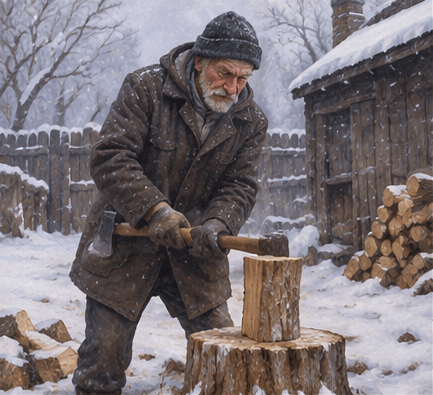

<sub>9 frames · 433×395 · 1.6s · gpt-image-2.6 · generated 2026-11-07</sub>

**Prompt**

```text
An old man in a thick wool coat raising an axe and splitting a log on a stump in a snowy backyard, wood halves falling to the sides, his breath visible in the cold air. Painterly illustration.
```

`winter` `rural` `work`

### 140. Robot dancing on the street


<sub>9 frames · 439×390 · 1.3s · gpt-image-2.6 · generated 2026-11-07</sub>

**Prompt**

```text
A boxy orange robot doing a robotic pop-and-lock dance on a graffiti-covered city street, arms snapping between poses. Fixed camera, vibrant 3D render.
```

`robot` `dance` `street`

### 141. Paper boat bobbing on water


<sub>9 frames · 439×390 · 1.6s · gpt-image-2.6 · generated 2026-11-07</sub>

**Prompt**

```text
A white folded paper boat bobbing gently on calm water, small ripples spreading outward, fixed overhead camera. Soft natural light photo style.
```

`water` `paper` `calm`

### 142. Windmill on green hills

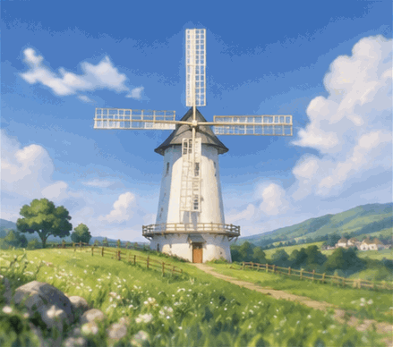

<sub>9 frames · 439×388 · 1.6s · gpt-image-2.6 · generated 2026-11-07</sub>

**Prompt**

```text
A white wooden windmill on rolling green hills, its four sails turning slowly while clouds drift across a blue sky. Soft painterly landscape.
```

`landscape` `windmill` `calm`

### 143. Pelican riding a bicycle


<sub>16 frames · 380×250 · 2.2s · gpt-image-2.6 · generated 2026-11-07</sub>

**Prompt**

```text
A pelican riding a red bicycle along a seaside promenade, legs pedaling and its big beak bobbing, waves rolling in behind. Flat vector illustration, side view.
```

`animal` `bicycle` `classic-test`

### 144. Clay kitten in a ball pit


<sub>16 frames · 380×250 · 2.2s · gpt-image-2.6 · generated 2026-11-07</sub>

**Prompt**

```text
A clay kitten popping its head out of a ball pit full of colorful plastic balls, balls tumbling off its head as it wiggles. Claymation style.
```

`clay` `cat` `playful`

### 145. City in a snow globe


<sub>16 frames · 380×252 · 2.9s · gpt-image-2.6 · generated 2026-11-07</sub>

**Prompt**

```text
A snow globe holding a miniature city of red-brick apartment blocks and a little yellow taxi, snow drifting down slowly inside the glass. Warm studio lighting, macro photo.
```

`snow-globe` `city` `winter`

### 146. Husky howling in a snow globe


<sub>9 frames · 433×393 · 1.6s · gpt-image-2.6 · generated 2026-11-07</sub>

**Prompt**

```text
A tiny husky inside a glass snow globe sitting on a snowy mound and howling up at the sky as glitter snow swirls around it. Product photo style on a dark wooden table.
```

`snow-globe` `dog` `winter`

### 147. Teapot steam turns into a heart


<sub>16 frames · 380×252 · 2.9s · gpt-image-2.6 · generated 2026-11-07</sub>

**Prompt**

```text
A copper teapot on a windowsill on a rainy afternoon, steam rising from the spout and briefly curling into a heart shape before drifting apart. Clay stop-motion style, fixed camera.
```

`steam` `cozy` `clay`

### 148. Doodle monster comes alive


<sub>9 frames · 440×386 · 1.6s · gpt-image-2.6 · generated 2026-11-06</sub>

**Prompt**

```text
A crude crayon doodle of a little purple blob monster with two eyes on wobbly stalks and three stubby legs, drawn on lined notebook paper, comes alive: its eye-stalks blink and sway, it waves its tiny arms and hops in place, keeping the wobbly hand-drawn lines and odd proportions. The notebook paper stays still.
```

`loop` `doodle` `cute`

### 149. Ink-wash galloping horse


<sub>16 frames · 380×252 · 1.9s · gpt-image-2.6 · generated 2026-11-06</sub>

**Prompt**

```text
A racehorse with a jockey galloping to the right in a loose Chinese ink-wash painting style, legs cycling through a full gallop stride, the jockey bobbing up and down, ink splashes kicking up behind the hooves. Rice-paper background, black ink with a touch of red.
```

`loop` `ink-wash` `animal`

### 150. Café cinemagraph


<sub>9 frames · 439×390 · 1.6s · gpt-image-2.6 · generated 2026-11-06</sub>

**Prompt**

```text
A cinemagraph of a quiet street café terrace in the morning: everything is perfectly still except the steam curling from a cup on the table and a striped awning flag fluttering in the breeze. Realistic photography, soft warm light, locked camera.
```

> 💡 **Tip:** For a cinemagraph, say explicitly that everything is still except one or two named elements.

`loop` `cinemagraph` `photo`

### 151. Lo-fi study loop


<sub>9 frames · 434×383 · 1.6s · gpt-image-2.6 · generated 2026-11-06</sub>

**Prompt**

```text
A girl with headphones writing in a notebook at a desk at night, her pencil moving, steam rising from a mug, rain sliding down the window behind her and a desk lamp glowing. Lo-fi anime illustration, muted purple and blue palette, locked camera.
```

`loop` `lofi` `study`

### 152. Sleepy fox on a mossy rock

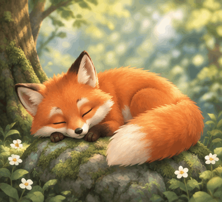

<sub>9 frames · 432×394 · 1.6s · gpt-image-2.6 · generated 2026-11-06</sub>

**Prompt**

```text
A small orange fox curled up asleep on a mossy rock, its tail gently swaying and ears twitching. Soft storybook illustration, locked camera.
```

`loop` `animal` `calm`

### 153. Lantern monkey in the snow


<sub>16 frames · 380×241 · 2.9s · gpt-image-2.6 · generated 2026-11-06</sub>

**Prompt**

```text
A small monkey in an olive-green hooded coat standing in a snowy pine forest at dusk, lifting a glowing amber paper lantern, looking up and blinking, then lowering the lantern back to where it started. Snow falls gently and a tiny cabin glows in the background. Soft storybook illustration, locked camera.
```

> 💡 **Tip:** Give the subject a pose to return to and lock the camera — the easiest way to get a clean loop.

`loop` `character` `winter`

### 154. Cat sleeping by the fireplace


<sub>16 frames · 380×243 · 2.9s · gpt-image-2.6 · generated 2026-11-06</sub>

**Prompt**

```text
A ginger cat curled up asleep on a rug in front of a crackling fireplace, its body gently rising and falling with each breath, flames flickering and casting warm light. Cozy flat illustration, warm orange and brown tones.
```

> 💡 **Tip:** Breathing is a great tiny motion for calm loops — it reads clearly and loops naturally.

`loop` `cozy` `cat`

### 155. Lighthouse at night


<sub>16 frames · 380×247 · 2.9s · gpt-image-2.6 · generated 2026-11-06</sub>

**Prompt**

```text
A white lighthouse on a rocky shore at night, its beam sweeping slowly across a dark blue sky, waves rolling and splashing against the rocks below. Flat illustration with a deep navy and warm yellow palette.
```

`loop` `seascape` `night`

### 156. Goldfish in a bowl

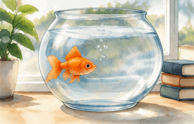

<sub>16 frames · 380×243 · 2.9s · gpt-image-2.6 · generated 2026-11-06</sub>

**Prompt**

```text
A round glass fishbowl on a windowsill with one orange goldfish swimming a slow circle, tail fluttering, tiny bubbles rising to the surface. Soft watercolor-style illustration, gentle light.
```

`loop` `pet` `calm`

### 157. Rainy window and plant


<sub>16 frames · 378×252 · 2.9s · gpt-image-2.6 · generated 2026-11-06</sub>

**Prompt**

```text
A rainy window at dusk with a small potted plant on the sill, raindrops sliding down the glass and blurry city lights twinkling outside. Soft muted blue palette, lo-fi illustration style.
```

`loop` `lofi` `weather`

### 158. Steaming coffee loop


<sub>16 frames · 379×252 · 2.6s · gpt-image-2.6 · generated 2026-11-05</sub>

**Prompt**

```text
A steaming cup of coffee on a small wooden table, steam curling and drifting upward, a tiny spoon wobbling on the saucer. Cozy flat illustration with warm colors.
```

`loop` `food` `cozy`

### 159. Reading by the window, day to night


<sub>9 frames · 413×412 · 3.1s · gpt-image-2.6 · generated 2026-11-06</sub>

**Prompt**

```text
A girl with a short bob reading a book on a cushion by a big window, seen from the side. Outside the window the sky cycles from bright morning blue to orange sunset to a starry night and back to morning, while the room light warms up and a desk lamp switches on at night. Soft flat illustration, calm and cozy.
```

> 💡 **Tip:** Day-to-night loops are harder than simple motions. Keep the character mostly still and let the light and sky carry the change.

`loop` `character` `time-lapse`

[← README](../README.md)
