# 氛围循环动画 · 126 条提示词

[← README](../README_zh.md)

### 1. 雪花球里的小木屋


<sub>9 帧 · 439×390 · 1.6s · gpt-image-2.6 · 生成于 2026-11-17</sub>

**提示词**

```text
A glass snow globe with a tiny red cabin and pine trees inside; snowflakes swirl up and settle slowly around the cabin. Warm cozy lighting, wooden table, fixed close-up.
```

`snow-globe` `winter` `cozy`

### 2. 糖炒栗子

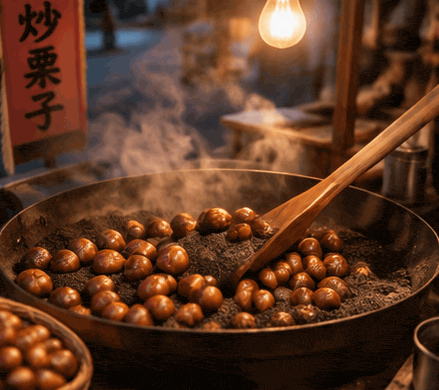

<sub>9 帧 · 439×390 · 1.6s · gpt-image-2.6 · 生成于 2026-11-17</sub>

**提示词**

```text
A big iron wok of chestnuts and dark sand is stirred by a wooden paddle, steam curling up under a warm bulb at a winter street stall. Cozy photographic style, close-up, fixed camera.
```

`chestnut` `street-food` `winter`

### 3. 路灯下的初雪


<sub>16 帧 · 376×252 · 2.9s · gpt-image-2.6 · 生成于 2026-11-17</sub>

**提示词**

```text
Big soft snowflakes drift down through the warm cone of an old street lamp on a quiet cobblestone street at night. Cinematic, fixed camera, everything else still.
```

`snow` `night` `street`

### 4. 窗上霜花蔓延

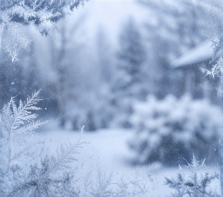

<sub>8 帧 · 439×388 · 1.8s · gpt-image-2.6 · 生成于 2026-11-17</sub>

**提示词**

```text
Delicate fern-like frost patterns creep across a cold window pane from the corners, a blurry snowy garden visible behind. Macro winter photography, fixed camera.
```

`frost` `winter` `macro`

### 5. 孔明灯升空


<sub>16 帧 · 377×248 · 2.9s · gpt-image-2.6 · 生成于 2026-11-17</sub>

**提示词**

```text
Dozens of warm glowing paper lanterns float slowly up into a deep blue night sky above dark rooftops, flickering softly. Dreamy painterly style, fixed camera.
```

`lantern` `night` `festival`

### 6. 瓢虫与露珠

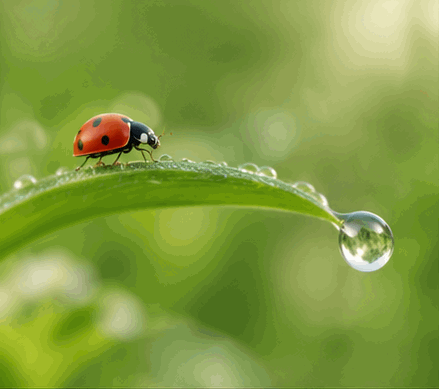

<sub>9 帧 · 439×389 · 1.6s · gpt-image-2.6 · 生成于 2026-11-17</sub>

**提示词**

```text
A ladybug walks along a curved green leaf while a dewdrop at the leaf tip swells and wobbles. Macro nature photography, soft morning bokeh, fixed camera.
```

`ladybug` `macro` `nature`

### 7. 山洞里打呼的熊


<sub>16 帧 · 380×248 · 2.9s · gpt-image-2.6 · 生成于 2026-11-17</sub>

**提示词**

```text
A brown bear sleeps curled up in a cozy cave, its belly rising and falling as a snore bubble grows and shrinks from its nose, snow falling softly outside. Storybook illustration, fixed camera.
```

`bear` `hibernation` `winter`

### 8. 海獭仰浮打盹

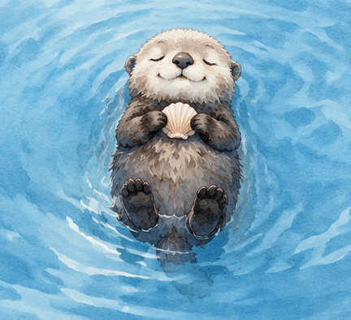

<sub>9 帧 · 432×395 · 1.6s · gpt-image-2.6 · 生成于 2026-11-17</sub>

**提示词**

```text
A sea otter floats on its back in calm water, holding a small shell on its belly, bobbing gently with the ripples as its eyes stay closed. Soft watercolor style, fixed overhead-angle camera.
```

`otter` `sleep` `calm`

### 9. 沙漠上空的彗星


<sub>9 帧 · 506×337 · 2.0s · gpt-image-2.6 · 生成于 2026-11-17</sub>

**提示词**

```text
A bright comet with a long glowing tail drifts slowly across a starry sky above dark desert dunes, the tail shimmering. Calm night photography look, fixed wide camera.
```

`comet` `night` `sky`

### 10. 发光菌丝峡谷桥


<sub>9 帧 · 506×337 · 1.6s · gpt-image-2.6 · 生成于 2026-11-17</sub>

**提示词**

```text
A delicate bridge woven from glowing white fungal threads spans a misty canyon at dusk; soft pulses of blue light travel along the threads from one side to the other. Fantasy concept art, fixed wide shot.
```

`fantasy` `bridge` `glow`

### 11. 稚拙几何手绘脸


<sub>9 帧 · 437×388 · 1.6s · gpt-image-2.6 · 生成于 2026-11-17</sub>

**提示词**

```text
A naive hand-drawn portrait of an imaginary character built from uneven circles, triangles and blocks of retro color, with trembling black ink outlines; the character blinks once and the color blocks shift slightly. Textured paper, lots of empty space.
```

`illustration` `geometric` `ink`

### 12. 海湾浪花动态照片


<sub>9 帧 · 437×388 · 1.6s · gpt-image-2.6 · 生成于 2026-11-17</sub>

**提示词**

```text
A quiet rocky cove at golden hour where only the sea moves: small waves roll in and wash over the sand. The rocks, cliffs and sky stay completely still. Natural photographic color, fixed camera.
```

> 💡 **技巧：** 做动态照片要点名唯一动的元素，并列出必须静止的部分。

`sea` `cinemagraph` `calm`

### 13. 牡丹缓缓绽放

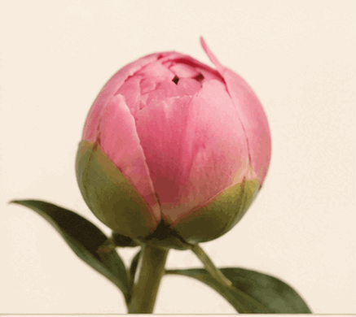

<sub>9 帧 · 437×390 · 1.6s · gpt-image-2.6 · 生成于 2026-11-17</sub>

**提示词**

```text
A single pink peony bud slowly unfurls its layered petals into a full bloom, a few petals trembling at the edges. Soft studio light, plain cream background, fixed close-up camera.
```

> 💡 **技巧：** 开花是单向动作，想无缝循环就让花在结尾缓缓收拢回花苞。

`flower` `bloom` `macro`

### 14. 蜗牛壳小屋亮灯

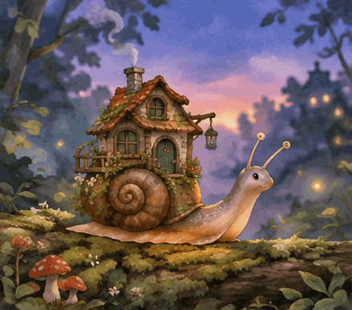

<sub>9 帧 · 439×387 · 3.1s · gpt-image-2.6 · 生成于 2026-11-17</sub>

**提示词**

```text
A snail carrying a tiny cottage on its back inches along a mossy log as the little windows flicker on one by one at dusk. Storybook watercolor style.
```

`snail` `cottage` `storybook`

### 15. 阳光中的海龟

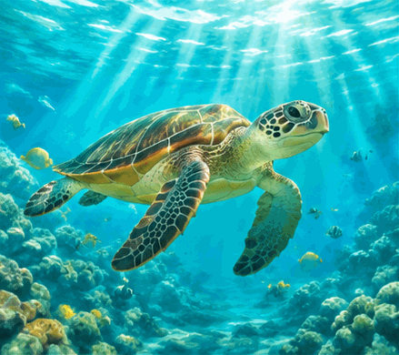

<sub>9 帧 · 439×390 · 1.6s · gpt-image-2.6 · 生成于 2026-11-17</sub>

**提示词**

```text
A green sea turtle paddles slowly through shafts of sunlight with small fish drifting past. Painterly underwater scene, turquoise water.
```

`turtle` `ocean` `calm`

### 16. 拉坯转盘


<sub>16 帧 · 380×252 · 2.9s · gpt-image-2.6 · 生成于 2026-11-17</sub>

**提示词**

```text
Clay-covered hands shape a bowl on a spinning pottery wheel, its rim rising slowly and evenly. Warm studio illustration, earthy tones.
```

`pottery` `craft` `calm`

### 17. 枯山水耙沙


<sub>9 帧 · 433×395 · 1.6s · gpt-image-2.6 · 生成于 2026-11-17</sub>

**提示词**

```text
A wooden rake draws smooth curving lines through white sand around a mossy stone in a small zen garden. Calm top-down illustration, soft morning light.
```

`zen` `garden` `calm`

### 18. 火山剖面岩浆上升


<sub>16 帧 · 379×250 · 2.9s · gpt-image-2.6 · 生成于 2026-11-17</sub>

**提示词**

```text
A cross-section of a cone volcano with labeled layers; glowing magma climbs the central vent and a small puff of smoke pops from the crater. Textbook infographic style, white background.
```

`cutaway` `volcano` `science`

### 19. 蚁巢剖面


<sub>9 帧 · 433×395 · 1.6s · gpt-image-2.6 · 生成于 2026-11-17</sub>

**提示词**

```text
A cross-section of an underground ant nest; ants carry crumbs and leaves along winding tunnels into round chambers. Educational illustration, warm soil tones.
```

`cutaway` `ants` `science`

### 20. 潜艇剖面图


<sub>12 帧 · 379×337 · 1.9s · gpt-image-2.6 · 生成于 2026-11-17</sub>

**提示词**

```text
A cutaway view of a yellow submarine showing small rooms; tiny crew members walk between the engine room and the periscope while bubbles rise outside. Clean isometric infographic style, deep teal water.
```

`cutaway` `submarine` `infographic`

### 21. 星辰钟碎裂


<sub>16 帧 · 378×252 · 2.9s · gpt-image-2.6 · 生成于 2026-11-17</sub>

**提示词**

```text
A brass astronomical clock with tiny planets on its rings cracks across the face and spills glowing star fragments that drift outward. Ornate fantasy illustration, deep navy background.
```

`clock` `stars` `fantasy`

### 22. 云朵倒咖啡


<sub>9 帧 · 412×413 · 1.6s · gpt-image-2.6 · 生成于 2026-11-17</sub>

**提示词**

```text
A fluffy white cloud with a sleepy face tilts and pours a thin stream of coffee into a striped mug below, steam curling up. Soft pastel illustration, pale blue background.
```

`cloud` `coffee` `morning`

### 23. 种子发芽

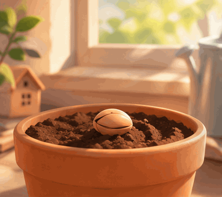

<sub>9 帧 · 439×390 · 1.6s · gpt-image-2.6 · 生成于 2026-11-17</sub>

**提示词**

```text
A seed in a small clay pot pushes up a green sprout that unfurls two leaves, a droplet sliding off one. Soft cartoon style, warm windowsill light.
```

`plant` `sprout` `growth`

### 24. 雨中温室

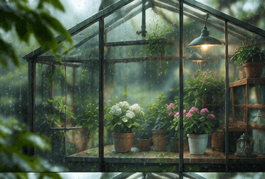

<sub>16 帧 · 372×252 · 2.9s · gpt-image-2.6 · 生成于 2026-11-17</sub>

**提示词**

```text
Rain streaks down the glass panes of a small greenhouse full of potted plants, droplets tapping and leaves trembling slightly. Soft green cinematic light.
```

`greenhouse` `rain` `plants`

### 25. 蝠鲼滑翔

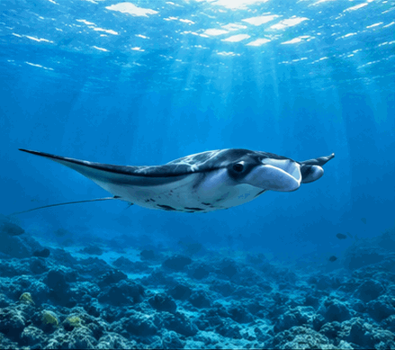

<sub>9 帧 · 439×389 · 1.6s · gpt-image-2.6 · 生成于 2026-11-17</sub>

**提示词**

```text
A manta ray glides through blue water, its wings rising and falling slowly while sun rays shimmer from above. Underwater scene, fixed camera.
```

`ocean` `manta` `underwater`

### 26. 深夜洗衣房


<sub>9 帧 · 436×389 · 1.6s · gpt-image-2.6 · 生成于 2026-11-17</sub>

**提示词**

```text
A front-loading washer spins colorful clothes behind its round glass door in an empty laundromat at night, fluorescent light humming. Moody lo-fi illustration, fixed camera.
```

`laundromat` `night` `lofi`

### 27. 玻璃生态瓶起雾

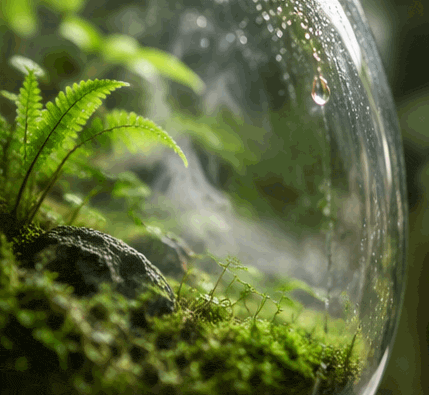

<sub>9 帧 · 429×395 · 2.0s · gpt-image-2.6 · 生成于 2026-11-17</sub>

**提示词**

```text
Inside a glass terrarium with moss and tiny ferns, soft mist curls and a single water drop slides down the glass. Macro photography, soft green light.
```

`terrarium` `plants` `mist`

### 28. 黄铜齿轮转动


<sub>16 帧 · 380×247 · 2.6s · gpt-image-2.6 · 生成于 2026-11-17</sub>

**提示词**

```text
A cluster of interlocking brass gears turns smoothly at different speeds, light glinting on the teeth. Steampunk macro shot, dark background.
```

`gears` `steampunk` `machine`

### 29. 海边吊床


<sub>16 帧 · 380×252 · 2.6s · gpt-image-2.6 · 生成于 2026-11-17</sub>

**提示词**

```text
An empty striped hammock sways between two palm trees while small waves roll onto the beach behind it. Bright tropical illustration, fixed camera.
```

`beach` `hammock` `summer`

### 30. 风吹麦浪


<sub>16 帧 · 380×252 · 2.9s · gpt-image-2.6 · 生成于 2026-11-17</sub>

**提示词**

```text
Golden wheat sways in waves across a field as fluffy clouds drift slowly overhead. Warm late afternoon light, wide fixed shot.
```

`wheat` `wind` `nature`

### 31. 月下小船


<sub>9 帧 · 438×387 · 1.6s · gpt-image-2.6 · 生成于 2026-11-17</sub>

**提示词**

```text
A small wooden rowboat rocks gently on dark water under a full moon, its reflection rippling. Soft painterly night scene, fixed camera.
```

`boat` `moon` `night`

### 32. 图书馆光束浮尘

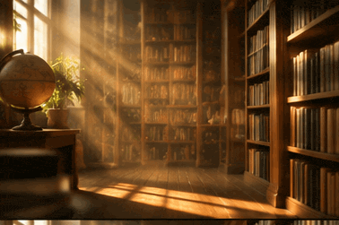

<sub>16 帧 · 378×251 · 2.9s · gpt-image-2.6 · 生成于 2026-11-17</sub>

**提示词**

```text
Golden dust motes drift slowly through a beam of sunlight in a quiet wooden library aisle. Warm cinematic light, fixed camera, everything else still.
```

`library` `light` `calm`

### 33. 古典油画里的猫眨眼


<sub>9 帧 · 435×389 · 1.6s · gpt-image-2.6 · 生成于 2026-11-13</sub>

**提示词**

```text
An old oil painting in an ornate gold frame shows a noble cat wearing a lace ruff collar; the cat slowly blinks and glances sideways while a painted candle beside it flickers. Visible brush strokes, museum wall.
```

`painting` `cat` `museum`

### 34. 方盒子变成曲面建筑


<sub>9 帧 · 438×390 · 1.6s · gpt-image-2.6 · 生成于 2026-11-13</sub>

**提示词**

```text
A plain white cube architectural model on a concrete plinth smoothly melts and stretches into a flowing curved futuristic pavilion, then folds back into the cube. Clean architectural model photography, neutral backdrop.
```

`architecture` `morph` `model`

### 35. 毛毡小羊过山坡

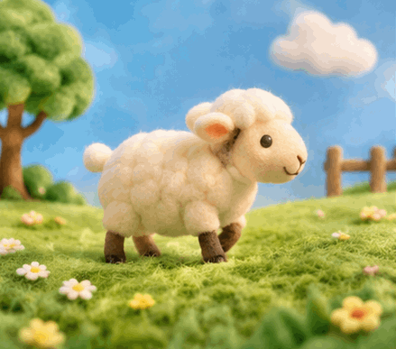

<sub>9 帧 · 439×387 · 1.4s · gpt-image-2.6 · 生成于 2026-11-13</sub>

**提示词**

```text
A needle-felted wool sheep trots across a rolling felt hill with tiny felt flowers, its legs bobbing, while a felt cloud drifts behind. Soft fuzzy fiber texture, warm studio light, fixed camera.
```

> 💡 **技巧：** 毛毡没有清晰的边，每帧重画时质感容易闪。镜头放远一点、动作小一点会更稳。

`felt` `sheep` `craft`

### 36. 折纸狐狸展开


<sub>9 帧 · 437×388 · 1.6s · gpt-image-2.6 · 生成于 2026-11-12</sub>

**提示词**

```text
A flat sheet of orange paper folds itself into an origami fox that turns its head and blinks. Clean paper craft style, plain white background.
```

`paper` `origami` `fox`

### 37. 灯泡脑袋拼贴画

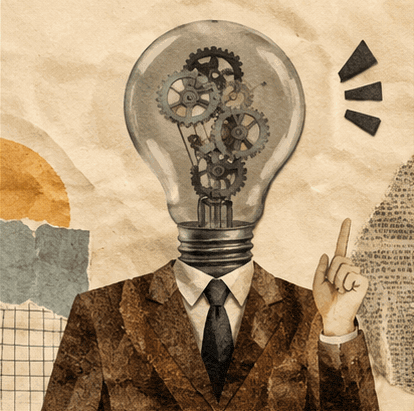

<sub>9 帧 · 414×411 · 1.6s · gpt-image-2.6 · 生成于 2026-11-12</sub>

**提示词**

```text
Cut-paper collage of a figure with a light-bulb head; gears inside the bulb turn and the bulb flickers on with a bright idea. Vintage magazine collage style, beige paper background.
```

`collage` `idea` `paper`

### 38. 接雪花的冬日小兔

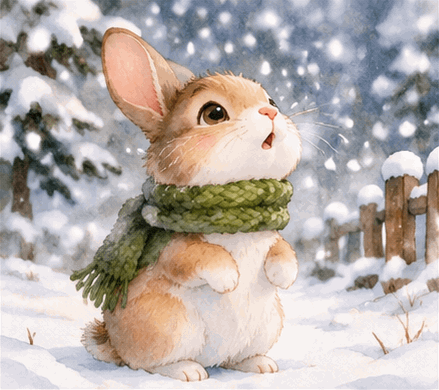

<sub>9 帧 · 439×390 · 1.6s · gpt-image-2.6 · 生成于 2026-11-12</sub>

**提示词**

```text
A small bunny in a green knitted scarf looks up and catches falling snowflakes on its nose, sneezing softly. Warm watercolor winter style, snowy forest background.
```

`winter` `bunny` `cozy`

### 39. 小机器人和科学家看试管


<sub>9 帧 · 433×373 · 1.6s · gpt-image-2.6 · 生成于 2026-11-12</sub>

**提示词**

```text
A scientist in a white coat and a small round robot lean in to watch a test tube that bubbles and glows green, both blinking in wonder. Clean flat illustration, plain white background.
```

`science` `robot` `illustration`

### 40. 公园大泡泡


<sub>9 帧 · 439×389 · 1.6s · gpt-image-2.6 · 生成于 2026-11-12</sub>

**提示词**

```text
A giant soap bubble wobbles and drifts across a green park, rainbow colors swirling on its surface. Bright cheerful illustration, fixed camera.
```

`ambient` `bubble` `summer`

### 41. 秋日窗边一杯茶


<sub>16 帧 · 380×252 · 2.9s · gpt-image-2.6 · 生成于 2026-11-12</sub>

**提示词**

```text
A cup of tea on a wooden table by a window, steam curling up while maple leaves drift past outside. Warm cozy illustration, fixed camera.
```

`ambient` `autumn` `tea`

### 42. 海边打盹的猫

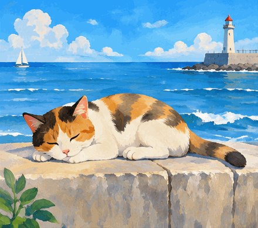

<sub>9 帧 · 440×389 · 1.6s · gpt-image-2.6 · 生成于 2026-11-12</sub>

**提示词**

```text
A calico cat naps on a sunny harbor wall, its tail flicking lazily while small waves roll in behind it. Bright gouache illustration, fixed camera.
```

`ambient` `cat` `sea`

### 43. 黄昏路面电车

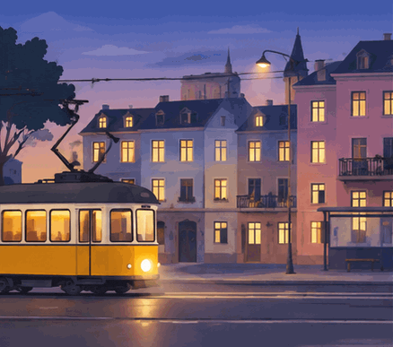

<sub>9 帧 · 438×387 · 1.6s · gpt-image-2.6 · 生成于 2026-11-12</sub>

**提示词**

```text
A small yellow tram glides past a row of pastel buildings at dusk, its windows glowing and overhead wires swaying. Flat illustration style, fixed camera.
```

`ambient` `city` `travel`

### 44. 星河沙漏


<sub>16 帧 · 320×294 · 2.6s · gpt-image-2.6 · 生成于 2026-11-12</sub>

**提示词**

```text
A glass hourglass where tiny glowing stars trickle down instead of sand, forming a small swirling galaxy in the bottom bulb. Dark background, magical realism style.
```

`ambient` `space` `magic`

### 45. 壁炉边烘袜子


<sub>16 帧 · 377×249 · 2.6s · gpt-image-2.6 · 生成于 2026-11-12</sub>

**提示词**

```text
Knitted socks hang on a line above a crackling fireplace, flames dancing and the socks swaying slightly in the warm air. Cozy illustrated style, fixed camera.
```

`ambient` `cozy` `winter`

### 46. 廊下风铃

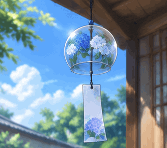

<sub>16 帧 · 328×291 · 2.2s · gpt-image-2.6 · 生成于 2026-11-12</sub>

**提示词**

```text
A glass wind chime on a wooden porch sways in a summer breeze, its paper tag fluttering and light glinting off the glass. Soft anime summer style, blue sky behind.
```

`ambient` `summer` `japan`

### 47. 雪夜拉面摊


<sub>16 帧 · 379×250 · 2.9s · gpt-image-2.6 · 生成于 2026-11-12</sub>

**提示词**

```text
A tiny street ramen stall at night, steam rising from a pot and paper lanterns swaying while snow falls gently. Warm anime background style, fixed camera.
```

`ambient` `food` `snow`

### 48. 俯视锦鲤池

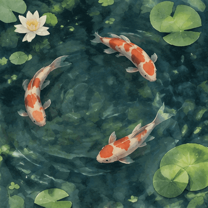

<sub>9 帧 · 414×414 · 2.0s · gpt-image-2.6 · 生成于 2026-11-12</sub>

**提示词**

```text
Top-down view of a dark pond where three orange and white koi glide in a slow circle among lily pads, gentle ripples spreading. Watercolor style, fixed camera.
```

`ambient` `fish` `water`

### 49. 雨夜蜡烛店橱窗


<sub>16 帧 · 377×241 · 2.9s · gpt-image-2.6 · 生成于 2026-11-12</sub>

**提示词**

```text
A small candle shop window at night with dozens of candles flickering softly while rain streaks down the glass. Cozy painterly style, fixed camera.
```

`ambient` `rain` `cozy`

### 50. 发光蘑菇林


<sub>16 帧 · 378×251 · 2.9s · gpt-image-2.6 · 生成于 2026-11-11</sub>

**提示词**

```text
A mossy forest floor at night with clusters of bioluminescent blue mushrooms whose caps pulse brighter and dimmer as tiny glowing spores drift upward. Fantasy illustration, fixed camera.
```

`fantasy` `night` `nature`

### 51. 八音盒小舞者

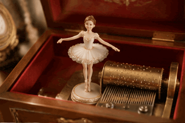

<sub>16 帧 · 380×252 · 2.6s · gpt-image-2.6 · 生成于 2026-11-11</sub>

**提示词**

```text
Inside an open wooden music box lined with red velvet, a small porcelain dancer in a white tutu spins on a pin while the brass comb mechanism turns. Warm vintage lighting, close-up.
```

`vintage` `music-box` `object`

### 52. 风吹沙丘


<sub>9 帧 · 439×388 · 1.6s · gpt-image-2.6 · 生成于 2026-11-11</sub>

**提示词**

```text
Fine sand streams off the sharp crest of a golden desert dune in the wind, rippled sand patterns glowing under a low evening sun and a pale sky. Cinematic landscape, fixed wide shot.
```

`desert` `landscape` `wind`

### 53. 潮池小螃蟹

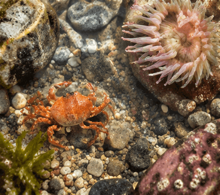

<sub>9 帧 · 439×390 · 1.6s · gpt-image-2.6 · 生成于 2026-11-11</sub>

**提示词**

```text
A small orange crab scuttles sideways between pebbles in a clear tide pool as gentle ripples pass over it and a sea anemone waves its tentacles. Top-down nature photography, fixed camera.
```

`nature` `ocean` `macro`

### 54. 烤箱里膨胀的面包

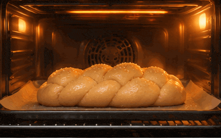

<sub>16 帧 · 378×236 · 2.9s · gpt-image-2.6 · 生成于 2026-11-11</sub>

**提示词**

```text
Through a glowing oven window, a braided loaf slowly puffs up and turns golden while the orange heating element pulses. Warm cozy kitchen photography, fixed close-up.
```

`baking` `kitchen` `cozy`

### 55. 河灯漂流


<sub>16 帧 · 375×244 · 2.9s · gpt-image-2.6 · 生成于 2026-11-11</sub>

**提示词**

```text
Paper lotus lanterns with candle flames float slowly down a dark river at night, their reflections wobbling on the water while the flames flicker. Painterly style, fixed camera.
```

`lantern` `night` `festival`

### 56. 绘本小熊泡茶


<sub>16 帧 · 380×252 · 2.9s · gpt-image-2.6 · 生成于 2026-11-11</sub>

**提示词**

```text
a picture-book watercolor scene of a small brown bear in a striped apron pouring tea from a round pot into a cup at a wooden table, steam rising, a cat on the windowsill flicking its tail. Soft paper texture, gentle colors.
```

`picture-book` `watercolor` `cozy`

### 57. 海岸敞篷车


<sub>16 帧 · 380×252 · 2.6s · gpt-image-2.6 · 生成于 2026-11-11</sub>

**提示词**

```text
A vintage red convertible drives along a cliffside coastal road at sunset, the camera tracking alongside it; palm trees and guardrails slide past while the sea glitters below. Warm cinematic film look.
```

`car` `road-trip` `cinematic`

### 58. 剪纸分层森林

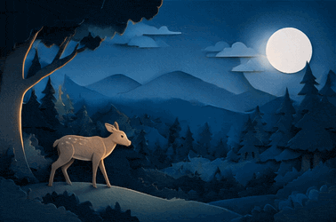

<sub>16 帧 · 378×250 · 2.9s · gpt-image-2.6 · 生成于 2026-11-11</sub>

**提示词**

```text
A layered cut-paper diorama of a pine forest at dusk, five paper layers in deepening blues and a pale moon; the layers drift sideways at different speeds for a gentle parallax and a small paper deer lifts its head. Soft side lighting with real paper shadows.
```

`paper-craft` `parallax` `scenery`

### 59. 赛博粉彩神社


<sub>16 帧 · 380×252 · 2.9s · gpt-image-2.6 · 生成于 2026-11-11</sub>

**提示词**

```text
A small shrine gate on a floating island in soft pastel pink and lilac, glowing cyan circuit lines pulse along its pillars, cherry petals drift past and holographic paper charms flutter. Dreamy anime background art, fixed camera.
```

`cyber` `pastel` `scenery`

### 60. 皮影戏书生


<sub>9 帧 · 438×389 · 1.6s · gpt-image-2.6 · 生成于 2026-11-11</sub>

**提示词**

```text
A traditional Chinese leather shadow puppet of a scholar holding a fan, translucent red and amber colors, backlit on a glowing white screen. The puppet turns its head, lifts the fan and bows slightly, thin control rods visible below.
```

`shadow-puppet` `chinese` `folk-art`

### 61. 雪夜书店橱窗


<sub>9 帧 · 435×385 · 1.6s · gpt-image-2.6 · 生成于 2026-11-10</sub>

**提示词**

```text
A cozy bookshop window at night with warm light; a gray cat sleeps on a stack of books, its tail swishing slowly, while snow falls outside. Storybook illustration style.
```

`cozy` `snow` `cat`

### 62. 落叶绕着长椅打转


<sub>9 帧 · 433×395 · 1.6s · gpt-image-2.6 · 生成于 2026-11-10</sub>

**提示词**

```text
Golden and red autumn leaves swirl in a little gust around an empty wooden park bench under a lamppost. Warm gouache illustration, fixed camera.
```

`autumn` `park` `wind`

### 63. 帐篷上空的流星雨


<sub>9 帧 · 439×389 · 1.6s · gpt-image-2.6 · 生成于 2026-11-10</sub>

**提示词**

```text
A small glowing orange tent on a hill under a deep blue sky, meteors streaking across the stars one after another. Calm illustrated night scene, wide shot.
```

`night` `camping` `stars`

### 64. 雨天斑马线上的伞

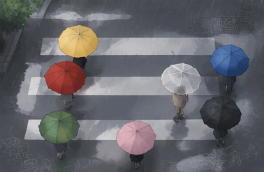

<sub>16 帧 · 378×247 · 2.9s · gpt-image-2.6 · 生成于 2026-11-10</sub>

**提示词**

```text
Top-down view of a rainy crosswalk where colorful umbrellas move across the white stripes, puddles rippling under the rain. Minimal flat illustration, muted gray street.
```

`rain` `city` `top-down`

### 65. 茶叶在玻璃壶里舒展

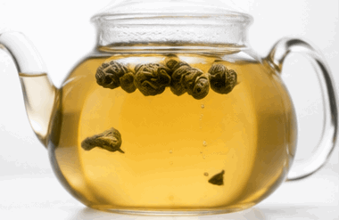

<sub>16 帧 · 380×247 · 2.9s · gpt-image-2.6 · 生成于 2026-11-10</sub>

**提示词**

```text
Inside a clear glass teapot, rolled green tea leaves slowly unfurl and drift down through amber water while tiny bubbles rise. Macro photography, soft daylight, white background.
```

`tea` `macro` `calm`

### 66. 黄昏摩天轮


<sub>16 帧 · 380×242 · 2.9s · gpt-image-2.6 · 生成于 2026-11-10</sub>

**提示词**

```text
A ferris wheel at a seaside fair turns slowly at dusk, its bulb lights twinkling in sequence against a purple and orange sky. Dreamy illustration, wide shot, fixed camera.
```

`fair` `dusk` `lights`

### 67. 天台晾衣随风摆


<sub>16 帧 · 380×247 · 2.6s · gpt-image-2.6 · 生成于 2026-11-10</sub>

**提示词**

```text
Colorful laundry hangs on a line across a city rooftop, shirts and sheets flapping gently in the breeze under a blue sky with drifting clouds. Soft anime background art style.
```

`city` `breeze` `calm`

### 68. 熔岩灯气泡

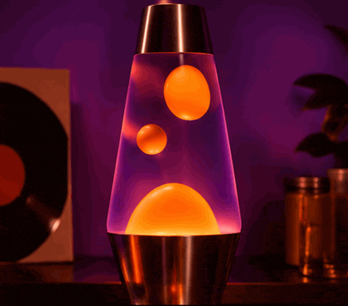

<sub>9 帧 · 437×384 · 2.5s · gpt-image-2.6 · 生成于 2026-11-10</sub>

**提示词**

```text
A retro lava lamp on a dark shelf: orange wax blobs slowly rise, stretch, split, and sink in glowing purple liquid. Moody 70s photography style, close-up.
```

`retro` `lamp` `ambient`

### 69. 翠鸟入水


<sub>16 帧 · 380×250 · 1.9s · gpt-image-2.6 · 生成于 2026-11-10</sub>

**提示词**

```text
A bright blue and orange kingfisher dives from a branch into a calm river, a crown of splash rising where it enters the water. Detailed nature illustration, side view, fixed camera.
```

`bird` `nature` `splash`

### 70. 浇花喷出彩虹


<sub>9 帧 · 440×389 · 1.6s · gpt-image-2.6 · 生成于 2026-11-10</sub>

**提示词**

```text
A gardener in a wide straw hat, seen from behind, sprays a fan of water over a sunny flower bed, and a small rainbow shimmers in the mist. Warm painterly illustration, summer light.
```

`garden` `summer` `rainbow`

### 71. 撕纸海浪


<sub>16 帧 · 380×252 · 2.2s · gpt-image-2.6 · 生成于 2026-11-10</sub>

**提示词**

```text
Layered torn-paper ocean waves in shades of blue roll forward one behind another, a small paper sailboat rising and dipping on top. Handmade paper collage with visible fibers and paint texture.
```

`paper` `ocean` `collage`

### 72. 孔版印刷色块漂移


<sub>16 帧 · 379×252 · 2.9s · gpt-image-2.6 · 生成于 2026-11-10</sub>

**提示词**

```text
Four flat textured shapes in risograph colors (pink, teal, yellow, blue) slowly drift and morph into one another, overlapping with grainy ink texture. Abstract background loop, centered composition.
```

`abstract` `background` `texture`

### 73. 烤棉花糖


<sub>9 帧 · 439×389 · 1.6s · gpt-image-2.6 · 生成于 2026-11-09</sub>

**提示词**

```text
A marshmallow on a stick held over a campfire at night, slowly turning golden brown, the flames flickering and small sparks floating up. Close-up, warm firelight, fixed camera.
```

`camping` `food` `cozy`

### 74. 石桥上的樱花雨


<sub>16 帧 · 380×252 · 2.9s · gpt-image-2.6 · 生成于 2026-11-09</sub>

**提示词**

```text
An arched stone bridge over a quiet stream lined with cherry trees in full bloom, pink petals falling and landing on the water, ripples spreading. Soft spring light, fixed camera.
```

`spring` `flowers` `japan`

### 75. 日出时的热气球


<sub>9 帧 · 439×388 · 1.6s · gpt-image-2.6 · 生成于 2026-11-09</sub>

**提示词**

```text
Several colorful hot-air balloons drifting gently over a canyon at sunrise, the nearest one's burner flaring briefly, morning mist moving below. Soft golden light, fixed camera.
```

`travel` `sunrise` `sky`

### 76. 木屋上空的极光


<sub>16 帧 · 379×246 · 3.5s · gpt-image-2.6 · 生成于 2026-11-09</sub>

**提示词**

```text
A small wooden cabin with glowing windows in a snowy valley, green and violet aurora ribbons rippling slowly across the starry sky above, smoke curling from the chimney. Fixed camera.
```

`night` `winter` `aurora`

### 77. 刷抹茶


<sub>9 帧 · 439×390 · 1.1s · gpt-image-2.6 · 生成于 2026-11-09</sub>

**提示词**

```text
A bamboo whisk briskly whisking bright green matcha in a dark ceramic bowl, fine foam forming on top, a wisp of steam rising. Close-up on a wooden tray, soft natural light, fixed camera.
```

`tea` `food` `asmr`

### 78. 火车窗外的田野

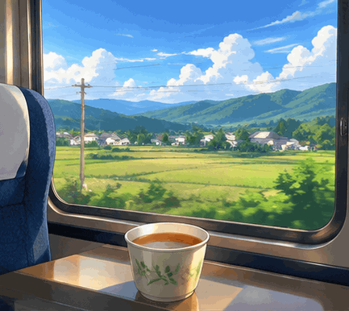

<sub>9 帧 · 433×386 · 1.6s · gpt-image-2.6 · 生成于 2026-11-09</sub>

**提示词**

```text
The view through a train window on a sunny afternoon: green rice fields and distant hills scrolling past, telegraph poles flicking by, a cup of tea on the windowsill rippling slightly. Anime-inspired background painting, fixed camera inside the carriage.
```

`travel` `train` `scenery`

### 79. 摇曳的海带森林


<sub>9 帧 · 439×390 · 1.6s · gpt-image-2.6 · 生成于 2026-11-09</sub>

**提示词**

```text
An underwater kelp forest with tall golden-green kelp swaying in the current, sun rays shimmering down from the surface, a small school of silver fish darting past. Fixed camera.
```

`ocean` `calm` `nature`

### 80. 萤火虫环绕的盆景


<sub>9 帧 · 431×395 · 2.7s · gpt-image-2.6 · 生成于 2026-11-09</sub>

**提示词**

```text
A small bonsai pine in a ceramic pot on a wooden shelf at dusk, a few fireflies drifting around its branches and blinking on and off. Soft painterly style, fixed camera.
```

`calm` `nature` `night`

### 81. 屋顶上捧纸星星的宇航员


<sub>16 帧 · 308×302 · 2.9s · gpt-image-2.6 · 生成于 2026-11-09</sub>

**提示词**

```text
A small astronaut sitting on a city rooftop at night holding a folded paper star, the star starting to glow, lifting gently out of their gloves, floating up a little and drifting back down. Dreamy illustration, deep blue sky, fixed camera.
```

`night` `dreamy` `space`

### 82. 旅行手账上的棕榈影


<sub>9 帧 · 439×389 · 1.6s · gpt-image-2.6 · 生成于 2026-11-09</sub>

**提示词**

```text
An open travel journal on a sunny café table with taped photos and a handwritten page, the soft shadow of a palm frond drifting slowly across the pages and back. Everything else stays still. Warm film-photo colors, fixed overhead camera.
```

`cinemagraph` `travel` `shadow`

### 83. 水墨月夜窗前


<sub>16 帧 · 376×248 · 2.9s · gpt-image-2.6 · 生成于 2026-11-09</sub>

**提示词**

```text
A Chinese ink-wash painting of a moonlit round window with a pipa lute leaning against the sill, plum blossom petals drifting past, thin clouds sliding across the full moon. Muted ink tones on rice paper, fixed camera.
```

`ink` `chinese` `moon`

### 84. 排灯节油灯


<sub>9 帧 · 439×387 · 2.0s · gpt-image-2.6 · 生成于 2026-11-09</sub>

**提示词**

```text
A row of small clay diya oil lamps on a stone step decorated with a colorful rangoli pattern, their flames flickering, warm light pulsing softly, a few marigold petals drifting down. Warm festive night, fixed camera.
```

`festival` `diwali` `lights`

### 85. 绘本风：小兔子浇花


<sub>9 帧 · 431×394 · 1.6s · gpt-image-2.6 · 生成于 2026-11-09</sub>

**提示词**

```text
A children's picture-book page in soft watercolor and colored pencil: a little bunny in blue overalls watering a row of tulips with a tin can, water drops falling, two butterflies fluttering around. Gentle healing mood, fixed camera.
```

> 💡 **技巧：** 绘本风适合做治愈系儿童短视频；画面里只让一两个小东西动。

`storybook` `watercolor` `kids`

### 86. 转动的黑胶唱片


<sub>16 帧 · 380×252 · 2.6s · gpt-image-2.6 · 生成于 2026-11-08</sub>

**提示词**

```text
A vinyl record spinning on a wooden turntable with the tonearm resting on it, warm lamp light reflecting off the grooves, small music notes floating up. Cozy lo-fi illustration, fixed camera.
```

`music` `lofi` `cozy`

### 87. 夹起拉面


<sub>9 帧 · 414×413 · 1.6s · gpt-image-2.6 · 生成于 2026-11-08</sub>

**提示词**

```text
A bowl of ramen with a soft-boiled egg and green onions, chopsticks lifting a bundle of noodles that sway gently while steam rises. Rich anime food illustration, fixed camera.
```

`food` `anime` `steam`

### 88. 回转寿司传送带


<sub>12 帧 · 358×358 · 1.7s · gpt-image-2.6 · 生成于 2026-11-08</sub>

**提示词**

```text
A sushi conveyor belt in a small restaurant with colorful plates of nigiri sliding steadily from left to right past the counter. Warm anime background art style, fixed camera.
```

`food` `anime` `conveyor`

### 89. 书桌上的烛光


<sub>9 帧 · 439×390 · 1.6s · gpt-image-2.6 · 生成于 2026-11-08</sub>

**提示词**

```text
A lit candle on an old wooden writing desk beside an open notebook and fountain pen, still except for the flickering flame and its soft shifting glow on the paper. Moody painterly style.
```

`candle` `cozy` `cinemagraph`

### 90. 发光水母


<sub>9 帧 · 439×389 · 1.6s · gpt-image-2.6 · 生成于 2026-11-08</sub>

**提示词**

```text
A single translucent jellyfish drifting in the deep ocean, its bell pulsing slowly and its tentacles trailing as soft cyan bioluminescence glows along its edges. Dark blue water, fixed camera.
```

`ocean` `glow` `ambient`

### 91. 剪纸风河谷小船


<sub>9 帧 · 439×390 · 1.6s · gpt-image-2.6 · 生成于 2026-11-08</sub>

**提示词**

```text
Layered paper-cut art of a river valley: paper waves slide across, a little paper fishing boat bobs on them, and paper clouds drift, with soft shadows between the layers. Pastel blue and green palette.
```

`papercut` `craft` `layers`

### 92. 清晨湖面的涟漪


<sub>16 帧 · 380×252 · 4.0s · gpt-image-2.6 · 生成于 2026-11-08</sub>

**提示词**

```text
A calm mountain lake at dawn, everything still except soft ripples spreading across the water and a thin layer of mist drifting slowly over the surface. Photorealistic landscape, fixed camera.
```

`landscape` `water` `cinemagraph`

### 93. 窗台伸懒腰的橘猫

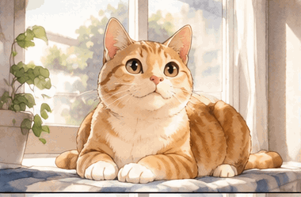

<sub>16 帧 · 380×249 · 2.9s · gpt-image-2.6 · 生成于 2026-11-08</sub>

**提示词**

```text
An orange tabby cat on a sunny windowsill stretching its front legs, yawning wide, then settling back and blinking slowly. Soft watercolor illustration, curtains still, fixed camera.
```

`cat` `cozy` `watercolor`

### 94. 刚出炉的酸面包冒热气


<sub>9 帧 · 436×389 · 1.6s · gpt-image-2.6 · 生成于 2026-11-08</sub>

**提示词**

```text
A freshly baked sourdough loaf on a floured wooden board, still except for thin curls of steam rising from its scored crust. Warm morning light, food photography, fixed camera.
```

`food` `steam` `cinemagraph`

### 95. 唐代舞姬转袖

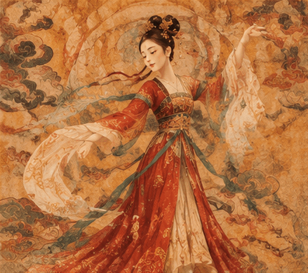

<sub>9 帧 · 439×390 · 1.4s · gpt-image-2.6 · 生成于 2026-11-08</sub>

**提示词**

```text
A court dancer in flowing red and gold Tang-dynasty robes spinning in place, her long water sleeves trailing in wide arcs around her. Painted in the style of ancient Chinese cave murals on a warm ochre background.
```

`chinese` `dance` `mural`

### 96. 纸鹤从贺卡上起飞


<sub>9 帧 · 437×379 · 1.6s · gpt-image-2.6 · 生成于 2026-11-08</sub>

**提示词**

```text
A folded white paper crane sitting on an open greeting card flaps its creased paper wings and lifts off, rising gently above the card. Soft pastel watercolor style on a cream background, fixed camera.
```

`paper` `message` `watercolor`

### 97. 地铁进站的那阵风


<sub>16 帧 · 380×252 · 1.9s · gpt-image-2.6 · 生成于 2026-11-07</sub>

**提示词**

```text
A girl with long dark hair and a yellow raincoat standing on a subway platform as a train rushes past behind her, her hair and coat whipping sideways in the gust while she squints. Anime film still style, fixed camera.
```

`anime` `wind` `cinemagraph`

### 98. 做咖啡的机器人


<sub>9 帧 · 432×394 · 1.6s · gpt-image-2.6 · 生成于 2026-11-07</sub>

**提示词**

```text
A small white robot barista with one arm pouring steamed milk into a cup of coffee on a café counter, drawing a leaf pattern in the foam. Clean 3D render.
```

`robot` `coffee` `cafe`

### 99. 黏土面团面包师


<sub>9 帧 · 439×390 · 1.6s · gpt-image-2.6 · 生成于 2026-11-07</sub>

**提示词**

```text
A round clay dough mascot in a little white chef hat kneading a piece of dough on a floured board, folding it over and giving a small wave. Claymation style, fixed camera.
```

`clay` `mascot` `cooking`

### 100. 纸雕灯里的江南


<sub>16 帧 · 380×245 · 2.9s · gpt-image-2.6 · 生成于 2026-11-07</sub>

**提示词**

```text
A layered paper-cut lantern scene of a southern Chinese water town with a stone arch bridge and a pavilion, two golden koi swimming beneath the bridge while the warm light flickers. Paper-sculpture style.
```

`paper-cut` `chinese` `lantern`

### 101. 振翅的老鹰

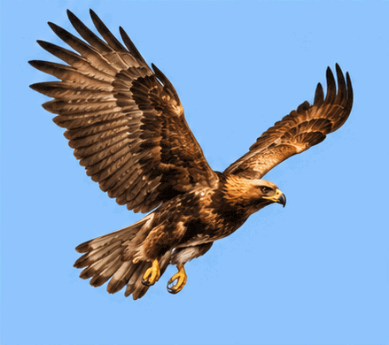

<sub>9 帧 · 439×390 · 1.1s · gpt-image-2.6 · 生成于 2026-11-07</sub>

**提示词**

```text
A golden eagle flying in place with powerful wing beats, feathers rippling, isolated on a plain sky-blue background. Realistic illustration.
```

`bird` `flight` `animal`

### 102. 烧杯荧光漩涡


<sub>16 帧 · 379×250 · 2.6s · gpt-image-2.6 · 生成于 2026-11-07</sub>

**提示词**

```text
A glass lab beaker on a dark bench with a swirling vortex of glowing teal liquid inside, tiny bubbles rising and the glow pulsing. Moody lab photography.
```

`science` `glow` `liquid`

### 103. 玻璃蝴蝶与投影

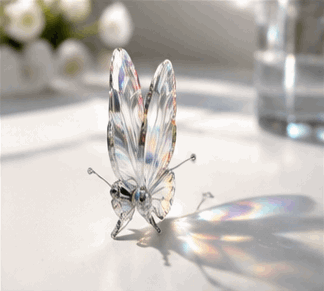

<sub>16 帧 · 324×291 · 2.9s · gpt-image-2.6 · 生成于 2026-11-07</sub>

**提示词**

```text
A butterfly made of clear glass perched on a white table, slowly opening and closing its wings while the colorful refracted shadow on the table changes in sync. Macro photo, soft light.
```

`glass` `butterfly` `light`

### 104. 峡谷瀑布与水雾

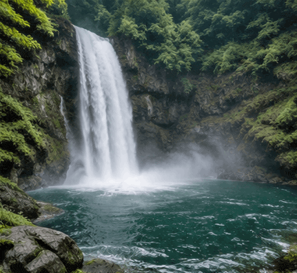

<sub>9 帧 · 431×396 · 1.6s · gpt-image-2.6 · 生成于 2026-11-07</sub>

**提示词**

```text
A tall waterfall pouring into a deep green canyon pool, mist rising and ripples spreading across the water. Fixed wide shot, realistic landscape photo.
```

`nature` `waterfall` `cinemagraph`

### 105. 雨夜摸柴犬


<sub>9 帧 · 439×390 · 1.6s · gpt-image-2.6 · 生成于 2026-11-07</sub>

**提示词**

```text
A girl with a clear umbrella crouching on a wet city street at night to pet a shiba inu, the dog's tail wagging, rain glittering under neon reflections. Anime-style illustration.
```

`rain` `dog` `night`

### 106. 冬日院子里劈柴


<sub>9 帧 · 433×395 · 1.6s · gpt-image-2.6 · 生成于 2026-11-07</sub>

**提示词**

```text
An old man in a thick wool coat raising an axe and splitting a log on a stump in a snowy backyard, wood halves falling to the sides, his breath visible in the cold air. Painterly illustration.
```

`winter` `rural` `work`

### 107. 街头跳舞的机器人


<sub>9 帧 · 439×390 · 1.3s · gpt-image-2.6 · 生成于 2026-11-07</sub>

**提示词**

```text
A boxy orange robot doing a robotic pop-and-lock dance on a graffiti-covered city street, arms snapping between poses. Fixed camera, vibrant 3D render.
```

`robot` `dance` `street`

### 108. 水面上起伏的纸船


<sub>9 帧 · 439×390 · 1.6s · gpt-image-2.6 · 生成于 2026-11-07</sub>

**提示词**

```text
A white folded paper boat bobbing gently on calm water, small ripples spreading outward, fixed overhead camera. Soft natural light photo style.
```

`water` `paper` `calm`

### 109. 青山上的风车

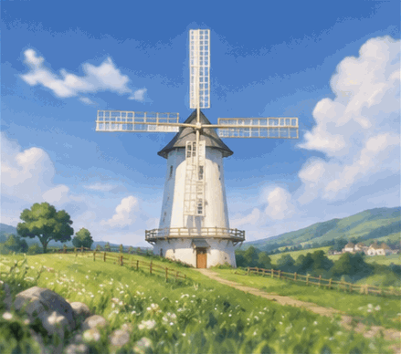

<sub>9 帧 · 439×388 · 1.6s · gpt-image-2.6 · 生成于 2026-11-07</sub>

**提示词**

```text
A white wooden windmill on rolling green hills, its four sails turning slowly while clouds drift across a blue sky. Soft painterly landscape.
```

`landscape` `windmill` `calm`

### 110. 海边骑车的鹈鹕

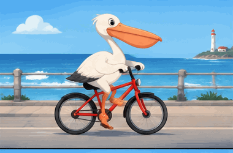

<sub>16 帧 · 380×250 · 2.2s · gpt-image-2.6 · 生成于 2026-11-07</sub>

**提示词**

```text
A pelican riding a red bicycle along a seaside promenade, legs pedaling and its big beak bobbing, waves rolling in behind. Flat vector illustration, side view.
```

`animal` `bicycle` `classic-test`

### 111. 球池里的黏土小猫

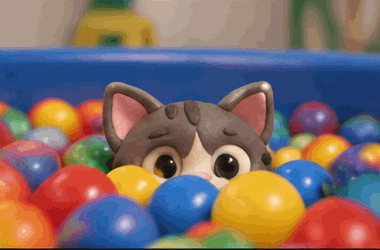

<sub>16 帧 · 380×250 · 2.2s · gpt-image-2.6 · 生成于 2026-11-07</sub>

**提示词**

```text
A clay kitten popping its head out of a ball pit full of colorful plastic balls, balls tumbling off its head as it wiggles. Claymation style.
```

`clay` `cat` `playful`

### 112. 雪花球里的城市


<sub>16 帧 · 380×252 · 2.9s · gpt-image-2.6 · 生成于 2026-11-07</sub>

**提示词**

```text
A snow globe holding a miniature city of red-brick apartment blocks and a little yellow taxi, snow drifting down slowly inside the glass. Warm studio lighting, macro photo.
```

`snow-globe` `city` `winter`

### 113. 雪花球里嚎叫的哈士奇

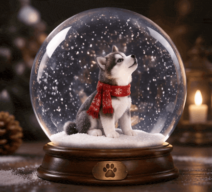

<sub>9 帧 · 433×393 · 1.6s · gpt-image-2.6 · 生成于 2026-11-07</sub>

**提示词**

```text
A tiny husky inside a glass snow globe sitting on a snowy mound and howling up at the sky as glitter snow swirls around it. Product photo style on a dark wooden table.
```

`snow-globe` `dog` `winter`

### 114. 茶壶蒸汽变成爱心

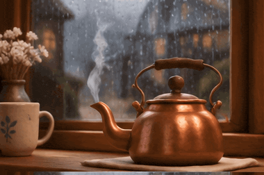

<sub>16 帧 · 380×252 · 2.9s · gpt-image-2.6 · 生成于 2026-11-07</sub>

**提示词**

```text
A copper teapot on a windowsill on a rainy afternoon, steam rising from the spout and briefly curling into a heart shape before drifting apart. Clay stop-motion style, fixed camera.
```

`steam` `cozy` `clay`

### 115. 涂鸦小怪兽活了

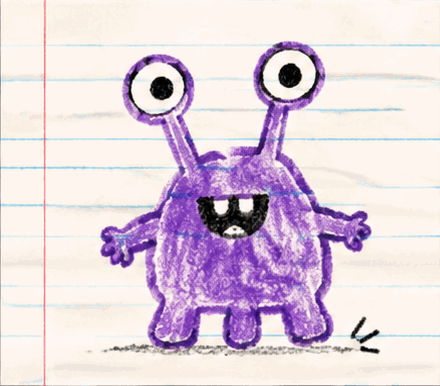

<sub>9 帧 · 440×386 · 1.6s · gpt-image-2.6 · 生成于 2026-11-06</sub>

**提示词**

```text
A crude crayon doodle of a little purple blob monster with two eyes on wobbly stalks and three stubby legs, drawn on lined notebook paper, comes alive: its eye-stalks blink and sway, it waves its tiny arms and hops in place, keeping the wobbly hand-drawn lines and odd proportions. The notebook paper stays still.
```

`loop` `doodle` `cute`

### 116. 水墨奔马

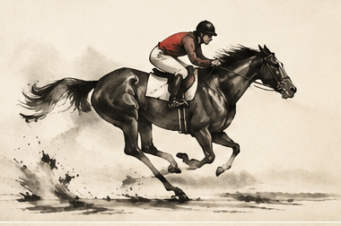

<sub>16 帧 · 380×252 · 1.9s · gpt-image-2.6 · 生成于 2026-11-06</sub>

**提示词**

```text
A racehorse with a jockey galloping to the right in a loose Chinese ink-wash painting style, legs cycling through a full gallop stride, the jockey bobbing up and down, ink splashes kicking up behind the hooves. Rice-paper background, black ink with a touch of red.
```

`loop` `ink-wash` `animal`

### 117. 街角咖啡馆动态照片


<sub>9 帧 · 439×390 · 1.6s · gpt-image-2.6 · 生成于 2026-11-06</sub>

**提示词**

```text
A cinemagraph of a quiet street café terrace in the morning: everything is perfectly still except the steam curling from a cup on the table and a striped awning flag fluttering in the breeze. Realistic photography, soft warm light, locked camera.
```

> 💡 **技巧：** 做动态照片（cinemagraph）要明确写“除了某一两个元素，其他都静止”。

`loop` `cinemagraph` `photo`

### 118. Lo-fi 学习循环


<sub>9 帧 · 434×383 · 1.6s · gpt-image-2.6 · 生成于 2026-11-06</sub>

**提示词**

```text
A girl with headphones writing in a notebook at a desk at night, her pencil moving, steam rising from a mug, rain sliding down the window behind her and a desk lamp glowing. Lo-fi anime illustration, muted purple and blue palette, locked camera.
```

`loop` `lofi` `study`

### 119. 苔石上打盹的小狐狸


<sub>9 帧 · 432×394 · 1.6s · gpt-image-2.6 · 生成于 2026-11-06</sub>

**提示词**

```text
A small orange fox curled up asleep on a mossy rock, its tail gently swaying and ears twitching. Soft storybook illustration, locked camera.
```

`loop` `animal` `calm`

### 120. 雪林提灯的小猴子


<sub>16 帧 · 380×241 · 2.9s · gpt-image-2.6 · 生成于 2026-11-06</sub>

**提示词**

```text
A small monkey in an olive-green hooded coat standing in a snowy pine forest at dusk, lifting a glowing amber paper lantern, looking up and blinking, then lowering the lantern back to where it started. Snow falls gently and a tiny cabin glows in the background. Soft storybook illustration, locked camera.
```

> 💡 **技巧：** 给主体一个能回去的起始姿势，并锁定镜头，循环最容易接得上。

`loop` `character` `winter`

### 121. 壁炉边睡觉的猫

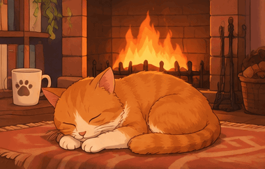

<sub>16 帧 · 380×243 · 2.9s · gpt-image-2.6 · 生成于 2026-11-06</sub>

**提示词**

```text
A ginger cat curled up asleep on a rug in front of a crackling fireplace, its body gently rising and falling with each breath, flames flickering and casting warm light. Cozy flat illustration, warm orange and brown tones.
```

> 💡 **技巧：** “呼吸起伏”这种小动作很适合做安静的循环，看得清又天然能循环。

`loop` `cozy` `cat`

### 122. 夜晚的灯塔


<sub>16 帧 · 380×247 · 2.9s · gpt-image-2.6 · 生成于 2026-11-06</sub>

**提示词**

```text
A white lighthouse on a rocky shore at night, its beam sweeping slowly across a dark blue sky, waves rolling and splashing against the rocks below. Flat illustration with a deep navy and warm yellow palette.
```

`loop` `seascape` `night`

### 123. 鱼缸里的金鱼

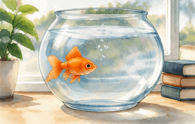

<sub>16 帧 · 380×243 · 2.9s · gpt-image-2.6 · 生成于 2026-11-06</sub>

**提示词**

```text
A round glass fishbowl on a windowsill with one orange goldfish swimming a slow circle, tail fluttering, tiny bubbles rising to the surface. Soft watercolor-style illustration, gentle light.
```

`loop` `pet` `calm`

### 124. 雨窗与绿植

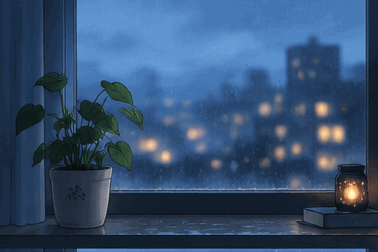

<sub>16 帧 · 378×252 · 2.9s · gpt-image-2.6 · 生成于 2026-11-06</sub>

**提示词**

```text
A rainy window at dusk with a small potted plant on the sill, raindrops sliding down the glass and blurry city lights twinkling outside. Soft muted blue palette, lo-fi illustration style.
```

`loop` `lofi` `weather`

### 125. 冒热气的咖啡

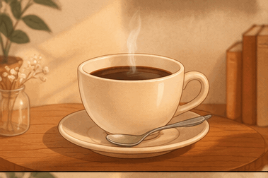

<sub>16 帧 · 379×252 · 2.6s · gpt-image-2.6 · 生成于 2026-11-05</sub>

**提示词**

```text
A steaming cup of coffee on a small wooden table, steam curling and drifting upward, a tiny spoon wobbling on the saucer. Cozy flat illustration with warm colors.
```

`loop` `food` `cozy`

### 126. 窗边读书·白天到夜晚


<sub>9 帧 · 413×412 · 3.1s · gpt-image-2.6 · 生成于 2026-11-06</sub>

**提示词**

```text
A girl with a short bob reading a book on a cushion by a big window, seen from the side. Outside the window the sky cycles from bright morning blue to orange sunset to a starry night and back to morning, while the room light warms up and a desk lamp switches on at night. Soft flat illustration, calm and cozy.
```

> 💡 **技巧：** 昼夜循环比简单动作难得多。让人物基本保持不动，用天空和光线来表现变化。

`loop` `character` `time-lapse`

[← README](../README_zh.md)
