# Pixel Art & UI Motion · 84 prompts

[← README](../README.md)

### 1. Success toast slides in


<sub>16 frames · 380×252 · 1.8s · gpt-image-2.6 · generated 2026-11-17</sub>

**Prompt**

```text
A green rounded notification toast slides in from the top with a white check mark drawing itself, holds a moment, then slides back up. Minimal app UI, white background, no other text.
```

`ui` `toast` `notification`

### 2. Emoji reactions pop

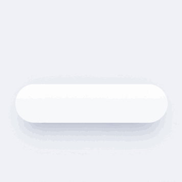

<sub>12 frames · 356×356 · 1.4s · gpt-image-2.6 · generated 2026-11-17</sub>

**Prompt**

```text
A rounded white reaction bar where five round emoji faces, smile, laugh, heart eyes, surprise and sad, pop up one after another with a springy bounce. Clean app UI style, light gray background.
```

`ui` `emoji` `reaction`

### 3. Pixel train on a bridge

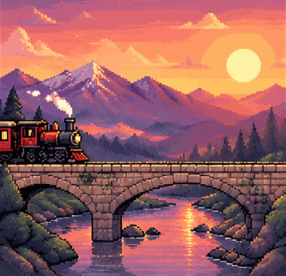

<sub>12 frames · 358×345 · 1.4s · gpt-image-2.6 · generated 2026-11-17</sub>

**Prompt**

```text
A small pixel art steam train crosses a stone arch bridge over a river, puffing little smoke clouds, mountains behind. 16-bit side-scroller style, sunset palette.
```

`pixel` `train` `landscape`

### 4. Pixel bee garden

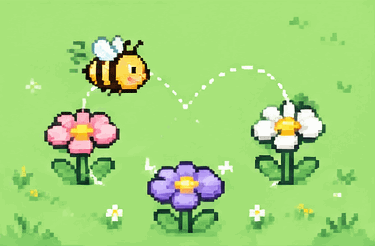

<sub>16 frames · 375×246 · 1.9s · gpt-image-2.6 · generated 2026-11-17</sub>

**Prompt**

```text
A pixel art bee buzzes in a figure eight between three pixel flowers that sway slightly. 16-bit game style, light green background.
```

`pixel` `bee` `garden`

### 5. Bookmark saved

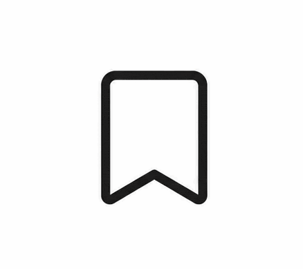

<sub>9 frames · 438×389 · 1.4s · gpt-image-2.6 · generated 2026-11-17</sub>

**Prompt**

```text
An outlined bookmark icon fills with solid gold from top to bottom and gives a small bounce, with a few tiny sparkles. Minimal app icon style, white background.
```

`ui` `bookmark` `save`

### 6. Add to cart


<sub>9 frames · 437×388 · 1.4s · gpt-image-2.6 · generated 2026-11-17</sub>

**Prompt**

```text
A flat shopping cart icon; a small box drops into it, the cart wiggles, and a red badge with the number 1 pops up on its corner. Clean app UI icon style, white background.
```

`ui` `cart` `ecommerce`

### 7. Pixel dino stomps and roars

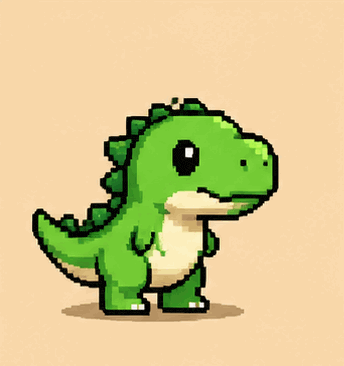

<sub>12 frames · 344×366 · 1.7s · gpt-image-2.6 · generated 2026-11-17</sub>

**Prompt**

```text
A small green pixel art dinosaur stomps one foot, opens its mouth in a tiny roar with a shake line, then settles back. 16-bit game sprite, plain sand-colored background.
```

`pixel` `dinosaur` `sprite`

### 8. Low-poly hero jog

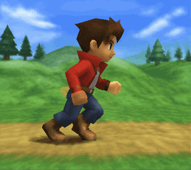

<sub>12 frames · 380×337 · 1.4s · gpt-image-2.6 · generated 2026-11-17</sub>

**Prompt**

```text
A blocky low-poly game hero in a red jacket jogs along a dirt path in a side view, rendered like an early 2000s console game with chunky polygons and blurry textures. Fixed camera, simple green hills behind.
```

`low-poly` `retro-game` `run`

### 9. Pixel astronaut run cycle

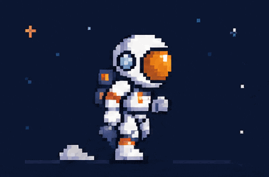

<sub>16 frames · 378×249 · 1.6s · gpt-image-2.6 · generated 2026-11-17</sub>

**Prompt**

```text
A pixel art astronaut in a white suit with an orange visor runs in place in a smooth side-view run cycle, small dust puffs at each step. Limited 16-color palette, dark navy background with a few stars.
```

> 💡 **Tip:** Run and walk cycles look smoother with 12–16 frames.

`pixel` `astronaut` `run-cycle`

### 10. Donut chart fills

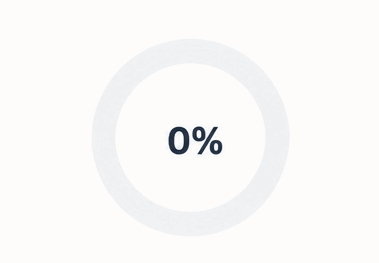

<sub>16 frames · 379×263 · 1.6s · gpt-image-2.6 · generated 2026-11-17</sub>

**Prompt**

```text
A donut chart fills segment by segment in teal, coral and yellow while the percentage in the middle counts up. Clean dashboard UI style, white background.
```

`ui` `chart` `data`

### 11. Map pin drops


<sub>12 frames · 358×357 · 1.4s · gpt-image-2.6 · generated 2026-11-17</sub>

**Prompt**

```text
A red location pin drops onto a simple folded map, bounces once and sends out a soft ripple ring. Flat UI icon style, pale green background.
```

`ui` `map` `location`

### 12. Copied to clipboard

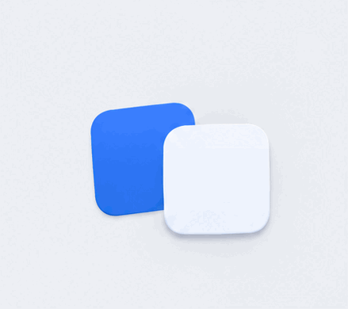

<sub>9 frames · 439×390 · 1.4s · gpt-image-2.6 · generated 2026-11-17</sub>

**Prompt**

```text
Two stacked rounded squares slide together into a clipboard icon, then a green checkmark draws itself on top. Minimal flat UI animation, light gray background.
```

`ui` `copy` `icon`

### 13. Volume slider


<sub>12 frames · 356×357 · 1.7s · gpt-image-2.6 · generated 2026-11-17</sub>

**Prompt**

```text
A rounded volume slider knob glides from left to right while sound wave arcs grow beside a speaker icon. Clean flat UI icon style, white background, purple accent.
```

`ui` `volume` `icon`

### 14. Pixel kettle boils

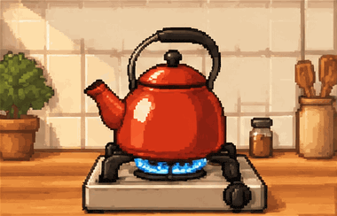

<sub>16 frames · 380×244 · 2.2s · gpt-image-2.6 · generated 2026-11-17</sub>

**Prompt**

```text
A pixel art red kettle on a tiny stove rattles its lid and puffs steam clouds as it whistles. Cozy 16-bit style, warm kitchen tile background.
```

`pixel` `kettle` `cozy`

### 15. Pixel shield block

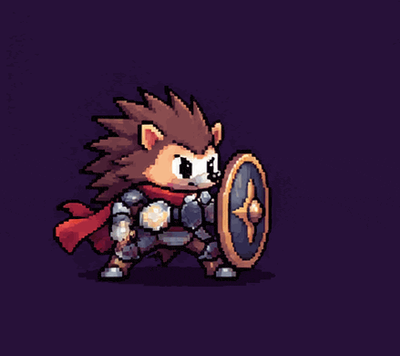

<sub>8 frames · 439×390 · 1.0s · gpt-image-2.6 · generated 2026-11-17</sub>

**Prompt**

```text
A pixel art armored hedgehog raises a round shield and a fireball bursts into sparks against it. 16-bit game sprite style, plain dark purple background.
```

`pixel` `shield` `game`

### 16. Pixel dungeon door

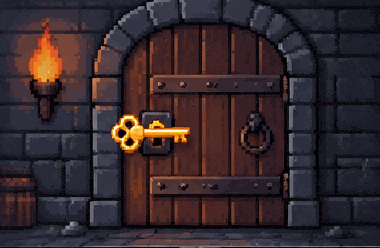

<sub>16 frames · 380×248 · 2.9s · gpt-image-2.6 · generated 2026-11-17</sub>

**Prompt**

```text
A pixel art golden key turns in a heavy wooden dungeon door, which creaks open to reveal torchlight inside. 16-bit game style, dark stone background.
```

`pixel` `door` `game`

### 17. Pull to refresh

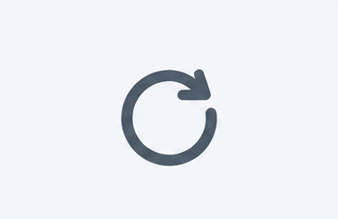

<sub>16 frames · 378×245 · 1.6s · gpt-image-2.6 · generated 2026-11-17</sub>

**Prompt**

```text
A circular arrow icon is pulled down, stretches slightly, then spins and snaps back with a small check. Minimal mobile UI style, light gray background.
```

`refresh` `ui` `mobile`

### 18. Checkbox tick


<sub>9 frames · 436×388 · 1.1s · gpt-image-2.6 · generated 2026-11-17</sub>

**Prompt**

```text
An empty rounded checkbox fills with green and a white checkmark draws itself inside with a small bounce. Clean flat UI, white background.
```

`checkbox` `ui` `icon`

### 19. Paw print loader


<sub>12 frames · 356×356 · 1.2s · gpt-image-2.6 · generated 2026-11-17</sub>

**Prompt**

```text
Six small paw prints appear one after another in a circle and fade, like a loading spinner. Flat UI style, white background, single brown color.
```

`loader` `ui` `paw`

### 20. Pixel sailboat

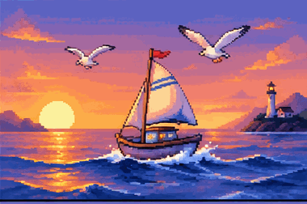

<sub>16 frames · 380×252 · 2.6s · gpt-image-2.6 · generated 2026-11-17</sub>

**Prompt**

```text
A small pixel art sailboat bobs on rolling waves with seagulls flapping overhead. 16-bit style, sunset sky.
```

`pixel` `sea` `boat`

### 21. Pixel UFO beam

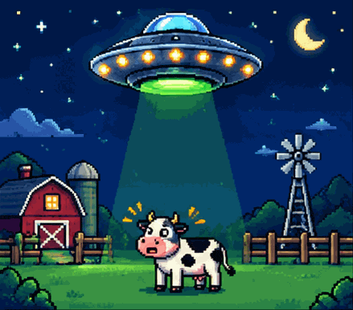

<sub>9 frames · 439×386 · 1.4s · gpt-image-2.6 · generated 2026-11-17</sub>

**Prompt**

```text
A pixel art flying saucer hovers over a farm at night and a green tractor beam lifts a surprised cow a little off the ground. 8-bit style, starry sky.
```

`pixel` `ufo` `cow`

### 22. Pixel blacksmith

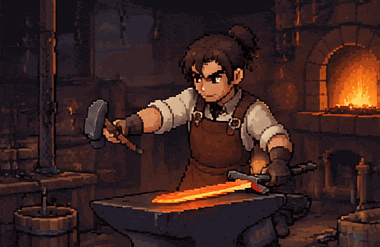

<sub>16 frames · 380×247 · 1.9s · gpt-image-2.6 · generated 2026-11-17</sub>

**Prompt**

```text
A pixel art blacksmith in a leather apron hammers a glowing sword on an anvil, sparks flying with each strike. 16-bit RPG style, dark forge background.
```

`pixel` `blacksmith` `rpg`

### 23. Pixel cave waterfall

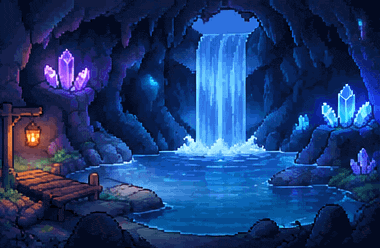

<sub>16 frames · 380×248 · 2.6s · gpt-image-2.6 · generated 2026-11-17</sub>

**Prompt**

```text
A pixel art cave with a waterfall pouring into a pool, glowing crystals blinking on the walls. 16-bit game style, fixed camera.
```

`pixel` `cave` `waterfall`

### 24. Wallet top-up

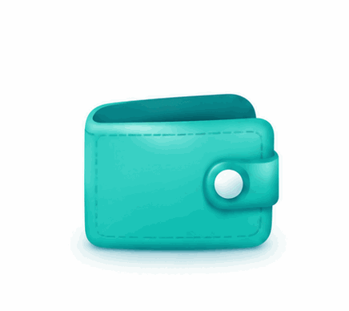

<sub>9 frames · 436×388 · 1.6s · gpt-image-2.6 · generated 2026-11-13</sub>

**Prompt**

```text
A flat app icon of a teal wallet; three gold coins drop in one by one and a small plus badge pops on the corner. Clean UI illustration, white background.
```

`wallet` `ui` `icon`

### 25. ASCII star logo assembles

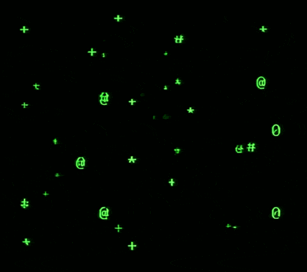

<sub>9 frames · 438×389 · 1.4s · gpt-image-2.6 · generated 2026-11-13</sub>

**Prompt**

```text
Scattered green ASCII characters on a black terminal screen drift into place and assemble into a simple five-point star logo, which pulses once. Monospace retro terminal look.
```

`ascii` `logo` `terminal`

### 26. Pixel rocket launch


<sub>16 frames · 380×250 · 2.6s · gpt-image-2.6 · generated 2026-11-12</sub>

**Prompt**

```text
A pixel-art rocket on a launch pad rumbles, flames burst from its base and it lifts off leaving a smoke puff. 8-bit style, starry dark background.
```

`pixel` `space` `rocket`

### 27. Pixel fox dash

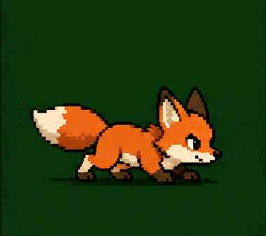

<sub>12 frames · 380×337 · 1.4s · gpt-image-2.6 · generated 2026-11-12</sub>

**Prompt**

```text
A pixel-art orange fox crouches then dashes forward with a burst of dust and a speed trail, ending in a skid. 16-bit platformer sprite, plain dark green background.
```

`pixel` `sprite` `fox`

### 28. Pixel mailbox letter

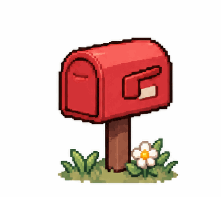

<sub>9 frames · 445×396 · 1.6s · gpt-image-2.6 · generated 2026-11-12</sub>

**Prompt**

```text
A pixel-art red mailbox flips its flag up and a letter pops out with a small sparkle. 16-bit style, plain light background.
```

`pixel` `ui` `mail`

### 29. Level up badge

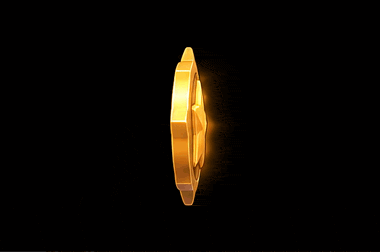

<sub>16 frames · 380×252 · 1.9s · gpt-image-2.6 · generated 2026-11-12</sub>

**Prompt**

```text
A shiny gold badge with a star flips in, flashes, and small sparkles burst around it. Game UI style, plain dark background, no text.
```

`ui` `game` `icon`

### 30. Pixel ninja frog dash

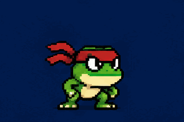

<sub>16 frames · 380×252 · 1.9s · gpt-image-2.6 · generated 2026-11-12</sub>

**Prompt**

```text
A pixel-art frog in a red ninja headband dashes forward and leaves a short speed trail, then poses. 16-bit platformer sprite, plain dark blue background.
```

`pixel` `game` `sprite`

### 31. Pixel potion shop

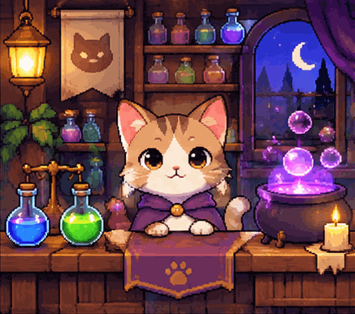

<sub>9 frames · 437×387 · 1.6s · gpt-image-2.6 · generated 2026-11-12</sub>

**Prompt**

```text
A pixel-art potion shop counter with bubbling colorful bottles and a shopkeeper cat blinking behind it. 16-bit RPG style, fixed camera.
```

`pixel` `game` `shop`

### 32. Pixel snowy cabin

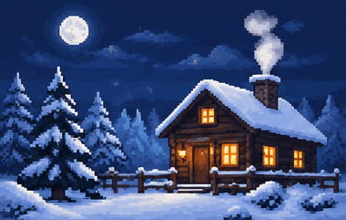

<sub>16 frames · 380×241 · 2.9s · gpt-image-2.6 · generated 2026-11-12</sub>

**Prompt**

```text
A pixel-art log cabin in a snowy forest, smoke rising from the chimney, windows glowing and snow falling. 16-bit style, fixed camera.
```

`pixel` `winter` `ambient`

### 33. Pixel dragon egg hatch

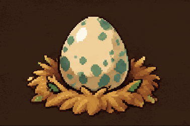

<sub>16 frames · 377×250 · 2.6s · gpt-image-2.6 · generated 2026-11-11</sub>

**Prompt**

```text
A speckled pixel-art dragon egg wobbles in a straw nest, cracks appear, and a tiny green baby dragon pokes its head out and blinks. 16-bit RPG style, plain dark brown background.
```

`pixel` `game` `dragon`

### 34. Calendar page flip


<sub>16 frames · 378×250 · 1.9s · gpt-image-2.6 · generated 2026-11-11</sub>

**Prompt**

```text
A flat desk calendar icon with a red header; the top page curls up and flips over to reveal the next day, the date number sliding in. Flat UI icon style, plain light gray background.
```

`ui` `icon` `calendar`

### 35. Pixel coin collect

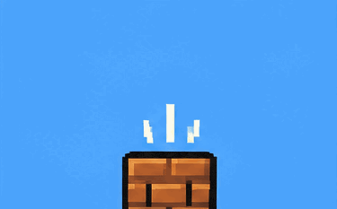

<sub>16 frames · 375×233 · 1.8s · gpt-image-2.6 · generated 2026-11-11</sub>

**Prompt**

```text
A spinning pixel-art gold coin pops up above a brick block, flips in the air, then vanishes in a small sparkle with a +1 floating up. 16-bit platformer style, plain sky blue background.
```

`pixel` `game` `coin`

### 36. Pixel health hearts

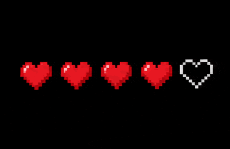

<sub>16 frames · 379×247 · 1.9s · gpt-image-2.6 · generated 2026-11-11</sub>

**Prompt**

```text
A row of five pixel-art red hearts as a game health bar; one empty heart refills with a sparkle while all hearts pulse gently. 8-bit style, plain black background.
```

`pixel` `game` `ui`

### 37. Toggle switch

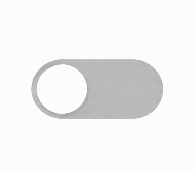

<sub>12 frames · 384×343 · 1.7s · gpt-image-2.6 · generated 2026-11-11</sub>

**Prompt**

```text
A large rounded toggle switch slides from gray off to bright green on, the knob gives a small squish, and a tiny check mark pops beside it. Flat UI style, plain white background.
```

`ui` `toggle` `micro-interaction`

### 38. Hovering potion bottle

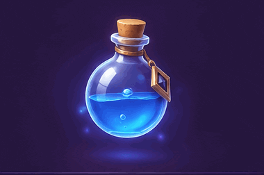

<sub>16 frames · 380×252 · 2.2s · gpt-image-2.6 · generated 2026-11-11</sub>

**Prompt**

```text
A round glass potion bottle with a cork stopper hovers and bobs gently; the glowing blue liquid sloshes inside and tiny bubbles rise and pop at the top. Stylized game item icon, soft glow, plain dark purple background.
```

`game` `item` `icon`

### 39. RPG stats card

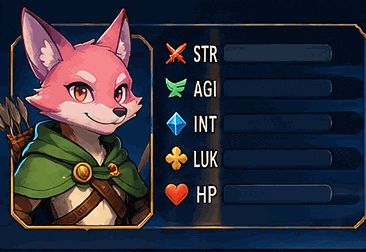

<sub>16 frames · 366×252 · 2.9s · gpt-image-2.6 · generated 2026-11-11</sub>

**Prompt**

```text
A fantasy RPG character stat card with a cartoon fox ranger portrait; five horizontal bars labeled STR, AGI, INT, LUK and HP fill up one by one with glowing colors and a small level-up star sparkles in the corner. Clean game UI style on dark navy.
```

`ui` `game` `stats`

### 40. Pixel chameleon run cycle

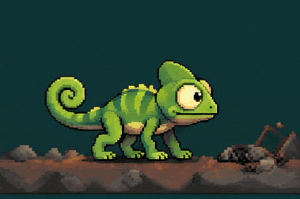

<sub>16 frames · 379×252 · 1.8s · gpt-image-2.6 · generated 2026-11-11</sub>

**Prompt**

```text
A side-view pixel-art run cycle of a small green chameleon with a curled tail and big swiveling eyes, running in place on a strip of rusty junkyard ground. 16-bit game sprite style, plain dark teal background.
```

`pixel` `sprite` `game`

### 41. Equalizer bars bounce


<sub>16 frames · 380×252 · 1.6s · gpt-image-2.6 · generated 2026-11-10</sub>

**Prompt**

```text
Seven rounded equalizer bars in a purple-to-pink gradient bounce up and down to an implied beat. Flat UI style, plain dark navy background.
```

`ui` `music` `audio`

### 42. Upload arrow rises into a cloud


<sub>9 frames · 438×388 · 1.3s · gpt-image-2.6 · generated 2026-11-10</sub>

**Prompt**

```text
A white arrow rises from the bottom into a soft blue cloud icon, the cloud puffs up once, and a small progress ring around it completes. Flat UI style, plain white background.
```

`ui` `upload` `icon`

### 43. Magnifier scans a document


<sub>16 frames · 388×257 · 1.9s · gpt-image-2.6 · generated 2026-11-10</sub>

**Prompt**

```text
A flat UI document icon with gray text lines; a magnifying glass sweeps across it and each line it passes turns highlighted blue. Clean vector style, plain white background.
```

`ui` `search` `icon`

### 44. Padlock unlocks


<sub>9 frames · 445×395 · 1.4s · gpt-image-2.6 · generated 2026-11-10</sub>

**Prompt**

```text
A flat gray padlock icon wiggles, its shackle pops open, and the body turns green with a small check mark. Clean vector UI style, plain white background.
```

`ui` `icon` `security`

### 45. Send button becomes a paper plane


<sub>9 frames · 445×395 · 1.4s · gpt-image-2.6 · generated 2026-11-10</sub>

**Prompt**

```text
A rounded blue Send button squeezes inward and folds into a white paper plane that flies off to the upper right, leaving a dotted trail. Flat UI animation, plain white background.
```

`ui` `button` `send`

### 46. Star rating fills


<sub>9 frames · 509×339 · 1.4s · gpt-image-2.6 · generated 2026-11-10</sub>

**Prompt**

```text
Five outlined stars in a row fill with gold one after another, each popping slightly larger as it fills, with a tiny sparkle on the last. Flat UI style, plain white background.
```

`ui` `rating` `icon`

### 47. Crumpled paper into the trash


<sub>16 frames · 378×250 · 1.8s · gpt-image-2.6 · generated 2026-11-10</sub>

**Prompt**

```text
Flat UI animation: a sheet of paper crumples into a ball, arcs into a gray trash can icon, and the lid bounces shut. Clean vector style, plain white background.
```

`ui` `icon` `delete`

### 48. Wi-Fi bars fill up

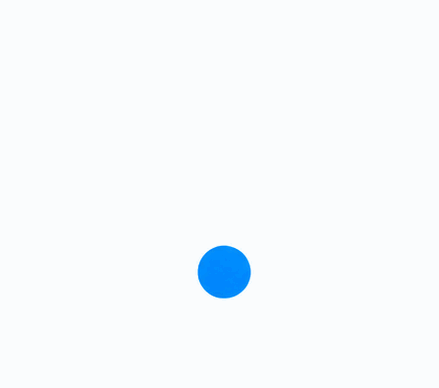

<sub>9 frames · 439×388 · 1.6s · gpt-image-2.6 · generated 2026-11-10</sub>

**Prompt**

```text
A flat UI Wi-Fi icon whose arcs light up one by one from the center dot outward in bright blue, then all glow together. Clean vector style, plain white background.
```

`ui` `icon` `signal`

### 49. Pixel cauldron brews

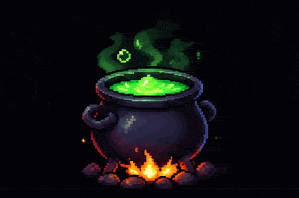

<sub>16 frames · 380×252 · 2.6s · gpt-image-2.6 · generated 2026-11-10</sub>

**Prompt**

```text
A pixel art black cauldron over a small fire bubbles with green potion, bubbles popping and a puff of sparkly smoke rising. 16-bit item animation, plain dark background.
```

`pixel` `potion` `item`

### 50. Pixel mushroom dances

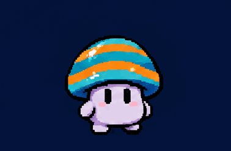

<sub>16 frames · 378×248 · 1.9s · gpt-image-2.6 · generated 2026-11-10</sub>

**Prompt**

```text
A pixel art mushroom character with a teal cap striped in orange and a stubby lavender stem bops side to side and does a little hop, its cap bouncing. 8-bit game sprite style, plain navy background.
```

`pixel` `dance` `sprite`

### 51. Pixel owl wizard casts

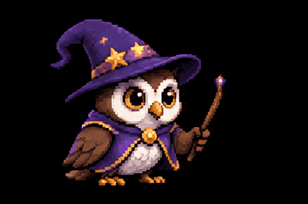

<sub>16 frames · 380×252 · 2.2s · gpt-image-2.6 · generated 2026-11-10</sub>

**Prompt**

```text
A pixel art owl in a starry purple wizard hat raises a wooden wand and releases a burst of sparkles. 16-bit sprite, side view, plain black background.
```

`pixel` `magic` `sprite`

### 52. Pixel bucket-helmet frog jump attack

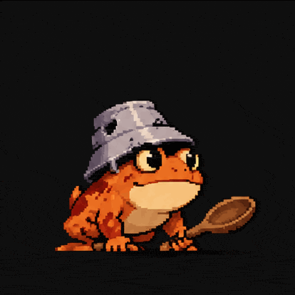

<sub>9 frames · 414×414 · 1.4s · gpt-image-2.6 · generated 2026-11-10</sub>

**Prompt**

```text
A chunky orange pixel art frog wearing a dented tin bucket as a helmet and holding a wooden spoon leaps up and slams the spoon down, landing with a small dust puff. 16-bit game sprite, side view, plain dark background.
```

`pixel` `game` `sprite`

### 53. Pixel letters hop

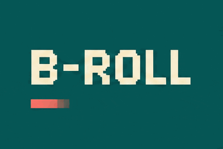

<sub>16 frames · 377×252 · 1.8s · gpt-image-2.6 · generated 2026-11-10</sub>

**Prompt**

```text
Cream pixel-font letters spelling B-ROLL on a deep teal background hop up one by one from left to right and land back in place, while a coral cursor bar slides underneath. Spelling and spacing stay identical.
```

`pixel` `text` `title`

### 54. Pixel bus pulls into the stop

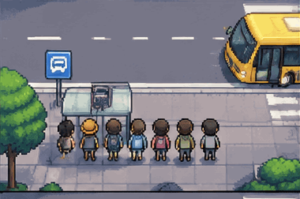

<sub>16 frames · 380×252 · 2.6s · gpt-image-2.6 · generated 2026-11-10</sub>

**Prompt**

```text
Top-down pixel art street at morning rush hour: a yellow bus pulls into a stop while tiny commuters wait in line, swaying slightly. Fixed camera, fixed background, 16-bit palette.
```

`pixel` `city` `bus`

### 55. Download arrow turns into a check


<sub>16 frames · 379×255 · 2.2s · gpt-image-2.6 · generated 2026-11-09</sub>

**Prompt**

```text
A flat UI animation: a blue down arrow drops into a rounded tray, the tray fills with a progress line, then the arrow morphs into a white check mark inside a green circle. Clean vector style, plain white background.
```

`ui` `icon` `download`

### 56. Battery charging icon

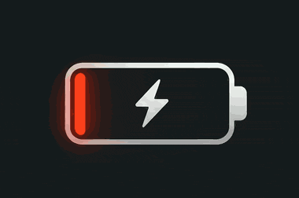

<sub>16 frames · 380×252 · 1.9s · gpt-image-2.6 · generated 2026-11-09</sub>

**Prompt**

```text
A flat rounded battery icon filling up segment by segment from red to green, a white lightning bolt pulsing in the middle, a small check mark appearing when full. Clean UI icon style, plain dark background.
```

`ui` `icon` `loading`

### 57. Notification bell ringing

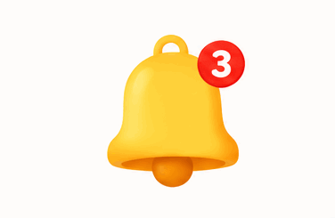

<sub>16 frames · 376×245 · 1.6s · gpt-image-2.6 · generated 2026-11-09</sub>

**Prompt**

```text
A flat rounded yellow notification bell icon swinging side to side as if ringing, a red badge with the number 3 popping onto its corner, small motion lines around it. Clean UI icon style, plain white background.
```

`ui` `icon` `notification`

### 58. Pixel crops sprouting

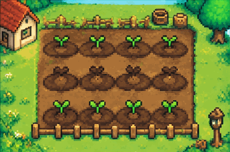

<sub>16 frames · 380×252 · 2.9s · gpt-image-2.6 · generated 2026-11-09</sub>

**Prompt**

```text
16-bit pixel art farm plot with three rows of soil: sprouts pop up, grow leaves and turn into ripe carrots and pumpkins, a small sparkle appearing over each. Retro farming game style, fixed camera.
```

`pixel` `farm` `game`

### 59. Pixel town in the rain

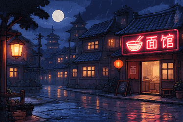

<sub>16 frames · 374×250 · 2.9s · gpt-image-2.6 · generated 2026-11-09</sub>

**Prompt**

```text
Pixel art of a small town street at night in the rain, raindrops falling, warm windows flickering on, a neon noodle-shop sign buzzing and puddles rippling. Cozy retro game palette, fixed camera.
```

`pixel` `rain` `night`

### 60. Pixel fishing catch

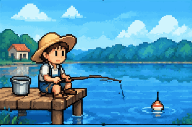

<sub>16 frames · 380×252 · 2.2s · gpt-image-2.6 · generated 2026-11-09</sub>

**Prompt**

```text
16-bit pixel art of a kid in a straw hat on a wooden pier, the bobber dipping, the kid yanking the rod up and a shiny fish flipping out of the water with a little sparkle. Retro game palette, fixed camera.
```

`pixel` `game` `fishing`

### 61. Earth Online: morning commute

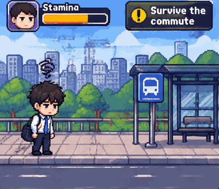

<sub>9 frames · 439×379 · 1.6s · gpt-image-2.6 · generated 2026-11-09</sub>

**Prompt**

```text
A 16-bit pixel art RPG scene of a tired office worker character walking to a bus stop, a game HUD on top: the stamina bar slowly draining, a "+10 EXP" popup rising, and a quest box saying "Survive the commute". Retro game UI, fixed camera.
```

> 💡 **Tip:** Treating everyday life as a game HUD (stamina, EXP, quest box) is a popular series format.

`pixel` `rpg` `daily-life` `text`

### 62. Sun / moon theme toggle

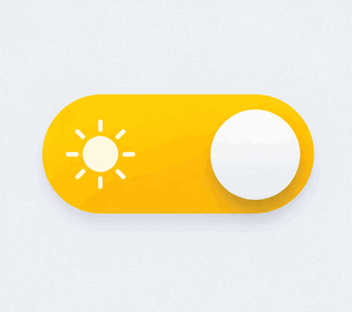

<sub>9 frames · 435×386 · 1.1s · gpt-image-2.6 · generated 2026-11-08</sub>

**Prompt**

```text
A rounded toggle switch sliding from a sunny yellow side with a sun icon to a dark navy side with a crescent moon and tiny stars. Flat UI style on a light grey background.
```

`ui` `toggle` `dark-mode`

### 63. Rocket progress bar

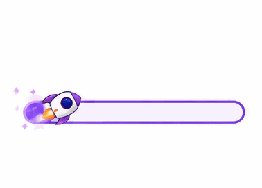

<sub>16 frames · 378×272 · 1.6s · gpt-image-2.6 · generated 2026-11-08</sub>

**Prompt**

```text
A flat UI progress bar filling from left to right as a tiny cartoon rocket flies along its leading edge, leaving a sparkly trail. Clean vector style, purple and white.
```

`ui` `loader` `rocket`

### 64. Pixel treasure chest

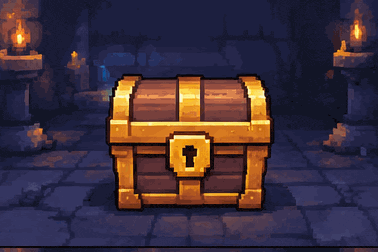

<sub>16 frames · 378×252 · 1.9s · gpt-image-2.6 · generated 2026-11-08</sub>

**Prompt**

```text
16-bit pixel art treasure chest: the lid flips open, gold coins and a gem burst upward with sparkles, then settle back inside. Retro RPG style on a dark dungeon floor.
```

`pixel` `game` `reward`

### 65. Gem merge game ad

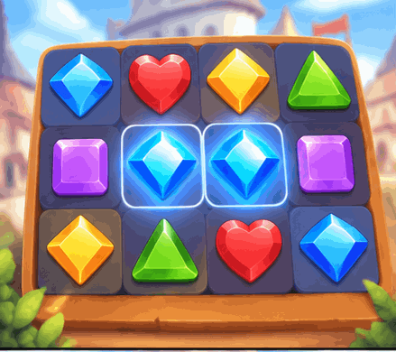

<sub>9 frames · 439×390 · 1.6s · gpt-image-2.6 · generated 2026-11-08</sub>

**Prompt**

```text
A mobile puzzle game ad shot: two identical glowing blue gems slide together on a grid board and merge into one bigger gem with a burst of sparkles and a floating "+100". Bright casual-game style.
```

`game` `ad` `mobile`

### 66. Pixel lantern scares ghosts

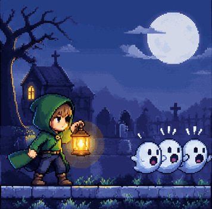

<sub>12 frames · 356×351 · 1.7s · gpt-image-2.6 · generated 2026-11-08</sub>

**Prompt**

```text
16-bit pixel art of a kid in a hooded green cloak raising a glowing lantern in a moonlit graveyard, and three small round cartoon ghosts flee off to the right. Side view, retro game style.
```

`pixel` `game` `halloween`

### 67. Scroll-down arrow hint


<sub>9 frames · 438×389 · 1.1s · gpt-image-2.6 · generated 2026-11-08</sub>

**Prompt**

```text
A minimalist rounded chevron arrow pointing down, bouncing gently up and down with a soft shadow that shrinks and grows beneath it. Flat UI style, indigo on white.
```

`ui` `arrow` `minimal`

### 68. Pixel coffee cup


<sub>16 frames · 379×247 · 2.2s · gpt-image-2.6 · generated 2026-11-08</sub>

**Prompt**

```text
A pixel-art coffee cup on a saucer with three wisps of steam rising and curling in a loop. 16-bit style, warm brown palette, plain cream background.
```

`pixel` `coffee` `icon`

### 69. 8-bit raver alien


<sub>16 frames · 377×245 · 1.9s · gpt-image-2.6 · generated 2026-11-08</sub>

**Prompt**

```text
8-bit pixel art of a little green alien wearing antenna headphones, jumping and pumping its fist on a tiny dance floor while colored strobe lights flash. Retro game palette, black background.
```

`pixel` `dance` `retro`

### 70. Bodyweight squat guide


<sub>9 frames · 439×389 · 1.3s · gpt-image-2.6 · generated 2026-11-08</sub>

**Prompt**

```text
A clean flat infographic of a faceless fitness figure in a teal tank top doing a bodyweight squat in side view: sitting the hips back with arms stretched forward, then standing tall. Light grey background with a dotted guideline at knee height.
```

`fitness` `infographic` `tutorial`

### 71. 16-bit fighter punch combo


<sub>9 frames · 439×390 · 1.3s · gpt-image-2.6 · generated 2026-11-07</sub>

**Prompt**

```text
A 16-bit arcade fighter, a stocky red panda in a blue gi, throwing a jab and a straight punch from a fighting stance with hit sparks. Side view sprite on a dojo background.
```

`pixel-art` `fighting` `sprite`

### 72. AI assistant typing indicator


<sub>12 frames · 356×356 · 1.7s · gpt-image-2.6 · generated 2026-11-07</sub>

**Prompt**

```text
A chat interface where a small rounded robot avatar sits beside a grey bubble with three dots pulsing one after another, the avatar's eyes blinking. Clean modern UI style on white.
```

`ui` `chat` `loader`

### 73. Squash and stretch bouncing ball


<sub>16 frames · 379×243 · 1.9s · gpt-image-2.6 · generated 2026-11-07</sub>

**Prompt**

```text
A red rubber ball bouncing on a flat floor with classic squash and stretch, a soft shadow growing and shrinking underneath. Clean flat animation on a plain white background.
```

`animation-basics` `ball` `loop`

### 74. Handheld-style castle run


<sub>12 frames · 380×336 · 1.4s · gpt-image-2.6 · generated 2026-11-07</sub>

**Prompt**

```text
A 32-bit handheld-style side-scrolling level: a small round armadillo knight in shiny orange armor with a feathered helmet running and jumping across castle battlements while the background parallax scrolls. Pixel art.
```

`pixel-art` `platformer` `game`

### 75. Pixel hero sword slash


<sub>12 frames · 358×358 · 1.3s · gpt-image-2.6 · generated 2026-11-07</sub>

**Prompt**

```text
A pixel art hero with spiky red hair swinging a sword in a wide arc, leaving a bright white slash trail. Side view game sprite on a plain dark background, crisp pixels.
```

`pixel-art` `sprite` `attack`

### 76. Junkyard robot walk cycle


<sub>16 frames · 380×252 · 1.9s · gpt-image-2.6 · generated 2026-11-06</sub>

**Prompt**

```text
A rusty little scrap-metal robot with one antenna and a mismatched arm walking to the right in a side-view walk cycle, bolts jiggling, a puff of dust at each step. Pixel art game sprite on a plain dark background, crisp pixels.
```

`pixel-art` `sprite` `game`

### 77. Love-burst skill animation


<sub>16 frames · 369×239 · 1.9s · gpt-image-2.6 · generated 2026-11-06</sub>

**Prompt**

```text
A chibi magical girl with a pink bob raises her wand and casts a "love burst" skill: a ring of glowing pink hearts explodes outward from her and fades, then she returns to her idle pose. Game skill-card style animation, sparkly effects, dark purple background.
```

`game` `skill` `effects`

### 78. 8-bit slime boss battle


<sub>16 frames · 375×240 · 2.2s · gpt-image-2.6 · generated 2026-11-06</sub>

**Prompt**

```text
An 8-bit boss battle: a giant green slime boss with a tiny crown bounces and squishes in the center of a dungeon arena, its health bar at the top flashing, while a small pixel hero on the left raises a shield. Retro NES pixel art, dark stone background.
```

`pixel-art` `game` `boss`

### 79. Arcade VS screen


<sub>16 frames · 376×251 · 2.2s · gpt-image-2.6 · generated 2026-11-06</sub>

**Prompt**

```text
A retro arcade versus screen: on the left a chubby panda wrestler in a yellow cape, on the right a lanky girl skateboarder with a green ponytail and a hoodie, both slide in from the edges, a huge "VS" slams into the center with lightning flashes, then both strike a pose. 16-bit pixel art, bold colors.
```

> 💡 **Tip:** Use clearly original characters (animals, unusual outfits). Generic "martial artist in a headband" drifts toward famous fighting-game heroes.

`pixel-art` `game` `versus`

### 80. Hourglass loading


<sub>16 frames · 379×252 · 2.2s · gpt-image-2.6 · generated 2026-11-06</sub>

**Prompt**

```text
A simple flat hourglass icon with sand pouring from the top to the bottom, then the hourglass flips over and starts again. Minimal vector style, teal frame and golden sand on a plain off-white background.
```

`ui` `loader` `icon`

### 81. Like button heart burst


<sub>16 frames · 379×246 · 1.8s · gpt-image-2.6 · generated 2026-11-06</sub>

**Prompt**

```text
A rounded outline heart icon that fills with red, pops bigger with a bounce and bursts into small colorful confetti dots around it, then settles back. Flat vector UI animation on a plain white background.
```

`ui` `icon` `micro-interaction`

### 82. Pixel knight run cycle


<sub>8 frames · 380×508 · 1.0s · gpt-image-2.6 · generated 2026-11-06</sub>

**Prompt**

```text
A pixel art knight with a blue cape and a small sword running to the right in a side view run cycle, cape flapping, on a plain dark background. 16-bit retro game sprite style, crisp pixels.
```

> 💡 **Tip:** Ask for a "run cycle" in "side view" to get game-sprite style animation.

`pixel-art` `sprite` `game`

### 83. Bouncing dots loader


<sub>16 frames · 385×266 · 1.4s · gpt-image-2.6 · generated 2026-11-06</sub>

**Prompt**

```text
A minimal loading animation: three rounded dots in coral, violet and teal bouncing up and down one after another in a wave, with soft squash on landing. Flat vector style on a plain off-white background.
```

> 💡 **Tip:** UI loaders work best with very few elements and a plain background.

`ui` `loader` `minimal`

### 84. Pixel art campfire


<sub>16 frames · 378×240 · 1.9s · gpt-image-2.6 · generated 2026-11-06</sub>

**Prompt**

```text
A pixel art campfire at night in a small forest clearing, flames flickering, sparks rising and fading, two logs glowing orange. 16-bit retro game style, dark blue night sky with a few stars.
```

`pixel-art` `loop` `game`

[← README](../README.md)
