# 像素风与界面动效 · 103 条提示词

[← README](../README_zh.md)

### 1. 像素篝火旁熟睡的狐狸

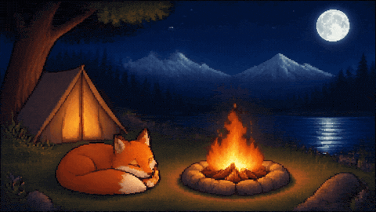

<sub>15 帧 · 480×270 · 1.3s · GPT Image 2.6 Sunburst (API)</sub>

📌 **来源：** [useapi.net on useapi.net](https://useapi.net/docs/articles/gpt-image-2-6-gif-api)

**提示词**

```text
Looping pixel-art animation of a cozy campfire at night under a starry sky, flames flickering, sparks rising, a fox sleeping beside it
```

`pixel-art` `campfire` `fox` `night` `cozy`

### 2. 像素风日式奇幻城市

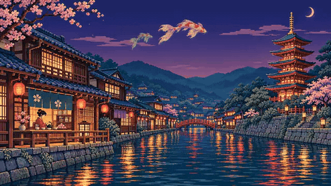

<sub>80 帧 · 480×270 · 8.0s · GPT-6.2 Astra (ChatGPT)</sub>

📌 **来源：** [@leo114119 on X](https://x.com/leo114119/status/2123062551923798110)

**提示词**

```text
生成一个日式奇幻城市动画 GIF，像素艺术，超精细，超高质量，画面惊艳，整体协调统一且完美
```

`pixel-art` `city` `japanese` `fantasy` `minimal-prompt`

### 3. 黑曜石火焰剑光标

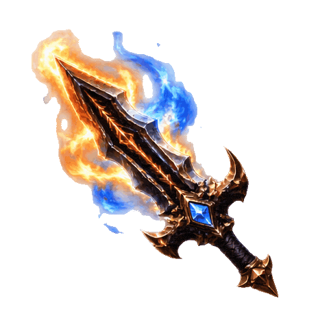

<sub>14 帧 · 480×480 · 1.3s · GPT Image 2.6 Flare (sprite sheet to GIF)</sub>

📌 **来源：** [wuyoscar (after a workflow by @hAru_mAki_ch) on GitHub](https://github.com/wuyoscar/GPT-Image2-Skill/blob/HEAD/skills/gpt-image/references/gallery-gaming.md)

**提示词**

```text
An animation sprite sheet for a fantasy desktop cursor, inspired by a flaming-sword mouse pointer. Exactly 8 frames in a 4-column by 2-row uniform grid, read left to right then top to bottom. Canvas 2048 by 1024, each cell exactly 512 by 512. Transparent background, no gutters, no borders, no text, no labels. In every cell the same small ornate obsidian sword points diagonally toward the upper-left. Its sharp tip is fixed at cell coordinate (100,100), blade geometry and position identical in every frame. Bright amber and electric-blue flame curls around the blade, progressing smoothly through eight phases and returning to the initial shape at the loop boundary. The blade stays still; only flames, a few sparks and reflected light move. Keep all effects within the middle 360 by 360 pixels of each cell. Crisp illustrated game-UI asset, luminous edges, convincing metallic highlights, strong silhouette, no character, no duplicate swords within a cell. Do not draw checkerboards; use actual transparency.
```

`cursor` `game-ui` `sprite-sheet`

### 4. 雨天咖啡馆里敲键盘的像素橘猫


<sub>12 帧 · 358×358 · 2.2s · GPT Image 2.6</sub>

📌 **来源：** [OP響樂生活 on OP響樂生活 myfone blog](https://myfone.blog/tech-news/news6-chatgpt-gif-2611010/)

**提示词**

```text
請幫我生成一張復古像素風格（Pixel Art）的動態 GIF：畫面中央是一隻戴著耳機的橘貓，坐在雨天的咖啡館窗邊，雙手在筆電上規律敲鍵盤，旁邊有一杯熱咖啡冒著縷縷輕煙，背景窗戶有緩緩流下的雨滴，請確保動畫能流暢循環播放（Seamless loop）。
```

`pixel-art` `cat` `lofi` `rain` `cafe`

### 5. 8 位像素小牛行走循环

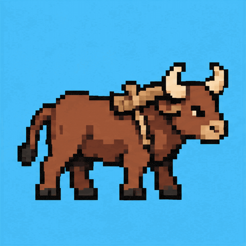

<sub>8 帧 · 480×480 · 0.8s · GPT Image 2.6</sub>

📌 **来源：** [Oxen.ai on Oxen.ai Blog](https://ghost.oxen.ai/gpt-image-26/)

**提示词**

```text
An 8-bit pixel art sprite of a stocky brown ox with a tiny yoke,
walking in place from left to right. Classic side-scrolling game walk
cycle, flat sky blue background, crisp pixels, no blur.
```

`pixel-art` `sprite` `walk-cycle` `game`

### 6. 像素勇者挥剑特效

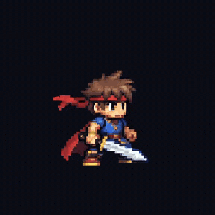

<sub>12 帧 · 358×358 · 1.2s · GPT Image 2.6</sub>

📌 **来源：** [@YaReYaRu30Life on X](https://x.com/YaReYaRu30Life/status/2118166505603153922)

**提示词**

```text
GIFを作成。ドット絵の勇者。
剣にエフェクトをつけて振り回す
```

`pixel-art` `hero` `sword` `fx`

### 7. 绿色询价按钮流光

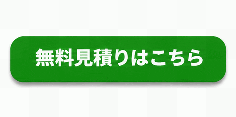

<sub>8 帧 · 480×238 · 1.1s · GPT Image 2.6</sub>

📌 **来源：** [末松 光太郎 on WizTry Blog](https://wiztrydx.com/blog/chatgpt-images-2-6-kaisetsu/)

**提示词**

```text
ホームページに置くボタンのループGIFを作って。横長の角丸で、緑色のボタンに白い文字で「無料見積りはこちら」。文字の位置は動かさず、光が左から右へ流れて、ボタンが少しだけふくらむ動きにして。背景は白。
```

`button` `ui` `japanese`

### 8. 灯泡图标慢慢亮起

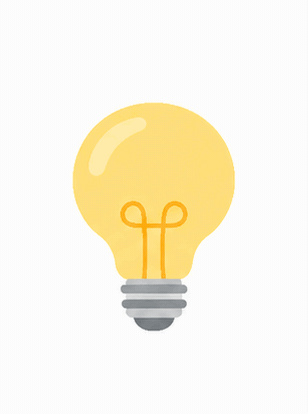

<sub>12 帧 · 308×414 · 2.2s · GPT Image 2.6</sub>

📌 **来源：** [牧牧的成長實驗室 on 方格子 vocus](https://vocus.cc/article/6aebf9a0fd8978000170526d)

**提示词**

```text
製作一張極簡扁平插畫 GIF。畫面中央是一個黃色燈泡圖示，燈泡從微暗逐漸亮起，接著恢復原本狀態。背景純白、圖示位置固定，動畫柔和，不要任何文字，無縫循環。
```

`icon` `flat` `education`

### 9. 像素闪电劈落特效

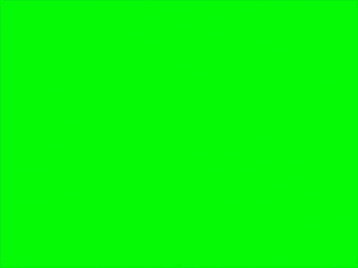

<sub>12 帧 · 358×268 · 1.0s · GPT Image 2.6</sub>

📌 **来源：** [@kasperzackgames on GitHub](https://github.com/kasperzackgames/chatgpt-pixel-effects/tree/main/effects/lightning)

**提示词**

```text
Make an animated GIF of a pixel-art lightning strike for a 2D side-view game, rendered as large as you can. 14 frames, about 70 ms per frame. Use fine pixel art: each art pixel is only 2 to 3 image pixels wide, so the bolt has a lot of detail (it spans the full frame height, about 120 art pixels). The camera does not move. The bottom edge of the frame is the ground line, and the bolt hits the ground at the bottom centre, at the same point in every frame. Don't draw the ground itself. Sequence: a thin flickering leader zigzags down from the top edge; the full bolt strikes: a thick jagged white core with an electric blue and violet glow outline and three or four forked branches; one frame where the bolt and a bright white burst at the impact point are at their brightest; the bolt flickers twice, changing its branches each time; at the impact point a burst of electric sparks flies out in arcs and short arcs of electricity crawl sideways along the ground; the bolt vanishes, leaving a glowing blue afterimage that fades; a few sparks and a small curl of dark smoke fade out until the frame is empty. True pixel art: crisp pixels on one even grid, hard edges, no anti-aliasing, no blur, no soft gradients, a limited palette of about 16 colours (white, pale cyan, electric blues, violets, two dark greys for the smoke). Background: flat solid pure green #00FF00 in every frame, nothing else. No text, no borders.
```

`pixel-art` `game-fx` `lightning`

### 10. 像素火柱喷发特效

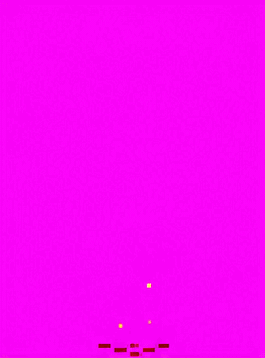

<sub>15 帧 · 265×358 · 1.3s · GPT Image 2.6</sub>

📌 **来源：** [@kasperzackgames on GitHub](https://github.com/kasperzackgames/chatgpt-pixel-effects/tree/main/effects/fire-pillar)

**提示词**

```text
Make an animated GIF of a pixel-art fire pillar erupting from the ground, for a 2D side-view game, in a tall frame (taller than wide), rendered as large as you can. 16 frames, about 80 ms per frame. Use fine pixel art: each art pixel is exactly 2 image pixels wide, so the fire has a lot of detail. The camera does not move. The bottom edge of the frame is the ground line, and the pillar erupts at the bottom centre, at the same point in every frame. Don't draw the ground itself. The tallest flame tips reach about 85 percent of the frame height: always leave empty background above the fire and at both sides, so nothing is ever cut off by the frame edges. Sequence: a small glowing crack and a few embers rising; flames burst upward into a tall roaring column of fire, wider at the base, with swirling tongues of flame, a white-yellow hot core and orange, red and dark red edges; burning chunks and sparks fly out of the top; the column roars for several frames, its flames changing shape every frame; it collapses downward into low flickering flames and puffs of dark smoke; glowing embers drift up and fade until the frame is empty. True pixel art: crisp pixels on one even grid, hard edges, no anti-aliasing, no blur, no soft gradients, a limited palette of about 18 colours (white, yellows, oranges, reds, dark reds and three dark greys for the smoke). Background: flat solid pure magenta #FF00FF in every frame, nothing else. No text, no borders.
```

`pixel-art` `game-fx` `fire-pillar`

### 11. 像素火山喷发特效

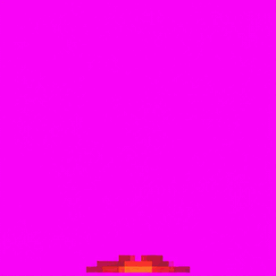

<sub>16 帧 · 309×308 · 1.4s · GPT Image 2.6</sub>

📌 **来源：** [@kasperzackgames on GitHub](https://github.com/kasperzackgames/chatgpt-pixel-effects/tree/main/effects/eruption)

**提示词**

```text
Make an animated GIF of a pixel-art volcano eruption seen from far away, for the background of a 2D side-view game, in a square frame, rendered as large as you can. 16 frames, about 90 ms per frame. Use fine pixel art: each art pixel is exactly 2 image pixels wide. The camera does not move. The crater is at the bottom centre of the frame, at the same point in every frame; don't draw the mountain itself, only what comes out of the crater. Sequence: frames 1 to 4: the crater glows brighter and spits a few sparks; frame 5: a bright burst; frames 6 to 16: a full eruption that loops seamlessly from frame 16 back to frame 6: a fountain of glowing lava shooting straight up from the crater, glowing lava bombs flying out in high arcs and falling back down on both sides, and a thick dark ash column rising above it, its underside lit red and orange by the lava, the top of the ash staying inside the frame. Leave empty background around everything so nothing is cut off by the frame edges. True pixel art: crisp pixels on one even grid, hard edges, no anti-aliasing, no blur, no soft gradients, a limited palette of about 18 colours (white, yellows, oranges, reds, dark reds, and four dark grey-browns for the ash). Background: flat solid pure magenta #FF00FF in every frame, nothing else. No text, no borders.
```

`pixel-art` `game-fx` `eruption`

### 12. 像素能量光束特效

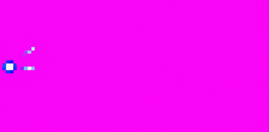

<sub>13 帧 · 439×216 · 1.1s · GPT Image 2.6</sub>

📌 **来源：** [@kasperzackgames on GitHub](https://github.com/kasperzackgames/chatgpt-pixel-effects/tree/main/effects/beam)

**提示词**

```text
Make an animated GIF of a pixel-art energy beam for a 2D side-view game, in a wide frame twice as wide as it is tall, rendered as large as you can. 16 frames, about 70 ms per frame. Use fine pixel art: each art pixel is only 2 to 3 image pixels wide. The camera does not move. The beam starts at the left edge at mid-height, at the same point in every frame. Sequence: a small glowing orb of energy charges at the left edge, crackling and growing as sparks are pulled into it; it fires: a thick straight beam with a white core and cyan and electric blue outer layers shoots to the right edge within two frames; the beam holds for several frames, pulsing thicker and thinner, with bright ripples travelling along it, rings around its origin and sparks spraying off its edges; the beam thins to a line and vanishes; small sparks and a fading glow at the origin until the frame is empty. True pixel art: crisp pixels on one even grid, hard edges, no anti-aliasing, no blur, no soft gradients, a limited palette of about 14 colours (white, pale cyan, cyans, electric blues, deep blue). Background: flat solid pure magenta #FF00FF in every frame, nothing else. No text, no borders.
```

`pixel-art` `game-fx` `beam`

### 13. 像素爆炸与蘑菇云特效

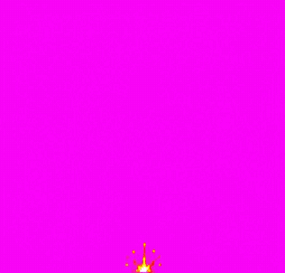

<sub>15 帧 · 316×302 · 1.3s · GPT Image 2.6</sub>

📌 **来源：** [@kasperzackgames on GitHub](https://github.com/kasperzackgames/chatgpt-pixel-effects)

**提示词**

```text
Make an animated GIF of a pixel-art explosion for a 2D side-view game, rendered as large as you can (at least 512x512). 16 frames, about 80 ms per frame. Use fine pixel art: each art pixel is only 2 to 3 image pixels wide, so the explosion has a lot of detail (about 120 art pixels tall at its peak). The camera does not move. The bottom edge of the frame is the ground line, and the explosion hits the ground at the bottom centre, at the same point in every frame. Don't draw the ground itself. Sequence: a tiny spark on the ground; one bright white flash frame; a huge orange and yellow fireball that grows until it fills about three quarters of the frame height and rises into a mushroom cloud with a fiery stem; debris chunks and sparks flying out in arcs; a thin dust ring rolling sideways along the ground; the fire breaks up into a light grey smoke column that rises and drifts; glowing embers fade out until the frame is empty. True pixel art: crisp pixels on one even grid, hard edges, no anti-aliasing, no blur, no soft gradients, a limited palette of about 20 colours (white, yellows, oranges, reds, dark reds and four neutral greys for the smoke). Background: flat solid pure magenta #FF00FF in every frame, nothing else. No text, no borders.
```

`pixel-art` `game-fx` `explosion`

### 14. 三颗橘色圆点跳动加载


<sub>13 帧 · 416×404 · 1.1s · GPT Image 2.6</sub>

📌 **来源：** [蘇柔瑋 on 數位時代 BusinessNext](https://www.bnext.com.tw/article/92943/chatgpt-gif-generator-prompts)

**提示词**

```text
請設計一張極簡風格的 GIF 載入動畫。畫面中央有三顆橘色小圓點，依序從左至右向上跳動，再回到原本位置，形成自然連續的節奏。背景透明，整體使用簡潔的扁平化設計，圓點大小與顏色保持一致。鏡頭固定，動畫無縫循環，不要加入文字或其他裝飾。
```

`loader` `ui` `flat`

### 15. 指南针 App 图标指针摆动

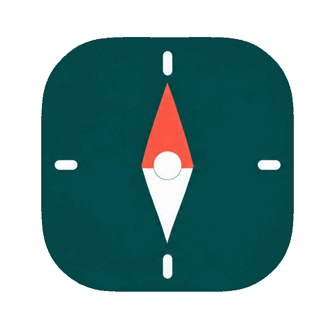

<sub>14 帧 · 480×480 · 1.2s · GPT Image 2.6</sub>

📌 **来源：** [Fuxuan Guo on ChatCut Blog](https://chatcut.io/blog/chatgpt-gif)

**提示词**

```text
Minimalist flat-vector rounded-square app icon on a completely transparent background, locked front-on view. A solid deep-teal rounded square dial with four tiny white tick marks holds a two-tone coral-and-white diamond compass needle pointing straight up. The compass needle swings 20 degrees clockwise, rebounds slightly left, and settles pointing straight up again in its exact starting alignment on the final frame for a clean loop. Flat crisp vector shapes, no gradients, no text.
```

`icon` `app` `transparent`

### 16. 纸飞机空状态加载图


<sub>8 帧 · 480×480 · 1.2s · GPT Image 2.6</sub>

📌 **来源：** [Fuxuan Guo on ChatCut Blog](https://chatcut.io/blog/chatgpt-gif)

**提示词**

```text
Clean flat vector empty-state loading illustration, locked front-on view. Inside a soft powder-blue circle badge on a crisp off-white square background, a folded coral-orange paper airplane glides in a gentle up-and-down bobbing arc above two tiny stationary white clouds, returning to its exact starting height and angle on the final frame for a clean loop. Flat colors, no gradients, no text.
```

`loader` `ui` `flat`

### 17. 三颗胶囊波浪加载动画

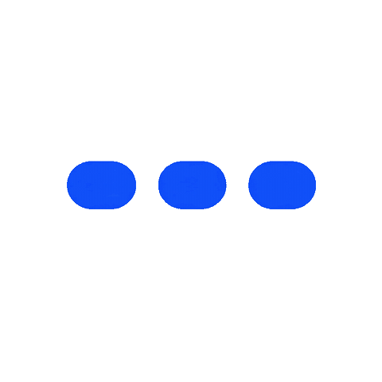

<sub>11 帧 · 480×480 · 1.0s · GPT Image 2.6</sub>

📌 **来源：** [Fuxuan Guo on ChatCut Blog](https://chatcut.io/blog/chatgpt-gif)

**提示词**

```text
Minimalist flat-vector UI loading indicator on a completely transparent background, locked front-on view. Three rounded cobalt-blue pill dots sit in a horizontal row; the left dot hops up, then the center dot, then the right dot in a crisp wave, and all three settle level in their exact starting alignment on the final frame for a clean loop. Sharp vector edges, solid flat blue, no text.
```

`loader` `ui` `transparent`

### 18. 16 位像素金毛点赞

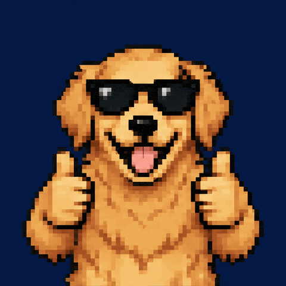

<sub>8 帧 · 480×480 · 1.1s · GPT Image 2.6</sub>

📌 **来源：** [Fuxuan Guo on ChatCut Blog](https://chatcut.io/blog/chatgpt-gif)

**提示词**

```text
Crisp 16-bit pixel art reaction icon, locked front-on camera. A cheerful golden retriever wearing cool dark pixel sunglasses gives an enthusiastic double thumbs-up as three tiny yellow pixel stars pop around its head and fade out, returning to the exact starting pose on the final frame for a clean loop. Solid deep midnight-blue background, limited retro palette, no text.
```

`pixel-art` `dog` `reaction`

### 19. 像素字母依次跳动 B-ROLL

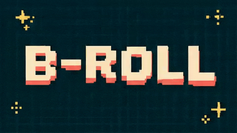

<sub>12 帧 · 480×270 · 3.0s · gpt-image-2.6-gif</sub>

📌 **来源：** [@Wv3EcACHtizRjZK on X](https://x.com/Wv3EcACHtizRjZK/status/2119673507068203035)

**提示词**

```text
深青色背景，奶油色像素字体 B-ROLL，字母从左到右轻轻跳起再落回原位，珊瑚色光标从下方划过。字形、拼写和间距保持一致，动画 GIF。
```

`pixel font` `text` `title`

### 20. 成功提示条滑入

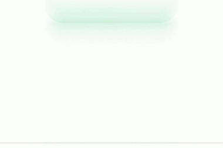

<sub>16 帧 · 380×252 · 1.8s · gpt-image-2.6 · 生成于 2026-11-17</sub>

**提示词**

```text
A green rounded notification toast slides in from the top with a white check mark drawing itself, holds a moment, then slides back up. Minimal app UI, white background, no other text.
```

`ui` `toast` `notification`

### 21. 表情回应依次弹出

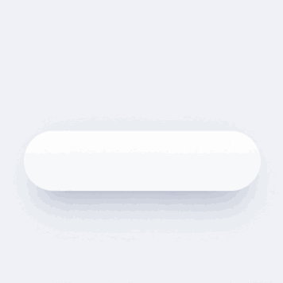

<sub>12 帧 · 356×356 · 1.4s · gpt-image-2.6 · 生成于 2026-11-17</sub>

**提示词**

```text
A rounded white reaction bar where five round emoji faces, smile, laugh, heart eyes, surprise and sad, pop up one after another with a springy bounce. Clean app UI style, light gray background.
```

`ui` `emoji` `reaction`

### 22. 像素火车过桥

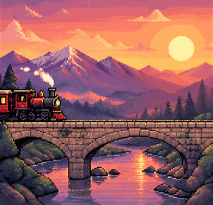

<sub>12 帧 · 358×345 · 1.4s · gpt-image-2.6 · 生成于 2026-11-17</sub>

**提示词**

```text
A small pixel art steam train crosses a stone arch bridge over a river, puffing little smoke clouds, mountains behind. 16-bit side-scroller style, sunset palette.
```

`pixel` `train` `landscape`

### 23. 像素蜜蜂花园

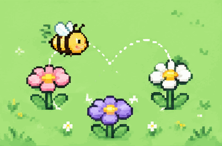

<sub>16 帧 · 375×246 · 1.9s · gpt-image-2.6 · 生成于 2026-11-17</sub>

**提示词**

```text
A pixel art bee buzzes in a figure eight between three pixel flowers that sway slightly. 16-bit game style, light green background.
```

`pixel` `bee` `garden`

### 24. 书签收藏

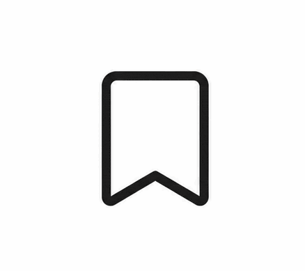

<sub>9 帧 · 438×389 · 1.4s · gpt-image-2.6 · 生成于 2026-11-17</sub>

**提示词**

```text
An outlined bookmark icon fills with solid gold from top to bottom and gives a small bounce, with a few tiny sparkles. Minimal app icon style, white background.
```

`ui` `bookmark` `save`

### 25. 加入购物车


<sub>9 帧 · 437×388 · 1.4s · gpt-image-2.6 · 生成于 2026-11-17</sub>

**提示词**

```text
A flat shopping cart icon; a small box drops into it, the cart wiggles, and a red badge with the number 1 pops up on its corner. Clean app UI icon style, white background.
```

`ui` `cart` `ecommerce`

### 26. 像素小恐龙跺脚吼叫

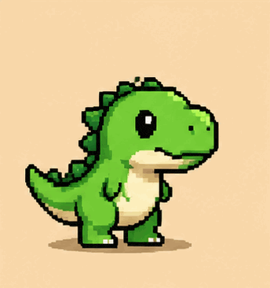

<sub>12 帧 · 344×366 · 1.7s · gpt-image-2.6 · 生成于 2026-11-17</sub>

**提示词**

```text
A small green pixel art dinosaur stomps one foot, opens its mouth in a tiny roar with a shake line, then settles back. 16-bit game sprite, plain sand-colored background.
```

`pixel` `dinosaur` `sprite`

### 27. 低多边形主角慢跑

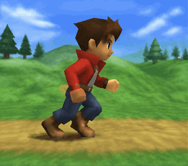

<sub>12 帧 · 380×337 · 1.4s · gpt-image-2.6 · 生成于 2026-11-17</sub>

**提示词**

```text
A blocky low-poly game hero in a red jacket jogs along a dirt path in a side view, rendered like an early 2000s console game with chunky polygons and blurry textures. Fixed camera, simple green hills behind.
```

`low-poly` `retro-game` `run`

### 28. 像素宇航员跑步

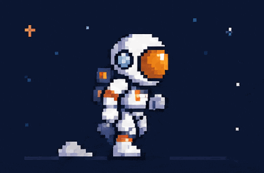

<sub>16 帧 · 378×249 · 1.6s · gpt-image-2.6 · 生成于 2026-11-17</sub>

**提示词**

```text
A pixel art astronaut in a white suit with an orange visor runs in place in a smooth side-view run cycle, small dust puffs at each step. Limited 16-color palette, dark navy background with a few stars.
```

> 💡 **技巧：** 跑步、走路循环用 12–16 帧更顺。

`pixel` `astronaut` `run-cycle`

### 29. 环形图填充

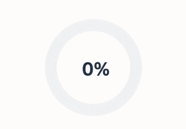

<sub>16 帧 · 379×263 · 1.6s · gpt-image-2.6 · 生成于 2026-11-17</sub>

**提示词**

```text
A donut chart fills segment by segment in teal, coral and yellow while the percentage in the middle counts up. Clean dashboard UI style, white background.
```

`ui` `chart` `data`

### 30. 地图图钉落下


<sub>12 帧 · 358×357 · 1.4s · gpt-image-2.6 · 生成于 2026-11-17</sub>

**提示词**

```text
A red location pin drops onto a simple folded map, bounces once and sends out a soft ripple ring. Flat UI icon style, pale green background.
```

`ui` `map` `location`

### 31. 复制成功

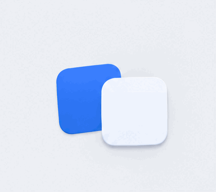

<sub>9 帧 · 439×390 · 1.4s · gpt-image-2.6 · 生成于 2026-11-17</sub>

**提示词**

```text
Two stacked rounded squares slide together into a clipboard icon, then a green checkmark draws itself on top. Minimal flat UI animation, light gray background.
```

`ui` `copy` `icon`

### 32. 音量滑块


<sub>12 帧 · 356×357 · 1.7s · gpt-image-2.6 · 生成于 2026-11-17</sub>

**提示词**

```text
A rounded volume slider knob glides from left to right while sound wave arcs grow beside a speaker icon. Clean flat UI icon style, white background, purple accent.
```

`ui` `volume` `icon`

### 33. 像素水壶烧开

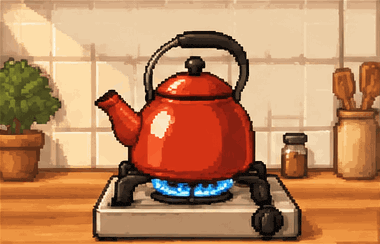

<sub>16 帧 · 380×244 · 2.2s · gpt-image-2.6 · 生成于 2026-11-17</sub>

**提示词**

```text
A pixel art red kettle on a tiny stove rattles its lid and puffs steam clouds as it whistles. Cozy 16-bit style, warm kitchen tile background.
```

`pixel` `kettle` `cozy`

### 34. 像素举盾格挡

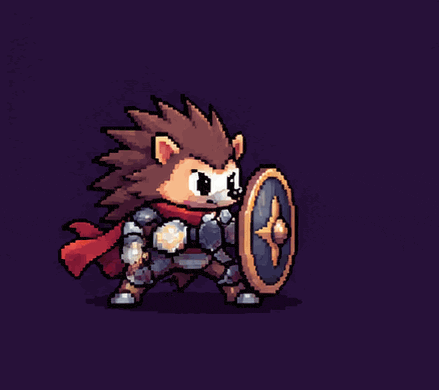

<sub>8 帧 · 439×390 · 1.0s · gpt-image-2.6 · 生成于 2026-11-17</sub>

**提示词**

```text
A pixel art armored hedgehog raises a round shield and a fireball bursts into sparks against it. 16-bit game sprite style, plain dark purple background.
```

`pixel` `shield` `game`

### 35. 像素地牢开门

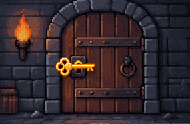

<sub>16 帧 · 380×248 · 2.9s · gpt-image-2.6 · 生成于 2026-11-17</sub>

**提示词**

```text
A pixel art golden key turns in a heavy wooden dungeon door, which creaks open to reveal torchlight inside. 16-bit game style, dark stone background.
```

`pixel` `door` `game`

### 36. 下拉刷新

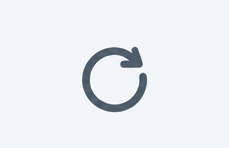

<sub>16 帧 · 378×245 · 1.6s · gpt-image-2.6 · 生成于 2026-11-17</sub>

**提示词**

```text
A circular arrow icon is pulled down, stretches slightly, then spins and snaps back with a small check. Minimal mobile UI style, light gray background.
```

`refresh` `ui` `mobile`

### 37. 复选框打勾


<sub>9 帧 · 436×388 · 1.1s · gpt-image-2.6 · 生成于 2026-11-17</sub>

**提示词**

```text
An empty rounded checkbox fills with green and a white checkmark draws itself inside with a small bounce. Clean flat UI, white background.
```

`checkbox` `ui` `icon`

### 38. 爪印加载动画


<sub>12 帧 · 356×356 · 1.2s · gpt-image-2.6 · 生成于 2026-11-17</sub>

**提示词**

```text
Six small paw prints appear one after another in a circle and fade, like a loading spinner. Flat UI style, white background, single brown color.
```

`loader` `ui` `paw`

### 39. 像素帆船

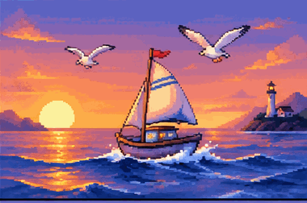

<sub>16 帧 · 380×252 · 2.6s · gpt-image-2.6 · 生成于 2026-11-17</sub>

**提示词**

```text
A small pixel art sailboat bobs on rolling waves with seagulls flapping overhead. 16-bit style, sunset sky.
```

`pixel` `sea` `boat`

### 40. 像素飞碟吸牛

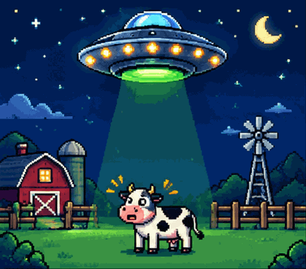

<sub>9 帧 · 439×386 · 1.4s · gpt-image-2.6 · 生成于 2026-11-17</sub>

**提示词**

```text
A pixel art flying saucer hovers over a farm at night and a green tractor beam lifts a surprised cow a little off the ground. 8-bit style, starry sky.
```

`pixel` `ufo` `cow`

### 41. 像素铁匠打铁

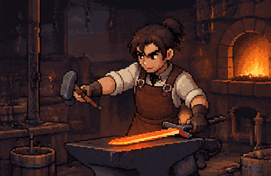

<sub>16 帧 · 380×247 · 1.9s · gpt-image-2.6 · 生成于 2026-11-17</sub>

**提示词**

```text
A pixel art blacksmith in a leather apron hammers a glowing sword on an anvil, sparks flying with each strike. 16-bit RPG style, dark forge background.
```

`pixel` `blacksmith` `rpg`

### 42. 像素洞穴瀑布

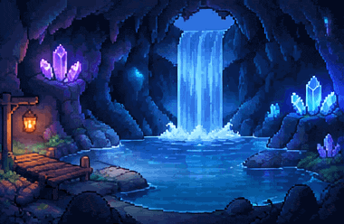

<sub>16 帧 · 380×248 · 2.6s · gpt-image-2.6 · 生成于 2026-11-17</sub>

**提示词**

```text
A pixel art cave with a waterfall pouring into a pool, glowing crystals blinking on the walls. 16-bit game style, fixed camera.
```

`pixel` `cave` `waterfall`

### 43. 钱包充值动效

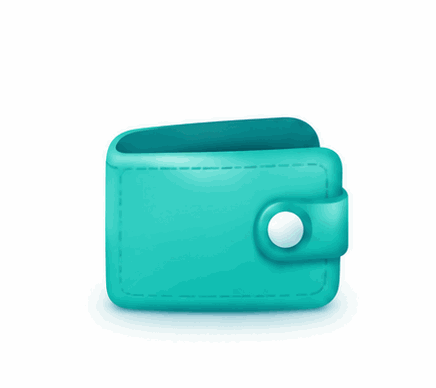

<sub>9 帧 · 436×388 · 1.6s · gpt-image-2.6 · 生成于 2026-11-13</sub>

**提示词**

```text
A flat app icon of a teal wallet; three gold coins drop in one by one and a small plus badge pops on the corner. Clean UI illustration, white background.
```

`wallet` `ui` `icon`

### 44. ASCII 字符拼出星形标志

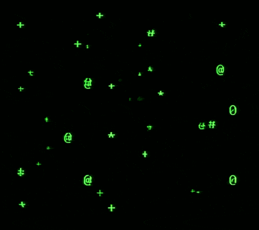

<sub>9 帧 · 438×389 · 1.4s · gpt-image-2.6 · 生成于 2026-11-13</sub>

**提示词**

```text
Scattered green ASCII characters on a black terminal screen drift into place and assemble into a simple five-point star logo, which pulses once. Monospace retro terminal look.
```

`ascii` `logo` `terminal`

### 45. 像素火箭发射


<sub>16 帧 · 380×250 · 2.6s · gpt-image-2.6 · 生成于 2026-11-12</sub>

**提示词**

```text
A pixel-art rocket on a launch pad rumbles, flames burst from its base and it lifts off leaving a smoke puff. 8-bit style, starry dark background.
```

`pixel` `space` `rocket`

### 46. 像素狐狸冲刺

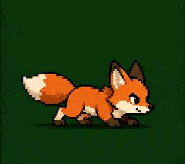

<sub>12 帧 · 380×337 · 1.4s · gpt-image-2.6 · 生成于 2026-11-12</sub>

**提示词**

```text
A pixel-art orange fox crouches then dashes forward with a burst of dust and a speed trail, ending in a skid. 16-bit platformer sprite, plain dark green background.
```

`pixel` `sprite` `fox`

### 47. 像素邮箱来信

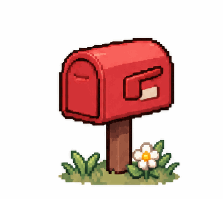

<sub>9 帧 · 445×396 · 1.6s · gpt-image-2.6 · 生成于 2026-11-12</sub>

**提示词**

```text
A pixel-art red mailbox flips its flag up and a letter pops out with a small sparkle. 16-bit style, plain light background.
```

`pixel` `ui` `mail`

### 48. 升级徽章

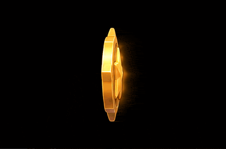

<sub>16 帧 · 380×252 · 1.9s · gpt-image-2.6 · 生成于 2026-11-12</sub>

**提示词**

```text
A shiny gold badge with a star flips in, flashes, and small sparkles burst around it. Game UI style, plain dark background, no text.
```

`ui` `game` `icon`

### 49. 像素忍者蛙冲刺

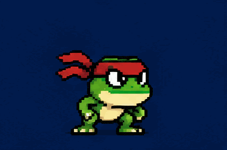

<sub>16 帧 · 380×252 · 1.9s · gpt-image-2.6 · 生成于 2026-11-12</sub>

**提示词**

```text
A pixel-art frog in a red ninja headband dashes forward and leaves a short speed trail, then poses. 16-bit platformer sprite, plain dark blue background.
```

`pixel` `game` `sprite`

### 50. 像素药水店

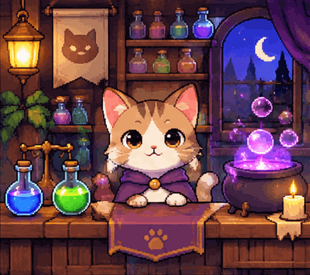

<sub>9 帧 · 437×387 · 1.6s · gpt-image-2.6 · 生成于 2026-11-12</sub>

**提示词**

```text
A pixel-art potion shop counter with bubbling colorful bottles and a shopkeeper cat blinking behind it. 16-bit RPG style, fixed camera.
```

`pixel` `game` `shop`

### 51. 像素雪夜小屋

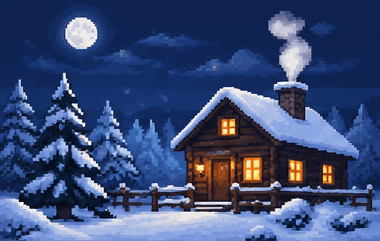

<sub>16 帧 · 380×241 · 2.9s · gpt-image-2.6 · 生成于 2026-11-12</sub>

**提示词**

```text
A pixel-art log cabin in a snowy forest, smoke rising from the chimney, windows glowing and snow falling. 16-bit style, fixed camera.
```

`pixel` `winter` `ambient`

### 52. 像素龙蛋孵化

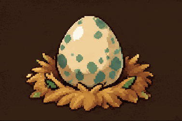

<sub>16 帧 · 377×250 · 2.6s · gpt-image-2.6 · 生成于 2026-11-11</sub>

**提示词**

```text
A speckled pixel-art dragon egg wobbles in a straw nest, cracks appear, and a tiny green baby dragon pokes its head out and blinks. 16-bit RPG style, plain dark brown background.
```

`pixel` `game` `dragon`

### 53. 日历翻页


<sub>16 帧 · 378×250 · 1.9s · gpt-image-2.6 · 生成于 2026-11-11</sub>

**提示词**

```text
A flat desk calendar icon with a red header; the top page curls up and flips over to reveal the next day, the date number sliding in. Flat UI icon style, plain light gray background.
```

`ui` `icon` `calendar`

### 54. 像素金币收集

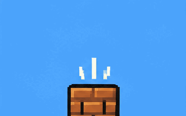

<sub>16 帧 · 375×233 · 1.8s · gpt-image-2.6 · 生成于 2026-11-11</sub>

**提示词**

```text
A spinning pixel-art gold coin pops up above a brick block, flips in the air, then vanishes in a small sparkle with a +1 floating up. 16-bit platformer style, plain sky blue background.
```

`pixel` `game` `coin`

### 55. 像素生命值爱心

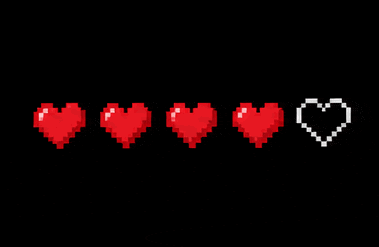

<sub>16 帧 · 379×247 · 1.9s · gpt-image-2.6 · 生成于 2026-11-11</sub>

**提示词**

```text
A row of five pixel-art red hearts as a game health bar; one empty heart refills with a sparkle while all hearts pulse gently. 8-bit style, plain black background.
```

`pixel` `game` `ui`

### 56. 开关切换

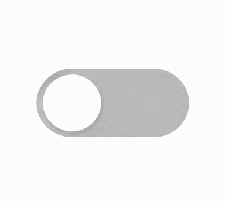

<sub>12 帧 · 384×343 · 1.7s · gpt-image-2.6 · 生成于 2026-11-11</sub>

**提示词**

```text
A large rounded toggle switch slides from gray off to bright green on, the knob gives a small squish, and a tiny check mark pops beside it. Flat UI style, plain white background.
```

`ui` `toggle` `micro-interaction`

### 57. 悬浮药水瓶

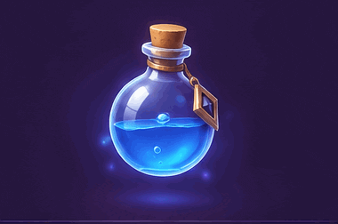

<sub>16 帧 · 380×252 · 2.2s · gpt-image-2.6 · 生成于 2026-11-11</sub>

**提示词**

```text
A round glass potion bottle with a cork stopper hovers and bobs gently; the glowing blue liquid sloshes inside and tiny bubbles rise and pop at the top. Stylized game item icon, soft glow, plain dark purple background.
```

`game` `item` `icon`

### 58. 角色属性卡

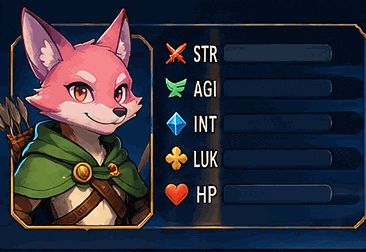

<sub>16 帧 · 366×252 · 2.9s · gpt-image-2.6 · 生成于 2026-11-11</sub>

**提示词**

```text
A fantasy RPG character stat card with a cartoon fox ranger portrait; five horizontal bars labeled STR, AGI, INT, LUK and HP fill up one by one with glowing colors and a small level-up star sparkles in the corner. Clean game UI style on dark navy.
```

`ui` `game` `stats`

### 59. 像素变色龙奔跑

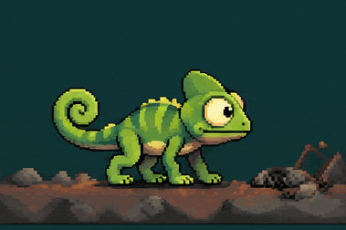

<sub>16 帧 · 379×252 · 1.8s · gpt-image-2.6 · 生成于 2026-11-11</sub>

**提示词**

```text
A side-view pixel-art run cycle of a small green chameleon with a curled tail and big swiveling eyes, running in place on a strip of rusty junkyard ground. 16-bit game sprite style, plain dark teal background.
```

`pixel` `sprite` `game`

### 60. 音乐均衡器跳动

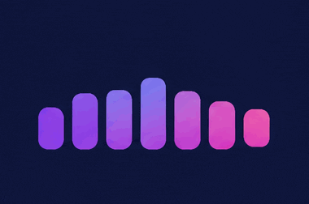

<sub>16 帧 · 380×252 · 1.6s · gpt-image-2.6 · 生成于 2026-11-10</sub>

**提示词**

```text
Seven rounded equalizer bars in a purple-to-pink gradient bounce up and down to an implied beat. Flat UI style, plain dark navy background.
```

`ui` `music` `audio`

### 61. 上传箭头飞进云朵


<sub>9 帧 · 438×388 · 1.3s · gpt-image-2.6 · 生成于 2026-11-10</sub>

**提示词**

```text
A white arrow rises from the bottom into a soft blue cloud icon, the cloud puffs up once, and a small progress ring around it completes. Flat UI style, plain white background.
```

`ui` `upload` `icon`

### 62. 放大镜扫描文档


<sub>16 帧 · 388×257 · 1.9s · gpt-image-2.6 · 生成于 2026-11-10</sub>

**提示词**

```text
A flat UI document icon with gray text lines; a magnifying glass sweeps across it and each line it passes turns highlighted blue. Clean vector style, plain white background.
```

`ui` `search` `icon`

### 63. 挂锁解锁变绿


<sub>9 帧 · 445×395 · 1.4s · gpt-image-2.6 · 生成于 2026-11-10</sub>

**提示词**

```text
A flat gray padlock icon wiggles, its shackle pops open, and the body turns green with a small check mark. Clean vector UI style, plain white background.
```

`ui` `icon` `security`

### 64. 发送按钮变纸飞机


<sub>9 帧 · 445×395 · 1.4s · gpt-image-2.6 · 生成于 2026-11-10</sub>

**提示词**

```text
A rounded blue Send button squeezes inward and folds into a white paper plane that flies off to the upper right, leaving a dotted trail. Flat UI animation, plain white background.
```

`ui` `button` `send`

### 65. 五星评分逐个点亮


<sub>9 帧 · 509×339 · 1.4s · gpt-image-2.6 · 生成于 2026-11-10</sub>

**提示词**

```text
Five outlined stars in a row fill with gold one after another, each popping slightly larger as it fills, with a tiny sparkle on the last. Flat UI style, plain white background.
```

`ui` `rating` `icon`

### 66. 纸团扔进垃圾桶


<sub>16 帧 · 378×250 · 1.8s · gpt-image-2.6 · 生成于 2026-11-10</sub>

**提示词**

```text
Flat UI animation: a sheet of paper crumples into a ball, arcs into a gray trash can icon, and the lid bounces shut. Clean vector style, plain white background.
```

`ui` `icon` `delete`

### 67. Wi-Fi 信号格逐个点亮


<sub>9 帧 · 439×388 · 1.6s · gpt-image-2.6 · 生成于 2026-11-10</sub>

**提示词**

```text
A flat UI Wi-Fi icon whose arcs light up one by one from the center dot outward in bright blue, then all glow together. Clean vector style, plain white background.
```

`ui` `icon` `signal`

### 68. 像素坩埚冒泡


<sub>16 帧 · 380×252 · 2.6s · gpt-image-2.6 · 生成于 2026-11-10</sub>

**提示词**

```text
A pixel art black cauldron over a small fire bubbles with green potion, bubbles popping and a puff of sparkly smoke rising. 16-bit item animation, plain dark background.
```

`pixel` `potion` `item`

### 69. 像素蘑菇跳舞


<sub>16 帧 · 378×248 · 1.9s · gpt-image-2.6 · 生成于 2026-11-10</sub>

**提示词**

```text
A pixel art mushroom character with a teal cap striped in orange and a stubby lavender stem bops side to side and does a little hop, its cap bouncing. 8-bit game sprite style, plain navy background.
```

`pixel` `dance` `sprite`

### 70. 像素猫头鹰法师施法


<sub>16 帧 · 380×252 · 2.2s · gpt-image-2.6 · 生成于 2026-11-10</sub>

**提示词**

```text
A pixel art owl in a starry purple wizard hat raises a wooden wand and releases a burst of sparkles. 16-bit sprite, side view, plain black background.
```

`pixel` `magic` `sprite`

### 71. 像素水桶头盔青蛙跳劈


<sub>9 帧 · 414×414 · 1.4s · gpt-image-2.6 · 生成于 2026-11-10</sub>

**提示词**

```text
A chunky orange pixel art frog wearing a dented tin bucket as a helmet and holding a wooden spoon leaps up and slams the spoon down, landing with a small dust puff. 16-bit game sprite, side view, plain dark background.
```

`pixel` `game` `sprite`

### 72. 像素字母跳动


<sub>16 帧 · 377×252 · 1.8s · gpt-image-2.6 · 生成于 2026-11-10</sub>

**提示词**

```text
Cream pixel-font letters spelling B-ROLL on a deep teal background hop up one by one from left to right and land back in place, while a coral cursor bar slides underneath. Spelling and spacing stay identical.
```

`pixel` `text` `title`

### 73. 像素巴士进站


<sub>16 帧 · 380×252 · 2.6s · gpt-image-2.6 · 生成于 2026-11-10</sub>

**提示词**

```text
Top-down pixel art street at morning rush hour: a yellow bus pulls into a stop while tiny commuters wait in line, swaying slightly. Fixed camera, fixed background, 16-bit palette.
```

`pixel` `city` `bus`

### 74. 下载箭头变成对勾


<sub>16 帧 · 379×255 · 2.2s · gpt-image-2.6 · 生成于 2026-11-09</sub>

**提示词**

```text
A flat UI animation: a blue down arrow drops into a rounded tray, the tray fills with a progress line, then the arrow morphs into a white check mark inside a green circle. Clean vector style, plain white background.
```

`ui` `icon` `download`

### 75. 电池充电图标


<sub>16 帧 · 380×252 · 1.9s · gpt-image-2.6 · 生成于 2026-11-09</sub>

**提示词**

```text
A flat rounded battery icon filling up segment by segment from red to green, a white lightning bolt pulsing in the middle, a small check mark appearing when full. Clean UI icon style, plain dark background.
```

`ui` `icon` `loading`

### 76. 通知铃铛摇晃


<sub>16 帧 · 376×245 · 1.6s · gpt-image-2.6 · 生成于 2026-11-09</sub>

**提示词**

```text
A flat rounded yellow notification bell icon swinging side to side as if ringing, a red badge with the number 3 popping onto its corner, small motion lines around it. Clean UI icon style, plain white background.
```

`ui` `icon` `notification`

### 77. 像素农田发芽


<sub>16 帧 · 380×252 · 2.9s · gpt-image-2.6 · 生成于 2026-11-09</sub>

**提示词**

```text
16-bit pixel art farm plot with three rows of soil: sprouts pop up, grow leaves and turn into ripe carrots and pumpkins, a small sparkle appearing over each. Retro farming game style, fixed camera.
```

`pixel` `farm` `game`

### 78. 雨夜像素小镇


<sub>16 帧 · 374×250 · 2.9s · gpt-image-2.6 · 生成于 2026-11-09</sub>

**提示词**

```text
Pixel art of a small town street at night in the rain, raindrops falling, warm windows flickering on, a neon noodle-shop sign buzzing and puddles rippling. Cozy retro game palette, fixed camera.
```

`pixel` `rain` `night`

### 79. 像素钓鱼上钩


<sub>16 帧 · 380×252 · 2.2s · gpt-image-2.6 · 生成于 2026-11-09</sub>

**提示词**

```text
16-bit pixel art of a kid in a straw hat on a wooden pier, the bobber dipping, the kid yanking the rod up and a shiny fish flipping out of the water with a little sparkle. Retro game palette, fixed camera.
```

`pixel` `game` `fishing`

### 80. 地球 Online：早高峰通勤


<sub>9 帧 · 439×379 · 1.6s · gpt-image-2.6 · 生成于 2026-11-09</sub>

**提示词**

```text
A 16-bit pixel art RPG scene of a tired office worker character walking to a bus stop, a game HUD on top: the stamina bar slowly draining, a "+10 EXP" popup rising, and a quest box saying "Survive the commute". Retro game UI, fixed camera.
```

> 💡 **技巧：** 把日常生活画成游戏界面（体力条、经验值、任务框）是很受欢迎的系列玩法。

`pixel` `rpg` `daily-life` `text`

### 81. 日夜模式切换开关


<sub>9 帧 · 435×386 · 1.1s · gpt-image-2.6 · 生成于 2026-11-08</sub>

**提示词**

```text
A rounded toggle switch sliding from a sunny yellow side with a sun icon to a dark navy side with a crescent moon and tiny stars. Flat UI style on a light grey background.
```

`ui` `toggle` `dark-mode`

### 82. 火箭进度条


<sub>16 帧 · 378×272 · 1.6s · gpt-image-2.6 · 生成于 2026-11-08</sub>

**提示词**

```text
A flat UI progress bar filling from left to right as a tiny cartoon rocket flies along its leading edge, leaving a sparkly trail. Clean vector style, purple and white.
```

`ui` `loader` `rocket`

### 83. 像素宝箱开启


<sub>16 帧 · 378×252 · 1.9s · gpt-image-2.6 · 生成于 2026-11-08</sub>

**提示词**

```text
16-bit pixel art treasure chest: the lid flips open, gold coins and a gem burst upward with sparkles, then settle back inside. Retro RPG style on a dark dungeon floor.
```

`pixel` `game` `reward`

### 84. 宝石合成游戏广告


<sub>9 帧 · 439×390 · 1.6s · gpt-image-2.6 · 生成于 2026-11-08</sub>

**提示词**

```text
A mobile puzzle game ad shot: two identical glowing blue gems slide together on a grid board and merge into one bigger gem with a burst of sparkles and a floating "+100". Bright casual-game style.
```

`game` `ad` `mobile`

### 85. 像素提灯驱鬼


<sub>12 帧 · 356×351 · 1.7s · gpt-image-2.6 · 生成于 2026-11-08</sub>

**提示词**

```text
16-bit pixel art of a kid in a hooded green cloak raising a glowing lantern in a moonlit graveyard, and three small round cartoon ghosts flee off to the right. Side view, retro game style.
```

`pixel` `game` `halloween`

### 86. 向下滑动提示箭头


<sub>9 帧 · 438×389 · 1.1s · gpt-image-2.6 · 生成于 2026-11-08</sub>

**提示词**

```text
A minimalist rounded chevron arrow pointing down, bouncing gently up and down with a soft shadow that shrinks and grows beneath it. Flat UI style, indigo on white.
```

`ui` `arrow` `minimal`

### 87. 像素咖啡杯


<sub>16 帧 · 379×247 · 2.2s · gpt-image-2.6 · 生成于 2026-11-08</sub>

**提示词**

```text
A pixel-art coffee cup on a saucer with three wisps of steam rising and curling in a loop. 16-bit style, warm brown palette, plain cream background.
```

`pixel` `coffee` `icon`

### 88. 8 位像素外星人蹦迪


<sub>16 帧 · 377×245 · 1.9s · gpt-image-2.6 · 生成于 2026-11-08</sub>

**提示词**

```text
8-bit pixel art of a little green alien wearing antenna headphones, jumping and pumping its fist on a tiny dance floor while colored strobe lights flash. Retro game palette, black background.
```

`pixel` `dance` `retro`

### 89. 徒手深蹲示范


<sub>9 帧 · 439×389 · 1.3s · gpt-image-2.6 · 生成于 2026-11-08</sub>

**提示词**

```text
A clean flat infographic of a faceless fitness figure in a teal tank top doing a bodyweight squat in side view: sitting the hips back with arms stretched forward, then standing tall. Light grey background with a dotted guideline at knee height.
```

`fitness` `infographic` `tutorial`

### 90. 16 位格斗角色出拳


<sub>9 帧 · 439×390 · 1.3s · gpt-image-2.6 · 生成于 2026-11-07</sub>

**提示词**

```text
A 16-bit arcade fighter, a stocky red panda in a blue gi, throwing a jab and a straight punch from a fighting stance with hit sparks. Side view sprite on a dojo background.
```

`pixel-art` `fighting` `sprite`

### 91. AI 助手正在输入


<sub>12 帧 · 356×356 · 1.7s · gpt-image-2.6 · 生成于 2026-11-07</sub>

**提示词**

```text
A chat interface where a small rounded robot avatar sits beside a grey bubble with three dots pulsing one after another, the avatar's eyes blinking. Clean modern UI style on white.
```

`ui` `chat` `loader`

### 92. 弹跳球挤压拉伸


<sub>16 帧 · 379×243 · 1.9s · gpt-image-2.6 · 生成于 2026-11-07</sub>

**提示词**

```text
A red rubber ball bouncing on a flat floor with classic squash and stretch, a soft shadow growing and shrinking underneath. Clean flat animation on a plain white background.
```

`animation-basics` `ball` `loop`

### 93. 掌机风城堡横版关卡


<sub>12 帧 · 380×336 · 1.4s · gpt-image-2.6 · 生成于 2026-11-07</sub>

**提示词**

```text
A 32-bit handheld-style side-scrolling level: a small round armadillo knight in shiny orange armor with a feathered helmet running and jumping across castle battlements while the background parallax scrolls. Pixel art.
```

`pixel-art` `platformer` `game`

### 94. 像素勇者挥剑


<sub>12 帧 · 358×358 · 1.3s · gpt-image-2.6 · 生成于 2026-11-07</sub>

**提示词**

```text
A pixel art hero with spiky red hair swinging a sword in a wide arc, leaving a bright white slash trail. Side view game sprite on a plain dark background, crisp pixels.
```

`pixel-art` `sprite` `attack`

### 95. 废品场机器人行走


<sub>16 帧 · 380×252 · 1.9s · gpt-image-2.6 · 生成于 2026-11-06</sub>

**提示词**

```text
A rusty little scrap-metal robot with one antenna and a mismatched arm walking to the right in a side-view walk cycle, bolts jiggling, a puff of dust at each step. Pixel art game sprite on a plain dark background, crisp pixels.
```

`pixel-art` `sprite` `game`

### 96. 爱心爆发技能动画


<sub>16 帧 · 369×239 · 1.9s · gpt-image-2.6 · 生成于 2026-11-06</sub>

**提示词**

```text
A chibi magical girl with a pink bob raises her wand and casts a "love burst" skill: a ring of glowing pink hearts explodes outward from her and fades, then she returns to her idle pose. Game skill-card style animation, sparkly effects, dark purple background.
```

`game` `skill` `effects`

### 97. 8-bit 史莱姆 Boss 战


<sub>16 帧 · 375×240 · 2.2s · gpt-image-2.6 · 生成于 2026-11-06</sub>

**提示词**

```text
An 8-bit boss battle: a giant green slime boss with a tiny crown bounces and squishes in the center of a dungeon arena, its health bar at the top flashing, while a small pixel hero on the left raises a shield. Retro NES pixel art, dark stone background.
```

`pixel-art` `game` `boss`

### 98. 街机对战 VS 画面


<sub>16 帧 · 376×251 · 2.2s · gpt-image-2.6 · 生成于 2026-11-06</sub>

**提示词**

```text
A retro arcade versus screen: on the left a chubby panda wrestler in a yellow cape, on the right a lanky girl skateboarder with a green ponytail and a hoodie, both slide in from the edges, a huge "VS" slams into the center with lightning flashes, then both strike a pose. 16-bit pixel art, bold colors.
```

> 💡 **技巧：** 用一眼就是原创的角色（动物、少见的服装）。写“头戴发带的武术家”这类泛称，容易画成知名格斗游戏主角。

`pixel-art` `game` `versus`

### 99. 沙漏加载


<sub>16 帧 · 379×252 · 2.2s · gpt-image-2.6 · 生成于 2026-11-06</sub>

**提示词**

```text
A simple flat hourglass icon with sand pouring from the top to the bottom, then the hourglass flips over and starts again. Minimal vector style, teal frame and golden sand on a plain off-white background.
```

`ui` `loader` `icon`

### 100. 点赞爱心爆开


<sub>16 帧 · 379×246 · 1.8s · gpt-image-2.6 · 生成于 2026-11-06</sub>

**提示词**

```text
A rounded outline heart icon that fills with red, pops bigger with a bounce and bursts into small colorful confetti dots around it, then settles back. Flat vector UI animation on a plain white background.
```

`ui` `icon` `micro-interaction`

### 101. 像素骑士跑步循环


<sub>8 帧 · 380×508 · 1.0s · gpt-image-2.6 · 生成于 2026-11-06</sub>

**提示词**

```text
A pixel art knight with a blue cape and a small sword running to the right in a side view run cycle, cape flapping, on a plain dark background. 16-bit retro game sprite style, crisp pixels.
```

> 💡 **技巧：** 写明 “side view” 和 “run cycle”，就能得到游戏精灵图那样的动画。

`pixel-art` `sprite` `game`

### 102. 弹跳圆点加载动画


<sub>16 帧 · 385×266 · 1.4s · gpt-image-2.6 · 生成于 2026-11-06</sub>

**提示词**

```text
A minimal loading animation: three rounded dots in coral, violet and teal bouncing up and down one after another in a wave, with soft squash on landing. Flat vector style on a plain off-white background.
```

> 💡 **技巧：** 界面加载动画元素越少越好，背景保持纯色。

`ui` `loader` `minimal`

### 103. 像素风篝火


<sub>16 帧 · 378×240 · 1.9s · gpt-image-2.6 · 生成于 2026-11-06</sub>

**提示词**

```text
A pixel art campfire at night in a small forest clearing, flames flickering, sparks rising and fading, two logs glowing orange. 16-bit retro game style, dark blue night sky with a few stars.
```

`pixel-art` `loop` `game`

[← README](../README_zh.md)
