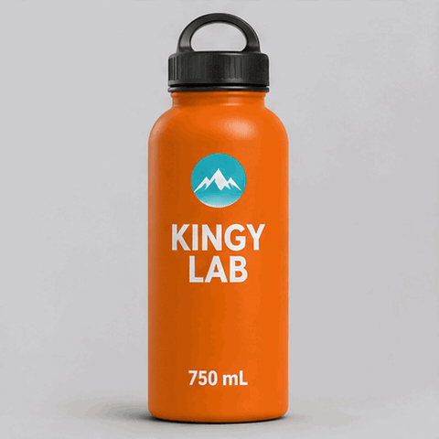
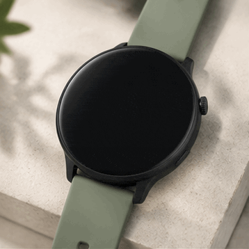
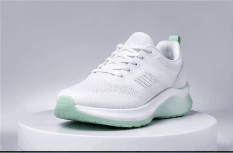

# 电商与产品展示 · 3 条提示词

[← README](../README_zh.md)

### 1. 左右摇摆的水杯产品动图



<sub>10 帧 · 480×480 · 2.0s · gpt-image-2.6-gif</sub>

📌 **来源：** [Curtis Pyke on Kingy AI](https://kingy.ai/blog/chatgpt-gifs-images-2-6-vs-2-5-hands-on-test/)

**提示词**

```text
Generate an actual animated GIF file, not a still picture, sprite sheet, video, or Python-coded animation. Square 512 by 512 pixels, a seamless 2-second loop. A bright orange reusable water bottle with a charcoal screw cap and a small turquoise circular badge remains centered on a pale gray studio background. The bottle rocks gently left and right and returns to its starting pose; the camera and background stay fixed. The bottle reads exactly "KINGY LAB" and "750 mL" throughout. No other text or objects. Use ChatGPT's native GIF generation and provide the downloadable GIF. If native GIF generation is unavailable, state that limitation rather than simulating it with code.
```

`product` `bottle` `api`

### 2. 智能手表亮屏



<sub>12 帧 · 358×358 · 2.2s · gpt-image-2.6 · 生成于 2026-11-18</sub>

**提示词**

```text
A round matte black smartwatch with a sage green strap lies on a light stone surface; its screen wakes up with a soft glow, the clock hands sweep into place, then the screen dims again. Minimal studio product shot, no text, no logos.
```

`smartwatch` `wearable` `product shot`

### 3. 转台上旋转的运动鞋



<sub>16 帧 · 380×250 · 1.9s · gpt-image-2.6 · 生成于 2026-11-18</sub>

**提示词**

```text
A clean white running sneaker with a mint green sole slowly rotates on a round white turntable, a soft highlight sliding across the toe. Studio product shot, pale grey seamless background, no text.
```

`sneaker` `turntable` `ecommerce`

[← README](../README_zh.md)
