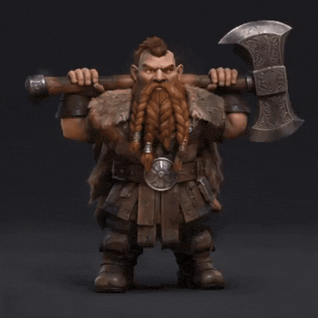

# 电商与产品展示 · 11 条提示词

[← README](../README_zh.md)

### 1. 降噪耳机：喧嚣街头瞬间变白棚


<sub>9 帧 · 358×478 · 2.0s · GPT Image 2.6</sub>

📌 **来源：** [@TanShilong on X](https://x.com/TanShilong/status/2119452466161008908)

**提示词**

```text
生成一个竖版Gif图，使用创意手法体现一个降噪耳机的降噪效果，主体是一个现实风格，苹果摄影风格的一个喧嚣的街头，特写集中在一个欧洲人的面部，侧脸。人物带上耳机之后，瞬间街道内容直接变成纯白色的摄影棚
```

`product` `headphones` `ad` `transformation`

### 2. 石中剑360度旋转


<sub>12 帧 · 358×346 · 1.6s · GPT Image 2.6</sub>

📌 **来源：** [@xikhar on X](https://x.com/xikhar/status/2118407355859878352)

**提示词**

```text
create a gif of a "3d legendary sword in a stone game asset" spinning full 360 degrees
```

`3d` `game-asset` `turntable` `sword`

### 3. 未来摩托车360度展示


<sub>12 帧 · 358×356 · 1.3s · GPT Image 2.6</sub>

📌 **来源：** [@xikhar on X](https://x.com/xikhar/status/2118407355859878352)

**提示词**

```text
create a gif of a "AAA 3d futuristic motorbike game asset" spinning full 360 degrees
```

`3d` `game-asset` `turntable` `motorbike`

### 4. 3D矮人模型360度旋转



<sub>12 帧 · 358×358 · 1.4s · GPT Image 2.6</sub>

📌 **来源：** [@xikhar on X](https://x.com/xikhar/status/2118407355859878352)

**提示词**

```text
create a gif of a "3d dwarf game model carrying a huge axe on his shoulders" spinning full 360 degrees
```

`3d` `game-asset` `turntable` `dwarf`

### 5. 浴室翻新广告横幅热气升腾


<sub>6 帧 · 480×240 · 1.8s · GPT Image 2.6</sub>

📌 **来源：** [末松 光太郎 on WizTry Blog](https://wiztrydx.com/blog/chatgpt-images-2-6-kaisetsu/)

**提示词**

```text
ホームページのトップに置く、横長の広告バナーのループGIFを作って。写真のようにリアルな、木の窓がある明るいお風呂。湯船の湯気だけがゆっくり上がる。左側に大きく「冬のお風呂リフォーム応援キャンペーン」、その下に「手すりの取り付け無料」と「11月20日〜12月25日」。文字は動かさないで。
```

`banner` `ad` `japanese`

### 6. 耳机充电盒开合展示


<sub>12 帧 · 358×358 · 1.9s · GPT Image 2.6</sub>

📌 **来源：** [蘇柔瑋 on 數位時代 BusinessNext](https://www.bnext.com.tw/article/92943/chatgpt-gif-generator-prompts)

**提示词**

```text
請製作一張 1:1 的高質感產品展示 GIF。畫面中央是一個【極簡白色無線耳機充電盒】，放置於淡灰色攝影棚背景。動畫從盒蓋關閉開始，接著盒蓋慢慢打開，展示內部耳機，最後緩緩關閉。商品外觀、比例、材質與顏色必須保持一致，鏡頭固定，使用柔和商業攝影光線，製作平滑循環動畫，不要加入文字。
```

`product` `tech` `ecommerce`

### 7. 耳机充电盒指示灯呼吸


<sub>9 帧 · 480×270 · 1.6s · GPT Image 2.6</sub>

📌 **来源：** [Fuxuan Guo on ChatCut Blog](https://chatcut.io/blog/chatgpt-gif)

**提示词**

```text
Locked macro studio product shot on a dark brushed-aluminum desk. A matte smoke-gray wireless earbuds charging case sits open with both earbuds resting inside, completely motionless. Only the tiny round emerald-green status LED on the front lip of the case pulses smoothly from dim to bright green with a soft tiny halo and fades back to dim on the final frame for a clean loop. Keep the case, earbuds, and reflections completely still, no text.
```

`product` `tech` `macro`

### 8. 咖啡豆袋主图＋浓缩咖啡热气


<sub>9 帧 · 480×606 · 1.8s · GPT Image 2.6</sub>

📌 **来源：** [Fuxuan Guo on ChatCut Blog](https://chatcut.io/blog/chatgpt-gif)

**提示词**

```text
Locked tripod commercial product shot in soft morning studio light. A matte terracotta kraft coffee bag with a clean cream front label reading "MORNING ROAST" in sharp dark-brown sans-serif type stands completely motionless beside a speckled stoneware espresso cup on a travertine counter. Only a thin ribbon of warm white steam curls gently upward from the cup and settles back to the exact starting wisp on the final frame for a clean loop. Keep the coffee bag, label text, and cup completely still across every frame.
```

`product` `coffee` `steam`

### 9. 左右摇摆的水杯产品动图


<sub>10 帧 · 480×480 · 2.0s · gpt-image-2.6-gif</sub>

📌 **来源：** [Curtis Pyke on Kingy AI](https://kingy.ai/blog/chatgpt-gifs-images-2-6-vs-2-5-hands-on-test/)

**提示词**

```text
Generate an actual animated GIF file, not a still picture, sprite sheet, video, or Python-coded animation. Square 512 by 512 pixels, a seamless 2-second loop. A bright orange reusable water bottle with a charcoal screw cap and a small turquoise circular badge remains centered on a pale gray studio background. The bottle rocks gently left and right and returns to its starting pose; the camera and background stay fixed. The bottle reads exactly "KINGY LAB" and "750 mL" throughout. No other text or objects. Use ChatGPT's native GIF generation and provide the downloadable GIF. If native GIF generation is unavailable, state that limitation rather than simulating it with code.
```

`product` `bottle` `api`

### 10. 智能手表亮屏


<sub>12 帧 · 358×358 · 2.2s · gpt-image-2.6 · 生成于 2026-11-18</sub>

**提示词**

```text
A round matte black smartwatch with a sage green strap lies on a light stone surface; its screen wakes up with a soft glow, the clock hands sweep into place, then the screen dims again. Minimal studio product shot, no text, no logos.
```

`smartwatch` `wearable` `product shot`

### 11. 转台上旋转的运动鞋


<sub>16 帧 · 380×250 · 1.9s · gpt-image-2.6 · 生成于 2026-11-18</sub>

**提示词**

```text
A clean white running sneaker with a mint green sole slowly rotates on a round white turntable, a soft highlight sliding across the toe. Studio product shot, pale grey seamless background, no text.
```

`sneaker` `turntable` `ecommerce`

[← README](../README_zh.md)
