# Stickers & Reactions · 203 prompts

[← README](../README.md)

### 1. Round blue robot mascot waves hello

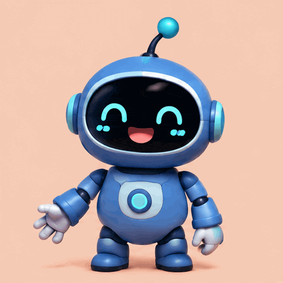

<sub>6 frames · 480×480 · 0.9s · GPT Image 2.6</sub>

📌 **Source:** [@super_lewis on DEV Community](https://dev.to/super_lewis/animated-gifs-and-markup-guided-edits-with-the-gpt-image-26-api-real-timings-and-per-call-cost-2jmd)

**Prompt**

```text
A round blue robot mascot waves hello. Seamless loop, same framing in every frame.
```

`mascot` `robot` `api`

### 2. Pink heart heartbeat pulse

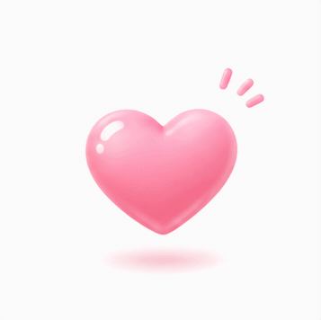

<sub>12 frames · 357×356 · 1.7s · GPT Image 2.6</sub>

📌 **Source:** [牧牧的成長實驗室 on 方格子 vocus](https://vocus.cc/article/6aebf9a0fd8978000170526d)

**Prompt**

```text
製作一張粉紅色愛心 GIF。愛心在畫面中央輕輕放大，再縮回原本大小，呈現柔和的心跳節奏。背景簡潔、固定視角，畫面乾淨，無縫循環，不要文字。
```

`heart` `social` `flat`

### 3. Silver-haired boy in green cloak hops

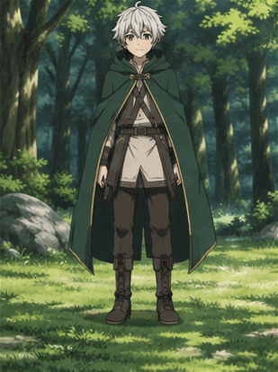

<sub>12 frames · 309×414 · 1.7s · GPT Image 2.6</sub>

📌 **Source:** [牧牧的成長實驗室 on 方格子 vocus](https://vocus.cc/article/6aebf9a0fd8978000170526d)

**Prompt**

```text
製作一張日系動畫風格 GIF。一名銀白色短髮少年穿著深綠色斗篷，站在森林空地上，輕輕跳起一次，然後回到站立姿勢。保持角色五官、衣服與背景一致，固定鏡頭，動作自然、無縫循環。
```

`anime` `character` `jump`

### 4. 3D bunny in overalls waves

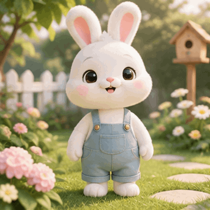

<sub>12 frames · 358×358 · 2.2s · GPT Image 2.6</sub>

📌 **Source:** [牧牧的成長實驗室 on 方格子 vocus](https://vocus.cc/article/6aebf9a0fd8978000170526d)

**Prompt**

```text
製作一張可愛 3D 小白兔 GIF。小白兔穿著淺藍色吊帶褲，站在花園裡，慢慢舉起右手揮手打招呼，然後自然放下。背景固定，柔和晨光，可愛 3D 動畫風格，動作連貫，無縫循環，不要字幕。
```

`bunny` `3d` `greeting`

### 5. Clay orange cat in plaid shirt typing

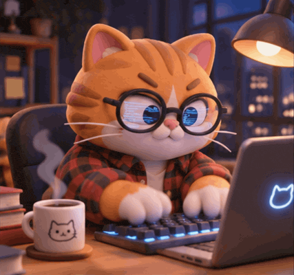

<sub>9 frames · 427×400 · 1.0s · GPT Image 2.6</sub>

📌 **Source:** [STRUGGLE_xlf on CSDN](https://tianqi.csdn.net/6aebfbae40858c2d8818a1fd.html)

**Prompt**

```text
帮我生成一个无缝循环的 GIF 动图：一只穿格子衫的橘猫坐在电脑前疯狂敲键盘，屏幕反光映在脸上，旁边放着一杯冒热气的咖啡。3D 黏土动画风格，要求动作自然连贯，首尾帧无缝循环。
```

`cat` `3d-clay` `programmer`

### 6. Chibi office worker sees the notification

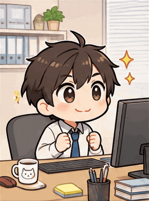

<sub>12 frames · 308×414 · 2.0s · GPT Image 2.6</sub>

📌 **Source:** [蘇柔瑋 on 數位時代 BusinessNext](https://www.bnext.com.tw/article/92943/chatgpt-gif-generator-prompts)

**Prompt**

```text
請製作一張幽默的 GIF 動畫。一名 Q 版上班族坐在電腦前，先露出充滿期待的表情，接著看到螢幕上的工作通知，眼睛瞬間睜大，最後無奈地趴在桌上。使用可愛的日系 2D 插畫風格，背景為簡約辦公室，角色服裝與桌面物品保持一致。鏡頭固定，動作誇張但自然，動畫可以無縫循環，不要加入文字。
```

`office` `reaction` `chibi`

### 7. 3D clay orange cat waves and blinks

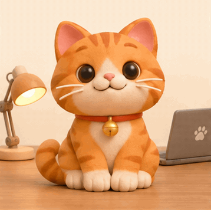

<sub>12 frames · 358×356 · 1.7s · GPT Image 2.6</sub>

📌 **Source:** [蘇柔瑋 on 數位時代 BusinessNext](https://www.bnext.com.tw/article/92943/chatgpt-gif-generator-prompts)

**Prompt**

```text
請製作一張正方形 1:1 GIF 動畫。一隻可愛的橘貓坐在奶油白色背景前，慢慢抬起前腳揮手，接著眨眼，最後回到原本姿勢。採用精緻的 3D 黏土插畫風格，毛髮柔軟、表情可愛。鏡頭固定，保持角色外觀一致，製作自然流暢的無縫循環動畫，不要加入文字。
```

`cat` `3d-clay` `sticker`

### 8. Cassette "SIDE A" sticker with notes

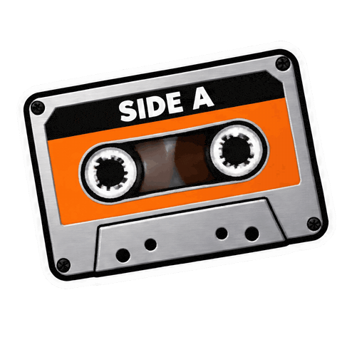

<sub>14 frames · 480×480 · 1.2s · GPT Image 2.6</sub>

📌 **Source:** [Fuxuan Guo on ChatCut Blog](https://chatcut.io/blog/gpt-image-2-6)

**Prompt**

```text
Locked front-on 1:1 animated die-cut vinyl sticker on a fully transparent background with a crisp thick white kiss-cut border. A tilted brushed-silver and signal-orange compact cassette tape labeled 'SIDE A' in clean white sans-serif type. Across 8 frames, both white inner tape reel gears rotate smoothly while two bold electric-cobalt musical notes pop playfully out of the top-right corner on frames 2 to 5 and fade cleanly away by frame 8 so frame 8 matches frame 1's clean silhouette for a seamless loop.
```

`sticker` `retro` `music`

### 9. Raccoon meme: the 5-minute fix broke prod

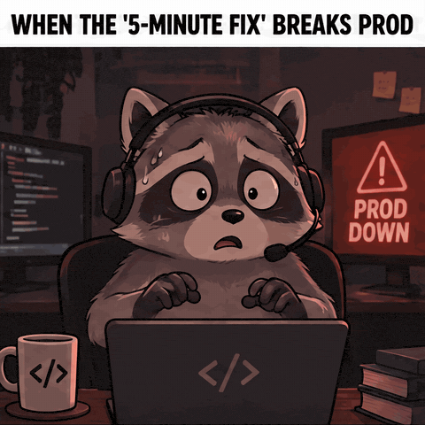

<sub>8 frames · 480×480 · 1.4s · GPT Image 2.6</sub>

📌 **Source:** [Fuxuan Guo on ChatCut Blog](https://chatcut.io/blog/chatgpt-gif)

**Prompt**

```text
Square internet reaction meme GIF with a solid white top caption bar reading "WHEN THE '5-MINUTE FIX' BREAKS PROD" in bold black sans-serif all-caps letters. Below the caption bar, locked front-on comic illustration of a wide-eyed gray raccoon wearing a black headset sitting at a dark desk behind an open laptop. Warm red-orange monitor light pulses across the raccoon's face as its paws hover tensely over the keyboard and its ears flatten slightly, then return to the exact starting pose on the final frame for a clean loop. Keep the white top bar and every letter of "WHEN THE '5-MINUTE FIX' BREAKS PROD" completely crisp and motionless across all frames.
```

`meme` `caption` `developer`

### 10. "SHIP IT!" badge sticker wiggle

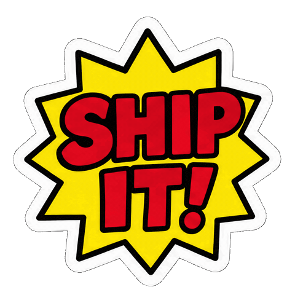

<sub>14 frames · 480×480 · 1.3s · GPT Image 2.6</sub>

📌 **Source:** [Fuxuan Guo on ChatCut Blog](https://chatcut.io/blog/chatgpt-gif)

**Prompt**

```text
Bold street-art die-cut sticker badge with a thick white cutout border on a completely transparent background, locked front-on camera. Chunky crimson block letters reading "SHIP IT!" sit centered inside a bright yellow starburst badge. The badge tilts slightly left and right with tiny black comic wiggle lines around the border, then returns to the exact starting angle on the final frame for a clean loop. Crisp flat ink colors, exact spelling.
```

`sticker` `text` `transparent`

### 11. Die-cut clay star hop

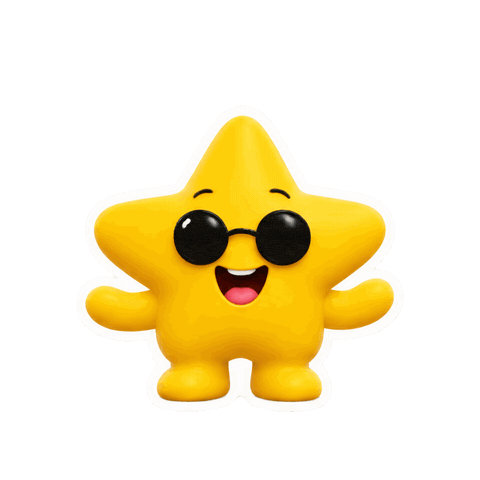

<sub>14 frames · 480×480 · 1.2s · GPT Image 2.6</sub>

📌 **Source:** [Fuxuan Guo on ChatCut Blog](https://chatcut.io/blog/chatgpt-gif)

**Prompt**

```text
Glossy 3D clay-style die-cut sticker with a thick white sticker border on a completely transparent background, locked front-on camera. A cheerful yellow five-pointed star character wearing tiny round black sunglasses does a happy little hop and lands softly back in its exact starting stance on the final frame for a clean loop. Crisp cutout edge, flat vibrant colors, no text.
```

`sticker` `transparent` `3d-clay`

### 12. Glasses frog typing fast

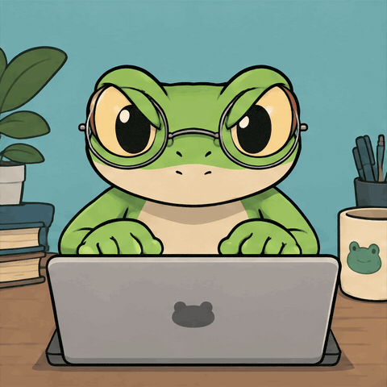

<sub>8 frames · 480×480 · 0.9s · GPT Image 2.6</sub>

📌 **Source:** [Fuxuan Guo on ChatCut Blog](https://chatcut.io/blog/chatgpt-gif)

**Prompt**

```text
Flat cel-shaded comic reaction illustration, locked front-on camera. A determined little green tree frog wearing round wire-rim glasses sits behind a silver laptop at a desk, rapidly tapping alternate webbed hands on the keyboard with tiny white motion arcs above its fingers while its glasses glint once, returning to the exact starting hand position on the final frame for a clean loop. Solid warm cream-teal background, bold outlines, no text.
```

`reaction` `frog` `work`

### 13. Cat coder runs out of Codex quota

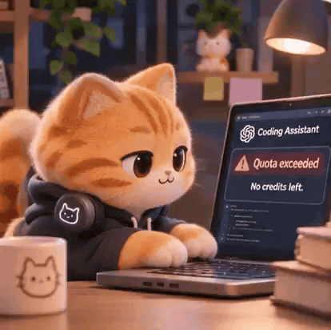

<sub>9 frames · 414×412 · 1.6s · gpt-image-2.6-gif</sub>

📌 **Source:** [@DawienZZ on X](https://x.com/DawienZZ/status/2120785093661012027)

**Prompt**

```text
生成一个循环 GIF：一只橘猫趴在电脑前敲键盘，codex提示没额度了，表情从平静变成崩溃，最后无奈地趴在键盘上。Q版3D风格，9帧，循环播放
```

`cat` `coding` `meme`

### 14. "This is fine" dog sipping tea

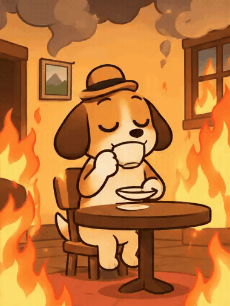

<sub>16 frames · 380×506 · 2.9s · gpt-image-2.6-gif</sub>

📌 **Source:** [@shitunote on X](https://x.com/shitunote/status/2118187063241777311)

**Prompt**

```text
做一个循环 GIF，一只戴着小帽子的卡通狗坐在着火的房间里，先是平静地喝茶，然后慢慢意识到不对劲，表情逐渐从“没事”变成“其实有事”，最后又假装没事继续喝茶。风格偏扁平插画，表情夸张，背景火焰轻微闪动，6-8帧，无缝循环。
```

`dog` `meme` `fire`

### 15. Penguin knitting a scarf

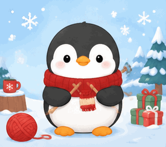

<sub>16 frames · 328×290 · 2.2s · gpt-image-2.6 · generated 2026-11-17</sub>

**Prompt**

```text
A round penguin sits clicking two knitting needles, a striped red scarf growing longer from its flippers. Cute flat cartoon, snowy light blue background.
```

`penguin` `knitting` `winter`

### 16. Bunny slurps noodles


<sub>16 frames · 309×309 · 2.2s · gpt-image-2.6 · generated 2026-11-17</sub>

**Prompt**

```text
A white bunny with chopsticks slurps a long noodle from a bowl, cheeks puffing, the noodle wiggling up into its mouth. Cute flat sticker style, thick outline, pale orange background.
```

`bunny` `noodles` `food`

### 17. Octopus ink oops

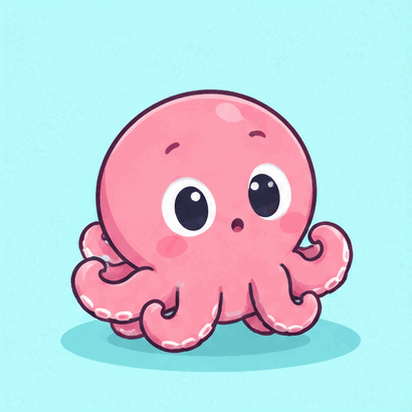

<sub>9 frames · 412×412 · 1.6s · gpt-image-2.6 · generated 2026-11-17</sub>

**Prompt**

```text
A small pink octopus gets startled and puffs out a cloud of ink, then peeks out of the cloud with an embarrassed grin. Cute flat cartoon, light aqua background.
```

`octopus` `oops` `funny`

### 18. Hippo big yawn

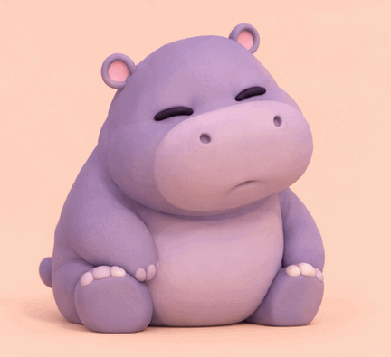

<sub>9 frames · 432×395 · 1.6s · gpt-image-2.6 · generated 2026-11-17</sub>

**Prompt**

```text
A sleepy round lavender hippo opens its mouth in an enormous yawn, eyes squeezed shut, then closes it with a satisfied smack. Soft clay-like 3D style, pale peach background.
```

`hippo` `yawn` `sleepy`

### 19. Shiba running late

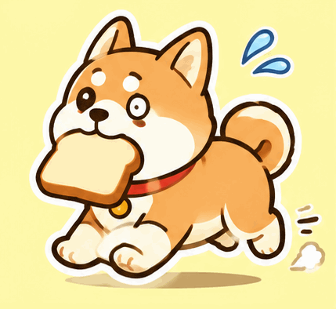

<sub>8 frames · 429×394 · 1.0s · gpt-image-2.6 · generated 2026-11-17</sub>

**Prompt**

```text
A shiba inu with a slice of toast in its mouth runs in place in a panic, ears flapping, a sweat drop flying off. Funny flat sticker style, thick white outline, light yellow background.
```

`shiba` `late` `sticker`

### 20. Baby elephant trunk shower

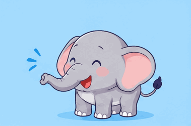

<sub>16 frames · 379×251 · 2.2s · gpt-image-2.6 · generated 2026-11-17</sub>

**Prompt**

```text
A chubby baby elephant lifts its trunk and sprays a happy fountain of water over its own head, droplets sparkling. Cute flat cartoon, light blue background, fixed camera.
```

`elephant` `water` `cute`

### 21. Doodle eye roll

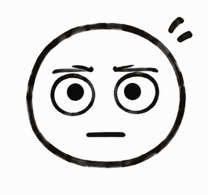

<sub>9 frames · 425×399 · 1.6s · gpt-image-2.6 · generated 2026-11-17</sub>

**Prompt**

```text
A round hand-drawn doodle face with marker lines rolls its eyes up in exaggerated annoyance, then looks back forward with a flat mouth. White paper background, wobbly ink lines.
```

`doodle` `eye-roll` `reaction`

### 22. Notebook stick figure dances

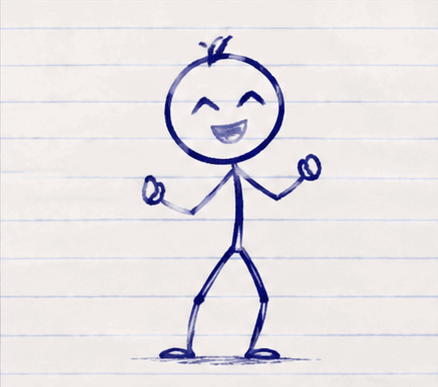

<sub>9 frames · 438×387 · 1.3s · gpt-image-2.6 · generated 2026-11-17</sub>

**Prompt**

```text
A hand-drawn ballpoint stick figure on lined notebook paper does a goofy hip-shaking dance with arms waving, slight line boil like a flipbook. Paper texture, fixed overhead camera.
```

`doodle` `dance` `sketch`

### 23. Fox steps up and waves

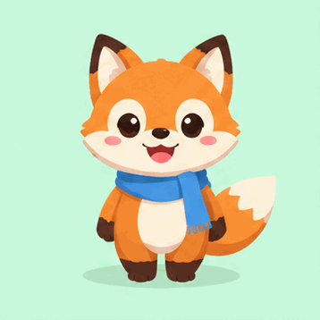

<sub>12 frames · 358×358 · 1.9s · gpt-image-2.6 · generated 2026-11-17</sub>

**Prompt**

```text
An orange fox in a little blue scarf takes two small steps toward the viewer, waves one paw, then steps back to where it started. Flat vector cartoon, pale mint background, fixed camera.
```

> 💡 **Tip:** Describe the start pose, the action and the return to start; it keeps the first and last frames matched.

`fox` `wave` `greeting`

### 24. Red panda blinks and smiles

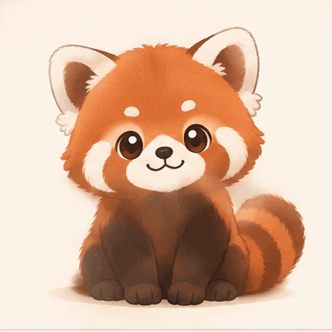

<sub>9 frames · 414×414 · 1.6s · gpt-image-2.6 · generated 2026-11-17</sub>

**Prompt**

```text
A fluffy red panda mascot closes its eyes, opens them again with a small happy smile, ears twitching once. Soft flat illustration, cream background, fixed camera.
```

`red-panda` `blink` `cute`

### 25. Mint robot waves hello

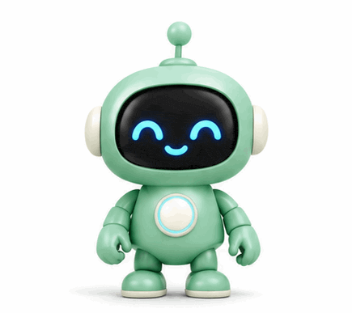

<sub>9 frames · 435×387 · 1.4s · gpt-image-2.6 · generated 2026-11-17</sub>

**Prompt**

```text
A small mint-green robot with a round screen face and a blinking antenna raises one hand, gives one wave, and lowers it back to rest. Simple rounded 3D illustration, clean white background, fixed camera.
```

`robot` `wave` `hello`

### 26. Kitten fixes a cracked screen

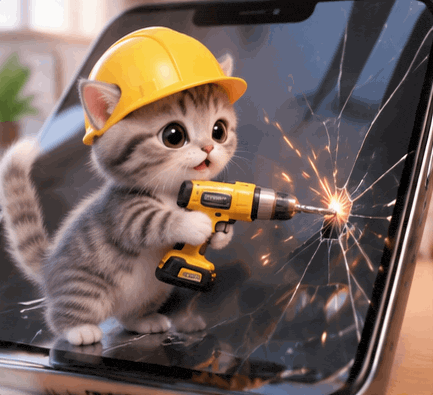

<sub>9 frames · 433×395 · 1.4s · gpt-image-2.6 · generated 2026-11-17</sub>

**Prompt**

```text
A tiny gray kitten in a yellow hard hat stands inside a cracked phone screen and works a toy power drill against the crack, sparks flying, the crack shrinking a little. Cute 3D cartoon, phone fills the frame, fixed camera.
```

`kitten` `phone` `repair`

### 27. Penguin pirouette

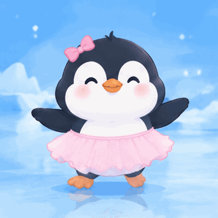

<sub>12 frames · 357×357 · 1.7s · gpt-image-2.6 · generated 2026-11-17</sub>

**Prompt**

```text
A chubby penguin in a tiny tutu does one wobbly spin on ice and ends with a proud flipper pose. Cute flat sticker, icy blue background.
```

`penguin` `dance` `sticker`

### 28. Cat peeks from box

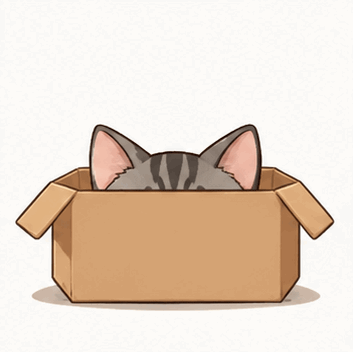

<sub>12 frames · 353×352 · 2.2s · gpt-image-2.6 · generated 2026-11-17</sub>

**Prompt**

```text
A gray tabby slowly rises out of a cardboard box until its eyes clear the edge, blinks once, then sinks back down. Simple cartoon, warm white background.
```

`cat` `box` `peek`

### 29. Goat yells

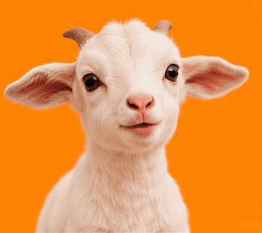

<sub>9 frames · 439×390 · 1.3s · gpt-image-2.6 · generated 2026-11-17</sub>

**Prompt**

```text
A small white goat opens its mouth wide in a dramatic yell, ears flapping and motion lines bursting out. Funny meme sticker, bright orange background.
```

`goat` `shock` `meme`

### 30. Bee bonks a flower

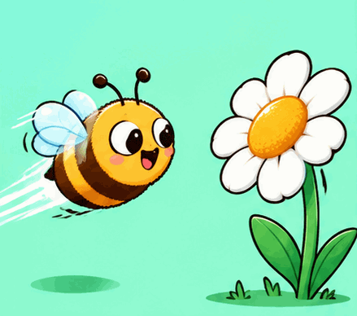

<sub>9 frames · 439×388 · 1.3s · gpt-image-2.6 · generated 2026-11-17</sub>

**Prompt**

```text
A round bumblebee buzzes forward, bonks into a big daisy, and spins dizzily with little stars circling its head. Playful cartoon sticker, mint background.
```

`bee` `oops` `sticker`

### 31. Taking a day off

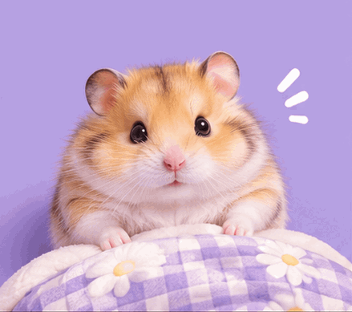

<sub>9 frames · 439×389 · 1.6s · gpt-image-2.6 · generated 2026-11-17</sub>

**Prompt**

```text
A hamster yawns and pulls a tiny quilt over its head, leaving only its ears and a dangling OFF tag visible. Cute sticker style, lavender background.
```

`hamster` `rest` `sticker`

### 32. Saved, thank you

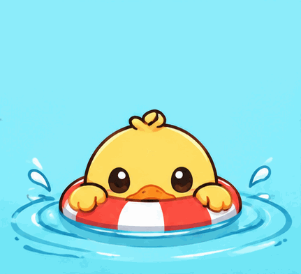

<sub>9 frames · 431×393 · 1.4s · gpt-image-2.6 · generated 2026-11-17</sub>

**Prompt**

```text
A yellow duck clinging to a red-white lifebuoy pops up from water and waves gratefully, sparkles around it. Cheerful flat sticker, light aqua background.
```

`duck` `thanks` `sticker`

### 33. Go ahead and eat

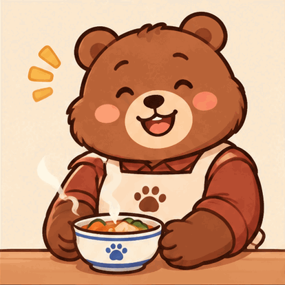

<sub>8 frames · 414×414 · 1.4s · gpt-image-2.6 · generated 2026-11-17</sub>

**Prompt**

```text
A brown bear in an apron sets down a steaming bowl and waves a paw toward it with a warm smile. Cozy family sticker style, thick outline, beige background.
```

`bear` `dinner` `family`

### 34. Milk on the way home

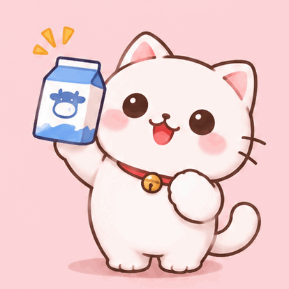

<sub>9 frames · 414×414 · 1.6s · gpt-image-2.6 · generated 2026-11-17</sub>

**Prompt**

```text
A round white cat holds up an empty milk carton and gives a hopeful little bow, a small heart popping above. Soft family sticker style, big rounded shapes, light pink background.
```

`cat` `family` `sticker`

### 35. Houseplant survives

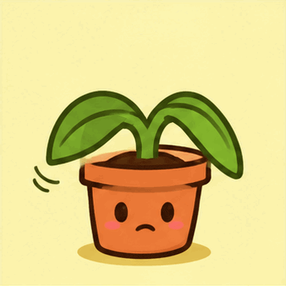

<sub>12 frames · 357×358 · 1.7s · gpt-image-2.6 · generated 2026-11-17</sub>

**Prompt**

```text
A droopy potted plant with two leaves sags, then perks straight up and flexes one leaf like a bicep. Cute flat sticker, thick outline, light yellow background.
```

`plant` `survive` `sticker`

### 36. Squirrel ready to fight

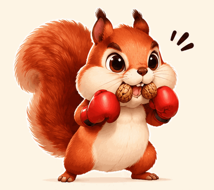

<sub>9 frames · 439×390 · 1.4s · gpt-image-2.6 · generated 2026-11-17</sub>

**Prompt**

```text
A chubby red squirrel in tiny boxing gloves, cheeks stuffed with nuts, bounces on its feet and throws two quick jabs. Bold cartoon sticker, white outline, cream background.
```

`squirrel` `fight` `sticker`

### 37. Snail in a hurry

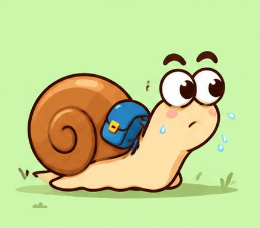

<sub>9 frames · 434×381 · 1.4s · gpt-image-2.6 · generated 2026-11-17</sub>

**Prompt**

```text
A snail with a tiny backpack strains forward with sweat drops and speed lines flying, yet barely moves an inch. Funny flat cartoon, light green background.
```

`snail` `late` `sticker`

### 38. Crab snip dance

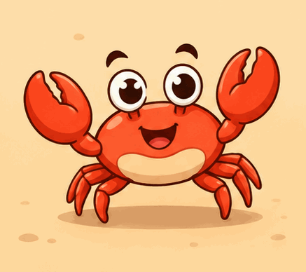

<sub>9 frames · 437×388 · 1.4s · gpt-image-2.6 · generated 2026-11-13</sub>

**Prompt**

```text
A red crab sidesteps left and right, snipping both claws in rhythm with a proud face. Flat cartoon, sandy beige background.
```

`crab` `dance` `sticker`

### 39. Piglet mud splash

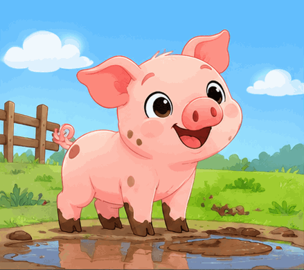

<sub>9 frames · 439×390 · 1.3s · gpt-image-2.6 · generated 2026-11-13</sub>

**Prompt**

```text
A pink piglet hops into a mud puddle, brown droplets splash up, and it grins happily. Flat sticker art, light blue sky background.
```

`pig` `happy` `sticker`

### 40. Parrot head bob

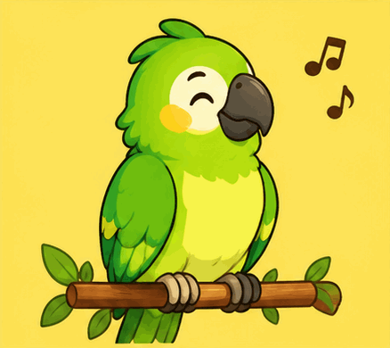

<sub>9 frames · 438×390 · 1.4s · gpt-image-2.6 · generated 2026-11-13</sub>

**Prompt**

```text
A green parrot on a perch bobs its head to a beat, eyes half closed, as small music notes float up. Flat cartoon, warm yellow background.
```

`parrot` `music` `sticker`

### 41. Mole pops up

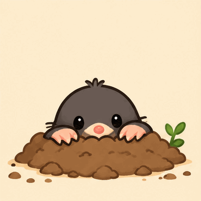

<sub>9 frames · 414×414 · 1.4s · gpt-image-2.6 · generated 2026-11-13</sub>

**Prompt**

```text
A little mole pops out of a dirt hole, waves a tiny pink paw, then ducks back down as soil crumbs bounce. Cartoon sticker style, plain beige background.
```

`mole` `hello` `sticker`

### 42. Duck winks

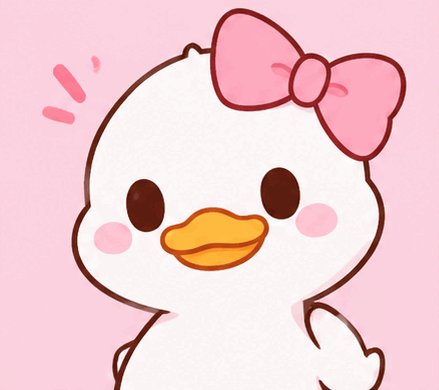

<sub>9 frames · 439×390 · 1.6s · gpt-image-2.6 · generated 2026-11-13</sub>

**Prompt**

```text
A white duck with a pink bow winks and a small red heart pops out beside its cheek. Kawaii flat style, light pink background.
```

`duck` `love` `sticker`

### 43. Loaf cat dozing

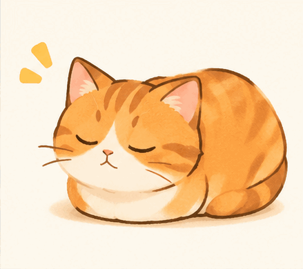

<sub>9 frames · 439×390 · 2.0s · gpt-image-2.6 · generated 2026-11-13</sub>

**Prompt**

```text
An orange cat tucked into a perfect loaf shape slowly nods off, its head dipping down, then jerks awake. Soft pastel sticker style, cream background.
```

`cat` `sleepy` `sticker`

### 44. Otters high five

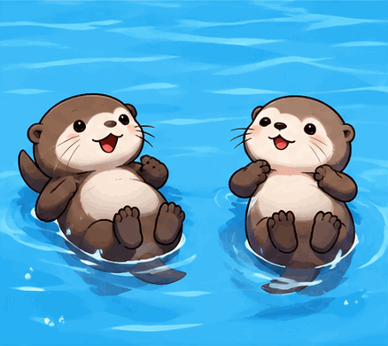

<sub>9 frames · 438×390 · 1.6s · gpt-image-2.6 · generated 2026-11-13</sub>

**Prompt**

```text
Two brown otters float on their backs, reach up and slap a high five with a small sparkle, then drift apart. Cute flat style, blue water background.
```

`otter` `high-five` `sticker`

### 45. Angry pufferfish

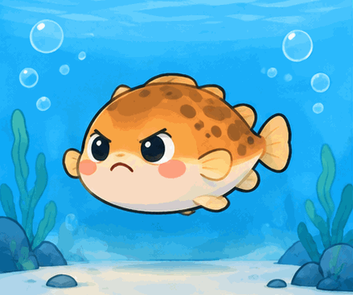

<sub>9 frames · 439×367 · 1.6s · gpt-image-2.6 · generated 2026-11-13</sub>

**Prompt**

```text
A small pufferfish frowns, puffs up into a spiky round ball with red cheeks, then slowly deflates back. Simple cartoon, light blue water background.
```

`pufferfish` `angry` `sticker`

### 46. Corgi butt wiggle bye

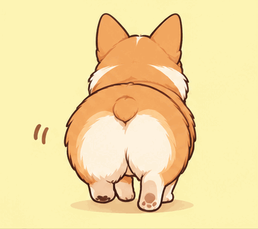

<sub>9 frames · 439×390 · 1.4s · gpt-image-2.6 · generated 2026-11-13</sub>

**Prompt**

```text
A corgi walks away from the viewer wiggling its fluffy rear, then looks back over its shoulder with a cheeky grin. Flat sticker art, pale yellow background.
```

`corgi` `bye` `sticker`

### 47. Chick peeks from the egg

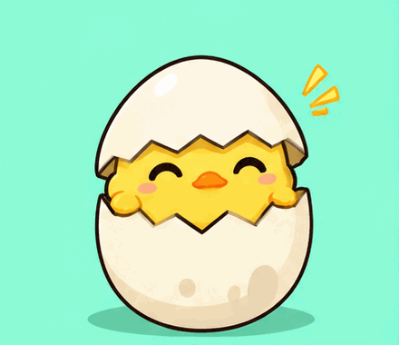

<sub>9 frames · 440×380 · 1.6s · gpt-image-2.6 · generated 2026-11-13</sub>

**Prompt**

```text
A yellow chick lifts the cracked top of its eggshell like a lid, peeks out, waves one wing, then ducks back inside. Cute flat cartoon, mint background.
```

`chick` `hello` `sticker`

### 48. Walrus thinking

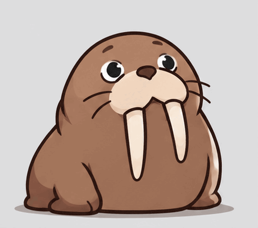

<sub>9 frames · 439×388 · 1.4s · gpt-image-2.6 · generated 2026-11-13</sub>

**Prompt**

```text
A round walrus strokes one tusk with its flipper, eyes rolling up in thought, and a small question mark pops above its head. Flat sticker style, thick outline, light gray background.
```

`walrus` `thinking` `sticker`

### 49. Tofu flips the sign

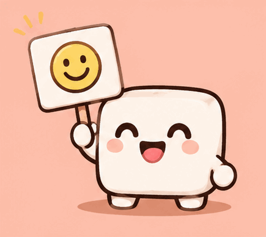

<sub>9 frames · 435×388 · 1.4s · gpt-image-2.6 · generated 2026-11-13</sub>

**Prompt**

```text
A square tofu character holds up a small sign with a big smiley face, then flips it over to show a crying face on the back while its own smile stays frozen. Kawaii flat style, peach background, no words.
```

`tofu` `reversal` `sticker`

### 50. Frazzled cat stare

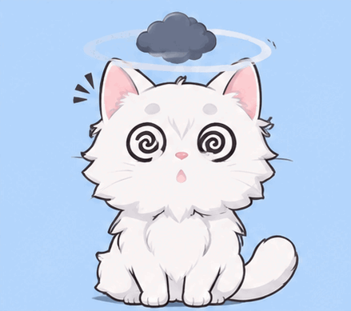

<sub>9 frames · 439×389 · 1.3s · gpt-image-2.6 · generated 2026-11-13</sub>

**Prompt**

```text
A white cat with messy fur and spiral eyes stares blankly ahead while a tiny gray storm cloud circles above its head, one ear twitching. Simple cartoon sticker style, pale blue background.
```

`cat` `mood` `sticker`

### 51. Kung fu kitten kick

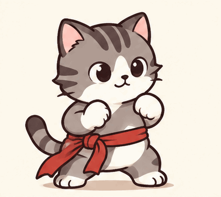

<sub>9 frames · 438×390 · 1.1s · gpt-image-2.6 · generated 2026-11-13</sub>

**Prompt**

```text
A chubby gray kitten wearing a red cloth sash holds a martial arts stance, snaps out one quick front kick with a little 'hi-yah' face, then lands back in the same stance. Thick outlines, flat sticker colors, plain cream background.
```

`cat` `kung-fu` `sticker`

### 52. Chick under an umbrella


<sub>9 frames · 414×414 · 1.4s · gpt-image-2.6 · generated 2026-11-12</sub>

**Prompt**

```text
A tiny yellow chick holds a red umbrella and twirls it while raindrops bounce off the top. Cute flat sticker style, plain gray-blue background.
```

`sticker` `rain` `chick`

### 53. Bunny hop with shadow


<sub>9 frames · 439×390 · 1.3s · gpt-image-2.6 · generated 2026-11-12</sub>

**Prompt**

```text
A white bunny hops in place, ears flopping on each landing while its oval shadow shrinks when it rises and grows when it lands. Simple soft sticker style, plain mint background.
```

`sticker` `bunny` `hop`

### 54. Cat refuses to go to work


<sub>9 frames · 433×395 · 1.6s · gpt-image-2.6 · generated 2026-11-12</sub>

**Prompt**

```text
A tabby cat clings to a pillow with all four paws and shakes its head no as an alarm clock rings beside it. Cartoon sticker style, plain lavender background.
```

`sticker` `cat` `monday`

### 55. Cat: that costs extra


<sub>9 frames · 414×414 · 1.6s · gpt-image-2.6 · generated 2026-11-12</sub>

**Prompt**

```text
A businesslike white cat in a tiny tie rubs its paw pads together, and small gold coins pop up beside it one by one. Flat cartoon sticker, plain light gray background.
```

`sticker` `cat` `work`

### 56. Lazy lion in a Santa hat


<sub>8 frames · 438×377 · 1.4s · gpt-image-2.6 · generated 2026-11-12</sub>

**Prompt**

```text
A droopy-eyed chubby lion wearing a Santa hat sighs heavily, its mane flopping, then gives a half-hearted wave. Soft cartoon sticker, plain red background.
```

`sticker` `christmas` `lion`

### 57. Snowman mitten wave


<sub>16 frames · 378×250 · 2.6s · gpt-image-2.6 · generated 2026-11-12</sub>

**Prompt**

```text
A small round snowman with a red knitted scarf and blue mittens waves one arm while light snowflakes drift around it. Cozy winter sticker style, plain light blue background.
```

`sticker` `winter` `snowman`

### 58. Two mice dancing


<sub>9 frames · 439×390 · 1.4s · gpt-image-2.6 · generated 2026-11-12</sub>

**Prompt**

```text
Two little gray mice hold paws and do a happy hopping dance in a circle, tails swinging. Cute flat sticker style, plain pale yellow background.
```

`sticker` `mouse` `dance`

### 59. Cat full HP revive


<sub>9 frames · 432×393 · 1.6s · gpt-image-2.6 · generated 2026-11-12</sub>

**Prompt**

```text
A limp flattened orange cat lies on the floor, a green health bar above it fills up, and the cat springs up with sparkling eyes and a fist pump. Chunky cartoon sticker, plain white background.
```

`sticker` `cat` `energy`

### 60. Panda bamboo thumbs up


<sub>9 frames · 414×414 · 1.6s · gpt-image-2.6 · generated 2026-11-12</sub>

**Prompt**

```text
A chubby panda chewing a bamboo stalk gives a slow confident thumbs up and nods once. Flat sticker style, plain light green background.
```

`sticker` `panda` `ok`

### 61. Shy ghost boo


<sub>9 frames · 438×390 · 1.4s · gpt-image-2.6 · generated 2026-11-12</sub>

**Prompt**

```text
A tiny white ghost jumps out shouting boo with raised arms, then immediately hides its face embarrassed. Simple cartoon sticker, plain dark purple background.
```

`sticker` `ghost` `funny`

### 62. Bao bun wiggle dance


<sub>9 frames · 412×411 · 1.6s · gpt-image-2.6 · generated 2026-11-12</sub>

**Prompt**

```text
A soft steamed bao bun with a tiny face wiggles side to side on a bamboo steamer, little steam curls rising above it. Cute kawaii sticker, plain warm beige background.
```

`sticker` `food` `dance`

### 63. Angry tomato steam


<sub>9 frames · 435×386 · 1.4s · gpt-image-2.6 · generated 2026-11-12</sub>

**Prompt**

```text
A cartoon tomato character turns from red to deep crimson, shakes with anger and puffs steam from its leafy top. Flat sticker style, thick outlines, plain white background.
```

`sticker` `food` `angry`

### 64. Owl big yawn


<sub>9 frames · 437×388 · 1.6s · gpt-image-2.6 · generated 2026-11-12</sub>

**Prompt**

```text
A round brown owl on a branch stretches its wings and lets out a huge yawn, eyes squeezing shut, then settles back down. Soft storybook sticker, plain navy background.
```

`sticker` `owl` `sleepy`

### 65. Puppy zoomies


<sub>9 frames · 439×386 · 1.0s · gpt-image-2.6 · generated 2026-11-12</sub>

**Prompt**

```text
A fluffy cream puppy spins in fast happy circles chasing its own tail, ears flapping, little dust puffs behind it. Cute cartoon sticker, plain peach background.
```

`sticker` `dog` `happy`

### 66. Penguin needs coffee


<sub>9 frames · 414×414 · 1.6s · gpt-image-2.6 · generated 2026-11-12</sub>

**Prompt**

```text
A sleepy penguin holds up an empty mug, shakes it upside down, and droops with heavy eyelids. Simple flat sticker style, plain pale blue background.
```

`sticker` `penguin` `coffee`

### 67. Cat keyboard rage


<sub>9 frames · 413×413 · 1.3s · gpt-image-2.6 · generated 2026-11-12</sub>

**Prompt**

```text
An angry gray cat with a furrowed brow mashes a tiny keyboard with both paws, little key caps flying off with each hit. Bold cartoon sticker, plain light gray background.
```

`sticker` `cat` `work`

### 68. Bunny head pat melt


<sub>9 frames · 437×386 · 1.6s · gpt-image-2.6 · generated 2026-11-12</sub>

**Prompt**

```text
A small white bunny receives gentle pats from a hand entering the frame and slowly melts into a happy flat puddle with closed eyes. Pastel sticker style, plain lilac background.
```

`sticker` `bunny` `cute`

### 69. Frog noted salute


<sub>9 frames · 412×412 · 1.4s · gpt-image-2.6 · generated 2026-11-12</sub>

**Prompt**

```text
A round green frog in a tiny yellow raincoat stands up straight and gives a crisp salute, its cheeks puffing proudly. Chunky cartoon sticker, thick white outline, plain mint background.
```

`sticker` `frog` `ok`

### 70. Hedgehog blush hide


<sub>9 frames · 439×390 · 1.6s · gpt-image-2.6 · generated 2026-11-12</sub>

**Prompt**

```text
A tiny brown hedgehog with pink cheeks hears a compliment, blushes bright red and curls up into a spiky ball, then peeks out with one eye. Soft kawaii sticker style, plain cream background.
```

`sticker` `hedgehog` `shy`

### 71. Cartoon shark fin wave


<sub>9 frames · 437×387 · 1.4s · gpt-image-2.6 · generated 2026-11-12</sub>

**Prompt**

```text
A chubby light-blue cartoon shark pops halfway out of a tiny wave, waves one fin hello and grins showing round teeth. Flat colors, thick outlines, plain white background.
```

`sticker` `shark` `hello`

### 72. Whale spout hello


<sub>16 frames · 380×252 · 2.9s · gpt-image-2.6 · generated 2026-11-11</sub>

**Prompt**

```text
a chubby baby blue whale bobs on small waves and puffs a water spout shaped like a heart from its blowhole, then smiles. Flat pastel style, plain aqua background.
```

`sticker` `whale` `hello`

### 73. Juggling squirrel


<sub>16 frames · 326×291 · 1.9s · gpt-image-2.6 · generated 2026-11-11</sub>

**Prompt**

```text
a red cartoon squirrel with a huge fluffy tail juggles three acorns in an arc, tongue out in concentration. Flat colors, thick outlines, plain warm beige background.
```

`sticker` `squirrel` `fun`

### 74. Lamb says sorry


<sub>16 frames · 322×293 · 2.2s · gpt-image-2.6 · generated 2026-11-11</sub>

**Prompt**

```text
a fluffy cartoon lamb with a cloud-like wool coat presses its hooves together and bows deeply, a small sweat drop and a pink heart appearing above. Soft pastel flat style, plain lavender background.
```

`sticker` `apology` `lamb`

### 75. Bunny carrot crunch


<sub>16 frames · 379×247 · 1.6s · gpt-image-2.6 · generated 2026-11-11</sub>

**Prompt**

```text
a white cartoon bunny with floppy ears holds a big carrot and munches quickly, cheeks bouncing, small orange crumbs flying off. Flat colors, plain pale green background.
```

`sticker` `bunny` `food`

### 76. Upside-down bat goodnight


<sub>9 frames · 430×391 · 2.0s · gpt-image-2.6 · generated 2026-11-11</sub>

**Prompt**

```text
a fluffy little purple bat hangs upside down from a branch, wraps its wings around itself and sways gently while a small crescent moon and Zzz float nearby. Kawaii flat style, plain midnight blue background.
```

`sticker` `goodnight` `bat`

### 77. Slow thumbs up


<sub>9 frames · 437×386 · 2.7s · gpt-image-2.6 · generated 2026-11-11</sub>

**Prompt**

```text
a sleepy green cartoon turtle in a tiny knit cap very slowly raises one flipper into a thumbs-up and gives a lazy smile. Flat pastel colors, thick outlines, plain light peach background.
```

`sticker` `turtle` `approval`

### 78. Fox spills coffee


<sub>9 frames · 413×412 · 1.3s · gpt-image-2.6 · generated 2026-11-11</sub>

**Prompt**

```text
a cartoon orange fox in a green hoodie bumps a coffee cup, the coffee splashes up, and the fox freezes with a wide-eyed oops face and paws on its cheeks. Flat sticker style, plain cream background.
```

`sticker` `fox` `oops`

### 79. Penguin belly slide


<sub>12 frames · 356×357 · 1.7s · gpt-image-2.6 · generated 2026-11-11</sub>

**Prompt**

```text
a round cartoon penguin with a tiny red beanie slides on its belly across a patch of ice, flaps its flippers happily and gives a little wave. Flat colors, thick outlines, plain icy blue background.
```

`sticker` `penguin` `winter`

### 80. Mood toggle cube


<sub>12 frames · 358×358 · 2.6s · gpt-image-2.6 · generated 2026-11-11</sub>

**Prompt**

```text
a cute pastel yellow cube character with stubby legs stands still and switches expressions: a grumpy frown with a small storm cloud, then a big grin with sparkles. Kawaii flat style, plain light blue background.
```

`sticker` `emotion` `reaction`

### 81. Plush bear sipping cocoa


<sub>9 frames · 439×390 · 1.6s · gpt-image-2.6 · generated 2026-11-11</sub>

**Prompt**

```text
a soft plush teddy bear with visible fabric texture and stitched seams holds a big mug with both paws, takes a slow sip, and closes its eyes contentedly as steam curls up. Cozy warm lighting, plain oatmeal background.
```

`sticker` `plush` `cozy`

### 82. Avocado OMG jump


<sub>9 frames · 436×390 · 1.4s · gpt-image-2.6 · generated 2026-11-11</sub>

**Prompt**

```text
a cartoon avocado half with a big seed belly and tiny arms leaps up in surprise, eyes wide and mouth open, a speech bubble reading OMG! popping beside it. Bold outlines, flat colors, plain white background.
```

`sticker` `food` `text`

### 83. Deadline hamster on fire


<sub>9 frames · 433×395 · 1.4s · gpt-image-2.6 · generated 2026-11-11</sub>

**Prompt**

```text
a tiny golden hamster in round glasses types furiously on a little keyboard while a cartoon flame burns on top of its head and sweat drops fly off. White sticker border, flat colors, plain pale yellow background.
```

`sticker` `deadline` `work`

### 84. Desk stretch break


<sub>16 frames · 379×252 · 2.9s · gpt-image-2.6 · generated 2026-11-11</sub>

**Prompt**

```text
a chibi office worker with messy hair types fast on a laptop, then leans back and stretches both arms high with a big yawn before returning to typing. Flat pastel illustration, plain light gray background.
```

`sticker` `office` `work`

### 85. End-screen wave


<sub>9 frames · 500×332 · 1.4s · gpt-image-2.6 · generated 2026-11-11</sub>

**Prompt**

```text
a friendly cartoon robot with a round screen face showing a smile stands on the right side of a plain coral background, waves one hand and points to a blank rounded rectangle on the left where a red bell icon gives a little shake. Flat vector style.
```

`creator` `video` `mascot`

### 86. Red envelope: no, no, yes


<sub>9 frames · 438×389 · 1.6s · gpt-image-2.6 · generated 2026-11-11</sub>

**Prompt**

```text
a round cartoon panda in a red padded jacket shakes its head and waves one paw in polite refusal, while its other paw quietly slips a red envelope into its jacket pocket. Flat sticker style, plain cream background, thick outlines.
```

`sticker` `lunar-new-year` `holiday`

### 87. Asleep at the countdown


<sub>9 frames · 439×390 · 2.0s · gpt-image-2.6 · generated 2026-11-11</sub>

**Prompt**

```text
a chibi kid in pajamas and a party hat sits on a sofa holding a tiny noisemaker; a wall clock shows one minute to midnight. The kid's head nods down slowly, jerks back up, then nods again with a floating Zzz. Cozy flat illustration, warm lamp light.
```

`sticker` `new-year` `holiday`

### 88. Christmas Eve apple unwrap


<sub>16 frames · 378×242 · 2.9s · gpt-image-2.6 · generated 2026-11-11</sub>

**Prompt**

```text
a cute cartoon red apple wrapped in a shiny gift wrapper with a green ribbon, on a plain mint background. Small hands pull off the wrapper, revealing another wrapper underneath, and the apple gives a puzzled blink. Flat sticker style, thick outlines.
```

`sticker` `christmas` `holiday`

### 89. Office bear: clocking out


<sub>9 frames · 435×388 · 1.3s · gpt-image-2.6 · generated 2026-11-11</sub>

**Prompt**

```text
a chubby cartoon brown bear office worker in a loose blue tie and a lanyard badge, round ears, small dot eyes, thick clean outlines, flat pastel colors, plain cream background. With a backpack on, the bear jogs in place with fast little legs, speed lines streaming behind and its tie flapping over its shoulder.
```

`sticker` `bear` `series` `office`

### 90. Office bear: payday


<sub>16 frames · 378×252 · 2.6s · gpt-image-2.6 · generated 2026-11-11</sub>

**Prompt**

```text
a chubby cartoon brown bear office worker in a loose blue tie and a lanyard badge, round ears, small dot eyes, thick clean outlines, flat pastel colors, plain cream background. The bear throws its head back laughing while hugging a fat envelope, small coins bouncing up around it.
```

`sticker` `bear` `series` `money`

### 91. Office bear: overtime wail


<sub>9 frames · 414×412 · 1.6s · gpt-image-2.6 · generated 2026-11-11</sub>

**Prompt**

```text
a chubby cartoon brown bear office worker in a loose blue tie and a lanyard badge, round ears, small dot eyes, thick clean outlines, flat pastel colors, plain cream background. At a desk piled with folders under a night-blue window, the bear opens its mouth wide and wails, two streams of tears spraying sideways.
```

`sticker` `bear` `series` `office`

### 92. Office bear: sneaky snack


<sub>12 frames · 356×355 · 2.2s · gpt-image-2.6 · generated 2026-11-11</sub>

**Prompt**

```text
a chubby cartoon brown bear office worker in a loose blue tie and a lanyard badge, round ears, small dot eyes, thick clean outlines, flat pastel colors, plain cream background. Hiding behind a laptop screen, the bear peeks left and right, then quickly pops a cookie into its mouth and chews with puffed cheeks.
```

`sticker` `bear` `series` `office`

### 93. Office bear: eye roll


<sub>12 frames · 356×357 · 1.9s · gpt-image-2.6 · generated 2026-11-11</sub>

**Prompt**

```text
a chubby cartoon brown bear office worker in a loose blue tie and a lanyard badge, round ears, small dot eyes, thick clean outlines, flat pastel colors, plain cream background. The bear holds a phone, glances at it, then rolls its eyes up dramatically and lets the phone drop to its side.
```

`sticker` `bear` `series` `reaction`

### 94. Office bear: Monday sigh


<sub>9 frames · 436×386 · 1.6s · gpt-image-2.6 · generated 2026-11-11</sub>

**Prompt**

```text
a chubby cartoon brown bear office worker in a loose blue tie and a lanyard badge, round ears, small dot eyes, thick clean outlines, flat pastel colors, plain cream background. The bear slumps forward over a coffee mug, shoulders rising and falling with a long sigh, a small gray puff of breath drifting out.
```

`sticker` `bear` `series` `office`

### 95. Angry goose honks


<sub>16 frames · 380×250 · 1.9s · gpt-image-2.6 · generated 2026-11-10</sub>

**Prompt**

```text
A white goose stretches its neck forward, flaps its wings wide, and honks angrily with its beak open, a little cartoon anger mark above its head. Cartoon sticker style, plain light green background.
```

`sticker` `angry` `animal`

### 96. Dumpling hides a blush


<sub>9 frames · 437×388 · 1.6s · gpt-image-2.6 · generated 2026-11-10</sub>

**Prompt**

```text
A plump steamed dumpling character covers its face with tiny hands, peeks out between them, and blushes bright pink. Kawaii sticker style, bold outline, plain white background.
```

`sticker` `shy` `food`

### 97. Tofu shivers in the cold


<sub>16 frames · 324×295 · 1.9s · gpt-image-2.6 · generated 2026-11-10</sub>

**Prompt**

```text
A soft white tofu block character wrapped in a tiny scarf shivers hard, teeth chattering, with a little icicle hanging from its edge and snowflakes drifting. Kawaii sticker style, plain icy blue background.
```

`sticker` `cold` `food`

### 98. Mushroom nods yes


<sub>9 frames · 412×413 · 1.4s · gpt-image-2.6 · generated 2026-11-10</sub>

**Prompt**

```text
A small red-capped mushroom character with white spots nods enthusiastically, its cap bouncing up and down, cheeks blushing. Cute sticker style, plain mint background.
```

`sticker` `yes` `cute`

### 99. Duck mic drop


<sub>12 frames · 356×356 · 1.9s · gpt-image-2.6 · generated 2026-11-10</sub>

**Prompt**

```text
A white duck in sunglasses holds a tiny microphone out at wing's length, drops it, and turns away with a smug look. Cartoon sticker style, thick outline, plain yellow background.
```

`sticker` `smug` `reaction`

### 100. Octopus types on four keyboards


<sub>9 frames · 438×387 · 1.3s · gpt-image-2.6 · generated 2026-11-10</sub>

**Prompt**

```text
A purple cartoon octopus wearing glasses types furiously on four keyboards at once, tentacles moving in turn, a tiny sweat drop flying off. Flat office-humor sticker style, plain white background.
```

`sticker` `work` `busy`

### 101. Sheep fluffs up and dozes


<sub>9 frames · 414×413 · 1.6s · gpt-image-2.6 · generated 2026-11-10</sub>

**Prompt**

```text
A round fluffy sheep slowly puffs up its wool like a cloud, its eyes droop closed, and small Z letters float up. Soft pastel sticker style, plain lilac background.
```

`sticker` `sleepy` `animal`

### 102. Chick bounce entrance


<sub>9 frames · 432×393 · 1.3s · gpt-image-2.6 · generated 2026-11-10</sub>

**Prompt**

```text
A fluffy yellow chick drops in from above, squashes flat on landing, springs back up, and strikes a proud pose with one wing raised. Squash-and-stretch cartoon style, plain white background.
```

`entrance` `sticker` `bounce`

### 103. Young mage levitates a glowing orb


<sub>9 frames · 433×387 · 1.4s · gpt-image-2.6 · generated 2026-11-10</sub>

**Prompt**

```text
A young mage in a hooded blue cloak holds both palms apart while a glowing turquoise orb floats and slowly rotates between them, sparks circling. Anime-style illustration, dark gradient background.
```

`magic` `character` `glow`

### 104. Cactus reads the newspaper


<sub>9 frames · 439×390 · 1.6s · gpt-image-2.6 · generated 2026-11-10</sub>

**Prompt**

```text
A green cactus character wearing a wide straw hat sits on a stool reading a newspaper, peeks over the top with raised eyebrows, then flips the page. Flat cartoon style, plain sandy background.
```

`sticker` `reading` `plant`

### 105. Horned chibi girl twirls


<sub>12 frames · 358×358 · 1.9s · gpt-image-2.6 · generated 2026-11-10</sub>

**Prompt**

```text
A chibi girl with small curled ivory horns, wearing a ruffled lavender gown, does a little twirl so the skirt flares out, then curtsies. Soft cel-shaded chibi style, plain cream background.
```

`dance` `chibi` `original-character`

### 106. Bubblegum bubble pops in a neon diner


<sub>9 frames · 435×386 · 2.0s · gpt-image-2.6 · generated 2026-11-10</sub>

**Prompt**

```text
An illustrated girl in a retro neon diner booth at night slowly blows a big pink bubblegum bubble until it pops on her face. Pink and teal neon lighting, stylized illustration, fixed camera.
```

`reaction` `neon` `retro`

### 107. Monkey on roller skates


<sub>9 frames · 439×390 · 1.4s · gpt-image-2.6 · generated 2026-11-10</sub>

**Prompt**

```text
A cheerful cartoon monkey in red roller skates glides along a sidewalk, arms out for balance, its tail swaying behind. Bright flat illustration, simple sidewalk and plain sky background, side view.
```

`character` `skate` `animal`

### 108. Round robot hears good news


<sub>16 frames · 380×252 · 2.2s · gpt-image-2.6 · generated 2026-11-10</sub>

**Prompt**

```text
A small round white robot with a screen face: its pixel eyes grow wide and sparkly, both little arms shoot up in celebration, then it returns to a neutral pose. High-contrast flat shapes, pale blue background.
```

`sticker` `celebrate` `robot`

### 109. Pigeon spit-take


<sub>8 frames · 437×383 · 1.1s · gpt-image-2.6 · generated 2026-11-10</sub>

**Prompt**

```text
A gray city pigeon holding a tiny teacup takes a sip and sprays the tea out in a dramatic spit-take, eyes bulging. Cartoon sticker style, thick outline, plain light blue background.
```

`sticker` `reaction` `shock`

### 110. Rabbit comedic fan smack


<sub>9 frames · 432×395 · 1.1s · gpt-image-2.6 · generated 2026-11-10</sub>

**Prompt**

```text
A white rabbit in a tiny bow tie swings a folded paper fan sideways in a classic comedy retort gesture, mouth open mid-shout, with speed lines. Bold manga-comedy sticker style, plain white background.
```

`sticker` `reaction` `comedy`

### 111. Bear slips on a banana peel


<sub>12 frames · 356×358 · 1.9s · gpt-image-2.6 · generated 2026-11-10</sub>

**Prompt**

```text
A round brown cartoon bear walks forward, steps on a banana peel, and flips onto its back with legs in the air and stars circling its head. Slapstick sticker style, thick outline, plain white background.
```

`sticker` `slapstick` `fail`

### 112. Cat-ear hoodie girl nods yes


<sub>9 frames · 444×394 · 1.4s · gpt-image-2.6 · generated 2026-11-10</sub>

**Prompt**

```text
A chibi girl in an oversized mint hoodie with cat ears on the hood nods eagerly twice, the ears flopping, eyes closed in a happy smile. Clean anime-inspired chibi sticker style, plain white background.
```

`sticker` `yes` `chibi`

### 113. Cream puff stretch and yawn


<sub>9 frames · 412×412 · 1.6s · gpt-image-2.6 · generated 2026-11-10</sub>

**Prompt**

```text
A chubby cream puff character with tiny arms stretches upward and lets out a big yawn, a little cream squishing out of its top, then settles back down sleepily. Kawaii sticker style, bold outline, plain pale yellow background.
```

`sticker` `sleepy` `food`

### 114. Cherry cake hat sprite waves


<sub>9 frames · 438×386 · 1.3s · gpt-image-2.6 · generated 2026-11-10</sub>

**Prompt**

```text
A tiny round cream-colored creature wearing a little strawberry shortcake with a cherry on top as a hat. It waves one stubby arm and does a small happy bounce, the cherry wobbling. Soft pastel sticker style, thick outline, plain white background.
```

`sticker` `cute` `original-character`

### 115. Alpaca hair flip


<sub>9 frames · 436×390 · 1.3s · gpt-image-2.6 · generated 2026-11-09</sub>

**Prompt**

```text
A fluffy white cartoon alpaca with a huge curly fringe tossing its head to flip the fringe out of its eyes, then posing with a confident wink. Thick outlines, flat colors, plain pink background.
```

`sticker` `sassy` `alpaca`

### 116. Pug blows out a candle


<sub>9 frames · 439×390 · 1.6s · gpt-image-2.6 · generated 2026-11-09</sub>

**Prompt**

```text
A pug in a striped party hat puffing its cheeks and blowing out a single candle on a pink cupcake, the flame going out and colorful confetti popping up. Thick outlines, flat colors, plain yellow background.
```

`sticker` `birthday` `dog`

### 117. Cloud sneezes rain


<sub>9 frames · 414×414 · 1.6s · gpt-image-2.6 · generated 2026-11-09</sub>

**Prompt**

```text
A small fluffy white cloud character with rosy cheeks scrunching up its face and sneezing, a burst of raindrops and a tiny rainbow shooting out, then sniffling. Thick outlines, flat colors, plain sky-blue background.
```

`sticker` `weather` `cute`

### 118. Owl side-eye


<sub>9 frames · 439×389 · 2.0s · gpt-image-2.6 · generated 2026-11-09</sub>

**Prompt**

```text
A round brown cartoon owl perched on a branch, slowly turning its eyes sideways toward the viewer and raising one feathery eyebrow in suspicion, then blinking once. Thick outlines, flat colors, plain teal background.
```

`sticker` `side-eye` `reaction`

### 119. Dinosaur tiny-arm clap


<sub>12 frames · 358×358 · 1.7s · gpt-image-2.6 · generated 2026-11-09</sub>

**Prompt**

```text
A chubby mint-green cartoon dinosaur trying hard to clap with its very short arms, the paws barely reaching, its face scrunched in effort, then a proud grin. Thick outlines, flat colors, plain peach background.
```

`sticker` `clap` `dinosaur`

### 120. Raccoon finds a treasure


<sub>16 frames · 380×251 · 2.2s · gpt-image-2.6 · generated 2026-11-09</sub>

**Prompt**

```text
A grey cartoon raccoon popping up out of a cardboard box holding a shiny silver spoon high above its head, eyes sparkling proudly, a little gleam flashing on the spoon. Thick outlines, flat colors, plain orange background.
```

`sticker` `proud` `raccoon`

### 121. Tortoise: on my way


<sub>16 frames · 378×253 · 1.8s · gpt-image-2.6 · generated 2026-11-09</sub>

**Prompt**

```text
A green cartoon tortoise with a tiny backpack running as fast as it can, legs spinning in a blur with speed lines and sweat drops, but barely moving forward. Thick outlines, flat colors, plain white background.
```

`sticker` `late` `funny`

### 122. Duckling in big headphones


<sub>16 frames · 308×309 · 1.9s · gpt-image-2.6 · generated 2026-11-09</sub>

**Prompt**

```text
A fluffy yellow duckling wearing oversized purple headphones, eyes closed, bobbing its head and tapping one foot to the beat, small music notes floating around. Thick outlines, flat colors, plain lilac background.
```

`sticker` `music` `duck`

### 123. Koala jolted awake


<sub>16 frames · 378×246 · 2.9s · gpt-image-2.6 · generated 2026-11-09</sub>

**Prompt**

```text
A sleepy grey cartoon koala hugging a giant mug, nodding off until its nose dips into the coffee, then jolting wide awake with spiky fur. Thick outlines, flat colors, plain soft green background.
```

`sticker` `coffee` `sleepy`

### 124. Capybara: hot spring


<sub>9 frames · 439×387 · 2.0s · gpt-image-2.6 · generated 2026-11-09</sub>

**Prompt**

```text
a round brown cartoon capybara with a small orange yuzu balanced on its head, sleepy half-closed eyes and a calm smile, thick clean outlines, flat pastel colors, plain cream background. The capybara sits up to its chin in a small round hot spring, steam curling up, eyes closing in bliss as it sinks slightly lower.
```

`sticker` `capybara` `series`

### 125. Capybara: cheering


<sub>9 frames · 433×393 · 1.4s · gpt-image-2.6 · generated 2026-11-09</sub>

**Prompt**

```text
a round brown cartoon capybara with a small orange yuzu balanced on its head, sleepy half-closed eyes and a calm smile, thick clean outlines, flat pastel colors, plain cream background. The capybara waves two tiny pom-poms above its head and bounces, small sparkles popping around it.
```

`sticker` `capybara` `series`

### 126. Capybara: sleepy nod


<sub>9 frames · 435×387 · 1.6s · gpt-image-2.6 · generated 2026-11-09</sub>

**Prompt**

```text
a round brown cartoon capybara with a small orange yuzu balanced on its head, sleepy half-closed eyes and a calm smile, thick clean outlines, flat pastel colors, plain cream background. The capybara's head slowly droops forward as it dozes off, then jerks back up, the yuzu nearly falling off.
```

`sticker` `capybara` `series`

### 127. Capybara: OK


<sub>8 frames · 439×389 · 1.4s · gpt-image-2.6 · generated 2026-11-09</sub>

**Prompt**

```text
a round brown cartoon capybara with a small orange yuzu balanced on its head, sleepy half-closed eyes and a calm smile, thick clean outlines, flat pastel colors, plain cream background. The capybara slowly raises one stubby paw into an OK sign and nods once, the yuzu wobbling on its head.
```

> 💡 **Tip:** All four capybara entries share the exact same character description so the set stays consistent.

`sticker` `capybara` `series`

### 128. Tabby cat double take


<sub>9 frames · 439×390 · 1.6s · gpt-image-2.6 · generated 2026-11-09</sub>

**Prompt**

```text
A calm orange tabby cat sitting sideways, then suddenly turning toward the viewer: its eyes go huge, ears shoot up, mouth drops open, then it settles back to calm. Clean cartoon style, plain pale yellow background.
```

`sticker` `cat` `shocked`

### 129. Collapsed souffle tears


<sub>9 frames · 439×390 · 2.0s · gpt-image-2.6 · generated 2026-11-09</sub>

**Prompt**

```text
A chibi baker girl in a white apron pulling a tall souffle out of the oven, the souffle sinking flat, her eyes filling with tears, then she shrugs and takes a spoonful. Soft pastel cartoon, plain warm beige background.
```

> 💡 **Tip:** Four beats (pull out, collapse, cry, eat) fit a 6-frame sprite sheet; more beats make each step blur together.

`sticker` `baking` `chibi`

### 130. Monday desk slump


<sub>16 frames · 309×306 · 2.9s · gpt-image-2.6 · generated 2026-11-09</sub>

**Prompt**

```text
A chubby orange cat wearing a navy necktie slumping over a laptop, sinking lower and lower until it disappears behind the desk, then popping back up with a tired face. The word "MONDAY." printed above in bold letters. Thick outlines, flat colors, plain white background.
```

`sticker` `office` `monday` `text`

### 131. Smug raccoon says no thanks


<sub>9 frames · 437×386 · 1.4s · gpt-image-2.6 · generated 2026-11-09</sub>

**Prompt**

```text
A smug cartoon raccoon in pink heart-shaped sunglasses lounging in a beach chair, sipping a juice box and lazily waving one paw in a "no thanks" gesture, eyebrows raised. Thick outlines, flat colors, plain sky-blue background.
```

`sticker` `smug` `reaction`

### 132. Too many emails, close laptop


<sub>9 frames · 436×390 · 1.6s · gpt-image-2.6 · generated 2026-11-09</sub>

**Prompt**

```text
A cartoon office worker with round glasses opening a laptop, the screen showing a red badge with a huge unread count, their face going pale, then slowly closing the laptop again. Exaggerated expressions, thick outlines, flat colors, plain light grey background.
```

`sticker` `office` `email`

### 133. Caveman shrug


<sub>9 frames · 439×387 · 1.6s · gpt-image-2.6 · generated 2026-11-09</sub>

**Prompt**

```text
A stocky cartoon caveman with a wild orange beard, a bone hair clip and a spotted fur tunic shrugging with both palms up and an unimpressed face, eyebrows bouncing once. Thick outlines, flat colors, plain sand-colored background.
```

`sticker` `shrug` `reaction`

### 134. Hedgehog hugging a sweet potato


<sub>9 frames · 439×390 · 1.4s · gpt-image-2.6 · generated 2026-11-09</sub>

**Prompt**

```text
A tiny cartoon hedgehog hugging a roasted sweet potato almost as big as itself, steam rising from the cracked skin, the hedgehog taking a happy nibble and wiggling. Crayon doodle style on plain off-white paper.
```

`sticker` `food` `doodle`

### 135. Panda resting on a cushion


<sub>9 frames · 438×390 · 2.7s · gpt-image-2.6 · generated 2026-11-09</sub>

**Prompt**

```text
A chubby cartoon panda leaning back on a big round yellow cushion, slowly closing its eyes and letting out a long relaxed sigh, a small "zzz" drifting up. Soft watercolor texture, gentle outlines, plain cream background.
```

`sticker` `rest` `panda`

### 136. Shrimp saved by a recovered file


<sub>9 frames · 432×394 · 1.6s · gpt-image-2.6 · generated 2026-11-09</sub>

**Prompt**

```text
A small pink cartoon shrimp in a tiny office lanyard hugging a glowing blue folder icon to its chest, crying tears of relief and bouncing up and down with joy. Thick outlines, flat colors, plain white background.
```

`sticker` `office` `relief`

### 137. Otter holding a thank-you sign


<sub>9 frames · 438×389 · 1.6s · gpt-image-2.6 · generated 2026-11-09</sub>

**Prompt**

```text
A small brown cartoon otter holding up a little wooden sign that reads "THANK YOU", bowing forward and popping back up with a happy squint, tiny hearts floating above. Thick outlines, flat colors, plain mint background.
```

> 💡 **Tip:** Short words in quotes usually stay legible; check every frame for letter changes.

`sticker` `thanks` `text`

### 138. 90s anime blush


<sub>9 frames · 439×390 · 1.4s · gpt-image-2.6 · generated 2026-11-09</sub>

**Prompt**

```text
A 1990s cel-animation style boy with messy brown hair and a red scarf blushing: pink hatched lines spread across his cheeks, he looks away and scratches the back of his head. Soft film grain, VHS-era color palette, plain peach background.
```

`anime` `retro` `reaction`

### 139. 90s anime gasp


<sub>9 frames · 433×395 · 1.6s · gpt-image-2.6 · generated 2026-11-09</sub>

**Prompt**

```text
A 1990s cel-animation style girl with two long auburn braids, a band of freckles across her nose, round glasses and a green denim jacket gasping in shock: her eyes go wide behind the glasses, a big sweat drop appears beside her head, then her shoulders drop. Soft film grain, VHS-era color palette, plain lavender background.
```

> 💡 **Tip:** Name the decade and medium (cel animation, film grain, VHS palette) and keep the character design generic so it doesn't drift toward a known show.

`anime` `retro` `reaction`

### 140. Bunny rolling on the floor crying


<sub>9 frames · 439×390 · 1.3s · gpt-image-2.6 · generated 2026-11-09</sub>

**Prompt**

```text
A chubby cream-colored cartoon bunny lying on its back on the floor, kicking its little legs and rolling side to side while sobbing, big cartoon tears flying off both sides. Thick outlines, flat colors, plain pale pink background.
```

`sticker` `crying` `bunny`

### 141. Frog puddle jump


<sub>16 frames · 378×245 · 2.2s · gpt-image-2.6 · generated 2026-11-08</sub>

**Prompt**

```text
A small green frog in a red raincoat leaping into a puddle, water splashing up in a crown, then giving a happy little wave. Bright cartoon style on a white background.
```

`sticker` `rain` `frog`

### 142. Sloth wakes up with coffee


<sub>16 frames · 384×262 · 2.9s · gpt-image-2.6 · generated 2026-11-08</sub>

**Prompt**

```text
A sleepy sloth hanging from a branch slowly sipping coffee from a tiny cup, then its eyes pop wide open with sparkles. Soft cartoon sticker on a white background.
```

`sticker` `coffee` `morning`

### 143. Axolotl blows a bubble


<sub>16 frames · 378×241 · 2.2s · gpt-image-2.6 · generated 2026-11-08</sub>

**Prompt**

```text
A pink axolotl with frilly gills puffing its cheeks to blow a round bubble that grows, pops, and leaves it blinking in surprise. Soft cartoon style, light aqua background.
```

`sticker` `water` `cute`

### 144. Cactus wants a hug


<sub>9 frames · 409×414 · 1.6s · gpt-image-2.6 · generated 2026-11-08</sub>

**Prompt**

```text
A small potted cactus character opening its spiky arms wide for a hug, then looking down at its spines and drooping sadly. Flat cute illustration on a white background.
```

`sticker` `hug` `sad`

### 145. Surprised toast pops up


<sub>9 frames · 438×390 · 1.4s · gpt-image-2.6 · generated 2026-11-08</sub>

**Prompt**

```text
Two slices of toast with cartoon faces popping out of a chrome toaster, flipping in the air with surprised expressions, then dropping back in. Glossy 3D cartoon on a pale orange background.
```

`sticker` `food` `surprise`

### 146. Snail mail delivery


<sub>9 frames · 437×387 · 1.6s · gpt-image-2.6 · generated 2026-11-08</sub>

**Prompt**

```text
A small snail with a tiny leather postbag slowly sliding forward and holding out an envelope with its antennae, smiling proudly. Soft storybook illustration on a cream background.
```

`sticker` `mail` `slow`

### 147. Mochi says OK


<sub>9 frames · 414×414 · 1.6s · gpt-image-2.6 · generated 2026-11-08</sub>

**Prompt**

```text
A round white mochi character with tiny arms bowing politely and then popping up holding an "OK!" sign, cheeks blushing. LINE-sticker style with thick outlines on a white background.
```

`sticker` `caption` `ok`

### 148. Raincoat kid big jump


<sub>9 frames · 431×394 · 1.4s · gpt-image-2.6 · generated 2026-11-08</sub>

**Prompt**

```text
A chibi kid in a yellow raincoat crouching down, springing into a high jump with arms up, then landing with a little puff of dust. Side view, flat animation style on a white background.
```

`sticker` `jump` `character`

### 149. Flower-crown cat dance


<sub>9 frames · 414×414 · 1.3s · gpt-image-2.6 · generated 2026-11-08</sub>

**Prompt**

```text
A grey cat wearing a crown of small daisies doing a happy side-step dance on its hind legs, front paws swinging. Flat cute illustration on a light green background.
```

`sticker` `cat` `dance`

### 150. White cat and yarn ball


<sub>9 frames · 439×390 · 1.4s · gpt-image-2.6 · generated 2026-11-08</sub>

**Prompt**

```text
A fluffy white kitten batting a red yarn ball, rolling onto its back with the ball in its paws, then popping back upright. Soft pastel cartoon on a pale lavender background.
```

`sticker` `cat` `play`

### 151. Dramatic poodle faint


<sub>9 frames · 439×390 · 1.4s · gpt-image-2.6 · generated 2026-11-08</sub>

**Prompt**

```text
A white poodle mascot striking a dramatic pose, pressing a paw to its forehead and swooning backward onto a red velvet cushion. Exaggerated theatrical cartoon on a cream background.
```

`sticker` `drama` `dog`

### 152. Corgi begs for a snack


<sub>9 frames · 412×412 · 1.4s · gpt-image-2.6 · generated 2026-11-08</sub>

**Prompt**

```text
A fluffy corgi mascot staring up at a treat just above its head, drooling, wiggling its round butt and doing a little hop. Cute vector sticker on a white background.
```

`sticker` `dog` `food`

### 153. Cardboard robot breakdance


<sub>9 frames · 440×388 · 1.6s · gpt-image-2.6 · generated 2026-11-08</sub>

**Prompt**

```text
A robot made from cardboard boxes with bottle-cap eyes doing a breakdance toprock step, then dropping into a one-hand freeze on a flattened cardboard mat. Hand-drawn marker style on white paper.
```

`sticker` `dance` `robot`

### 154. Grandma in her Sunday hat


<sub>9 frames · 437×390 · 1.6s · gpt-image-2.6 · generated 2026-11-08</sub>

**Prompt**

```text
A cheerful cartoon grandma in a big floral Sunday hat and a pearl necklace clapping and swaying side to side to music, eyes closed in joy. Warm flat illustration on a soft pink background.
```

`sticker` `joy` `character`

### 155. Hamster courier


<sub>9 frames · 433×388 · 1.4s · gpt-image-2.6 · generated 2026-11-08</sub>

**Prompt**

```text
A small golden hamster in a tiny brown courier cap pushing a cardboard parcel twice its size across the floor, cheeks puffed with effort and feet scrabbling. Cozy cartoon sticker on a white background.
```

`sticker` `work` `hamster`

### 156. Tuxedo cat vs. foxtail toy


<sub>9 frames · 390×439 · 1.3s · gpt-image-2.6 · generated 2026-11-08</sub>

**Prompt**

```text
A simple black-and-white anime-style tuxedo cat sitting up and swatting at a foxtail grass toy dangling from above, ears flattened, tail twitching. Clean line art on a white background.
```

`sticker` `cat` `monochrome`

### 157. Shiba takes a snowball


<sub>9 frames · 439×381 · 1.4s · gpt-image-2.6 · generated 2026-11-08</sub>

**Prompt**

```text
A shiba inu in a red knitted winter hat standing in the snow gets hit in the face by a snowball, snow bursting everywhere, then blinks and shakes its head. Cartoon sticker style on a pale blue background.
```

`sticker` `winter` `funny`

### 158. Shiba: on it, on it


<sub>9 frames · 436×388 · 1.3s · gpt-image-2.6 · generated 2026-11-08</sub>

**Prompt**

```text
A cream shiba inu at a desk typing furiously on a keyboard with both paws, sweat drops flying off its head, with the handwritten caption "在改了在改了" fixed at the top. Flat sticker style on a white background.
```

`sticker` `caption` `work`

### 159. Baby seal: sending love


<sub>9 frames · 435×388 · 1.6s · gpt-image-2.6 · generated 2026-11-08</sub>

**Prompt**

```text
a chubby white baby harp seal with big glossy black eyes, pink cheeks and a tiny blue scarf lifting both flippers together over its head to form a clear heart shape, then small pink hearts float up. Flat chat-sticker style on a white background.
```

> 💡 **Tip:** Two-limb heart gestures often fail to close; spell out that the flippers meet above the head.

`sticker` `seal` `love`

### 160. Baby seal: crying


<sub>9 frames · 431×393 · 1.4s · gpt-image-2.6 · generated 2026-11-08</sub>

**Prompt**

```text
a chubby white baby harp seal with big glossy black eyes, pink cheeks and a tiny blue scarf bawling with its mouth wide open, two streams of tears spraying out sideways, flippers flapping. Flat chat-sticker style on a white background.
```

> 💡 **Tip:** For a set, reuse the exact same character description in every prompt.

`sticker` `seal` `cry`

### 161. Baby seal: giving up


<sub>16 frames · 376×259 · 2.9s · gpt-image-2.6 · generated 2026-11-08</sub>

**Prompt**

```text
a chubby white baby harp seal with big glossy black eyes, pink cheeks and a tiny blue scarf lying flat on its belly and slowly melting into a puddle-like blob, then sighing a tiny cloud. Flat chat-sticker style on a white background.
```

> 💡 **Tip:** For a set, reuse the exact same character description in every prompt.

`sticker` `seal` `lazy`

### 162. Baby seal: sneaky giggle


<sub>8 frames · 439×390 · 1.2s · gpt-image-2.6 · generated 2026-11-08</sub>

**Prompt**

```text
a chubby white baby harp seal with big glossy black eyes, pink cheeks and a tiny blue scarf covering its mouth with one flipper and giggling, shoulders shaking and eyes curved into happy arcs. Flat chat-sticker style on a white background.
```

> 💡 **Tip:** For a set, reuse the exact same character description in every prompt.

`sticker` `seal` `laugh`

### 163. Baby seal: shocked


<sub>9 frames · 439×388 · 1.4s · gpt-image-2.6 · generated 2026-11-08</sub>

**Prompt**

```text
a chubby white baby harp seal with big glossy black eyes, pink cheeks and a tiny blue scarf jolting backward in shock, eyes popping wide and whiskers standing straight out, with a small burst of exclamation lines. Flat chat-sticker style on a white background.
```

> 💡 **Tip:** For a set, reuse the exact same character description in every prompt.

`sticker` `seal` `shock`

### 164. Bowl-cut dog scrolling


<sub>9 frames · 435×391 · 1.6s · gpt-image-2.6 · generated 2026-11-08</sub>

**Prompt**

```text
A small dog with a perfectly round bowl-cut hairstyle lying on its belly, scrolling a smartphone with one paw and snorting with laughter at the screen. Cute cartoon style on a white background.
```

`sticker` `phone` `dog`

### 165. Gorilla shuffle dance


<sub>16 frames · 320×289 · 1.9s · gpt-image-2.6 · generated 2026-11-08</sub>

**Prompt**

```text
A chunky cartoon gorilla wearing a tiny red bow tie doing a side-to-side shuffle dance, swinging its long arms and bobbing its head to the beat. Flat vector sticker on a white background.
```

`sticker` `dance` `animal`

### 166. Mantis shrimp jiggles a flan


<sub>9 frames · 414×414 · 1.6s · gpt-image-2.6 · generated 2026-11-08</sub>

**Prompt**

```text
A rainbow-colored cartoon mantis shrimp poking a caramel flan on a plate with both front claws, the flan wobbling wildly while the shrimp's eyes sparkle with delight. Glossy clay-toy style on a pale yellow background.
```

`sticker` `food` `funny`

### 167. Grateful shrimp bows deeply


<sub>9 frames · 439×389 · 1.6s · gpt-image-2.6 · generated 2026-11-07</sub>

**Prompt**

```text
A small pink cartoon shrimp pressing its claws together, raising them high over its head and then bowing dramatically low, with the caption "THANK YOU!" fixed at the bottom. Flat sticker style on a white background.
```

`sticker` `caption` `thanks`

### 168. Cat dozing in a VR headset


<sub>16 frames · 328×291 · 2.9s · gpt-image-2.6 · generated 2026-11-07</sub>

**Prompt**

```text
A fluffy grey cat wearing a sleek white VR headset slowly nodding off, its head drooping and jerking back up, a small Zzz bubble floating up. Soft 3D render on a plain lavender background.
```

`sticker` `cat` `tech`

### 169. Gym bear doing chest presses


<sub>9 frames · 433×395 · 1.4s · gpt-image-2.6 · generated 2026-11-07</sub>

**Prompt**

```text
A muscular cartoon brown bear in a red tank top lying on a bench and pressing a barbell up and down, cheeks puffing with each rep. Bold cartoon sticker style on a plain grey background.
```

`sticker` `fitness` `bear`

### 170. Duckling with a tiny umbrella


<sub>16 frames · 380×252 · 2.2s · gpt-image-2.6 · generated 2026-11-07</sub>

**Prompt**

```text
A yellow duckling holding a tiny red umbrella hopping in a small puddle, splashes rising with each hop while rain falls. Soft watercolor sticker style.
```

`sticker` `duck` `rain`

### 171. Hamster stuffing its cheeks


<sub>9 frames · 433×395 · 1.6s · gpt-image-2.6 · generated 2026-11-07</sub>

**Prompt**

```text
A golden hamster sitting up and stuffing sunflower seeds into its cheeks until they balloon comically, then blinking proudly. Cute cartoon style on a plain white background.
```

`sticker` `hamster` `food`

### 172. Baby robot wave and hop


<sub>9 frames · 440×388 · 1.4s · gpt-image-2.6 · generated 2026-11-07</sub>

**Prompt**

```text
A tiny round white baby robot with a glowing blue face screen and stubby legs waving one hand and doing a small happy hop, its antenna wobbling. Clean 3D toy style on a plain pastel background.
```

`sticker` `robot` `hello`

### 173. Cat flying on a broomstick


<sub>16 frames · 378×252 · 2.2s · gpt-image-2.6 · generated 2026-11-07</sub>

**Prompt**

```text
A black cat with a tiny red scarf riding a wooden broomstick across a night sky, bobbing up and down, the scarf fluttering behind it. Cute storybook sticker style.
```

`sticker` `cat` `magic`

### 174. Office worker: received!


<sub>9 frames · 436×392 · 1.4s · gpt-image-2.6 · generated 2026-11-07</sub>

**Prompt**

```text
A chibi office worker with a tidy bob and a lanyard snapping to attention and giving a firm thumbs-up with a determined nod. Flat sticker style on a plain light blue background.
```

`sticker` `office` `reply`

### 175. Otter in a teal scarf waving


<sub>9 frames · 438×389 · 1.6s · gpt-image-2.6 · generated 2026-11-07</sub>

**Prompt**

```text
A small brown sea otter with a cream muzzle and a teal knitted scarf turning toward the viewer, waving one paw twice and blinking. Soft sticker style on a plain cream background.
```

`sticker` `otter` `hello`

### 176. Penguin panics after hitting send


<sub>9 frames · 435×390 · 1.4s · gpt-image-2.6 · generated 2026-11-07</sub>

**Prompt**

```text
A small cartoon penguin slapping a big round red button labeled "SEND", then freezing as its eyes go wide and it grabs its head with both flippers in panic, sweat drops flying. Flat sticker style on a plain white background.
```

`sticker` `penguin` `reaction`

### 177. Lobster working overtime


<sub>9 frames · 437×388 · 1.4s · gpt-image-2.6 · generated 2026-11-07</sub>

**Prompt**

```text
A red cartoon lobster wearing round glasses typing furiously on a keyboard with both claws at a desk late at night, lit by the blue glow of a monitor, a coffee mug steaming beside it. Cartoon sticker style.
```

`sticker` `work` `funny`

### 178. Cat baker sneezes flour


<sub>9 frames · 440×389 · 1.6s · gpt-image-2.6 · generated 2026-11-07</sub>

**Prompt**

```text
An anthropomorphic orange cat in an apron kneading dough on a wooden counter, then sneezing and blowing a big white cloud of flour into the air. Warm cartoon style.
```

`sticker` `cat` `cooking`

### 179. Apprentice spell backfires


<sub>8 frames · 439×388 · 1.3s · gpt-image-2.6 · generated 2026-11-07</sub>

**Prompt**

```text
A chibi wizard apprentice in an oversized purple hat waves a wand, a small puff explodes in front of her, and she is left blinking with a soot-black face and frizzy hair. Cute cartoon sticker style on a plain lilac background.
```

`sticker` `magic` `fail`

### 180. Laughing so hard it cries


<sub>16 frames · 306×307 · 2.2s · gpt-image-2.6 · generated 2026-11-07</sub>

**Prompt**

```text
A round pink mochi blob character throwing its head back and laughing hysterically, tears spraying from its eyes, body shaking. Cute sticker style on a plain white background.
```

`sticker` `laugh` `reaction`

### 181. Orange cat pouncing at the camera


<sub>9 frames · 433×395 · 1.6s · gpt-image-2.6 · generated 2026-11-07</sub>

**Prompt**

```text
A chubby orange cat crouching, wiggling its rear, then leaping straight toward the viewer with paws spread wide until its face squishes against the glass. Funny cartoon style on a plain living room background.
```

`sticker` `cat` `funny`

### 182. Goodnight kitty


<sub>16 frames · 380×251 · 2.9s · gpt-image-2.6 · generated 2026-11-07</sub>

**Prompt**

```text
A sleepy white kitten in a blue nightcap hugging a small pillow, slowly yawning and then nodding off as a tiny crescent moon bobs beside it. Soft pastel sticker style on a dark navy background.
```

`sticker` `cat` `goodnight`

### 183. Puppy swaying with hearts


<sub>9 frames · 437×389 · 1.6s · gpt-image-2.6 · generated 2026-11-07</sub>

**Prompt**

```text
A fluffy cream-colored puppy sitting and swaying its head left and right with its eyes closed happily, small pink hearts floating up around it. Kawaii sticker style on a plain white background.
```

`sticker` `dog` `love`

### 184. Busy bee clocking in


<sub>9 frames · 439×390 · 1.4s · gpt-image-2.6 · generated 2026-11-07</sub>

**Prompt**

```text
A round fuzzy cartoon bee with a tiny lanyard badge buzzing in place, wings fluttering fast, then giving a crisp salute. Soft flat sticker style on a plain mint background.
```

`sticker` `bee` `work`

### 185. Top-hat frog shooing bad vibes


<sub>9 frames · 438×390 · 1.4s · gpt-image-2.6 · generated 2026-11-07</sub>

**Prompt**

```text
A small green frog in a tall black top hat and a monocle waving a tiny cane in circles as if shooing away bad luck, little grey smoke puffs scattering. Cute storybook sticker style on a cream background.
```

`sticker` `frog` `reaction`

### 186. Cat in sunglasses dancing


<sub>12 frames · 356×357 · 1.4s · gpt-image-2.6 · generated 2026-11-07</sub>

**Prompt**

```text
A cool grey cat wearing tiny black sunglasses doing a side-to-side groove dance, hips swaying and one paw pointing up then down. Bold cartoon sticker style on a plain yellow background.
```

`sticker` `cat` `dance`

### 187. Chibi trader celebrating a rally


<sub>9 frames · 414×410 · 1.4s · gpt-image-2.6 · generated 2026-11-07</sub>

**Prompt**

```text
A chibi office worker in a white shirt and loose tie jumping up from his chair as a green stock line shoots upward on his laptop, throwing paper banknotes into the air with both hands. Flat pastel sticker style on a plain light background.
```

`sticker` `office` `finance`

### 188. Chibi trader watching stocks crash


<sub>9 frames · 438×388 · 1.4s · gpt-image-2.6 · generated 2026-11-07</sub>

**Prompt**

```text
A chibi office worker in a white shirt and loose tie staring at a laptop where a red stock line plunges, his hopeful smile crumbling into big wobbling tears. Flat pastel sticker style on a plain light background.
```

`sticker` `office` `finance`

### 189. Roaring duck


<sub>9 frames · 433×394 · 1.6s · gpt-image-2.6 · generated 2026-11-06</sub>

**Prompt**

```text
A small round yellow duck suddenly opening its beak wide and roaring like a lion, feathers blown back, the screen shaking slightly, then it calmly closes its beak. Cute cartoon sticker style, bold outline, plain sky-blue background.
```

`sticker` `reaction` `funny`

### 190. Office cat: clocking out


<sub>16 frames · 374×249 · 2.6s · gpt-image-2.6 · generated 2026-11-06</sub>

**Prompt**

```text
A chubby orange tabby cat office worker with a tiny blue tie and an employee badge tosses its badge in the air, grabs a tiny backpack and does a happy little hop toward the door, tail swishing. Flat cartoon sticker style, bold outline, plain pale yellow background.
```

`sticker` `work` `sticker-pack`

### 191. Office cat: exhausted


<sub>9 frames · 438×387 · 1.6s · gpt-image-2.6 · generated 2026-11-06</sub>

**Prompt**

```text
A chubby orange tabby cat office worker with a tiny blue tie and an employee badge slumps face-down onto a pile of papers on its desk, ears drooping, a tiny ghost of a sigh floating up, then twitches one paw. Flat cartoon sticker style, bold outline, plain pale grey background.
```

> 💡 **Tip:** Part of a set: repeat the exact same character description and only change the action — that is how real sticker packs stay consistent.

`sticker` `work` `sticker-pack`

### 192. Black cat punch


<sub>9 frames · 437×390 · 1.3s · gpt-image-2.6 · generated 2026-11-06</sub>

**Prompt**

```text
A round black cat with big yellow eyes throwing a quick one-two punch toward the viewer with its front paws, little impact stars popping, then settling back into a boxing stance. Chibi sticker style, bold outline, plain pastel purple background.
```

`sticker` `reaction` `cat`

### 193. Cat chef tossing fried rice


<sub>16 frames · 323×295 · 1.9s · gpt-image-2.6 · generated 2026-11-06</sub>

**Prompt**

```text
A white cat chef in a tall chef hat tossing fried rice in a wok, the rice flies up in a little arc and lands back in the pan, a puff of steam rising each time. Comic cartoon style, warm kitchen background kept still.
```

`sticker` `food` `cat`

### 194. Basketball shot celebration


<sub>16 frames · 380×251 · 1.9s · gpt-image-2.6 · generated 2026-11-06</sub>

**Prompt**

```text
A chibi kid in a red jersey jumps and shoots a basketball, the ball swishes through the hoop, then the kid lands and pumps a fist in celebration before returning to the starting pose. Bold-outline sticker style, plain light orange background.
```

> 💡 **Tip:** For sports moves, break the action into 3 clear beats (jump, shot, celebrate). Complex tricks like a 360 kickflip still tend to fail.

`sticker` `sports` `celebration`

### 195. Penguin facepalm


<sub>9 frames · 435×389 · 1.4s · gpt-image-2.6 · generated 2026-11-06</sub>

**Prompt**

```text
A chubby cartoon penguin slowly raising one flipper and slapping it onto its forehead, then shaking its head in disbelief. Chibi sticker style, bold outline, plain light grey background.
```

`sticker` `reaction` `facepalm`

### 196. Frog blowing a heart


<sub>16 frames · 380×252 · 2.2s · gpt-image-2.6 · generated 2026-11-06</sub>

**Prompt**

```text
A round green cartoon frog puffing its cheeks and blowing a pink heart-shaped bubble that floats up and pops into tiny sparkles. Cute flat sticker style, bold outline, plain cream background.
```

`sticker` `love` `cute`

### 197. Cat typing furiously


<sub>16 frames · 380×242 · 1.9s · gpt-image-2.6 · generated 2026-11-06</sub>

**Prompt**

```text
A grey tabby cat sitting at a tiny laptop and typing furiously with both front paws, paws blurring, little speed lines and sweat drops flying off. Flat cartoon sticker style, bold outline, plain pale pink background.
```

> 💡 **Tip:** Speed lines and sweat drops make fast motion readable even with only a few frames.

`sticker` `work` `cat`

### 198. Confused shiba head tilt


<sub>9 frames · 439×390 · 1.6s · gpt-image-2.6 · generated 2026-11-06</sub>

**Prompt**

```text
A fluffy orange shiba inu puppy tilting its head to one side and back again, ears twitching, a small question mark popping above its head. Chibi sticker style, bold outline, plain light blue background.
```

`sticker` `reaction` `dog`

### 199. Cartoon cat waving hello


<sub>9 frames · 438×390 · 1.3s · gpt-image-2.6 · generated 2026-11-05</sub>

**Prompt**

```text
A cheerful cartoon cat waving hello.
```

> 💡 **Tip:** Even a one-line prompt works for simple greetings — the model fills in style and timing.

`sticker` `greeting` `minimal-prompt`

### 200. Sleepy bunny


<sub>9 frames · 439×387 · 1.6s · gpt-image-2.6 · generated 2026-11-06</sub>

**Prompt**

```text
A small white cartoon bunny with long floppy ears and a pink nose, sitting and nodding off, head slowly drooping then jerking back up, a small bubble swelling and shrinking from its nose. Chibi sticker style, bold outline, plain warm yellow background.
```

`sticker` `reaction` `sticker-pack`

### 201. Bunny laughing to tears


<sub>8 frames · 440×389 · 1.1s · gpt-image-2.6 · generated 2026-11-06</sub>

**Prompt**

```text
A small white cartoon bunny with long floppy ears and a pink nose, laughing so hard it rocks back and forth, eyes squeezed shut and two little tears flying out. Chibi sticker style, bold outline, plain warm yellow background.
```

`sticker` `reaction` `sticker-pack`

### 202. Bunny thumbs-up


<sub>9 frames · 438×388 · 1.3s · gpt-image-2.6 · generated 2026-11-06</sub>

**Prompt**

```text
A small white cartoon bunny with long floppy ears and a pink nose, giving an enthusiastic thumbs-up with one paw, the paw pumping forward twice while the ears bounce. Chibi sticker style, bold outline, plain warm yellow background.
```

> 💡 **Tip:** Reuse the same character description across a set (see the next two prompts) so the whole sticker pack stays consistent.

`sticker` `reaction` `sticker-pack`

### 203. Jelly bear wobble


<sub>9 frames · 438×388 · 1.3s · gpt-image-2.6 · generated 2026-11-06</sub>

**Prompt**

```text
A chubby round cartoon bear with a soft jelly-like body and stubby arms, squishing down and springing back up while wobbling side to side, cheeks jiggling on every bounce. Thick clean outlines, flat pastel colors, centered on a plain solid mint-green background that contrasts strongly with the bear.
```

> 💡 **Tip:** Keep the background one flat color far from the character's colors so it can be keyed out as a transparent sticker later.

`sticker` `bouncy` `cute`

[← README](../README.md)
