# 表情包与贴纸 · 189 条提示词

[← README](../README_zh.md)

### 1. 织围巾的企鹅

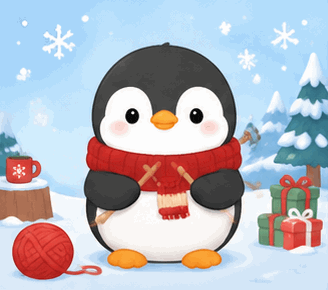

<sub>16 帧 · 328×290 · 2.2s · gpt-image-2.6 · 生成于 2026-11-17</sub>

**提示词**

```text
A round penguin sits clicking two knitting needles, a striped red scarf growing longer from its flippers. Cute flat cartoon, snowy light blue background.
```

`penguin` `knitting` `winter`

### 2. 小兔吸面条


<sub>16 帧 · 309×309 · 2.2s · gpt-image-2.6 · 生成于 2026-11-17</sub>

**提示词**

```text
A white bunny with chopsticks slurps a long noodle from a bowl, cheeks puffing, the noodle wiggling up into its mouth. Cute flat sticker style, thick outline, pale orange background.
```

`bunny` `noodles` `food`

### 3. 章鱼喷墨尴尬


<sub>9 帧 · 412×412 · 1.6s · gpt-image-2.6 · 生成于 2026-11-17</sub>

**提示词**

```text
A small pink octopus gets startled and puffs out a cloud of ink, then peeks out of the cloud with an embarrassed grin. Cute flat cartoon, light aqua background.
```

`octopus` `oops` `funny`

### 4. 河马打大哈欠


<sub>9 帧 · 432×395 · 1.6s · gpt-image-2.6 · 生成于 2026-11-17</sub>

**提示词**

```text
A sleepy round lavender hippo opens its mouth in an enormous yawn, eyes squeezed shut, then closes it with a satisfied smack. Soft clay-like 3D style, pale peach background.
```

`hippo` `yawn` `sleepy`

### 5. 叼吐司赶路的柴犬


<sub>8 帧 · 429×394 · 1.0s · gpt-image-2.6 · 生成于 2026-11-17</sub>

**提示词**

```text
A shiba inu with a slice of toast in its mouth runs in place in a panic, ears flapping, a sweat drop flying off. Funny flat sticker style, thick white outline, light yellow background.
```

`shiba` `late` `sticker`

### 6. 小象鼻子喷水


<sub>16 帧 · 379×251 · 2.2s · gpt-image-2.6 · 生成于 2026-11-17</sub>

**提示词**

```text
A chubby baby elephant lifts its trunk and sprays a happy fountain of water over its own head, droplets sparkling. Cute flat cartoon, light blue background, fixed camera.
```

`elephant` `water` `cute`

### 7. 涂鸦小人翻白眼


<sub>9 帧 · 425×399 · 1.6s · gpt-image-2.6 · 生成于 2026-11-17</sub>

**提示词**

```text
A round hand-drawn doodle face with marker lines rolls its eyes up in exaggerated annoyance, then looks back forward with a flat mouth. White paper background, wobbly ink lines.
```

`doodle` `eye-roll` `reaction`

### 8. 本子上的火柴人跳舞


<sub>9 帧 · 438×387 · 1.3s · gpt-image-2.6 · 生成于 2026-11-17</sub>

**提示词**

```text
A hand-drawn ballpoint stick figure on lined notebook paper does a goofy hip-shaking dance with arms waving, slight line boil like a flipbook. Paper texture, fixed overhead camera.
```

`doodle` `dance` `sketch`

### 9. 小狐狸上前打招呼


<sub>12 帧 · 358×358 · 1.9s · gpt-image-2.6 · 生成于 2026-11-17</sub>

**提示词**

```text
An orange fox in a little blue scarf takes two small steps toward the viewer, waves one paw, then steps back to where it started. Flat vector cartoon, pale mint background, fixed camera.
```

> 💡 **技巧：** 写清起始姿势、动作和回到原位，首尾帧才对得上。

`fox` `wave` `greeting`

### 10. 小熊猫眨眼微笑


<sub>9 帧 · 414×414 · 1.6s · gpt-image-2.6 · 生成于 2026-11-17</sub>

**提示词**

```text
A fluffy red panda mascot closes its eyes, opens them again with a small happy smile, ears twitching once. Soft flat illustration, cream background, fixed camera.
```

`red-panda` `blink` `cute`

### 11. 薄荷色机器人挥手


<sub>9 帧 · 435×387 · 1.4s · gpt-image-2.6 · 生成于 2026-11-17</sub>

**提示词**

```text
A small mint-green robot with a round screen face and a blinking antenna raises one hand, gives one wave, and lowers it back to rest. Simple rounded 3D illustration, clean white background, fixed camera.
```

`robot` `wave` `hello`

### 12. 手机里修屏的小猫


<sub>9 帧 · 433×395 · 1.4s · gpt-image-2.6 · 生成于 2026-11-17</sub>

**提示词**

```text
A tiny gray kitten in a yellow hard hat stands inside a cracked phone screen and works a toy power drill against the crack, sparks flying, the crack shrinking a little. Cute 3D cartoon, phone fills the frame, fixed camera.
```

`kitten` `phone` `repair`

### 13. 转圈企鹅

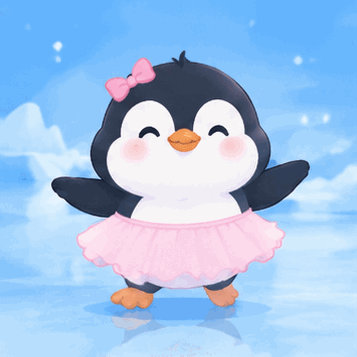

<sub>12 帧 · 357×357 · 1.7s · gpt-image-2.6 · 生成于 2026-11-17</sub>

**提示词**

```text
A chubby penguin in a tiny tutu does one wobbly spin on ice and ends with a proud flipper pose. Cute flat sticker, icy blue background.
```

`penguin` `dance` `sticker`

### 14. 纸箱探头猫


<sub>12 帧 · 353×352 · 2.2s · gpt-image-2.6 · 生成于 2026-11-17</sub>

**提示词**

```text
A gray tabby slowly rises out of a cardboard box until its eyes clear the edge, blinks once, then sinks back down. Simple cartoon, warm white background.
```

`cat` `box` `peek`

### 15. 大叫的山羊


<sub>9 帧 · 439×390 · 1.3s · gpt-image-2.6 · 生成于 2026-11-17</sub>

**提示词**

```text
A small white goat opens its mouth wide in a dramatic yell, ears flapping and motion lines bursting out. Funny meme sticker, bright orange background.
```

`goat` `shock` `meme`

### 16. 撞花的小蜜蜂


<sub>9 帧 · 439×388 · 1.3s · gpt-image-2.6 · 生成于 2026-11-17</sub>

**提示词**

```text
A round bumblebee buzzes forward, bonks into a big daisy, and spins dizzily with little stars circling its head. Playful cartoon sticker, mint background.
```

`bee` `oops` `sticker`

### 17. 今天休息


<sub>9 帧 · 439×389 · 1.6s · gpt-image-2.6 · 生成于 2026-11-17</sub>

**提示词**

```text
A hamster yawns and pulls a tiny quilt over its head, leaving only its ears and a dangling OFF tag visible. Cute sticker style, lavender background.
```

`hamster` `rest` `sticker`

### 18. 得救了谢谢


<sub>9 帧 · 431×393 · 1.4s · gpt-image-2.6 · 生成于 2026-11-17</sub>

**提示词**

```text
A yellow duck clinging to a red-white lifebuoy pops up from water and waves gratefully, sparkles around it. Cheerful flat sticker, light aqua background.
```

`duck` `thanks` `sticker`

### 19. 你先吃吧


<sub>8 帧 · 414×414 · 1.4s · gpt-image-2.6 · 生成于 2026-11-17</sub>

**提示词**

```text
A brown bear in an apron sets down a steaming bowl and waves a paw toward it with a warm smile. Cozy family sticker style, thick outline, beige background.
```

`bear` `dinner` `family`

### 20. 回家带牛奶


<sub>9 帧 · 414×414 · 1.6s · gpt-image-2.6 · 生成于 2026-11-17</sub>

**提示词**

```text
A round white cat holds up an empty milk carton and gives a hopeful little bow, a small heart popping above. Soft family sticker style, big rounded shapes, light pink background.
```

`cat` `family` `sticker`

### 21. 顽强的盆栽

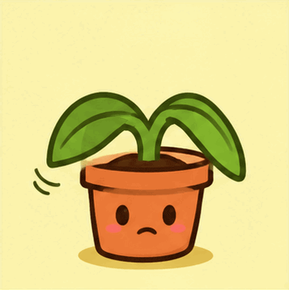

<sub>12 帧 · 357×358 · 1.7s · gpt-image-2.6 · 生成于 2026-11-17</sub>

**提示词**

```text
A droopy potted plant with two leaves sags, then perks straight up and flexes one leaf like a bicep. Cute flat sticker, thick outline, light yellow background.
```

`plant` `survive` `sticker`

### 22. 备战松鼠


<sub>9 帧 · 439×390 · 1.4s · gpt-image-2.6 · 生成于 2026-11-17</sub>

**提示词**

```text
A chubby red squirrel in tiny boxing gloves, cheeks stuffed with nuts, bounces on its feet and throws two quick jabs. Bold cartoon sticker, white outline, cream background.
```

`squirrel` `fight` `sticker`

### 23. 赶路的蜗牛


<sub>9 帧 · 434×381 · 1.4s · gpt-image-2.6 · 生成于 2026-11-17</sub>

**提示词**

```text
A snail with a tiny backpack strains forward with sweat drops and speed lines flying, yet barely moves an inch. Funny flat cartoon, light green background.
```

`snail` `late` `sticker`

### 24. 螃蟹剪刀舞


<sub>9 帧 · 437×388 · 1.4s · gpt-image-2.6 · 生成于 2026-11-13</sub>

**提示词**

```text
A red crab sidesteps left and right, snipping both claws in rhythm with a proud face. Flat cartoon, sandy beige background.
```

`crab` `dance` `sticker`

### 25. 小猪踩泥巴


<sub>9 帧 · 439×390 · 1.3s · gpt-image-2.6 · 生成于 2026-11-13</sub>

**提示词**

```text
A pink piglet hops into a mud puddle, brown droplets splash up, and it grins happily. Flat sticker art, light blue sky background.
```

`pig` `happy` `sticker`

### 26. 鹦鹉点头摇摆


<sub>9 帧 · 438×390 · 1.4s · gpt-image-2.6 · 生成于 2026-11-13</sub>

**提示词**

```text
A green parrot on a perch bobs its head to a beat, eyes half closed, as small music notes float up. Flat cartoon, warm yellow background.
```

`parrot` `music` `sticker`

### 27. 鼹鼠冒头打招呼


<sub>9 帧 · 414×414 · 1.4s · gpt-image-2.6 · 生成于 2026-11-13</sub>

**提示词**

```text
A little mole pops out of a dirt hole, waves a tiny pink paw, then ducks back down as soil crumbs bounce. Cartoon sticker style, plain beige background.
```

`mole` `hello` `sticker`

### 28. 小鸭眨眼比心


<sub>9 帧 · 439×390 · 1.6s · gpt-image-2.6 · 生成于 2026-11-13</sub>

**提示词**

```text
A white duck with a pink bow winks and a small red heart pops out beside its cheek. Kawaii flat style, light pink background.
```

`duck` `love` `sticker`

### 29. 面包猫打瞌睡

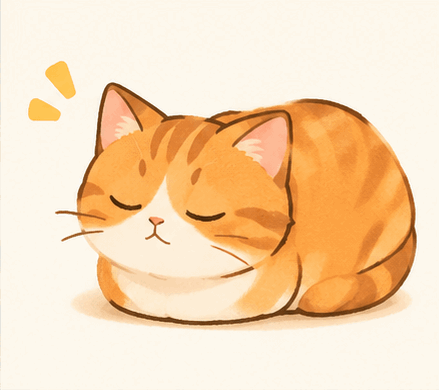

<sub>9 帧 · 439×390 · 2.0s · gpt-image-2.6 · 生成于 2026-11-13</sub>

**提示词**

```text
An orange cat tucked into a perfect loaf shape slowly nods off, its head dipping down, then jerks awake. Soft pastel sticker style, cream background.
```

`cat` `sleepy` `sticker`

### 30. 水獭击掌


<sub>9 帧 · 438×390 · 1.6s · gpt-image-2.6 · 生成于 2026-11-13</sub>

**提示词**

```text
Two brown otters float on their backs, reach up and slap a high five with a small sparkle, then drift apart. Cute flat style, blue water background.
```

`otter` `high-five` `sticker`

### 31. 气鼓鼓的河豚


<sub>9 帧 · 439×367 · 1.6s · gpt-image-2.6 · 生成于 2026-11-13</sub>

**提示词**

```text
A small pufferfish frowns, puffs up into a spiky round ball with red cheeks, then slowly deflates back. Simple cartoon, light blue water background.
```

`pufferfish` `angry` `sticker`

### 32. 柯基扭屁股拜拜


<sub>9 帧 · 439×390 · 1.4s · gpt-image-2.6 · 生成于 2026-11-13</sub>

**提示词**

```text
A corgi walks away from the viewer wiggling its fluffy rear, then looks back over its shoulder with a cheeky grin. Flat sticker art, pale yellow background.
```

`corgi` `bye` `sticker`

### 33. 小鸡探头

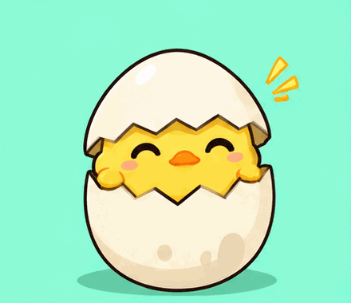

<sub>9 帧 · 440×380 · 1.6s · gpt-image-2.6 · 生成于 2026-11-13</sub>

**提示词**

```text
A yellow chick lifts the cracked top of its eggshell like a lid, peeks out, waves one wing, then ducks back inside. Cute flat cartoon, mint background.
```

`chick` `hello` `sticker`

### 34. 海象托腮思考


<sub>9 帧 · 439×388 · 1.4s · gpt-image-2.6 · 生成于 2026-11-13</sub>

**提示词**

```text
A round walrus strokes one tusk with its flipper, eyes rolling up in thought, and a small question mark pops above its head. Flat sticker style, thick outline, light gray background.
```

`walrus` `thinking` `sticker`

### 35. 豆腐块翻牌反转


<sub>9 帧 · 435×388 · 1.4s · gpt-image-2.6 · 生成于 2026-11-13</sub>

**提示词**

```text
A square tofu character holds up a small sign with a big smiley face, then flips it over to show a crying face on the back while its own smile stays frozen. Kawaii flat style, peach background, no words.
```

`tofu` `reversal` `sticker`

### 36. 精神状态不稳定的猫


<sub>9 帧 · 439×389 · 1.3s · gpt-image-2.6 · 生成于 2026-11-13</sub>

**提示词**

```text
A white cat with messy fur and spiral eyes stares blankly ahead while a tiny gray storm cloud circles above its head, one ear twitching. Simple cartoon sticker style, pale blue background.
```

`cat` `mood` `sticker`

### 37. 功夫小猫踢腿


<sub>9 帧 · 438×390 · 1.1s · gpt-image-2.6 · 生成于 2026-11-13</sub>

**提示词**

```text
A chubby gray kitten wearing a red cloth sash holds a martial arts stance, snaps out one quick front kick with a little 'hi-yah' face, then lands back in the same stance. Thick outlines, flat sticker colors, plain cream background.
```

`cat` `kung-fu` `sticker`

### 38. 撑伞的小鸡


<sub>9 帧 · 414×414 · 1.4s · gpt-image-2.6 · 生成于 2026-11-12</sub>

**提示词**

```text
A tiny yellow chick holds a red umbrella and twirls it while raindrops bounce off the top. Cute flat sticker style, plain gray-blue background.
```

`sticker` `rain` `chick`

### 39. 带影子的兔子蹦跳


<sub>9 帧 · 439×390 · 1.3s · gpt-image-2.6 · 生成于 2026-11-12</sub>

**提示词**

```text
A white bunny hops in place, ears flopping on each landing while its oval shadow shrinks when it rises and grows when it lands. Simple soft sticker style, plain mint background.
```

`sticker` `bunny` `hop`

### 40. 不想上班的猫


<sub>9 帧 · 433×395 · 1.6s · gpt-image-2.6 · 生成于 2026-11-12</sub>

**提示词**

```text
A tabby cat clings to a pillow with all four paws and shakes its head no as an alarm clock rings beside it. Cartoon sticker style, plain lavender background.
```

`sticker` `cat` `monday`

### 41. 这得加钱的猫


<sub>9 帧 · 414×414 · 1.6s · gpt-image-2.6 · 生成于 2026-11-12</sub>

**提示词**

```text
A businesslike white cat in a tiny tie rubs its paw pads together, and small gold coins pop up beside it one by one. Flat cartoon sticker, plain light gray background.
```

`sticker` `cat` `work`

### 42. 戴圣诞帽的懒狮子


<sub>8 帧 · 438×377 · 1.4s · gpt-image-2.6 · 生成于 2026-11-12</sub>

**提示词**

```text
A droopy-eyed chubby lion wearing a Santa hat sighs heavily, its mane flopping, then gives a half-hearted wave. Soft cartoon sticker, plain red background.
```

`sticker` `christmas` `lion`

### 43. 戴手套的小雪人挥手


<sub>16 帧 · 378×250 · 2.6s · gpt-image-2.6 · 生成于 2026-11-12</sub>

**提示词**

```text
A small round snowman with a red knitted scarf and blue mittens waves one arm while light snowflakes drift around it. Cozy winter sticker style, plain light blue background.
```

`sticker` `winter` `snowman`

### 44. 两只小老鼠跳舞


<sub>9 帧 · 439×390 · 1.4s · gpt-image-2.6 · 生成于 2026-11-12</sub>

**提示词**

```text
Two little gray mice hold paws and do a happy hopping dance in a circle, tails swinging. Cute flat sticker style, plain pale yellow background.
```

`sticker` `mouse` `dance`

### 45. 满血复活的猫


<sub>9 帧 · 432×393 · 1.6s · gpt-image-2.6 · 生成于 2026-11-12</sub>

**提示词**

```text
A limp flattened orange cat lies on the floor, a green health bar above it fills up, and the cat springs up with sparkling eyes and a fist pump. Chunky cartoon sticker, plain white background.
```

`sticker` `cat` `energy`

### 46. 熊猫叼竹子点赞


<sub>9 帧 · 414×414 · 1.6s · gpt-image-2.6 · 生成于 2026-11-12</sub>

**提示词**

```text
A chubby panda chewing a bamboo stalk gives a slow confident thumbs up and nods once. Flat sticker style, plain light green background.
```

`sticker` `panda` `ok`

### 47. 害羞小幽灵吓人失败


<sub>9 帧 · 438×390 · 1.4s · gpt-image-2.6 · 生成于 2026-11-12</sub>

**提示词**

```text
A tiny white ghost jumps out shouting boo with raised arms, then immediately hides its face embarrassed. Simple cartoon sticker, plain dark purple background.
```

`sticker` `ghost` `funny`

### 48. 包子扭扭舞


<sub>9 帧 · 412×411 · 1.6s · gpt-image-2.6 · 生成于 2026-11-12</sub>

**提示词**

```text
A soft steamed bao bun with a tiny face wiggles side to side on a bamboo steamer, little steam curls rising above it. Cute kawaii sticker, plain warm beige background.
```

`sticker` `food` `dance`

### 49. 气到冒烟的番茄


<sub>9 帧 · 435×386 · 1.4s · gpt-image-2.6 · 生成于 2026-11-12</sub>

**提示词**

```text
A cartoon tomato character turns from red to deep crimson, shakes with anger and puffs steam from its leafy top. Flat sticker style, thick outlines, plain white background.
```

`sticker` `food` `angry`

### 50. 猫头鹰打大哈欠


<sub>9 帧 · 437×388 · 1.6s · gpt-image-2.6 · 生成于 2026-11-12</sub>

**提示词**

```text
A round brown owl on a branch stretches its wings and lets out a huge yawn, eyes squeezing shut, then settles back down. Soft storybook sticker, plain navy background.
```

`sticker` `owl` `sleepy`

### 51. 小狗兴奋转圈


<sub>9 帧 · 439×386 · 1.0s · gpt-image-2.6 · 生成于 2026-11-12</sub>

**提示词**

```text
A fluffy cream puppy spins in fast happy circles chasing its own tail, ears flapping, little dust puffs behind it. Cute cartoon sticker, plain peach background.
```

`sticker` `dog` `happy`

### 52. 企鹅要续咖啡

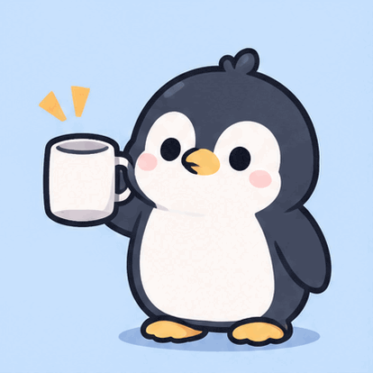

<sub>9 帧 · 414×414 · 1.6s · gpt-image-2.6 · 生成于 2026-11-12</sub>

**提示词**

```text
A sleepy penguin holds up an empty mug, shakes it upside down, and droops with heavy eyelids. Simple flat sticker style, plain pale blue background.
```

`sticker` `penguin` `coffee`

### 53. 暴躁猫猫狂敲键盘

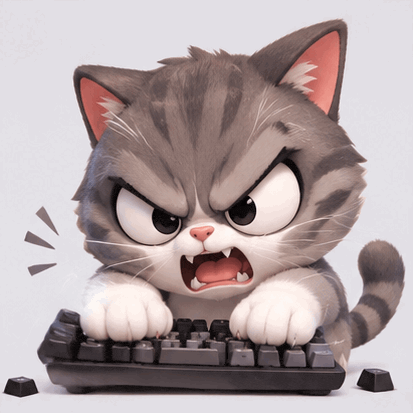

<sub>9 帧 · 413×413 · 1.3s · gpt-image-2.6 · 生成于 2026-11-12</sub>

**提示词**

```text
An angry gray cat with a furrowed brow mashes a tiny keyboard with both paws, little key caps flying off with each hit. Bold cartoon sticker, plain light gray background.
```

`sticker` `cat` `work`

### 54. 摸头融化的兔子


<sub>9 帧 · 437×386 · 1.6s · gpt-image-2.6 · 生成于 2026-11-12</sub>

**提示词**

```text
A small white bunny receives gentle pats from a hand entering the frame and slowly melts into a happy flat puddle with closed eyes. Pastel sticker style, plain lilac background.
```

`sticker` `bunny` `cute`

### 55. 青蛙敬礼收到

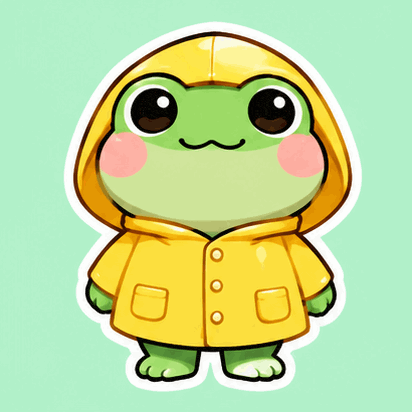

<sub>9 帧 · 412×412 · 1.4s · gpt-image-2.6 · 生成于 2026-11-12</sub>

**提示词**

```text
A round green frog in a tiny yellow raincoat stands up straight and gives a crisp salute, its cheeks puffing proudly. Chunky cartoon sticker, thick white outline, plain mint background.
```

`sticker` `frog` `ok`

### 56. 刺猬害羞缩成球


<sub>9 帧 · 439×390 · 1.6s · gpt-image-2.6 · 生成于 2026-11-12</sub>

**提示词**

```text
A tiny brown hedgehog with pink cheeks hears a compliment, blushes bright red and curls up into a spiky ball, then peeks out with one eye. Soft kawaii sticker style, plain cream background.
```

`sticker` `hedgehog` `shy`

### 57. 卡通鲨鱼挥鳍打招呼

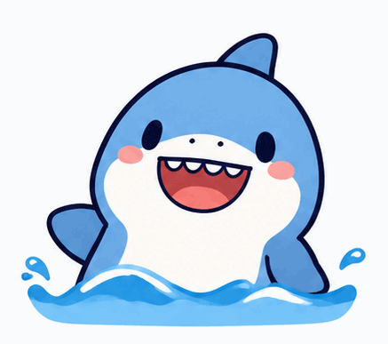

<sub>9 帧 · 437×387 · 1.4s · gpt-image-2.6 · 生成于 2026-11-12</sub>

**提示词**

```text
A chubby light-blue cartoon shark pops halfway out of a tiny wave, waves one fin hello and grins showing round teeth. Flat colors, thick outlines, plain white background.
```

`sticker` `shark` `hello`

### 58. 鲸鱼喷水打招呼


<sub>16 帧 · 380×252 · 2.9s · gpt-image-2.6 · 生成于 2026-11-11</sub>

**提示词**

```text
a chubby baby blue whale bobs on small waves and puffs a water spout shaped like a heart from its blowhole, then smiles. Flat pastel style, plain aqua background.
```

`sticker` `whale` `hello`

### 59. 松鼠抛橡果

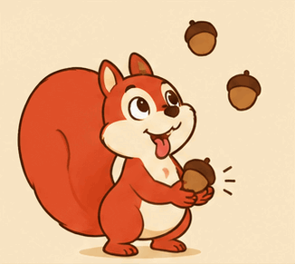

<sub>16 帧 · 326×291 · 1.9s · gpt-image-2.6 · 生成于 2026-11-11</sub>

**提示词**

```text
a red cartoon squirrel with a huge fluffy tail juggles three acorns in an arc, tongue out in concentration. Flat colors, thick outlines, plain warm beige background.
```

`sticker` `squirrel` `fun`

### 60. 小羊鞠躬道歉


<sub>16 帧 · 322×293 · 2.2s · gpt-image-2.6 · 生成于 2026-11-11</sub>

**提示词**

```text
a fluffy cartoon lamb with a cloud-like wool coat presses its hooves together and bows deeply, a small sweat drop and a pink heart appearing above. Soft pastel flat style, plain lavender background.
```

`sticker` `apology` `lamb`

### 61. 兔子啃胡萝卜

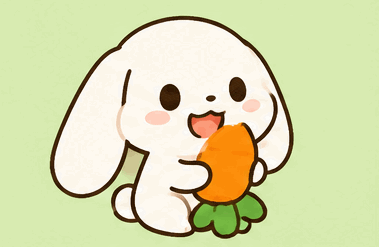

<sub>16 帧 · 379×247 · 1.6s · gpt-image-2.6 · 生成于 2026-11-11</sub>

**提示词**

```text
a white cartoon bunny with floppy ears holds a big carrot and munches quickly, cheeks bouncing, small orange crumbs flying off. Flat colors, plain pale green background.
```

`sticker` `bunny` `food`

### 62. 倒挂蝙蝠晚安


<sub>9 帧 · 430×391 · 2.0s · gpt-image-2.6 · 生成于 2026-11-11</sub>

**提示词**

```text
a fluffy little purple bat hangs upside down from a branch, wraps its wings around itself and sways gently while a small crescent moon and Zzz float nearby. Kawaii flat style, plain midnight blue background.
```

`sticker` `goodnight` `bat`

### 63. 慢吞吞点赞


<sub>9 帧 · 437×386 · 2.7s · gpt-image-2.6 · 生成于 2026-11-11</sub>

**提示词**

```text
a sleepy green cartoon turtle in a tiny knit cap very slowly raises one flipper into a thumbs-up and gives a lazy smile. Flat pastel colors, thick outlines, plain light peach background.
```

`sticker` `turtle` `approval`

### 64. 狐狸打翻咖啡


<sub>9 帧 · 413×412 · 1.3s · gpt-image-2.6 · 生成于 2026-11-11</sub>

**提示词**

```text
a cartoon orange fox in a green hoodie bumps a coffee cup, the coffee splashes up, and the fox freezes with a wide-eyed oops face and paws on its cheeks. Flat sticker style, plain cream background.
```

`sticker` `fox` `oops`

### 65. 企鹅肚皮滑


<sub>12 帧 · 356×357 · 1.7s · gpt-image-2.6 · 生成于 2026-11-11</sub>

**提示词**

```text
a round cartoon penguin with a tiny red beanie slides on its belly across a patch of ice, flaps its flippers happily and gives a little wave. Flat colors, thick outlines, plain icy blue background.
```

`sticker` `penguin` `winter`

### 66. 心情切换小方块

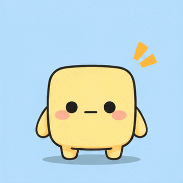

<sub>12 帧 · 358×358 · 2.6s · gpt-image-2.6 · 生成于 2026-11-11</sub>

**提示词**

```text
a cute pastel yellow cube character with stubby legs stands still and switches expressions: a grumpy frown with a small storm cloud, then a big grin with sparkles. Kawaii flat style, plain light blue background.
```

`sticker` `emotion` `reaction`

### 67. 毛绒熊喝可可


<sub>9 帧 · 439×390 · 1.6s · gpt-image-2.6 · 生成于 2026-11-11</sub>

**提示词**

```text
a soft plush teddy bear with visible fabric texture and stitched seams holds a big mug with both paws, takes a slow sip, and closes its eyes contentedly as steam curls up. Cozy warm lighting, plain oatmeal background.
```

`sticker` `plush` `cozy`

### 68. 牛油果吓一跳


<sub>9 帧 · 436×390 · 1.4s · gpt-image-2.6 · 生成于 2026-11-11</sub>

**提示词**

```text
a cartoon avocado half with a big seed belly and tiny arms leaps up in surprise, eyes wide and mouth open, a speech bubble reading OMG! popping beside it. Bold outlines, flat colors, plain white background.
```

`sticker` `food` `text`

### 69. 截止日火烧仓鼠


<sub>9 帧 · 433×395 · 1.4s · gpt-image-2.6 · 生成于 2026-11-11</sub>

**提示词**

```text
a tiny golden hamster in round glasses types furiously on a little keyboard while a cartoon flame burns on top of its head and sweat drops fly off. White sticker border, flat colors, plain pale yellow background.
```

`sticker` `deadline` `work`

### 70. 工位伸懒腰


<sub>16 帧 · 379×252 · 2.9s · gpt-image-2.6 · 生成于 2026-11-11</sub>

**提示词**

```text
a chibi office worker with messy hair types fast on a laptop, then leans back and stretches both arms high with a big yawn before returning to typing. Flat pastel illustration, plain light gray background.
```

`sticker` `office` `work`

### 71. 片尾挥手


<sub>9 帧 · 500×332 · 1.4s · gpt-image-2.6 · 生成于 2026-11-11</sub>

**提示词**

```text
a friendly cartoon robot with a round screen face showing a smile stands on the right side of a plain coral background, waves one hand and points to a blank rounded rectangle on the left where a red bell icon gives a little shake. Flat vector style.
```

`creator` `video` `mascot`

### 72. 嘴上不要手很诚实


<sub>9 帧 · 438×389 · 1.6s · gpt-image-2.6 · 生成于 2026-11-11</sub>

**提示词**

```text
a round cartoon panda in a red padded jacket shakes its head and waves one paw in polite refusal, while its other paw quietly slips a red envelope into its jacket pocket. Flat sticker style, plain cream background, thick outlines.
```

`sticker` `lunar-new-year` `holiday`

### 73. 跨年倒数睡着了


<sub>9 帧 · 439×390 · 2.0s · gpt-image-2.6 · 生成于 2026-11-11</sub>

**提示词**

```text
a chibi kid in pajamas and a party hat sits on a sofa holding a tiny noisemaker; a wall clock shows one minute to midnight. The kid's head nods down slowly, jerks back up, then nods again with a floating Zzz. Cozy flat illustration, warm lamp light.
```

`sticker` `new-year` `holiday`

### 74. 平安果层层拆开


<sub>16 帧 · 378×242 · 2.9s · gpt-image-2.6 · 生成于 2026-11-11</sub>

**提示词**

```text
a cute cartoon red apple wrapped in a shiny gift wrapper with a green ribbon, on a plain mint background. Small hands pull off the wrapper, revealing another wrapper underneath, and the apple gives a puzzled blink. Flat sticker style, thick outlines.
```

`sticker` `christmas` `holiday`

### 75. 打工熊：下班冲刺


<sub>9 帧 · 435×388 · 1.3s · gpt-image-2.6 · 生成于 2026-11-11</sub>

**提示词**

```text
a chubby cartoon brown bear office worker in a loose blue tie and a lanyard badge, round ears, small dot eyes, thick clean outlines, flat pastel colors, plain cream background. With a backpack on, the bear jogs in place with fast little legs, speed lines streaming behind and its tie flapping over its shoulder.
```

`sticker` `bear` `series` `office`

### 76. 打工熊：发薪日大笑

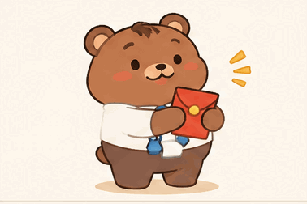

<sub>16 帧 · 378×252 · 2.6s · gpt-image-2.6 · 生成于 2026-11-11</sub>

**提示词**

```text
a chubby cartoon brown bear office worker in a loose blue tie and a lanyard badge, round ears, small dot eyes, thick clean outlines, flat pastel colors, plain cream background. The bear throws its head back laughing while hugging a fat envelope, small coins bouncing up around it.
```

`sticker` `bear` `series` `money`

### 77. 打工熊：又加班大哭


<sub>9 帧 · 414×412 · 1.6s · gpt-image-2.6 · 生成于 2026-11-11</sub>

**提示词**

```text
a chubby cartoon brown bear office worker in a loose blue tie and a lanyard badge, round ears, small dot eyes, thick clean outlines, flat pastel colors, plain cream background. At a desk piled with folders under a night-blue window, the bear opens its mouth wide and wails, two streams of tears spraying sideways.
```

`sticker` `bear` `series` `office`

### 78. 打工熊：摸鱼偷吃


<sub>12 帧 · 356×355 · 2.2s · gpt-image-2.6 · 生成于 2026-11-11</sub>

**提示词**

```text
a chubby cartoon brown bear office worker in a loose blue tie and a lanyard badge, round ears, small dot eyes, thick clean outlines, flat pastel colors, plain cream background. Hiding behind a laptop screen, the bear peeks left and right, then quickly pops a cookie into its mouth and chews with puffed cheeks.
```

`sticker` `bear` `series` `office`

### 79. 打工熊：已读翻白眼

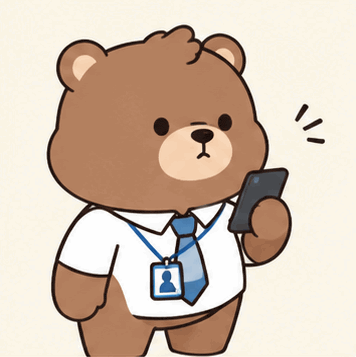

<sub>12 帧 · 356×357 · 1.9s · gpt-image-2.6 · 生成于 2026-11-11</sub>

**提示词**

```text
a chubby cartoon brown bear office worker in a loose blue tie and a lanyard badge, round ears, small dot eyes, thick clean outlines, flat pastel colors, plain cream background. The bear holds a phone, glances at it, then rolls its eyes up dramatically and lets the phone drop to its side.
```

`sticker` `bear` `series` `reaction`

### 80. 打工熊：周一叹气


<sub>9 帧 · 436×386 · 1.6s · gpt-image-2.6 · 生成于 2026-11-11</sub>

**提示词**

```text
a chubby cartoon brown bear office worker in a loose blue tie and a lanyard badge, round ears, small dot eyes, thick clean outlines, flat pastel colors, plain cream background. The bear slumps forward over a coffee mug, shoulders rising and falling with a long sigh, a small gray puff of breath drifting out.
```

`sticker` `bear` `series` `office`

### 81. 大鹅生气嘎嘎叫


<sub>16 帧 · 380×250 · 1.9s · gpt-image-2.6 · 生成于 2026-11-10</sub>

**提示词**

```text
A white goose stretches its neck forward, flaps its wings wide, and honks angrily with its beak open, a little cartoon anger mark above its head. Cartoon sticker style, plain light green background.
```

`sticker` `angry` `animal`

### 82. 饺子害羞捂脸

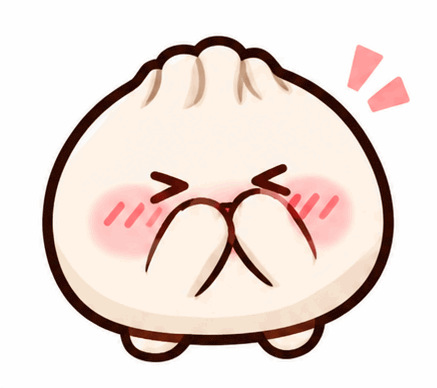

<sub>9 帧 · 437×388 · 1.6s · gpt-image-2.6 · 生成于 2026-11-10</sub>

**提示词**

```text
A plump steamed dumpling character covers its face with tiny hands, peeks out between them, and blushes bright pink. Kawaii sticker style, bold outline, plain white background.
```

`sticker` `shy` `food`

### 83. 豆腐冻得发抖


<sub>16 帧 · 324×295 · 1.9s · gpt-image-2.6 · 生成于 2026-11-10</sub>

**提示词**

```text
A soft white tofu block character wrapped in a tiny scarf shivers hard, teeth chattering, with a little icicle hanging from its edge and snowflakes drifting. Kawaii sticker style, plain icy blue background.
```

`sticker` `cold` `food`

### 84. 蘑菇猛点头


<sub>9 帧 · 412×413 · 1.4s · gpt-image-2.6 · 生成于 2026-11-10</sub>

**提示词**

```text
A small red-capped mushroom character with white spots nods enthusiastically, its cap bouncing up and down, cheeks blushing. Cute sticker style, plain mint background.
```

`sticker` `yes` `cute`

### 85. 鸭子丢麦克风


<sub>12 帧 · 356×356 · 1.9s · gpt-image-2.6 · 生成于 2026-11-10</sub>

**提示词**

```text
A white duck in sunglasses holds a tiny microphone out at wing's length, drops it, and turns away with a smug look. Cartoon sticker style, thick outline, plain yellow background.
```

`sticker` `smug` `reaction`

### 86. 章鱼同时敲四个键盘


<sub>9 帧 · 438×387 · 1.3s · gpt-image-2.6 · 生成于 2026-11-10</sub>

**提示词**

```text
A purple cartoon octopus wearing glasses types furiously on four keyboards at once, tentacles moving in turn, a tiny sweat drop flying off. Flat office-humor sticker style, plain white background.
```

`sticker` `work` `busy`

### 87. 小羊蓬起来打瞌睡


<sub>9 帧 · 414×413 · 1.6s · gpt-image-2.6 · 生成于 2026-11-10</sub>

**提示词**

```text
A round fluffy sheep slowly puffs up its wool like a cloud, its eyes droop closed, and small Z letters float up. Soft pastel sticker style, plain lilac background.
```

`sticker` `sleepy` `animal`

### 88. 小鸡弹跳登场


<sub>9 帧 · 432×393 · 1.3s · gpt-image-2.6 · 生成于 2026-11-10</sub>

**提示词**

```text
A fluffy yellow chick drops in from above, squashes flat on landing, springs back up, and strikes a proud pose with one wing raised. Squash-and-stretch cartoon style, plain white background.
```

`entrance` `sticker` `bounce`

### 89. 小法师操控悬浮光球


<sub>9 帧 · 433×387 · 1.4s · gpt-image-2.6 · 生成于 2026-11-10</sub>

**提示词**

```text
A young mage in a hooded blue cloak holds both palms apart while a glowing turquoise orb floats and slowly rotates between them, sparks circling. Anime-style illustration, dark gradient background.
```

`magic` `character` `glow`

### 90. 仙人掌看报纸


<sub>9 帧 · 439×390 · 1.6s · gpt-image-2.6 · 生成于 2026-11-10</sub>

**提示词**

```text
A green cactus character wearing a wide straw hat sits on a stool reading a newspaper, peeks over the top with raised eyebrows, then flips the page. Flat cartoon style, plain sandy background.
```

`sticker` `reading` `plant`

### 91. 小角萌娃转圈跳舞

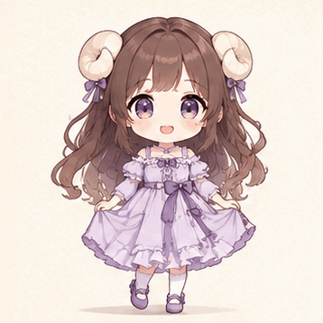

<sub>12 帧 · 358×358 · 1.9s · gpt-image-2.6 · 生成于 2026-11-10</sub>

**提示词**

```text
A chibi girl with small curled ivory horns, wearing a ruffled lavender gown, does a little twirl so the skirt flares out, then curtsies. Soft cel-shaded chibi style, plain cream background.
```

`dance` `chibi` `original-character`

### 92. 霓虹餐厅里吹爆泡泡糖


<sub>9 帧 · 435×386 · 2.0s · gpt-image-2.6 · 生成于 2026-11-10</sub>

**提示词**

```text
An illustrated girl in a retro neon diner booth at night slowly blows a big pink bubblegum bubble until it pops on her face. Pink and teal neon lighting, stylized illustration, fixed camera.
```

`reaction` `neon` `retro`

### 93. 穿轮滑鞋的小猴子

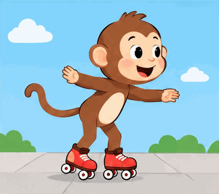

<sub>9 帧 · 439×390 · 1.4s · gpt-image-2.6 · 生成于 2026-11-10</sub>

**提示词**

```text
A cheerful cartoon monkey in red roller skates glides along a sidewalk, arms out for balance, its tail swaying behind. Bright flat illustration, simple sidewalk and plain sky background, side view.
```

`character` `skate` `animal`

### 94. 圆滚滚机器人听到好消息


<sub>16 帧 · 380×252 · 2.2s · gpt-image-2.6 · 生成于 2026-11-10</sub>

**提示词**

```text
A small round white robot with a screen face: its pixel eyes grow wide and sparkly, both little arms shoot up in celebration, then it returns to a neutral pose. High-contrast flat shapes, pale blue background.
```

`sticker` `celebrate` `robot`

### 95. 鸽子喷茶

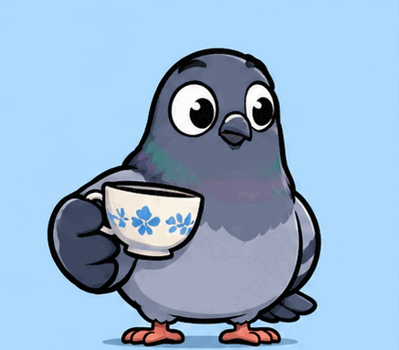

<sub>8 帧 · 437×383 · 1.1s · gpt-image-2.6 · 生成于 2026-11-10</sub>

**提示词**

```text
A gray city pigeon holding a tiny teacup takes a sip and sprays the tea out in a dramatic spit-take, eyes bulging. Cartoon sticker style, thick outline, plain light blue background.
```

`sticker` `reaction` `shock`

### 96. 兔子拿纸扇吐槽


<sub>9 帧 · 432×395 · 1.1s · gpt-image-2.6 · 生成于 2026-11-10</sub>

**提示词**

```text
A white rabbit in a tiny bow tie swings a folded paper fan sideways in a classic comedy retort gesture, mouth open mid-shout, with speed lines. Bold manga-comedy sticker style, plain white background.
```

`sticker` `reaction` `comedy`

### 97. 小熊踩香蕉皮滑倒

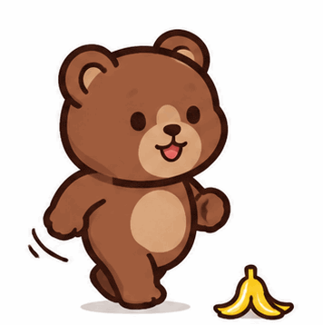

<sub>12 帧 · 356×358 · 1.9s · gpt-image-2.6 · 生成于 2026-11-10</sub>

**提示词**

```text
A round brown cartoon bear walks forward, steps on a banana peel, and flips onto its back with legs in the air and stars circling its head. Slapstick sticker style, thick outline, plain white background.
```

`sticker` `slapstick` `fail`

### 98. 猫耳卫衣女孩点头


<sub>9 帧 · 444×394 · 1.4s · gpt-image-2.6 · 生成于 2026-11-10</sub>

**提示词**

```text
A chibi girl in an oversized mint hoodie with cat ears on the hood nods eagerly twice, the ears flopping, eyes closed in a happy smile. Clean anime-inspired chibi sticker style, plain white background.
```

`sticker` `yes` `chibi`

### 99. 奶油泡芙伸懒腰打哈欠


<sub>9 帧 · 412×412 · 1.6s · gpt-image-2.6 · 生成于 2026-11-10</sub>

**提示词**

```text
A chubby cream puff character with tiny arms stretches upward and lets out a big yawn, a little cream squishing out of its top, then settles back down sleepily. Kawaii sticker style, bold outline, plain pale yellow background.
```

`sticker` `sleepy` `food`

### 100. 樱桃蛋糕帽小家伙挥手


<sub>9 帧 · 438×386 · 1.3s · gpt-image-2.6 · 生成于 2026-11-10</sub>

**提示词**

```text
A tiny round cream-colored creature wearing a little strawberry shortcake with a cherry on top as a hat. It waves one stubby arm and does a small happy bounce, the cherry wobbling. Soft pastel sticker style, thick outline, plain white background.
```

`sticker` `cute` `original-character`

### 101. 甩刘海的羊驼

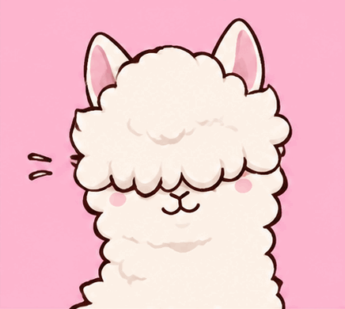

<sub>9 帧 · 436×390 · 1.3s · gpt-image-2.6 · 生成于 2026-11-09</sub>

**提示词**

```text
A fluffy white cartoon alpaca with a huge curly fringe tossing its head to flip the fringe out of its eyes, then posing with a confident wink. Thick outlines, flat colors, plain pink background.
```

`sticker` `sassy` `alpaca`

### 102. 吹蜡烛的巴哥犬

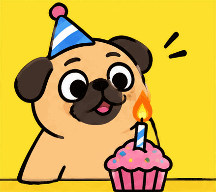

<sub>9 帧 · 439×390 · 1.6s · gpt-image-2.6 · 生成于 2026-11-09</sub>

**提示词**

```text
A pug in a striped party hat puffing its cheeks and blowing out a single candle on a pink cupcake, the flame going out and colorful confetti popping up. Thick outlines, flat colors, plain yellow background.
```

`sticker` `birthday` `dog`

### 103. 打喷嚏下雨的小云朵


<sub>9 帧 · 414×414 · 1.6s · gpt-image-2.6 · 生成于 2026-11-09</sub>

**提示词**

```text
A small fluffy white cloud character with rosy cheeks scrunching up its face and sneezing, a burst of raindrops and a tiny rainbow shooting out, then sniffling. Thick outlines, flat colors, plain sky-blue background.
```

`sticker` `weather` `cute`

### 104. 斜眼看人的猫头鹰


<sub>9 帧 · 439×389 · 2.0s · gpt-image-2.6 · 生成于 2026-11-09</sub>

**提示词**

```text
A round brown cartoon owl perched on a branch, slowly turning its eyes sideways toward the viewer and raising one feathery eyebrow in suspicion, then blinking once. Thick outlines, flat colors, plain teal background.
```

`sticker` `side-eye` `reaction`

### 105. 小短手鼓掌的恐龙


<sub>12 帧 · 358×358 · 1.7s · gpt-image-2.6 · 生成于 2026-11-09</sub>

**提示词**

```text
A chubby mint-green cartoon dinosaur trying hard to clap with its very short arms, the paws barely reaching, its face scrunched in effort, then a proud grin. Thick outlines, flat colors, plain peach background.
```

`sticker` `clap` `dinosaur`

### 106. 从纸箱里探出头炫宝的浣熊


<sub>16 帧 · 380×251 · 2.2s · gpt-image-2.6 · 生成于 2026-11-09</sub>

**提示词**

```text
A grey cartoon raccoon popping up out of a cardboard box holding a shiny silver spoon high above its head, eyes sparkling proudly, a little gleam flashing on the spoon. Thick outlines, flat colors, plain orange background.
```

`sticker` `proud` `raccoon`

### 107. 乌龟：在路上了

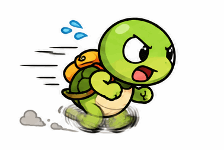

<sub>16 帧 · 378×253 · 1.8s · gpt-image-2.6 · 生成于 2026-11-09</sub>

**提示词**

```text
A green cartoon tortoise with a tiny backpack running as fast as it can, legs spinning in a blur with speed lines and sweat drops, but barely moving forward. Thick outlines, flat colors, plain white background.
```

`sticker` `late` `funny`

### 108. 戴大耳机摇头晃脑的小鸭


<sub>16 帧 · 308×309 · 1.9s · gpt-image-2.6 · 生成于 2026-11-09</sub>

**提示词**

```text
A fluffy yellow duckling wearing oversized purple headphones, eyes closed, bobbing its head and tapping one foot to the beat, small music notes floating around. Thick outlines, flat colors, plain lilac background.
```

`sticker` `music` `duck`

### 109. 被咖啡惊醒的考拉


<sub>16 帧 · 378×246 · 2.9s · gpt-image-2.6 · 生成于 2026-11-09</sub>

**提示词**

```text
A sleepy grey cartoon koala hugging a giant mug, nodding off until its nose dips into the coffee, then jolting wide awake with spiky fur. Thick outlines, flat colors, plain soft green background.
```

`sticker` `coffee` `sleepy`

### 110. 水豚：泡温泉

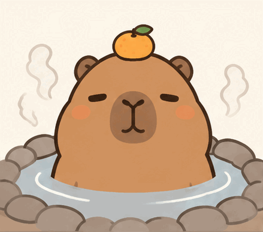

<sub>9 帧 · 439×387 · 2.0s · gpt-image-2.6 · 生成于 2026-11-09</sub>

**提示词**

```text
a round brown cartoon capybara with a small orange yuzu balanced on its head, sleepy half-closed eyes and a calm smile, thick clean outlines, flat pastel colors, plain cream background. The capybara sits up to its chin in a small round hot spring, steam curling up, eyes closing in bliss as it sinks slightly lower.
```

`sticker` `capybara` `series`

### 111. 水豚：加油

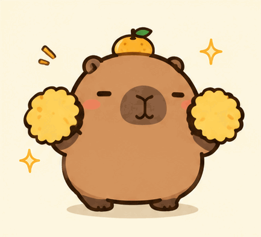

<sub>9 帧 · 433×393 · 1.4s · gpt-image-2.6 · 生成于 2026-11-09</sub>

**提示词**

```text
a round brown cartoon capybara with a small orange yuzu balanced on its head, sleepy half-closed eyes and a calm smile, thick clean outlines, flat pastel colors, plain cream background. The capybara waves two tiny pom-poms above its head and bounces, small sparkles popping around it.
```

`sticker` `capybara` `series`

### 112. 水豚：困到点头


<sub>9 帧 · 435×387 · 1.6s · gpt-image-2.6 · 生成于 2026-11-09</sub>

**提示词**

```text
a round brown cartoon capybara with a small orange yuzu balanced on its head, sleepy half-closed eyes and a calm smile, thick clean outlines, flat pastel colors, plain cream background. The capybara's head slowly droops forward as it dozes off, then jerks back up, the yuzu nearly falling off.
```

`sticker` `capybara` `series`

### 113. 水豚：好的

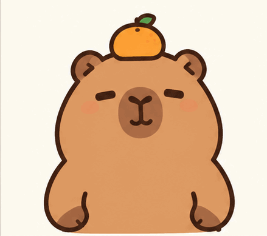

<sub>8 帧 · 439×389 · 1.4s · gpt-image-2.6 · 生成于 2026-11-09</sub>

**提示词**

```text
a round brown cartoon capybara with a small orange yuzu balanced on its head, sleepy half-closed eyes and a calm smile, thick clean outlines, flat pastel colors, plain cream background. The capybara slowly raises one stubby paw into an OK sign and nods once, the yuzu wobbling on its head.
```

> 💡 **技巧：** 四条水豚共用一模一样的角色描述，整套才能保持一致。

`sticker` `capybara` `series`

### 114. 虎斑猫猛地回头


<sub>9 帧 · 439×390 · 1.6s · gpt-image-2.6 · 生成于 2026-11-09</sub>

**提示词**

```text
A calm orange tabby cat sitting sideways, then suddenly turning toward the viewer: its eyes go huge, ears shoot up, mouth drops open, then it settles back to calm. Clean cartoon style, plain pale yellow background.
```

`sticker` `cat` `shocked`

### 115. 舒芙蕾塌了哭着吃掉


<sub>9 帧 · 439×390 · 2.0s · gpt-image-2.6 · 生成于 2026-11-09</sub>

**提示词**

```text
A chibi baker girl in a white apron pulling a tall souffle out of the oven, the souffle sinking flat, her eyes filling with tears, then she shrugs and takes a spoonful. Soft pastel cartoon, plain warm beige background.
```

> 💡 **技巧：** 四个节拍（拿出、塌掉、哭、吃）正好放进 6 帧；节拍再多，每一步都会变得模糊。

`sticker` `baking` `chibi`

### 116. 周一瘫在桌前的胖橘猫


<sub>16 帧 · 309×306 · 2.9s · gpt-image-2.6 · 生成于 2026-11-09</sub>

**提示词**

```text
A chubby orange cat wearing a navy necktie slumping over a laptop, sinking lower and lower until it disappears behind the desk, then popping back up with a tired face. The word "MONDAY." printed above in bold letters. Thick outlines, flat colors, plain white background.
```

`sticker` `office` `monday` `text`

### 117. 得意地摆手说不用了的浣熊


<sub>9 帧 · 437×386 · 1.4s · gpt-image-2.6 · 生成于 2026-11-09</sub>

**提示词**

```text
A smug cartoon raccoon in pink heart-shaped sunglasses lounging in a beach chair, sipping a juice box and lazily waving one paw in a "no thanks" gesture, eyebrows raised. Thick outlines, flat colors, plain sky-blue background.
```

`sticker` `smug` `reaction`

### 118. 邮件太多，默默合上电脑


<sub>9 帧 · 436×390 · 1.6s · gpt-image-2.6 · 生成于 2026-11-09</sub>

**提示词**

```text
A cartoon office worker with round glasses opening a laptop, the screen showing a red badge with a huge unread count, their face going pale, then slowly closing the laptop again. Exaggerated expressions, thick outlines, flat colors, plain light grey background.
```

`sticker` `office` `email`

### 119. 耸肩的原始人


<sub>9 帧 · 439×387 · 1.6s · gpt-image-2.6 · 生成于 2026-11-09</sub>

**提示词**

```text
A stocky cartoon caveman with a wild orange beard, a bone hair clip and a spotted fur tunic shrugging with both palms up and an unimpressed face, eyebrows bouncing once. Thick outlines, flat colors, plain sand-colored background.
```

`sticker` `shrug` `reaction`

### 120. 抱着烤红薯的小刺猬


<sub>9 帧 · 439×390 · 1.4s · gpt-image-2.6 · 生成于 2026-11-09</sub>

**提示词**

```text
A tiny cartoon hedgehog hugging a roasted sweet potato almost as big as itself, steam rising from the cracked skin, the hedgehog taking a happy nibble and wiggling. Crayon doodle style on plain off-white paper.
```

`sticker` `food` `doodle`

### 121. 靠着靠垫休息的熊猫


<sub>9 帧 · 438×390 · 2.7s · gpt-image-2.6 · 生成于 2026-11-09</sub>

**提示词**

```text
A chubby cartoon panda leaning back on a big round yellow cushion, slowly closing its eyes and letting out a long relaxed sigh, a small "zzz" drifting up. Soft watercolor texture, gentle outlines, plain cream background.
```

`sticker` `rest` `panda`

### 122. 文件找回后喜极而泣的小虾


<sub>9 帧 · 432×394 · 1.6s · gpt-image-2.6 · 生成于 2026-11-09</sub>

**提示词**

```text
A small pink cartoon shrimp in a tiny office lanyard hugging a glowing blue folder icon to its chest, crying tears of relief and bouncing up and down with joy. Thick outlines, flat colors, plain white background.
```

`sticker` `office` `relief`

### 123. 举牌道谢的水獭


<sub>9 帧 · 438×389 · 1.6s · gpt-image-2.6 · 生成于 2026-11-09</sub>

**提示词**

```text
A small brown cartoon otter holding up a little wooden sign that reads "THANK YOU", bowing forward and popping back up with a happy squint, tiny hearts floating above. Thick outlines, flat colors, plain mint background.
```

> 💡 **技巧：** 引号里的短词一般能保持清晰，仍要逐帧检查有没有字母走样。

`sticker` `thanks` `text`

### 124. 90 年代动画风害羞脸红

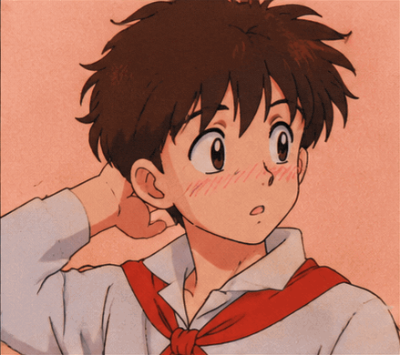

<sub>9 帧 · 439×390 · 1.4s · gpt-image-2.6 · 生成于 2026-11-09</sub>

**提示词**

```text
A 1990s cel-animation style boy with messy brown hair and a red scarf blushing: pink hatched lines spread across his cheeks, he looks away and scratches the back of his head. Soft film grain, VHS-era color palette, plain peach background.
```

`anime` `retro` `reaction`

### 125. 90 年代动画风倒吸一口气


<sub>9 帧 · 433×395 · 1.6s · gpt-image-2.6 · 生成于 2026-11-09</sub>

**提示词**

```text
A 1990s cel-animation style girl with two long auburn braids, a band of freckles across her nose, round glasses and a green denim jacket gasping in shock: her eyes go wide behind the glasses, a big sweat drop appears beside her head, then her shoulders drop. Soft film grain, VHS-era color palette, plain lavender background.
```

> 💡 **技巧：** 写明年代和画法（赛璐珞、胶片颗粒、VHS 色调），角色外观保持通用，避免被画成某部现成动画的角色。

`anime` `retro` `reaction`

### 126. 在地上打滚大哭的兔子


<sub>9 帧 · 439×390 · 1.3s · gpt-image-2.6 · 生成于 2026-11-09</sub>

**提示词**

```text
A chubby cream-colored cartoon bunny lying on its back on the floor, kicking its little legs and rolling side to side while sobbing, big cartoon tears flying off both sides. Thick outlines, flat colors, plain pale pink background.
```

`sticker` `crying` `bunny`

### 127. 青蛙跳水坑


<sub>16 帧 · 378×245 · 2.2s · gpt-image-2.6 · 生成于 2026-11-08</sub>

**提示词**

```text
A small green frog in a red raincoat leaping into a puddle, water splashing up in a crown, then giving a happy little wave. Bright cartoon style on a white background.
```

`sticker` `rain` `frog`

### 128. 树懒喝咖啡醒了


<sub>16 帧 · 384×262 · 2.9s · gpt-image-2.6 · 生成于 2026-11-08</sub>

**提示词**

```text
A sleepy sloth hanging from a branch slowly sipping coffee from a tiny cup, then its eyes pop wide open with sparkles. Soft cartoon sticker on a white background.
```

`sticker` `coffee` `morning`

### 129. 六角恐龙吹泡泡

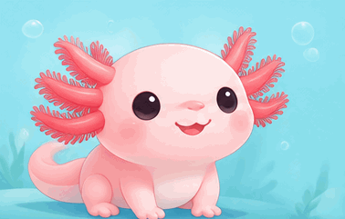

<sub>16 帧 · 378×241 · 2.2s · gpt-image-2.6 · 生成于 2026-11-08</sub>

**提示词**

```text
A pink axolotl with frilly gills puffing its cheeks to blow a round bubble that grows, pops, and leaves it blinking in surprise. Soft cartoon style, light aqua background.
```

`sticker` `water` `cute`

### 130. 想要抱抱的仙人掌


<sub>9 帧 · 409×414 · 1.6s · gpt-image-2.6 · 生成于 2026-11-08</sub>

**提示词**

```text
A small potted cactus character opening its spiky arms wide for a hug, then looking down at its spines and drooping sadly. Flat cute illustration on a white background.
```

`sticker` `hug` `sad`

### 131. 吐司弹出吓一跳

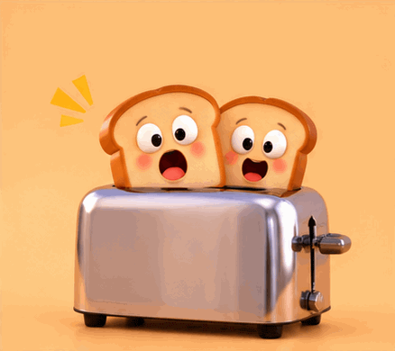

<sub>9 帧 · 438×390 · 1.4s · gpt-image-2.6 · 生成于 2026-11-08</sub>

**提示词**

```text
Two slices of toast with cartoon faces popping out of a chrome toaster, flipping in the air with surprised expressions, then dropping back in. Glossy 3D cartoon on a pale orange background.
```

`sticker` `food` `surprise`

### 132. 蜗牛送信

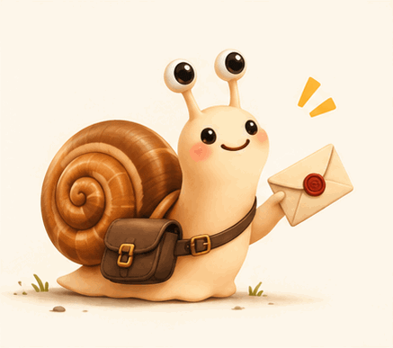

<sub>9 帧 · 437×387 · 1.6s · gpt-image-2.6 · 生成于 2026-11-08</sub>

**提示词**

```text
A small snail with a tiny leather postbag slowly sliding forward and holding out an envelope with its antennae, smiling proudly. Soft storybook illustration on a cream background.
```

`sticker` `mail` `slow`

### 133. 麻薯团子说 OK


<sub>9 帧 · 414×414 · 1.6s · gpt-image-2.6 · 生成于 2026-11-08</sub>

**提示词**

```text
A round white mochi character with tiny arms bowing politely and then popping up holding an "OK!" sign, cheeks blushing. LINE-sticker style with thick outlines on a white background.
```

`sticker` `caption` `ok`

### 134. 雨衣小孩起跳落地


<sub>9 帧 · 431×394 · 1.4s · gpt-image-2.6 · 生成于 2026-11-08</sub>

**提示词**

```text
A chibi kid in a yellow raincoat crouching down, springing into a high jump with arms up, then landing with a little puff of dust. Side view, flat animation style on a white background.
```

`sticker` `jump` `character`

### 135. 戴花环的猫跳舞

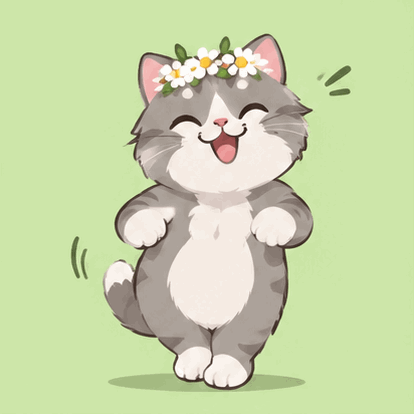

<sub>9 帧 · 414×414 · 1.3s · gpt-image-2.6 · 生成于 2026-11-08</sub>

**提示词**

```text
A grey cat wearing a crown of small daisies doing a happy side-step dance on its hind legs, front paws swinging. Flat cute illustration on a light green background.
```

`sticker` `cat` `dance`

### 136. 白猫滚毛线球

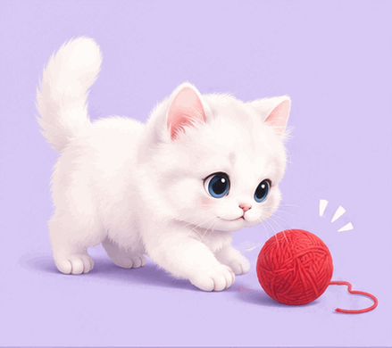

<sub>9 帧 · 439×390 · 1.4s · gpt-image-2.6 · 生成于 2026-11-08</sub>

**提示词**

```text
A fluffy white kitten batting a red yarn ball, rolling onto its back with the ball in its paws, then popping back upright. Soft pastel cartoon on a pale lavender background.
```

`sticker` `cat` `play`

### 137. 戏精贵宾犬晕倒


<sub>9 帧 · 439×390 · 1.4s · gpt-image-2.6 · 生成于 2026-11-08</sub>

**提示词**

```text
A white poodle mascot striking a dramatic pose, pressing a paw to its forehead and swooning backward onto a red velvet cushion. Exaggerated theatrical cartoon on a cream background.
```

`sticker` `drama` `dog`

### 138. 柯基讨零食


<sub>9 帧 · 412×412 · 1.4s · gpt-image-2.6 · 生成于 2026-11-08</sub>

**提示词**

```text
A fluffy corgi mascot staring up at a treat just above its head, drooling, wiggling its round butt and doing a little hop. Cute vector sticker on a white background.
```

`sticker` `dog` `food`

### 139. 纸箱机器人霹雳舞

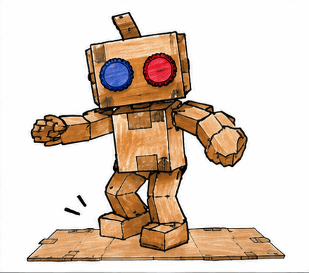

<sub>9 帧 · 440×388 · 1.6s · gpt-image-2.6 · 生成于 2026-11-08</sub>

**提示词**

```text
A robot made from cardboard boxes with bottle-cap eyes doing a breakdance toprock step, then dropping into a one-hand freeze on a flattened cardboard mat. Hand-drawn marker style on white paper.
```

`sticker` `dance` `robot`

### 140. 戴礼帽的奶奶


<sub>9 帧 · 437×390 · 1.6s · gpt-image-2.6 · 生成于 2026-11-08</sub>

**提示词**

```text
A cheerful cartoon grandma in a big floral Sunday hat and a pearl necklace clapping and swaying side to side to music, eyes closed in joy. Warm flat illustration on a soft pink background.
```

`sticker` `joy` `character`

### 141. 仓鼠快递员


<sub>9 帧 · 433×388 · 1.4s · gpt-image-2.6 · 生成于 2026-11-08</sub>

**提示词**

```text
A small golden hamster in a tiny brown courier cap pushing a cardboard parcel twice its size across the floor, cheeks puffed with effort and feet scrabbling. Cozy cartoon sticker on a white background.
```

`sticker` `work` `hamster`

### 142. 奶牛猫扑逗猫棒


<sub>9 帧 · 390×439 · 1.3s · gpt-image-2.6 · 生成于 2026-11-08</sub>

**提示词**

```text
A simple black-and-white anime-style tuxedo cat sitting up and swatting at a foxtail grass toy dangling from above, ears flattened, tail twitching. Clean line art on a white background.
```

`sticker` `cat` `monochrome`

### 143. 柴犬被雪球砸脸


<sub>9 帧 · 439×381 · 1.4s · gpt-image-2.6 · 生成于 2026-11-08</sub>

**提示词**

```text
A shiba inu in a red knitted winter hat standing in the snow gets hit in the face by a snowball, snow bursting everywhere, then blinks and shakes its head. Cartoon sticker style on a pale blue background.
```

`sticker` `winter` `funny`

### 144. 柴犬：在改了在改了


<sub>9 帧 · 436×388 · 1.3s · gpt-image-2.6 · 生成于 2026-11-08</sub>

**提示词**

```text
A cream shiba inu at a desk typing furiously on a keyboard with both paws, sweat drops flying off its head, with the handwritten caption "在改了在改了" fixed at the top. Flat sticker style on a white background.
```

`sticker` `caption` `work`

### 145. 小海豹：比心


<sub>9 帧 · 435×388 · 1.6s · gpt-image-2.6 · 生成于 2026-11-08</sub>

**提示词**

```text
a chubby white baby harp seal with big glossy black eyes, pink cheeks and a tiny blue scarf lifting both flippers together over its head to form a clear heart shape, then small pink hearts float up. Flat chat-sticker style on a white background.
```

> 💡 **技巧：** 双手比心经常合不拢，要写明两只鳍在头顶碰在一起。

`sticker` `seal` `love`

### 146. 小海豹：大哭


<sub>9 帧 · 431×393 · 1.4s · gpt-image-2.6 · 生成于 2026-11-08</sub>

**提示词**

```text
a chubby white baby harp seal with big glossy black eyes, pink cheeks and a tiny blue scarf bawling with its mouth wide open, two streams of tears spraying out sideways, flippers flapping. Flat chat-sticker style on a white background.
```

> 💡 **技巧：** 做成套表情时，每条都复用完全相同的角色描述。

`sticker` `seal` `cry`

### 147. 小海豹：摆烂

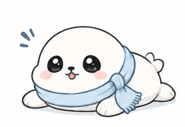

<sub>16 帧 · 376×259 · 2.9s · gpt-image-2.6 · 生成于 2026-11-08</sub>

**提示词**

```text
a chubby white baby harp seal with big glossy black eyes, pink cheeks and a tiny blue scarf lying flat on its belly and slowly melting into a puddle-like blob, then sighing a tiny cloud. Flat chat-sticker style on a white background.
```

> 💡 **技巧：** 做成套表情时，每条都复用完全相同的角色描述。

`sticker` `seal` `lazy`

### 148. 小海豹：偷笑


<sub>8 帧 · 439×390 · 1.2s · gpt-image-2.6 · 生成于 2026-11-08</sub>

**提示词**

```text
a chubby white baby harp seal with big glossy black eyes, pink cheeks and a tiny blue scarf covering its mouth with one flipper and giggling, shoulders shaking and eyes curved into happy arcs. Flat chat-sticker style on a white background.
```

> 💡 **技巧：** 做成套表情时，每条都复用完全相同的角色描述。

`sticker` `seal` `laugh`

### 149. 小海豹：震惊


<sub>9 帧 · 439×388 · 1.4s · gpt-image-2.6 · 生成于 2026-11-08</sub>

**提示词**

```text
a chubby white baby harp seal with big glossy black eyes, pink cheeks and a tiny blue scarf jolting backward in shock, eyes popping wide and whiskers standing straight out, with a small burst of exclamation lines. Flat chat-sticker style on a white background.
```

> 💡 **技巧：** 做成套表情时，每条都复用完全相同的角色描述。

`sticker` `seal` `shock`

### 150. 西瓜头小狗刷手机


<sub>9 帧 · 435×391 · 1.6s · gpt-image-2.6 · 生成于 2026-11-08</sub>

**提示词**

```text
A small dog with a perfectly round bowl-cut hairstyle lying on its belly, scrolling a smartphone with one paw and snorting with laughter at the screen. Cute cartoon style on a white background.
```

`sticker` `phone` `dog`

### 151. 领结大猩猩摇摆舞

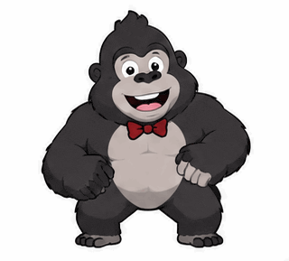

<sub>16 帧 · 320×289 · 1.9s · gpt-image-2.6 · 生成于 2026-11-08</sub>

**提示词**

```text
A chunky cartoon gorilla wearing a tiny red bow tie doing a side-to-side shuffle dance, swinging its long arms and bobbing its head to the beat. Flat vector sticker on a white background.
```

`sticker` `dance` `animal`

### 152. 螳螂虾戳布丁


<sub>9 帧 · 414×414 · 1.6s · gpt-image-2.6 · 生成于 2026-11-08</sub>

**提示词**

```text
A rainbow-colored cartoon mantis shrimp poking a caramel flan on a plate with both front claws, the flan wobbling wildly while the shrimp's eyes sparkle with delight. Glossy clay-toy style on a pale yellow background.
```

`sticker` `food` `funny`

### 153. 感激涕零的小虾


<sub>9 帧 · 439×389 · 1.6s · gpt-image-2.6 · 生成于 2026-11-07</sub>

**提示词**

```text
A small pink cartoon shrimp pressing its claws together, raising them high over its head and then bowing dramatically low, with the caption "THANK YOU!" fixed at the bottom. Flat sticker style on a white background.
```

`sticker` `caption` `thanks`

### 154. 戴 VR 眼镜打瞌睡的猫


<sub>16 帧 · 328×291 · 2.9s · gpt-image-2.6 · 生成于 2026-11-07</sub>

**提示词**

```text
A fluffy grey cat wearing a sleek white VR headset slowly nodding off, its head drooping and jerking back up, a small Zzz bubble floating up. Soft 3D render on a plain lavender background.
```

`sticker` `cat` `tech`

### 155. 健身熊推胸


<sub>9 帧 · 433×395 · 1.4s · gpt-image-2.6 · 生成于 2026-11-07</sub>

**提示词**

```text
A muscular cartoon brown bear in a red tank top lying on a bench and pressing a barbell up and down, cheeks puffing with each rep. Bold cartoon sticker style on a plain grey background.
```

`sticker` `fitness` `bear`

### 156. 撑伞小黄鸭


<sub>16 帧 · 380×252 · 2.2s · gpt-image-2.6 · 生成于 2026-11-07</sub>

**提示词**

```text
A yellow duckling holding a tiny red umbrella hopping in a small puddle, splashes rising with each hop while rain falls. Soft watercolor sticker style.
```

`sticker` `duck` `rain`

### 157. 仓鼠塞满腮帮子


<sub>9 帧 · 433×395 · 1.6s · gpt-image-2.6 · 生成于 2026-11-07</sub>

**提示词**

```text
A golden hamster sitting up and stuffing sunflower seeds into its cheeks until they balloon comically, then blinking proudly. Cute cartoon style on a plain white background.
```

`sticker` `hamster` `food`

### 158. 小机器人挥手蹦跳


<sub>9 帧 · 440×388 · 1.4s · gpt-image-2.6 · 生成于 2026-11-07</sub>

**提示词**

```text
A tiny round white baby robot with a glowing blue face screen and stubby legs waving one hand and doing a small happy hop, its antenna wobbling. Clean 3D toy style on a plain pastel background.
```

`sticker` `robot` `hello`

### 159. 骑扫把飞行的猫

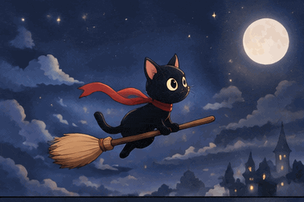

<sub>16 帧 · 378×252 · 2.2s · gpt-image-2.6 · 生成于 2026-11-07</sub>

**提示词**

```text
A black cat with a tiny red scarf riding a wooden broomstick across a night sky, bobbing up and down, the scarf fluttering behind it. Cute storybook sticker style.
```

`sticker` `cat` `magic`

### 160. 打工人：收到


<sub>9 帧 · 436×392 · 1.4s · gpt-image-2.6 · 生成于 2026-11-07</sub>

**提示词**

```text
A chibi office worker with a tidy bob and a lanyard snapping to attention and giving a firm thumbs-up with a determined nod. Flat sticker style on a plain light blue background.
```

`sticker` `office` `reply`

### 161. 围巾小水獭挥手

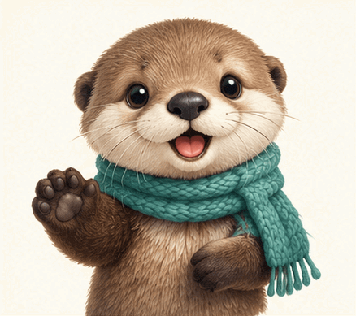

<sub>9 帧 · 438×389 · 1.6s · gpt-image-2.6 · 生成于 2026-11-07</sub>

**提示词**

```text
A small brown sea otter with a cream muzzle and a teal knitted scarf turning toward the viewer, waving one paw twice and blinking. Soft sticker style on a plain cream background.
```

`sticker` `otter` `hello`

### 162. 按下发送后慌了的企鹅


<sub>9 帧 · 435×390 · 1.4s · gpt-image-2.6 · 生成于 2026-11-07</sub>

**提示词**

```text
A small cartoon penguin slapping a big round red button labeled "SEND", then freezing as its eyes go wide and it grabs its head with both flippers in panic, sweat drops flying. Flat sticker style on a plain white background.
```

`sticker` `penguin` `reaction`

### 163. 深夜加班的龙虾


<sub>9 帧 · 437×388 · 1.4s · gpt-image-2.6 · 生成于 2026-11-07</sub>

**提示词**

```text
A red cartoon lobster wearing round glasses typing furiously on a keyboard with both claws at a desk late at night, lit by the blue glow of a monitor, a coffee mug steaming beside it. Cartoon sticker style.
```

`sticker` `work` `funny`

### 164. 橘猫揉面打喷嚏


<sub>9 帧 · 440×389 · 1.6s · gpt-image-2.6 · 生成于 2026-11-07</sub>

**提示词**

```text
An anthropomorphic orange cat in an apron kneading dough on a wooden counter, then sneezing and blowing a big white cloud of flour into the air. Warm cartoon style.
```

`sticker` `cat` `cooking`

### 165. 魔法学徒咒语失控


<sub>8 帧 · 439×388 · 1.3s · gpt-image-2.6 · 生成于 2026-11-07</sub>

**提示词**

```text
A chibi wizard apprentice in an oversized purple hat waves a wand, a small puff explodes in front of her, and she is left blinking with a soot-black face and frizzy hair. Cute cartoon sticker style on a plain lilac background.
```

`sticker` `magic` `fail`

### 166. 笑出眼泪的小团子

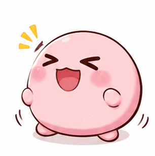

<sub>16 帧 · 306×307 · 2.2s · gpt-image-2.6 · 生成于 2026-11-07</sub>

**提示词**

```text
A round pink mochi blob character throwing its head back and laughing hysterically, tears spraying from its eyes, body shaking. Cute sticker style on a plain white background.
```

`sticker` `laugh` `reaction`

### 167. 橘猫扑向镜头


<sub>9 帧 · 433×395 · 1.6s · gpt-image-2.6 · 生成于 2026-11-07</sub>

**提示词**

```text
A chubby orange cat crouching, wiggling its rear, then leaping straight toward the viewer with paws spread wide until its face squishes against the glass. Funny cartoon style on a plain living room background.
```

`sticker` `cat` `funny`

### 168. 晚安喵

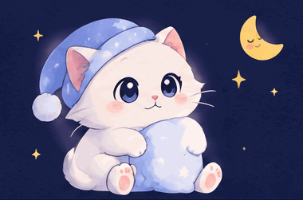

<sub>16 帧 · 380×251 · 2.9s · gpt-image-2.6 · 生成于 2026-11-07</sub>

**提示词**

```text
A sleepy white kitten in a blue nightcap hugging a small pillow, slowly yawning and then nodding off as a tiny crescent moon bobs beside it. Soft pastel sticker style on a dark navy background.
```

`sticker` `cat` `goodnight`

### 169. 小狗摇摆冒爱心


<sub>9 帧 · 437×389 · 1.6s · gpt-image-2.6 · 生成于 2026-11-07</sub>

**提示词**

```text
A fluffy cream-colored puppy sitting and swaying its head left and right with its eyes closed happily, small pink hearts floating up around it. Kawaii sticker style on a plain white background.
```

`sticker` `dog` `love`

### 170. 勤劳小蜜蜂打卡上班


<sub>9 帧 · 439×390 · 1.4s · gpt-image-2.6 · 生成于 2026-11-07</sub>

**提示词**

```text
A round fuzzy cartoon bee with a tiny lanyard badge buzzing in place, wings fluttering fast, then giving a crisp salute. Soft flat sticker style on a plain mint background.
```

`sticker` `bee` `work`

### 171. 高礼帽青蛙驱散霉运


<sub>9 帧 · 438×390 · 1.4s · gpt-image-2.6 · 生成于 2026-11-07</sub>

**提示词**

```text
A small green frog in a tall black top hat and a monocle waving a tiny cane in circles as if shooing away bad luck, little grey smoke puffs scattering. Cute storybook sticker style on a cream background.
```

`sticker` `frog` `reaction`

### 172. 戴墨镜的猫跳舞


<sub>12 帧 · 356×357 · 1.4s · gpt-image-2.6 · 生成于 2026-11-07</sub>

**提示词**

```text
A cool grey cat wearing tiny black sunglasses doing a side-to-side groove dance, hips swaying and one paw pointing up then down. Bold cartoon sticker style on a plain yellow background.
```

`sticker` `cat` `dance`

### 173. Q 版上班族看股价暴涨


<sub>9 帧 · 414×410 · 1.4s · gpt-image-2.6 · 生成于 2026-11-07</sub>

**提示词**

```text
A chibi office worker in a white shirt and loose tie jumping up from his chair as a green stock line shoots upward on his laptop, throwing paper banknotes into the air with both hands. Flat pastel sticker style on a plain light background.
```

`sticker` `office` `finance`

### 174. Q 版上班族看股价暴跌


<sub>9 帧 · 438×388 · 1.4s · gpt-image-2.6 · 生成于 2026-11-07</sub>

**提示词**

```text
A chibi office worker in a white shirt and loose tie staring at a laptop where a red stock line plunges, his hopeful smile crumbling into big wobbling tears. Flat pastel sticker style on a plain light background.
```

`sticker` `office` `finance`

### 175. 咆哮的小黄鸭

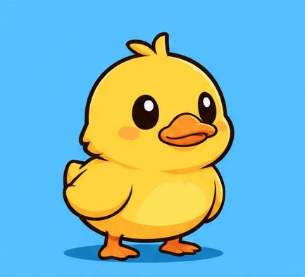

<sub>9 帧 · 433×394 · 1.6s · gpt-image-2.6 · 生成于 2026-11-06</sub>

**提示词**

```text
A small round yellow duck suddenly opening its beak wide and roaring like a lion, feathers blown back, the screen shaking slightly, then it calmly closes its beak. Cute cartoon sticker style, bold outline, plain sky-blue background.
```

`sticker` `reaction` `funny`

### 176. 打工猫：下班啦


<sub>16 帧 · 374×249 · 2.6s · gpt-image-2.6 · 生成于 2026-11-06</sub>

**提示词**

```text
A chubby orange tabby cat office worker with a tiny blue tie and an employee badge tosses its badge in the air, grabs a tiny backpack and does a happy little hop toward the door, tail swishing. Flat cartoon sticker style, bold outline, plain pale yellow background.
```

`sticker` `work` `sticker-pack`

### 177. 打工猫：累瘫


<sub>9 帧 · 438×387 · 1.6s · gpt-image-2.6 · 生成于 2026-11-06</sub>

**提示词**

```text
A chubby orange tabby cat office worker with a tiny blue tie and an employee badge slumps face-down onto a pile of papers on its desk, ears drooping, a tiny ghost of a sigh floating up, then twitches one paw. Flat cartoon sticker style, bold outline, plain pale grey background.
```

> 💡 **技巧：** 成套表情：角色描述一字不改，只换动作，真实上架的表情包都是这样保持一致的。

`sticker` `work` `sticker-pack`

### 178. 黑猫出拳

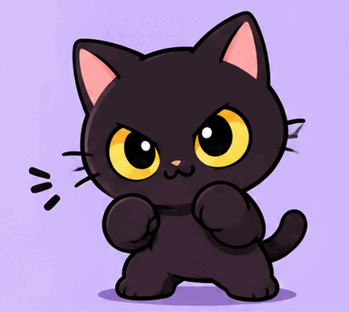

<sub>9 帧 · 437×390 · 1.3s · gpt-image-2.6 · 生成于 2026-11-06</sub>

**提示词**

```text
A round black cat with big yellow eyes throwing a quick one-two punch toward the viewer with its front paws, little impact stars popping, then settling back into a boxing stance. Chibi sticker style, bold outline, plain pastel purple background.
```

`sticker` `reaction` `cat`

### 179. 猫厨师颠勺炒饭


<sub>16 帧 · 323×295 · 1.9s · gpt-image-2.6 · 生成于 2026-11-06</sub>

**提示词**

```text
A white cat chef in a tall chef hat tossing fried rice in a wok, the rice flies up in a little arc and lands back in the pan, a puff of steam rising each time. Comic cartoon style, warm kitchen background kept still.
```

`sticker` `food` `cat`

### 180. 投篮命中庆祝

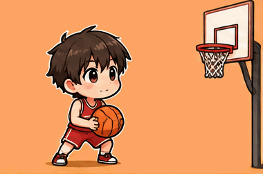

<sub>16 帧 · 380×251 · 1.9s · gpt-image-2.6 · 生成于 2026-11-06</sub>

**提示词**

```text
A chibi kid in a red jersey jumps and shoots a basketball, the ball swishes through the hoop, then the kid lands and pumps a fist in celebration before returning to the starting pose. Bold-outline sticker style, plain light orange background.
```

> 💡 **技巧：** 运动类动作拆成三个清楚的节拍（起跳、出手、庆祝）。360 度踢板这类复杂花式目前仍容易失败。

`sticker` `sports` `celebration`

### 181. 企鹅捂脸


<sub>9 帧 · 435×389 · 1.4s · gpt-image-2.6 · 生成于 2026-11-06</sub>

**提示词**

```text
A chubby cartoon penguin slowly raising one flipper and slapping it onto its forehead, then shaking its head in disbelief. Chibi sticker style, bold outline, plain light grey background.
```

`sticker` `reaction` `facepalm`

### 182. 青蛙吹出爱心


<sub>16 帧 · 380×252 · 2.2s · gpt-image-2.6 · 生成于 2026-11-06</sub>

**提示词**

```text
A round green cartoon frog puffing its cheeks and blowing a pink heart-shaped bubble that floats up and pops into tiny sparkles. Cute flat sticker style, bold outline, plain cream background.
```

`sticker` `love` `cute`

### 183. 猫猫疯狂打字


<sub>16 帧 · 380×242 · 1.9s · gpt-image-2.6 · 生成于 2026-11-06</sub>

**提示词**

```text
A grey tabby cat sitting at a tiny laptop and typing furiously with both front paws, paws blurring, little speed lines and sweat drops flying off. Flat cartoon sticker style, bold outline, plain pale pink background.
```

> 💡 **技巧：** 速度线和汗珠能让快速动作在帧数很少时也看得清。

`sticker` `work` `cat`

### 184. 柴犬歪头疑惑


<sub>9 帧 · 439×390 · 1.6s · gpt-image-2.6 · 生成于 2026-11-06</sub>

**提示词**

```text
A fluffy orange shiba inu puppy tilting its head to one side and back again, ears twitching, a small question mark popping above its head. Chibi sticker style, bold outline, plain light blue background.
```

`sticker` `reaction` `dog`

### 185. 卡通猫挥手打招呼


<sub>9 帧 · 438×390 · 1.3s · gpt-image-2.6 · 生成于 2026-11-05</sub>

**提示词**

```text
A cheerful cartoon cat waving hello.
```

> 💡 **技巧：** 简单的打招呼动作，一句话提示词也够用，风格和节奏交给模型。

`sticker` `greeting` `minimal-prompt`

### 186. 兔兔犯困


<sub>9 帧 · 439×387 · 1.6s · gpt-image-2.6 · 生成于 2026-11-06</sub>

**提示词**

```text
A small white cartoon bunny with long floppy ears and a pink nose, sitting and nodding off, head slowly drooping then jerking back up, a small bubble swelling and shrinking from its nose. Chibi sticker style, bold outline, plain warm yellow background.
```

`sticker` `reaction` `sticker-pack`

### 187. 兔兔笑出眼泪


<sub>8 帧 · 440×389 · 1.1s · gpt-image-2.6 · 生成于 2026-11-06</sub>

**提示词**

```text
A small white cartoon bunny with long floppy ears and a pink nose, laughing so hard it rocks back and forth, eyes squeezed shut and two little tears flying out. Chibi sticker style, bold outline, plain warm yellow background.
```

`sticker` `reaction` `sticker-pack`

### 188. 兔兔点赞


<sub>9 帧 · 438×388 · 1.3s · gpt-image-2.6 · 生成于 2026-11-06</sub>

**提示词**

```text
A small white cartoon bunny with long floppy ears and a pink nose, giving an enthusiastic thumbs-up with one paw, the paw pumping forward twice while the ears bounce. Chibi sticker style, bold outline, plain warm yellow background.
```

> 💡 **技巧：** 一整套表情包都复用同一段角色描述（见后面两条），风格才能保持一致。

`sticker` `reaction` `sticker-pack`

### 189. Q 弹果冻熊摇晃


<sub>9 帧 · 438×388 · 1.3s · gpt-image-2.6 · 生成于 2026-11-06</sub>

**提示词**

```text
A chubby round cartoon bear with a soft jelly-like body and stubby arms, squishing down and springing back up while wobbling side to side, cheeks jiggling on every bounce. Thick clean outlines, flat pastel colors, centered on a plain solid mint-green background that contrasts strongly with the bear.
```

> 💡 **技巧：** 背景用一种和角色颜色完全拉开的纯色，之后才方便抠成透明贴纸。

`sticker` `bouncy` `cute`

[← README](../README_zh.md)
